# Oyster performance report: cloud-2026-11-07T11-53-12-946Z

Requests travel from the CF runner through the CF router over HTTPS to the provider. End-to-end measurements include TLS and CF router costs; native and Oyster pairs share this path. These measurements do not isolate handler costs at microsecond precision.

351 measured runs are recorded. Tables retain all observations; findings and charts exclude failed, skipped, blocked and limit-probe runs.

## Findings

| Question | Comparison | Matched workload | Pairs | Mean delta (ms) | Mean paired delta (%) | Delta SD (ms) | Evidence row | Oyster handlers |
| --- | --- | --- | --- | --- | --- | --- | --- | --- |
| Native handler overhead | native-empty minus oyster-idle | operation=create; table=WriteRows; rows=10; iterations=100; callbacks=1; access=service; hook=false; pageSize=1000; scanRows=10000; enrichment=batch; mixed=unavailable; readTable=unavailable; queryShape=page; offset=0; hookControl=false; actionContract=auto; scanCoordination=unavailable; wholeScanRows=unavailable; lookupPattern=unavailable; validationOutcome=unavailable; transport=http; phase=warm; load=vus:1 | 3 | 0.1 | 0.721 | 0.364 | F2 | unavailable |
| Native handler overhead | native-empty minus oyster-idle | operation=read; table=LargeRows; rows=1000; iterations=100; callbacks=1; access=service; hook=false; pageSize=1000; scanRows=10000; enrichment=batch; mixed=unavailable; readTable=unavailable; queryShape=page; offset=0; hookControl=false; actionContract=auto; scanCoordination=unavailable; wholeScanRows=unavailable; lookupPattern=unavailable; validationOutcome=unavailable; transport=http; phase=warm; load=vus:1 | 3 | 0.159 | 1.304 | 1.448 | F3 | unavailable |
| Native handler overhead | native-empty minus oyster-idle | operation=update; table=WriteRows; rows=10; iterations=100; callbacks=1; access=service; hook=false; pageSize=1000; scanRows=10000; enrichment=batch; mixed=unavailable; readTable=unavailable; queryShape=page; offset=0; hookControl=false; actionContract=auto; scanCoordination=unavailable; wholeScanRows=unavailable; lookupPattern=unavailable; validationOutcome=unavailable; transport=http; phase=warm; load=vus:1 | 3 | 0.094 | 1.113 | 1.518 | F4 | unavailable |
| Native handler overhead | native-empty minus oyster-idle | operation=read; table=SmallRows; rows=10; iterations=100; callbacks=1; access=service; hook=false; pageSize=1000; scanRows=10000; enrichment=batch; mixed=unavailable; readTable=unavailable; queryShape=page; offset=0; hookControl=false; actionContract=auto; scanCoordination=unavailable; wholeScanRows=unavailable; lookupPattern=unavailable; validationOutcome=unavailable; transport=http; phase=warm; load=vus:1 | 3 | 0.607 | 6.195 | 0.18 | F5 | unavailable |
| Native handler overhead | native-empty minus oyster-idle | operation=action; table=SmallRows; rows=10; iterations=100; callbacks=1; access=service; hook=false; pageSize=1000; scanRows=10000; enrichment=batch; mixed=unavailable; readTable=unavailable; queryShape=page; offset=0; hookControl=false; actionContract=auto; scanCoordination=unavailable; wholeScanRows=unavailable; lookupPattern=unavailable; validationOutcome=unavailable; transport=http; phase=warm; load=vus:1 | 3 | -0.366 | -10.931 | 0.693 | F6 | unavailable |
| Native handler overhead | native-empty minus oyster-idle | operation=read; table=LargeRows; rows=10; iterations=100; callbacks=1; access=service; hook=false; pageSize=1000; scanRows=10000; enrichment=batch; mixed=unavailable; readTable=unavailable; queryShape=page; offset=0; hookControl=false; actionContract=auto; scanCoordination=unavailable; wholeScanRows=unavailable; lookupPattern=unavailable; validationOutcome=unavailable; transport=http; phase=warm; load=vus:1 | 3 | -0.102 | -0.32 | 1.362 | F7 | unavailable |
| Total empty sandbox path | wasm-empty minus oyster-idle | operation=create; table=WriteRows; rows=10; iterations=100; callbacks=1; access=service; hook=false; pageSize=1000; scanRows=10000; enrichment=batch; mixed=unavailable; readTable=unavailable; queryShape=page; offset=0; hookControl=false; actionContract=auto; scanCoordination=unavailable; wholeScanRows=unavailable; lookupPattern=unavailable; validationOutcome=unavailable; transport=http; phase=warm; load=vus:1 | 3 | 2.051 | 13.905 | 1.56 | F8 | [wasm-empty](../../apps/extension/srv/BenchmarkService/OysterEmptyWriteRows/before-CREATE.js) |
| Total empty sandbox path | wasm-empty minus oyster-idle | operation=read; table=LargeRows; rows=1000; iterations=100; callbacks=1; access=service; hook=false; pageSize=1000; scanRows=10000; enrichment=batch; mixed=unavailable; readTable=unavailable; queryShape=page; offset=0; hookControl=false; actionContract=auto; scanCoordination=unavailable; wholeScanRows=unavailable; lookupPattern=unavailable; validationOutcome=unavailable; transport=http; phase=warm; load=vus:1 | 3 | 11.738 | 62.84 | 2.103 | F9 | [wasm-empty](../../apps/extension/srv/BenchmarkService/OysterEmptyLargeRows/after-READ.js) |
| Total empty sandbox path | wasm-empty minus oyster-idle | operation=update; table=WriteRows; rows=10; iterations=100; callbacks=1; access=service; hook=false; pageSize=1000; scanRows=10000; enrichment=batch; mixed=unavailable; readTable=unavailable; queryShape=page; offset=0; hookControl=false; actionContract=auto; scanCoordination=unavailable; wholeScanRows=unavailable; lookupPattern=unavailable; validationOutcome=unavailable; transport=http; phase=warm; load=vus:1 | 3 | 3.854 | 28.968 | 2.784 | F10 | [wasm-empty](../../apps/extension/srv/BenchmarkService/OysterEmptyWriteRows/before-UPDATE.js) |
| Total empty sandbox path | wasm-empty minus oyster-idle | operation=read; table=SmallRows; rows=10; iterations=100; callbacks=1; access=service; hook=false; pageSize=1000; scanRows=10000; enrichment=batch; mixed=unavailable; readTable=unavailable; queryShape=page; offset=0; hookControl=false; actionContract=auto; scanCoordination=unavailable; wholeScanRows=unavailable; lookupPattern=unavailable; validationOutcome=unavailable; transport=http; phase=warm; load=vus:1 | 3 | 3.127 | 32.007 | 0.268 | F11 | [wasm-empty](../../apps/extension/srv/BenchmarkService/OysterEmptySmallRows/after-READ.js) |
| Total empty sandbox path | wasm-empty minus oyster-idle | operation=action; table=SmallRows; rows=10; iterations=100; callbacks=1; access=service; hook=false; pageSize=1000; scanRows=10000; enrichment=batch; mixed=unavailable; readTable=unavailable; queryShape=page; offset=0; hookControl=false; actionContract=auto; scanCoordination=unavailable; wholeScanRows=unavailable; lookupPattern=unavailable; validationOutcome=unavailable; transport=http; phase=warm; load=vus:1 | 3 | 1.882 | 65.98 | 0.789 | F12 | [wasm-empty](../../apps/extension/srv/BenchmarkService/on-oysterNoop.js) |
| Total empty sandbox path | wasm-empty minus oyster-idle | operation=read; table=LargeRows; rows=10; iterations=100; callbacks=1; access=service; hook=false; pageSize=1000; scanRows=10000; enrichment=batch; mixed=unavailable; readTable=unavailable; queryShape=page; offset=0; hookControl=false; actionContract=auto; scanCoordination=unavailable; wholeScanRows=unavailable; lookupPattern=unavailable; validationOutcome=unavailable; transport=http; phase=warm; load=vus:1 | 3 | 3.638 | 40.868 | 1.636 | F13 | [wasm-empty](../../apps/extension/srv/BenchmarkService/OysterEmptyLargeRows/after-READ.js) |
| Sandbox path versus native handler | wasm-empty minus native-empty | operation=create; table=WriteRows; rows=10; iterations=100; callbacks=1; access=service; hook=false; pageSize=1000; scanRows=10000; enrichment=batch; mixed=unavailable; readTable=unavailable; queryShape=page; offset=0; hookControl=false; actionContract=auto; scanCoordination=unavailable; wholeScanRows=unavailable; lookupPattern=unavailable; validationOutcome=unavailable; transport=http; phase=warm; load=vus:1 | 3 | 1.951 | 13.123 | 1.594 | F14 | [wasm-empty](../../apps/extension/srv/BenchmarkService/OysterEmptyWriteRows/before-CREATE.js) |
| Sandbox path versus native handler | wasm-empty minus native-empty | operation=read; table=LargeRows; rows=1000; iterations=100; callbacks=1; access=service; hook=false; pageSize=1000; scanRows=10000; enrichment=batch; mixed=unavailable; readTable=unavailable; queryShape=page; offset=0; hookControl=false; actionContract=auto; scanCoordination=unavailable; wholeScanRows=unavailable; lookupPattern=unavailable; validationOutcome=unavailable; transport=http; phase=warm; load=vus:1 | 3 | 11.579 | 60.559 | 0.862 | F15 | [wasm-empty](../../apps/extension/srv/BenchmarkService/OysterEmptyLargeRows/after-READ.js) |
| Sandbox path versus native handler | wasm-empty minus native-empty | operation=action; table=SmallRows; rows=10; iterations=0; callbacks=1; access=service; hook=true; pageSize=1000; scanRows=10000; enrichment=batch; mixed=unavailable; readTable=unavailable; queryShape=page; offset=0; hookControl=false; actionContract=compute; scanCoordination=unavailable; wholeScanRows=unavailable; lookupPattern=unavailable; validationOutcome=unavailable; transport=http; phase=warm; load=vus:1 | 3 | 2.239 | 77.083 | 0.574 | F16 | [wasm-empty](../../apps/extension/srv/BenchmarkExtensionService/on-oysterEmpty.js) |
| Sandbox path versus native handler | wasm-empty minus native-empty | operation=update; table=WriteRows; rows=10; iterations=100; callbacks=1; access=service; hook=false; pageSize=1000; scanRows=10000; enrichment=batch; mixed=unavailable; readTable=unavailable; queryShape=page; offset=0; hookControl=false; actionContract=auto; scanCoordination=unavailable; wholeScanRows=unavailable; lookupPattern=unavailable; validationOutcome=unavailable; transport=http; phase=warm; load=vus:1 | 3 | 3.76 | 27.095 | 1.474 | F17 | [wasm-empty](../../apps/extension/srv/BenchmarkService/OysterEmptyWriteRows/before-UPDATE.js) |
| Sandbox path versus native handler | wasm-empty minus native-empty | operation=read; table=SmallRows; rows=10; iterations=100; callbacks=1; access=service; hook=false; pageSize=1000; scanRows=10000; enrichment=batch; mixed=unavailable; readTable=unavailable; queryShape=page; offset=0; hookControl=false; actionContract=auto; scanCoordination=unavailable; wholeScanRows=unavailable; lookupPattern=unavailable; validationOutcome=unavailable; transport=http; phase=warm; load=vus:1 | 3 | 2.52 | 24.303 | 0.102 | F18 | [wasm-empty](../../apps/extension/srv/BenchmarkService/OysterEmptySmallRows/after-READ.js) |
| Sandbox path versus native handler | wasm-empty minus native-empty | operation=action; table=SmallRows; rows=10; iterations=100; callbacks=1; access=service; hook=false; pageSize=1000; scanRows=10000; enrichment=batch; mixed=unavailable; readTable=unavailable; queryShape=page; offset=0; hookControl=false; actionContract=auto; scanCoordination=unavailable; wholeScanRows=unavailable; lookupPattern=unavailable; validationOutcome=unavailable; transport=http; phase=warm; load=vus:1 | 3 | 2.248 | 89.047 | 0.305 | F19 | [wasm-empty](../../apps/extension/srv/BenchmarkService/on-oysterNoop.js) |
| Sandbox path versus native handler | wasm-empty minus native-empty | operation=read; table=LargeRows; rows=10; iterations=100; callbacks=1; access=service; hook=false; pageSize=1000; scanRows=10000; enrichment=batch; mixed=unavailable; readTable=unavailable; queryShape=page; offset=0; hookControl=false; actionContract=auto; scanCoordination=unavailable; wholeScanRows=unavailable; lookupPattern=unavailable; validationOutcome=unavailable; transport=http; phase=warm; load=vus:1 | 3 | 3.74 | 41.323 | 0.296 | F20 | [wasm-empty](../../apps/extension/srv/BenchmarkService/OysterEmptyLargeRows/after-READ.js) |
| Execution-location penalty for CPU work | wasm-compute minus native-compute | operation=scan; table=LargeRows; rows=10; iterations=100; callbacks=1; access=service; hook=false; pageSize=1000; scanRows=50000; enrichment=batch; mixed=unavailable; readTable=unavailable; queryShape=page; offset=0; hookControl=false; actionContract=auto; scanCoordination=unavailable; wholeScanRows=unavailable; lookupPattern=unavailable; validationOutcome=unavailable; transport=http; phase=warm; load=vus:1 | 3 | 1199.064 | 227.671 | 91.586 | F21 | [wasm-compute](../../apps/extension/srv/BenchmarkService/on-oysterScan.js) |
| Execution-location penalty for CPU work | wasm-compute minus native-compute | operation=create; table=WriteRows; rows=10; iterations=100; callbacks=1; access=service; hook=false; pageSize=1000; scanRows=10000; enrichment=batch; mixed=unavailable; readTable=unavailable; queryShape=page; offset=0; hookControl=false; actionContract=auto; scanCoordination=unavailable; wholeScanRows=unavailable; lookupPattern=unavailable; validationOutcome=unavailable; transport=http; phase=warm; load=vus:1 | 3 | 3.425 | 23.222 | 0.338 | F22 | [wasm-compute](../../apps/extension/srv/BenchmarkService/OysterCalculationWriteRows/before-CREATE.js) |
| Execution-location penalty for CPU work | wasm-compute minus native-compute | operation=read; table=LargeRows; rows=1000; iterations=100; callbacks=1; access=service; hook=false; pageSize=1000; scanRows=10000; enrichment=batch; mixed=unavailable; readTable=unavailable; queryShape=page; offset=0; hookControl=false; actionContract=auto; scanCoordination=unavailable; wholeScanRows=unavailable; lookupPattern=unavailable; validationOutcome=unavailable; transport=http; phase=warm; load=vus:1 | 3 | 31.419 | 163.561 | 1.1 | F23 | [wasm-compute](../../apps/extension/srv/BenchmarkService/OysterCalculationLargeRows/after-READ.js) |
| Execution-location penalty for CPU work | wasm-compute minus native-compute | operation=update; table=WriteRows; rows=10; iterations=100; callbacks=1; access=service; hook=false; pageSize=1000; scanRows=10000; enrichment=batch; mixed=unavailable; readTable=unavailable; queryShape=page; offset=0; hookControl=false; actionContract=auto; scanCoordination=unavailable; wholeScanRows=unavailable; lookupPattern=unavailable; validationOutcome=unavailable; transport=http; phase=warm; load=vus:1 | 3 | 2.477 | 17.088 | 0.715 | F24 | [wasm-compute](../../apps/extension/srv/BenchmarkService/OysterCalculationWriteRows/before-UPDATE.js) |
| Execution-location penalty for CPU work | wasm-compute minus native-compute | operation=action; table=SmallRows; rows=10; iterations=100; callbacks=1; access=service; hook=false; pageSize=1000; scanRows=10000; enrichment=batch; mixed=unavailable; readTable=unavailable; queryShape=page; offset=0; hookControl=false; actionContract=auto; scanCoordination=unavailable; wholeScanRows=unavailable; lookupPattern=unavailable; validationOutcome=unavailable; transport=http; phase=warm; load=vus:1 | 3 | 2.656 | 90.712 | 0.319 | F25 | [wasm-compute](../../apps/extension/srv/BenchmarkService/on-oysterCalculation.js) |
| Execution-location penalty for CPU work | wasm-compute minus native-compute | operation=read; table=LargeRows; rows=10; iterations=100; callbacks=1; access=service; hook=false; pageSize=1000; scanRows=10000; enrichment=batch; mixed=unavailable; readTable=unavailable; queryShape=page; offset=0; hookControl=false; actionContract=auto; scanCoordination=unavailable; wholeScanRows=unavailable; lookupPattern=unavailable; validationOutcome=unavailable; transport=http; phase=warm; load=vus:1 | 3 | 3.15 | 32.076 | 0.497 | F26 | [wasm-compute](../../apps/extension/srv/BenchmarkService/OysterCalculationLargeRows/after-READ.js) |
| Execution-location penalty for CPU work | wasm-compute minus native-compute | operation=action; table=SmallRows; rows=10; iterations=10000; callbacks=1; access=service; hook=false; pageSize=1000; scanRows=10000; enrichment=batch; mixed=unavailable; readTable=unavailable; queryShape=page; offset=0; hookControl=false; actionContract=auto; scanCoordination=unavailable; wholeScanRows=unavailable; lookupPattern=unavailable; validationOutcome=unavailable; transport=http; phase=warm; load=vus:1 | 3 | 4.776 | 168.019 | 1.145 | F27 | [wasm-compute](../../apps/extension/srv/BenchmarkService/on-oysterCalculation.js) |
| Execution-location penalty for CPU work | wasm-compute minus native-compute | operation=scan; table=LargeRows; rows=10; iterations=100; callbacks=1; access=service; hook=false; pageSize=1000; scanRows=10000; enrichment=batch; mixed=unavailable; readTable=unavailable; queryShape=page; offset=0; hookControl=false; actionContract=auto; scanCoordination=unavailable; wholeScanRows=unavailable; lookupPattern=unavailable; validationOutcome=unavailable; transport=http; phase=warm; load=vus:1 | 3 | 225.148 | 207.171 | 9.59 | F28 | [wasm-compute](../../apps/extension/srv/BenchmarkService/on-oysterScan.js) |
| Execution-location penalty for CPU work | wasm-compute minus native-compute | operation=scan; table=LargeRows; rows=10; iterations=100; callbacks=1; access=service; hook=false; pageSize=1000; scanRows=50000; enrichment=batch; mixed=unavailable; readTable=unavailable; queryShape=page; offset=0; hookControl=false; actionContract=auto; scanCoordination=external; wholeScanRows=1000000; lookupPattern=unavailable; validationOutcome=unavailable; transport=http; phase=warm; load=vus:1 | 3 | 1187.636 | 241.242 | 27.592 | F29 | [wasm-compute](../../apps/extension/srv/BenchmarkService/on-oysterScan.js) |
| CPU plus auxiliary read path | wasm-compute-read minus native-compute-read | operation=action; table=SmallRows; rows=10; iterations=0; callbacks=1; access=service; hook=false; pageSize=1000; scanRows=10000; enrichment=batch; mixed=unavailable; readTable=unavailable; queryShape=page; offset=0; hookControl=false; actionContract=auto; scanCoordination=unavailable; wholeScanRows=unavailable; lookupPattern=unavailable; validationOutcome=unavailable; transport=http; phase=warm; load=vus:1 | 3 | 2.714 | 30.215 | 0.974 | F30 | [wasm-compute-read](../../apps/extension/srv/BenchmarkService/on-oysterCqlRead.js) |
| CPU plus auxiliary read path | wasm-compute-read minus native-compute-read | operation=update; table=WriteRows; rows=10; iterations=0; callbacks=1; access=service; hook=false; pageSize=1000; scanRows=10000; enrichment=batch; mixed=unavailable; readTable=unavailable; queryShape=page; offset=0; hookControl=false; actionContract=auto; scanCoordination=unavailable; wholeScanRows=unavailable; lookupPattern=unavailable; validationOutcome=unavailable; transport=http; phase=warm; load=vus:1 | 3 | 4.34 | 24.8 | 2.213 | F31 | [wasm-compute-read](../../apps/extension/srv/BenchmarkService/OysterCqlReadWriteRows/before-UPDATE.js) |
| CPU plus auxiliary read path | wasm-compute-read minus native-compute-read | operation=action; table=SmallRows; rows=10; iterations=0; callbacks=1; access=service; hook=true; pageSize=1000; scanRows=10000; enrichment=batch; mixed=unavailable; readTable=unavailable; queryShape=page; offset=0; hookControl=false; actionContract=compute; scanCoordination=unavailable; wholeScanRows=unavailable; lookupPattern=unavailable; validationOutcome=unavailable; transport=http; phase=warm; load=vus:1 | 3 | 5.343 | 64.794 | 2.937 | F32 | [wasm-compute-read](../../apps/extension/srv/BenchmarkExtensionService/on-oysterCqlRead.js) |
| CPU plus auxiliary read path | wasm-compute-read minus native-compute-read | operation=create; table=WriteRows; rows=10; iterations=0; callbacks=1; access=service; hook=false; pageSize=1000; scanRows=10000; enrichment=batch; mixed=unavailable; readTable=unavailable; queryShape=page; offset=0; hookControl=false; actionContract=auto; scanCoordination=unavailable; wholeScanRows=unavailable; lookupPattern=unavailable; validationOutcome=unavailable; transport=http; phase=warm; load=vus:1 | 3 | 4.133 | 24.365 | 0.974 | F33 | [wasm-compute-read](../../apps/extension/srv/BenchmarkService/OysterCqlReadWriteRows/before-CREATE.js) |
| CPU plus auxiliary read path | wasm-compute-read minus native-compute-read | operation=read; table=SmallRows; rows=10; iterations=0; callbacks=1; access=service; hook=false; pageSize=1000; scanRows=10000; enrichment=batch; mixed=true; readTable=unavailable; queryShape=page; offset=0; hookControl=false; actionContract=auto; scanCoordination=unavailable; wholeScanRows=unavailable; lookupPattern=unavailable; validationOutcome=unavailable; transport=http; phase=warm; load=vus:1 | 3 | 2.887 | 20.623 | 1.101 | F34 | [wasm-compute-read: READ](../../apps/extension/srv/BenchmarkService/OysterCqlReadSmallRows/after-READ.js), [wasm-compute-read: INSERT](../../apps/extension/srv/BenchmarkService/OysterCqlReadWriteRows/before-CREATE.js), [wasm-compute-read: UPDATE](../../apps/extension/srv/BenchmarkService/OysterCqlReadWriteRows/before-UPDATE.js), [wasm-compute-read: action](../../apps/extension/srv/BenchmarkService/on-oysterCqlRead.js) |
| CPU plus auxiliary read path | wasm-compute-read minus native-compute-read | operation=action; table=SmallRows; rows=10; iterations=0; callbacks=10; access=service; hook=false; pageSize=1000; scanRows=10000; enrichment=batch; mixed=unavailable; readTable=unavailable; queryShape=page; offset=0; hookControl=false; actionContract=auto; scanCoordination=unavailable; wholeScanRows=unavailable; lookupPattern=unavailable; validationOutcome=unavailable; transport=http; phase=warm; load=vus:1 | 3 | 7.384 | 21.494 | 1.322 | F35 | [wasm-compute-read](../../apps/extension/srv/BenchmarkService/on-oysterCqlRead.js) |
| CPU plus auxiliary read path | wasm-compute-read minus native-compute-read | operation=read; table=SmallRows; rows=10; iterations=0; callbacks=1; access=service; hook=false; pageSize=1000; scanRows=10000; enrichment=batch; mixed=unavailable; readTable=unavailable; queryShape=page; offset=0; hookControl=false; actionContract=auto; scanCoordination=unavailable; wholeScanRows=unavailable; lookupPattern=unavailable; validationOutcome=unavailable; transport=http; phase=warm; load=vus:1 | 3 | 3.199 | 25.783 | 1.276 | F36 | [wasm-compute-read](../../apps/extension/srv/BenchmarkService/OysterCqlReadSmallRows/after-READ.js) |
| CPU plus auxiliary read path | wasm-compute-read minus native-compute-read | operation=action; table=SmallRows; rows=10; iterations=0; callbacks=1; access=service; hook=false; pageSize=1000; scanRows=10000; enrichment=batch; mixed=unavailable; readTable=unavailable; queryShape=page; offset=0; hookControl=false; actionContract=auto; scanCoordination=unavailable; wholeScanRows=unavailable; lookupPattern=individual; validationOutcome=unavailable; transport=http; phase=warm; load=vus:1 | 3 | 7.52 | 22.855 | 2.404 | F37 | [wasm-compute-read](../../apps/extension/srv/BenchmarkService/on-oysterLookupIndividual.js) |
| CPU plus auxiliary read path | wasm-compute-read minus native-compute-read | operation=action; table=SmallRows; rows=10; iterations=0; callbacks=1; access=service; hook=false; pageSize=1000; scanRows=10000; enrichment=batch; mixed=unavailable; readTable=unavailable; queryShape=page; offset=0; hookControl=false; actionContract=auto; scanCoordination=unavailable; wholeScanRows=unavailable; lookupPattern=batch; validationOutcome=unavailable; transport=http; phase=warm; load=vus:1 | 3 | 3.551 | 36.305 | 1.264 | F38 | [wasm-compute-read](../../apps/extension/srv/BenchmarkService/on-oysterLookupBatch.js) |
| CPU plus auxiliary write path | wasm-compute-write minus native-compute-write | operation=action; table=SmallRows; rows=10; iterations=0; callbacks=1; access=service; hook=false; pageSize=1000; scanRows=10000; enrichment=batch; mixed=unavailable; readTable=unavailable; queryShape=page; offset=0; hookControl=false; actionContract=auto; scanCoordination=unavailable; wholeScanRows=unavailable; lookupPattern=unavailable; validationOutcome=unavailable; transport=http; phase=warm; load=vus:1 | 3 | 3.495 | 33.163 | 1.005 | F39 | [wasm-compute-write](../../apps/extension/srv/BenchmarkService/on-oysterCqlWrite.js) |
| CPU plus auxiliary write path | wasm-compute-write minus native-compute-write | operation=update; table=WriteRows; rows=10; iterations=0; callbacks=1; access=service; hook=false; pageSize=1000; scanRows=10000; enrichment=batch; mixed=unavailable; readTable=unavailable; queryShape=page; offset=0; hookControl=false; actionContract=auto; scanCoordination=unavailable; wholeScanRows=unavailable; lookupPattern=unavailable; validationOutcome=unavailable; transport=http; phase=warm; load=vus:1 | 3 | 2.491 | 15.03 | 1.53 | F40 | [wasm-compute-write](../../apps/extension/srv/BenchmarkService/OysterCqlWriteWriteRows/before-UPDATE.js) |
| CPU plus auxiliary write path | wasm-compute-write minus native-compute-write | operation=action; table=SmallRows; rows=10; iterations=0; callbacks=1; access=service; hook=true; pageSize=1000; scanRows=10000; enrichment=batch; mixed=unavailable; readTable=unavailable; queryShape=page; offset=0; hookControl=false; actionContract=compute; scanCoordination=unavailable; wholeScanRows=unavailable; lookupPattern=unavailable; validationOutcome=unavailable; transport=http; phase=warm; load=vus:1 | 3 | 2.712 | 23.536 | 0.701 | F41 | [wasm-compute-write](../../apps/extension/srv/BenchmarkExtensionService/on-oysterCqlWrite.js) |
| CPU plus auxiliary write path | wasm-compute-write minus native-compute-write | operation=create; table=WriteRows; rows=10; iterations=0; callbacks=1; access=service; hook=false; pageSize=1000; scanRows=10000; enrichment=batch; mixed=unavailable; readTable=unavailable; queryShape=page; offset=0; hookControl=false; actionContract=auto; scanCoordination=unavailable; wholeScanRows=unavailable; lookupPattern=unavailable; validationOutcome=unavailable; transport=http; phase=warm; load=vus:1 | 3 | 3.757 | 21.765 | 0.708 | F42 | [wasm-compute-write](../../apps/extension/srv/BenchmarkService/OysterCqlWriteWriteRows/before-CREATE.js) |
| CPU plus auxiliary write path | wasm-compute-write minus native-compute-write | operation=action; table=SmallRows; rows=10; iterations=0; callbacks=10; access=service; hook=false; pageSize=1000; scanRows=10000; enrichment=batch; mixed=unavailable; readTable=unavailable; queryShape=page; offset=0; hookControl=false; actionContract=auto; scanCoordination=unavailable; wholeScanRows=unavailable; lookupPattern=unavailable; validationOutcome=unavailable; transport=http; phase=warm; load=vus:1 | 3 | 6.033 | 18.186 | 0.524 | F43 | [wasm-compute-write](../../apps/extension/srv/BenchmarkService/on-oysterCqlWrite.js) |
| CPU plus auxiliary write path | wasm-compute-write minus native-compute-write | operation=read; table=SmallRows; rows=10; iterations=0; callbacks=1; access=service; hook=false; pageSize=1000; scanRows=10000; enrichment=batch; mixed=unavailable; readTable=unavailable; queryShape=page; offset=0; hookControl=false; actionContract=auto; scanCoordination=unavailable; wholeScanRows=unavailable; lookupPattern=unavailable; validationOutcome=unavailable; transport=http; phase=warm; load=vus:1 | 3 | 3.998 | 22.176 | 0.508 | F44 | [wasm-compute-write](../../apps/extension/srv/BenchmarkService/OysterCqlWriteSmallRows/after-READ.js) |
| Native auxiliary read increment | native-compute-read minus native-compute | Unanswered: no eligible matched warm low-load repetition tuples | 0 | unavailable | unavailable | unavailable | unavailable | unavailable |
| Native auxiliary write increment | native-compute-write minus native-compute | Unanswered: no eligible matched warm low-load repetition tuples | 0 | unavailable | unavailable | unavailable | unavailable | unavailable |
| Business constraint | wasm-validate minus native-validate | operation=update; table=WriteRows; rows=10; iterations=0; callbacks=1; access=service; hook=false; pageSize=1000; scanRows=10000; enrichment=batch; mixed=unavailable; readTable=unavailable; queryShape=page; offset=0; hookControl=false; actionContract=auto; scanCoordination=unavailable; wholeScanRows=unavailable; lookupPattern=unavailable; validationOutcome=accepted; transport=http; phase=warm; load=vus:1 | 3 | 1.679 | 11.691 | 0.684 | F50 | [wasm-validate](../../apps/extension/srv/BenchmarkService/OysterValidationWriteRows/before-UPDATE.js) |
| Business constraint | wasm-validate minus native-validate | operation=action; table=SmallRows; rows=10; iterations=0; callbacks=1; access=service; hook=false; pageSize=1000; scanRows=10000; enrichment=batch; mixed=unavailable; readTable=unavailable; queryShape=page; offset=0; hookControl=false; actionContract=auto; scanCoordination=unavailable; wholeScanRows=unavailable; lookupPattern=unavailable; validationOutcome=rejected; transport=http; phase=warm; load=vus:1 | 3 | 2.852 | 98.717 | 0.627 | F51 | [wasm-validate](../../apps/extension/srv/BenchmarkService/on-oysterValidation.js) |
| Business constraint | wasm-validate minus native-validate | operation=create; table=WriteRows; rows=10; iterations=0; callbacks=1; access=service; hook=false; pageSize=1000; scanRows=10000; enrichment=batch; mixed=unavailable; readTable=unavailable; queryShape=page; offset=0; hookControl=false; actionContract=auto; scanCoordination=unavailable; wholeScanRows=unavailable; lookupPattern=unavailable; validationOutcome=accepted; transport=http; phase=warm; load=vus:1 | 3 | 3.1 | 22.051 | 0.899 | F52 | [wasm-validate](../../apps/extension/srv/BenchmarkService/OysterValidationWriteRows/before-CREATE.js) |
| Business constraint | wasm-validate minus native-validate | operation=action; table=SmallRows; rows=10; iterations=0; callbacks=1; access=service; hook=true; pageSize=1000; scanRows=10000; enrichment=batch; mixed=unavailable; readTable=unavailable; queryShape=page; offset=0; hookControl=false; actionContract=auto; scanCoordination=unavailable; wholeScanRows=unavailable; lookupPattern=unavailable; validationOutcome=accepted; transport=http; phase=warm; load=vus:1 | 3 | 2.008 | 74.391 | 1.491 | F53 | [wasm-validate](../../apps/extension/srv/BenchmarkExtensionService/on-oysterValidation.js) |
| Business constraint | wasm-validate minus native-validate | operation=create; table=WriteRows; rows=10; iterations=0; callbacks=1; access=service; hook=false; pageSize=1000; scanRows=10000; enrichment=batch; mixed=unavailable; readTable=unavailable; queryShape=page; offset=0; hookControl=false; actionContract=auto; scanCoordination=unavailable; wholeScanRows=unavailable; lookupPattern=unavailable; validationOutcome=rejected; transport=http; phase=warm; load=vus:1 | 3 | 3.372 | 108.029 | 0.12 | F54 | [wasm-validate](../../apps/extension/srv/BenchmarkService/OysterValidationWriteRows/before-CREATE.js) |
| Business constraint | wasm-validate minus native-validate | operation=action; table=SmallRows; rows=10; iterations=0; callbacks=1; access=service; hook=true; pageSize=1000; scanRows=10000; enrichment=batch; mixed=unavailable; readTable=unavailable; queryShape=page; offset=0; hookControl=false; actionContract=auto; scanCoordination=unavailable; wholeScanRows=unavailable; lookupPattern=unavailable; validationOutcome=rejected; transport=http; phase=warm; load=vus:1 | 3 | 1.962 | 50.005 | 1.007 | F55 | [wasm-validate](../../apps/extension/srv/BenchmarkExtensionService/on-oysterValidation.js) |
| Business constraint | wasm-validate minus native-validate | operation=action; table=SmallRows; rows=10; iterations=0; callbacks=1; access=service; hook=false; pageSize=1000; scanRows=10000; enrichment=batch; mixed=unavailable; readTable=unavailable; queryShape=page; offset=0; hookControl=false; actionContract=auto; scanCoordination=unavailable; wholeScanRows=unavailable; lookupPattern=unavailable; validationOutcome=accepted; transport=http; phase=warm; load=vus:1 | 3 | 2.372 | 93.406 | 0.36 | F56 | [wasm-validate](../../apps/extension/srv/BenchmarkService/on-oysterValidation.js) |
| Business constraint | wasm-validate minus native-validate | operation=update; table=WriteRows; rows=10; iterations=0; callbacks=1; access=service; hook=false; pageSize=1000; scanRows=10000; enrichment=batch; mixed=unavailable; readTable=unavailable; queryShape=page; offset=0; hookControl=false; actionContract=auto; scanCoordination=unavailable; wholeScanRows=unavailable; lookupPattern=unavailable; validationOutcome=rejected; transport=http; phase=warm; load=vus:1 | 3 | 2.887 | 89.933 | 1.026 | F57 | [wasm-validate](../../apps/extension/srv/BenchmarkService/OysterValidationWriteRows/before-UPDATE.js) |
| Business constraint with one lookup | wasm-validate-read minus native-validate-read | operation=update; table=WriteRows; rows=10; iterations=0; callbacks=1; access=service; hook=false; pageSize=1000; scanRows=10000; enrichment=batch; mixed=unavailable; readTable=unavailable; queryShape=page; offset=0; hookControl=false; actionContract=auto; scanCoordination=unavailable; wholeScanRows=unavailable; lookupPattern=unavailable; validationOutcome=accepted; transport=http; phase=warm; load=vus:1 | 3 | 3.285 | 19.641 | 1.388 | F58 | [wasm-validate-read](../../apps/extension/srv/BenchmarkService/OysterValidationReadWriteRows/before-UPDATE.js) |
| Business constraint with one lookup | wasm-validate-read minus native-validate-read | operation=action; table=SmallRows; rows=10; iterations=0; callbacks=1; access=service; hook=false; pageSize=1000; scanRows=10000; enrichment=batch; mixed=unavailable; readTable=unavailable; queryShape=page; offset=0; hookControl=false; actionContract=auto; scanCoordination=unavailable; wholeScanRows=unavailable; lookupPattern=unavailable; validationOutcome=rejected; transport=http; phase=warm; load=vus:1 | 3 | 3.314 | 32.795 | 1.587 | F59 | [wasm-validate-read](../../apps/extension/srv/BenchmarkService/on-oysterValidationRead.js) |
| Business constraint with one lookup | wasm-validate-read minus native-validate-read | operation=create; table=WriteRows; rows=10; iterations=0; callbacks=1; access=service; hook=false; pageSize=1000; scanRows=10000; enrichment=batch; mixed=unavailable; readTable=unavailable; queryShape=page; offset=0; hookControl=false; actionContract=auto; scanCoordination=unavailable; wholeScanRows=unavailable; lookupPattern=unavailable; validationOutcome=accepted; transport=http; phase=warm; load=vus:1 | 3 | 2.065 | 11.886 | 1.217 | F60 | [wasm-validate-read](../../apps/extension/srv/BenchmarkService/OysterValidationReadWriteRows/before-CREATE.js) |
| Business constraint with one lookup | wasm-validate-read minus native-validate-read | operation=action; table=SmallRows; rows=10; iterations=0; callbacks=1; access=service; hook=true; pageSize=1000; scanRows=10000; enrichment=batch; mixed=unavailable; readTable=unavailable; queryShape=page; offset=0; hookControl=false; actionContract=auto; scanCoordination=unavailable; wholeScanRows=unavailable; lookupPattern=unavailable; validationOutcome=accepted; transport=http; phase=warm; load=vus:1 | 3 | 4.19 | 50.396 | 0.055 | F61 | [wasm-validate-read](../../apps/extension/srv/BenchmarkExtensionService/on-oysterValidationRead.js) |
| Business constraint with one lookup | wasm-validate-read minus native-validate-read | operation=create; table=WriteRows; rows=10; iterations=0; callbacks=1; access=service; hook=false; pageSize=1000; scanRows=10000; enrichment=batch; mixed=unavailable; readTable=unavailable; queryShape=page; offset=0; hookControl=false; actionContract=auto; scanCoordination=unavailable; wholeScanRows=unavailable; lookupPattern=unavailable; validationOutcome=rejected; transport=http; phase=warm; load=vus:1 | 3 | 2.426 | 24.072 | 0.801 | F62 | [wasm-validate-read](../../apps/extension/srv/BenchmarkService/OysterValidationReadWriteRows/before-CREATE.js) |
| Business constraint with one lookup | wasm-validate-read minus native-validate-read | operation=action; table=SmallRows; rows=10; iterations=0; callbacks=1; access=service; hook=true; pageSize=1000; scanRows=10000; enrichment=batch; mixed=unavailable; readTable=unavailable; queryShape=page; offset=0; hookControl=false; actionContract=auto; scanCoordination=unavailable; wholeScanRows=unavailable; lookupPattern=unavailable; validationOutcome=rejected; transport=http; phase=warm; load=vus:1 | 3 | 2.977 | 30.812 | 1.237 | F63 | [wasm-validate-read](../../apps/extension/srv/BenchmarkExtensionService/on-oysterValidationRead.js) |
| Business constraint with one lookup | wasm-validate-read minus native-validate-read | operation=action; table=SmallRows; rows=10; iterations=0; callbacks=1; access=service; hook=false; pageSize=1000; scanRows=10000; enrichment=batch; mixed=unavailable; readTable=unavailable; queryShape=page; offset=0; hookControl=false; actionContract=auto; scanCoordination=unavailable; wholeScanRows=unavailable; lookupPattern=unavailable; validationOutcome=accepted; transport=http; phase=warm; load=vus:1 | 3 | 2.821 | 29.435 | 0.479 | F64 | [wasm-validate-read](../../apps/extension/srv/BenchmarkService/on-oysterValidationRead.js) |
| Business constraint with one lookup | wasm-validate-read minus native-validate-read | operation=update; table=WriteRows; rows=10; iterations=0; callbacks=1; access=service; hook=false; pageSize=1000; scanRows=10000; enrichment=batch; mixed=unavailable; readTable=unavailable; queryShape=page; offset=0; hookControl=false; actionContract=auto; scanCoordination=unavailable; wholeScanRows=unavailable; lookupPattern=unavailable; validationOutcome=rejected; transport=http; phase=warm; load=vus:1 | 3 | 4.362 | 46.148 | 0.619 | F65 | [wasm-validate-read](../../apps/extension/srv/BenchmarkService/OysterValidationReadWriteRows/before-UPDATE.js) |
| Unimplemented hook routing | oyster-idle hook=true minus oyster-idle hook=false | operation=action; table=SmallRows; rows=10; iterations=100; callbacks=1; access=service; pageSize=1000; scanRows=10000; enrichment=batch; mixed=unavailable; readTable=unavailable; queryShape=page; offset=0; hookControl=true; actionContract=compute; scanCoordination=unavailable; wholeScanRows=unavailable; lookupPattern=unavailable; validationOutcome=unavailable; transport=http; phase=warm; load=vus:1 | 3 | -0.061 | -2.357 | 0.227 | F66 | unavailable |
| Native CPU handler overhead | native-compute minus native-empty | operation=create; table=WriteRows; rows=10; iterations=100; callbacks=1; access=service; hook=false; pageSize=1000; scanRows=10000; enrichment=batch; mixed=unavailable; readTable=unavailable; queryShape=page; offset=0; hookControl=false; actionContract=auto; scanCoordination=unavailable; wholeScanRows=unavailable; lookupPattern=unavailable; validationOutcome=unavailable; transport=http; phase=warm; load=vus:1 | 3 | -0.142 | -0.945 | 1.528 | F67 | unavailable |
| Native CPU handler overhead | native-compute minus native-empty | operation=read; table=LargeRows; rows=1000; iterations=100; callbacks=1; access=service; hook=false; pageSize=1000; scanRows=10000; enrichment=batch; mixed=unavailable; readTable=unavailable; queryShape=page; offset=0; hookControl=false; actionContract=auto; scanCoordination=unavailable; wholeScanRows=unavailable; lookupPattern=unavailable; validationOutcome=unavailable; transport=http; phase=warm; load=vus:1 | 3 | 0.116 | 0.538 | 1.13 | F68 | unavailable |
| Native CPU handler overhead | native-compute minus native-empty | operation=update; table=WriteRows; rows=10; iterations=100; callbacks=1; access=service; hook=false; pageSize=1000; scanRows=10000; enrichment=batch; mixed=unavailable; readTable=unavailable; queryShape=page; offset=0; hookControl=false; actionContract=auto; scanCoordination=unavailable; wholeScanRows=unavailable; lookupPattern=unavailable; validationOutcome=unavailable; transport=http; phase=warm; load=vus:1 | 3 | 1.026 | 7.712 | 1.236 | F69 | unavailable |
| Native CPU handler overhead | native-compute minus native-empty | operation=read; table=LargeRows; rows=10; iterations=100; callbacks=1; access=service; hook=false; pageSize=1000; scanRows=10000; enrichment=batch; mixed=unavailable; readTable=unavailable; queryShape=page; offset=0; hookControl=false; actionContract=auto; scanCoordination=unavailable; wholeScanRows=unavailable; lookupPattern=unavailable; validationOutcome=unavailable; transport=http; phase=warm; load=vus:1 | 3 | 0.85 | 9.864 | 1.004 | F70 | unavailable |
| Native service versus database read | native-compute-read access=service minus access=db | operation=action; table=SmallRows; rows=10; iterations=0; callbacks=1; hook=false; pageSize=1000; scanRows=10000; enrichment=batch; mixed=unavailable; readTable=unavailable; queryShape=page; offset=0; hookControl=false; actionContract=auto; scanCoordination=unavailable; wholeScanRows=unavailable; lookupPattern=unavailable; validationOutcome=unavailable; transport=http; phase=warm; load=vus:1 | 3 | 0.375 | 4.451 | 1.877 | F71 | unavailable |
| Native service versus database write | native-compute-write access=service minus access=db | operation=action; table=SmallRows; rows=10; iterations=0; callbacks=1; hook=false; pageSize=1000; scanRows=10000; enrichment=batch; mixed=unavailable; readTable=unavailable; queryShape=page; offset=0; hookControl=false; actionContract=auto; scanCoordination=unavailable; wholeScanRows=unavailable; lookupPattern=unavailable; validationOutcome=unavailable; transport=http; phase=warm; load=vus:1 | 3 | 0.044 | 0.972 | 0.812 | F72 | unavailable |
| Oyster versus direct database read | wasm-compute-read access=service minus native-compute-read access=db | operation=action; table=SmallRows; rows=10; iterations=0; callbacks=1; hook=false; pageSize=1000; scanRows=10000; enrichment=batch; mixed=unavailable; readTable=unavailable; queryShape=page; offset=0; hookControl=false; actionContract=auto; scanCoordination=unavailable; wholeScanRows=unavailable; lookupPattern=unavailable; validationOutcome=unavailable; transport=http; phase=warm; load=vus:1 | 3 | 3.088 | 33.93 | 1.019 | F76 | [wasm-compute-read](../../apps/extension/srv/BenchmarkService/on-oysterCqlRead.js) |
| Oyster versus direct database write | wasm-compute-write access=service minus native-compute-write access=db | operation=action; table=SmallRows; rows=10; iterations=0; callbacks=1; hook=false; pageSize=1000; scanRows=10000; enrichment=batch; mixed=unavailable; readTable=unavailable; queryShape=page; offset=0; hookControl=false; actionContract=auto; scanCoordination=unavailable; wholeScanRows=unavailable; lookupPattern=unavailable; validationOutcome=unavailable; transport=http; phase=warm; load=vus:1 | 3 | 3.539 | 34.069 | 0.481 | F77 | [wasm-compute-write](../../apps/extension/srv/BenchmarkService/on-oysterCqlWrite.js) |

Pairs use run means from the same independent repetition, operation, table, returned rows, computation iterations, nominal callback loop count, data-access path, hook, page size, scan rows, enrichment, mixed flag, read table, query shape, offset, hook control, transport, phase and load. Scenario IDs, modes and expectedCallbacks metadata are excluded from the workload match. Only warm serial or one-user load results support the overhead table. A missing or duplicated repetition pair is excluded. Positive delta means a slower target. Percentages are the arithmetic mean of paired relative deltas; a zero baseline leaves its percentage unavailable. SD uses independent repetition deltas and is unavailable for a single pair.

Unimplemented hook routing compares oyster-idle hook=true with oyster-idle hook=false only when both declare hookControl=true. Only this pairing omits hook from matching; its controls must preserve identical external requests, response shape and application work. The fixture validation establishes those contracts. These differences describe complete execution paths. Percentiles are per-run observations; differences between percentiles do not isolate component distributions.

## Callback attribution

| Question | Comparison | Matched workload | Pairs | Mean delta (ms) | Mean percentage of native incremental IO (%) | Delta SD (ms) | Evidence row | Oyster handlers |
| --- | --- | --- | --- | --- | --- | --- | --- | --- |
| Auxiliary read | (wasm-compute-read minus wasm-compute) minus (native-compute-read minus native-compute) | Unanswered: no eligible matched warm low-load repetition tuples | 0 | unavailable | unavailable | unavailable | unavailable | unavailable |
| Auxiliary write | (wasm-compute-write minus wasm-compute) minus (native-compute-write minus native-compute) | Unanswered: no eligible matched warm low-load repetition tuples | 0 | unavailable | unavailable | unavailable | unavailable | unavailable |

Within each independent repetition, auxiliary read/write attribution is (WASM computation plus IO minus WASM computation) minus (native computation plus IO minus native computation). All four eligible modes must match every workload dimension, transport, phase and load exactly. The nominal callback loop count stays fixed; expectedCallbacks records actual callback expectations and can differ between computation and IO modes. Percentages are the mean of repetition-level deltas divided by the native incremental IO cost in the same repetition; a zero denominator is unavailable. This is an empirical path comparison, including query construction, validation, serialization, service/DB execution and their interactions. It does not establish an isolated additive callback cost.

## Callback attribution against direct database queries

| Question | Comparison | Matched workload | Pairs | Mean delta (ms) | Mean percentage of native direct-query increment (%) | Delta SD (ms) | Evidence row | Oyster handlers |
| --- | --- | --- | --- | --- | --- | --- | --- | --- |
| Direct database read | Oyster CQL increment minus native direct database increment | Unanswered: no eligible matched warm low-load repetition tuples | 0 | unavailable | unavailable | unavailable | unavailable | unavailable |
| Direct database write | Oyster CQL increment minus native direct database increment | Unanswered: no eligible matched warm low-load repetition tuples | 0 | unavailable | unavailable | unavailable | unavailable | unavailable |

This comparison subtracts calculation-only time on each path, then compares Oyster service-scoped CQL with native direct database CQL. All four observations must belong to the same independent repetition and match the remaining workload fields. The supporting attribution is retained in this detailed report.

## Per-run latency and throughput

| Run | Mode | Samples | Successes | Accepted requests | Expected rejections | Errors | Dropped starts | p50 (ms) | p95 (ms) | p99 (ms) | Mean (ms) | Successful requests/s | Offered requests/s | Completed requests/s | Elapsed (s) | Sample cap reached | Expected callbacks |
| --- | --- | --- | --- | --- | --- | --- | --- | --- | --- | --- | --- | --- | --- | --- | --- | --- | --- |
| action/SmallRows/native-compute/direct/service/rows10/cpu100/calls1/batch / rep 1 | native-compute | 3221 | 3221 | 3221 | 0 | 0 | unavailable | 2.856 | 4.167 | 6.238 | 3.04 | 321.173 | unavailable | 321.173 | 10.029 | false | 0 |
| action/SmallRows/wasm-compute/direct/service/rows10/cpu100/calls1/batch / rep 1 | [wasm-compute](../../apps/extension/srv/BenchmarkService/on-oysterCalculation.js) | 1621 | 1621 | 1621 | 0 | 0 | unavailable | 5.89 | 7.402 | 9.539 | 6.064 | 161.632 | unavailable | 161.632 | 10.029 | false | 0 |
| action/SmallRows/native-compute/direct/service/rows10/cpu100/calls1/batch / rep 2 | native-compute | 3767 | 3767 | 3767 | 0 | 0 | unavailable | 2.472 | 3.24 | 5.721 | 2.591 | 375.498 | unavailable | 375.498 | 10.032 | false | 0 |
| action/SmallRows/wasm-compute/direct/service/rows10/cpu100/calls1/batch / rep 2 | [wasm-compute](../../apps/extension/srv/BenchmarkService/on-oysterCalculation.js) | 1945 | 1945 | 1945 | 0 | 0 | unavailable | 4.897 | 6.09 | 8.138 | 5.048 | 194 | unavailable | 194 | 10.026 | false | 0 |
| action/SmallRows/native-compute/direct/service/rows10/cpu100/calls1/batch / rep 3 | native-compute | 3069 | 3069 | 3069 | 0 | 0 | unavailable | 2.964 | 4.408 | 6.042 | 3.195 | 306.081 | unavailable | 306.081 | 10.027 | false | 0 |
| action/SmallRows/wasm-compute/direct/service/rows10/cpu100/calls1/batch / rep 3 | [wasm-compute](../../apps/extension/srv/BenchmarkService/on-oysterCalculation.js) | 1731 | 1731 | 1731 | 0 | 0 | unavailable | 5.48 | 7.116 | 8.892 | 5.683 | 172.632 | unavailable | 172.632 | 10.027 | false | 0 |
| action/SmallRows/native-compute/direct/service/rows10/cpu10000/calls1/batch / rep 1 | native-compute | 2682 | 2682 | 2682 | 0 | 0 | unavailable | 3.582 | 4.338 | 5.138 | 3.659 | 267.387 | unavailable | 267.387 | 10.03 | false | 0 |
| action/SmallRows/wasm-compute/direct/service/rows10/cpu10000/calls1/batch / rep 1 | [wasm-compute](../../apps/extension/srv/BenchmarkService/on-oysterCalculation.js) | 1381 | 1381 | 1381 | 0 | 0 | unavailable | 6.939 | 8.633 | 10.954 | 7.132 | 137.77 | unavailable | 137.77 | 10.024 | false | 0 |
| action/SmallRows/native-compute/direct/service/rows10/cpu10000/calls1/batch / rep 2 | native-compute | 3015 | 3015 | 3015 | 0 | 0 | unavailable | 3.07 | 4.229 | 6.94 | 3.241 | 300.627 | unavailable | 300.627 | 10.029 | false | 0 |
| action/SmallRows/wasm-compute/direct/service/rows10/cpu10000/calls1/batch / rep 2 | [wasm-compute](../../apps/extension/srv/BenchmarkService/on-oysterCalculation.js) | 1161 | 1161 | 1161 | 0 | 0 | unavailable | 8.189 | 11.032 | 12.65 | 8.478 | 115.8 | unavailable | 115.8 | 10.026 | false | 0 |
| action/SmallRows/native-compute/direct/service/rows10/cpu10000/calls1/batch / rep 3 | native-compute | 4297 | 4297 | 4297 | 0 | 0 | unavailable | 2.159 | 2.82 | 4.836 | 2.27 | 428.52 | unavailable | 428.52 | 10.028 | false | 0 |
| action/SmallRows/wasm-compute/direct/service/rows10/cpu10000/calls1/batch / rep 3 | [wasm-compute](../../apps/extension/srv/BenchmarkService/on-oysterCalculation.js) | 1250 | 1250 | 1250 | 0 | 0 | unavailable | 7.72 | 9.2 | 10.819 | 7.889 | 124.674 | unavailable | 124.674 | 10.026 | false | 0 |
| action/SmallRows/native-compute-read/direct/db/rows10/cpu0/calls1/batch / rep 1 | native-compute-read | 1122 | 1122 | 1122 | 0 | 0 | unavailable | 8.613 | 10.876 | 13.059 | 8.771 | 111.892 | unavailable | 111.892 | 10.027 | false | 0 |
| action/SmallRows/native-compute-read/direct/db/rows10/cpu0/calls1/batch / rep 2 | native-compute-read | 1092 | 1092 | 1092 | 0 | 0 | unavailable | 8.745 | 11.295 | 13.443 | 9.036 | 108.923 | unavailable | 108.923 | 10.025 | false | 0 |
| action/SmallRows/native-compute-read/direct/db/rows10/cpu0/calls1/batch / rep 3 | native-compute-read | 1002 | 1002 | 1002 | 0 | 0 | unavailable | 9.674 | 11.998 | 13.16 | 9.817 | 99.937 | unavailable | 99.937 | 10.026 | false | 0 |
| action/SmallRows/native-compute-read/direct/service/rows10/cpu0/calls1/batch/lookup-batch / rep 1 | native-compute-read | 921 | 921 | 921 | 0 | 0 | unavailable | 10.614 | 12.642 | 14.583 | 10.707 | 91.881 | unavailable | 91.881 | 10.024 | false | 0 |
| action/SmallRows/wasm-compute-read/direct/service/rows10/cpu0/calls1/batch/lookup-batch / rep 1 | [wasm-compute-read](../../apps/extension/srv/BenchmarkService/on-oysterLookupBatch.js) | 768 | 768 | 768 | 0 | 0 | unavailable | 12.703 | 14.695 | 17.521 | 12.853 | 76.612 | unavailable | 76.612 | 10.025 | false | 1 |
| action/SmallRows/native-compute-read/direct/service/rows10/cpu0/calls1/batch/lookup-batch / rep 2 | native-compute-read | 1102 | 1102 | 1102 | 0 | 0 | unavailable | 8.645 | 11.439 | 13.466 | 8.935 | 109.921 | unavailable | 109.921 | 10.025 | false | 0 |
| action/SmallRows/wasm-compute-read/direct/service/rows10/cpu0/calls1/batch/lookup-batch / rep 2 | [wasm-compute-read](../../apps/extension/srv/BenchmarkService/on-oysterLookupBatch.js) | 768 | 768 | 768 | 0 | 0 | unavailable | 12.719 | 15.214 | 17.449 | 12.845 | 76.617 | unavailable | 76.617 | 10.024 | false | 1 |
| action/SmallRows/native-compute-read/direct/service/rows10/cpu0/calls1/batch/lookup-batch / rep 3 | native-compute-read | 968 | 968 | 968 | 0 | 0 | unavailable | 9.953 | 12.612 | 13.915 | 10.188 | 96.558 | unavailable | 96.558 | 10.025 | false | 0 |
| action/SmallRows/wasm-compute-read/direct/service/rows10/cpu0/calls1/batch/lookup-batch / rep 3 | [wasm-compute-read](../../apps/extension/srv/BenchmarkService/on-oysterLookupBatch.js) | 668 | 668 | 668 | 0 | 0 | unavailable | 14.266 | 16.978 | 20.382 | 14.784 | 66.616 | unavailable | 66.616 | 10.028 | false | 1 |
| action/SmallRows/native-compute-read/direct/service/rows10/cpu0/calls1/batch/lookup-individual / rep 1 | native-compute-read | 254 | 254 | 254 | 0 | 0 | unavailable | 38.742 | 46.241 | 50.512 | 39.003 | 25.334 | unavailable | 25.334 | 10.026 | false | 0 |
| action/SmallRows/wasm-compute-read/direct/service/rows10/cpu0/calls1/batch/lookup-individual / rep 1 | [wasm-compute-read](../../apps/extension/srv/BenchmarkService/on-oysterLookupIndividual.js) | 227 | 227 | 227 | 0 | 0 | unavailable | 43.756 | 52.659 | 61.718 | 43.804 | 22.64 | unavailable | 22.64 | 10.027 | false | 10 |
| action/SmallRows/native-compute-read/direct/service/rows10/cpu0/calls1/batch/lookup-individual / rep 2 | native-compute-read | 322 | 322 | 322 | 0 | 0 | unavailable | 30.301 | 39.855 | 42.74 | 30.813 | 32.115 | unavailable | 32.115 | 10.027 | false | 0 |
| action/SmallRows/wasm-compute-read/direct/service/rows10/cpu0/calls1/batch/lookup-individual / rep 2 | [wasm-compute-read](../../apps/extension/srv/BenchmarkService/on-oysterLookupIndividual.js) | 247 | 247 | 247 | 0 | 0 | unavailable | 39.767 | 49.92 | 55.372 | 40.178 | 24.636 | unavailable | 24.636 | 10.026 | false | 10 |
| action/SmallRows/native-compute-read/direct/service/rows10/cpu0/calls1/batch/lookup-individual / rep 3 | native-compute-read | 306 | 306 | 306 | 0 | 0 | unavailable | 31.507 | 41.801 | 44.473 | 32.452 | 30.519 | unavailable | 30.519 | 10.027 | false | 0 |
| action/SmallRows/wasm-compute-read/direct/service/rows10/cpu0/calls1/batch/lookup-individual / rep 3 | [wasm-compute-read](../../apps/extension/srv/BenchmarkService/on-oysterLookupIndividual.js) | 243 | 243 | 243 | 0 | 0 | unavailable | 39.824 | 51.782 | 54.679 | 40.844 | 24.238 | unavailable | 24.238 | 10.026 | false | 10 |
| action/SmallRows/native-compute-read/direct/service/rows10/cpu0/calls1/batch / rep 1 | native-compute-read | 880 | 880 | 880 | 0 | 0 | unavailable | 9.784 | 21.951 | 41.465 | 11.217 | 87.782 | unavailable | 87.782 | 10.025 | false | 0 |
| action/SmallRows/wasm-compute-read/direct/service/rows10/cpu0/calls1/batch / rep 1 | [wasm-compute-read](../../apps/extension/srv/BenchmarkService/on-oysterCqlRead.js) | 758 | 758 | 758 | 0 | 0 | unavailable | 11.607 | 25.023 | 45.578 | 13.036 | 75.621 | unavailable | 75.621 | 10.024 | false | 1 |
| action/SmallRows/native-compute-read/direct/service/rows10/cpu0/calls1/batch / rep 2 | native-compute-read | 1260 | 1260 | 1260 | 0 | 0 | unavailable | 7.57 | 10.125 | 11.946 | 7.823 | 125.699 | unavailable | 125.699 | 10.024 | false | 0 |
| action/SmallRows/wasm-compute-read/direct/service/rows10/cpu0/calls1/batch / rep 2 | [wasm-compute-read](../../apps/extension/srv/BenchmarkService/on-oysterCqlRead.js) | 852 | 852 | 852 | 0 | 0 | unavailable | 11.361 | 13.955 | 15.894 | 11.574 | 84.979 | unavailable | 84.979 | 10.026 | false | 1 |
| action/SmallRows/native-compute-read/direct/service/rows10/cpu0/calls1/batch / rep 3 | native-compute-read | 1015 | 1015 | 1015 | 0 | 0 | unavailable | 9.497 | 12.082 | 13.849 | 9.707 | 101.228 | unavailable | 101.228 | 10.027 | false | 0 |
| action/SmallRows/wasm-compute-read/direct/service/rows10/cpu0/calls1/batch / rep 3 | [wasm-compute-read](../../apps/extension/srv/BenchmarkService/on-oysterCqlRead.js) | 804 | 804 | 804 | 0 | 0 | unavailable | 12.053 | 14.6 | 16.199 | 12.279 | 80.178 | unavailable | 80.178 | 10.028 | false | 1 |
| action/SmallRows/native-compute-read/direct/service/rows10/cpu0/calls1/batch / rep 1 | native-compute-read | 6675 | 6675 | 6675 | 0 | 0 | unavailable | 11.548 | 16.081 | 20.283 | 11.929 | 663.481 | unavailable | 663.481 | 10.061 | false | 0 |
| action/SmallRows/wasm-compute-read/direct/service/rows10/cpu0/calls1/batch / rep 1 | [wasm-compute-read](../../apps/extension/srv/BenchmarkService/on-oysterCqlRead.js) | 4765 | 4765 | 4765 | 0 | 0 | unavailable | 16.081 | 22.396 | 27.454 | 16.697 | 473.698 | unavailable | 473.698 | 10.059 | false | 1 |
| action/SmallRows/native-compute-read/direct/service/rows10/cpu0/calls1/batch / rep 2 | native-compute-read | 6366 | 6366 | 6366 | 0 | 0 | unavailable | 12.025 | 17.37 | 21.538 | 12.5 | 632.744 | unavailable | 632.744 | 10.061 | false | 0 |
| action/SmallRows/wasm-compute-read/direct/service/rows10/cpu0/calls1/batch / rep 2 | [wasm-compute-read](../../apps/extension/srv/BenchmarkService/on-oysterCqlRead.js) | 4133 | 4133 | 4133 | 0 | 0 | unavailable | 18.857 | 24.39 | 31.149 | 19.279 | 410.579 | unavailable | 410.579 | 10.066 | false | 1 |
| action/SmallRows/native-compute-read/direct/service/rows10/cpu0/calls1/batch / rep 3 | native-compute-read | 5922 | 5922 | 5922 | 0 | 0 | unavailable | 12.99 | 18.037 | 22.417 | 13.441 | 588.443 | unavailable | 588.443 | 10.064 | false | 0 |
| action/SmallRows/wasm-compute-read/direct/service/rows10/cpu0/calls1/batch / rep 3 | [wasm-compute-read](../../apps/extension/srv/BenchmarkService/on-oysterCqlRead.js) | 4356 | 4356 | 4356 | 0 | 0 | unavailable | 17.563 | 24.833 | 31.158 | 18.278 | 433.231 | unavailable | 433.231 | 10.055 | false | 1 |
| action/SmallRows/native-compute-read/direct/service/rows10/cpu0/calls1/batch / rep 1 | native-compute-read | 6141 | 6141 | 6141 | 0 | 0 | unavailable | 50.554 | 63.897 | 77.335 | 51.945 | 608.911 | unavailable | 608.911 | 10.085 | false | 0 |
| action/SmallRows/wasm-compute-read/direct/service/rows10/cpu0/calls1/batch / rep 1 | [wasm-compute-read](../../apps/extension/srv/BenchmarkService/on-oysterCqlRead.js) | 5324 | 5324 | 5324 | 0 | 0 | unavailable | 58.441 | 71.879 | 79.119 | 59.919 | 527.68 | unavailable | 527.68 | 10.089 | false | 1 |
| action/SmallRows/native-compute-read/direct/service/rows10/cpu0/calls1/batch / rep 2 | native-compute-read | 6955 | 6955 | 6955 | 0 | 0 | unavailable | 44.561 | 55.418 | 62.28 | 45.891 | 689.981 | unavailable | 689.981 | 10.08 | false | 0 |
| action/SmallRows/wasm-compute-read/direct/service/rows10/cpu0/calls1/batch / rep 2 | [wasm-compute-read](../../apps/extension/srv/BenchmarkService/on-oysterCqlRead.js) | 5192 | 5192 | 5192 | 0 | 0 | unavailable | 60.044 | 75.286 | 88.828 | 61.459 | 514.844 | unavailable | 514.844 | 10.085 | false | 1 |
| action/SmallRows/native-compute-read/direct/service/rows10/cpu0/calls1/batch / rep 3 | native-compute-read | 6830 | 6830 | 6830 | 0 | 0 | unavailable | 45.446 | 56.674 | 65.118 | 46.73 | 676.851 | unavailable | 676.851 | 10.091 | false | 0 |
| action/SmallRows/wasm-compute-read/direct/service/rows10/cpu0/calls1/batch / rep 3 | [wasm-compute-read](../../apps/extension/srv/BenchmarkService/on-oysterCqlRead.js) | 5342 | 5342 | 5342 | 0 | 0 | unavailable | 58.075 | 71.323 | 83.796 | 59.708 | 529.937 | unavailable | 529.937 | 10.08 | false | 1 |
| action/SmallRows/native-compute-read/hook/service/rows10/cpu0/calls1/batch/contract-compute / rep 1 | native-compute-read | 976 | 976 | 976 | 0 | 0 | unavailable | 9.889 | 12.353 | 15.083 | 10.086 | 97.327 | unavailable | 97.327 | 10.028 | false | 0 |
| action/SmallRows/wasm-compute-read/hook/service/rows10/cpu0/calls1/batch/contract-compute / rep 1 | [wasm-compute-read](../../apps/extension/srv/BenchmarkExtensionService/on-oysterCqlRead.js) | 739 | 739 | 739 | 0 | 0 | unavailable | 13.202 | 15.484 | 17.767 | 13.345 | 73.689 | unavailable | 73.689 | 10.029 | false | 1 |
| action/SmallRows/native-compute-read/hook/service/rows10/cpu0/calls1/batch/contract-compute / rep 2 | native-compute-read | 1308 | 1308 | 1308 | 0 | 0 | unavailable | 7.311 | 9.732 | 11.569 | 7.54 | 130.483 | unavailable | 130.483 | 10.024 | false | 0 |
| action/SmallRows/wasm-compute-read/hook/service/rows10/cpu0/calls1/batch/contract-compute / rep 2 | [wasm-compute-read](../../apps/extension/srv/BenchmarkExtensionService/on-oysterCqlRead.js) | 607 | 607 | 607 | 0 | 0 | unavailable | 11.639 | 15.364 | 231.36 | 16.242 | 60.534 | unavailable | 60.534 | 10.027 | false | 1 |
| action/SmallRows/native-compute-read/hook/service/rows10/cpu0/calls1/batch/contract-compute / rep 3 | native-compute-read | 1130 | 1130 | 1130 | 0 | 0 | unavailable | 8.526 | 10.909 | 12.347 | 8.718 | 112.718 | unavailable | 112.718 | 10.025 | false | 0 |
| action/SmallRows/wasm-compute-read/hook/service/rows10/cpu0/calls1/batch/contract-compute / rep 3 | [wasm-compute-read](../../apps/extension/srv/BenchmarkExtensionService/on-oysterCqlRead.js) | 771 | 771 | 771 | 0 | 0 | unavailable | 12.576 | 15.445 | 17.128 | 12.785 | 76.902 | unavailable | 76.902 | 10.026 | false | 1 |
| action/SmallRows/native-compute-read/direct/service/rows10/cpu0/calls10/batch / rep 1 | native-compute-read | 271 | 271 | 271 | 0 | 0 | unavailable | 37.408 | 42.554 | 45.323 | 36.582 | 27.026 | unavailable | 27.026 | 10.028 | false | 0 |
| action/SmallRows/wasm-compute-read/direct/service/rows10/cpu0/calls10/batch / rep 1 | [wasm-compute-read](../../apps/extension/srv/BenchmarkService/on-oysterCqlRead.js) | 227 | 227 | 227 | 0 | 0 | unavailable | 43.609 | 52.559 | 57.917 | 43.765 | 22.644 | unavailable | 22.644 | 10.025 | false | 10 |
| action/SmallRows/native-compute-read/direct/service/rows10/cpu0/calls10/batch / rep 2 | native-compute-read | 289 | 289 | 289 | 0 | 0 | unavailable | 33.823 | 44.88 | 48.576 | 34.367 | 28.823 | unavailable | 28.823 | 10.027 | false | 0 |
| action/SmallRows/wasm-compute-read/direct/service/rows10/cpu0/calls10/batch / rep 2 | [wasm-compute-read](../../apps/extension/srv/BenchmarkService/on-oysterCqlRead.js) | 230 | 230 | 230 | 0 | 0 | unavailable | 41.923 | 54.905 | 57.601 | 43.162 | 22.933 | unavailable | 22.933 | 10.029 | false | 10 |
| action/SmallRows/native-compute-read/direct/service/rows10/cpu0/calls10/batch / rep 3 | native-compute-read | 310 | 310 | 310 | 0 | 0 | unavailable | 31.608 | 41.296 | 43.258 | 32.073 | 30.908 | unavailable | 30.908 | 10.03 | false | 0 |
| action/SmallRows/wasm-compute-read/direct/service/rows10/cpu0/calls10/batch / rep 3 | [wasm-compute-read](../../apps/extension/srv/BenchmarkService/on-oysterCqlRead.js) | 260 | 260 | 260 | 0 | 0 | unavailable | 37.813 | 48.247 | 52.316 | 38.248 | 25.937 | unavailable | 25.937 | 10.024 | false | 10 |
| action/SmallRows/native-compute-write/direct/db/rows10/cpu0/calls1/batch / rep 1 | native-compute-write | 820 | 820 | 820 | 0 | 0 | unavailable | 11.918 | 13.804 | 16.064 | 12.027 | 81.788 | unavailable | 81.788 | 10.026 | false | 0 |
| action/SmallRows/native-compute-write/direct/db/rows10/cpu0/calls1/batch / rep 2 | native-compute-write | 1052 | 1052 | 1052 | 0 | 0 | unavailable | 9.177 | 11.417 | 12.585 | 9.387 | 104.948 | unavailable | 104.948 | 10.024 | false | 0 |
| action/SmallRows/native-compute-write/direct/db/rows10/cpu0/calls1/batch / rep 3 | native-compute-write | 1000 | 1000 | 1000 | 0 | 0 | unavailable | 9.7 | 12.038 | 12.926 | 9.857 | 99.725 | unavailable | 99.725 | 10.028 | false | 0 |
| action/SmallRows/native-compute-write/direct/service/rows10/cpu0/calls1/batch / rep 1 | native-compute-write | 864 | 864 | 864 | 0 | 0 | unavailable | 10.151 | 23.116 | 30.818 | 11.431 | 86.17 | unavailable | 86.17 | 10.027 | false | 0 |
| action/SmallRows/wasm-compute-write/direct/service/rows10/cpu0/calls1/batch / rep 1 | [wasm-compute-write](../../apps/extension/srv/BenchmarkService/on-oysterCqlWrite.js) | 616 | 616 | 616 | 0 | 0 | unavailable | 15.035 | 26.083 | 32.873 | 16.025 | 61.435 | unavailable | 61.435 | 10.027 | false | 1 |
| action/SmallRows/native-compute-write/direct/service/rows10/cpu0/calls1/batch / rep 2 | native-compute-write | 953 | 953 | 953 | 0 | 0 | unavailable | 10.064 | 12.846 | 15.529 | 10.344 | 95.034 | unavailable | 95.034 | 10.028 | false | 0 |
| action/SmallRows/wasm-compute-write/direct/service/rows10/cpu0/calls1/batch / rep 2 | [wasm-compute-write](../../apps/extension/srv/BenchmarkService/on-oysterCqlWrite.js) | 762 | 762 | 762 | 0 | 0 | unavailable | 12.712 | 15.208 | 17.77 | 12.967 | 75.995 | unavailable | 75.995 | 10.027 | false | 1 |
| action/SmallRows/native-compute-write/direct/service/rows10/cpu0/calls1/batch / rep 3 | native-compute-write | 1023 | 1023 | 1023 | 0 | 0 | unavailable | 9.406 | 11.954 | 13.433 | 9.628 | 102.032 | unavailable | 102.032 | 10.026 | false | 0 |
| action/SmallRows/wasm-compute-write/direct/service/rows10/cpu0/calls1/batch / rep 3 | [wasm-compute-write](../../apps/extension/srv/BenchmarkService/on-oysterCqlWrite.js) | 765 | 765 | 765 | 0 | 0 | unavailable | 12.676 | 15.656 | 17.681 | 12.896 | 76.311 | unavailable | 76.311 | 10.025 | false | 1 |
| action/SmallRows/native-compute-write/hook/service/rows10/cpu0/calls1/batch/contract-compute / rep 1 | native-compute-write | 791 | 791 | 791 | 0 | 0 | unavailable | 11.004 | 24.445 | 43.41 | 12.467 | 78.875 | unavailable | 78.875 | 10.029 | false | 0 |
| action/SmallRows/wasm-compute-write/hook/service/rows10/cpu0/calls1/batch/contract-compute / rep 1 | [wasm-compute-write](../../apps/extension/srv/BenchmarkExtensionService/on-oysterCqlWrite.js) | 623 | 623 | 623 | 0 | 0 | unavailable | 14.241 | 28.582 | 46.198 | 15.874 | 62.133 | unavailable | 62.133 | 10.027 | false | 1 |
| action/SmallRows/native-compute-write/hook/service/rows10/cpu0/calls1/batch/contract-compute / rep 2 | native-compute-write | 922 | 922 | 922 | 0 | 0 | unavailable | 10.437 | 12.845 | 14.263 | 10.699 | 91.964 | unavailable | 91.964 | 10.026 | false | 0 |
| action/SmallRows/wasm-compute-write/hook/service/rows10/cpu0/calls1/batch/contract-compute / rep 2 | [wasm-compute-write](../../apps/extension/srv/BenchmarkExtensionService/on-oysterCqlWrite.js) | 736 | 736 | 736 | 0 | 0 | unavailable | 13.226 | 16.02 | 17.532 | 13.423 | 73.409 | unavailable | 73.409 | 10.026 | false | 1 |
| action/SmallRows/native-compute-write/hook/service/rows10/cpu0/calls1/batch/contract-compute / rep 3 | native-compute-write | 877 | 877 | 877 | 0 | 0 | unavailable | 11.001 | 13.751 | 15.619 | 11.254 | 87.466 | unavailable | 87.466 | 10.027 | false | 0 |
| action/SmallRows/wasm-compute-write/hook/service/rows10/cpu0/calls1/batch/contract-compute / rep 3 | [wasm-compute-write](../../apps/extension/srv/BenchmarkExtensionService/on-oysterCqlWrite.js) | 744 | 744 | 744 | 0 | 0 | unavailable | 13.015 | 15.728 | 18.01 | 13.26 | 74.211 | unavailable | 74.211 | 10.026 | false | 1 |
| action/SmallRows/native-compute-write/direct/service/rows10/cpu0/calls10/batch / rep 1 | native-compute-write | 288 | 288 | 288 | 0 | 0 | unavailable | 35.261 | 40.23 | 44.62 | 34.446 | 28.731 | unavailable | 28.731 | 10.024 | false | 0 |
| action/SmallRows/wasm-compute-write/direct/service/rows10/cpu0/calls10/batch / rep 1 | [wasm-compute-write](../../apps/extension/srv/BenchmarkService/on-oysterCqlWrite.js) | 244 | 244 | 244 | 0 | 0 | unavailable | 41.106 | 46.963 | 49.696 | 40.759 | 24.344 | unavailable | 24.344 | 10.023 | false | 10 |
| action/SmallRows/native-compute-write/direct/service/rows10/cpu0/calls10/batch / rep 2 | native-compute-write | 313 | 313 | 313 | 0 | 0 | unavailable | 31.094 | 41.336 | 43.542 | 31.715 | 31.228 | unavailable | 31.228 | 10.023 | false | 0 |
| action/SmallRows/wasm-compute-write/direct/service/rows10/cpu0/calls10/batch / rep 2 | [wasm-compute-write](../../apps/extension/srv/BenchmarkService/on-oysterCqlWrite.js) | 267 | 267 | 267 | 0 | 0 | unavailable | 36.33 | 47.725 | 49.981 | 37.142 | 26.627 | unavailable | 26.627 | 10.028 | false | 10 |
| action/SmallRows/native-compute-write/direct/service/rows10/cpu0/calls10/batch / rep 3 | native-compute-write | 298 | 298 | 298 | 0 | 0 | unavailable | 32.266 | 42.483 | 45.562 | 33.256 | 29.726 | unavailable | 29.726 | 10.025 | false | 0 |
| action/SmallRows/wasm-compute-write/direct/service/rows10/cpu0/calls10/batch / rep 3 | [wasm-compute-write](../../apps/extension/srv/BenchmarkService/on-oysterCqlWrite.js) | 251 | 251 | 251 | 0 | 0 | unavailable | 38.454 | 50.723 | 57.429 | 39.614 | 25.037 | unavailable | 25.037 | 10.025 | false | 10 |
| action/SmallRows/native-empty/hook/service/rows10/cpu0/calls1/batch/contract-compute / rep 1 | native-empty | 3943 | 3943 | 3943 | 0 | 0 | unavailable | 2.345 | 3.286 | 5.533 | 2.466 | 393.143 | unavailable | 393.143 | 10.029 | false | 0 |
| action/SmallRows/wasm-empty/hook/service/rows10/cpu0/calls1/batch/contract-compute / rep 1 | [wasm-empty](../../apps/extension/srv/BenchmarkExtensionService/on-oysterEmpty.js) | 1837 | 1837 | 1837 | 0 | 0 | unavailable | 5.169 | 6.532 | 8.604 | 5.357 | 183.232 | unavailable | 183.232 | 10.026 | false | 0 |
| action/SmallRows/native-empty/hook/service/rows10/cpu0/calls1/batch/contract-compute / rep 2 | native-empty | 2693 | 2693 | 2693 | 0 | 0 | unavailable | 3.485 | 4.592 | 6.933 | 3.605 | 268.412 | unavailable | 268.412 | 10.033 | false | 0 |
| action/SmallRows/wasm-empty/hook/service/rows10/cpu0/calls1/batch/contract-compute / rep 2 | [wasm-empty](../../apps/extension/srv/BenchmarkExtensionService/on-oysterEmpty.js) | 1818 | 1818 | 1818 | 0 | 0 | unavailable | 5.284 | 6.383 | 8.026 | 5.415 | 181.35 | unavailable | 181.35 | 10.025 | false | 0 |
| action/SmallRows/native-empty/hook/service/rows10/cpu0/calls1/batch/contract-compute / rep 3 | native-empty | 3097 | 3097 | 3097 | 0 | 0 | unavailable | 3.039 | 3.884 | 6.199 | 3.16 | 308.631 | unavailable | 308.631 | 10.035 | false | 0 |
| action/SmallRows/wasm-empty/hook/service/rows10/cpu0/calls1/batch/contract-compute / rep 3 | [wasm-empty](../../apps/extension/srv/BenchmarkExtensionService/on-oysterEmpty.js) | 1891 | 1891 | 1891 | 0 | 0 | unavailable | 5.068 | 6.391 | 7.599 | 5.176 | 188.545 | unavailable | 188.545 | 10.029 | false | 0 |
| action/SmallRows/native-empty/direct/service/rows10/cpu100/calls1/batch / rep 1 | native-empty | 3486 | 3486 | 3486 | 0 | 0 | unavailable | 2.685 | 3.629 | 5.516 | 2.811 | 347.663 | unavailable | 347.663 | 10.027 | false | 0 |
| action/SmallRows/wasm-empty/direct/service/rows10/cpu100/calls1/batch / rep 1 | [wasm-empty](../../apps/extension/srv/BenchmarkService/on-oysterNoop.js) | 1853 | 1853 | 1853 | 0 | 0 | unavailable | 5.184 | 6.293 | 8.571 | 5.313 | 184.842 | unavailable | 184.842 | 10.025 | false | 0 |
| action/SmallRows/native-empty/direct/service/rows10/cpu100/calls1/batch / rep 2 | native-empty | 4776 | 4776 | 4776 | 0 | 0 | unavailable | 1.922 | 2.732 | 4.234 | 2.035 | 476.169 | unavailable | 476.169 | 10.03 | false | 0 |
| action/SmallRows/wasm-empty/direct/service/rows10/cpu100/calls1/batch / rep 2 | [wasm-empty](../../apps/extension/srv/BenchmarkService/on-oysterNoop.js) | 2246 | 2246 | 2246 | 0 | 0 | unavailable | 4.188 | 5.619 | 7.686 | 4.367 | 223.935 | unavailable | 223.935 | 10.03 | false | 0 |
| action/SmallRows/native-empty/direct/service/rows10/cpu100/calls1/batch / rep 3 | native-empty | 3258 | 3258 | 3258 | 0 | 0 | unavailable | 2.896 | 3.623 | 6.086 | 3.007 | 324.832 | unavailable | 324.832 | 10.03 | false | 0 |
| action/SmallRows/wasm-empty/direct/service/rows10/cpu100/calls1/batch / rep 3 | [wasm-empty](../../apps/extension/srv/BenchmarkService/on-oysterNoop.js) | 1995 | 1995 | 1995 | 0 | 0 | unavailable | 4.797 | 6.027 | 7.424 | 4.916 | 198.956 | unavailable | 198.956 | 10.027 | false | 0 |
| action/SmallRows/oyster-idle/direct/service/rows10/cpu100/calls1/batch / rep 1 | oyster-idle | 3813 | 3813 | 3813 | 0 | 0 | unavailable | 2.441 | 3.297 | 5.714 | 2.558 | 380.328 | unavailable | 380.328 | 10.026 | false | 0 |
| action/SmallRows/oyster-idle/direct/service/rows10/cpu100/calls1/batch / rep 2 | oyster-idle | 3116 | 3116 | 3116 | 0 | 0 | unavailable | 3.036 | 3.791 | 6.395 | 3.149 | 310.714 | unavailable | 310.714 | 10.029 | false | 0 |
| action/SmallRows/oyster-idle/direct/service/rows10/cpu100/calls1/batch / rep 3 | oyster-idle | 3006 | 3006 | 3006 | 0 | 0 | unavailable | 3.084 | 4.065 | 6.717 | 3.244 | 299.496 | unavailable | 299.496 | 10.037 | false | 0 |
| action/SmallRows/oyster-idle/direct/service/rows10/cpu100/calls1/batch / rep 1 | oyster-idle | 24654 | 24654 | 24654 | 0 | 0 | unavailable | 3.059 | 4.373 | 6.937 | 3.206 | 2451.045 | unavailable | 2451.045 | 10.059 | false | 0 |
| action/SmallRows/oyster-idle/direct/service/rows10/cpu100/calls1/batch / rep 2 | oyster-idle | 25042 | 25042 | 25042 | 0 | 0 | unavailable | 2.949 | 4.697 | 7.435 | 3.148 | 2488.257 | unavailable | 2488.257 | 10.064 | false | 0 |
| action/SmallRows/oyster-idle/direct/service/rows10/cpu100/calls1/batch / rep 3 | oyster-idle | 24753 | 24753 | 24753 | 0 | 0 | unavailable | 3.07 | 4.604 | 7.161 | 3.189 | 2459.47 | unavailable | 2459.47 | 10.064 | false | 0 |
| action/SmallRows/oyster-idle/direct/service/rows10/cpu100/calls1/batch / rep 1 | oyster-idle | 28576 | 28576 | 28576 | 0 | 0 | unavailable | 9.881 | 18.179 | 21.116 | 11.157 | 2833.912 | unavailable | 2833.912 | 10.084 | false | 0 |
| action/SmallRows/oyster-idle/direct/service/rows10/cpu100/calls1/batch / rep 2 | oyster-idle | 30202 | 30202 | 30202 | 0 | 0 | unavailable | 9.553 | 17.183 | 20.686 | 10.555 | 2996.848 | unavailable | 2996.848 | 10.078 | false | 0 |
| action/SmallRows/oyster-idle/direct/service/rows10/cpu100/calls1/batch / rep 3 | oyster-idle | 32756 | 32756 | 32756 | 0 | 0 | unavailable | 8.952 | 15.608 | 18.884 | 9.731 | 3250.483 | unavailable | 3250.483 | 10.077 | false | 0 |
| action/SmallRows/oyster-idle/direct/service/rows10/cpu100/calls1/batch/hook-control/contract-compute / rep 1 | oyster-idle | 2914 | 2914 | 2914 | 0 | 0 | unavailable | 3.194 | 4.296 | 6.593 | 3.347 | 290.42 | unavailable | 290.42 | 10.034 | false | 0 |
| action/SmallRows/oyster-idle/direct/service/rows10/cpu100/calls1/batch/hook-control/contract-compute / rep 2 | oyster-idle | 4354 | 4354 | 4354 | 0 | 0 | unavailable | 2.088 | 3.148 | 4.407 | 2.234 | 434.189 | unavailable | 434.189 | 10.028 | false | 0 |
| action/SmallRows/oyster-idle/direct/service/rows10/cpu100/calls1/batch/hook-control/contract-compute / rep 3 | oyster-idle | 2962 | 2962 | 2962 | 0 | 0 | unavailable | 3.187 | 3.955 | 6.495 | 3.302 | 295.358 | unavailable | 295.358 | 10.029 | false | 0 |
| action/SmallRows/oyster-idle/hook/service/rows10/cpu100/calls1/batch/hook-control/contract-compute / rep 1 | oyster-idle | 3170 | 3170 | 3170 | 0 | 0 | unavailable | 2.937 | 4.003 | 5.993 | 3.088 | 316.06 | unavailable | 316.06 | 10.03 | false | 0 |
| action/SmallRows/oyster-idle/hook/service/rows10/cpu100/calls1/batch/hook-control/contract-compute / rep 2 | oyster-idle | 4590 | 4590 | 4590 | 0 | 0 | unavailable | 1.981 | 3 | 4.738 | 2.123 | 457.858 | unavailable | 457.858 | 10.025 | false | 0 |
| action/SmallRows/oyster-idle/hook/service/rows10/cpu100/calls1/batch/hook-control/contract-compute / rep 3 | oyster-idle | 2806 | 2806 | 2806 | 0 | 0 | unavailable | 3.331 | 4.444 | 6.553 | 3.489 | 279.87 | unavailable | 279.87 | 10.026 | false | 0 |
| action/SmallRows/native-validate/direct/service/rows10/cpu0/calls1/batch/decision-accepted / rep 1 | native-validate | 3577 | 3577 | 3577 | 0 | 0 | unavailable | 2.578 | 3.512 | 5.951 | 2.727 | 356.511 | unavailable | 356.511 | 10.033 | false | 0 |
| action/SmallRows/wasm-validate/direct/service/rows10/cpu0/calls1/batch/decision-accepted / rep 1 | [wasm-validate](../../apps/extension/srv/BenchmarkService/on-oysterValidation.js) | 2036 | 2036 | 2036 | 0 | 0 | unavailable | 4.656 | 6.051 | 8 | 4.812 | 202.933 | unavailable | 202.933 | 10.033 | false | 0 |
| action/SmallRows/native-validate/direct/service/rows10/cpu0/calls1/batch/decision-accepted / rep 2 | native-validate | 4806 | 4806 | 4806 | 0 | 0 | unavailable | 1.899 | 2.701 | 4.574 | 2.018 | 479.066 | unavailable | 479.066 | 10.032 | false | 0 |
| action/SmallRows/wasm-validate/direct/service/rows10/cpu0/calls1/batch/decision-accepted / rep 2 | [wasm-validate](../../apps/extension/srv/BenchmarkService/on-oysterValidation.js) | 2046 | 2046 | 2046 | 0 | 0 | unavailable | 4.645 | 6.038 | 7.866 | 4.793 | 204.043 | unavailable | 204.043 | 10.027 | false | 0 |
| action/SmallRows/native-validate/direct/service/rows10/cpu0/calls1/batch/decision-accepted / rep 3 | native-validate | 2878 | 2878 | 2878 | 0 | 0 | unavailable | 3.295 | 4.197 | 6.035 | 3.407 | 287.011 | unavailable | 287.011 | 10.028 | false | 0 |
| action/SmallRows/wasm-validate/direct/service/rows10/cpu0/calls1/batch/decision-accepted / rep 3 | [wasm-validate](../../apps/extension/srv/BenchmarkService/on-oysterValidation.js) | 1739 | 1739 | 1739 | 0 | 0 | unavailable | 5.446 | 7.059 | 8.85 | 5.662 | 173.459 | unavailable | 173.459 | 10.025 | false | 0 |
| action/SmallRows/native-validate/direct/service/rows10/cpu0/calls1/batch/decision-rejected / rep 1 | native-validate | 3572 | 3572 | 0 | 3572 | 0 | unavailable | 2.561 | 3.81 | 5.959 | 2.734 | 355.89 | unavailable | 355.89 | 10.037 | false | 0 |
| action/SmallRows/wasm-validate/direct/service/rows10/cpu0/calls1/batch/decision-rejected / rep 1 | [wasm-validate](../../apps/extension/srv/BenchmarkService/on-oysterValidation.js) | 1565 | 1565 | 0 | 1565 | 0 | unavailable | 6.143 | 7.377 | 8.823 | 6.282 | 155.981 | unavailable | 155.981 | 10.033 | false | 0 |
| action/SmallRows/native-validate/direct/service/rows10/cpu0/calls1/batch/decision-rejected / rep 2 | native-validate | 3640 | 3640 | 0 | 3640 | 0 | unavailable | 2.522 | 3.652 | 5.328 | 2.675 | 362.619 | unavailable | 362.619 | 10.038 | false | 0 |
| action/SmallRows/wasm-validate/direct/service/rows10/cpu0/calls1/batch/decision-rejected / rep 2 | [wasm-validate](../../apps/extension/srv/BenchmarkService/on-oysterValidation.js) | 1964 | 1964 | 0 | 1964 | 0 | unavailable | 4.854 | 5.986 | 8.654 | 5.007 | 195.773 | unavailable | 195.773 | 10.032 | false | 0 |
| action/SmallRows/native-validate/direct/service/rows10/cpu0/calls1/batch/decision-rejected / rep 3 | native-validate | 2897 | 2897 | 0 | 2897 | 0 | unavailable | 3.262 | 4.182 | 6.255 | 3.379 | 288.726 | unavailable | 288.726 | 10.034 | false | 0 |
| action/SmallRows/wasm-validate/direct/service/rows10/cpu0/calls1/batch/decision-rejected / rep 3 | [wasm-validate](../../apps/extension/srv/BenchmarkService/on-oysterValidation.js) | 1626 | 1626 | 0 | 1626 | 0 | unavailable | 5.872 | 7.378 | 8.676 | 6.055 | 162.056 | unavailable | 162.056 | 10.034 | false | 0 |
| action/SmallRows/native-validate/hook/service/rows10/cpu0/calls1/batch/decision-accepted / rep 1 | native-validate | 3331 | 3331 | 3331 | 0 | 0 | unavailable | 2.856 | 3.528 | 5.93 | 2.941 | 332.186 | unavailable | 332.186 | 10.028 | false | 0 |
| action/SmallRows/wasm-validate/hook/service/rows10/cpu0/calls1/batch/decision-accepted / rep 1 | [wasm-validate](../../apps/extension/srv/BenchmarkExtensionService/on-oysterValidation.js) | 1785 | 1785 | 1785 | 0 | 0 | unavailable | 5.343 | 6.941 | 8.662 | 5.49 | 177.919 | unavailable | 177.919 | 10.033 | false | 0 |
| action/SmallRows/native-validate/hook/service/rows10/cpu0/calls1/batch/decision-accepted / rep 2 | native-validate | 2519 | 2519 | 2519 | 0 | 0 | unavailable | 3.706 | 4.859 | 7.215 | 3.873 | 251.088 | unavailable | 251.088 | 10.032 | false | 0 |
| action/SmallRows/wasm-validate/hook/service/rows10/cpu0/calls1/batch/decision-accepted / rep 2 | [wasm-validate](../../apps/extension/srv/BenchmarkExtensionService/on-oysterValidation.js) | 2342 | 2342 | 2342 | 0 | 0 | unavailable | 4.053 | 5.13 | 6.974 | 4.195 | 233.606 | unavailable | 233.606 | 10.025 | false | 0 |
| action/SmallRows/native-validate/hook/service/rows10/cpu0/calls1/batch/decision-accepted / rep 3 | native-validate | 3968 | 3968 | 3968 | 0 | 0 | unavailable | 2.331 | 3.206 | 5.628 | 2.458 | 395.612 | unavailable | 395.612 | 10.03 | false | 0 |
| action/SmallRows/wasm-validate/hook/service/rows10/cpu0/calls1/batch/decision-accepted / rep 3 | [wasm-validate](../../apps/extension/srv/BenchmarkExtensionService/on-oysterValidation.js) | 1753 | 1753 | 1753 | 0 | 0 | unavailable | 5.45 | 6.916 | 8.339 | 5.61 | 174.824 | unavailable | 174.824 | 10.027 | false | 0 |
| action/SmallRows/native-validate/hook/service/rows10/cpu0/calls1/batch/decision-rejected / rep 1 | native-validate | 2323 | 2323 | 0 | 2323 | 0 | unavailable | 4.073 | 5.218 | 7.526 | 4.207 | 231.436 | unavailable | 231.436 | 10.037 | false | 0 |
| action/SmallRows/wasm-validate/hook/service/rows10/cpu0/calls1/batch/decision-rejected / rep 1 | [wasm-validate](../../apps/extension/srv/BenchmarkExtensionService/on-oysterValidation.js) | 1911 | 1911 | 0 | 1911 | 0 | unavailable | 4.949 | 6.538 | 7.923 | 5.133 | 190.449 | unavailable | 190.449 | 10.034 | false | 0 |
| action/SmallRows/native-validate/hook/service/rows10/cpu0/calls1/batch/decision-rejected / rep 2 | native-validate | 2617 | 2617 | 0 | 2617 | 0 | unavailable | 3.611 | 4.725 | 6.755 | 3.736 | 260.75 | unavailable | 260.75 | 10.036 | false | 0 |
| action/SmallRows/wasm-validate/hook/service/rows10/cpu0/calls1/batch/decision-rejected / rep 2 | [wasm-validate](../../apps/extension/srv/BenchmarkExtensionService/on-oysterValidation.js) | 1707 | 1707 | 0 | 1707 | 0 | unavailable | 5.597 | 6.999 | 9.444 | 5.763 | 170.145 | unavailable | 170.145 | 10.033 | false | 0 |
| action/SmallRows/native-validate/hook/service/rows10/cpu0/calls1/batch/decision-rejected / rep 3 | native-validate | 2461 | 2461 | 0 | 2461 | 0 | unavailable | 3.791 | 5.068 | 7.295 | 3.979 | 245.151 | unavailable | 245.151 | 10.039 | false | 0 |
| action/SmallRows/wasm-validate/hook/service/rows10/cpu0/calls1/batch/decision-rejected / rep 3 | [wasm-validate](../../apps/extension/srv/BenchmarkExtensionService/on-oysterValidation.js) | 1419 | 1419 | 0 | 1419 | 0 | unavailable | 6.79 | 8.455 | 10.494 | 6.914 | 141.454 | unavailable | 141.454 | 10.032 | false | 0 |
| action/SmallRows/native-validate-read/direct/service/rows10/cpu0/calls1/batch/decision-accepted / rep 1 | native-validate-read | 1068 | 1068 | 1068 | 0 | 0 | unavailable | 9.124 | 11.145 | 12.906 | 9.248 | 106.518 | unavailable | 106.518 | 10.026 | false | 0 |
| action/SmallRows/wasm-validate-read/direct/service/rows10/cpu0/calls1/batch/decision-accepted / rep 1 | [wasm-validate-read](../../apps/extension/srv/BenchmarkService/on-oysterValidationRead.js) | 790 | 790 | 790 | 0 | 0 | unavailable | 12.44 | 14.308 | 16.471 | 12.507 | 78.802 | unavailable | 78.802 | 10.025 | false | 1 |
| action/SmallRows/native-validate-read/direct/service/rows10/cpu0/calls1/batch/decision-accepted / rep 2 | native-validate-read | 973 | 973 | 973 | 0 | 0 | unavailable | 9.919 | 12.469 | 14.088 | 10.11 | 97.043 | unavailable | 97.043 | 10.026 | false | 0 |
| action/SmallRows/wasm-validate-read/direct/service/rows10/cpu0/calls1/batch/decision-accepted / rep 2 | [wasm-validate-read](../../apps/extension/srv/BenchmarkService/on-oysterValidationRead.js) | 794 | 794 | 794 | 0 | 0 | unavailable | 12.173 | 15.221 | 16.868 | 12.418 | 79.203 | unavailable | 79.203 | 10.025 | false | 1 |
| action/SmallRows/native-validate-read/direct/service/rows10/cpu0/calls1/batch/decision-accepted / rep 3 | native-validate-read | 1029 | 1029 | 1029 | 0 | 0 | unavailable | 9.376 | 12.082 | 13.877 | 9.577 | 102.629 | unavailable | 102.629 | 10.026 | false | 0 |
| action/SmallRows/wasm-validate-read/direct/service/rows10/cpu0/calls1/batch/decision-accepted / rep 3 | [wasm-validate-read](../../apps/extension/srv/BenchmarkService/on-oysterValidationRead.js) | 791 | 791 | 791 | 0 | 0 | unavailable | 12.291 | 14.955 | 18.353 | 12.472 | 78.898 | unavailable | 78.898 | 10.026 | false | 1 |
| action/SmallRows/native-validate-read/direct/service/rows10/cpu0/calls1/batch/decision-rejected / rep 1 | native-validate-read | 978 | 978 | 0 | 978 | 0 | unavailable | 8.787 | 20.601 | 37.706 | 10.103 | 97.485 | unavailable | 97.485 | 10.032 | false | 0 |
| action/SmallRows/wasm-validate-read/direct/service/rows10/cpu0/calls1/batch/decision-rejected / rep 1 | [wasm-validate-read](../../apps/extension/srv/BenchmarkService/on-oysterValidationRead.js) | 655 | 655 | 0 | 655 | 0 | unavailable | 14.274 | 20.651 | 33.846 | 15.061 | 65.291 | unavailable | 65.291 | 10.032 | false | 1 |
| action/SmallRows/native-validate-read/direct/service/rows10/cpu0/calls1/batch/decision-rejected / rep 2 | native-validate-read | 964 | 964 | 0 | 964 | 0 | unavailable | 9.975 | 12.742 | 14.245 | 10.215 | 96.034 | unavailable | 96.034 | 10.038 | false | 0 |
| action/SmallRows/wasm-validate-read/direct/service/rows10/cpu0/calls1/batch/decision-rejected / rep 2 | [wasm-validate-read](../../apps/extension/srv/BenchmarkService/on-oysterValidationRead.js) | 821 | 821 | 0 | 821 | 0 | unavailable | 11.905 | 14.561 | 16.32 | 12.008 | 81.802 | unavailable | 81.802 | 10.036 | false | 1 |
| action/SmallRows/native-validate-read/direct/service/rows10/cpu0/calls1/batch/decision-rejected / rep 3 | native-validate-read | 981 | 981 | 0 | 981 | 0 | unavailable | 9.856 | 12.447 | 13.952 | 10.05 | 97.738 | unavailable | 97.738 | 10.037 | false | 0 |
| action/SmallRows/wasm-validate-read/direct/service/rows10/cpu0/calls1/batch/decision-rejected / rep 3 | [wasm-validate-read](../../apps/extension/srv/BenchmarkService/on-oysterValidationRead.js) | 745 | 745 | 0 | 745 | 0 | unavailable | 12.911 | 15.92 | 19.688 | 13.242 | 74.265 | unavailable | 74.265 | 10.032 | false | 1 |
| action/SmallRows/native-validate-read/hook/service/rows10/cpu0/calls1/batch/decision-accepted / rep 1 | native-validate-read | 1158 | 1158 | 1158 | 0 | 0 | unavailable | 8.331 | 10.252 | 13.508 | 8.507 | 115.498 | unavailable | 115.498 | 10.026 | false | 0 |
| action/SmallRows/wasm-validate-read/hook/service/rows10/cpu0/calls1/batch/decision-accepted / rep 1 | [wasm-validate-read](../../apps/extension/srv/BenchmarkExtensionService/on-oysterValidationRead.js) | 781 | 781 | 781 | 0 | 0 | unavailable | 12.497 | 14.685 | 16.628 | 12.636 | 77.89 | unavailable | 77.89 | 10.027 | false | 1 |
| action/SmallRows/native-validate-read/hook/service/rows10/cpu0/calls1/batch/decision-accepted / rep 2 | native-validate-read | 1171 | 1171 | 1171 | 0 | 0 | unavailable | 8.111 | 10.87 | 13.019 | 8.399 | 116.821 | unavailable | 116.821 | 10.024 | false | 0 |
| action/SmallRows/wasm-validate-read/hook/service/rows10/cpu0/calls1/batch/decision-accepted / rep 2 | [wasm-validate-read](../../apps/extension/srv/BenchmarkExtensionService/on-oysterValidationRead.js) | 783 | 783 | 783 | 0 | 0 | unavailable | 12.387 | 15.096 | 17.382 | 12.605 | 78.107 | unavailable | 78.107 | 10.025 | false | 1 |
| action/SmallRows/native-validate-read/hook/service/rows10/cpu0/calls1/batch/decision-accepted / rep 3 | native-validate-read | 1225 | 1225 | 1225 | 0 | 0 | unavailable | 7.845 | 10.194 | 11.472 | 8.056 | 122.208 | unavailable | 122.208 | 10.024 | false | 0 |
| action/SmallRows/wasm-validate-read/hook/service/rows10/cpu0/calls1/batch/decision-accepted / rep 3 | [wasm-validate-read](../../apps/extension/srv/BenchmarkExtensionService/on-oysterValidationRead.js) | 803 | 803 | 803 | 0 | 0 | unavailable | 12.06 | 14.708 | 15.882 | 12.292 | 80.089 | unavailable | 80.089 | 10.026 | false | 1 |
| action/SmallRows/native-validate-read/hook/service/rows10/cpu0/calls1/batch/decision-rejected / rep 1 | native-validate-read | 1003 | 1003 | 0 | 1003 | 0 | unavailable | 9.736 | 11.629 | 13.475 | 9.823 | 99.941 | unavailable | 99.941 | 10.036 | false | 0 |
| action/SmallRows/wasm-validate-read/hook/service/rows10/cpu0/calls1/batch/decision-rejected / rep 1 | [wasm-validate-read](../../apps/extension/srv/BenchmarkExtensionService/on-oysterValidationRead.js) | 695 | 695 | 0 | 695 | 0 | unavailable | 14.082 | 16.339 | 18.82 | 14.191 | 69.269 | unavailable | 69.269 | 10.033 | false | 1 |
| action/SmallRows/native-validate-read/hook/service/rows10/cpu0/calls1/batch/decision-rejected / rep 2 | native-validate-read | 1062 | 1062 | 0 | 1062 | 0 | unavailable | 9.071 | 11.656 | 13.508 | 9.283 | 105.835 | unavailable | 105.835 | 10.035 | false | 0 |
| action/SmallRows/wasm-validate-read/hook/service/rows10/cpu0/calls1/batch/decision-rejected / rep 2 | [wasm-validate-read](../../apps/extension/srv/BenchmarkExtensionService/on-oysterValidationRead.js) | 874 | 874 | 0 | 874 | 0 | unavailable | 11.071 | 13.517 | 15.847 | 11.283 | 87.125 | unavailable | 87.125 | 10.032 | false | 1 |
| action/SmallRows/native-validate-read/hook/service/rows10/cpu0/calls1/batch/decision-rejected / rep 3 | native-validate-read | 1017 | 1017 | 0 | 1017 | 0 | unavailable | 9.474 | 11.996 | 13.294 | 9.697 | 101.346 | unavailable | 101.346 | 10.035 | false | 0 |
| action/SmallRows/wasm-validate-read/hook/service/rows10/cpu0/calls1/batch/decision-rejected / rep 3 | [wasm-validate-read](../../apps/extension/srv/BenchmarkExtensionService/on-oysterValidationRead.js) | 805 | 805 | 0 | 805 | 0 | unavailable | 12.118 | 14.41 | 16.311 | 12.26 | 80.215 | unavailable | 80.215 | 10.036 | false | 1 |
| create/WriteRows/native-compute/direct/service/rows10/cpu100/calls1/batch / rep 1 | native-compute | 600 | 600 | 600 | 0 | 0 | unavailable | 14.311 | 34.533 | 63.267 | 16.482 | 59.841 | unavailable | 59.841 | 10.027 | false | 0 |
| create/WriteRows/wasm-compute/direct/service/rows10/cpu100/calls1/batch / rep 1 | [wasm-compute](../../apps/extension/srv/BenchmarkService/OysterCalculationWriteRows/before-CREATE.js) | 488 | 488 | 488 | 0 | 0 | unavailable | 18.683 | 34.765 | 54.864 | 20.297 | 48.654 | unavailable | 48.654 | 10.03 | false | 0 |
| create/WriteRows/native-compute/direct/service/rows10/cpu100/calls1/batch / rep 2 | native-compute | 722 | 722 | 722 | 0 | 0 | unavailable | 13.171 | 16.455 | 18.435 | 13.676 | 72.014 | unavailable | 72.014 | 10.026 | false | 0 |
| create/WriteRows/wasm-compute/direct/service/rows10/cpu100/calls1/batch / rep 2 | [wasm-compute](../../apps/extension/srv/BenchmarkService/OysterCalculationWriteRows/before-CREATE.js) | 586 | 586 | 586 | 0 | 0 | unavailable | 16.522 | 20.532 | 23.432 | 16.882 | 58.39 | unavailable | 58.39 | 10.036 | false | 0 |
| create/WriteRows/native-compute/direct/service/rows10/cpu100/calls1/batch / rep 3 | native-compute | 700 | 700 | 700 | 0 | 0 | unavailable | 13.683 | 17.607 | 23.604 | 14.104 | 69.826 | unavailable | 69.826 | 10.025 | false | 0 |
| create/WriteRows/wasm-compute/direct/service/rows10/cpu100/calls1/batch / rep 3 | [wasm-compute](../../apps/extension/srv/BenchmarkService/OysterCalculationWriteRows/before-CREATE.js) | 570 | 570 | 570 | 0 | 0 | unavailable | 16.937 | 20.498 | 23.524 | 17.359 | 56.828 | unavailable | 56.828 | 10.03 | false | 0 |
| create/WriteRows/native-compute-read/direct/service/rows10/cpu0/calls1/batch / rep 1 | native-compute-read | 533 | 533 | 533 | 0 | 0 | unavailable | 18.502 | 21.532 | 23.977 | 18.562 | 53.161 | unavailable | 53.161 | 10.026 | false | 0 |
| create/WriteRows/wasm-compute-read/direct/service/rows10/cpu0/calls1/batch / rep 1 | [wasm-compute-read](../../apps/extension/srv/BenchmarkService/OysterCqlReadWriteRows/before-CREATE.js) | 432 | 432 | 432 | 0 | 0 | unavailable | 22.732 | 26.829 | 30.392 | 22.953 | 43.081 | unavailable | 43.081 | 10.028 | false | 1 |
| create/WriteRows/native-compute-read/direct/service/rows10/cpu0/calls1/batch / rep 2 | native-compute-read | 645 | 645 | 645 | 0 | 0 | unavailable | 14.861 | 19.048 | 24.624 | 15.331 | 64.336 | unavailable | 64.336 | 10.025 | false | 0 |
| create/WriteRows/wasm-compute-read/direct/service/rows10/cpu0/calls1/batch / rep 2 | [wasm-compute-read](../../apps/extension/srv/BenchmarkService/OysterCqlReadWriteRows/before-CREATE.js) | 488 | 488 | 488 | 0 | 0 | unavailable | 19.929 | 24.779 | 27.974 | 20.283 | 48.683 | unavailable | 48.683 | 10.024 | false | 1 |
| create/WriteRows/native-compute-read/direct/service/rows10/cpu0/calls1/batch / rep 3 | native-compute-read | 555 | 555 | 555 | 0 | 0 | unavailable | 17.419 | 22.422 | 24.475 | 17.826 | 55.358 | unavailable | 55.358 | 10.026 | false | 0 |
| create/WriteRows/wasm-compute-read/direct/service/rows10/cpu0/calls1/batch / rep 3 | [wasm-compute-read](../../apps/extension/srv/BenchmarkService/OysterCqlReadWriteRows/before-CREATE.js) | 474 | 474 | 474 | 0 | 0 | unavailable | 20.461 | 24.82 | 28.332 | 20.882 | 47.284 | unavailable | 47.284 | 10.025 | false | 1 |
| create/WriteRows/native-compute-write/direct/service/rows10/cpu0/calls1/batch / rep 1 | native-compute-write | 566 | 566 | 566 | 0 | 0 | unavailable | 17.418 | 20.608 | 23.098 | 17.479 | 56.463 | unavailable | 56.463 | 10.024 | false | 0 |
| create/WriteRows/wasm-compute-write/direct/service/rows10/cpu0/calls1/batch / rep 1 | [wasm-compute-write](../../apps/extension/srv/BenchmarkService/OysterCqlWriteWriteRows/before-CREATE.js) | 449 | 449 | 449 | 0 | 0 | unavailable | 21.829 | 25.15 | 29.533 | 22.036 | 44.772 | unavailable | 44.772 | 10.029 | false | 1 |
| create/WriteRows/native-compute-write/direct/service/rows10/cpu0/calls1/batch / rep 2 | native-compute-write | 600 | 600 | 600 | 0 | 0 | unavailable | 16.077 | 20.016 | 25.61 | 16.481 | 59.83 | unavailable | 59.83 | 10.028 | false | 0 |
| create/WriteRows/wasm-compute-write/direct/service/rows10/cpu0/calls1/batch / rep 2 | [wasm-compute-write](../../apps/extension/srv/BenchmarkService/OysterCqlWriteWriteRows/before-CREATE.js) | 495 | 495 | 495 | 0 | 0 | unavailable | 19.553 | 23.822 | 27.303 | 19.984 | 49.385 | unavailable | 49.385 | 10.023 | false | 1 |
| create/WriteRows/native-compute-write/direct/service/rows10/cpu0/calls1/batch / rep 3 | native-compute-write | 553 | 553 | 553 | 0 | 0 | unavailable | 17.435 | 21.974 | 24.961 | 17.867 | 55.163 | unavailable | 55.163 | 10.025 | false | 0 |
| create/WriteRows/wasm-compute-write/direct/service/rows10/cpu0/calls1/batch / rep 3 | [wasm-compute-write](../../apps/extension/srv/BenchmarkService/OysterCqlWriteWriteRows/before-CREATE.js) | 470 | 470 | 470 | 0 | 0 | unavailable | 20.698 | 25.519 | 28.678 | 21.077 | 46.888 | unavailable | 46.888 | 10.024 | false | 1 |
| create/WriteRows/native-empty/direct/service/rows10/cpu100/calls1/batch / rep 1 | native-empty | 664 | 664 | 664 | 0 | 0 | unavailable | 14.834 | 17.033 | 20.716 | 14.89 | 66.227 | unavailable | 66.227 | 10.026 | false | 0 |
| create/WriteRows/wasm-empty/direct/service/rows10/cpu100/calls1/batch / rep 1 | [wasm-empty](../../apps/extension/srv/BenchmarkService/OysterEmptyWriteRows/before-CREATE.js) | 552 | 552 | 552 | 0 | 0 | unavailable | 17.687 | 20.652 | 22.894 | 17.931 | 55.063 | unavailable | 55.063 | 10.025 | false | 0 |
| create/WriteRows/native-empty/direct/service/rows10/cpu100/calls1/batch / rep 2 | native-empty | 660 | 660 | 660 | 0 | 0 | unavailable | 14.657 | 18.259 | 21.017 | 14.968 | 65.816 | unavailable | 65.816 | 10.028 | false | 0 |
| create/WriteRows/wasm-empty/direct/service/rows10/cpu100/calls1/batch / rep 2 | [wasm-empty](../../apps/extension/srv/BenchmarkService/OysterEmptyWriteRows/before-CREATE.js) | 655 | 655 | 655 | 0 | 0 | unavailable | 14.779 | 18.349 | 20.743 | 15.089 | 65.336 | unavailable | 65.336 | 10.025 | false | 0 |
| create/WriteRows/native-empty/direct/service/rows10/cpu100/calls1/batch / rep 3 | native-empty | 666 | 666 | 666 | 0 | 0 | unavailable | 14.556 | 18.277 | 22.004 | 14.83 | 66.388 | unavailable | 66.388 | 10.032 | false | 0 |
| create/WriteRows/wasm-empty/direct/service/rows10/cpu100/calls1/batch / rep 3 | [wasm-empty](../../apps/extension/srv/BenchmarkService/OysterEmptyWriteRows/before-CREATE.js) | 564 | 564 | 564 | 0 | 0 | unavailable | 17.142 | 21.055 | 24.138 | 17.519 | 56.232 | unavailable | 56.232 | 10.03 | false | 0 |
| create/WriteRows/oyster-idle/direct/service/rows10/cpu100/calls1/batch / rep 1 | oyster-idle | 651 | 651 | 651 | 0 | 0 | unavailable | 14.968 | 17.741 | 20.766 | 15.172 | 64.944 | unavailable | 64.944 | 10.024 | false | 0 |
| create/WriteRows/oyster-idle/direct/service/rows10/cpu100/calls1/batch / rep 2 | oyster-idle | 666 | 666 | 666 | 0 | 0 | unavailable | 14.631 | 17.953 | 20.168 | 14.826 | 66.429 | unavailable | 66.429 | 10.026 | false | 0 |
| create/WriteRows/oyster-idle/direct/service/rows10/cpu100/calls1/batch / rep 3 | oyster-idle | 687 | 687 | 687 | 0 | 0 | unavailable | 14.041 | 17.305 | 19.938 | 14.388 | 68.525 | unavailable | 68.525 | 10.026 | false | 0 |
| create/WriteRows/native-validate/direct/service/rows10/cpu0/calls1/batch/decision-accepted / rep 1 | native-validate | 643 | 643 | 643 | 0 | 0 | unavailable | 15.117 | 18.135 | 23.765 | 15.355 | 64.142 | unavailable | 64.142 | 10.025 | false | 0 |
| create/WriteRows/wasm-validate/direct/service/rows10/cpu0/calls1/batch/decision-accepted / rep 1 | [wasm-validate](../../apps/extension/srv/BenchmarkService/OysterValidationWriteRows/before-CREATE.js) | 542 | 542 | 542 | 0 | 0 | unavailable | 18.155 | 20.576 | 23.524 | 18.242 | 54.062 | unavailable | 54.062 | 10.026 | false | 0 |
| create/WriteRows/native-validate/direct/service/rows10/cpu0/calls1/batch/decision-accepted / rep 2 | native-validate | 682 | 682 | 682 | 0 | 0 | unavailable | 14.25 | 17.576 | 19.885 | 14.494 | 68.019 | unavailable | 68.019 | 10.027 | false | 0 |
| create/WriteRows/wasm-validate/direct/service/rows10/cpu0/calls1/batch/decision-accepted / rep 2 | [wasm-validate](../../apps/extension/srv/BenchmarkService/OysterValidationWriteRows/before-CREATE.js) | 588 | 588 | 588 | 0 | 0 | unavailable | 16.513 | 19.808 | 22.117 | 16.82 | 58.66 | unavailable | 58.66 | 10.024 | false | 0 |
| create/WriteRows/native-validate/direct/service/rows10/cpu0/calls1/batch/decision-accepted / rep 3 | native-validate | 758 | 758 | 758 | 0 | 0 | unavailable | 12.663 | 16.154 | 19.745 | 13.052 | 75.616 | unavailable | 75.616 | 10.024 | false | 0 |
| create/WriteRows/wasm-validate/direct/service/rows10/cpu0/calls1/batch/decision-accepted / rep 3 | [wasm-validate](../../apps/extension/srv/BenchmarkService/OysterValidationWriteRows/before-CREATE.js) | 578 | 578 | 578 | 0 | 0 | unavailable | 16.746 | 20.475 | 23.901 | 17.137 | 57.652 | unavailable | 57.652 | 10.026 | false | 0 |
| create/WriteRows/native-validate/direct/service/rows10/cpu0/calls1/batch/decision-rejected / rep 1 | native-validate | 3812 | 3812 | 0 | 3812 | 0 | unavailable | 2.365 | 3.647 | 5.848 | 2.559 | 379.784 | unavailable | 379.784 | 10.037 | false | 0 |
| create/WriteRows/wasm-validate/direct/service/rows10/cpu0/calls1/batch/decision-rejected / rep 1 | [wasm-validate](../../apps/extension/srv/BenchmarkService/OysterValidationWriteRows/before-CREATE.js) | 1629 | 1629 | 0 | 1629 | 0 | unavailable | 5.818 | 7.546 | 9.587 | 6.026 | 162.377 | unavailable | 162.377 | 10.032 | false | 0 |
| create/WriteRows/native-validate/direct/service/rows10/cpu0/calls1/batch/decision-rejected / rep 2 | native-validate | 2584 | 2584 | 0 | 2584 | 0 | unavailable | 3.667 | 4.73 | 6.273 | 3.79 | 257.463 | unavailable | 257.463 | 10.036 | false | 0 |
| create/WriteRows/wasm-validate/direct/service/rows10/cpu0/calls1/batch/decision-rejected / rep 2 | [wasm-validate](../../apps/extension/srv/BenchmarkService/OysterValidationWriteRows/before-CREATE.js) | 1395 | 1395 | 0 | 1395 | 0 | unavailable | 6.835 | 8.554 | 10.906 | 7.029 | 138.992 | unavailable | 138.992 | 10.037 | false | 0 |
| create/WriteRows/native-validate/direct/service/rows10/cpu0/calls1/batch/decision-rejected / rep 3 | native-validate | 2949 | 2949 | 0 | 2949 | 0 | unavailable | 3.129 | 4.393 | 6.216 | 3.307 | 293.761 | unavailable | 293.761 | 10.039 | false | 0 |
| create/WriteRows/wasm-validate/direct/service/rows10/cpu0/calls1/batch/decision-rejected / rep 3 | [wasm-validate](../../apps/extension/srv/BenchmarkService/OysterValidationWriteRows/before-CREATE.js) | 1457 | 1457 | 0 | 1457 | 0 | unavailable | 6.605 | 8.058 | 9.462 | 6.72 | 145.244 | unavailable | 145.244 | 10.031 | false | 0 |
| create/WriteRows/native-validate-read/direct/service/rows10/cpu0/calls1/batch/decision-accepted / rep 1 | native-validate-read | 496 | 496 | 496 | 0 | 0 | unavailable | 19.675 | 23.456 | 30.283 | 19.943 | 49.479 | unavailable | 49.479 | 10.024 | false | 0 |
| create/WriteRows/wasm-validate-read/direct/service/rows10/cpu0/calls1/batch/decision-accepted / rep 1 | [wasm-validate-read](../../apps/extension/srv/BenchmarkService/OysterValidationReadWriteRows/before-CREATE.js) | 473 | 473 | 473 | 0 | 0 | unavailable | 20.854 | 24.168 | 27.807 | 20.944 | 47.178 | unavailable | 47.178 | 10.026 | false | 1 |
| create/WriteRows/native-validate-read/direct/service/rows10/cpu0/calls1/batch/decision-accepted / rep 2 | native-validate-read | 596 | 596 | 596 | 0 | 0 | unavailable | 16.245 | 20.229 | 25.126 | 16.613 | 59.429 | unavailable | 59.429 | 10.029 | false | 0 |
| create/WriteRows/wasm-validate-read/direct/service/rows10/cpu0/calls1/batch/decision-accepted / rep 2 | [wasm-validate-read](../../apps/extension/srv/BenchmarkService/OysterValidationReadWriteRows/before-CREATE.js) | 494 | 494 | 494 | 0 | 0 | unavailable | 19.594 | 24.091 | 27.62 | 20.005 | 49.261 | unavailable | 49.261 | 10.028 | false | 1 |
| create/WriteRows/native-validate-read/direct/service/rows10/cpu0/calls1/batch/decision-accepted / rep 3 | native-validate-read | 561 | 561 | 561 | 0 | 0 | unavailable | 17.375 | 21.784 | 23.371 | 17.631 | 55.963 | unavailable | 55.963 | 10.025 | false | 0 |
| create/WriteRows/wasm-validate-read/direct/service/rows10/cpu0/calls1/batch/decision-accepted / rep 3 | [wasm-validate-read](../../apps/extension/srv/BenchmarkService/OysterValidationReadWriteRows/before-CREATE.js) | 509 | 509 | 509 | 0 | 0 | unavailable | 19.002 | 23.628 | 27.511 | 19.433 | 50.765 | unavailable | 50.765 | 10.027 | false | 1 |
| create/WriteRows/native-validate-read/direct/service/rows10/cpu0/calls1/batch/decision-rejected / rep 1 | native-validate-read | 978 | 978 | 0 | 978 | 0 | unavailable | 9.866 | 12.19 | 14.752 | 10.07 | 97.452 | unavailable | 97.452 | 10.036 | false | 0 |
| create/WriteRows/wasm-validate-read/direct/service/rows10/cpu0/calls1/batch/decision-rejected / rep 1 | [wasm-validate-read](../../apps/extension/srv/BenchmarkService/OysterValidationReadWriteRows/before-CREATE.js) | 736 | 736 | 0 | 736 | 0 | unavailable | 13.285 | 15.706 | 17.701 | 13.418 | 73.352 | unavailable | 73.352 | 10.034 | false | 1 |
| create/WriteRows/native-validate-read/direct/service/rows10/cpu0/calls1/batch/decision-rejected / rep 2 | native-validate-read | 1014 | 1014 | 0 | 1014 | 0 | unavailable | 9.515 | 12.067 | 13.242 | 9.711 | 100.996 | unavailable | 100.996 | 10.04 | false | 0 |
| create/WriteRows/wasm-validate-read/direct/service/rows10/cpu0/calls1/batch/decision-rejected / rep 2 | [wasm-validate-read](../../apps/extension/srv/BenchmarkService/OysterValidationReadWriteRows/before-CREATE.js) | 850 | 850 | 0 | 850 | 0 | unavailable | 11.466 | 14.327 | 15.72 | 11.61 | 84.705 | unavailable | 84.705 | 10.035 | false | 1 |
| create/WriteRows/native-validate-read/direct/service/rows10/cpu0/calls1/batch/decision-rejected / rep 3 | native-validate-read | 938 | 938 | 0 | 938 | 0 | unavailable | 10.287 | 12.929 | 14.963 | 10.464 | 93.398 | unavailable | 93.398 | 10.043 | false | 0 |
| create/WriteRows/wasm-validate-read/direct/service/rows10/cpu0/calls1/batch/decision-rejected / rep 3 | [wasm-validate-read](../../apps/extension/srv/BenchmarkService/OysterValidationReadWriteRows/before-CREATE.js) | 789 | 789 | 0 | 789 | 0 | unavailable | 12.246 | 15.412 | 17.159 | 12.495 | 78.596 | unavailable | 78.596 | 10.039 | false | 1 |
| read/LargeRows/native-compute/direct/service/rows10/cpu100/calls1/batch/query-page-offset0 / rep 1 | native-compute | 933 | 933 | 933 | 0 | 0 | unavailable | 10.5 | 12.363 | 14.154 | 10.586 | 93.062 | unavailable | 93.062 | 10.026 | false | 0 |
| read/LargeRows/wasm-compute/direct/service/rows10/cpu100/calls1/batch/query-page-offset0 / rep 1 | [wasm-compute](../../apps/extension/srv/BenchmarkService/OysterCalculationLargeRows/after-READ.js) | 750 | 750 | 750 | 0 | 0 | unavailable | 13.064 | 15.167 | 17.596 | 13.192 | 74.788 | unavailable | 74.788 | 10.028 | false | 0 |
| read/LargeRows/native-compute/direct/service/rows10/cpu100/calls1/batch/query-page-offset0 / rep 2 | native-compute | 1025 | 1025 | 1025 | 0 | 0 | unavailable | 9.421 | 11.972 | 13.685 | 9.634 | 102.237 | unavailable | 102.237 | 10.026 | false | 0 |
| read/LargeRows/wasm-compute/direct/service/rows10/cpu100/calls1/batch/query-page-offset0 / rep 2 | [wasm-compute](../../apps/extension/srv/BenchmarkService/OysterCalculationLargeRows/after-READ.js) | 748 | 748 | 748 | 0 | 0 | unavailable | 12.931 | 15.83 | 17.906 | 13.215 | 74.62 | unavailable | 74.62 | 10.024 | false | 0 |
| read/LargeRows/native-compute/direct/service/rows10/cpu100/calls1/batch/query-page-offset0 / rep 3 | native-compute | 1042 | 1042 | 1042 | 0 | 0 | unavailable | 9.249 | 11.68 | 13.328 | 9.477 | 103.934 | unavailable | 103.934 | 10.026 | false | 0 |
| read/LargeRows/wasm-compute/direct/service/rows10/cpu100/calls1/batch/query-page-offset0 / rep 3 | [wasm-compute](../../apps/extension/srv/BenchmarkService/OysterCalculationLargeRows/after-READ.js) | 776 | 776 | 776 | 0 | 0 | unavailable | 12.545 | 15.037 | 16.492 | 12.74 | 77.412 | unavailable | 77.412 | 10.024 | false | 0 |
| read/LargeRows/native-compute/direct/service/rows1000/cpu100/calls1/batch/query-page-offset0 / rep 1 | native-compute | 472 | 472 | 472 | 0 | 0 | unavailable | 20.598 | 24.73 | 28.997 | 20.997 | 47.075 | unavailable | 47.075 | 10.027 | false | 0 |
| read/LargeRows/wasm-compute/direct/service/rows1000/cpu100/calls1/batch/query-page-offset0 / rep 1 | [wasm-compute](../../apps/extension/srv/BenchmarkService/OysterCalculationLargeRows/after-READ.js) | 187 | 187 | 187 | 0 | 0 | unavailable | 53.061 | 59.996 | 65.944 | 53.18 | 18.646 | unavailable | 18.646 | 10.029 | false | 0 |
| read/LargeRows/native-compute/direct/service/rows1000/cpu100/calls1/batch/query-page-offset0 / rep 2 | native-compute | 541 | 541 | 541 | 0 | 0 | unavailable | 17.985 | 21.666 | 25.086 | 18.32 | 53.953 | unavailable | 53.953 | 10.027 | false | 0 |
| read/LargeRows/wasm-compute/direct/service/rows1000/cpu100/calls1/batch/query-page-offset0 / rep 2 | [wasm-compute](../../apps/extension/srv/BenchmarkService/OysterCalculationLargeRows/after-READ.js) | 198 | 198 | 198 | 0 | 0 | unavailable | 49.289 | 59.803 | 72.186 | 50.237 | 19.741 | unavailable | 19.741 | 10.03 | false | 0 |
| read/LargeRows/native-compute/direct/service/rows1000/cpu100/calls1/batch/query-page-offset0 / rep 3 | native-compute | 536 | 536 | 536 | 0 | 0 | unavailable | 18.051 | 22.41 | 26.616 | 18.479 | 53.451 | unavailable | 53.451 | 10.028 | false | 0 |
| read/LargeRows/wasm-compute/direct/service/rows1000/cpu100/calls1/batch/query-page-offset0 / rep 3 | [wasm-compute](../../apps/extension/srv/BenchmarkService/OysterCalculationLargeRows/after-READ.js) | 204 | 204 | 204 | 0 | 0 | unavailable | 47.99 | 53.822 | 67.414 | 48.637 | 20.343 | unavailable | 20.343 | 10.028 | false | 0 |
| read/SmallRows/native-compute-read/direct/service/rows10/cpu0/calls1/batch/query-page-offset0 / rep 1 | native-compute-read | 692 | 692 | 692 | 0 | 0 | unavailable | 14.241 | 16.648 | 18.956 | 14.29 | 69.032 | unavailable | 69.032 | 10.024 | false | 0 |
| read/SmallRows/wasm-compute-read/direct/service/rows10/cpu0/calls1/batch/query-page-offset0 / rep 1 | [wasm-compute-read](../../apps/extension/srv/BenchmarkService/OysterCqlReadSmallRows/after-READ.js) | 618 | 618 | 618 | 0 | 0 | unavailable | 15.919 | 18.479 | 20.297 | 16.016 | 61.639 | unavailable | 61.639 | 10.026 | false | 1 |
| read/SmallRows/native-compute-read/direct/service/rows10/cpu0/calls1/batch/query-page-offset0 / rep 2 | native-compute-read | 869 | 869 | 869 | 0 | 0 | unavailable | 11.037 | 14.493 | 16.636 | 11.36 | 86.688 | unavailable | 86.688 | 10.024 | false | 0 |
| read/SmallRows/wasm-compute-read/direct/service/rows10/cpu0/calls1/batch/query-page-offset0 / rep 2 | [wasm-compute-read](../../apps/extension/srv/BenchmarkService/OysterCqlReadSmallRows/after-READ.js) | 648 | 648 | 648 | 0 | 0 | unavailable | 14.98 | 18.559 | 21.021 | 15.264 | 64.625 | unavailable | 64.625 | 10.027 | false | 1 |
| read/SmallRows/native-compute-read/direct/service/rows10/cpu0/calls1/batch/query-page-offset0 / rep 3 | native-compute-read | 770 | 770 | 770 | 0 | 0 | unavailable | 12.563 | 15.922 | 17.383 | 12.834 | 76.79 | unavailable | 76.79 | 10.027 | false | 0 |
| read/SmallRows/wasm-compute-read/direct/service/rows10/cpu0/calls1/batch/query-page-offset0 / rep 3 | [wasm-compute-read](../../apps/extension/srv/BenchmarkService/OysterCqlReadSmallRows/after-READ.js) | 589 | 589 | 589 | 0 | 0 | unavailable | 16.54 | 20.26 | 22.253 | 16.8 | 58.736 | unavailable | 58.736 | 10.028 | false | 1 |
| read/SmallRows/native-compute-read/direct/service/rows10/cpu0/calls1/batch/query-page-offset0 / rep 1 (mixed traffic) | native-compute-read | 700 | 700 | 700 | 0 | 0 | unavailable | 13.61 | 19.463 | 21.848 | 14.126 | 69.828 | unavailable | 69.828 | 10.025 | false | 0 |
| read/SmallRows/wasm-compute-read/direct/service/rows10/cpu0/calls1/batch/query-page-offset0 / rep 1 (mixed traffic) | [wasm-compute-read: READ](../../apps/extension/srv/BenchmarkService/OysterCqlReadSmallRows/after-READ.js), [wasm-compute-read: INSERT](../../apps/extension/srv/BenchmarkService/OysterCqlReadWriteRows/before-CREATE.js), [wasm-compute-read: UPDATE](../../apps/extension/srv/BenchmarkService/OysterCqlReadWriteRows/before-UPDATE.js), [wasm-compute-read: action](../../apps/extension/srv/BenchmarkService/on-oysterCqlRead.js) | 541 | 541 | 541 | 0 | 0 | unavailable | 17.909 | 24.002 | 25.58 | 18.284 | 53.964 | unavailable | 53.964 | 10.025 | false | 1 |
| read/SmallRows/native-compute-read/direct/service/rows10/cpu0/calls1/batch/query-page-offset0 / rep 2 (mixed traffic) | native-compute-read | 738 | 738 | 738 | 0 | 0 | unavailable | 13.355 | 17.109 | 19.783 | 13.377 | 73.608 | unavailable | 73.608 | 10.026 | false | 0 |
| read/SmallRows/wasm-compute-read/direct/service/rows10/cpu0/calls1/batch/query-page-offset0 / rep 2 (mixed traffic) | [wasm-compute-read: READ](../../apps/extension/srv/BenchmarkService/OysterCqlReadSmallRows/after-READ.js), [wasm-compute-read: INSERT](../../apps/extension/srv/BenchmarkService/OysterCqlReadWriteRows/before-CREATE.js), [wasm-compute-read: UPDATE](../../apps/extension/srv/BenchmarkService/OysterCqlReadWriteRows/before-UPDATE.js), [wasm-compute-read: action](../../apps/extension/srv/BenchmarkService/on-oysterCqlRead.js) | 633 | 633 | 633 | 0 | 0 | unavailable | 15.85 | 19.778 | 22.306 | 15.63 | 63.135 | unavailable | 63.135 | 10.026 | false | 1 |
| read/SmallRows/native-compute-read/direct/service/rows10/cpu0/calls1/batch/query-page-offset0 / rep 3 (mixed traffic) | native-compute-read | 684 | 684 | 684 | 0 | 0 | unavailable | 14.273 | 19.618 | 23.09 | 14.432 | 68.218 | unavailable | 68.218 | 10.027 | false | 0 |
| read/SmallRows/wasm-compute-read/direct/service/rows10/cpu0/calls1/batch/query-page-offset0 / rep 3 (mixed traffic) | [wasm-compute-read: READ](../../apps/extension/srv/BenchmarkService/OysterCqlReadSmallRows/after-READ.js), [wasm-compute-read: INSERT](../../apps/extension/srv/BenchmarkService/OysterCqlReadWriteRows/before-CREATE.js), [wasm-compute-read: UPDATE](../../apps/extension/srv/BenchmarkService/OysterCqlReadWriteRows/before-UPDATE.js), [wasm-compute-read: action](../../apps/extension/srv/BenchmarkService/on-oysterCqlRead.js) | 593 | 593 | 593 | 0 | 0 | unavailable | 16.065 | 23.289 | 26.189 | 16.682 | 59.145 | unavailable | 59.145 | 10.026 | false | 1 |
| read/SmallRows/native-compute-read/direct/service/rows10/cpu0/calls1/batch/query-page-offset0 / rep 1 (mixed traffic) | native-compute-read | 3660 | 3660 | 3660 | 0 | 0 | unavailable | 20.36 | 33.383 | 40.623 | 21.772 | 363.692 | unavailable | 363.692 | 10.063 | false | 0 |
| read/SmallRows/wasm-compute-read/direct/service/rows10/cpu0/calls1/batch/query-page-offset0 / rep 1 (mixed traffic) | [wasm-compute-read: READ](../../apps/extension/srv/BenchmarkService/OysterCqlReadSmallRows/after-READ.js), [wasm-compute-read: INSERT](../../apps/extension/srv/BenchmarkService/OysterCqlReadWriteRows/before-CREATE.js), [wasm-compute-read: UPDATE](../../apps/extension/srv/BenchmarkService/OysterCqlReadWriteRows/before-UPDATE.js), [wasm-compute-read: action](../../apps/extension/srv/BenchmarkService/on-oysterCqlRead.js) | 3065 | 3065 | 3065 | 0 | 0 | unavailable | 24.93 | 36.722 | 44.448 | 25.965 | 304.678 | unavailable | 304.678 | 10.06 | false | 1 |
| read/SmallRows/native-compute-read/direct/service/rows10/cpu0/calls1/batch/query-page-offset0 / rep 2 (mixed traffic) | native-compute-read | 3574 | 3574 | 3574 | 0 | 0 | unavailable | 20.656 | 35.277 | 44.158 | 22.296 | 355.364 | unavailable | 355.364 | 10.057 | false | 0 |
| read/SmallRows/wasm-compute-read/direct/service/rows10/cpu0/calls1/batch/query-page-offset0 / rep 2 (mixed traffic) | [wasm-compute-read: READ](../../apps/extension/srv/BenchmarkService/OysterCqlReadSmallRows/after-READ.js), [wasm-compute-read: INSERT](../../apps/extension/srv/BenchmarkService/OysterCqlReadWriteRows/before-CREATE.js), [wasm-compute-read: UPDATE](../../apps/extension/srv/BenchmarkService/OysterCqlReadWriteRows/before-UPDATE.js), [wasm-compute-read: action](../../apps/extension/srv/BenchmarkService/on-oysterCqlRead.js) | 3403 | 3403 | 3403 | 0 | 0 | unavailable | 22.605 | 32.222 | 39.126 | 23.426 | 338.277 | unavailable | 338.277 | 10.06 | false | 1 |
| read/SmallRows/native-compute-read/direct/service/rows10/cpu0/calls1/batch/query-page-offset0 / rep 3 (mixed traffic) | native-compute-read | 3691 | 3691 | 3691 | 0 | 0 | unavailable | 20.049 | 32.785 | 41.596 | 21.588 | 366.711 | unavailable | 366.711 | 10.065 | false | 0 |
| read/SmallRows/wasm-compute-read/direct/service/rows10/cpu0/calls1/batch/query-page-offset0 / rep 3 (mixed traffic) | [wasm-compute-read: READ](../../apps/extension/srv/BenchmarkService/OysterCqlReadSmallRows/after-READ.js), [wasm-compute-read: INSERT](../../apps/extension/srv/BenchmarkService/OysterCqlReadWriteRows/before-CREATE.js), [wasm-compute-read: UPDATE](../../apps/extension/srv/BenchmarkService/OysterCqlReadWriteRows/before-UPDATE.js), [wasm-compute-read: action](../../apps/extension/srv/BenchmarkService/on-oysterCqlRead.js) | 3211 | 3211 | 3211 | 0 | 0 | unavailable | 23.741 | 35.046 | 44.879 | 24.816 | 319.323 | unavailable | 319.323 | 10.056 | false | 1 |
| read/SmallRows/native-compute-read/direct/service/rows10/cpu0/calls1/batch/query-page-offset0 / rep 1 (mixed traffic) | native-compute-read | 4092 | 4092 | 4092 | 0 | 0 | unavailable | 76 | 100.614 | 112.394 | 77.857 | 405.9 | unavailable | 405.9 | 10.081 | false | 0 |
| read/SmallRows/wasm-compute-read/direct/service/rows10/cpu0/calls1/batch/query-page-offset0 / rep 1 (mixed traffic) | [wasm-compute-read: READ](../../apps/extension/srv/BenchmarkService/OysterCqlReadSmallRows/after-READ.js), [wasm-compute-read: INSERT](../../apps/extension/srv/BenchmarkService/OysterCqlReadWriteRows/before-CREATE.js), [wasm-compute-read: UPDATE](../../apps/extension/srv/BenchmarkService/OysterCqlReadWriteRows/before-UPDATE.js), [wasm-compute-read: action](../../apps/extension/srv/BenchmarkService/on-oysterCqlRead.js) | 3491 | 3491 | 3491 | 0 | 0 | unavailable | 89.313 | 115.992 | 126.734 | 91.278 | 346.041 | unavailable | 346.041 | 10.088 | false | 1 |
| read/SmallRows/native-compute-read/direct/service/rows10/cpu0/calls1/batch/query-page-offset0 / rep 2 (mixed traffic) | native-compute-read | 3920 | 3920 | 3920 | 0 | 0 | unavailable | 79.382 | 103.239 | 113.717 | 81.343 | 388.459 | unavailable | 388.459 | 10.091 | false | 0 |
| read/SmallRows/wasm-compute-read/direct/service/rows10/cpu0/calls1/batch/query-page-offset0 / rep 2 (mixed traffic) | [wasm-compute-read: READ](../../apps/extension/srv/BenchmarkService/OysterCqlReadSmallRows/after-READ.js), [wasm-compute-read: INSERT](../../apps/extension/srv/BenchmarkService/OysterCqlReadWriteRows/before-CREATE.js), [wasm-compute-read: UPDATE](../../apps/extension/srv/BenchmarkService/OysterCqlReadWriteRows/before-UPDATE.js), [wasm-compute-read: action](../../apps/extension/srv/BenchmarkService/on-oysterCqlRead.js) | 3099 | 3099 | 3099 | 0 | 0 | unavailable | 101.375 | 133.008 | 144.995 | 102.709 | 307.35 | unavailable | 307.35 | 10.083 | false | 1 |
| read/SmallRows/native-compute-read/direct/service/rows10/cpu0/calls1/batch/query-page-offset0 / rep 3 (mixed traffic) | native-compute-read | 3387 | 3387 | 3387 | 0 | 0 | unavailable | 91.634 | 124.766 | 140.455 | 94.048 | 335.686 | unavailable | 335.686 | 10.09 | false | 0 |
| read/SmallRows/wasm-compute-read/direct/service/rows10/cpu0/calls1/batch/query-page-offset0 / rep 3 (mixed traffic) | [wasm-compute-read: READ](../../apps/extension/srv/BenchmarkService/OysterCqlReadSmallRows/after-READ.js), [wasm-compute-read: INSERT](../../apps/extension/srv/BenchmarkService/OysterCqlReadWriteRows/before-CREATE.js), [wasm-compute-read: UPDATE](../../apps/extension/srv/BenchmarkService/OysterCqlReadWriteRows/before-UPDATE.js), [wasm-compute-read: action](../../apps/extension/srv/BenchmarkService/on-oysterCqlRead.js) | 3344 | 3344 | 3344 | 0 | 0 | unavailable | 93.272 | 123.978 | 140.529 | 95.279 | 331.639 | unavailable | 331.639 | 10.083 | false | 1 |
| read/SmallRows/native-compute-write/direct/service/rows10/cpu0/calls1/batch/query-page-offset0 / rep 1 | native-compute-write | 514 | 514 | 514 | 0 | 0 | unavailable | 19.161 | 22.368 | 24.44 | 19.265 | 51.263 | unavailable | 51.263 | 10.027 | false | 0 |
| read/SmallRows/wasm-compute-write/direct/service/rows10/cpu0/calls1/batch/query-page-offset0 / rep 1 | [wasm-compute-write](../../apps/extension/srv/BenchmarkService/OysterCqlWriteSmallRows/after-READ.js) | 416 | 416 | 416 | 0 | 0 | unavailable | 23.372 | 28.24 | 33.933 | 23.829 | 41.483 | unavailable | 41.483 | 10.028 | false | 2 |
| read/SmallRows/native-compute-write/direct/service/rows10/cpu0/calls1/batch/query-page-offset0 / rep 2 | native-compute-write | 574 | 574 | 574 | 0 | 0 | unavailable | 16.819 | 21.099 | 22.448 | 17.24 | 57.243 | unavailable | 57.243 | 10.027 | false | 0 |
| read/SmallRows/wasm-compute-write/direct/service/rows10/cpu0/calls1/batch/query-page-offset0 / rep 2 | [wasm-compute-write](../../apps/extension/srv/BenchmarkService/OysterCqlWriteSmallRows/after-READ.js) | 476 | 476 | 476 | 0 | 0 | unavailable | 20.398 | 25.119 | 29.012 | 20.822 | 47.47 | unavailable | 47.47 | 10.027 | false | 2 |
| read/SmallRows/native-compute-write/direct/service/rows10/cpu0/calls1/batch/query-page-offset0 / rep 3 | native-compute-write | 568 | 568 | 568 | 0 | 0 | unavailable | 17.16 | 21.373 | 24.432 | 17.448 | 56.667 | unavailable | 56.667 | 10.023 | false | 0 |
| read/SmallRows/wasm-compute-write/direct/service/rows10/cpu0/calls1/batch/query-page-offset0 / rep 3 | [wasm-compute-write](../../apps/extension/srv/BenchmarkService/OysterCqlWriteSmallRows/after-READ.js) | 466 | 466 | 466 | 0 | 0 | unavailable | 20.781 | 25.277 | 28.373 | 21.296 | 46.486 | unavailable | 46.486 | 10.025 | false | 2 |
| read/LargeRows/native-empty/direct/service/rows10/cpu100/calls1/batch/query-page-offset0 / rep 1 | native-empty | 1102 | 1102 | 1102 | 0 | 0 | unavailable | 8.879 | 10.818 | 12.444 | 8.961 | 109.874 | unavailable | 109.874 | 10.03 | false | 0 |
| read/LargeRows/wasm-empty/direct/service/rows10/cpu100/calls1/batch/query-page-offset0 / rep 1 | [wasm-empty](../../apps/extension/srv/BenchmarkService/OysterEmptyLargeRows/after-READ.js) | 776 | 776 | 776 | 0 | 0 | unavailable | 12.605 | 14.633 | 16.677 | 12.738 | 77.404 | unavailable | 77.404 | 10.025 | false | 0 |
| read/LargeRows/native-empty/direct/service/rows10/cpu100/calls1/batch/query-page-offset0 / rep 2 | native-empty | 1172 | 1172 | 1172 | 0 | 0 | unavailable | 8.183 | 10.861 | 12.7 | 8.423 | 116.862 | unavailable | 116.862 | 10.029 | false | 0 |
| read/LargeRows/wasm-empty/direct/service/rows10/cpu100/calls1/batch/query-page-offset0 / rep 2 | [wasm-empty](../../apps/extension/srv/BenchmarkService/OysterEmptyLargeRows/after-READ.js) | 834 | 834 | 834 | 0 | 0 | unavailable | 11.649 | 14.09 | 15.722 | 11.849 | 83.191 | unavailable | 83.191 | 10.025 | false | 0 |
| read/LargeRows/native-empty/direct/service/rows10/cpu100/calls1/batch/query-page-offset0 / rep 3 | native-empty | 1012 | 1012 | 1012 | 0 | 0 | unavailable | 9.574 | 12.033 | 14.002 | 9.761 | 100.946 | unavailable | 100.946 | 10.025 | false | 0 |
| read/LargeRows/wasm-empty/direct/service/rows10/cpu100/calls1/batch/query-page-offset0 / rep 3 | [wasm-empty](../../apps/extension/srv/BenchmarkService/OysterEmptyLargeRows/after-READ.js) | 717 | 717 | 717 | 0 | 0 | unavailable | 13.52 | 16.301 | 18.219 | 13.776 | 71.521 | unavailable | 71.521 | 10.025 | false | 0 |
| read/LargeRows/native-empty/direct/service/rows1000/cpu100/calls1/batch/query-page-offset0 / rep 1 | native-empty | 505 | 505 | 505 | 0 | 0 | unavailable | 19.449 | 22.695 | 25.345 | 19.619 | 50.364 | unavailable | 50.364 | 10.027 | false | 0 |
| read/LargeRows/wasm-empty/direct/service/rows1000/cpu100/calls1/batch/query-page-offset0 / rep 1 | [wasm-empty](../../apps/extension/srv/BenchmarkService/OysterEmptyLargeRows/after-READ.js) | 327 | 327 | 327 | 0 | 0 | unavailable | 30.224 | 33.488 | 35.982 | 30.41 | 32.61 | unavailable | 32.61 | 10.028 | false | 0 |
| read/LargeRows/native-empty/direct/service/rows1000/cpu100/calls1/batch/query-page-offset0 / rep 2 | native-empty | 518 | 518 | 518 | 0 | 0 | unavailable | 18.721 | 23.507 | 26.941 | 19.121 | 51.67 | unavailable | 51.67 | 10.025 | false | 0 |
| read/LargeRows/wasm-empty/direct/service/rows1000/cpu100/calls1/batch/query-page-offset0 / rep 2 | [wasm-empty](../../apps/extension/srv/BenchmarkService/OysterEmptyLargeRows/after-READ.js) | 325 | 325 | 325 | 0 | 0 | unavailable | 30.199 | 34.872 | 37.907 | 30.567 | 32.407 | unavailable | 32.407 | 10.029 | false | 0 |
| read/LargeRows/native-empty/direct/service/rows1000/cpu100/calls1/batch/query-page-offset0 / rep 3 | native-empty | 530 | 530 | 530 | 0 | 0 | unavailable | 18.287 | 22.291 | 24.616 | 18.708 | 52.84 | unavailable | 52.84 | 10.03 | false | 0 |
| read/LargeRows/wasm-empty/direct/service/rows1000/cpu100/calls1/batch/query-page-offset0 / rep 3 | [wasm-empty](../../apps/extension/srv/BenchmarkService/OysterEmptyLargeRows/after-READ.js) | 318 | 318 | 318 | 0 | 0 | unavailable | 31.001 | 36.079 | 39.038 | 31.207 | 31.714 | unavailable | 31.714 | 10.027 | false | 0 |
| read/SmallRows/native-empty/direct/service/rows10/cpu100/calls1/batch/query-page-offset0 / rep 1 | native-empty | 888 | 888 | 888 | 0 | 0 | unavailable | 9.805 | 21.975 | 37.947 | 11.112 | 88.561 | unavailable | 88.561 | 10.027 | false | 0 |
| read/SmallRows/wasm-empty/direct/service/rows10/cpu100/calls1/batch/query-page-offset0 / rep 1 | [wasm-empty](../../apps/extension/srv/BenchmarkService/OysterEmptySmallRows/after-READ.js) | 729 | 729 | 729 | 0 | 0 | unavailable | 11.982 | 25.194 | 44.564 | 13.578 | 72.681 | unavailable | 72.681 | 10.03 | false | 0 |
| read/SmallRows/native-empty/direct/service/rows10/cpu100/calls1/batch/query-page-offset0 / rep 2 | native-empty | 958 | 958 | 958 | 0 | 0 | unavailable | 10.174 | 12.686 | 14.374 | 10.304 | 95.54 | unavailable | 95.54 | 10.027 | false | 0 |
| read/SmallRows/wasm-empty/direct/service/rows10/cpu100/calls1/batch/query-page-offset0 / rep 2 | [wasm-empty](../../apps/extension/srv/BenchmarkService/OysterEmptySmallRows/after-READ.js) | 763 | 763 | 763 | 0 | 0 | unavailable | 12.787 | 15.383 | 17.378 | 12.941 | 76.104 | unavailable | 76.104 | 10.026 | false | 0 |
| read/SmallRows/native-empty/direct/service/rows10/cpu100/calls1/batch/query-page-offset0 / rep 3 | native-empty | 1011 | 1011 | 1011 | 0 | 0 | unavailable | 9.522 | 12.17 | 14.256 | 9.776 | 100.822 | unavailable | 100.822 | 10.028 | false | 0 |
| read/SmallRows/wasm-empty/direct/service/rows10/cpu100/calls1/batch/query-page-offset0 / rep 3 | [wasm-empty](../../apps/extension/srv/BenchmarkService/OysterEmptySmallRows/after-READ.js) | 808 | 808 | 808 | 0 | 0 | unavailable | 12.001 | 14.552 | 16.581 | 12.233 | 80.612 | unavailable | 80.612 | 10.023 | false | 0 |
| read/LargeRows/oyster-idle/direct/service/rows10/cpu100/calls1/batch/query-page-offset0 / rep 1 | oyster-idle | 1033 | 1033 | 1033 | 0 | 0 | unavailable | 9.421 | 11.707 | 13.403 | 9.553 | 103.028 | unavailable | 103.028 | 10.026 | false | 0 |
| read/LargeRows/oyster-idle/direct/service/rows10/cpu100/calls1/batch/query-page-offset0 / rep 2 | oyster-idle | 1032 | 1032 | 1032 | 0 | 0 | unavailable | 9.333 | 11.892 | 13.997 | 9.574 | 102.943 | unavailable | 102.943 | 10.025 | false | 0 |
| read/LargeRows/oyster-idle/direct/service/rows10/cpu100/calls1/batch/query-page-offset0 / rep 3 | oyster-idle | 1184 | 1184 | 1184 | 0 | 0 | unavailable | 7.997 | 10.849 | 12.497 | 8.324 | 118.102 | unavailable | 118.102 | 10.025 | false | 0 |
| read/LargeRows/oyster-idle/direct/service/rows1000/cpu100/calls1/batch/query-page-offset0 / rep 1 | oyster-idle | 470 | 470 | 470 | 0 | 0 | unavailable | 19.059 | 38.187 | 60.791 | 21.089 | 46.87 | unavailable | 46.87 | 10.028 | false | 0 |
| read/LargeRows/oyster-idle/direct/service/rows1000/cpu100/calls1/batch/query-page-offset0 / rep 2 | oyster-idle | 556 | 556 | 556 | 0 | 0 | unavailable | 17.38 | 21.89 | 26.378 | 17.818 | 55.458 | unavailable | 55.458 | 10.026 | false | 0 |
| read/LargeRows/oyster-idle/direct/service/rows1000/cpu100/calls1/batch/query-page-offset0 / rep 3 | oyster-idle | 548 | 548 | 548 | 0 | 0 | unavailable | 17.751 | 21.624 | 23.592 | 18.063 | 54.654 | unavailable | 54.654 | 10.027 | false | 0 |
| read/SmallRows/oyster-idle/direct/service/rows10/cpu100/calls1/batch/query-page-offset0 / rep 1 | oyster-idle | 942 | 942 | 942 | 0 | 0 | unavailable | 10.361 | 12.453 | 15.656 | 10.47 | 93.936 | unavailable | 93.936 | 10.028 | false | 0 |
| read/SmallRows/oyster-idle/direct/service/rows10/cpu100/calls1/batch/query-page-offset0 / rep 2 | oyster-idle | 1035 | 1035 | 1035 | 0 | 0 | unavailable | 9.313 | 11.813 | 13.514 | 9.537 | 103.225 | unavailable | 103.225 | 10.027 | false | 0 |
| read/SmallRows/oyster-idle/direct/service/rows10/cpu100/calls1/batch/query-page-offset0 / rep 3 | oyster-idle | 1055 | 1055 | 1055 | 0 | 0 | unavailable | 9.14 | 11.441 | 12.726 | 9.363 | 105.228 | unavailable | 105.228 | 10.026 | false | 0 |
| read/SmallRows/oyster-idle/direct/service/rows10/cpu100/calls1/batch/query-page-offset0 / rep 1 (mixed traffic) | oyster-idle | 978 | 978 | 978 | 0 | 0 | unavailable | 9.834 | 15.504 | 17.721 | 10.09 | 97.525 | unavailable | 97.525 | 10.028 | false | 0 |
| read/SmallRows/oyster-idle/direct/service/rows10/cpu100/calls1/batch/query-page-offset0 / rep 2 (mixed traffic) | oyster-idle | 952 | 952 | 952 | 0 | 0 | unavailable | 10.105 | 16.141 | 17.845 | 10.369 | 94.954 | unavailable | 94.954 | 10.026 | false | 0 |
| read/SmallRows/oyster-idle/direct/service/rows10/cpu100/calls1/batch/query-page-offset0 / rep 3 (mixed traffic) | oyster-idle | 928 | 928 | 928 | 0 | 0 | unavailable | 10.275 | 16.218 | 18.655 | 10.616 | 92.526 | unavailable | 92.526 | 10.03 | false | 0 |
| read/SmallRows/oyster-idle/direct/service/rows10/cpu100/calls1/batch/query-page-offset0 / rep 1 (mixed traffic) | oyster-idle | 5365 | 5365 | 5365 | 0 | 0 | unavailable | 13.849 | 25.034 | 33.653 | 14.842 | 532.616 | unavailable | 532.616 | 10.073 | false | 0 |
| read/SmallRows/oyster-idle/direct/service/rows10/cpu100/calls1/batch/query-page-offset0 / rep 2 (mixed traffic) | oyster-idle | 5636 | 5636 | 5636 | 0 | 0 | unavailable | 13.52 | 22.911 | 28.634 | 14.129 | 559.986 | unavailable | 559.986 | 10.065 | false | 0 |
| read/SmallRows/oyster-idle/direct/service/rows10/cpu100/calls1/batch/query-page-offset0 / rep 3 (mixed traffic) | oyster-idle | 5136 | 5136 | 5136 | 0 | 0 | unavailable | 14.836 | 25.783 | 32.29 | 15.49 | 510.437 | unavailable | 510.437 | 10.062 | false | 0 |
| read/SmallRows/oyster-idle/direct/service/rows10/cpu100/calls1/batch/query-page-offset0 / rep 1 (mixed traffic) | oyster-idle | 6072 | 6072 | 6072 | 0 | 0 | unavailable | 53.767 | 76.032 | 85.132 | 52.565 | 602.177 | unavailable | 602.177 | 10.083 | false | 0 |
| read/SmallRows/oyster-idle/direct/service/rows10/cpu100/calls1/batch/query-page-offset0 / rep 2 (mixed traffic) | oyster-idle | 5721 | 5721 | 5721 | 0 | 0 | unavailable | 56.925 | 80.519 | 92.436 | 55.765 | 567.738 | unavailable | 567.738 | 10.077 | false | 0 |
| read/SmallRows/oyster-idle/direct/service/rows10/cpu100/calls1/batch/query-page-offset0 / rep 3 (mixed traffic) | oyster-idle | 5460 | 5460 | 5460 | 0 | 0 | unavailable | 59.154 | 87.822 | 108.234 | 58.442 | 540.745 | unavailable | 540.745 | 10.097 | false | 0 |
| scan/LargeRows/native-compute/direct/service/rows10/cpu100/calls1/scan10000-page1000 / rep 1 | native-compute | 90 | 90 | 90 | 0 | 0 | unavailable | 110.774 | 122.549 | 132.34 | 110.288 | 8.976 | unavailable | 8.976 | 10.027 | false | 0 |
| scan/LargeRows/wasm-compute/direct/service/rows10/cpu100/calls1/scan10000-page1000 / rep 1 | [wasm-compute](../../apps/extension/srv/BenchmarkService/on-oysterScan.js) | 29 | 29 | 29 | 0 | 0 | unavailable | 337.687 | 400.24 | 415.375 | 343.441 | 2.892 | unavailable | 2.892 | 10.026 | false | 10 |
| scan/LargeRows/native-compute/direct/service/rows10/cpu100/calls1/scan10000-page1000 / rep 2 | native-compute | 94 | 94 | 94 | 0 | 0 | unavailable | 104.177 | 122.914 | 133.817 | 105.22 | 9.373 | unavailable | 9.373 | 10.029 | false | 0 |
| scan/LargeRows/wasm-compute/direct/service/rows10/cpu100/calls1/scan10000-page1000 / rep 2 | [wasm-compute](../../apps/extension/srv/BenchmarkService/on-oysterScan.js) | 29 | 29 | 29 | 0 | 0 | unavailable | 329.445 | 367.494 | 371.839 | 332.99 | 2.892 | unavailable | 2.892 | 10.026 | false | 10 |
| scan/LargeRows/native-compute/direct/service/rows10/cpu100/calls1/scan10000-page1000 / rep 3 | native-compute | 90 | 90 | 90 | 0 | 0 | unavailable | 109.37 | 129.931 | 145.333 | 110.785 | 8.976 | unavailable | 8.976 | 10.027 | false | 0 |
| scan/LargeRows/wasm-compute/direct/service/rows10/cpu100/calls1/scan10000-page1000 / rep 3 | [wasm-compute](../../apps/extension/srv/BenchmarkService/on-oysterScan.js) | 30 | 30 | 30 | 0 | 0 | unavailable | 326.075 | 344.369 | 348.594 | 325.304 | 2.991 | unavailable | 2.991 | 10.031 | false | 10 |
| scan/LargeRows/native-compute/direct/service/rows10/cpu100/calls1/scan50000-page1000 / rep 1 | native-compute | 20 | 20 | unavailable | unavailable | 0 | 0 | 489.775 | 577.884 | 582.95 | 504.087 | 1.984 | unavailable | unavailable | 10.083 | unavailable | 0 |
| scan/LargeRows/wasm-compute/direct/service/rows10/cpu100/calls1/scan50000-page1000 / rep 1 | [wasm-compute](../../apps/extension/srv/BenchmarkService/on-oysterScan.js) | 20 | 20 | unavailable | unavailable | 0 | 0 | 1636.214 | 1795.013 | 1798.297 | 1660.328 | 0.602 | unavailable | unavailable | 33.207 | unavailable | 50 |
| scan/LargeRows/native-compute/direct/service/rows10/cpu100/calls1/scan50000-page1000 / rep 2 | native-compute | 20 | 20 | unavailable | unavailable | 0 | 0 | 469.6 | 558.691 | 570.707 | 483.374 | 2.069 | unavailable | unavailable | 9.668 | unavailable | 0 |
| scan/LargeRows/wasm-compute/direct/service/rows10/cpu100/calls1/scan50000-page1000 / rep 2 | [wasm-compute](../../apps/extension/srv/BenchmarkService/on-oysterScan.js) | 20 | 20 | unavailable | unavailable | 0 | 0 | 1686.829 | 1842.511 | 1852.947 | 1682.001 | 0.595 | unavailable | unavailable | 33.641 | unavailable | 50 |
| scan/LargeRows/native-compute/direct/service/rows10/cpu100/calls1/scan50000-page1000 / rep 3 | native-compute | 20 | 20 | unavailable | unavailable | 0 | 0 | 494.708 | 572.042 | 588.651 | 490.31 | 2.039 | unavailable | unavailable | 9.807 | unavailable | 0 |
| scan/LargeRows/wasm-compute/direct/service/rows10/cpu100/calls1/scan50000-page1000 / rep 3 | [wasm-compute](../../apps/extension/srv/BenchmarkService/on-oysterScan.js) | 20 | 20 | unavailable | unavailable | 0 | 0 | 1700.502 | 1833.298 | 1894.666 | 1698.349 | 0.589 | unavailable | unavailable | 33.967 | unavailable | 50 |
| scan/LargeRows/native-compute/direct/service/rows10/cpu100/calls1/scan50000-page1000 / rep 1 | native-compute | 17 | 17 | 17 | 0 | 0 | unavailable | 545.785 | 636.744 | 636.744 | 566.286 | 1.696 | unavailable | 1.696 | 10.024 | false | 0 |
| scan/LargeRows/wasm-compute/direct/service/rows10/cpu100/calls1/scan50000-page1000 / rep 1 | [wasm-compute](../../apps/extension/srv/BenchmarkService/on-oysterScan.js) | 5 | 5 | 5 | 0 | 0 | unavailable | 1846.385 | 2210.918 | 2210.918 | 1870.475 | 0.499 | unavailable | 0.499 | 10.029 | false | 50 |
| scan/LargeRows/native-compute/direct/service/rows10/cpu100/calls1/scan50000-page1000 / rep 2 | native-compute | 19 | 19 | 19 | 0 | 0 | unavailable | 499.371 | 624.443 | 624.443 | 504.107 | 1.895 | unavailable | 1.895 | 10.026 | false | 0 |
| scan/LargeRows/wasm-compute/direct/service/rows10/cpu100/calls1/scan50000-page1000 / rep 2 | [wasm-compute](../../apps/extension/srv/BenchmarkService/on-oysterScan.js) | 6 | 6 | 6 | 0 | 0 | unavailable | 1616.455 | 1734.734 | 1734.734 | 1640.622 | 0.598 | unavailable | 0.598 | 10.029 | false | 50 |
| scan/LargeRows/native-compute/direct/service/rows10/cpu100/calls1/scan50000-page1000 / rep 3 | native-compute | 19 | 19 | 19 | 0 | 0 | unavailable | 511.719 | 598.81 | 598.81 | 508.893 | 1.895 | unavailable | 1.895 | 10.027 | false | 0 |
| scan/LargeRows/wasm-compute/direct/service/rows10/cpu100/calls1/scan50000-page1000 / rep 3 | [wasm-compute](../../apps/extension/srv/BenchmarkService/on-oysterScan.js) | 6 | 6 | 6 | 0 | 0 | unavailable | 1627.662 | 1865.979 | 1865.979 | 1665.382 | 0.598 | unavailable | 0.598 | 10.032 | false | 50 |
| update/WriteRows/native-compute/direct/service/rows10/cpu100/calls1/batch / rep 1 | native-compute | 639 | 639 | 639 | 0 | 0 | unavailable | 15.318 | 18.246 | 20.446 | 15.446 | 63.717 | unavailable | 63.717 | 10.029 | false | 0 |
| update/WriteRows/wasm-compute/direct/service/rows10/cpu100/calls1/batch / rep 1 | [wasm-compute](../../apps/extension/srv/BenchmarkService/OysterCalculationWriteRows/before-UPDATE.js) | 552 | 552 | 552 | 0 | 0 | unavailable | 17.735 | 20.51 | 22.778 | 17.895 | 55.051 | unavailable | 55.051 | 10.027 | false | 0 |
| update/WriteRows/native-compute/direct/service/rows10/cpu100/calls1/batch / rep 2 | native-compute | 732 | 732 | 732 | 0 | 0 | unavailable | 13.183 | 16.265 | 18.01 | 13.506 | 73.002 | unavailable | 73.002 | 10.027 | false | 0 |
| update/WriteRows/wasm-compute/direct/service/rows10/cpu100/calls1/batch / rep 2 | [wasm-compute](../../apps/extension/srv/BenchmarkService/OysterCalculationWriteRows/before-UPDATE.js) | 592 | 592 | 592 | 0 | 0 | unavailable | 16.352 | 20.053 | 22.66 | 16.711 | 59.042 | unavailable | 59.042 | 10.027 | false | 0 |
| update/WriteRows/native-compute/direct/service/rows10/cpu100/calls1/batch / rep 3 | native-compute | 648 | 648 | 648 | 0 | 0 | unavailable | 14.864 | 18.527 | 20.79 | 15.224 | 64.625 | unavailable | 64.625 | 10.027 | false | 0 |
| update/WriteRows/wasm-compute/direct/service/rows10/cpu100/calls1/batch / rep 3 | [wasm-compute](../../apps/extension/srv/BenchmarkService/OysterCalculationWriteRows/before-UPDATE.js) | 582 | 582 | 582 | 0 | 0 | unavailable | 16.727 | 20.118 | 22.322 | 17.001 | 58.051 | unavailable | 58.051 | 10.026 | false | 0 |
| update/WriteRows/native-compute-read/direct/service/rows10/cpu0/calls1/batch / rep 1 | native-compute-read | 562 | 562 | 562 | 0 | 0 | unavailable | 17.505 | 20.885 | 23.932 | 17.589 | 56.045 | unavailable | 56.045 | 10.028 | false | 0 |
| update/WriteRows/wasm-compute-read/direct/service/rows10/cpu0/calls1/batch / rep 1 | [wasm-compute-read](../../apps/extension/srv/BenchmarkService/OysterCqlReadWriteRows/before-UPDATE.js) | 405 | 405 | 405 | 0 | 0 | unavailable | 22.217 | 43.809 | 85.545 | 24.481 | 40.383 | unavailable | 40.383 | 10.029 | false | 1 |
| update/WriteRows/native-compute-read/direct/service/rows10/cpu0/calls1/batch / rep 2 | native-compute-read | 576 | 576 | 576 | 0 | 0 | unavailable | 16.849 | 21.447 | 23.374 | 17.181 | 57.45 | unavailable | 57.45 | 10.026 | false | 0 |
| update/WriteRows/wasm-compute-read/direct/service/rows10/cpu0/calls1/batch / rep 2 | [wasm-compute-read](../../apps/extension/srv/BenchmarkService/OysterCqlReadWriteRows/before-UPDATE.js) | 492 | 492 | 492 | 0 | 0 | unavailable | 19.82 | 24.112 | 27.634 | 20.12 | 49.084 | unavailable | 49.084 | 10.024 | false | 1 |
| update/WriteRows/native-compute-read/direct/service/rows10/cpu0/calls1/batch / rep 3 | native-compute-read | 561 | 561 | 561 | 0 | 0 | unavailable | 17.109 | 21.971 | 23.725 | 17.608 | 55.964 | unavailable | 55.964 | 10.024 | false | 0 |
| update/WriteRows/wasm-compute-read/direct/service/rows10/cpu0/calls1/batch / rep 3 | [wasm-compute-read](../../apps/extension/srv/BenchmarkService/OysterCqlReadWriteRows/before-UPDATE.js) | 476 | 476 | 476 | 0 | 0 | unavailable | 20.438 | 24.989 | 28.16 | 20.797 | 47.471 | unavailable | 47.471 | 10.027 | false | 1 |
| update/WriteRows/native-compute-write/direct/service/rows10/cpu0/calls1/batch / rep 1 | native-compute-write | 479 | 479 | 479 | 0 | 0 | unavailable | 18.19 | 45.568 | 70.865 | 20.678 | 47.768 | unavailable | 47.768 | 10.028 | false | 0 |
| update/WriteRows/wasm-compute-write/direct/service/rows10/cpu0/calls1/batch / rep 1 | [wasm-compute-write](../../apps/extension/srv/BenchmarkService/OysterCqlWriteWriteRows/before-UPDATE.js) | 457 | 457 | 457 | 0 | 0 | unavailable | 20.525 | 28.379 | 50.858 | 21.682 | 45.577 | unavailable | 45.577 | 10.027 | false | 1 |
| update/WriteRows/native-compute-write/direct/service/rows10/cpu0/calls1/batch / rep 2 | native-compute-write | 584 | 584 | 584 | 0 | 0 | unavailable | 16.591 | 20.988 | 22.424 | 16.931 | 58.243 | unavailable | 58.243 | 10.027 | false | 0 |
| update/WriteRows/wasm-compute-write/direct/service/rows10/cpu0/calls1/batch / rep 2 | [wasm-compute-write](../../apps/extension/srv/BenchmarkService/OysterCqlWriteWriteRows/before-UPDATE.js) | 512 | 512 | 512 | 0 | 0 | unavailable | 18.928 | 23.039 | 25.718 | 19.338 | 51.072 | unavailable | 51.072 | 10.025 | false | 1 |
| update/WriteRows/native-compute-write/direct/service/rows10/cpu0/calls1/batch / rep 3 | native-compute-write | 633 | 633 | 633 | 0 | 0 | unavailable | 15.254 | 19.581 | 20.815 | 15.609 | 63.159 | unavailable | 63.159 | 10.022 | false | 0 |
| update/WriteRows/wasm-compute-write/direct/service/rows10/cpu0/calls1/batch / rep 3 | [wasm-compute-write](../../apps/extension/srv/BenchmarkService/OysterCqlWriteWriteRows/before-UPDATE.js) | 503 | 503 | 503 | 0 | 0 | unavailable | 19.302 | 23.96 | 26.83 | 19.67 | 50.169 | unavailable | 50.169 | 10.026 | false | 1 |
| update/WriteRows/native-empty/direct/service/rows10/cpu100/calls1/batch / rep 1 | native-empty | 678 | 678 | 678 | 0 | 0 | unavailable | 13.773 | 17.487 | 46.858 | 14.568 | 67.616 | unavailable | 67.616 | 10.027 | false | 0 |
| update/WriteRows/wasm-empty/direct/service/rows10/cpu100/calls1/batch / rep 1 | [wasm-empty](../../apps/extension/srv/BenchmarkService/OysterEmptyWriteRows/before-UPDATE.js) | 495 | 495 | 495 | 0 | 0 | unavailable | 18.04 | 37.02 | 62.081 | 19.987 | 49.388 | unavailable | 49.388 | 10.023 | false | 0 |
| update/WriteRows/native-empty/direct/service/rows10/cpu100/calls1/batch / rep 2 | native-empty | 725 | 725 | 725 | 0 | 0 | unavailable | 13.259 | 16.77 | 18.775 | 13.635 | 72.292 | unavailable | 72.292 | 10.029 | false | 0 |
| update/WriteRows/wasm-empty/direct/service/rows10/cpu100/calls1/batch / rep 2 | [wasm-empty](../../apps/extension/srv/BenchmarkService/OysterEmptyWriteRows/before-UPDATE.js) | 585 | 585 | 585 | 0 | 0 | unavailable | 16.55 | 20.122 | 22.406 | 16.898 | 58.343 | unavailable | 58.343 | 10.027 | false | 0 |
| update/WriteRows/native-empty/direct/service/rows10/cpu100/calls1/batch / rep 3 | native-empty | 767 | 767 | 767 | 0 | 0 | unavailable | 12.689 | 15.698 | 16.941 | 12.896 | 76.52 | unavailable | 76.52 | 10.024 | false | 0 |
| update/WriteRows/wasm-empty/direct/service/rows10/cpu100/calls1/batch / rep 3 | [wasm-empty](../../apps/extension/srv/BenchmarkService/OysterEmptyWriteRows/before-UPDATE.js) | 638 | 638 | 638 | 0 | 0 | unavailable | 15.21 | 18.349 | 20.59 | 15.495 | 63.634 | unavailable | 63.634 | 10.026 | false | 0 |
| update/WriteRows/oyster-idle/direct/service/rows10/cpu100/calls1/batch / rep 1 | oyster-idle | 732 | 732 | 732 | 0 | 0 | unavailable | 13.332 | 15.798 | 19.842 | 13.495 | 72.994 | unavailable | 72.994 | 10.028 | false | 0 |
| update/WriteRows/oyster-idle/direct/service/rows10/cpu100/calls1/batch / rep 2 | oyster-idle | 774 | 774 | 774 | 0 | 0 | unavailable | 12.403 | 15.997 | 23.038 | 12.772 | 77.213 | unavailable | 77.213 | 10.024 | false | 0 |
| update/WriteRows/oyster-idle/direct/service/rows10/cpu100/calls1/batch / rep 3 | oyster-idle | 679 | 679 | 679 | 0 | 0 | unavailable | 14.194 | 18.022 | 23.22 | 14.55 | 67.736 | unavailable | 67.736 | 10.024 | false | 0 |
| update/WriteRows/native-validate/direct/service/rows10/cpu0/calls1/batch/decision-accepted / rep 1 | native-validate | 647 | 647 | 647 | 0 | 0 | unavailable | 14.845 | 17.983 | 39.124 | 15.265 | 64.508 | unavailable | 64.508 | 10.03 | false | 0 |
| update/WriteRows/wasm-validate/direct/service/rows10/cpu0/calls1/batch/decision-accepted / rep 1 | [wasm-validate](../../apps/extension/srv/BenchmarkService/OysterValidationWriteRows/before-UPDATE.js) | 577 | 577 | 577 | 0 | 0 | unavailable | 16.659 | 19.329 | 23.646 | 17.137 | 57.55 | unavailable | 57.55 | 10.026 | false | 0 |
| update/WriteRows/native-validate/direct/service/rows10/cpu0/calls1/batch/decision-accepted / rep 2 | native-validate | 727 | 727 | 727 | 0 | 0 | unavailable | 13.317 | 16.827 | 18.538 | 13.566 | 72.512 | unavailable | 72.512 | 10.026 | false | 0 |
| update/WriteRows/wasm-validate/direct/service/rows10/cpu0/calls1/batch/decision-accepted / rep 2 | [wasm-validate](../../apps/extension/srv/BenchmarkService/OysterValidationWriteRows/before-UPDATE.js) | 625 | 625 | 625 | 0 | 0 | unavailable | 15.498 | 19.127 | 21.343 | 15.811 | 62.355 | unavailable | 62.355 | 10.023 | false | 0 |
| update/WriteRows/native-validate/direct/service/rows10/cpu0/calls1/batch/decision-accepted / rep 3 | native-validate | 672 | 672 | 672 | 0 | 0 | unavailable | 14.329 | 18.011 | 21.288 | 14.698 | 67.036 | unavailable | 67.036 | 10.024 | false | 0 |
| update/WriteRows/wasm-validate/direct/service/rows10/cpu0/calls1/batch/decision-accepted / rep 3 | [wasm-validate](../../apps/extension/srv/BenchmarkService/OysterValidationWriteRows/before-UPDATE.js) | 633 | 633 | 633 | 0 | 0 | unavailable | 15.274 | 18.635 | 21.238 | 15.617 | 63.124 | unavailable | 63.124 | 10.028 | false | 0 |
| update/WriteRows/native-validate/direct/service/rows10/cpu0/calls1/batch/decision-rejected / rep 1 | native-validate | 3512 | 3512 | 0 | 3512 | 0 | unavailable | 2.607 | 3.791 | 5.988 | 2.776 | 349.822 | unavailable | 349.822 | 10.039 | false | 0 |
| update/WriteRows/wasm-validate/direct/service/rows10/cpu0/calls1/batch/decision-rejected / rep 1 | [wasm-validate](../../apps/extension/srv/BenchmarkService/OysterValidationWriteRows/before-UPDATE.js) | 1522 | 1522 | 0 | 1522 | 0 | unavailable | 6.308 | 7.639 | 9.386 | 6.455 | 151.686 | unavailable | 151.686 | 10.034 | false | 0 |
| update/WriteRows/native-validate/direct/service/rows10/cpu0/calls1/batch/decision-rejected / rep 2 | native-validate | 2784 | 2784 | 0 | 2784 | 0 | unavailable | 3.41 | 4.27 | 6.336 | 3.517 | 277.437 | unavailable | 277.437 | 10.035 | false | 0 |
| update/WriteRows/wasm-validate/direct/service/rows10/cpu0/calls1/batch/decision-rejected / rep 2 | [wasm-validate](../../apps/extension/srv/BenchmarkService/OysterValidationWriteRows/before-UPDATE.js) | 1447 | 1447 | 0 | 1447 | 0 | unavailable | 6.643 | 8.193 | 10.017 | 6.771 | 144.213 | unavailable | 144.213 | 10.034 | false | 0 |
| update/WriteRows/native-validate/direct/service/rows10/cpu0/calls1/batch/decision-rejected / rep 3 | native-validate | 2524 | 2524 | 0 | 2524 | 0 | unavailable | 3.648 | 5.102 | 7.513 | 3.86 | 251.402 | unavailable | 251.402 | 10.04 | false | 0 |
| update/WriteRows/wasm-validate/direct/service/rows10/cpu0/calls1/batch/decision-rejected / rep 3 | [wasm-validate](../../apps/extension/srv/BenchmarkService/OysterValidationWriteRows/before-UPDATE.js) | 1754 | 1754 | 0 | 1754 | 0 | unavailable | 5.399 | 6.962 | 9.408 | 5.588 | 174.81 | unavailable | 174.81 | 10.034 | false | 0 |
| update/WriteRows/native-validate-read/direct/service/rows10/cpu0/calls1/batch/decision-accepted / rep 1 | native-validate-read | 554 | 554 | 554 | 0 | 0 | unavailable | 17.724 | 20.705 | 22.53 | 17.838 | 55.259 | unavailable | 55.259 | 10.025 | false | 0 |
| update/WriteRows/wasm-validate-read/direct/service/rows10/cpu0/calls1/batch/decision-accepted / rep 1 | [wasm-validate-read](../../apps/extension/srv/BenchmarkService/OysterValidationReadWriteRows/before-UPDATE.js) | 482 | 482 | 482 | 0 | 0 | unavailable | 20.605 | 23.364 | 26.521 | 20.547 | 48.068 | unavailable | 48.068 | 10.027 | false | 1 |
| update/WriteRows/native-validate-read/direct/service/rows10/cpu0/calls1/batch/decision-accepted / rep 2 | native-validate-read | 568 | 568 | 568 | 0 | 0 | unavailable | 17.03 | 21.304 | 24.483 | 17.382 | 56.658 | unavailable | 56.658 | 10.025 | false | 0 |
| update/WriteRows/wasm-validate-read/direct/service/rows10/cpu0/calls1/batch/decision-accepted / rep 2 | [wasm-validate-read](../../apps/extension/srv/BenchmarkService/OysterValidationReadWriteRows/before-UPDATE.js) | 504 | 504 | 504 | 0 | 0 | unavailable | 19.337 | 23.586 | 25.985 | 19.661 | 50.261 | unavailable | 50.261 | 10.028 | false | 1 |
| update/WriteRows/native-validate-read/direct/service/rows10/cpu0/calls1/batch/decision-accepted / rep 3 | native-validate-read | 622 | 622 | 622 | 0 | 0 | unavailable | 15.571 | 19.604 | 23.077 | 15.894 | 62.038 | unavailable | 62.038 | 10.026 | false | 0 |
| update/WriteRows/wasm-validate-read/direct/service/rows10/cpu0/calls1/batch/decision-accepted / rep 3 | [wasm-validate-read](../../apps/extension/srv/BenchmarkService/OysterValidationReadWriteRows/before-UPDATE.js) | 477 | 477 | 477 | 0 | 0 | unavailable | 20.417 | 25.41 | 26.591 | 20.762 | 47.561 | unavailable | 47.561 | 10.029 | false | 1 |
| update/WriteRows/native-validate-read/direct/service/rows10/cpu0/calls1/batch/decision-rejected / rep 1 | native-validate-read | 981 | 981 | 0 | 981 | 0 | unavailable | 9.972 | 11.804 | 14.217 | 10.038 | 97.759 | unavailable | 97.759 | 10.035 | false | 0 |
| update/WriteRows/wasm-validate-read/direct/service/rows10/cpu0/calls1/batch/decision-rejected / rep 1 | [wasm-validate-read](../../apps/extension/srv/BenchmarkService/OysterValidationReadWriteRows/before-UPDATE.js) | 675 | 675 | 0 | 675 | 0 | unavailable | 14.369 | 17.017 | 20.509 | 14.619 | 67.259 | unavailable | 67.259 | 10.036 | false | 1 |
| update/WriteRows/native-validate-read/direct/service/rows10/cpu0/calls1/batch/decision-rejected / rep 2 | native-validate-read | 1125 | 1125 | 0 | 1125 | 0 | unavailable | 8.564 | 11.242 | 12.449 | 8.742 | 112.117 | unavailable | 112.117 | 10.034 | false | 0 |
| update/WriteRows/wasm-validate-read/direct/service/rows10/cpu0/calls1/batch/decision-rejected / rep 2 | [wasm-validate-read](../../apps/extension/srv/BenchmarkService/OysterValidationReadWriteRows/before-UPDATE.js) | 726 | 726 | 0 | 726 | 0 | unavailable | 13.325 | 16.456 | 18.786 | 13.584 | 72.351 | unavailable | 72.351 | 10.034 | false | 1 |
| update/WriteRows/native-validate-read/direct/service/rows10/cpu0/calls1/batch/decision-rejected / rep 3 | native-validate-read | 1008 | 1008 | 0 | 1008 | 0 | unavailable | 9.35 | 11.701 | 13.41 | 9.787 | 100.455 | unavailable | 100.455 | 10.034 | false | 0 |
| update/WriteRows/wasm-validate-read/direct/service/rows10/cpu0/calls1/batch/decision-rejected / rep 3 | [wasm-validate-read](../../apps/extension/srv/BenchmarkService/OysterValidationReadWriteRows/before-UPDATE.js) | 734 | 734 | 0 | 734 | 0 | unavailable | 13.271 | 15.971 | 18.429 | 13.45 | 73.167 | unavailable | 73.167 | 10.032 | false | 1 |

Every workload dimension appears in the table. The static endpoint protocol records warmed measurements. Historical cold timings and limit probes, when present, remain separate; a fresh server process does not establish a cold operating-system cache. Unavailable metrics are never replaced with zero. Display values round to three decimals, retaining three significant digits for smaller nonzero values; JSON and CSV preserve the recorded precision.

## Independent repetition variability

| Mode | Workload | Mean n | Mean of run means (ms) | SD of run means (ms) | Min run mean (ms) | Max run mean (ms) | p95 n | Mean run p95 (ms) | SD run p95 (ms) | Throughput n | Mean successful requests/s | SD successful requests/s |
| --- | --- | --- | --- | --- | --- | --- | --- | --- | --- | --- | --- | --- |
| native-compute | operation=action; table=SmallRows; rows=10; iterations=100; callbacks=1; access=service; hook=false; pageSize=1000; scanRows=10000; enrichment=batch; mixed=unavailable; readTable=unavailable; queryShape=page; offset=0; hookControl=false; actionContract=auto; scanCoordination=unavailable; wholeScanRows=unavailable; lookupPattern=unavailable; validationOutcome=unavailable; transport=http; phase=warm; load=vus:1 | 3 | 2.942 | 0.313 | 2.591 | 3.195 | 3 | 3.939 | 0.617 | 3 | 334.251 | 36.509 |
| [wasm-compute](../../apps/extension/srv/BenchmarkService/on-oysterCalculation.js) | operation=action; table=SmallRows; rows=10; iterations=100; callbacks=1; access=service; hook=false; pageSize=1000; scanRows=10000; enrichment=batch; mixed=unavailable; readTable=unavailable; queryShape=page; offset=0; hookControl=false; actionContract=auto; scanCoordination=unavailable; wholeScanRows=unavailable; lookupPattern=unavailable; validationOutcome=unavailable; transport=http; phase=warm; load=vus:1 | 3 | 5.598 | 0.514 | 5.048 | 6.064 | 3 | 6.869 | 0.69 | 3 | 176.088 | 16.459 |
| native-compute | operation=action; table=SmallRows; rows=10; iterations=10000; callbacks=1; access=service; hook=false; pageSize=1000; scanRows=10000; enrichment=batch; mixed=unavailable; readTable=unavailable; queryShape=page; offset=0; hookControl=false; actionContract=auto; scanCoordination=unavailable; wholeScanRows=unavailable; lookupPattern=unavailable; validationOutcome=unavailable; transport=http; phase=warm; load=vus:1 | 3 | 3.057 | 0.713 | 2.27 | 3.659 | 3 | 3.796 | 0.847 | 3 | 332.178 | 85.074 |
| [wasm-compute](../../apps/extension/srv/BenchmarkService/on-oysterCalculation.js) | operation=action; table=SmallRows; rows=10; iterations=10000; callbacks=1; access=service; hook=false; pageSize=1000; scanRows=10000; enrichment=batch; mixed=unavailable; readTable=unavailable; queryShape=page; offset=0; hookControl=false; actionContract=auto; scanCoordination=unavailable; wholeScanRows=unavailable; lookupPattern=unavailable; validationOutcome=unavailable; transport=http; phase=warm; load=vus:1 | 3 | 7.833 | 0.675 | 7.132 | 8.478 | 3 | 9.622 | 1.254 | 3 | 126.082 | 11.052 |
| native-compute-read | operation=action; table=SmallRows; rows=10; iterations=0; callbacks=1; access=db; hook=false; pageSize=1000; scanRows=10000; enrichment=batch; mixed=unavailable; readTable=unavailable; queryShape=page; offset=0; hookControl=false; actionContract=auto; scanCoordination=unavailable; wholeScanRows=unavailable; lookupPattern=unavailable; validationOutcome=unavailable; transport=http; phase=warm; load=vus:1 | 3 | 9.208 | 0.544 | 8.771 | 9.817 | 3 | 11.39 | 0.567 | 3 | 106.917 | 6.225 |
| native-compute-read | operation=action; table=SmallRows; rows=10; iterations=0; callbacks=1; access=service; hook=false; pageSize=1000; scanRows=10000; enrichment=batch; mixed=unavailable; readTable=unavailable; queryShape=page; offset=0; hookControl=false; actionContract=auto; scanCoordination=unavailable; wholeScanRows=unavailable; lookupPattern=batch; validationOutcome=unavailable; transport=http; phase=warm; load=vus:1 | 3 | 9.943 | 0.911 | 8.935 | 10.707 | 3 | 12.231 | 0.686 | 3 | 99.454 | 9.362 |
| [wasm-compute-read](../../apps/extension/srv/BenchmarkService/on-oysterLookupBatch.js) | operation=action; table=SmallRows; rows=10; iterations=0; callbacks=1; access=service; hook=false; pageSize=1000; scanRows=10000; enrichment=batch; mixed=unavailable; readTable=unavailable; queryShape=page; offset=0; hookControl=false; actionContract=auto; scanCoordination=unavailable; wholeScanRows=unavailable; lookupPattern=batch; validationOutcome=unavailable; transport=http; phase=warm; load=vus:1 | 3 | 13.494 | 1.117 | 12.845 | 14.784 | 3 | 15.629 | 1.197 | 3 | 73.282 | 5.772 |
| native-compute-read | operation=action; table=SmallRows; rows=10; iterations=0; callbacks=1; access=service; hook=false; pageSize=1000; scanRows=10000; enrichment=batch; mixed=unavailable; readTable=unavailable; queryShape=page; offset=0; hookControl=false; actionContract=auto; scanCoordination=unavailable; wholeScanRows=unavailable; lookupPattern=individual; validationOutcome=unavailable; transport=http; phase=warm; load=vus:1 | 3 | 34.089 | 4.334 | 30.813 | 39.003 | 3 | 42.632 | 3.273 | 3 | 29.323 | 3.545 |
| [wasm-compute-read](../../apps/extension/srv/BenchmarkService/on-oysterLookupIndividual.js) | operation=action; table=SmallRows; rows=10; iterations=0; callbacks=1; access=service; hook=false; pageSize=1000; scanRows=10000; enrichment=batch; mixed=unavailable; readTable=unavailable; queryShape=page; offset=0; hookControl=false; actionContract=auto; scanCoordination=unavailable; wholeScanRows=unavailable; lookupPattern=individual; validationOutcome=unavailable; transport=http; phase=warm; load=vus:1 | 3 | 41.609 | 1.93 | 40.178 | 43.804 | 3 | 51.454 | 1.399 | 3 | 23.838 | 1.057 |
| native-compute-read | operation=action; table=SmallRows; rows=10; iterations=0; callbacks=1; access=service; hook=false; pageSize=1000; scanRows=10000; enrichment=batch; mixed=unavailable; readTable=unavailable; queryShape=page; offset=0; hookControl=false; actionContract=auto; scanCoordination=unavailable; wholeScanRows=unavailable; lookupPattern=unavailable; validationOutcome=unavailable; transport=http; phase=warm; load=vus:1 | 3 | 9.583 | 1.7 | 7.823 | 11.217 | 3 | 14.72 | 6.338 | 3 | 104.903 | 19.224 |
| [wasm-compute-read](../../apps/extension/srv/BenchmarkService/on-oysterCqlRead.js) | operation=action; table=SmallRows; rows=10; iterations=0; callbacks=1; access=service; hook=false; pageSize=1000; scanRows=10000; enrichment=batch; mixed=unavailable; readTable=unavailable; queryShape=page; offset=0; hookControl=false; actionContract=auto; scanCoordination=unavailable; wholeScanRows=unavailable; lookupPattern=unavailable; validationOutcome=unavailable; transport=http; phase=warm; load=vus:1 | 3 | 12.296 | 0.731 | 11.574 | 13.036 | 3 | 17.859 | 6.212 | 3 | 80.259 | 4.68 |
| native-compute-read | operation=action; table=SmallRows; rows=10; iterations=0; callbacks=1; access=service; hook=false; pageSize=1000; scanRows=10000; enrichment=batch; mixed=unavailable; readTable=unavailable; queryShape=page; offset=0; hookControl=false; actionContract=auto; scanCoordination=unavailable; wholeScanRows=unavailable; lookupPattern=unavailable; validationOutcome=unavailable; transport=http; phase=warm; load=vus:8 | 3 | 12.623 | 0.763 | 11.929 | 13.441 | 3 | 17.163 | 0.994 | 3 | 628.222 | 37.723 |
| [wasm-compute-read](../../apps/extension/srv/BenchmarkService/on-oysterCqlRead.js) | operation=action; table=SmallRows; rows=10; iterations=0; callbacks=1; access=service; hook=false; pageSize=1000; scanRows=10000; enrichment=batch; mixed=unavailable; readTable=unavailable; queryShape=page; offset=0; hookControl=false; actionContract=auto; scanCoordination=unavailable; wholeScanRows=unavailable; lookupPattern=unavailable; validationOutcome=unavailable; transport=http; phase=warm; load=vus:8 | 3 | 18.085 | 1.302 | 16.697 | 19.279 | 3 | 23.873 | 1.298 | 3 | 439.17 | 31.976 |
| native-compute-read | operation=action; table=SmallRows; rows=10; iterations=0; callbacks=1; access=service; hook=false; pageSize=1000; scanRows=10000; enrichment=batch; mixed=unavailable; readTable=unavailable; queryShape=page; offset=0; hookControl=false; actionContract=auto; scanCoordination=unavailable; wholeScanRows=unavailable; lookupPattern=unavailable; validationOutcome=unavailable; transport=http; phase=warm; load=vus:32 | 3 | 48.189 | 3.28 | 45.891 | 51.945 | 3 | 58.663 | 4.576 | 3 | 658.581 | 43.514 |
| [wasm-compute-read](../../apps/extension/srv/BenchmarkService/on-oysterCqlRead.js) | operation=action; table=SmallRows; rows=10; iterations=0; callbacks=1; access=service; hook=false; pageSize=1000; scanRows=10000; enrichment=batch; mixed=unavailable; readTable=unavailable; queryShape=page; offset=0; hookControl=false; actionContract=auto; scanCoordination=unavailable; wholeScanRows=unavailable; lookupPattern=unavailable; validationOutcome=unavailable; transport=http; phase=warm; load=vus:32 | 3 | 60.362 | 0.956 | 59.708 | 61.459 | 3 | 72.829 | 2.146 | 3 | 524.154 | 8.141 |
| native-compute-read | operation=action; table=SmallRows; rows=10; iterations=0; callbacks=1; access=service; hook=true; pageSize=1000; scanRows=10000; enrichment=batch; mixed=unavailable; readTable=unavailable; queryShape=page; offset=0; hookControl=false; actionContract=compute; scanCoordination=unavailable; wholeScanRows=unavailable; lookupPattern=unavailable; validationOutcome=unavailable; transport=http; phase=warm; load=vus:1 | 3 | 8.781 | 1.274 | 7.54 | 10.086 | 3 | 10.998 | 1.313 | 3 | 113.509 | 16.592 |
| [wasm-compute-read](../../apps/extension/srv/BenchmarkExtensionService/on-oysterCqlRead.js) | operation=action; table=SmallRows; rows=10; iterations=0; callbacks=1; access=service; hook=true; pageSize=1000; scanRows=10000; enrichment=batch; mixed=unavailable; readTable=unavailable; queryShape=page; offset=0; hookControl=false; actionContract=compute; scanCoordination=unavailable; wholeScanRows=unavailable; lookupPattern=unavailable; validationOutcome=unavailable; transport=http; phase=warm; load=vus:1 | 3 | 14.124 | 1.855 | 12.785 | 16.242 | 3 | 15.431 | 0.061 | 3 | 70.375 | 8.673 |
| native-compute-read | operation=action; table=SmallRows; rows=10; iterations=0; callbacks=10; access=service; hook=false; pageSize=1000; scanRows=10000; enrichment=batch; mixed=unavailable; readTable=unavailable; queryShape=page; offset=0; hookControl=false; actionContract=auto; scanCoordination=unavailable; wholeScanRows=unavailable; lookupPattern=unavailable; validationOutcome=unavailable; transport=http; phase=warm; load=vus:1 | 3 | 34.341 | 2.255 | 32.073 | 36.582 | 3 | 42.91 | 1.818 | 3 | 28.919 | 1.943 |
| [wasm-compute-read](../../apps/extension/srv/BenchmarkService/on-oysterCqlRead.js) | operation=action; table=SmallRows; rows=10; iterations=0; callbacks=10; access=service; hook=false; pageSize=1000; scanRows=10000; enrichment=batch; mixed=unavailable; readTable=unavailable; queryShape=page; offset=0; hookControl=false; actionContract=auto; scanCoordination=unavailable; wholeScanRows=unavailable; lookupPattern=unavailable; validationOutcome=unavailable; transport=http; phase=warm; load=vus:1 | 3 | 41.725 | 3.026 | 38.248 | 43.765 | 3 | 51.904 | 3.377 | 3 | 23.838 | 1.824 |
| native-compute-write | operation=action; table=SmallRows; rows=10; iterations=0; callbacks=1; access=db; hook=false; pageSize=1000; scanRows=10000; enrichment=batch; mixed=unavailable; readTable=unavailable; queryShape=page; offset=0; hookControl=false; actionContract=auto; scanCoordination=unavailable; wholeScanRows=unavailable; lookupPattern=unavailable; validationOutcome=unavailable; transport=http; phase=warm; load=vus:1 | 3 | 10.424 | 1.408 | 9.387 | 12.027 | 3 | 12.42 | 1.238 | 3 | 95.487 | 12.148 |
| native-compute-write | operation=action; table=SmallRows; rows=10; iterations=0; callbacks=1; access=service; hook=false; pageSize=1000; scanRows=10000; enrichment=batch; mixed=unavailable; readTable=unavailable; queryShape=page; offset=0; hookControl=false; actionContract=auto; scanCoordination=unavailable; wholeScanRows=unavailable; lookupPattern=unavailable; validationOutcome=unavailable; transport=http; phase=warm; load=vus:1 | 3 | 10.468 | 0.908 | 9.628 | 11.431 | 3 | 15.972 | 6.203 | 3 | 94.412 | 7.949 |
| [wasm-compute-write](../../apps/extension/srv/BenchmarkService/on-oysterCqlWrite.js) | operation=action; table=SmallRows; rows=10; iterations=0; callbacks=1; access=service; hook=false; pageSize=1000; scanRows=10000; enrichment=batch; mixed=unavailable; readTable=unavailable; queryShape=page; offset=0; hookControl=false; actionContract=auto; scanCoordination=unavailable; wholeScanRows=unavailable; lookupPattern=unavailable; validationOutcome=unavailable; transport=http; phase=warm; load=vus:1 | 3 | 13.963 | 1.786 | 12.896 | 16.025 | 3 | 18.983 | 6.153 | 3 | 71.247 | 8.499 |
| native-compute-write | operation=action; table=SmallRows; rows=10; iterations=0; callbacks=1; access=service; hook=true; pageSize=1000; scanRows=10000; enrichment=batch; mixed=unavailable; readTable=unavailable; queryShape=page; offset=0; hookControl=false; actionContract=compute; scanCoordination=unavailable; wholeScanRows=unavailable; lookupPattern=unavailable; validationOutcome=unavailable; transport=http; phase=warm; load=vus:1 | 3 | 11.473 | 0.904 | 10.699 | 12.467 | 3 | 17.014 | 6.452 | 3 | 86.102 | 6.65 |
| [wasm-compute-write](../../apps/extension/srv/BenchmarkExtensionService/on-oysterCqlWrite.js) | operation=action; table=SmallRows; rows=10; iterations=0; callbacks=1; access=service; hook=true; pageSize=1000; scanRows=10000; enrichment=batch; mixed=unavailable; readTable=unavailable; queryShape=page; offset=0; hookControl=false; actionContract=compute; scanCoordination=unavailable; wholeScanRows=unavailable; lookupPattern=unavailable; validationOutcome=unavailable; transport=http; phase=warm; load=vus:1 | 3 | 14.186 | 1.465 | 13.26 | 15.874 | 3 | 20.11 | 7.338 | 3 | 69.917 | 6.754 |
| native-compute-write | operation=action; table=SmallRows; rows=10; iterations=0; callbacks=10; access=service; hook=false; pageSize=1000; scanRows=10000; enrichment=batch; mixed=unavailable; readTable=unavailable; queryShape=page; offset=0; hookControl=false; actionContract=auto; scanCoordination=unavailable; wholeScanRows=unavailable; lookupPattern=unavailable; validationOutcome=unavailable; transport=http; phase=warm; load=vus:1 | 3 | 33.139 | 1.37 | 31.715 | 34.446 | 3 | 41.35 | 1.127 | 3 | 29.895 | 1.257 |
| [wasm-compute-write](../../apps/extension/srv/BenchmarkService/on-oysterCqlWrite.js) | operation=action; table=SmallRows; rows=10; iterations=0; callbacks=10; access=service; hook=false; pageSize=1000; scanRows=10000; enrichment=batch; mixed=unavailable; readTable=unavailable; queryShape=page; offset=0; hookControl=false; actionContract=auto; scanCoordination=unavailable; wholeScanRows=unavailable; lookupPattern=unavailable; validationOutcome=unavailable; transport=http; phase=warm; load=vus:1 | 3 | 39.172 | 1.848 | 37.142 | 40.759 | 3 | 48.47 | 1.988 | 3 | 25.336 | 1.17 |
| native-empty | operation=action; table=SmallRows; rows=10; iterations=0; callbacks=1; access=service; hook=true; pageSize=1000; scanRows=10000; enrichment=batch; mixed=unavailable; readTable=unavailable; queryShape=page; offset=0; hookControl=false; actionContract=compute; scanCoordination=unavailable; wholeScanRows=unavailable; lookupPattern=unavailable; validationOutcome=unavailable; transport=http; phase=warm; load=vus:1 | 3 | 3.077 | 0.574 | 2.466 | 3.605 | 3 | 3.92 | 0.654 | 3 | 323.395 | 63.663 |
| [wasm-empty](../../apps/extension/srv/BenchmarkExtensionService/on-oysterEmpty.js) | operation=action; table=SmallRows; rows=10; iterations=0; callbacks=1; access=service; hook=true; pageSize=1000; scanRows=10000; enrichment=batch; mixed=unavailable; readTable=unavailable; queryShape=page; offset=0; hookControl=false; actionContract=compute; scanCoordination=unavailable; wholeScanRows=unavailable; lookupPattern=unavailable; validationOutcome=unavailable; transport=http; phase=warm; load=vus:1 | 3 | 5.316 | 0.125 | 5.176 | 5.415 | 3 | 6.435 | 0.084 | 3 | 184.376 | 3.731 |
| native-empty | operation=action; table=SmallRows; rows=10; iterations=100; callbacks=1; access=service; hook=false; pageSize=1000; scanRows=10000; enrichment=batch; mixed=unavailable; readTable=unavailable; queryShape=page; offset=0; hookControl=false; actionContract=auto; scanCoordination=unavailable; wholeScanRows=unavailable; lookupPattern=unavailable; validationOutcome=unavailable; transport=http; phase=warm; load=vus:1 | 3 | 2.618 | 0.514 | 2.035 | 3.007 | 3 | 3.328 | 0.516 | 3 | 382.888 | 81.586 |
| [wasm-empty](../../apps/extension/srv/BenchmarkService/on-oysterNoop.js) | operation=action; table=SmallRows; rows=10; iterations=100; callbacks=1; access=service; hook=false; pageSize=1000; scanRows=10000; enrichment=batch; mixed=unavailable; readTable=unavailable; queryShape=page; offset=0; hookControl=false; actionContract=auto; scanCoordination=unavailable; wholeScanRows=unavailable; lookupPattern=unavailable; validationOutcome=unavailable; transport=http; phase=warm; load=vus:1 | 3 | 4.866 | 0.475 | 4.367 | 5.313 | 3 | 5.98 | 0.339 | 3 | 202.578 | 19.796 |
| oyster-idle | operation=action; table=SmallRows; rows=10; iterations=100; callbacks=1; access=service; hook=false; pageSize=1000; scanRows=10000; enrichment=batch; mixed=unavailable; readTable=unavailable; queryShape=page; offset=0; hookControl=false; actionContract=auto; scanCoordination=unavailable; wholeScanRows=unavailable; lookupPattern=unavailable; validationOutcome=unavailable; transport=http; phase=warm; load=vus:1 | 3 | 2.984 | 0.371 | 2.558 | 3.244 | 3 | 3.718 | 0.389 | 3 | 330.18 | 43.791 |
| oyster-idle | operation=action; table=SmallRows; rows=10; iterations=100; callbacks=1; access=service; hook=false; pageSize=1000; scanRows=10000; enrichment=batch; mixed=unavailable; readTable=unavailable; queryShape=page; offset=0; hookControl=false; actionContract=auto; scanCoordination=unavailable; wholeScanRows=unavailable; lookupPattern=unavailable; validationOutcome=unavailable; transport=http; phase=warm; load=vus:8 | 3 | 3.181 | 0.03 | 3.148 | 3.206 | 3 | 4.558 | 0.167 | 3 | 2466.257 | 19.512 |
| oyster-idle | operation=action; table=SmallRows; rows=10; iterations=100; callbacks=1; access=service; hook=false; pageSize=1000; scanRows=10000; enrichment=batch; mixed=unavailable; readTable=unavailable; queryShape=page; offset=0; hookControl=false; actionContract=auto; scanCoordination=unavailable; wholeScanRows=unavailable; lookupPattern=unavailable; validationOutcome=unavailable; transport=http; phase=warm; load=vus:32 | 3 | 10.481 | 0.716 | 9.731 | 11.157 | 3 | 16.99 | 1.296 | 3 | 3027.081 | 209.924 |
| oyster-idle | operation=action; table=SmallRows; rows=10; iterations=100; callbacks=1; access=service; hook=false; pageSize=1000; scanRows=10000; enrichment=batch; mixed=unavailable; readTable=unavailable; queryShape=page; offset=0; hookControl=true; actionContract=compute; scanCoordination=unavailable; wholeScanRows=unavailable; lookupPattern=unavailable; validationOutcome=unavailable; transport=http; phase=warm; load=vus:1 | 3 | 2.961 | 0.63 | 2.234 | 3.347 | 3 | 3.8 | 0.589 | 3 | 339.989 | 81.617 |
| oyster-idle | operation=action; table=SmallRows; rows=10; iterations=100; callbacks=1; access=service; hook=true; pageSize=1000; scanRows=10000; enrichment=batch; mixed=unavailable; readTable=unavailable; queryShape=page; offset=0; hookControl=true; actionContract=compute; scanCoordination=unavailable; wholeScanRows=unavailable; lookupPattern=unavailable; validationOutcome=unavailable; transport=http; phase=warm; load=vus:1 | 3 | 2.9 | 0.702 | 2.123 | 3.489 | 3 | 3.816 | 0.74 | 3 | 351.263 | 94.071 |
| native-validate | operation=action; table=SmallRows; rows=10; iterations=0; callbacks=1; access=service; hook=false; pageSize=1000; scanRows=10000; enrichment=batch; mixed=unavailable; readTable=unavailable; queryShape=page; offset=0; hookControl=false; actionContract=auto; scanCoordination=unavailable; wholeScanRows=unavailable; lookupPattern=unavailable; validationOutcome=accepted; transport=http; phase=warm; load=vus:1 | 3 | 2.717 | 0.694 | 2.018 | 3.407 | 3 | 3.47 | 0.749 | 3 | 374.196 | 97.241 |
| [wasm-validate](../../apps/extension/srv/BenchmarkService/on-oysterValidation.js) | operation=action; table=SmallRows; rows=10; iterations=0; callbacks=1; access=service; hook=false; pageSize=1000; scanRows=10000; enrichment=batch; mixed=unavailable; readTable=unavailable; queryShape=page; offset=0; hookControl=false; actionContract=auto; scanCoordination=unavailable; wholeScanRows=unavailable; lookupPattern=unavailable; validationOutcome=accepted; transport=http; phase=warm; load=vus:1 | 3 | 5.089 | 0.496 | 4.793 | 5.662 | 3 | 6.383 | 0.586 | 3 | 193.478 | 17.346 |
| native-validate | operation=action; table=SmallRows; rows=10; iterations=0; callbacks=1; access=service; hook=false; pageSize=1000; scanRows=10000; enrichment=batch; mixed=unavailable; readTable=unavailable; queryShape=page; offset=0; hookControl=false; actionContract=auto; scanCoordination=unavailable; wholeScanRows=unavailable; lookupPattern=unavailable; validationOutcome=rejected; transport=http; phase=warm; load=vus:1 | 3 | 2.929 | 0.391 | 2.675 | 3.379 | 3 | 3.881 | 0.272 | 3 | 335.745 | 40.858 |
| [wasm-validate](../../apps/extension/srv/BenchmarkService/on-oysterValidation.js) | operation=action; table=SmallRows; rows=10; iterations=0; callbacks=1; access=service; hook=false; pageSize=1000; scanRows=10000; enrichment=batch; mixed=unavailable; readTable=unavailable; queryShape=page; offset=0; hookControl=false; actionContract=auto; scanCoordination=unavailable; wholeScanRows=unavailable; lookupPattern=unavailable; validationOutcome=rejected; transport=http; phase=warm; load=vus:1 | 3 | 5.781 | 0.68 | 5.007 | 6.282 | 3 | 6.914 | 0.804 | 3 | 171.27 | 21.437 |
| native-validate | operation=action; table=SmallRows; rows=10; iterations=0; callbacks=1; access=service; hook=true; pageSize=1000; scanRows=10000; enrichment=batch; mixed=unavailable; readTable=unavailable; queryShape=page; offset=0; hookControl=false; actionContract=auto; scanCoordination=unavailable; wholeScanRows=unavailable; lookupPattern=unavailable; validationOutcome=accepted; transport=http; phase=warm; load=vus:1 | 3 | 3.091 | 0.719 | 2.458 | 3.873 | 3 | 3.864 | 0.876 | 3 | 326.295 | 72.442 |
| [wasm-validate](../../apps/extension/srv/BenchmarkExtensionService/on-oysterValidation.js) | operation=action; table=SmallRows; rows=10; iterations=0; callbacks=1; access=service; hook=true; pageSize=1000; scanRows=10000; enrichment=batch; mixed=unavailable; readTable=unavailable; queryShape=page; offset=0; hookControl=false; actionContract=auto; scanCoordination=unavailable; wholeScanRows=unavailable; lookupPattern=unavailable; validationOutcome=accepted; transport=http; phase=warm; load=vus:1 | 3 | 5.098 | 0.785 | 4.195 | 5.61 | 3 | 6.329 | 1.038 | 3 | 195.45 | 33.08 |
| native-validate | operation=action; table=SmallRows; rows=10; iterations=0; callbacks=1; access=service; hook=true; pageSize=1000; scanRows=10000; enrichment=batch; mixed=unavailable; readTable=unavailable; queryShape=page; offset=0; hookControl=false; actionContract=auto; scanCoordination=unavailable; wholeScanRows=unavailable; lookupPattern=unavailable; validationOutcome=rejected; transport=http; phase=warm; load=vus:1 | 3 | 3.974 | 0.236 | 3.736 | 4.207 | 3 | 5.004 | 0.253 | 3 | 245.779 | 14.667 |
| [wasm-validate](../../apps/extension/srv/BenchmarkExtensionService/on-oysterValidation.js) | operation=action; table=SmallRows; rows=10; iterations=0; callbacks=1; access=service; hook=true; pageSize=1000; scanRows=10000; enrichment=batch; mixed=unavailable; readTable=unavailable; queryShape=page; offset=0; hookControl=false; actionContract=auto; scanCoordination=unavailable; wholeScanRows=unavailable; lookupPattern=unavailable; validationOutcome=rejected; transport=http; phase=warm; load=vus:1 | 3 | 5.937 | 0.903 | 5.133 | 6.914 | 3 | 7.331 | 1.001 | 3 | 167.349 | 24.617 |
| native-validate-read | operation=action; table=SmallRows; rows=10; iterations=0; callbacks=1; access=service; hook=false; pageSize=1000; scanRows=10000; enrichment=batch; mixed=unavailable; readTable=unavailable; queryShape=page; offset=0; hookControl=false; actionContract=auto; scanCoordination=unavailable; wholeScanRows=unavailable; lookupPattern=unavailable; validationOutcome=accepted; transport=http; phase=warm; load=vus:1 | 3 | 9.645 | 0.435 | 9.248 | 10.11 | 3 | 11.899 | 0.681 | 3 | 102.063 | 4.763 |
| [wasm-validate-read](../../apps/extension/srv/BenchmarkService/on-oysterValidationRead.js) | operation=action; table=SmallRows; rows=10; iterations=0; callbacks=1; access=service; hook=false; pageSize=1000; scanRows=10000; enrichment=batch; mixed=unavailable; readTable=unavailable; queryShape=page; offset=0; hookControl=false; actionContract=auto; scanCoordination=unavailable; wholeScanRows=unavailable; lookupPattern=unavailable; validationOutcome=accepted; transport=http; phase=warm; load=vus:1 | 3 | 12.466 | 0.044 | 12.418 | 12.507 | 3 | 14.828 | 0.47 | 3 | 78.968 | 0.21 |
| native-validate-read | operation=action; table=SmallRows; rows=10; iterations=0; callbacks=1; access=service; hook=false; pageSize=1000; scanRows=10000; enrichment=batch; mixed=unavailable; readTable=unavailable; queryShape=page; offset=0; hookControl=false; actionContract=auto; scanCoordination=unavailable; wholeScanRows=unavailable; lookupPattern=unavailable; validationOutcome=rejected; transport=http; phase=warm; load=vus:1 | 3 | 10.123 | 0.084 | 10.05 | 10.215 | 3 | 15.264 | 4.624 | 3 | 97.086 | 0.92 |
| [wasm-validate-read](../../apps/extension/srv/BenchmarkService/on-oysterValidationRead.js) | operation=action; table=SmallRows; rows=10; iterations=0; callbacks=1; access=service; hook=false; pageSize=1000; scanRows=10000; enrichment=batch; mixed=unavailable; readTable=unavailable; queryShape=page; offset=0; hookControl=false; actionContract=auto; scanCoordination=unavailable; wholeScanRows=unavailable; lookupPattern=unavailable; validationOutcome=rejected; transport=http; phase=warm; load=vus:1 | 3 | 13.437 | 1.536 | 12.008 | 15.061 | 3 | 17.044 | 3.196 | 3 | 73.786 | 8.266 |
| native-validate-read | operation=action; table=SmallRows; rows=10; iterations=0; callbacks=1; access=service; hook=true; pageSize=1000; scanRows=10000; enrichment=batch; mixed=unavailable; readTable=unavailable; queryShape=page; offset=0; hookControl=false; actionContract=auto; scanCoordination=unavailable; wholeScanRows=unavailable; lookupPattern=unavailable; validationOutcome=accepted; transport=http; phase=warm; load=vus:1 | 3 | 8.321 | 0.236 | 8.056 | 8.507 | 3 | 10.439 | 0.375 | 3 | 118.176 | 3.554 |
| [wasm-validate-read](../../apps/extension/srv/BenchmarkExtensionService/on-oysterValidationRead.js) | operation=action; table=SmallRows; rows=10; iterations=0; callbacks=1; access=service; hook=true; pageSize=1000; scanRows=10000; enrichment=batch; mixed=unavailable; readTable=unavailable; queryShape=page; offset=0; hookControl=false; actionContract=auto; scanCoordination=unavailable; wholeScanRows=unavailable; lookupPattern=unavailable; validationOutcome=accepted; transport=http; phase=warm; load=vus:1 | 3 | 12.511 | 0.19 | 12.292 | 12.636 | 3 | 14.83 | 0.231 | 3 | 78.696 | 1.212 |
| native-validate-read | operation=action; table=SmallRows; rows=10; iterations=0; callbacks=1; access=service; hook=true; pageSize=1000; scanRows=10000; enrichment=batch; mixed=unavailable; readTable=unavailable; queryShape=page; offset=0; hookControl=false; actionContract=auto; scanCoordination=unavailable; wholeScanRows=unavailable; lookupPattern=unavailable; validationOutcome=rejected; transport=http; phase=warm; load=vus:1 | 3 | 9.601 | 0.283 | 9.283 | 9.823 | 3 | 11.76 | 0.204 | 3 | 102.374 | 3.079 |
| [wasm-validate-read](../../apps/extension/srv/BenchmarkExtensionService/on-oysterValidationRead.js) | operation=action; table=SmallRows; rows=10; iterations=0; callbacks=1; access=service; hook=true; pageSize=1000; scanRows=10000; enrichment=batch; mixed=unavailable; readTable=unavailable; queryShape=page; offset=0; hookControl=false; actionContract=auto; scanCoordination=unavailable; wholeScanRows=unavailable; lookupPattern=unavailable; validationOutcome=rejected; transport=http; phase=warm; load=vus:1 | 3 | 12.578 | 1.48 | 11.283 | 14.191 | 3 | 14.755 | 1.442 | 3 | 78.87 | 9.004 |
| native-compute | operation=create; table=WriteRows; rows=10; iterations=100; callbacks=1; access=service; hook=false; pageSize=1000; scanRows=10000; enrichment=batch; mixed=unavailable; readTable=unavailable; queryShape=page; offset=0; hookControl=false; actionContract=auto; scanCoordination=unavailable; wholeScanRows=unavailable; lookupPattern=unavailable; validationOutcome=unavailable; transport=http; phase=warm; load=vus:1 | 3 | 14.754 | 1.512 | 13.676 | 16.482 | 3 | 22.865 | 10.121 | 3 | 67.227 | 6.49 |
| [wasm-compute](../../apps/extension/srv/BenchmarkService/OysterCalculationWriteRows/before-CREATE.js) | operation=create; table=WriteRows; rows=10; iterations=100; callbacks=1; access=service; hook=false; pageSize=1000; scanRows=10000; enrichment=batch; mixed=unavailable; readTable=unavailable; queryShape=page; offset=0; hookControl=false; actionContract=auto; scanCoordination=unavailable; wholeScanRows=unavailable; lookupPattern=unavailable; validationOutcome=unavailable; transport=http; phase=warm; load=vus:1 | 3 | 18.179 | 1.849 | 16.882 | 20.297 | 3 | 25.265 | 8.228 | 3 | 54.624 | 5.229 |
| native-compute-read | operation=create; table=WriteRows; rows=10; iterations=0; callbacks=1; access=service; hook=false; pageSize=1000; scanRows=10000; enrichment=batch; mixed=unavailable; readTable=unavailable; queryShape=page; offset=0; hookControl=false; actionContract=auto; scanCoordination=unavailable; wholeScanRows=unavailable; lookupPattern=unavailable; validationOutcome=unavailable; transport=http; phase=warm; load=vus:1 | 3 | 17.24 | 1.693 | 15.331 | 18.562 | 3 | 21.001 | 1.749 | 3 | 57.619 | 5.921 |
| [wasm-compute-read](../../apps/extension/srv/BenchmarkService/OysterCqlReadWriteRows/before-CREATE.js) | operation=create; table=WriteRows; rows=10; iterations=0; callbacks=1; access=service; hook=false; pageSize=1000; scanRows=10000; enrichment=batch; mixed=unavailable; readTable=unavailable; queryShape=page; offset=0; hookControl=false; actionContract=auto; scanCoordination=unavailable; wholeScanRows=unavailable; lookupPattern=unavailable; validationOutcome=unavailable; transport=http; phase=warm; load=vus:1 | 3 | 21.373 | 1.401 | 20.283 | 22.953 | 3 | 25.476 | 1.172 | 3 | 46.349 | 2.916 |
| native-compute-write | operation=create; table=WriteRows; rows=10; iterations=0; callbacks=1; access=service; hook=false; pageSize=1000; scanRows=10000; enrichment=batch; mixed=unavailable; readTable=unavailable; queryShape=page; offset=0; hookControl=false; actionContract=auto; scanCoordination=unavailable; wholeScanRows=unavailable; lookupPattern=unavailable; validationOutcome=unavailable; transport=http; phase=warm; load=vus:1 | 3 | 17.275 | 0.715 | 16.481 | 17.867 | 3 | 20.866 | 1.004 | 3 | 57.152 | 2.409 |
| [wasm-compute-write](../../apps/extension/srv/BenchmarkService/OysterCqlWriteWriteRows/before-CREATE.js) | operation=create; table=WriteRows; rows=10; iterations=0; callbacks=1; access=service; hook=false; pageSize=1000; scanRows=10000; enrichment=batch; mixed=unavailable; readTable=unavailable; queryShape=page; offset=0; hookControl=false; actionContract=auto; scanCoordination=unavailable; wholeScanRows=unavailable; lookupPattern=unavailable; validationOutcome=unavailable; transport=http; phase=warm; load=vus:1 | 3 | 21.032 | 1.027 | 19.984 | 22.036 | 3 | 24.83 | 0.893 | 3 | 47.015 | 2.309 |
| native-empty | operation=create; table=WriteRows; rows=10; iterations=100; callbacks=1; access=service; hook=false; pageSize=1000; scanRows=10000; enrichment=batch; mixed=unavailable; readTable=unavailable; queryShape=page; offset=0; hookControl=false; actionContract=auto; scanCoordination=unavailable; wholeScanRows=unavailable; lookupPattern=unavailable; validationOutcome=unavailable; transport=http; phase=warm; load=vus:1 | 3 | 14.896 | 0.069 | 14.83 | 14.968 | 3 | 17.856 | 0.713 | 3 | 66.144 | 0.295 |
| [wasm-empty](../../apps/extension/srv/BenchmarkService/OysterEmptyWriteRows/before-CREATE.js) | operation=create; table=WriteRows; rows=10; iterations=100; callbacks=1; access=service; hook=false; pageSize=1000; scanRows=10000; enrichment=batch; mixed=unavailable; readTable=unavailable; queryShape=page; offset=0; hookControl=false; actionContract=auto; scanCoordination=unavailable; wholeScanRows=unavailable; lookupPattern=unavailable; validationOutcome=unavailable; transport=http; phase=warm; load=vus:1 | 3 | 16.847 | 1.536 | 15.089 | 17.931 | 3 | 20.019 | 1.46 | 3 | 58.877 | 5.624 |
| oyster-idle | operation=create; table=WriteRows; rows=10; iterations=100; callbacks=1; access=service; hook=false; pageSize=1000; scanRows=10000; enrichment=batch; mixed=unavailable; readTable=unavailable; queryShape=page; offset=0; hookControl=false; actionContract=auto; scanCoordination=unavailable; wholeScanRows=unavailable; lookupPattern=unavailable; validationOutcome=unavailable; transport=http; phase=warm; load=vus:1 | 3 | 14.796 | 0.393 | 14.388 | 15.172 | 3 | 17.667 | 0.331 | 3 | 66.633 | 1.799 |
| native-validate | operation=create; table=WriteRows; rows=10; iterations=0; callbacks=1; access=service; hook=false; pageSize=1000; scanRows=10000; enrichment=batch; mixed=unavailable; readTable=unavailable; queryShape=page; offset=0; hookControl=false; actionContract=auto; scanCoordination=unavailable; wholeScanRows=unavailable; lookupPattern=unavailable; validationOutcome=accepted; transport=http; phase=warm; load=vus:1 | 3 | 14.3 | 1.164 | 13.052 | 15.355 | 3 | 17.288 | 1.021 | 3 | 69.259 | 5.837 |
| [wasm-validate](../../apps/extension/srv/BenchmarkService/OysterValidationWriteRows/before-CREATE.js) | operation=create; table=WriteRows; rows=10; iterations=0; callbacks=1; access=service; hook=false; pageSize=1000; scanRows=10000; enrichment=batch; mixed=unavailable; readTable=unavailable; queryShape=page; offset=0; hookControl=false; actionContract=auto; scanCoordination=unavailable; wholeScanRows=unavailable; lookupPattern=unavailable; validationOutcome=accepted; transport=http; phase=warm; load=vus:1 | 3 | 17.4 | 0.747 | 16.82 | 18.242 | 3 | 20.286 | 0.417 | 3 | 56.791 | 2.417 |
| native-validate | operation=create; table=WriteRows; rows=10; iterations=0; callbacks=1; access=service; hook=false; pageSize=1000; scanRows=10000; enrichment=batch; mixed=unavailable; readTable=unavailable; queryShape=page; offset=0; hookControl=false; actionContract=auto; scanCoordination=unavailable; wholeScanRows=unavailable; lookupPattern=unavailable; validationOutcome=rejected; transport=http; phase=warm; load=vus:1 | 3 | 3.219 | 0.621 | 2.559 | 3.79 | 3 | 4.257 | 0.554 | 3 | 310.336 | 62.823 |
| [wasm-validate](../../apps/extension/srv/BenchmarkService/OysterValidationWriteRows/before-CREATE.js) | operation=create; table=WriteRows; rows=10; iterations=0; callbacks=1; access=service; hook=false; pageSize=1000; scanRows=10000; enrichment=batch; mixed=unavailable; readTable=unavailable; queryShape=page; offset=0; hookControl=false; actionContract=auto; scanCoordination=unavailable; wholeScanRows=unavailable; lookupPattern=unavailable; validationOutcome=rejected; transport=http; phase=warm; load=vus:1 | 3 | 6.591 | 0.514 | 6.026 | 7.029 | 3 | 8.052 | 0.504 | 3 | 148.871 | 12.107 |
| native-validate-read | operation=create; table=WriteRows; rows=10; iterations=0; callbacks=1; access=service; hook=false; pageSize=1000; scanRows=10000; enrichment=batch; mixed=unavailable; readTable=unavailable; queryShape=page; offset=0; hookControl=false; actionContract=auto; scanCoordination=unavailable; wholeScanRows=unavailable; lookupPattern=unavailable; validationOutcome=accepted; transport=http; phase=warm; load=vus:1 | 3 | 18.062 | 1.706 | 16.613 | 19.943 | 3 | 21.823 | 1.614 | 3 | 54.957 | 5.051 |
| [wasm-validate-read](../../apps/extension/srv/BenchmarkService/OysterValidationReadWriteRows/before-CREATE.js) | operation=create; table=WriteRows; rows=10; iterations=0; callbacks=1; access=service; hook=false; pageSize=1000; scanRows=10000; enrichment=batch; mixed=unavailable; readTable=unavailable; queryShape=page; offset=0; hookControl=false; actionContract=auto; scanCoordination=unavailable; wholeScanRows=unavailable; lookupPattern=unavailable; validationOutcome=accepted; transport=http; phase=warm; load=vus:1 | 3 | 20.127 | 0.763 | 19.433 | 20.944 | 3 | 23.962 | 0.292 | 3 | 49.068 | 1.801 |
| native-validate-read | operation=create; table=WriteRows; rows=10; iterations=0; callbacks=1; access=service; hook=false; pageSize=1000; scanRows=10000; enrichment=batch; mixed=unavailable; readTable=unavailable; queryShape=page; offset=0; hookControl=false; actionContract=auto; scanCoordination=unavailable; wholeScanRows=unavailable; lookupPattern=unavailable; validationOutcome=rejected; transport=http; phase=warm; load=vus:1 | 3 | 10.081 | 0.377 | 9.711 | 10.464 | 3 | 12.395 | 0.466 | 3 | 97.282 | 3.802 |
| [wasm-validate-read](../../apps/extension/srv/BenchmarkService/OysterValidationReadWriteRows/before-CREATE.js) | operation=create; table=WriteRows; rows=10; iterations=0; callbacks=1; access=service; hook=false; pageSize=1000; scanRows=10000; enrichment=batch; mixed=unavailable; readTable=unavailable; queryShape=page; offset=0; hookControl=false; actionContract=auto; scanCoordination=unavailable; wholeScanRows=unavailable; lookupPattern=unavailable; validationOutcome=rejected; transport=http; phase=warm; load=vus:1 | 3 | 12.508 | 0.904 | 11.61 | 13.418 | 3 | 15.148 | 0.726 | 3 | 78.884 | 5.682 |
| native-compute | operation=read; table=LargeRows; rows=10; iterations=100; callbacks=1; access=service; hook=false; pageSize=1000; scanRows=10000; enrichment=batch; mixed=unavailable; readTable=unavailable; queryShape=page; offset=0; hookControl=false; actionContract=auto; scanCoordination=unavailable; wholeScanRows=unavailable; lookupPattern=unavailable; validationOutcome=unavailable; transport=http; phase=warm; load=vus:1 | 3 | 9.899 | 0.6 | 9.477 | 10.586 | 3 | 12.005 | 0.343 | 3 | 99.744 | 5.849 |
| [wasm-compute](../../apps/extension/srv/BenchmarkService/OysterCalculationLargeRows/after-READ.js) | operation=read; table=LargeRows; rows=10; iterations=100; callbacks=1; access=service; hook=false; pageSize=1000; scanRows=10000; enrichment=batch; mixed=unavailable; readTable=unavailable; queryShape=page; offset=0; hookControl=false; actionContract=auto; scanCoordination=unavailable; wholeScanRows=unavailable; lookupPattern=unavailable; validationOutcome=unavailable; transport=http; phase=warm; load=vus:1 | 3 | 13.049 | 0.268 | 12.74 | 13.215 | 3 | 15.345 | 0.425 | 3 | 75.607 | 1.565 |
| native-compute | operation=read; table=LargeRows; rows=1000; iterations=100; callbacks=1; access=service; hook=false; pageSize=1000; scanRows=10000; enrichment=batch; mixed=unavailable; readTable=unavailable; queryShape=page; offset=0; hookControl=false; actionContract=auto; scanCoordination=unavailable; wholeScanRows=unavailable; lookupPattern=unavailable; validationOutcome=unavailable; transport=http; phase=warm; load=vus:1 | 3 | 19.266 | 1.502 | 18.32 | 20.997 | 3 | 22.935 | 1.598 | 3 | 51.493 | 3.834 |
| [wasm-compute](../../apps/extension/srv/BenchmarkService/OysterCalculationLargeRows/after-READ.js) | operation=read; table=LargeRows; rows=1000; iterations=100; callbacks=1; access=service; hook=false; pageSize=1000; scanRows=10000; enrichment=batch; mixed=unavailable; readTable=unavailable; queryShape=page; offset=0; hookControl=false; actionContract=auto; scanCoordination=unavailable; wholeScanRows=unavailable; lookupPattern=unavailable; validationOutcome=unavailable; transport=http; phase=warm; load=vus:1 | 3 | 50.685 | 2.304 | 48.637 | 53.18 | 3 | 57.874 | 3.51 | 3 | 19.577 | 0.86 |
| native-compute-read | operation=read; table=SmallRows; rows=10; iterations=0; callbacks=1; access=service; hook=false; pageSize=1000; scanRows=10000; enrichment=batch; mixed=unavailable; readTable=unavailable; queryShape=page; offset=0; hookControl=false; actionContract=auto; scanCoordination=unavailable; wholeScanRows=unavailable; lookupPattern=unavailable; validationOutcome=unavailable; transport=http; phase=warm; load=vus:1 | 3 | 12.828 | 1.465 | 11.36 | 14.29 | 3 | 15.688 | 1.096 | 3 | 77.503 | 8.849 |
| [wasm-compute-read](../../apps/extension/srv/BenchmarkService/OysterCqlReadSmallRows/after-READ.js) | operation=read; table=SmallRows; rows=10; iterations=0; callbacks=1; access=service; hook=false; pageSize=1000; scanRows=10000; enrichment=batch; mixed=unavailable; readTable=unavailable; queryShape=page; offset=0; hookControl=false; actionContract=auto; scanCoordination=unavailable; wholeScanRows=unavailable; lookupPattern=unavailable; validationOutcome=unavailable; transport=http; phase=warm; load=vus:1 | 3 | 16.027 | 0.768 | 15.264 | 16.8 | 3 | 19.099 | 1.006 | 3 | 61.667 | 2.945 |
| native-compute-read | operation=read; table=SmallRows; rows=10; iterations=0; callbacks=1; access=service; hook=false; pageSize=1000; scanRows=10000; enrichment=batch; mixed=true; readTable=unavailable; queryShape=page; offset=0; hookControl=false; actionContract=auto; scanCoordination=unavailable; wholeScanRows=unavailable; lookupPattern=unavailable; validationOutcome=unavailable; transport=http; phase=warm; load=vus:1 | 3 | 13.978 | 0.543 | 13.377 | 14.432 | 3 | 18.73 | 1.406 | 3 | 70.551 | 2.767 |
| [wasm-compute-read: READ](../../apps/extension/srv/BenchmarkService/OysterCqlReadSmallRows/after-READ.js), [wasm-compute-read: INSERT](../../apps/extension/srv/BenchmarkService/OysterCqlReadWriteRows/before-CREATE.js), [wasm-compute-read: UPDATE](../../apps/extension/srv/BenchmarkService/OysterCqlReadWriteRows/before-UPDATE.js), [wasm-compute-read: action](../../apps/extension/srv/BenchmarkService/on-oysterCqlRead.js) | operation=read; table=SmallRows; rows=10; iterations=0; callbacks=1; access=service; hook=false; pageSize=1000; scanRows=10000; enrichment=batch; mixed=true; readTable=unavailable; queryShape=page; offset=0; hookControl=false; actionContract=auto; scanCoordination=unavailable; wholeScanRows=unavailable; lookupPattern=unavailable; validationOutcome=unavailable; transport=http; phase=warm; load=vus:1 | 3 | 16.865 | 1.336 | 15.63 | 18.284 | 3 | 22.357 | 2.261 | 3 | 58.748 | 4.598 |
| native-compute-read | operation=read; table=SmallRows; rows=10; iterations=0; callbacks=1; access=service; hook=false; pageSize=1000; scanRows=10000; enrichment=batch; mixed=true; readTable=unavailable; queryShape=page; offset=0; hookControl=false; actionContract=auto; scanCoordination=unavailable; wholeScanRows=unavailable; lookupPattern=unavailable; validationOutcome=unavailable; transport=http; phase=warm; load=vus:8 | 3 | 21.885 | 0.368 | 21.588 | 22.296 | 3 | 33.815 | 1.301 | 3 | 361.922 | 5.877 |
| [wasm-compute-read: READ](../../apps/extension/srv/BenchmarkService/OysterCqlReadSmallRows/after-READ.js), [wasm-compute-read: INSERT](../../apps/extension/srv/BenchmarkService/OysterCqlReadWriteRows/before-CREATE.js), [wasm-compute-read: UPDATE](../../apps/extension/srv/BenchmarkService/OysterCqlReadWriteRows/before-UPDATE.js), [wasm-compute-read: action](../../apps/extension/srv/BenchmarkService/on-oysterCqlRead.js) | operation=read; table=SmallRows; rows=10; iterations=0; callbacks=1; access=service; hook=false; pageSize=1000; scanRows=10000; enrichment=batch; mixed=true; readTable=unavailable; queryShape=page; offset=0; hookControl=false; actionContract=auto; scanCoordination=unavailable; wholeScanRows=unavailable; lookupPattern=unavailable; validationOutcome=unavailable; transport=http; phase=warm; load=vus:8 | 3 | 24.736 | 1.272 | 23.426 | 25.965 | 3 | 34.663 | 2.274 | 3 | 320.759 | 16.846 |
| native-compute-read | operation=read; table=SmallRows; rows=10; iterations=0; callbacks=1; access=service; hook=false; pageSize=1000; scanRows=10000; enrichment=batch; mixed=true; readTable=unavailable; queryShape=page; offset=0; hookControl=false; actionContract=auto; scanCoordination=unavailable; wholeScanRows=unavailable; lookupPattern=unavailable; validationOutcome=unavailable; transport=http; phase=warm; load=vus:32 | 3 | 84.416 | 8.522 | 77.857 | 94.048 | 3 | 109.54 | 13.252 | 3 | 376.682 | 36.559 |
| [wasm-compute-read: READ](../../apps/extension/srv/BenchmarkService/OysterCqlReadSmallRows/after-READ.js), [wasm-compute-read: INSERT](../../apps/extension/srv/BenchmarkService/OysterCqlReadWriteRows/before-CREATE.js), [wasm-compute-read: UPDATE](../../apps/extension/srv/BenchmarkService/OysterCqlReadWriteRows/before-UPDATE.js), [wasm-compute-read: action](../../apps/extension/srv/BenchmarkService/on-oysterCqlRead.js) | operation=read; table=SmallRows; rows=10; iterations=0; callbacks=1; access=service; hook=false; pageSize=1000; scanRows=10000; enrichment=batch; mixed=true; readTable=unavailable; queryShape=page; offset=0; hookControl=false; actionContract=auto; scanCoordination=unavailable; wholeScanRows=unavailable; lookupPattern=unavailable; validationOutcome=unavailable; transport=http; phase=warm; load=vus:32 | 3 | 96.422 | 5.801 | 91.278 | 102.709 | 3 | 124.326 | 8.514 | 3 | 328.343 | 19.555 |
| native-compute-write | operation=read; table=SmallRows; rows=10; iterations=0; callbacks=1; access=service; hook=false; pageSize=1000; scanRows=10000; enrichment=batch; mixed=unavailable; readTable=unavailable; queryShape=page; offset=0; hookControl=false; actionContract=auto; scanCoordination=unavailable; wholeScanRows=unavailable; lookupPattern=unavailable; validationOutcome=unavailable; transport=http; phase=warm; load=vus:1 | 3 | 17.984 | 1.114 | 17.24 | 19.265 | 3 | 21.613 | 0.668 | 3 | 55.058 | 3.299 |
| [wasm-compute-write](../../apps/extension/srv/BenchmarkService/OysterCqlWriteSmallRows/after-READ.js) | operation=read; table=SmallRows; rows=10; iterations=0; callbacks=1; access=service; hook=false; pageSize=1000; scanRows=10000; enrichment=batch; mixed=unavailable; readTable=unavailable; queryShape=page; offset=0; hookControl=false; actionContract=auto; scanCoordination=unavailable; wholeScanRows=unavailable; lookupPattern=unavailable; validationOutcome=unavailable; transport=http; phase=warm; load=vus:1 | 3 | 21.982 | 1.617 | 20.822 | 23.829 | 3 | 26.212 | 1.758 | 3 | 45.146 | 3.21 |
| native-empty | operation=read; table=LargeRows; rows=10; iterations=100; callbacks=1; access=service; hook=false; pageSize=1000; scanRows=10000; enrichment=batch; mixed=unavailable; readTable=unavailable; queryShape=page; offset=0; hookControl=false; actionContract=auto; scanCoordination=unavailable; wholeScanRows=unavailable; lookupPattern=unavailable; validationOutcome=unavailable; transport=http; phase=warm; load=vus:1 | 3 | 9.048 | 0.673 | 8.423 | 9.761 | 3 | 11.238 | 0.689 | 3 | 109.227 | 7.978 |
| [wasm-empty](../../apps/extension/srv/BenchmarkService/OysterEmptyLargeRows/after-READ.js) | operation=read; table=LargeRows; rows=10; iterations=100; callbacks=1; access=service; hook=false; pageSize=1000; scanRows=10000; enrichment=batch; mixed=unavailable; readTable=unavailable; queryShape=page; offset=0; hookControl=false; actionContract=auto; scanCoordination=unavailable; wholeScanRows=unavailable; lookupPattern=unavailable; validationOutcome=unavailable; transport=http; phase=warm; load=vus:1 | 3 | 12.788 | 0.964 | 11.849 | 13.776 | 3 | 15.008 | 1.152 | 3 | 77.372 | 5.835 |
| native-empty | operation=read; table=LargeRows; rows=1000; iterations=100; callbacks=1; access=service; hook=false; pageSize=1000; scanRows=10000; enrichment=batch; mixed=unavailable; readTable=unavailable; queryShape=page; offset=0; hookControl=false; actionContract=auto; scanCoordination=unavailable; wholeScanRows=unavailable; lookupPattern=unavailable; validationOutcome=unavailable; transport=http; phase=warm; load=vus:1 | 3 | 19.149 | 0.456 | 18.708 | 19.619 | 3 | 22.831 | 0.619 | 3 | 51.625 | 1.239 |
| [wasm-empty](../../apps/extension/srv/BenchmarkService/OysterEmptyLargeRows/after-READ.js) | operation=read; table=LargeRows; rows=1000; iterations=100; callbacks=1; access=service; hook=false; pageSize=1000; scanRows=10000; enrichment=batch; mixed=unavailable; readTable=unavailable; queryShape=page; offset=0; hookControl=false; actionContract=auto; scanCoordination=unavailable; wholeScanRows=unavailable; lookupPattern=unavailable; validationOutcome=unavailable; transport=http; phase=warm; load=vus:1 | 3 | 30.728 | 0.423 | 30.41 | 31.207 | 3 | 34.813 | 1.296 | 3 | 32.244 | 0.469 |
| native-empty | operation=read; table=SmallRows; rows=10; iterations=100; callbacks=1; access=service; hook=false; pageSize=1000; scanRows=10000; enrichment=batch; mixed=unavailable; readTable=unavailable; queryShape=page; offset=0; hookControl=false; actionContract=auto; scanCoordination=unavailable; wholeScanRows=unavailable; lookupPattern=unavailable; validationOutcome=unavailable; transport=http; phase=warm; load=vus:1 | 3 | 10.397 | 0.673 | 9.776 | 11.112 | 3 | 15.61 | 5.518 | 3 | 94.974 | 6.15 |
| [wasm-empty](../../apps/extension/srv/BenchmarkService/OysterEmptySmallRows/after-READ.js) | operation=read; table=SmallRows; rows=10; iterations=100; callbacks=1; access=service; hook=false; pageSize=1000; scanRows=10000; enrichment=batch; mixed=unavailable; readTable=unavailable; queryShape=page; offset=0; hookControl=false; actionContract=auto; scanCoordination=unavailable; wholeScanRows=unavailable; lookupPattern=unavailable; validationOutcome=unavailable; transport=http; phase=warm; load=vus:1 | 3 | 12.917 | 0.673 | 12.233 | 13.578 | 3 | 18.376 | 5.919 | 3 | 76.466 | 3.978 |
| oyster-idle | operation=read; table=LargeRows; rows=10; iterations=100; callbacks=1; access=service; hook=false; pageSize=1000; scanRows=10000; enrichment=batch; mixed=unavailable; readTable=unavailable; queryShape=page; offset=0; hookControl=false; actionContract=auto; scanCoordination=unavailable; wholeScanRows=unavailable; lookupPattern=unavailable; validationOutcome=unavailable; transport=http; phase=warm; load=vus:1 | 3 | 9.15 | 0.716 | 8.324 | 9.574 | 3 | 11.483 | 0.556 | 3 | 108.024 | 8.727 |
| oyster-idle | operation=read; table=LargeRows; rows=1000; iterations=100; callbacks=1; access=service; hook=false; pageSize=1000; scanRows=10000; enrichment=batch; mixed=unavailable; readTable=unavailable; queryShape=page; offset=0; hookControl=false; actionContract=auto; scanCoordination=unavailable; wholeScanRows=unavailable; lookupPattern=unavailable; validationOutcome=unavailable; transport=http; phase=warm; load=vus:1 | 3 | 18.99 | 1.822 | 17.818 | 21.089 | 3 | 27.233 | 9.487 | 3 | 52.327 | 4.743 |
| oyster-idle | operation=read; table=SmallRows; rows=10; iterations=100; callbacks=1; access=service; hook=false; pageSize=1000; scanRows=10000; enrichment=batch; mixed=unavailable; readTable=unavailable; queryShape=page; offset=0; hookControl=false; actionContract=auto; scanCoordination=unavailable; wholeScanRows=unavailable; lookupPattern=unavailable; validationOutcome=unavailable; transport=http; phase=warm; load=vus:1 | 3 | 9.79 | 0.595 | 9.363 | 10.47 | 3 | 11.902 | 0.512 | 3 | 100.797 | 6.025 |
| oyster-idle | operation=read; table=SmallRows; rows=10; iterations=100; callbacks=1; access=service; hook=false; pageSize=1000; scanRows=10000; enrichment=batch; mixed=true; readTable=unavailable; queryShape=page; offset=0; hookControl=false; actionContract=auto; scanCoordination=unavailable; wholeScanRows=unavailable; lookupPattern=unavailable; validationOutcome=unavailable; transport=http; phase=warm; load=vus:1 | 3 | 10.358 | 0.263 | 10.09 | 10.616 | 3 | 15.954 | 0.391 | 3 | 95.001 | 2.5 |
| oyster-idle | operation=read; table=SmallRows; rows=10; iterations=100; callbacks=1; access=service; hook=false; pageSize=1000; scanRows=10000; enrichment=batch; mixed=true; readTable=unavailable; queryShape=page; offset=0; hookControl=false; actionContract=auto; scanCoordination=unavailable; wholeScanRows=unavailable; lookupPattern=unavailable; validationOutcome=unavailable; transport=http; phase=warm; load=vus:8 | 3 | 14.82 | 0.681 | 14.129 | 15.49 | 3 | 24.576 | 1.49 | 3 | 534.346 | 24.82 |
| oyster-idle | operation=read; table=SmallRows; rows=10; iterations=100; callbacks=1; access=service; hook=false; pageSize=1000; scanRows=10000; enrichment=batch; mixed=true; readTable=unavailable; queryShape=page; offset=0; hookControl=false; actionContract=auto; scanCoordination=unavailable; wholeScanRows=unavailable; lookupPattern=unavailable; validationOutcome=unavailable; transport=http; phase=warm; load=vus:32 | 3 | 55.59 | 2.942 | 52.565 | 58.442 | 3 | 81.458 | 5.951 | 3 | 570.22 | 30.791 |
| native-compute | operation=scan; table=LargeRows; rows=10; iterations=100; callbacks=1; access=service; hook=false; pageSize=1000; scanRows=10000; enrichment=batch; mixed=unavailable; readTable=unavailable; queryShape=page; offset=0; hookControl=false; actionContract=auto; scanCoordination=unavailable; wholeScanRows=unavailable; lookupPattern=unavailable; validationOutcome=unavailable; transport=http; phase=warm; load=vus:1 | 3 | 108.764 | 3.08 | 105.22 | 110.785 | 3 | 125.131 | 4.161 | 3 | 9.108 | 0.229 |
| [wasm-compute](../../apps/extension/srv/BenchmarkService/on-oysterScan.js) | operation=scan; table=LargeRows; rows=10; iterations=100; callbacks=1; access=service; hook=false; pageSize=1000; scanRows=10000; enrichment=batch; mixed=unavailable; readTable=unavailable; queryShape=page; offset=0; hookControl=false; actionContract=auto; scanCoordination=unavailable; wholeScanRows=unavailable; lookupPattern=unavailable; validationOutcome=unavailable; transport=http; phase=warm; load=vus:1 | 3 | 333.912 | 9.103 | 325.304 | 343.441 | 3 | 370.701 | 28.073 | 3 | 2.925 | 0.057 |
| native-compute | operation=scan; table=LargeRows; rows=10; iterations=100; callbacks=1; access=service; hook=false; pageSize=1000; scanRows=50000; enrichment=batch; mixed=unavailable; readTable=unavailable; queryShape=page; offset=0; hookControl=false; actionContract=auto; scanCoordination=external; wholeScanRows=1000000; lookupPattern=unavailable; validationOutcome=unavailable; transport=http; phase=warm; load=vus:1 | 3 | 492.59 | 10.543 | 483.374 | 504.087 | 3 | 569.539 | 9.838 | 3 | 2.031 | 0.043 |
| [wasm-compute](../../apps/extension/srv/BenchmarkService/on-oysterScan.js) | operation=scan; table=LargeRows; rows=10; iterations=100; callbacks=1; access=service; hook=false; pageSize=1000; scanRows=50000; enrichment=batch; mixed=unavailable; readTable=unavailable; queryShape=page; offset=0; hookControl=false; actionContract=auto; scanCoordination=external; wholeScanRows=1000000; lookupPattern=unavailable; validationOutcome=unavailable; transport=http; phase=warm; load=vus:1 | 3 | 1680.226 | 19.072 | 1660.328 | 1698.349 | 3 | 1823.607 | 25.188 | 3 | 0.595 | 0.007 |
| native-compute | operation=scan; table=LargeRows; rows=10; iterations=100; callbacks=1; access=service; hook=false; pageSize=1000; scanRows=50000; enrichment=batch; mixed=unavailable; readTable=unavailable; queryShape=page; offset=0; hookControl=false; actionContract=auto; scanCoordination=unavailable; wholeScanRows=unavailable; lookupPattern=unavailable; validationOutcome=unavailable; transport=http; phase=warm; load=vus:1 | 3 | 526.429 | 34.601 | 504.107 | 566.286 | 3 | 619.999 | 19.354 | 3 | 1.829 | 0.115 |
| [wasm-compute](../../apps/extension/srv/BenchmarkService/on-oysterScan.js) | operation=scan; table=LargeRows; rows=10; iterations=100; callbacks=1; access=service; hook=false; pageSize=1000; scanRows=50000; enrichment=batch; mixed=unavailable; readTable=unavailable; queryShape=page; offset=0; hookControl=false; actionContract=auto; scanCoordination=unavailable; wholeScanRows=unavailable; lookupPattern=unavailable; validationOutcome=unavailable; transport=http; phase=warm; load=vus:1 | 3 | 1725.493 | 126.167 | 1640.622 | 1870.475 | 3 | 1937.21 | 245.954 | 3 | 0.565 | 0.058 |
| native-compute | operation=update; table=WriteRows; rows=10; iterations=100; callbacks=1; access=service; hook=false; pageSize=1000; scanRows=10000; enrichment=batch; mixed=unavailable; readTable=unavailable; queryShape=page; offset=0; hookControl=false; actionContract=auto; scanCoordination=unavailable; wholeScanRows=unavailable; lookupPattern=unavailable; validationOutcome=unavailable; transport=http; phase=warm; load=vus:1 | 3 | 14.725 | 1.062 | 13.506 | 15.446 | 3 | 17.679 | 1.233 | 3 | 67.114 | 5.119 |
| [wasm-compute](../../apps/extension/srv/BenchmarkService/OysterCalculationWriteRows/before-UPDATE.js) | operation=update; table=WriteRows; rows=10; iterations=100; callbacks=1; access=service; hook=false; pageSize=1000; scanRows=10000; enrichment=batch; mixed=unavailable; readTable=unavailable; queryShape=page; offset=0; hookControl=false; actionContract=auto; scanCoordination=unavailable; wholeScanRows=unavailable; lookupPattern=unavailable; validationOutcome=unavailable; transport=http; phase=warm; load=vus:1 | 3 | 17.203 | 0.617 | 16.711 | 17.895 | 3 | 20.227 | 0.247 | 3 | 57.382 | 2.078 |
| native-compute-read | operation=update; table=WriteRows; rows=10; iterations=0; callbacks=1; access=service; hook=false; pageSize=1000; scanRows=10000; enrichment=batch; mixed=unavailable; readTable=unavailable; queryShape=page; offset=0; hookControl=false; actionContract=auto; scanCoordination=unavailable; wholeScanRows=unavailable; lookupPattern=unavailable; validationOutcome=unavailable; transport=http; phase=warm; load=vus:1 | 3 | 17.459 | 0.242 | 17.181 | 17.608 | 3 | 21.434 | 0.543 | 3 | 56.486 | 0.836 |
| [wasm-compute-read](../../apps/extension/srv/BenchmarkService/OysterCqlReadWriteRows/before-UPDATE.js) | operation=update; table=WriteRows; rows=10; iterations=0; callbacks=1; access=service; hook=false; pageSize=1000; scanRows=10000; enrichment=batch; mixed=unavailable; readTable=unavailable; queryShape=page; offset=0; hookControl=false; actionContract=auto; scanCoordination=unavailable; wholeScanRows=unavailable; lookupPattern=unavailable; validationOutcome=unavailable; transport=http; phase=warm; load=vus:1 | 3 | 21.799 | 2.347 | 20.12 | 24.481 | 3 | 30.97 | 11.128 | 3 | 45.646 | 4.629 |
| native-compute-write | operation=update; table=WriteRows; rows=10; iterations=0; callbacks=1; access=service; hook=false; pageSize=1000; scanRows=10000; enrichment=batch; mixed=unavailable; readTable=unavailable; queryShape=page; offset=0; hookControl=false; actionContract=auto; scanCoordination=unavailable; wholeScanRows=unavailable; lookupPattern=unavailable; validationOutcome=unavailable; transport=http; phase=warm; load=vus:1 | 3 | 17.739 | 2.63 | 15.609 | 20.678 | 3 | 28.712 | 14.615 | 3 | 56.39 | 7.861 |
| [wasm-compute-write](../../apps/extension/srv/BenchmarkService/OysterCqlWriteWriteRows/before-UPDATE.js) | operation=update; table=WriteRows; rows=10; iterations=0; callbacks=1; access=service; hook=false; pageSize=1000; scanRows=10000; enrichment=batch; mixed=unavailable; readTable=unavailable; queryShape=page; offset=0; hookControl=false; actionContract=auto; scanCoordination=unavailable; wholeScanRows=unavailable; lookupPattern=unavailable; validationOutcome=unavailable; transport=http; phase=warm; load=vus:1 | 3 | 20.23 | 1.268 | 19.338 | 21.682 | 3 | 25.126 | 2.855 | 3 | 48.94 | 2.947 |
| native-empty | operation=update; table=WriteRows; rows=10; iterations=100; callbacks=1; access=service; hook=false; pageSize=1000; scanRows=10000; enrichment=batch; mixed=unavailable; readTable=unavailable; queryShape=page; offset=0; hookControl=false; actionContract=auto; scanCoordination=unavailable; wholeScanRows=unavailable; lookupPattern=unavailable; validationOutcome=unavailable; transport=http; phase=warm; load=vus:1 | 3 | 13.7 | 0.838 | 12.896 | 14.568 | 3 | 16.652 | 0.9 | 3 | 72.143 | 4.454 |
| [wasm-empty](../../apps/extension/srv/BenchmarkService/OysterEmptyWriteRows/before-UPDATE.js) | operation=update; table=WriteRows; rows=10; iterations=100; callbacks=1; access=service; hook=false; pageSize=1000; scanRows=10000; enrichment=batch; mixed=unavailable; readTable=unavailable; queryShape=page; offset=0; hookControl=false; actionContract=auto; scanCoordination=unavailable; wholeScanRows=unavailable; lookupPattern=unavailable; validationOutcome=unavailable; transport=http; phase=warm; load=vus:1 | 3 | 17.46 | 2.298 | 15.495 | 19.987 | 3 | 25.164 | 10.306 | 3 | 57.122 | 7.201 |
| oyster-idle | operation=update; table=WriteRows; rows=10; iterations=100; callbacks=1; access=service; hook=false; pageSize=1000; scanRows=10000; enrichment=batch; mixed=unavailable; readTable=unavailable; queryShape=page; offset=0; hookControl=false; actionContract=auto; scanCoordination=unavailable; wholeScanRows=unavailable; lookupPattern=unavailable; validationOutcome=unavailable; transport=http; phase=warm; load=vus:1 | 3 | 13.606 | 0.894 | 12.772 | 14.55 | 3 | 16.605 | 1.231 | 3 | 72.648 | 4.748 |
| native-validate | operation=update; table=WriteRows; rows=10; iterations=0; callbacks=1; access=service; hook=false; pageSize=1000; scanRows=10000; enrichment=batch; mixed=unavailable; readTable=unavailable; queryShape=page; offset=0; hookControl=false; actionContract=auto; scanCoordination=unavailable; wholeScanRows=unavailable; lookupPattern=unavailable; validationOutcome=accepted; transport=http; phase=warm; load=vus:1 | 3 | 14.51 | 0.865 | 13.566 | 15.265 | 3 | 17.607 | 0.675 | 3 | 68.019 | 4.092 |
| [wasm-validate](../../apps/extension/srv/BenchmarkService/OysterValidationWriteRows/before-UPDATE.js) | operation=update; table=WriteRows; rows=10; iterations=0; callbacks=1; access=service; hook=false; pageSize=1000; scanRows=10000; enrichment=batch; mixed=unavailable; readTable=unavailable; queryShape=page; offset=0; hookControl=false; actionContract=auto; scanCoordination=unavailable; wholeScanRows=unavailable; lookupPattern=unavailable; validationOutcome=accepted; transport=http; phase=warm; load=vus:1 | 3 | 16.189 | 0.827 | 15.617 | 17.137 | 3 | 19.03 | 0.357 | 3 | 61.01 | 3.021 |
| native-validate | operation=update; table=WriteRows; rows=10; iterations=0; callbacks=1; access=service; hook=false; pageSize=1000; scanRows=10000; enrichment=batch; mixed=unavailable; readTable=unavailable; queryShape=page; offset=0; hookControl=false; actionContract=auto; scanCoordination=unavailable; wholeScanRows=unavailable; lookupPattern=unavailable; validationOutcome=rejected; transport=http; phase=warm; load=vus:1 | 3 | 3.384 | 0.554 | 2.776 | 3.86 | 3 | 4.388 | 0.663 | 3 | 292.887 | 50.997 |
| [wasm-validate](../../apps/extension/srv/BenchmarkService/OysterValidationWriteRows/before-UPDATE.js) | operation=update; table=WriteRows; rows=10; iterations=0; callbacks=1; access=service; hook=false; pageSize=1000; scanRows=10000; enrichment=batch; mixed=unavailable; readTable=unavailable; queryShape=page; offset=0; hookControl=false; actionContract=auto; scanCoordination=unavailable; wholeScanRows=unavailable; lookupPattern=unavailable; validationOutcome=rejected; transport=http; phase=warm; load=vus:1 | 3 | 6.271 | 0.613 | 5.588 | 6.771 | 3 | 7.598 | 0.617 | 3 | 156.903 | 15.951 |
| native-validate-read | operation=update; table=WriteRows; rows=10; iterations=0; callbacks=1; access=service; hook=false; pageSize=1000; scanRows=10000; enrichment=batch; mixed=unavailable; readTable=unavailable; queryShape=page; offset=0; hookControl=false; actionContract=auto; scanCoordination=unavailable; wholeScanRows=unavailable; lookupPattern=unavailable; validationOutcome=accepted; transport=http; phase=warm; load=vus:1 | 3 | 17.038 | 1.017 | 15.894 | 17.838 | 3 | 20.538 | 0.862 | 3 | 57.985 | 3.579 |
| [wasm-validate-read](../../apps/extension/srv/BenchmarkService/OysterValidationReadWriteRows/before-UPDATE.js) | operation=update; table=WriteRows; rows=10; iterations=0; callbacks=1; access=service; hook=false; pageSize=1000; scanRows=10000; enrichment=batch; mixed=unavailable; readTable=unavailable; queryShape=page; offset=0; hookControl=false; actionContract=auto; scanCoordination=unavailable; wholeScanRows=unavailable; lookupPattern=unavailable; validationOutcome=accepted; transport=http; phase=warm; load=vus:1 | 3 | 20.323 | 0.584 | 19.661 | 20.762 | 3 | 24.12 | 1.123 | 3 | 48.63 | 1.435 |
| native-validate-read | operation=update; table=WriteRows; rows=10; iterations=0; callbacks=1; access=service; hook=false; pageSize=1000; scanRows=10000; enrichment=batch; mixed=unavailable; readTable=unavailable; queryShape=page; offset=0; hookControl=false; actionContract=auto; scanCoordination=unavailable; wholeScanRows=unavailable; lookupPattern=unavailable; validationOutcome=rejected; transport=http; phase=warm; load=vus:1 | 3 | 9.523 | 0.687 | 8.742 | 10.038 | 3 | 11.582 | 0.299 | 3 | 103.443 | 7.632 |
| [wasm-validate-read](../../apps/extension/srv/BenchmarkService/OysterValidationReadWriteRows/before-UPDATE.js) | operation=update; table=WriteRows; rows=10; iterations=0; callbacks=1; access=service; hook=false; pageSize=1000; scanRows=10000; enrichment=batch; mixed=unavailable; readTable=unavailable; queryShape=page; offset=0; hookControl=false; actionContract=auto; scanCoordination=unavailable; wholeScanRows=unavailable; lookupPattern=unavailable; validationOutcome=rejected; transport=http; phase=warm; load=vus:1 | 3 | 13.885 | 0.64 | 13.45 | 14.619 | 3 | 16.482 | 0.523 | 3 | 70.926 | 3.202 |

Each n counts eligible independent repetitions for that metric. Missing metrics reduce n. Duplicate repetition IDs within a mode and workload are excluded from variability and charts. Run percentiles are summarized across repetitions and are never pooled into a request-level percentile or treated as independent experiments.

## Per-run resources

| Whole scan run | Mode | Whole rows | Bounded invocations | Whole elapsed (s) |
| --- | --- | --- | --- | --- |
| scan/LargeRows/native-compute/direct/service/rows10/cpu100/calls1/scan50000-page1000 / rep 1 | native-compute | 1000000 | 20 | 10.083 |
| scan/LargeRows/wasm-compute/direct/service/rows10/cpu100/calls1/scan50000-page1000 / rep 1 | [wasm-compute](../../apps/extension/srv/BenchmarkService/on-oysterScan.js) | 1000000 | 20 | 33.207 |
| scan/LargeRows/wasm-compute/direct/service/rows10/cpu100/calls1/scan50000-page1000 / rep 2 | [wasm-compute](../../apps/extension/srv/BenchmarkService/on-oysterScan.js) | 1000000 | 20 | 33.641 |
| scan/LargeRows/native-compute/direct/service/rows10/cpu100/calls1/scan50000-page1000 / rep 2 | native-compute | 1000000 | 20 | 9.668 |
| scan/LargeRows/native-compute/direct/service/rows10/cpu100/calls1/scan50000-page1000 / rep 3 | native-compute | 1000000 | 20 | 9.807 |
| scan/LargeRows/wasm-compute/direct/service/rows10/cpu100/calls1/scan50000-page1000 / rep 3 | [wasm-compute](../../apps/extension/srv/BenchmarkService/on-oysterScan.js) | 1000000 | 20 | 33.967 |

| Run | Mode | Server CPU (%) | Peak RSS (MiB) | Event-loop p99 (ms) | GC count | GC time (ms) | Client CPU (%) |
| --- | --- | --- | --- | --- | --- | --- | --- |
| action/SmallRows/native-compute/direct/service/rows10/cpu100/calls1/batch / rep 1 | native-compute | 19.707 | 720.793 | 11.01 | 6 | 18.647 | unavailable |
| action/SmallRows/wasm-compute/direct/service/rows10/cpu100/calls1/batch / rep 1 | [wasm-compute](../../apps/extension/srv/BenchmarkService/on-oysterCalculation.js) | 54.888 | 726.133 | 11.207 | 6 | 18.123 | unavailable |
| action/SmallRows/native-compute/direct/service/rows10/cpu100/calls1/batch / rep 2 | native-compute | 21.494 | 743.852 | 11.035 | 7 | 23.407 | unavailable |
| action/SmallRows/wasm-compute/direct/service/rows10/cpu100/calls1/batch / rep 2 | [wasm-compute](../../apps/extension/srv/BenchmarkService/on-oysterCalculation.js) | 59.789 | 743.852 | 11.141 | 5 | 16.629 | unavailable |
| action/SmallRows/native-compute/direct/service/rows10/cpu100/calls1/batch / rep 3 | native-compute | 18.374 | 781.609 | 11.018 | 6 | 20.176 | unavailable |
| action/SmallRows/wasm-compute/direct/service/rows10/cpu100/calls1/batch / rep 3 | [wasm-compute](../../apps/extension/srv/BenchmarkService/on-oysterCalculation.js) | 55.756 | 789.367 | 11.067 | 6 | 15.933 | unavailable |
| action/SmallRows/native-compute/direct/service/rows10/cpu10000/calls1/batch / rep 1 | native-compute | 18.019 | 725.633 | 11.133 | 5 | 16.183 | unavailable |
| action/SmallRows/wasm-compute/direct/service/rows10/cpu10000/calls1/batch / rep 1 | [wasm-compute](../../apps/extension/srv/BenchmarkService/on-oysterCalculation.js) | 74.628 | 730.129 | 11.19 | 5 | 13.776 | unavailable |
| action/SmallRows/native-compute/direct/service/rows10/cpu10000/calls1/batch / rep 2 | native-compute | 19.982 | 745.109 | 11.067 | 6 | 20.222 | unavailable |
| action/SmallRows/wasm-compute/direct/service/rows10/cpu10000/calls1/batch / rep 2 | [wasm-compute](../../apps/extension/srv/BenchmarkService/on-oysterCalculation.js) | 66.859 | 745.609 | 11.19 | 2 | 6.175 | unavailable |
| action/SmallRows/native-compute/direct/service/rows10/cpu10000/calls1/batch / rep 3 | native-compute | 24.101 | 789.684 | 10.936 | 8 | 26.836 | unavailable |
| action/SmallRows/wasm-compute/direct/service/rows10/cpu10000/calls1/batch / rep 3 | [wasm-compute](../../apps/extension/srv/BenchmarkService/on-oysterCalculation.js) | 66.741 | 790.184 | 11.059 | 5 | 12.908 | unavailable |
| action/SmallRows/native-compute-read/direct/db/rows10/cpu0/calls1/batch / rep 1 | native-compute-read | 30.037 | 725.633 | 11.739 | 5 | 19.292 | unavailable |
| action/SmallRows/native-compute-read/direct/db/rows10/cpu0/calls1/batch / rep 2 | native-compute-read | 27.354 | 785.16 | 11.756 | 5 | 20.291 | unavailable |
| action/SmallRows/native-compute-read/direct/db/rows10/cpu0/calls1/batch / rep 3 | native-compute-read | 30.246 | 783.957 | 11.969 | 5 | 19.757 | unavailable |
| action/SmallRows/native-compute-read/direct/service/rows10/cpu0/calls1/batch/lookup-batch / rep 1 | native-compute-read | 29.348 | 724.117 | 12.009 | 7 | 31.69 | unavailable |
| action/SmallRows/wasm-compute-read/direct/service/rows10/cpu0/calls1/batch/lookup-batch / rep 1 | [wasm-compute-read](../../apps/extension/srv/BenchmarkService/on-oysterLookupBatch.js) | 50.911 | 726.043 | 11.338 | 7 | 28.585 | unavailable |
| action/SmallRows/native-compute-read/direct/service/rows10/cpu0/calls1/batch/lookup-batch / rep 2 | native-compute-read | 34.141 | 731.84 | 11.878 | 9 | 36.783 | unavailable |
| action/SmallRows/wasm-compute-read/direct/service/rows10/cpu0/calls1/batch/lookup-batch / rep 2 | [wasm-compute-read](../../apps/extension/srv/BenchmarkService/on-oysterLookupBatch.js) | 52.769 | 736.145 | 11.608 | 5 | 20.555 | unavailable |
| action/SmallRows/native-compute-read/direct/service/rows10/cpu0/calls1/batch/lookup-batch / rep 3 | native-compute-read | 31.307 | 783.957 | 11.985 | 6 | 24.999 | unavailable |
| action/SmallRows/wasm-compute-read/direct/service/rows10/cpu0/calls1/batch/lookup-batch / rep 3 | [wasm-compute-read](../../apps/extension/srv/BenchmarkService/on-oysterLookupBatch.js) | 50.083 | 785.629 | 11.747 | 5 | 23.341 | unavailable |
| action/SmallRows/native-compute-read/direct/service/rows10/cpu0/calls1/batch/lookup-individual / rep 1 | native-compute-read | 38.024 | 730.945 | 12.059 | 6 | 33.577 | unavailable |
| action/SmallRows/wasm-compute-read/direct/service/rows10/cpu0/calls1/batch/lookup-individual / rep 1 | [wasm-compute-read](../../apps/extension/srv/BenchmarkService/on-oysterLookupIndividual.js) | 45.236 | 724.813 | 11.502 | 6 | 29.366 | unavailable |
| action/SmallRows/native-compute-read/direct/service/rows10/cpu0/calls1/batch/lookup-individual / rep 2 | native-compute-read | 34.898 | 732.039 | 11.37 | 9 | 33.515 | unavailable |
| action/SmallRows/wasm-compute-read/direct/service/rows10/cpu0/calls1/batch/lookup-individual / rep 2 | [wasm-compute-read](../../apps/extension/srv/BenchmarkService/on-oysterLookupIndividual.js) | 47.002 | 737.215 | 11.362 | 7 | 33.692 | unavailable |
| action/SmallRows/native-compute-read/direct/service/rows10/cpu0/calls1/batch/lookup-individual / rep 3 | native-compute-read | 35.727 | 799.867 | 11.829 | 9 | 40.815 | unavailable |
| action/SmallRows/wasm-compute-read/direct/service/rows10/cpu0/calls1/batch/lookup-individual / rep 3 | [wasm-compute-read](../../apps/extension/srv/BenchmarkService/on-oysterLookupIndividual.js) | 48.254 | 789.734 | 11.403 | 7 | 38.082 | unavailable |
| action/SmallRows/native-compute-read/direct/service/rows10/cpu0/calls1/batch / rep 1 | native-compute-read | 26.511 | 713.027 | 11.502 | 4 | 17.17 | unavailable |
| action/SmallRows/wasm-compute-read/direct/service/rows10/cpu0/calls1/batch / rep 1 | [wasm-compute-read](../../apps/extension/srv/BenchmarkService/on-oysterCqlRead.js) | 43.638 | 715.766 | 11.305 | 4 | 14.62 | unavailable |
| action/SmallRows/native-compute-read/direct/service/rows10/cpu0/calls1/batch / rep 2 | native-compute-read | 30.949 | 738.406 | 11.51 | 6 | 22.243 | unavailable |
| action/SmallRows/wasm-compute-read/direct/service/rows10/cpu0/calls1/batch / rep 2 | [wasm-compute-read](../../apps/extension/srv/BenchmarkService/on-oysterCqlRead.js) | 49.835 | 740.398 | 11.575 | 5 | 19.559 | unavailable |
| action/SmallRows/native-compute-read/direct/service/rows10/cpu0/calls1/batch / rep 3 | native-compute-read | 28.024 | 791.305 | 11.583 | 5 | 18.686 | unavailable |
| action/SmallRows/wasm-compute-read/direct/service/rows10/cpu0/calls1/batch / rep 3 | [wasm-compute-read](../../apps/extension/srv/BenchmarkService/on-oysterCqlRead.js) | 47.013 | 785.75 | 11.502 | 6 | 18.282 | unavailable |
| action/SmallRows/native-compute-read/direct/service/rows10/cpu0/calls1/batch / rep 1 | native-compute-read | 102.373 | 736.262 | 14.025 | 36 | 134.21 | unavailable |
| action/SmallRows/wasm-compute-read/direct/service/rows10/cpu0/calls1/batch / rep 1 | [wasm-compute-read](../../apps/extension/srv/BenchmarkService/on-oysterCqlRead.js) | 234.513 | 730.977 | 15.344 | 26 | 106.106 | unavailable |
| action/SmallRows/native-compute-read/direct/service/rows10/cpu0/calls1/batch / rep 2 | native-compute-read | 104.104 | 778.398 | 14.623 | 34 | 133.099 | unavailable |
| action/SmallRows/wasm-compute-read/direct/service/rows10/cpu0/calls1/batch / rep 2 | [wasm-compute-read](../../apps/extension/srv/BenchmarkService/on-oysterCqlRead.js) | 219.788 | 786.934 | 16.843 | 24 | 105.866 | unavailable |
| action/SmallRows/native-compute-read/direct/service/rows10/cpu0/calls1/batch / rep 3 | native-compute-read | 98.327 | 796.703 | 14.737 | 30 | 123.433 | unavailable |
| action/SmallRows/wasm-compute-read/direct/service/rows10/cpu0/calls1/batch / rep 3 | [wasm-compute-read](../../apps/extension/srv/BenchmarkService/on-oysterCqlRead.js) | 226.427 | 807.781 | 16.359 | 25 | 112.566 | unavailable |
| action/SmallRows/native-compute-read/direct/service/rows10/cpu0/calls1/batch / rep 1 | native-compute-read | 105.604 | 728.156 | 16.794 | 32 | 144.135 | unavailable |
| action/SmallRows/wasm-compute-read/direct/service/rows10/cpu0/calls1/batch / rep 1 | [wasm-compute-read](../../apps/extension/srv/BenchmarkService/on-oysterCqlRead.js) | 261.036 | 756.02 | 16.794 | 31 | 133.496 | unavailable |
| action/SmallRows/native-compute-read/direct/service/rows10/cpu0/calls1/batch / rep 2 | native-compute-read | 107.049 | 780.914 | 17.695 | 35 | 152.861 | unavailable |
| action/SmallRows/wasm-compute-read/direct/service/rows10/cpu0/calls1/batch / rep 2 | [wasm-compute-read](../../apps/extension/srv/BenchmarkService/on-oysterCqlRead.js) | 253.62 | 807.734 | 19.12 | 29 | 127.87 | unavailable |
| action/SmallRows/native-compute-read/direct/service/rows10/cpu0/calls1/batch / rep 3 | native-compute-read | 106.712 | 801.277 | 16.4 | 35 | 147.888 | unavailable |
| action/SmallRows/wasm-compute-read/direct/service/rows10/cpu0/calls1/batch / rep 3 | [wasm-compute-read](../../apps/extension/srv/BenchmarkService/on-oysterCqlRead.js) | 258.125 | 828.664 | 17.383 | 31 | 139.284 | unavailable |
| action/SmallRows/native-compute-read/hook/service/rows10/cpu0/calls1/batch/contract-compute / rep 1 | native-compute-read | 29.832 | 730.809 | 11.96 | 5 | 19.429 | unavailable |
| action/SmallRows/wasm-compute-read/hook/service/rows10/cpu0/calls1/batch/contract-compute / rep 1 | [wasm-compute-read](../../apps/extension/srv/BenchmarkExtensionService/on-oysterCqlRead.js) | 45.761 | 726.906 | 11.477 | 3 | 12.544 | unavailable |
| action/SmallRows/native-compute-read/hook/service/rows10/cpu0/calls1/batch/contract-compute / rep 2 | native-compute-read | 30.865 | 734.969 | 11.624 | 7 | 25.799 | unavailable |
| action/SmallRows/wasm-compute-read/hook/service/rows10/cpu0/calls1/batch/contract-compute / rep 2 | [wasm-compute-read](../../apps/extension/srv/BenchmarkExtensionService/on-oysterCqlRead.js) | 37.378 | 738.035 | 11.739 | 5 | 20.818 | unavailable |
| action/SmallRows/native-compute-read/hook/service/rows10/cpu0/calls1/batch/contract-compute / rep 3 | native-compute-read | 32.27 | 785.156 | 11.788 | 6 | 26.406 | unavailable |
| action/SmallRows/wasm-compute-read/hook/service/rows10/cpu0/calls1/batch/contract-compute / rep 3 | [wasm-compute-read](../../apps/extension/srv/BenchmarkExtensionService/on-oysterCqlRead.js) | 48.888 | 785.105 | 11.723 | 6 | 27.561 | unavailable |
| action/SmallRows/native-compute-read/direct/service/rows10/cpu0/calls10/batch / rep 1 | native-compute-read | 32.1 | 725.813 | 11.297 | 7 | 28.977 | unavailable |
| action/SmallRows/wasm-compute-read/direct/service/rows10/cpu0/calls10/batch / rep 1 | [wasm-compute-read](../../apps/extension/srv/BenchmarkService/on-oysterCqlRead.js) | 47.643 | 724.758 | 11.182 | 9 | 28.141 | unavailable |
| action/SmallRows/native-compute-read/direct/service/rows10/cpu0/calls10/batch / rep 2 | native-compute-read | 39.474 | 779.355 | 12.1 | 11 | 35.194 | unavailable |
| action/SmallRows/wasm-compute-read/direct/service/rows10/cpu0/calls10/batch / rep 2 | [wasm-compute-read](../../apps/extension/srv/BenchmarkService/on-oysterCqlRead.js) | 51.897 | 781.723 | 11.723 | 5 | 28.534 | unavailable |
| action/SmallRows/native-compute-read/direct/service/rows10/cpu0/calls10/batch / rep 3 | native-compute-read | 35.308 | 783.191 | 11.403 | 8 | 36.253 | unavailable |
| action/SmallRows/wasm-compute-read/direct/service/rows10/cpu0/calls10/batch / rep 3 | [wasm-compute-read](../../apps/extension/srv/BenchmarkService/on-oysterCqlRead.js) | 47.991 | 786.867 | 11.207 | 9 | 41.59 | unavailable |
| action/SmallRows/native-compute-write/direct/db/rows10/cpu0/calls1/batch / rep 1 | native-compute-write | 21.741 | 736.262 | 11.739 | 3 | 12.331 | unavailable |
| action/SmallRows/native-compute-write/direct/db/rows10/cpu0/calls1/batch / rep 2 | native-compute-write | 23.427 | 781.551 | 11.305 | 6 | 17.979 | unavailable |
| action/SmallRows/native-compute-write/direct/db/rows10/cpu0/calls1/batch / rep 3 | native-compute-write | 26.506 | 787.988 | 11.878 | 6 | 23.156 | unavailable |
| action/SmallRows/native-compute-write/direct/service/rows10/cpu0/calls1/batch / rep 1 | native-compute-write | 23.598 | 719.996 | 11.641 | 5 | 15.658 | unavailable |
| action/SmallRows/wasm-compute-write/direct/service/rows10/cpu0/calls1/batch / rep 1 | [wasm-compute-write](../../apps/extension/srv/BenchmarkService/on-oysterCqlWrite.js) | 41.474 | 714.898 | 11.698 | 5 | 17.907 | unavailable |
| action/SmallRows/native-compute-write/direct/service/rows10/cpu0/calls1/batch / rep 2 | native-compute-write | 26.463 | 776.941 | 11.715 | 7 | 20.137 | unavailable |
| action/SmallRows/wasm-compute-write/direct/service/rows10/cpu0/calls1/batch / rep 2 | [wasm-compute-write](../../apps/extension/srv/BenchmarkService/on-oysterCqlWrite.js) | 42.587 | 781.359 | 11.436 | 6 | 16.256 | unavailable |
| action/SmallRows/native-compute-write/direct/service/rows10/cpu0/calls1/batch / rep 3 | native-compute-write | 27.396 | 793.871 | 11.69 | 5 | 16.281 | unavailable |
| action/SmallRows/wasm-compute-write/direct/service/rows10/cpu0/calls1/batch / rep 3 | [wasm-compute-write](../../apps/extension/srv/BenchmarkService/on-oysterCqlWrite.js) | 47.024 | 786.703 | 11.674 | 6 | 20.499 | unavailable |
| action/SmallRows/native-compute-write/hook/service/rows10/cpu0/calls1/batch/contract-compute / rep 1 | native-compute-write | 25.39 | 715.105 | 12.247 | 6 | 21.141 | unavailable |
| action/SmallRows/wasm-compute-write/hook/service/rows10/cpu0/calls1/batch/contract-compute / rep 1 | [wasm-compute-write](../../apps/extension/srv/BenchmarkExtensionService/on-oysterCqlWrite.js) | 38.504 | 716.488 | 11.526 | 5 | 19.017 | unavailable |
| action/SmallRows/native-compute-write/hook/service/rows10/cpu0/calls1/batch/contract-compute / rep 2 | native-compute-write | 24.616 | 777.492 | 11.665 | 5 | 16.812 | unavailable |
| action/SmallRows/wasm-compute-write/hook/service/rows10/cpu0/calls1/batch/contract-compute / rep 2 | [wasm-compute-write](../../apps/extension/srv/BenchmarkExtensionService/on-oysterCqlWrite.js) | 42.774 | 779.043 | 11.28 | 5 | 18.05 | unavailable |
| action/SmallRows/native-compute-write/hook/service/rows10/cpu0/calls1/batch/contract-compute / rep 3 | native-compute-write | 24.732 | 780.141 | 11.772 | 4 | 13.327 | unavailable |
| action/SmallRows/wasm-compute-write/hook/service/rows10/cpu0/calls1/batch/contract-compute / rep 3 | [wasm-compute-write](../../apps/extension/srv/BenchmarkExtensionService/on-oysterCqlWrite.js) | 46.701 | 784.539 | 11.526 | 6 | 18.795 | unavailable |
| action/SmallRows/native-compute-write/direct/service/rows10/cpu0/calls10/batch / rep 1 | native-compute-write | 26.712 | 722.813 | 11.297 | 7 | 21.097 | unavailable |
| action/SmallRows/wasm-compute-write/direct/service/rows10/cpu0/calls10/batch / rep 1 | [wasm-compute-write](../../apps/extension/srv/BenchmarkService/on-oysterCqlWrite.js) | 36.663 | 724.785 | 11.174 | 4 | 14.522 | unavailable |
| action/SmallRows/native-compute-write/direct/service/rows10/cpu0/calls10/batch / rep 2 | native-compute-write | 26.83 | 735.121 | 11.411 | 6 | 19.051 | unavailable |
| action/SmallRows/wasm-compute-write/direct/service/rows10/cpu0/calls10/batch / rep 2 | [wasm-compute-write](../../apps/extension/srv/BenchmarkService/on-oysterCqlWrite.js) | 42.626 | 737.723 | 11.166 | 7 | 23.751 | unavailable |
| action/SmallRows/native-compute-write/direct/service/rows10/cpu0/calls10/batch / rep 3 | native-compute-write | 26.723 | 777.457 | 11.469 | 6 | 20.88 | unavailable |
| action/SmallRows/wasm-compute-write/direct/service/rows10/cpu0/calls10/batch / rep 3 | [wasm-compute-write](../../apps/extension/srv/BenchmarkService/on-oysterCqlWrite.js) | 40.221 | 780.785 | 11.411 | 5 | 17.615 | unavailable |
| action/SmallRows/native-empty/hook/service/rows10/cpu0/calls1/batch/contract-compute / rep 1 | native-empty | 26.025 | 721.344 | 11.19 | 8 | 27.702 | unavailable |
| action/SmallRows/wasm-empty/hook/service/rows10/cpu0/calls1/batch/contract-compute / rep 1 | [wasm-empty](../../apps/extension/srv/BenchmarkExtensionService/on-oysterEmpty.js) | 54.283 | 726.563 | 11.174 | 6 | 16.919 | unavailable |
| action/SmallRows/native-empty/hook/service/rows10/cpu0/calls1/batch/contract-compute / rep 2 | native-empty | 23.859 | 784.805 | 11.338 | 6 | 22.034 | unavailable |
| action/SmallRows/wasm-empty/hook/service/rows10/cpu0/calls1/batch/contract-compute / rep 2 | [wasm-empty](../../apps/extension/srv/BenchmarkExtensionService/on-oysterEmpty.js) | 51.765 | 785.305 | 11.117 | 4 | 13.146 | unavailable |
| action/SmallRows/native-empty/hook/service/rows10/cpu0/calls1/batch/contract-compute / rep 3 | native-empty | 20.087 | 782.086 | 10.977 | 6 | 21.529 | unavailable |
| action/SmallRows/wasm-empty/hook/service/rows10/cpu0/calls1/batch/contract-compute / rep 3 | [wasm-empty](../../apps/extension/srv/BenchmarkExtensionService/on-oysterEmpty.js) | 62.987 | 788.773 | 11.1 | 7 | 24.535 | unavailable |
| action/SmallRows/native-empty/direct/service/rows10/cpu100/calls1/batch / rep 1 | native-empty | 20.239 | 721.57 | 11.051 | 9 | 26.328 | unavailable |
| action/SmallRows/wasm-empty/direct/service/rows10/cpu100/calls1/batch / rep 1 | [wasm-empty](../../apps/extension/srv/BenchmarkService/on-oysterNoop.js) | 56.215 | 727.832 | 11.141 | 7 | 17.688 | unavailable |
| action/SmallRows/native-empty/direct/service/rows10/cpu100/calls1/batch / rep 2 | native-empty | 24.666 | 744.414 | 11.117 | 9 | 28.39 | unavailable |
| action/SmallRows/wasm-empty/direct/service/rows10/cpu100/calls1/batch / rep 2 | [wasm-empty](../../apps/extension/srv/BenchmarkService/on-oysterNoop.js) | 66.246 | 744.914 | 11.035 | 7 | 20.401 | unavailable |
| action/SmallRows/native-empty/direct/service/rows10/cpu100/calls1/batch / rep 3 | native-empty | 19.018 | 781.293 | 10.895 | 6 | 19.616 | unavailable |
| action/SmallRows/wasm-empty/direct/service/rows10/cpu100/calls1/batch / rep 3 | [wasm-empty](../../apps/extension/srv/BenchmarkService/on-oysterNoop.js) | 62.393 | 788.789 | 11.182 | 7 | 19.958 | unavailable |
| action/SmallRows/oyster-idle/direct/service/rows10/cpu100/calls1/batch / rep 1 | oyster-idle | 22.676 | 721.344 | 11.059 | 9 | 27.049 | unavailable |
| action/SmallRows/oyster-idle/direct/service/rows10/cpu100/calls1/batch / rep 2 | oyster-idle | 18.17 | 745.789 | 11.01 | 6 | 20.084 | unavailable |
| action/SmallRows/oyster-idle/direct/service/rows10/cpu100/calls1/batch / rep 3 | oyster-idle | 20.649 | 784.625 | 11.256 | 6 | 21.362 | unavailable |
| action/SmallRows/oyster-idle/direct/service/rows10/cpu100/calls1/batch / rep 1 | oyster-idle | 89.903 | 736.262 | 11.706 | 50 | 170.166 | unavailable |
| action/SmallRows/oyster-idle/direct/service/rows10/cpu100/calls1/batch / rep 2 | oyster-idle | 101.232 | 775.008 | 12.632 | 51 | 196.069 | unavailable |
| action/SmallRows/oyster-idle/direct/service/rows10/cpu100/calls1/batch / rep 3 | oyster-idle | 94.815 | 798.34 | 11.944 | 50 | 176.129 | unavailable |
| action/SmallRows/oyster-idle/direct/service/rows10/cpu100/calls1/batch / rep 1 | oyster-idle | 106.252 | 728.156 | 20.316 | 54 | 189.347 | unavailable |
| action/SmallRows/oyster-idle/direct/service/rows10/cpu100/calls1/batch / rep 2 | oyster-idle | 107.885 | 775.508 | 19.595 | 59 | 208.877 | unavailable |
| action/SmallRows/oyster-idle/direct/service/rows10/cpu100/calls1/batch / rep 3 | oyster-idle | 107.133 | 801.277 | 19.284 | 62 | 222.847 | unavailable |
| action/SmallRows/oyster-idle/direct/service/rows10/cpu100/calls1/batch/hook-control/contract-compute / rep 1 | oyster-idle | 20.937 | 719.18 | 11.264 | 6 | 22.989 | unavailable |
| action/SmallRows/oyster-idle/direct/service/rows10/cpu100/calls1/batch/hook-control/contract-compute / rep 2 | oyster-idle | 25.105 | 740.168 | 11.043 | 8 | 29.212 | unavailable |
| action/SmallRows/oyster-idle/direct/service/rows10/cpu100/calls1/batch/hook-control/contract-compute / rep 3 | oyster-idle | 19.044 | 781.703 | 11.223 | 6 | 20.746 | unavailable |
| action/SmallRows/oyster-idle/hook/service/rows10/cpu100/calls1/batch/hook-control/contract-compute / rep 1 | oyster-idle | 21.332 | 721.57 | 10.994 | 7 | 22.362 | unavailable |
| action/SmallRows/oyster-idle/hook/service/rows10/cpu100/calls1/batch/hook-control/contract-compute / rep 2 | oyster-idle | 25.787 | 788.215 | 10.994 | 10 | 33.807 | unavailable |
| action/SmallRows/oyster-idle/hook/service/rows10/cpu100/calls1/batch/hook-control/contract-compute / rep 3 | oyster-idle | 20.302 | 785.426 | 11.158 | 6 | 19.371 | unavailable |
| action/SmallRows/native-validate/direct/service/rows10/cpu0/calls1/batch/decision-accepted / rep 1 | native-validate | 22.708 | 724.398 | 11.256 | 7 | 24.632 | unavailable |
| action/SmallRows/wasm-validate/direct/service/rows10/cpu0/calls1/batch/decision-accepted / rep 1 | [wasm-validate](../../apps/extension/srv/BenchmarkService/on-oysterValidation.js) | 65.988 | 728.762 | 11.297 | 7 | 20.272 | unavailable |
| action/SmallRows/native-validate/direct/service/rows10/cpu0/calls1/batch/decision-accepted / rep 2 | native-validate | 26.91 | 785.16 | 11.239 | 9 | 32.965 | unavailable |
| action/SmallRows/wasm-validate/direct/service/rows10/cpu0/calls1/batch/decision-accepted / rep 2 | [wasm-validate](../../apps/extension/srv/BenchmarkService/on-oysterValidation.js) | 66.15 | 785.66 | 11.354 | 7 | 24.213 | unavailable |
| action/SmallRows/native-validate/direct/service/rows10/cpu0/calls1/batch/decision-accepted / rep 3 | native-validate | 18.49 | 785.426 | 11.231 | 5 | 18.964 | unavailable |
| action/SmallRows/wasm-validate/direct/service/rows10/cpu0/calls1/batch/decision-accepted / rep 3 | [wasm-validate](../../apps/extension/srv/BenchmarkService/on-oysterValidation.js) | 54.775 | 794.063 | 11.125 | 7 | 23.722 | unavailable |
| action/SmallRows/native-validate/direct/service/rows10/cpu0/calls1/batch/decision-rejected / rep 1 | native-validate | 30.938 | 728.262 | 11.493 | 9 | 22.952 | unavailable |
| action/SmallRows/wasm-validate/direct/service/rows10/cpu0/calls1/batch/decision-rejected / rep 1 | [wasm-validate](../../apps/extension/srv/BenchmarkService/on-oysterValidation.js) | 56.243 | 729.762 | 11.338 | 5 | 12.703 | unavailable |
| action/SmallRows/native-validate/direct/service/rows10/cpu0/calls1/batch/decision-rejected / rep 2 | native-validate | 34.144 | 785.137 | 11.592 | 12 | 31.628 | unavailable |
| action/SmallRows/wasm-validate/direct/service/rows10/cpu0/calls1/batch/decision-rejected / rep 2 | [wasm-validate](../../apps/extension/srv/BenchmarkService/on-oysterValidation.js) | 64.15 | 785.637 | 11.158 | 6 | 14.793 | unavailable |
| action/SmallRows/native-validate/direct/service/rows10/cpu0/calls1/batch/decision-rejected / rep 3 | native-validate | 27.664 | 784.023 | 11.166 | 7 | 19.225 | unavailable |
| action/SmallRows/wasm-validate/direct/service/rows10/cpu0/calls1/batch/decision-rejected / rep 3 | [wasm-validate](../../apps/extension/srv/BenchmarkService/on-oysterValidation.js) | 56.878 | 791.578 | 11.231 | 6 | 15.137 | unavailable |
| action/SmallRows/native-validate/hook/service/rows10/cpu0/calls1/batch/decision-accepted / rep 1 | native-validate | 21.402 | 721.852 | 11.018 | 9 | 26.281 | unavailable |
| action/SmallRows/wasm-validate/hook/service/rows10/cpu0/calls1/batch/decision-accepted / rep 1 | [wasm-validate](../../apps/extension/srv/BenchmarkExtensionService/on-oysterValidation.js) | 60.242 | 726.266 | 11.272 | 6 | 23.776 | unavailable |
| action/SmallRows/native-validate/hook/service/rows10/cpu0/calls1/batch/decision-accepted / rep 2 | native-validate | 21.436 | 745.789 | 11.395 | 6 | 21.318 | unavailable |
| action/SmallRows/wasm-validate/hook/service/rows10/cpu0/calls1/batch/decision-accepted / rep 2 | [wasm-validate](../../apps/extension/srv/BenchmarkExtensionService/on-oysterValidation.js) | 63.689 | 747.195 | 11.149 | 6 | 17.974 | unavailable |
| action/SmallRows/native-validate/hook/service/rows10/cpu0/calls1/batch/decision-accepted / rep 3 | native-validate | 25.437 | 798.867 | 11.092 | 10 | 36.161 | unavailable |
| action/SmallRows/wasm-validate/hook/service/rows10/cpu0/calls1/batch/decision-accepted / rep 3 | [wasm-validate](../../apps/extension/srv/BenchmarkExtensionService/on-oysterValidation.js) | 53.206 | 800.367 | 11.207 | 4 | 12.954 | unavailable |
| action/SmallRows/native-validate/hook/service/rows10/cpu0/calls1/batch/decision-rejected / rep 1 | native-validate | 27.747 | 724.941 | 11.502 | 6 | 16.083 | unavailable |
| action/SmallRows/wasm-validate/hook/service/rows10/cpu0/calls1/batch/decision-rejected / rep 1 | [wasm-validate](../../apps/extension/srv/BenchmarkExtensionService/on-oysterValidation.js) | 65.727 | 734.805 | 11.231 | 7 | 19.446 | unavailable |
| action/SmallRows/native-validate/hook/service/rows10/cpu0/calls1/batch/decision-rejected / rep 2 | native-validate | 29.088 | 743.934 | 11.461 | 8 | 19.668 | unavailable |
| action/SmallRows/wasm-validate/hook/service/rows10/cpu0/calls1/batch/decision-rejected / rep 2 | [wasm-validate](../../apps/extension/srv/BenchmarkExtensionService/on-oysterValidation.js) | 57.198 | 744.434 | 11.231 | 5 | 11.913 | unavailable |
| action/SmallRows/native-validate/hook/service/rows10/cpu0/calls1/batch/decision-rejected / rep 3 | native-validate | 27.15 | 787.688 | 11.796 | 7 | 20.08 | unavailable |
| action/SmallRows/wasm-validate/hook/service/rows10/cpu0/calls1/batch/decision-rejected / rep 3 | [wasm-validate](../../apps/extension/srv/BenchmarkExtensionService/on-oysterValidation.js) | 56.851 | 790.184 | 11.526 | 6 | 15.782 | unavailable |
| action/SmallRows/native-validate-read/direct/service/rows10/cpu0/calls1/batch/decision-accepted / rep 1 | native-validate-read | 27.28 | 723.613 | 11.862 | 5 | 19.863 | unavailable |
| action/SmallRows/wasm-validate-read/direct/service/rows10/cpu0/calls1/batch/decision-accepted / rep 1 | [wasm-validate-read](../../apps/extension/srv/BenchmarkService/on-oysterValidationRead.js) | 45.389 | 727.355 | 11.428 | 6 | 20.496 | unavailable |
| action/SmallRows/native-validate-read/direct/service/rows10/cpu0/calls1/batch/decision-accepted / rep 2 | native-validate-read | 30.631 | 781.164 | 12.05 | 4 | 15.771 | unavailable |
| action/SmallRows/wasm-validate-read/direct/service/rows10/cpu0/calls1/batch/decision-accepted / rep 2 | [wasm-validate-read](../../apps/extension/srv/BenchmarkService/on-oysterValidationRead.js) | 49.218 | 781.793 | 11.608 | 6 | 22.108 | unavailable |
| action/SmallRows/native-validate-read/direct/service/rows10/cpu0/calls1/batch/decision-accepted / rep 3 | native-validate-read | 30.789 | 779.238 | 11.952 | 8 | 25.237 | unavailable |
| action/SmallRows/wasm-validate-read/direct/service/rows10/cpu0/calls1/batch/decision-accepted / rep 3 | [wasm-validate-read](../../apps/extension/srv/BenchmarkService/on-oysterValidationRead.js) | 47.106 | 783.723 | 11.502 | 4 | 14.774 | unavailable |
| action/SmallRows/native-validate-read/direct/service/rows10/cpu0/calls1/batch/decision-rejected / rep 1 | native-validate-read | 28.537 | 714.941 | 11.346 | 5 | 18.008 | unavailable |
| action/SmallRows/wasm-validate-read/direct/service/rows10/cpu0/calls1/batch/decision-rejected / rep 1 | [wasm-validate-read](../../apps/extension/srv/BenchmarkService/on-oysterValidationRead.js) | 46.524 | 716.633 | 11.624 | 4 | 15.169 | unavailable |
| action/SmallRows/native-validate-read/direct/service/rows10/cpu0/calls1/batch/decision-rejected / rep 2 | native-validate-read | 34.069 | 779.402 | 11.747 | 7 | 26.002 | unavailable |
| action/SmallRows/wasm-validate-read/direct/service/rows10/cpu0/calls1/batch/decision-rejected / rep 2 | [wasm-validate-read](../../apps/extension/srv/BenchmarkService/on-oysterValidationRead.js) | 54.569 | 783.934 | 11.788 | 5 | 17.826 | unavailable |
| action/SmallRows/native-validate-read/direct/service/rows10/cpu0/calls1/batch/decision-rejected / rep 3 | native-validate-read | 31.404 | 786.539 | 11.944 | 5 | 18.096 | unavailable |
| action/SmallRows/wasm-validate-read/direct/service/rows10/cpu0/calls1/batch/decision-rejected / rep 3 | [wasm-validate-read](../../apps/extension/srv/BenchmarkService/on-oysterValidationRead.js) | 52.009 | 784.348 | 11.534 | 6 | 20.909 | unavailable |
| action/SmallRows/native-validate-read/hook/service/rows10/cpu0/calls1/batch/decision-accepted / rep 1 | native-validate-read | 31.412 | 719.973 | 11.878 | 8 | 31.249 | unavailable |
| action/SmallRows/wasm-validate-read/hook/service/rows10/cpu0/calls1/batch/decision-accepted / rep 1 | [wasm-validate-read](../../apps/extension/srv/BenchmarkExtensionService/on-oysterValidationRead.js) | 47.437 | 722.203 | 11.51 | 4 | 15.771 | unavailable |
| action/SmallRows/native-validate-read/hook/service/rows10/cpu0/calls1/batch/decision-accepted / rep 2 | native-validate-read | 33.881 | 776.477 | 11.895 | 8 | 31.819 | unavailable |
| action/SmallRows/wasm-validate-read/hook/service/rows10/cpu0/calls1/batch/decision-accepted / rep 2 | [wasm-validate-read](../../apps/extension/srv/BenchmarkExtensionService/on-oysterValidationRead.js) | 47.112 | 784.363 | 11.936 | 4 | 18.699 | unavailable |
| action/SmallRows/native-validate-read/hook/service/rows10/cpu0/calls1/batch/decision-accepted / rep 3 | native-validate-read | 31.005 | 788.289 | 11.493 | 8 | 28.717 | unavailable |
| action/SmallRows/wasm-validate-read/hook/service/rows10/cpu0/calls1/batch/decision-accepted / rep 3 | [wasm-validate-read](../../apps/extension/srv/BenchmarkExtensionService/on-oysterValidationRead.js) | 46.525 | 787.219 | 11.493 | 4 | 15.292 | unavailable |
| action/SmallRows/native-validate-read/hook/service/rows10/cpu0/calls1/batch/decision-rejected / rep 1 | native-validate-read | 32.161 | 726.063 | 11.575 | 6 | 20.645 | unavailable |
| action/SmallRows/wasm-validate-read/hook/service/rows10/cpu0/calls1/batch/decision-rejected / rep 1 | [wasm-validate-read](../../apps/extension/srv/BenchmarkExtensionService/on-oysterValidationRead.js) | 49.797 | 723.25 | 11.633 | 5 | 20.013 | unavailable |
| action/SmallRows/native-validate-read/hook/service/rows10/cpu0/calls1/batch/decision-rejected / rep 2 | native-validate-read | 31.125 | 781.398 | 11.575 | 6 | 20.286 | unavailable |
| action/SmallRows/wasm-validate-read/hook/service/rows10/cpu0/calls1/batch/decision-rejected / rep 2 | [wasm-validate-read](../../apps/extension/srv/BenchmarkExtensionService/on-oysterValidationRead.js) | 54.636 | 782.266 | 11.657 | 8 | 25.863 | unavailable |
| action/SmallRows/native-validate-read/hook/service/rows10/cpu0/calls1/batch/decision-rejected / rep 3 | native-validate-read | 32.218 | 793.43 | 11.813 | 6 | 21.984 | unavailable |
| action/SmallRows/wasm-validate-read/hook/service/rows10/cpu0/calls1/batch/decision-rejected / rep 3 | [wasm-validate-read](../../apps/extension/srv/BenchmarkExtensionService/on-oysterValidationRead.js) | 50.228 | 787.555 | 11.444 | 4 | 16.082 | unavailable |
| create/WriteRows/native-compute/direct/service/rows10/cpu100/calls1/batch / rep 1 | native-compute | 30.233 | 712.406 | 11.919 | 5 | 29.781 | unavailable |
| create/WriteRows/wasm-compute/direct/service/rows10/cpu100/calls1/batch / rep 1 | [wasm-compute](../../apps/extension/srv/BenchmarkService/OysterCalculationWriteRows/before-CREATE.js) | 39.914 | 720.496 | 11.665 | 4 | 22.728 | unavailable |
| create/WriteRows/native-compute/direct/service/rows10/cpu100/calls1/batch / rep 2 | native-compute | 31.961 | 784.906 | 12.001 | 8 | 35.602 | unavailable |
| create/WriteRows/wasm-compute/direct/service/rows10/cpu100/calls1/batch / rep 2 | [wasm-compute](../../apps/extension/srv/BenchmarkService/OysterCalculationWriteRows/before-CREATE.js) | 44.595 | 784.906 | 11.739 | 5 | 28.287 | unavailable |
| create/WriteRows/native-compute/direct/service/rows10/cpu100/calls1/batch / rep 3 | native-compute | 32.457 | 787.445 | 11.993 | 6 | 38.763 | unavailable |
| create/WriteRows/wasm-compute/direct/service/rows10/cpu100/calls1/batch / rep 3 | [wasm-compute](../../apps/extension/srv/BenchmarkService/OysterCalculationWriteRows/before-CREATE.js) | 42.195 | 793.379 | 11.551 | 6 | 28.683 | unavailable |
| create/WriteRows/native-compute-read/direct/service/rows10/cpu0/calls1/batch / rep 1 | native-compute-read | 29.741 | 728.785 | 11.723 | 6 | 32.73 | unavailable |
| create/WriteRows/wasm-compute-read/direct/service/rows10/cpu0/calls1/batch / rep 1 | [wasm-compute-read](../../apps/extension/srv/BenchmarkService/OysterCqlReadWriteRows/before-CREATE.js) | 40.87 | 728.656 | 11.665 | 5 | 27.214 | unavailable |
| create/WriteRows/native-compute-read/direct/service/rows10/cpu0/calls1/batch / rep 2 | native-compute-read | 32.79 | 779 | 11.69 | 7 | 33.281 | unavailable |
| create/WriteRows/wasm-compute-read/direct/service/rows10/cpu0/calls1/batch / rep 2 | [wasm-compute-read](../../apps/extension/srv/BenchmarkService/OysterCqlReadWriteRows/before-CREATE.js) | 44.346 | 781.672 | 11.575 | 5 | 27.638 | unavailable |
| create/WriteRows/native-compute-read/direct/service/rows10/cpu0/calls1/batch / rep 3 | native-compute-read | 31.37 | 783.23 | 11.977 | 5 | 27.36 | unavailable |
| create/WriteRows/wasm-compute-read/direct/service/rows10/cpu0/calls1/batch / rep 3 | [wasm-compute-read](../../apps/extension/srv/BenchmarkService/OysterCqlReadWriteRows/before-CREATE.js) | 44.863 | 785.75 | 11.559 | 8 | 22.975 | unavailable |
| create/WriteRows/native-compute-write/direct/service/rows10/cpu0/calls1/batch / rep 1 | native-compute-write | 31.314 | 725.5 | 11.698 | 7 | 29.887 | unavailable |
| create/WriteRows/wasm-compute-write/direct/service/rows10/cpu0/calls1/batch / rep 1 | [wasm-compute-write](../../apps/extension/srv/BenchmarkService/OysterCqlWriteWriteRows/before-CREATE.js) | 39.584 | 724.758 | 11.444 | 6 | 26.175 | unavailable |
| create/WriteRows/native-compute-write/direct/service/rows10/cpu0/calls1/batch / rep 2 | native-compute-write | 30.341 | 777.051 | 11.624 | 7 | 31.867 | unavailable |
| create/WriteRows/wasm-compute-write/direct/service/rows10/cpu0/calls1/batch / rep 2 | [wasm-compute-write](../../apps/extension/srv/BenchmarkService/OysterCqlWriteWriteRows/before-CREATE.js) | 42.475 | 779.461 | 11.428 | 5 | 27.635 | unavailable |
| create/WriteRows/native-compute-write/direct/service/rows10/cpu0/calls1/batch / rep 3 | native-compute-write | 31.819 | 787.988 | 11.796 | 6 | 33.066 | unavailable |
| create/WriteRows/wasm-compute-write/direct/service/rows10/cpu0/calls1/batch / rep 3 | [wasm-compute-write](../../apps/extension/srv/BenchmarkService/OysterCqlWriteWriteRows/before-CREATE.js) | 45.757 | 786.52 | 11.837 | 7 | 27.878 | unavailable |
| create/WriteRows/native-empty/direct/service/rows10/cpu100/calls1/batch / rep 1 | native-empty | 26.953 | 724.332 | 11.583 | 5 | 26.028 | unavailable |
| create/WriteRows/wasm-empty/direct/service/rows10/cpu100/calls1/batch / rep 1 | [wasm-empty](../../apps/extension/srv/BenchmarkService/OysterEmptyWriteRows/before-CREATE.js) | 40.749 | 731.445 | 11.6 | 7 | 30.101 | unavailable |
| create/WriteRows/native-empty/direct/service/rows10/cpu100/calls1/batch / rep 2 | native-empty | 31.634 | 738.887 | 12.083 | 5 | 29.155 | unavailable |
| create/WriteRows/wasm-empty/direct/service/rows10/cpu100/calls1/batch / rep 2 | [wasm-empty](../../apps/extension/srv/BenchmarkService/OysterEmptyWriteRows/before-CREATE.js) | 44.044 | 739.715 | 11.518 | 7 | 31.104 | unavailable |
| create/WriteRows/native-empty/direct/service/rows10/cpu100/calls1/batch / rep 3 | native-empty | 31.702 | 797.316 | 12.075 | 5 | 30.343 | unavailable |
| create/WriteRows/wasm-empty/direct/service/rows10/cpu100/calls1/batch / rep 3 | [wasm-empty](../../apps/extension/srv/BenchmarkService/OysterEmptyWriteRows/before-CREATE.js) | 44.678 | 798.867 | 11.641 | 5 | 29.773 | unavailable |
| create/WriteRows/oyster-idle/direct/service/rows10/cpu100/calls1/batch / rep 1 | oyster-idle | 29.024 | 722.813 | 11.837 | 6 | 34.15 | unavailable |
| create/WriteRows/oyster-idle/direct/service/rows10/cpu100/calls1/batch / rep 2 | oyster-idle | 32.522 | 743.934 | 11.895 | 7 | 36.446 | unavailable |
| create/WriteRows/oyster-idle/direct/service/rows10/cpu100/calls1/batch / rep 3 | oyster-idle | 29.163 | 788.289 | 11.624 | 6 | 32.676 | unavailable |
| create/WriteRows/native-validate/direct/service/rows10/cpu0/calls1/batch/decision-accepted / rep 1 | native-validate | 28.999 | 726.23 | 11.641 | 7 | 31.198 | unavailable |
| create/WriteRows/wasm-validate/direct/service/rows10/cpu0/calls1/batch/decision-accepted / rep 1 | [wasm-validate](../../apps/extension/srv/BenchmarkService/OysterValidationWriteRows/before-CREATE.js) | 40.235 | 733.293 | 11.403 | 5 | 26.704 | unavailable |
| create/WriteRows/native-validate/direct/service/rows10/cpu0/calls1/batch/decision-accepted / rep 2 | native-validate | 31.847 | 742.797 | 11.854 | 7 | 32.71 | unavailable |
| create/WriteRows/wasm-validate/direct/service/rows10/cpu0/calls1/batch/decision-accepted / rep 2 | [wasm-validate](../../apps/extension/srv/BenchmarkService/OysterValidationWriteRows/before-CREATE.js) | 40.281 | 744.48 | 11.567 | 5 | 26.898 | unavailable |
| create/WriteRows/native-validate/direct/service/rows10/cpu0/calls1/batch/decision-accepted / rep 3 | native-validate | 30.718 | 788.273 | 11.756 | 6 | 33.198 | unavailable |
| create/WriteRows/wasm-validate/direct/service/rows10/cpu0/calls1/batch/decision-accepted / rep 3 | [wasm-validate](../../apps/extension/srv/BenchmarkService/OysterValidationWriteRows/before-CREATE.js) | 41.35 | 790.645 | 11.534 | 5 | 27.713 | unavailable |
| create/WriteRows/native-validate/direct/service/rows10/cpu0/calls1/batch/decision-rejected / rep 1 | native-validate | 34.074 | 727.195 | 11.436 | 12 | 30.256 | unavailable |
| create/WriteRows/wasm-validate/direct/service/rows10/cpu0/calls1/batch/decision-rejected / rep 1 | [wasm-validate](../../apps/extension/srv/BenchmarkService/OysterValidationWriteRows/before-CREATE.js) | 59.003 | 730.809 | 11.28 | 5 | 12.446 | unavailable |
| create/WriteRows/native-validate/direct/service/rows10/cpu0/calls1/batch/decision-rejected / rep 2 | native-validate | 26.762 | 743.926 | 11.444 | 7 | 20.832 | unavailable |
| create/WriteRows/wasm-validate/direct/service/rows10/cpu0/calls1/batch/decision-rejected / rep 2 | [wasm-validate](../../apps/extension/srv/BenchmarkService/OysterValidationWriteRows/before-CREATE.js) | 57.315 | 744.426 | 11.387 | 4 | 12.575 | unavailable |
| create/WriteRows/native-validate/direct/service/rows10/cpu0/calls1/batch/decision-rejected / rep 3 | native-validate | 32.305 | 793.648 | 11.51 | 9 | 23.639 | unavailable |
| create/WriteRows/wasm-validate/direct/service/rows10/cpu0/calls1/batch/decision-rejected / rep 3 | [wasm-validate](../../apps/extension/srv/BenchmarkService/OysterValidationWriteRows/before-CREATE.js) | 59.489 | 794.859 | 11.379 | 5 | 14.073 | unavailable |
| create/WriteRows/native-validate-read/direct/service/rows10/cpu0/calls1/batch/decision-accepted / rep 1 | native-validate-read | 33.465 | 714.781 | 12.394 | 5 | 30.984 | unavailable |
| create/WriteRows/wasm-validate-read/direct/service/rows10/cpu0/calls1/batch/decision-accepted / rep 1 | [wasm-validate-read](../../apps/extension/srv/BenchmarkService/OysterValidationReadWriteRows/before-CREATE.js) | 42.354 | 716.375 | 11.731 | 5 | 25.532 | unavailable |
| create/WriteRows/native-validate-read/direct/service/rows10/cpu0/calls1/batch/decision-accepted / rep 2 | native-validate-read | 30.739 | 781.551 | 11.772 | 6 | 34.204 | unavailable |
| create/WriteRows/wasm-validate-read/direct/service/rows10/cpu0/calls1/batch/decision-accepted / rep 2 | [wasm-validate-read](../../apps/extension/srv/BenchmarkService/OysterValidationReadWriteRows/before-CREATE.js) | 42.595 | 781.922 | 11.518 | 5 | 26.429 | unavailable |
| create/WriteRows/native-validate-read/direct/service/rows10/cpu0/calls1/batch/decision-accepted / rep 3 | native-validate-read | 35.222 | 781.703 | 12.059 | 9 | 29.505 | unavailable |
| create/WriteRows/wasm-validate-read/direct/service/rows10/cpu0/calls1/batch/decision-accepted / rep 3 | [wasm-validate-read](../../apps/extension/srv/BenchmarkService/OysterValidationReadWriteRows/before-CREATE.js) | 48.489 | 788.867 | 11.559 | 8 | 24.333 | unavailable |
| create/WriteRows/native-validate-read/direct/service/rows10/cpu0/calls1/batch/decision-rejected / rep 1 | native-validate-read | 31.876 | 727.332 | 11.96 | 5 | 20.128 | unavailable |
| create/WriteRows/wasm-validate-read/direct/service/rows10/cpu0/calls1/batch/decision-rejected / rep 1 | [wasm-validate-read](../../apps/extension/srv/BenchmarkService/OysterValidationReadWriteRows/before-CREATE.js) | 46.907 | 723.953 | 11.436 | 5 | 17.806 | unavailable |
| create/WriteRows/native-validate-read/direct/service/rows10/cpu0/calls1/batch/decision-rejected / rep 2 | native-validate-read | 32.723 | 735.77 | 11.87 | 6 | 21.822 | unavailable |
| create/WriteRows/wasm-validate-read/direct/service/rows10/cpu0/calls1/batch/decision-rejected / rep 2 | [wasm-validate-read](../../apps/extension/srv/BenchmarkService/OysterValidationReadWriteRows/before-CREATE.js) | 53.034 | 740.012 | 11.444 | 5 | 19.442 | unavailable |
| create/WriteRows/native-validate-read/direct/service/rows10/cpu0/calls1/batch/decision-rejected / rep 3 | native-validate-read | 36.337 | 782.613 | 12.247 | 5 | 21.436 | unavailable |
| create/WriteRows/wasm-validate-read/direct/service/rows10/cpu0/calls1/batch/decision-rejected / rep 3 | [wasm-validate-read](../../apps/extension/srv/BenchmarkService/OysterValidationReadWriteRows/before-CREATE.js) | 54.191 | 785.906 | 11.616 | 4 | 16.468 | unavailable |
| read/LargeRows/native-compute/direct/service/rows10/cpu100/calls1/batch/query-page-offset0 / rep 1 | native-compute | 29.802 | 734.305 | 12.1 | 8 | 30.523 | unavailable |
| read/LargeRows/wasm-compute/direct/service/rows10/cpu100/calls1/batch/query-page-offset0 / rep 1 | [wasm-compute](../../apps/extension/srv/BenchmarkService/OysterCalculationLargeRows/after-READ.js) | 44.109 | 736.805 | 12.034 | 5 | 21.6 | unavailable |
| read/LargeRows/native-compute/direct/service/rows10/cpu100/calls1/batch/query-page-offset0 / rep 2 | native-compute | 29.079 | 785.16 | 11.993 | 6 | 25.837 | unavailable |
| read/LargeRows/wasm-compute/direct/service/rows10/cpu100/calls1/batch/query-page-offset0 / rep 2 | [wasm-compute](../../apps/extension/srv/BenchmarkService/OysterCalculationLargeRows/after-READ.js) | 47.731 | 785.344 | 12.149 | 5 | 21.114 | unavailable |
| read/LargeRows/native-compute/direct/service/rows10/cpu100/calls1/batch/query-page-offset0 / rep 3 | native-compute | 30.741 | 786.477 | 11.796 | 9 | 35.178 | unavailable |
| read/LargeRows/wasm-compute/direct/service/rows10/cpu100/calls1/batch/query-page-offset0 / rep 3 | [wasm-compute](../../apps/extension/srv/BenchmarkService/OysterCalculationLargeRows/after-READ.js) | 45.903 | 797.609 | 11.944 | 5 | 20.076 | unavailable |
| read/LargeRows/native-compute/direct/service/rows1000/cpu100/calls1/batch/query-page-offset0 / rep 1 | native-compute | 49.052 | 730.156 | 12.345 | 43 | 140.25 | unavailable |
| read/LargeRows/wasm-compute/direct/service/rows1000/cpu100/calls1/batch/query-page-offset0 / rep 1 | [wasm-compute](../../apps/extension/srv/BenchmarkService/OysterCalculationLargeRows/after-READ.js) | 79.681 | 728.188 | 12.091 | 17 | 58.214 | unavailable |
| read/LargeRows/native-compute/direct/service/rows1000/cpu100/calls1/batch/query-page-offset0 / rep 2 | native-compute | 49.746 | 742.684 | 12.009 | 51 | 158.017 | unavailable |
| read/LargeRows/wasm-compute/direct/service/rows1000/cpu100/calls1/batch/query-page-offset0 / rep 2 | [wasm-compute](../../apps/extension/srv/BenchmarkService/OysterCalculationLargeRows/after-READ.js) | 80.466 | 744.41 | 12.026 | 20 | 61.056 | unavailable |
| read/LargeRows/native-compute/direct/service/rows1000/cpu100/calls1/batch/query-page-offset0 / rep 3 | native-compute | 51.145 | 781.781 | 12.247 | 50 | 158.869 | unavailable |
| read/LargeRows/wasm-compute/direct/service/rows1000/cpu100/calls1/batch/query-page-offset0 / rep 3 | [wasm-compute](../../apps/extension/srv/BenchmarkService/OysterCalculationLargeRows/after-READ.js) | 79.969 | 785.43 | 11.551 | 20 | 58.679 | unavailable |
| read/SmallRows/native-compute-read/direct/service/rows10/cpu0/calls1/batch/query-page-offset0 / rep 1 | native-compute-read | 32.359 | 728.004 | 11.895 | 5 | 24.54 | unavailable |
| read/SmallRows/wasm-compute-read/direct/service/rows10/cpu0/calls1/batch/query-page-offset0 / rep 1 | [wasm-compute-read](../../apps/extension/srv/BenchmarkService/OysterCqlReadSmallRows/after-READ.js) | 47.373 | 729.191 | 11.887 | 7 | 28.539 | unavailable |
| read/SmallRows/native-compute-read/direct/service/rows10/cpu0/calls1/batch/query-page-offset0 / rep 2 | native-compute-read | 35.107 | 734.445 | 11.78 | 9 | 39.717 | unavailable |
| read/SmallRows/wasm-compute-read/direct/service/rows10/cpu0/calls1/batch/query-page-offset0 / rep 2 | [wasm-compute-read](../../apps/extension/srv/BenchmarkService/OysterCqlReadSmallRows/after-READ.js) | 52.555 | 737.074 | 11.887 | 6 | 27.63 | unavailable |
| read/SmallRows/native-compute-read/direct/service/rows10/cpu0/calls1/batch/query-page-offset0 / rep 3 | native-compute-read | 33.603 | 793.563 | 11.936 | 6 | 28.191 | unavailable |
| read/SmallRows/wasm-compute-read/direct/service/rows10/cpu0/calls1/batch/query-page-offset0 / rep 3 | [wasm-compute-read](../../apps/extension/srv/BenchmarkService/OysterCqlReadSmallRows/after-READ.js) | 50.35 | 790.473 | 11.969 | 5 | 23.751 | unavailable |
| read/SmallRows/native-compute-read/direct/service/rows10/cpu0/calls1/batch/query-page-offset0 / rep 1 | native-compute-read | 30.512 | 726.609 | 11.919 | 6 | 30.1 | unavailable |
| read/SmallRows/wasm-compute-read/direct/service/rows10/cpu0/calls1/batch/query-page-offset0 / rep 1 | [wasm-compute-read: READ](../../apps/extension/srv/BenchmarkService/OysterCqlReadSmallRows/after-READ.js), [wasm-compute-read: INSERT](../../apps/extension/srv/BenchmarkService/OysterCqlReadWriteRows/before-CREATE.js), [wasm-compute-read: UPDATE](../../apps/extension/srv/BenchmarkService/OysterCqlReadWriteRows/before-UPDATE.js), [wasm-compute-read: action](../../apps/extension/srv/BenchmarkService/on-oysterCqlRead.js) | 45.665 | 726.137 | 12.067 | 7 | 31.012 | unavailable |
| read/SmallRows/native-compute-read/direct/service/rows10/cpu0/calls1/batch/query-page-offset0 / rep 2 | native-compute-read | 33.41 | 779.84 | 12.042 | 8 | 33.128 | unavailable |
| read/SmallRows/wasm-compute-read/direct/service/rows10/cpu0/calls1/batch/query-page-offset0 / rep 2 | [wasm-compute-read: READ](../../apps/extension/srv/BenchmarkService/OysterCqlReadSmallRows/after-READ.js), [wasm-compute-read: INSERT](../../apps/extension/srv/BenchmarkService/OysterCqlReadWriteRows/before-CREATE.js), [wasm-compute-read: UPDATE](../../apps/extension/srv/BenchmarkService/OysterCqlReadWriteRows/before-UPDATE.js), [wasm-compute-read: action](../../apps/extension/srv/BenchmarkService/on-oysterCqlRead.js) | 51.766 | 782.27 | 11.952 | 8 | 39.601 | unavailable |
| read/SmallRows/native-compute-read/direct/service/rows10/cpu0/calls1/batch/query-page-offset0 / rep 3 | native-compute-read | 35.355 | 788.613 | 12.55 | 6 | 31.234 | unavailable |
| read/SmallRows/wasm-compute-read/direct/service/rows10/cpu0/calls1/batch/query-page-offset0 / rep 3 | [wasm-compute-read: READ](../../apps/extension/srv/BenchmarkService/OysterCqlReadSmallRows/after-READ.js), [wasm-compute-read: INSERT](../../apps/extension/srv/BenchmarkService/OysterCqlReadWriteRows/before-CREATE.js), [wasm-compute-read: UPDATE](../../apps/extension/srv/BenchmarkService/OysterCqlReadWriteRows/before-UPDATE.js), [wasm-compute-read: action](../../apps/extension/srv/BenchmarkService/on-oysterCqlRead.js) | 46.562 | 788.191 | 11.911 | 7 | 32.992 | unavailable |
| read/SmallRows/native-compute-read/direct/service/rows10/cpu0/calls1/batch/query-page-offset0 / rep 1 | native-compute-read | 106.525 | 724.895 | 16.105 | 31 | 139.227 | unavailable |
| read/SmallRows/wasm-compute-read/direct/service/rows10/cpu0/calls1/batch/query-page-offset0 / rep 1 | [wasm-compute-read: READ](../../apps/extension/srv/BenchmarkService/OysterCqlReadSmallRows/after-READ.js), [wasm-compute-read: INSERT](../../apps/extension/srv/BenchmarkService/OysterCqlReadWriteRows/before-CREATE.js), [wasm-compute-read: UPDATE](../../apps/extension/srv/BenchmarkService/OysterCqlReadWriteRows/before-UPDATE.js), [wasm-compute-read: action](../../apps/extension/srv/BenchmarkService/on-oysterCqlRead.js) | 194.797 | 733.738 | 15.77 | 29 | 145.136 | unavailable |
| read/SmallRows/native-compute-read/direct/service/rows10/cpu0/calls1/batch/query-page-offset0 / rep 2 | native-compute-read | 107.672 | 775.008 | 15.942 | 32 | 159.09 | unavailable |
| read/SmallRows/wasm-compute-read/direct/service/rows10/cpu0/calls1/batch/query-page-offset0 / rep 2 | [wasm-compute-read: READ](../../apps/extension/srv/BenchmarkService/OysterCqlReadSmallRows/after-READ.js), [wasm-compute-read: INSERT](../../apps/extension/srv/BenchmarkService/OysterCqlReadWriteRows/before-CREATE.js), [wasm-compute-read: UPDATE](../../apps/extension/srv/BenchmarkService/OysterCqlReadWriteRows/before-UPDATE.js), [wasm-compute-read: action](../../apps/extension/srv/BenchmarkService/on-oysterCqlRead.js) | 199.016 | 782.695 | 15.049 | 33 | 148.134 | unavailable |
| read/SmallRows/native-compute-read/direct/service/rows10/cpu0/calls1/batch/query-page-offset0 / rep 3 | native-compute-read | 106.979 | 798.84 | 15.442 | 31 | 150.345 | unavailable |
| read/SmallRows/wasm-compute-read/direct/service/rows10/cpu0/calls1/batch/query-page-offset0 / rep 3 | [wasm-compute-read: READ](../../apps/extension/srv/BenchmarkService/OysterCqlReadSmallRows/after-READ.js), [wasm-compute-read: INSERT](../../apps/extension/srv/BenchmarkService/OysterCqlReadWriteRows/before-CREATE.js), [wasm-compute-read: UPDATE](../../apps/extension/srv/BenchmarkService/OysterCqlReadWriteRows/before-UPDATE.js), [wasm-compute-read: action](../../apps/extension/srv/BenchmarkService/on-oysterCqlRead.js) | 195.461 | 804.492 | 15.172 | 31 | 154.186 | unavailable |
| read/SmallRows/native-compute-read/direct/service/rows10/cpu0/calls1/batch/query-page-offset0 / rep 1 | native-compute-read | 109.843 | 724.102 | 18.35 | 36 | 179.075 | unavailable |
| read/SmallRows/wasm-compute-read/direct/service/rows10/cpu0/calls1/batch/query-page-offset0 / rep 1 | [wasm-compute-read: READ](../../apps/extension/srv/BenchmarkService/OysterCqlReadSmallRows/after-READ.js), [wasm-compute-read: INSERT](../../apps/extension/srv/BenchmarkService/OysterCqlReadWriteRows/before-CREATE.js), [wasm-compute-read: UPDATE](../../apps/extension/srv/BenchmarkService/OysterCqlReadWriteRows/before-UPDATE.js), [wasm-compute-read: action](../../apps/extension/srv/BenchmarkService/on-oysterCqlRead.js) | 207.979 | 750 | 17.318 | 34 | 174.177 | unavailable |
| read/SmallRows/native-compute-read/direct/service/rows10/cpu0/calls1/batch/query-page-offset0 / rep 2 | native-compute-read | 108.883 | 784.113 | 17.383 | 34 | 166.207 | unavailable |
| read/SmallRows/wasm-compute-read/direct/service/rows10/cpu0/calls1/batch/query-page-offset0 / rep 2 | [wasm-compute-read: READ](../../apps/extension/srv/BenchmarkService/OysterCqlReadSmallRows/after-READ.js), [wasm-compute-read: INSERT](../../apps/extension/srv/BenchmarkService/OysterCqlReadWriteRows/before-CREATE.js), [wasm-compute-read: UPDATE](../../apps/extension/srv/BenchmarkService/OysterCqlReadWriteRows/before-UPDATE.js), [wasm-compute-read: action](../../apps/extension/srv/BenchmarkService/on-oysterCqlRead.js) | 201.244 | 803.367 | 18.399 | 28 | 145.525 | unavailable |
| read/SmallRows/native-compute-read/direct/service/rows10/cpu0/calls1/batch/query-page-offset0 / rep 3 | native-compute-read | 108.379 | 803.652 | 20.087 | 30 | 165.689 | unavailable |
| read/SmallRows/wasm-compute-read/direct/service/rows10/cpu0/calls1/batch/query-page-offset0 / rep 3 | [wasm-compute-read: READ](../../apps/extension/srv/BenchmarkService/OysterCqlReadSmallRows/after-READ.js), [wasm-compute-read: INSERT](../../apps/extension/srv/BenchmarkService/OysterCqlReadWriteRows/before-CREATE.js), [wasm-compute-read: UPDATE](../../apps/extension/srv/BenchmarkService/OysterCqlReadWriteRows/before-UPDATE.js), [wasm-compute-read: action](../../apps/extension/srv/BenchmarkService/on-oysterCqlRead.js) | 204.354 | 825.527 | 19.317 | 33 | 168.54 | unavailable |
| read/SmallRows/native-compute-write/direct/service/rows10/cpu0/calls1/batch/query-page-offset0 / rep 1 | native-compute-write | 32.234 | 732.793 | 11.911 | 5 | 25.658 | unavailable |
| read/SmallRows/wasm-compute-write/direct/service/rows10/cpu0/calls1/batch/query-page-offset0 / rep 1 | [wasm-compute-write](../../apps/extension/srv/BenchmarkService/OysterCqlWriteSmallRows/after-READ.js) | 42.283 | 725.727 | 12.198 | 4 | 19.997 | unavailable |
| read/SmallRows/native-compute-write/direct/service/rows10/cpu0/calls1/batch/query-page-offset0 / rep 2 | native-compute-write | 32.179 | 731.523 | 12.263 | 5 | 24.305 | unavailable |
| read/SmallRows/wasm-compute-write/direct/service/rows10/cpu0/calls1/batch/query-page-offset0 / rep 2 | [wasm-compute-write](../../apps/extension/srv/BenchmarkService/OysterCqlWriteSmallRows/after-READ.js) | 44.876 | 735.758 | 11.87 | 7 | 33.531 | unavailable |
| read/SmallRows/native-compute-write/direct/service/rows10/cpu0/calls1/batch/query-page-offset0 / rep 3 | native-compute-write | 32.304 | 786.883 | 12.009 | 9 | 26.192 | unavailable |
| read/SmallRows/wasm-compute-write/direct/service/rows10/cpu0/calls1/batch/query-page-offset0 / rep 3 | [wasm-compute-write](../../apps/extension/srv/BenchmarkService/OysterCqlWriteSmallRows/after-READ.js) | 47.762 | 782.313 | 11.796 | 8 | 24.574 | unavailable |
| read/LargeRows/native-empty/direct/service/rows10/cpu100/calls1/batch/query-page-offset0 / rep 1 | native-empty | 29.864 | 728.547 | 11.641 | 7 | 28.3 | unavailable |
| read/LargeRows/wasm-empty/direct/service/rows10/cpu100/calls1/batch/query-page-offset0 / rep 1 | [wasm-empty](../../apps/extension/srv/BenchmarkService/OysterEmptyLargeRows/after-READ.js) | 43.859 | 731.047 | 11.796 | 5 | 20.384 | unavailable |
| read/LargeRows/native-empty/direct/service/rows10/cpu100/calls1/batch/query-page-offset0 / rep 2 | native-empty | 33.207 | 790.453 | 11.911 | 9 | 32.236 | unavailable |
| read/LargeRows/wasm-empty/direct/service/rows10/cpu100/calls1/batch/query-page-offset0 / rep 2 | [wasm-empty](../../apps/extension/srv/BenchmarkService/OysterEmptyLargeRows/after-READ.js) | 46.163 | 791.668 | 11.813 | 5 | 18.935 | unavailable |
| read/LargeRows/native-empty/direct/service/rows10/cpu100/calls1/batch/query-page-offset0 / rep 3 | native-empty | 29.461 | 789.988 | 11.747 | 6 | 25.5 | unavailable |
| read/LargeRows/wasm-empty/direct/service/rows10/cpu100/calls1/batch/query-page-offset0 / rep 3 | [wasm-empty](../../apps/extension/srv/BenchmarkService/OysterEmptyLargeRows/after-READ.js) | 50.209 | 794.715 | 12.182 | 7 | 27.598 | unavailable |
| read/LargeRows/native-empty/direct/service/rows1000/cpu100/calls1/batch/query-page-offset0 / rep 1 | native-empty | 45.769 | 729.316 | 12.124 | 46 | 136.891 | unavailable |
| read/LargeRows/wasm-empty/direct/service/rows1000/cpu100/calls1/batch/query-page-offset0 / rep 1 | [wasm-empty](../../apps/extension/srv/BenchmarkService/OysterEmptyLargeRows/after-READ.js) | 69.602 | 731.43 | 12.19 | 32 | 96.991 | unavailable |
| read/LargeRows/native-empty/direct/service/rows1000/cpu100/calls1/batch/query-page-offset0 / rep 2 | native-empty | 50.406 | 740.262 | 12.583 | 48 | 151.059 | unavailable |
| read/LargeRows/wasm-empty/direct/service/rows1000/cpu100/calls1/batch/query-page-offset0 / rep 2 | [wasm-empty](../../apps/extension/srv/BenchmarkService/OysterEmptyLargeRows/after-READ.js) | 72.631 | 744.902 | 12.321 | 32 | 103.613 | unavailable |
| read/LargeRows/native-empty/direct/service/rows1000/cpu100/calls1/batch/query-page-offset0 / rep 3 | native-empty | 50.814 | 792.688 | 12.452 | 50 | 161.237 | unavailable |
| read/LargeRows/wasm-empty/direct/service/rows1000/cpu100/calls1/batch/query-page-offset0 / rep 3 | [wasm-empty](../../apps/extension/srv/BenchmarkService/OysterEmptyLargeRows/after-READ.js) | 71.798 | 792.75 | 12.517 | 30 | 102.121 | unavailable |
| read/SmallRows/native-empty/direct/service/rows10/cpu100/calls1/batch/query-page-offset0 / rep 1 | native-empty | 30.717 | 725.766 | 11.985 | 5 | 21.807 | unavailable |
| read/SmallRows/wasm-empty/direct/service/rows10/cpu100/calls1/batch/query-page-offset0 / rep 1 | [wasm-empty](../../apps/extension/srv/BenchmarkService/OysterEmptySmallRows/after-READ.js) | 42.382 | 730.344 | 11.846 | 4 | 15.734 | unavailable |
| read/SmallRows/native-empty/direct/service/rows10/cpu100/calls1/batch/query-page-offset0 / rep 2 | native-empty | 30.928 | 790.727 | 12.108 | 6 | 27.439 | unavailable |
| read/SmallRows/wasm-empty/direct/service/rows10/cpu100/calls1/batch/query-page-offset0 / rep 2 | [wasm-empty](../../apps/extension/srv/BenchmarkService/OysterEmptySmallRows/after-READ.js) | 47.085 | 790.883 | 12.067 | 5 | 25.341 | unavailable |
| read/SmallRows/native-empty/direct/service/rows10/cpu100/calls1/batch/query-page-offset0 / rep 3 | native-empty | 30.039 | 784.625 | 11.69 | 8 | 31.859 | unavailable |
| read/SmallRows/wasm-empty/direct/service/rows10/cpu100/calls1/batch/query-page-offset0 / rep 3 | [wasm-empty](../../apps/extension/srv/BenchmarkService/OysterEmptySmallRows/after-READ.js) | 44.539 | 791.426 | 12.034 | 5 | 21.735 | unavailable |
| read/LargeRows/oyster-idle/direct/service/rows10/cpu100/calls1/batch/query-page-offset0 / rep 1 | oyster-idle | 33.54 | 725.633 | 11.911 | 7 | 27.018 | unavailable |
| read/LargeRows/oyster-idle/direct/service/rows10/cpu100/calls1/batch/query-page-offset0 / rep 2 | oyster-idle | 30.77 | 732.039 | 11.829 | 9 | 29.632 | unavailable |
| read/LargeRows/oyster-idle/direct/service/rows10/cpu100/calls1/batch/query-page-offset0 / rep 3 | oyster-idle | 33.007 | 786.539 | 12.009 | 7 | 32.86 | unavailable |
| read/LargeRows/oyster-idle/direct/service/rows1000/cpu100/calls1/batch/query-page-offset0 / rep 1 | oyster-idle | 47.368 | 719.996 | 12.198 | 44 | 140.719 | unavailable |
| read/LargeRows/oyster-idle/direct/service/rows1000/cpu100/calls1/batch/query-page-offset0 / rep 2 | oyster-idle | 50.841 | 781.551 | 12.247 | 51 | 159.16 | unavailable |
| read/LargeRows/oyster-idle/direct/service/rows1000/cpu100/calls1/batch/query-page-offset0 / rep 3 | oyster-idle | 48.945 | 793.648 | 12.239 | 49 | 153.92 | unavailable |
| read/SmallRows/oyster-idle/direct/service/rows10/cpu100/calls1/batch/query-page-offset0 / rep 1 | oyster-idle | 30.755 | 721.57 | 12.091 | 6 | 28.894 | unavailable |
| read/SmallRows/oyster-idle/direct/service/rows10/cpu100/calls1/batch/query-page-offset0 / rep 2 | oyster-idle | 32.3 | 736.68 | 11.911 | 9 | 33.638 | unavailable |
| read/SmallRows/oyster-idle/direct/service/rows10/cpu100/calls1/batch/query-page-offset0 / rep 3 | oyster-idle | 29.584 | 783.957 | 11.911 | 6 | 25.496 | unavailable |
| read/SmallRows/oyster-idle/direct/service/rows10/cpu100/calls1/batch/query-page-offset0 / rep 1 | oyster-idle | 28.802 | 734.305 | 11.641 | 6 | 25.559 | unavailable |
| read/SmallRows/oyster-idle/direct/service/rows10/cpu100/calls1/batch/query-page-offset0 / rep 2 | oyster-idle | 28.79 | 788.215 | 11.731 | 6 | 27.959 | unavailable |
| read/SmallRows/oyster-idle/direct/service/rows10/cpu100/calls1/batch/query-page-offset0 / rep 3 | oyster-idle | 30.905 | 786.5 | 12.1 | 5 | 23.383 | unavailable |
| read/SmallRows/oyster-idle/direct/service/rows10/cpu100/calls1/batch/query-page-offset0 / rep 1 | oyster-idle | 106.417 | 736.262 | 15.598 | 35 | 164.457 | unavailable |
| read/SmallRows/oyster-idle/direct/service/rows10/cpu100/calls1/batch/query-page-offset0 / rep 2 | oyster-idle | 104.633 | 778.898 | 14.483 | 34 | 151.513 | unavailable |
| read/SmallRows/oyster-idle/direct/service/rows10/cpu100/calls1/batch/query-page-offset0 / rep 3 | oyster-idle | 105.575 | 798.34 | 16.13 | 32 | 154.508 | unavailable |
| read/SmallRows/oyster-idle/direct/service/rows10/cpu100/calls1/batch/query-page-offset0 / rep 1 | oyster-idle | 110.044 | 728.156 | 17.94 | 38 | 176.499 | unavailable |
| read/SmallRows/oyster-idle/direct/service/rows10/cpu100/calls1/batch/query-page-offset0 / rep 2 | oyster-idle | 109.384 | 775.508 | 17.072 | 35 | 168.13 | unavailable |
| read/SmallRows/oyster-idle/direct/service/rows10/cpu100/calls1/batch/query-page-offset0 / rep 3 | oyster-idle | 109.44 | 803.652 | 18.956 | 35 | 168.72 | unavailable |
| scan/LargeRows/native-compute/direct/service/rows10/cpu100/calls1/scan10000-page1000 / rep 1 | native-compute | 54.213 | 720.426 | 12.231 | 55 | 189.306 | unavailable |
| scan/LargeRows/wasm-compute/direct/service/rows10/cpu100/calls1/scan10000-page1000 / rep 1 | [wasm-compute](../../apps/extension/srv/BenchmarkService/on-oysterScan.js) | 86.209 | 723.207 | 11.321 | 19 | 65.793 | unavailable |
| scan/LargeRows/native-compute/direct/service/rows10/cpu100/calls1/scan10000-page1000 / rep 2 | native-compute | 58.118 | 734.414 | 12.763 | 60 | 212.408 | unavailable |
| scan/LargeRows/wasm-compute/direct/service/rows10/cpu100/calls1/scan10000-page1000 / rep 2 | [wasm-compute](../../apps/extension/srv/BenchmarkService/on-oysterScan.js) | 85.861 | 735.445 | 11.346 | 17 | 58.54 | unavailable |
| scan/LargeRows/native-compute/direct/service/rows10/cpu100/calls1/scan10000-page1000 / rep 3 | native-compute | 59.507 | 790.145 | 12.976 | 55 | 212.064 | unavailable |
| scan/LargeRows/wasm-compute/direct/service/rows10/cpu100/calls1/scan10000-page1000 / rep 3 | [wasm-compute](../../apps/extension/srv/BenchmarkService/on-oysterScan.js) | 86.218 | 789.441 | 11.272 | 18 | 69.94 | unavailable |
| scan/LargeRows/native-compute/direct/service/rows10/cpu100/calls1/scan50000-page1000 / rep 1 | native-compute | 64.285 | 824.887 | 12.37 | 61 | 255.371 | unavailable |
| scan/LargeRows/wasm-compute/direct/service/rows10/cpu100/calls1/scan50000-page1000 / rep 1 | [wasm-compute](../../apps/extension/srv/BenchmarkService/on-oysterScan.js) | 90.764 | 813.441 | 11.379 | 61 | 261.139 | unavailable |
| scan/LargeRows/native-compute/direct/service/rows10/cpu100/calls1/scan50000-page1000 / rep 2 | native-compute | 61.352 | 810.863 | 12.853 | 59 | 232.533 | unavailable |
| scan/LargeRows/wasm-compute/direct/service/rows10/cpu100/calls1/scan50000-page1000 / rep 2 | [wasm-compute](../../apps/extension/srv/BenchmarkService/on-oysterScan.js) | 91.398 | 813.621 | 11.469 | 63 | 273.866 | unavailable |
| scan/LargeRows/native-compute/direct/service/rows10/cpu100/calls1/scan50000-page1000 / rep 3 | native-compute | 60.145 | 810.863 | 12.902 | 60 | 234.535 | unavailable |
| scan/LargeRows/wasm-compute/direct/service/rows10/cpu100/calls1/scan50000-page1000 / rep 3 | [wasm-compute](../../apps/extension/srv/BenchmarkService/on-oysterScan.js) | 90.388 | 812.512 | 11.575 | 62 | 253.862 | unavailable |
| scan/LargeRows/native-compute/direct/service/rows10/cpu100/calls1/scan50000-page1000 / rep 1 | native-compute | 59.637 | 712.453 | 12.763 | 55 | 224.292 | unavailable |
| scan/LargeRows/wasm-compute/direct/service/rows10/cpu100/calls1/scan50000-page1000 / rep 1 | [wasm-compute](../../apps/extension/srv/BenchmarkService/on-oysterScan.js) | 86.964 | 714.238 | 11.428 | 17 | 74.24 | unavailable |
| scan/LargeRows/native-compute/direct/service/rows10/cpu100/calls1/scan50000-page1000 / rep 2 | native-compute | 58.247 | 743.309 | 12.943 | 60 | 227.482 | unavailable |
| scan/LargeRows/wasm-compute/direct/service/rows10/cpu100/calls1/scan50000-page1000 / rep 2 | [wasm-compute](../../apps/extension/srv/BenchmarkService/on-oysterScan.js) | 88.987 | 737.945 | 11.526 | 18 | 71.217 | unavailable |
| scan/LargeRows/native-compute/direct/service/rows10/cpu100/calls1/scan50000-page1000 / rep 3 | native-compute | 61.034 | 784.457 | 13.189 | 58 | 248.886 | unavailable |
| scan/LargeRows/wasm-compute/direct/service/rows10/cpu100/calls1/scan50000-page1000 / rep 3 | [wasm-compute](../../apps/extension/srv/BenchmarkService/on-oysterScan.js) | 92.232 | 804.055 | 11.723 | 20 | 92.388 | unavailable |
| update/WriteRows/native-compute/direct/service/rows10/cpu100/calls1/batch / rep 1 | native-compute | 30.978 | 722.809 | 12.026 | 4 | 16.432 | unavailable |
| update/WriteRows/wasm-compute/direct/service/rows10/cpu100/calls1/batch / rep 1 | [wasm-compute](../../apps/extension/srv/BenchmarkService/OysterCalculationWriteRows/before-UPDATE.js) | 41.843 | 729.816 | 11.608 | 5 | 20.628 | unavailable |
| update/WriteRows/native-compute/direct/service/rows10/cpu100/calls1/batch / rep 2 | native-compute | 29.237 | 784.953 | 12.001 | 7 | 23.458 | unavailable |
| update/WriteRows/wasm-compute/direct/service/rows10/cpu100/calls1/batch / rep 2 | [wasm-compute](../../apps/extension/srv/BenchmarkService/OysterCalculationWriteRows/before-UPDATE.js) | 42.967 | 785.453 | 11.534 | 6 | 21.447 | unavailable |
| update/WriteRows/native-compute/direct/service/rows10/cpu100/calls1/batch / rep 3 | native-compute | 32.03 | 789.813 | 12.411 | 5 | 22.606 | unavailable |
| update/WriteRows/wasm-compute/direct/service/rows10/cpu100/calls1/batch / rep 3 | [wasm-compute](../../apps/extension/srv/BenchmarkService/OysterCalculationWriteRows/before-UPDATE.js) | 41.517 | 791.805 | 11.6 | 6 | 18.49 | unavailable |
| update/WriteRows/native-compute-read/direct/service/rows10/cpu0/calls1/batch / rep 1 | native-compute-read | 29.743 | 721.07 | 11.805 | 5 | 21.693 | unavailable |
| update/WriteRows/wasm-compute-read/direct/service/rows10/cpu0/calls1/batch / rep 1 | [wasm-compute-read](../../apps/extension/srv/BenchmarkService/OysterCqlReadWriteRows/before-UPDATE.js) | 38.004 | 717.617 | 11.583 | 4 | 17.415 | unavailable |
| update/WriteRows/native-compute-read/direct/service/rows10/cpu0/calls1/batch / rep 2 | native-compute-read | 35.394 | 736.68 | 12.034 | 9 | 25.107 | unavailable |
| update/WriteRows/wasm-compute-read/direct/service/rows10/cpu0/calls1/batch / rep 2 | [wasm-compute-read](../../apps/extension/srv/BenchmarkService/OysterCqlReadWriteRows/before-UPDATE.js) | 44.664 | 739.004 | 11.6 | 8 | 19.873 | unavailable |
| update/WriteRows/native-compute-read/direct/service/rows10/cpu0/calls1/batch / rep 3 | native-compute-read | 30.722 | 780.195 | 11.821 | 5 | 22.517 | unavailable |
| update/WriteRows/wasm-compute-read/direct/service/rows10/cpu0/calls1/batch / rep 3 | [wasm-compute-read](../../apps/extension/srv/BenchmarkService/OysterCqlReadWriteRows/before-UPDATE.js) | 42.169 | 787.797 | 11.477 | 5 | 24.272 | unavailable |
| update/WriteRows/native-compute-write/direct/service/rows10/cpu0/calls1/batch / rep 1 | native-compute-write | 25.703 | 730.344 | 11.559 | 6 | 20.515 | unavailable |
| update/WriteRows/wasm-compute-write/direct/service/rows10/cpu0/calls1/batch / rep 1 | [wasm-compute-write](../../apps/extension/srv/BenchmarkService/OysterCqlWriteWriteRows/before-UPDATE.js) | 37.964 | 724.52 | 11.469 | 6 | 20.766 | unavailable |
| update/WriteRows/native-compute-write/direct/service/rows10/cpu0/calls1/batch / rep 2 | native-compute-write | 29.857 | 778.516 | 11.895 | 5 | 20.268 | unavailable |
| update/WriteRows/wasm-compute-write/direct/service/rows10/cpu0/calls1/batch / rep 2 | [wasm-compute-write](../../apps/extension/srv/BenchmarkService/OysterCqlWriteWriteRows/before-UPDATE.js) | 39.93 | 781.621 | 11.248 | 4 | 15.915 | unavailable |
| update/WriteRows/native-compute-write/direct/service/rows10/cpu0/calls1/batch / rep 3 | native-compute-write | 29.363 | 792.879 | 11.592 | 5 | 18.917 | unavailable |
| update/WriteRows/wasm-compute-write/direct/service/rows10/cpu0/calls1/batch / rep 3 | [wasm-compute-write](../../apps/extension/srv/BenchmarkService/OysterCqlWriteWriteRows/before-UPDATE.js) | 45.9 | 790.203 | 11.567 | 7 | 31.132 | unavailable |
| update/WriteRows/native-empty/direct/service/rows10/cpu100/calls1/batch / rep 1 | native-empty | 27.056 | 715.172 | 11.674 | 5 | 20.22 | unavailable |
| update/WriteRows/wasm-empty/direct/service/rows10/cpu100/calls1/batch / rep 1 | [wasm-empty](../../apps/extension/srv/BenchmarkService/OysterEmptyWriteRows/before-UPDATE.js) | 36.246 | 721.852 | 11.493 | 4 | 14.518 | unavailable |
| update/WriteRows/native-empty/direct/service/rows10/cpu100/calls1/batch / rep 2 | native-empty | 28.603 | 786.934 | 11.854 | 5 | 20.676 | unavailable |
| update/WriteRows/wasm-empty/direct/service/rows10/cpu100/calls1/batch / rep 2 | [wasm-empty](../../apps/extension/srv/BenchmarkService/OysterEmptyWriteRows/before-UPDATE.js) | 42.137 | 786.934 | 11.813 | 6 | 20.157 | unavailable |
| update/WriteRows/native-empty/direct/service/rows10/cpu100/calls1/batch / rep 3 | native-empty | 29.932 | 783.285 | 11.6 | 6 | 22.427 | unavailable |
| update/WriteRows/wasm-empty/direct/service/rows10/cpu100/calls1/batch / rep 3 | [wasm-empty](../../apps/extension/srv/BenchmarkService/OysterEmptyWriteRows/before-UPDATE.js) | 42.649 | 790.313 | 11.534 | 7 | 24.834 | unavailable |
| update/WriteRows/oyster-idle/direct/service/rows10/cpu100/calls1/batch / rep 1 | oyster-idle | 28.909 | 720.793 | 11.665 | 7 | 23.451 | unavailable |
| update/WriteRows/oyster-idle/direct/service/rows10/cpu100/calls1/batch / rep 2 | oyster-idle | 28.991 | 784.52 | 11.493 | 5 | 19.887 | unavailable |
| update/WriteRows/oyster-idle/direct/service/rows10/cpu100/calls1/batch / rep 3 | oyster-idle | 28.789 | 783.957 | 11.821 | 5 | 21.475 | unavailable |
| update/WriteRows/native-validate/direct/service/rows10/cpu0/calls1/batch/decision-accepted / rep 1 | native-validate | 28.342 | 713.25 | 11.665 | 4 | 14.689 | unavailable |
| update/WriteRows/wasm-validate/direct/service/rows10/cpu0/calls1/batch/decision-accepted / rep 1 | [wasm-validate](../../apps/extension/srv/BenchmarkService/OysterValidationWriteRows/before-UPDATE.js) | 40.454 | 721.07 | 11.33 | 4 | 15.077 | unavailable |
| update/WriteRows/native-validate/direct/service/rows10/cpu0/calls1/batch/decision-accepted / rep 2 | native-validate | 31.85 | 786.531 | 11.977 | 5 | 20.907 | unavailable |
| update/WriteRows/wasm-validate/direct/service/rows10/cpu0/calls1/batch/decision-accepted / rep 2 | [wasm-validate](../../apps/extension/srv/BenchmarkService/OysterValidationWriteRows/before-UPDATE.js) | 45.879 | 787.031 | 11.731 | 9 | 28.466 | unavailable |
| update/WriteRows/native-validate/direct/service/rows10/cpu0/calls1/batch/decision-accepted / rep 3 | native-validate | 29.367 | 786.5 | 11.903 | 4 | 19.387 | unavailable |
| update/WriteRows/wasm-validate/direct/service/rows10/cpu0/calls1/batch/decision-accepted / rep 3 | [wasm-validate](../../apps/extension/srv/BenchmarkService/OysterValidationWriteRows/before-UPDATE.js) | 43.295 | 794.668 | 11.477 | 5 | 21.425 | unavailable |
| update/WriteRows/native-validate/direct/service/rows10/cpu0/calls1/batch/decision-rejected / rep 1 | native-validate | 34.698 | 720.926 | 11.428 | 13 | 32.868 | unavailable |
| update/WriteRows/wasm-validate/direct/service/rows10/cpu0/calls1/batch/decision-rejected / rep 1 | [wasm-validate](../../apps/extension/srv/BenchmarkService/OysterValidationWriteRows/before-UPDATE.js) | 57.017 | 728.809 | 11.149 | 5 | 12.916 | unavailable |
| update/WriteRows/native-validate/direct/service/rows10/cpu0/calls1/batch/decision-rejected / rep 2 | native-validate | 28.95 | 788.215 | 11.362 | 10 | 27.293 | unavailable |
| update/WriteRows/wasm-validate/direct/service/rows10/cpu0/calls1/batch/decision-rejected / rep 2 | [wasm-validate](../../apps/extension/srv/BenchmarkService/OysterValidationWriteRows/before-UPDATE.js) | 58.535 | 789.508 | 11.182 | 4 | 12.306 | unavailable |
| update/WriteRows/native-validate/direct/service/rows10/cpu0/calls1/batch/decision-rejected / rep 3 | native-validate | 30.041 | 783.93 | 11.846 | 7 | 22.78 | unavailable |
| update/WriteRows/wasm-validate/direct/service/rows10/cpu0/calls1/batch/decision-rejected / rep 3 | [wasm-validate](../../apps/extension/srv/BenchmarkService/OysterValidationWriteRows/before-UPDATE.js) | 66.208 | 794.137 | 11.624 | 8 | 20.234 | unavailable |
| update/WriteRows/native-validate-read/direct/service/rows10/cpu0/calls1/batch/decision-accepted / rep 1 | native-validate-read | 28.365 | 723.559 | 11.624 | 5 | 19.464 | unavailable |
| update/WriteRows/wasm-validate-read/direct/service/rows10/cpu0/calls1/batch/decision-accepted / rep 1 | [wasm-validate-read](../../apps/extension/srv/BenchmarkService/OysterValidationReadWriteRows/before-UPDATE.js) | 41.746 | 727.41 | 11.633 | 5 | 20.75 | unavailable |
| update/WriteRows/native-validate-read/direct/service/rows10/cpu0/calls1/batch/decision-accepted / rep 2 | native-validate-read | 30.485 | 733.164 | 11.616 | 5 | 20.352 | unavailable |
| update/WriteRows/wasm-validate-read/direct/service/rows10/cpu0/calls1/batch/decision-accepted / rep 2 | [wasm-validate-read](../../apps/extension/srv/BenchmarkService/OysterValidationReadWriteRows/before-UPDATE.js) | 41.891 | 735.633 | 11.346 | 4 | 18.977 | unavailable |
| update/WriteRows/native-validate-read/direct/service/rows10/cpu0/calls1/batch/decision-accepted / rep 3 | native-validate-read | 30.902 | 781.996 | 11.649 | 5 | 21.114 | unavailable |
| update/WriteRows/wasm-validate-read/direct/service/rows10/cpu0/calls1/batch/decision-accepted / rep 3 | [wasm-validate-read](../../apps/extension/srv/BenchmarkService/OysterValidationReadWriteRows/before-UPDATE.js) | 45.695 | 786.484 | 11.715 | 4 | 18.662 | unavailable |
| update/WriteRows/native-validate-read/direct/service/rows10/cpu0/calls1/batch/decision-rejected / rep 1 | native-validate-read | 31.387 | 719.18 | 11.944 | 5 | 18.671 | unavailable |
| update/WriteRows/wasm-validate-read/direct/service/rows10/cpu0/calls1/batch/decision-rejected / rep 1 | [wasm-validate-read](../../apps/extension/srv/BenchmarkService/OysterValidationReadWriteRows/before-UPDATE.js) | 48.511 | 720.59 | 11.608 | 4 | 16.471 | unavailable |
| update/WriteRows/native-validate-read/direct/service/rows10/cpu0/calls1/batch/decision-rejected / rep 2 | native-validate-read | 35.425 | 734.281 | 11.608 | 6 | 23.138 | unavailable |
| update/WriteRows/wasm-validate-read/direct/service/rows10/cpu0/calls1/batch/decision-rejected / rep 2 | [wasm-validate-read](../../apps/extension/srv/BenchmarkService/OysterValidationReadWriteRows/before-UPDATE.js) | 53.437 | 736.477 | 11.608 | 7 | 24.566 | unavailable |
| update/WriteRows/native-validate-read/direct/service/rows10/cpu0/calls1/batch/decision-rejected / rep 3 | native-validate-read | 30.494 | 790.746 | 11.69 | 6 | 22.691 | unavailable |
| update/WriteRows/wasm-validate-read/direct/service/rows10/cpu0/calls1/batch/decision-rejected / rep 3 | [wasm-validate-read](../../apps/extension/srv/BenchmarkService/OysterValidationReadWriteRows/before-UPDATE.js) | 52.874 | 787.234 | 11.69 | 7 | 27.115 | unavailable |


| Run | Generator CPU (%) | Generator peak RSS (MiB) | Generator event-loop p99 (ms) |
| --- | --- | --- | --- |
| scan/LargeRows/native-compute/direct/service/rows10/cpu100/calls1/scan50000-page1000 / rep 1 | 1.411 | 89.051 | 10.519 |
| scan/LargeRows/wasm-compute/direct/service/rows10/cpu100/calls1/scan50000-page1000 / rep 1 | 1.266 | 87.797 | 10.437 |
| create/WriteRows/native-compute/direct/service/rows10/cpu100/calls1/batch / rep 1 | 5.344 | 90.09 | 10.879 |
| create/WriteRows/wasm-compute/direct/service/rows10/cpu100/calls1/batch / rep 1 | 4.931 | 94.332 | 10.92 |
| read/LargeRows/oyster-idle/direct/service/rows1000/cpu100/calls1/batch/query-page-offset0 / rep 1 | 5.871 | 100.07 | 10.969 |
| action/SmallRows/native-compute-write/direct/service/rows10/cpu0/calls1/batch / rep 1 | 6.084 | 91.086 | 10.945 |
| action/SmallRows/wasm-compute-write/direct/service/rows10/cpu0/calls1/batch / rep 1 | 5.746 | 93.992 | 11.067 |
| update/WriteRows/native-validate/direct/service/rows10/cpu0/calls1/batch/decision-accepted / rep 1 | 5.62 | 95.691 | 10.945 |
| update/WriteRows/wasm-validate/direct/service/rows10/cpu0/calls1/batch/decision-accepted / rep 1 | 5.337 | 95.984 | 10.879 |
| update/WriteRows/native-compute-read/direct/service/rows10/cpu0/calls1/batch / rep 1 | 5.213 | 93.453 | 10.945 |
| update/WriteRows/wasm-compute-read/direct/service/rows10/cpu0/calls1/batch / rep 1 | 4.226 | 87.941 | 11.01 |
| action/SmallRows/native-compute-write/hook/service/rows10/cpu0/calls1/batch/contract-compute / rep 1 | 6.445 | 91.734 | 11.035 |
| action/SmallRows/wasm-compute-write/hook/service/rows10/cpu0/calls1/batch/contract-compute / rep 1 | 5.484 | 92.09 | 10.928 |
| action/SmallRows/native-compute-read/direct/service/rows10/cpu0/calls1/batch / rep 1 | 6.279 | 94.727 | 10.969 |
| action/SmallRows/wasm-compute-read/direct/service/rows10/cpu0/calls1/batch / rep 1 | 5.543 | 96.551 | 10.895 |
| action/SmallRows/native-validate-read/direct/service/rows10/cpu0/calls1/batch/decision-rejected / rep 1 | 5.813 | 93.074 | 10.92 |
| action/SmallRows/wasm-validate-read/direct/service/rows10/cpu0/calls1/batch/decision-rejected / rep 1 | 6.132 | 92.602 | 10.895 |
| create/WriteRows/native-validate-read/direct/service/rows10/cpu0/calls1/batch/decision-accepted / rep 1 | 4.985 | 88.852 | 11.026 |
| create/WriteRows/wasm-validate-read/direct/service/rows10/cpu0/calls1/batch/decision-accepted / rep 1 | 4.544 | 87.102 | 10.953 |
| update/WriteRows/native-empty/direct/service/rows10/cpu100/calls1/batch / rep 1 | 5.51 | 91.375 | 10.961 |
| update/WriteRows/wasm-empty/direct/service/rows10/cpu100/calls1/batch / rep 1 | 4.557 | 89.09 | 10.953 |
| action/SmallRows/native-validate/hook/service/rows10/cpu0/calls1/batch/decision-accepted / rep 1 | 11.147 | 96.52 | 10.985 |
| action/SmallRows/wasm-validate/hook/service/rows10/cpu0/calls1/batch/decision-accepted / rep 1 | 9.649 | 94.02 | 11.158 |
| read/SmallRows/native-empty/direct/service/rows10/cpu100/calls1/batch/query-page-offset0 / rep 1 | 6.684 | 96.5 | 11.026 |
| read/SmallRows/wasm-empty/direct/service/rows10/cpu100/calls1/batch/query-page-offset0 / rep 1 | 5.461 | 89.352 | 10.871 |
| update/WriteRows/native-compute-write/direct/service/rows10/cpu0/calls1/batch / rep 1 | 4.577 | 91.43 | 10.904 |
| update/WriteRows/wasm-compute-write/direct/service/rows10/cpu0/calls1/batch / rep 1 | 4.289 | 87.324 | 11.01 |
| action/SmallRows/native-validate-read/hook/service/rows10/cpu0/calls1/batch/decision-accepted / rep 1 | 6.965 | 97.582 | 11.067 |
| action/SmallRows/wasm-validate-read/hook/service/rows10/cpu0/calls1/batch/decision-accepted / rep 1 | 6.202 | 93.758 | 10.92 |
| read/SmallRows/oyster-idle/direct/service/rows10/cpu100/calls1/batch/query-page-offset0 / rep 1 | 6.622 | 93.598 | 11.108 |
| action/SmallRows/oyster-idle/hook/service/rows10/cpu100/calls1/batch/hook-control/contract-compute / rep 1 | 11.063 | 95.52 | 10.969 |
| action/SmallRows/native-empty/direct/service/rows10/cpu100/calls1/batch / rep 1 | 10.852 | 96.352 | 11.01 |
| action/SmallRows/wasm-empty/direct/service/rows10/cpu100/calls1/batch / rep 1 | 7.87 | 97.395 | 11.035 |
| create/WriteRows/native-validate-read/direct/service/rows10/cpu0/calls1/batch/decision-rejected / rep 1 | 6.92 | 96.59 | 10.994 |
| create/WriteRows/wasm-validate-read/direct/service/rows10/cpu0/calls1/batch/decision-rejected / rep 1 | 5.642 | 89.461 | 10.879 |
| action/SmallRows/oyster-idle/direct/service/rows10/cpu100/calls1/batch / rep 1 | 12.177 | 97.41 | 10.969 |
| action/SmallRows/native-empty/hook/service/rows10/cpu0/calls1/batch/contract-compute / rep 1 | 13.858 | 96.969 | 11.067 |
| action/SmallRows/wasm-empty/hook/service/rows10/cpu0/calls1/batch/contract-compute / rep 1 | 8.086 | 94.277 | 11.026 |
| action/SmallRows/native-validate-read/hook/service/rows10/cpu0/calls1/batch/decision-rejected / rep 1 | 6.756 | 92.297 | 11.067 |
| action/SmallRows/wasm-validate-read/hook/service/rows10/cpu0/calls1/batch/decision-rejected / rep 1 | 6.235 | 94.086 | 10.977 |
| update/WriteRows/oyster-idle/direct/service/rows10/cpu100/calls1/batch / rep 1 | 5.584 | 91.773 | 10.985 |
| action/SmallRows/native-compute/direct/service/rows10/cpu100/calls1/batch / rep 1 | 11.014 | 96.57 | 10.994 |
| action/SmallRows/wasm-compute/direct/service/rows10/cpu100/calls1/batch / rep 1 | 8.461 | 94.566 | 11.002 |
| action/SmallRows/native-compute-read/direct/db/rows10/cpu0/calls1/batch / rep 1 | 7.376 | 97.457 | 11.026 |
| read/LargeRows/oyster-idle/direct/service/rows10/cpu100/calls1/batch/query-page-offset0 / rep 1 | 6.817 | 94.25 | 11.035 |
| action/SmallRows/native-compute/direct/service/rows10/cpu10000/calls1/batch / rep 1 | 9.931 | 95.047 | 11.059 |
| action/SmallRows/wasm-compute/direct/service/rows10/cpu10000/calls1/batch / rep 1 | 7.346 | 97.559 | 11.043 |
| read/LargeRows/native-empty/direct/service/rows10/cpu100/calls1/batch/query-page-offset0 / rep 1 | 6.286 | 96.09 | 10.936 |
| read/LargeRows/wasm-empty/direct/service/rows10/cpu100/calls1/batch/query-page-offset0 / rep 1 | 5.66 | 91.488 | 10.985 |
| read/LargeRows/native-compute/direct/service/rows1000/cpu100/calls1/batch/query-page-offset0 / rep 1 | 6.385 | 101.582 | 11.002 |
| read/LargeRows/wasm-compute/direct/service/rows1000/cpu100/calls1/batch/query-page-offset0 / rep 1 | 3.79 | 97.508 | 10.994 |
| create/WriteRows/native-compute-write/direct/service/rows10/cpu0/calls1/batch / rep 1 | 5.223 | 92.074 | 10.879 |
| create/WriteRows/wasm-compute-write/direct/service/rows10/cpu0/calls1/batch / rep 1 | 4.307 | 89.93 | 10.936 |
| scan/LargeRows/native-compute/direct/service/rows10/cpu100/calls1/scan10000-page1000 / rep 1 | 1.914 | 90.059 | 10.748 |
| scan/LargeRows/wasm-compute/direct/service/rows10/cpu100/calls1/scan10000-page1000 / rep 1 | 1.382 | 89.422 | 10.519 |
| update/WriteRows/native-compute/direct/service/rows10/cpu100/calls1/batch / rep 1 | 6.07 | 93.293 | 10.904 |
| update/WriteRows/wasm-compute/direct/service/rows10/cpu100/calls1/batch / rep 1 | 5.395 | 91.879 | 10.969 |
| read/LargeRows/native-empty/direct/service/rows1000/cpu100/calls1/batch/query-page-offset0 / rep 1 | 6.263 | 97.578 | 10.977 |
| read/LargeRows/wasm-empty/direct/service/rows1000/cpu100/calls1/batch/query-page-offset0 / rep 1 | 4.641 | 99.582 | 10.904 |
| read/SmallRows/native-compute-read/direct/service/rows10/cpu0/calls1/batch/query-page-offset0 / rep 1 | 5.461 | 96.762 | 10.994 |
| read/SmallRows/wasm-compute-read/direct/service/rows10/cpu0/calls1/batch/query-page-offset0 / rep 1 | 5.206 | 93.504 | 10.969 |
| action/SmallRows/native-validate/direct/service/rows10/cpu0/calls1/batch/decision-accepted / rep 1 | 12.669 | 95.801 | 11.1 |
| action/SmallRows/wasm-validate/direct/service/rows10/cpu0/calls1/batch/decision-accepted / rep 1 | 9.872 | 96.359 | 11.035 |
| action/SmallRows/native-validate/direct/service/rows10/cpu0/calls1/batch/decision-rejected / rep 1 | 11.96 | 97.059 | 11.141 |
| action/SmallRows/wasm-validate/direct/service/rows10/cpu0/calls1/batch/decision-rejected / rep 1 | 8.106 | 95.344 | 11.043 |
| create/WriteRows/native-compute-read/direct/service/rows10/cpu0/calls1/batch / rep 1 | 5.043 | 93.582 | 11.067 |
| create/WriteRows/wasm-compute-read/direct/service/rows10/cpu0/calls1/batch / rep 1 | 4.387 | 88.121 | 10.912 |
| action/SmallRows/native-compute-read/direct/service/rows10/cpu0/calls10/batch / rep 1 | 3.256 | 90.082 | 10.813 |
| action/SmallRows/wasm-compute-read/direct/service/rows10/cpu0/calls10/batch / rep 1 | 3.002 | 89.984 | 10.985 |
| update/WriteRows/native-validate/direct/service/rows10/cpu0/calls1/batch/decision-rejected / rep 1 | 12.268 | 93.68 | 11.026 |
| update/WriteRows/wasm-validate/direct/service/rows10/cpu0/calls1/batch/decision-rejected / rep 1 | 8.149 | 95.637 | 10.994 |
| read/SmallRows/native-compute-read/direct/service/rows10/cpu0/calls1/batch/query-page-offset0 / rep 1 | 5.764 | 95.559 | 10.977 |
| read/SmallRows/wasm-compute-read/direct/service/rows10/cpu0/calls1/batch/query-page-offset0 / rep 1 | 5.135 | 92.43 | 10.928 |
| create/WriteRows/native-validate/direct/service/rows10/cpu0/calls1/batch/decision-rejected / rep 1 | 12.454 | 96.098 | 11.059 |
| create/WriteRows/wasm-validate/direct/service/rows10/cpu0/calls1/batch/decision-rejected / rep 1 | 8.441 | 97.098 | 11.1 |
| action/SmallRows/native-compute-read/hook/service/rows10/cpu0/calls1/batch/contract-compute / rep 1 | 6.893 | 94.414 | 11.01 |
| action/SmallRows/wasm-compute-read/hook/service/rows10/cpu0/calls1/batch/contract-compute / rep 1 | 6.074 | 95.477 | 10.928 |
| update/WriteRows/native-validate-read/direct/service/rows10/cpu0/calls1/batch/decision-accepted / rep 1 | 5.139 | 92.551 | 10.977 |
| update/WriteRows/wasm-validate-read/direct/service/rows10/cpu0/calls1/batch/decision-accepted / rep 1 | 4.562 | 91.559 | 10.953 |
| create/WriteRows/native-validate/direct/service/rows10/cpu0/calls1/batch/decision-accepted / rep 1 | 5.443 | 96.09 | 10.961 |
| create/WriteRows/wasm-validate/direct/service/rows10/cpu0/calls1/batch/decision-accepted / rep 1 | 5.138 | 92.551 | 10.945 |
| read/SmallRows/native-compute-write/direct/service/rows10/cpu0/calls1/batch/query-page-offset0 / rep 1 | 5.356 | 90.352 | 11.01 |
| read/SmallRows/wasm-compute-write/direct/service/rows10/cpu0/calls1/batch/query-page-offset0 / rep 1 | 4.402 | 88.547 | 10.879 |
| action/SmallRows/native-validate-read/direct/service/rows10/cpu0/calls1/batch/decision-accepted / rep 1 | 6.248 | 92.684 | 10.953 |
| action/SmallRows/wasm-validate-read/direct/service/rows10/cpu0/calls1/batch/decision-accepted / rep 1 | 5.634 | 91.383 | 10.912 |
| create/WriteRows/native-empty/direct/service/rows10/cpu100/calls1/batch / rep 1 | 5.144 | 98.59 | 10.928 |
| create/WriteRows/wasm-empty/direct/service/rows10/cpu100/calls1/batch / rep 1 | 4.902 | 88.609 | 11.01 |
| action/SmallRows/native-compute-read/direct/service/rows10/cpu0/calls1/batch/lookup-individual / rep 1 | 3.487 | 88.574 | 10.887 |
| action/SmallRows/wasm-compute-read/direct/service/rows10/cpu0/calls1/batch/lookup-individual / rep 1 | 2.966 | 86.398 | 10.879 |
| create/WriteRows/oyster-idle/direct/service/rows10/cpu100/calls1/batch / rep 1 | 5.472 | 96.113 | 10.936 |
| action/SmallRows/native-compute-write/direct/service/rows10/cpu0/calls10/batch / rep 1 | 3.294 | 88.043 | 10.945 |
| action/SmallRows/wasm-compute-write/direct/service/rows10/cpu0/calls10/batch / rep 1 | 2.874 | 88.18 | 10.789 |
| action/SmallRows/oyster-idle/direct/service/rows10/cpu100/calls1/batch/hook-control/contract-compute / rep 1 | 11.791 | 95.016 | 11.035 |
| update/WriteRows/native-validate-read/direct/service/rows10/cpu0/calls1/batch/decision-rejected / rep 1 | 6.75 | 96.207 | 11.1 |
| update/WriteRows/wasm-validate-read/direct/service/rows10/cpu0/calls1/batch/decision-rejected / rep 1 | 6.184 | 94.973 | 10.912 |
| action/SmallRows/native-compute-read/direct/service/rows10/cpu0/calls1/batch/lookup-batch / rep 1 | 6.11 | 94.383 | 11.002 |
| action/SmallRows/wasm-compute-read/direct/service/rows10/cpu0/calls1/batch/lookup-batch / rep 1 | 5.608 | 95.688 | 10.969 |
| action/SmallRows/native-validate/hook/service/rows10/cpu0/calls1/batch/decision-rejected / rep 1 | 10.629 | 95.059 | 11.002 |
| action/SmallRows/wasm-validate/hook/service/rows10/cpu0/calls1/batch/decision-rejected / rep 1 | 9.124 | 93.527 | 10.985 |
| read/SmallRows/oyster-idle/direct/service/rows10/cpu100/calls1/batch/query-page-offset0 / rep 1 | 6.246 | 93.836 | 10.953 |
| read/LargeRows/native-compute/direct/service/rows10/cpu100/calls1/batch/query-page-offset0 / rep 1 | 6.333 | 94.25 | 10.961 |
| read/LargeRows/wasm-compute/direct/service/rows10/cpu100/calls1/batch/query-page-offset0 / rep 1 | 5.363 | 95.254 | 10.928 |
| action/SmallRows/native-compute-write/direct/db/rows10/cpu0/calls1/batch / rep 1 | 6.363 | 98.16 | 10.977 |
| read/SmallRows/oyster-idle/direct/service/rows10/cpu100/calls1/batch/query-page-offset0 / rep 1 | 20.156 | 110.125 | 11.289 |
| action/SmallRows/oyster-idle/direct/service/rows10/cpu100/calls1/batch / rep 1 | 53.778 | 114.715 | 10.977 |
| action/SmallRows/native-compute-read/direct/service/rows10/cpu0/calls1/batch / rep 1 | 21.377 | 111.699 | 11.387 |
| action/SmallRows/wasm-compute-read/direct/service/rows10/cpu0/calls1/batch / rep 1 | 18.323 | 111.129 | 11.379 |
| read/SmallRows/native-compute-read/direct/service/rows10/cpu0/calls1/batch/query-page-offset0 / rep 1 | 15.79 | 109.98 | 11.002 |
| read/SmallRows/wasm-compute-read/direct/service/rows10/cpu0/calls1/batch/query-page-offset0 / rep 1 | 15.137 | 110.457 | 11.42 |
| read/SmallRows/native-compute-read/direct/service/rows10/cpu0/calls1/batch/query-page-offset0 / rep 1 | 17.866 | 114.266 | 11.067 |
| read/SmallRows/wasm-compute-read/direct/service/rows10/cpu0/calls1/batch/query-page-offset0 / rep 1 | 16.082 | 110.648 | 11.035 |
| read/SmallRows/oyster-idle/direct/service/rows10/cpu100/calls1/batch/query-page-offset0 / rep 1 | 22.102 | 112.832 | 11.059 |
| action/SmallRows/oyster-idle/direct/service/rows10/cpu100/calls1/batch / rep 1 | 68.393 | 116.797 | 11.452 |
| action/SmallRows/native-compute-read/direct/service/rows10/cpu0/calls1/batch / rep 1 | 23.805 | 113.668 | 11.215 |
| action/SmallRows/wasm-compute-read/direct/service/rows10/cpu0/calls1/batch / rep 1 | 20.998 | 111.391 | 11.067 |
| action/SmallRows/oyster-idle/direct/service/rows10/cpu100/calls1/batch/hook-control/contract-compute / rep 2 | 14.294 | 93.254 | 11.051 |
| create/WriteRows/wasm-validate/direct/service/rows10/cpu0/calls1/batch/decision-rejected / rep 2 | 8.781 | 95.559 | 11.043 |
| create/WriteRows/native-validate/direct/service/rows10/cpu0/calls1/batch/decision-rejected / rep 2 | 9.924 | 96.422 | 10.977 |
| action/SmallRows/wasm-compute-read/hook/service/rows10/cpu0/calls1/batch/contract-compute / rep 2 | 5.323 | 93.57 | 10.977 |
| action/SmallRows/native-compute-read/hook/service/rows10/cpu0/calls1/batch/contract-compute / rep 2 | 6.859 | 94.457 | 10.969 |
| read/SmallRows/wasm-compute-write/direct/service/rows10/cpu0/calls1/batch/query-page-offset0 / rep 2 | 4.329 | 87.59 | 10.895 |
| read/SmallRows/native-compute-write/direct/service/rows10/cpu0/calls1/batch/query-page-offset0 / rep 2 | 5.22 | 95.559 | 11.018 |
| read/SmallRows/wasm-compute-read/direct/service/rows10/cpu0/calls1/batch/query-page-offset0 / rep 2 | 5.629 | 93.566 | 10.945 |
| read/SmallRows/native-compute-read/direct/service/rows10/cpu0/calls1/batch/query-page-offset0 / rep 2 | 5.925 | 96.609 | 11.026 |
| action/SmallRows/wasm-compute/direct/service/rows10/cpu100/calls1/batch / rep 2 | 8.822 | 96.754 | 11.043 |
| action/SmallRows/native-compute/direct/service/rows10/cpu100/calls1/batch / rep 2 | 12.326 | 97.402 | 10.977 |
| action/SmallRows/wasm-compute-write/direct/service/rows10/cpu0/calls10/batch / rep 2 | 3.348 | 87.887 | 10.895 |
| action/SmallRows/native-compute-write/direct/service/rows10/cpu0/calls10/batch / rep 2 | 3.431 | 89.57 | 11.01 |
| read/LargeRows/wasm-empty/direct/service/rows1000/cpu100/calls1/batch/query-page-offset0 / rep 2 | 4.603 | 98.504 | 10.928 |
| read/LargeRows/native-empty/direct/service/rows1000/cpu100/calls1/batch/query-page-offset0 / rep 2 | 6.449 | 98.227 | 11.01 |
| create/WriteRows/wasm-validate/direct/service/rows10/cpu0/calls1/batch/decision-accepted / rep 2 | 4.899 | 95.047 | 10.83 |
| create/WriteRows/native-validate/direct/service/rows10/cpu0/calls1/batch/decision-accepted / rep 2 | 5.527 | 92.07 | 10.977 |
| action/SmallRows/wasm-compute-read/direct/service/rows10/cpu0/calls1/batch / rep 2 | 6.177 | 94.266 | 11.002 |
| action/SmallRows/native-compute-read/direct/service/rows10/cpu0/calls1/batch / rep 2 | 6.881 | 96.352 | 10.969 |
| action/SmallRows/wasm-empty/direct/service/rows10/cpu100/calls1/batch / rep 2 | 9.439 | 97.148 | 10.985 |
| action/SmallRows/native-empty/direct/service/rows10/cpu100/calls1/batch / rep 2 | 14.455 | 96.5 | 11.051 |
| action/SmallRows/wasm-compute/direct/service/rows10/cpu10000/calls1/batch / rep 2 | 7.441 | 93.063 | 11.051 |
| action/SmallRows/native-compute/direct/service/rows10/cpu10000/calls1/batch / rep 2 | 11.305 | 97.551 | 10.961 |
| action/SmallRows/wasm-compute-read/direct/service/rows10/cpu0/calls1/batch/lookup-batch / rep 2 | 6.01 | 96.121 | 10.887 |
| action/SmallRows/native-compute-read/direct/service/rows10/cpu0/calls1/batch/lookup-batch / rep 2 | 6.801 | 95.059 | 10.977 |
| update/WriteRows/wasm-validate-read/direct/service/rows10/cpu0/calls1/batch/decision-accepted / rep 2 | 4.456 | 88.816 | 11.01 |
| update/WriteRows/native-validate-read/direct/service/rows10/cpu0/calls1/batch/decision-accepted / rep 2 | 5.476 | 91.465 | 10.961 |
| update/WriteRows/wasm-validate-read/direct/service/rows10/cpu0/calls1/batch/decision-rejected / rep 2 | 6.092 | 92.566 | 11.043 |
| update/WriteRows/native-validate-read/direct/service/rows10/cpu0/calls1/batch/decision-rejected / rep 2 | 7.416 | 95.023 | 11.01 |
| scan/LargeRows/wasm-compute/direct/service/rows10/cpu100/calls1/scan10000-page1000 / rep 2 | 1.393 | 87.484 | 10.543 |
| scan/LargeRows/native-compute/direct/service/rows10/cpu100/calls1/scan10000-page1000 / rep 2 | 2.018 | 87.438 | 10.854 |
| action/SmallRows/wasm-validate/hook/service/rows10/cpu0/calls1/batch/decision-rejected / rep 2 | 8.045 | 94.918 | 11.018 |
| action/SmallRows/native-validate/hook/service/rows10/cpu0/calls1/batch/decision-rejected / rep 2 | 10.822 | 95.406 | 10.994 |
| create/WriteRows/oyster-idle/direct/service/rows10/cpu100/calls1/batch / rep 2 | 5.572 | 93.461 | 10.994 |
| read/LargeRows/wasm-compute/direct/service/rows1000/cpu100/calls1/batch/query-page-offset0 / rep 2 | 3.616 | 100.551 | 10.863 |
| read/LargeRows/native-compute/direct/service/rows1000/cpu100/calls1/batch/query-page-offset0 / rep 2 | 6.571 | 100.402 | 11.108 |
| action/SmallRows/wasm-validate/hook/service/rows10/cpu0/calls1/batch/decision-accepted / rep 2 | 9.155 | 96.738 | 10.969 |
| action/SmallRows/native-validate/hook/service/rows10/cpu0/calls1/batch/decision-accepted / rep 2 | 11.485 | 95.5 | 11.084 |
| action/SmallRows/oyster-idle/direct/service/rows10/cpu100/calls1/batch / rep 2 | 10.053 | 96.031 | 10.961 |
| create/WriteRows/wasm-validate-read/direct/service/rows10/cpu0/calls1/batch/decision-rejected / rep 2 | 6.198 | 93.051 | 11.026 |
| create/WriteRows/native-validate-read/direct/service/rows10/cpu0/calls1/batch/decision-rejected / rep 2 | 6.911 | 96.801 | 10.994 |
| create/WriteRows/wasm-empty/direct/service/rows10/cpu100/calls1/batch / rep 2 | 5.152 | 90.098 | 10.92 |
| create/WriteRows/native-empty/direct/service/rows10/cpu100/calls1/batch / rep 2 | 5.842 | 90.777 | 11.043 |
| action/SmallRows/wasm-compute-read/direct/service/rows10/cpu0/calls1/batch/lookup-individual / rep 2 | 3.028 | 91.758 | 10.887 |
| action/SmallRows/native-compute-read/direct/service/rows10/cpu0/calls1/batch/lookup-individual / rep 2 | 3.356 | 93.281 | 10.863 |
| read/LargeRows/oyster-idle/direct/service/rows10/cpu100/calls1/batch/query-page-offset0 / rep 2 | 6.18 | 91.512 | 11.133 |
| update/WriteRows/wasm-compute-read/direct/service/rows10/cpu0/calls1/batch / rep 2 | 4.73 | 93.559 | 10.895 |
| update/WriteRows/native-compute-read/direct/service/rows10/cpu0/calls1/batch / rep 2 | 5.375 | 91.059 | 10.92 |
| read/SmallRows/oyster-idle/direct/service/rows10/cpu100/calls1/batch/query-page-offset0 / rep 2 | 6.276 | 96.301 | 10.895 |
| scan/LargeRows/wasm-compute/direct/service/rows10/cpu100/calls1/scan50000-page1000 / rep 2 | 1.353 | 85.34 | 10.428 |
| scan/LargeRows/native-compute/direct/service/rows10/cpu100/calls1/scan50000-page1000 / rep 2 | 1.324 | 86.188 | 10.404 |
| action/SmallRows/wasm-empty/hook/service/rows10/cpu0/calls1/batch/contract-compute / rep 2 | 7.901 | 98.41 | 11.051 |
| action/SmallRows/native-empty/hook/service/rows10/cpu0/calls1/batch/contract-compute / rep 2 | 12.952 | 96.098 | 11.067 |
| update/WriteRows/wasm-validate/direct/service/rows10/cpu0/calls1/batch/decision-rejected / rep 2 | 8.967 | 95.059 | 11.059 |
| update/WriteRows/native-validate/direct/service/rows10/cpu0/calls1/batch/decision-rejected / rep 2 | 10.27 | 96.902 | 10.945 |
| action/SmallRows/oyster-idle/hook/service/rows10/cpu100/calls1/batch/hook-control/contract-compute / rep 2 | 13.452 | 97.355 | 10.961 |
| read/SmallRows/oyster-idle/direct/service/rows10/cpu100/calls1/batch/query-page-offset0 / rep 2 | 6.034 | 94.57 | 11.018 |
| action/SmallRows/wasm-validate-read/hook/service/rows10/cpu0/calls1/batch/decision-accepted / rep 2 | 6.051 | 92.449 | 10.969 |
| action/SmallRows/native-validate-read/hook/service/rows10/cpu0/calls1/batch/decision-accepted / rep 2 | 7.644 | 95.699 | 10.945 |
| read/LargeRows/wasm-compute/direct/service/rows10/cpu100/calls1/batch/query-page-offset0 / rep 2 | 5.812 | 96.09 | 11.002 |
| read/LargeRows/native-compute/direct/service/rows10/cpu100/calls1/batch/query-page-offset0 / rep 2 | 6.277 | 97.598 | 10.977 |
| action/SmallRows/native-compute-read/direct/db/rows10/cpu0/calls1/batch / rep 2 | 6.633 | 95.918 | 11.01 |
| create/WriteRows/wasm-compute-read/direct/service/rows10/cpu0/calls1/batch / rep 2 | 4.659 | 93.559 | 10.912 |
| create/WriteRows/native-compute-read/direct/service/rows10/cpu0/calls1/batch / rep 2 | 5.216 | 96.09 | 10.994 |
| action/SmallRows/wasm-compute-write/hook/service/rows10/cpu0/calls1/batch/contract-compute / rep 2 | 5.768 | 89.438 | 10.985 |
| action/SmallRows/native-compute-write/hook/service/rows10/cpu0/calls1/batch/contract-compute / rep 2 | 6.472 | 94.57 | 10.977 |
| action/SmallRows/wasm-validate/direct/service/rows10/cpu0/calls1/batch/decision-rejected / rep 2 | 8.296 | 97.715 | 10.953 |
| action/SmallRows/native-validate/direct/service/rows10/cpu0/calls1/batch/decision-rejected / rep 2 | 12.9 | 96.414 | 11.076 |
| update/WriteRows/oyster-idle/direct/service/rows10/cpu100/calls1/batch / rep 2 | 5.266 | 92.531 | 10.985 |
| read/LargeRows/wasm-empty/direct/service/rows10/cpu100/calls1/batch/query-page-offset0 / rep 2 | 5.917 | 94.762 | 10.936 |
| read/LargeRows/native-empty/direct/service/rows10/cpu100/calls1/batch/query-page-offset0 / rep 2 | 6.763 | 93.297 | 11.125 |
| action/SmallRows/wasm-validate-read/direct/service/rows10/cpu0/calls1/batch/decision-rejected / rep 2 | 6.74 | 92.785 | 11.067 |
| action/SmallRows/native-validate-read/direct/service/rows10/cpu0/calls1/batch/decision-rejected / rep 2 | 7.337 | 91.074 | 10.994 |
| create/WriteRows/wasm-validate-read/direct/service/rows10/cpu0/calls1/batch/decision-accepted / rep 2 | 4.743 | 92.551 | 10.969 |
| create/WriteRows/native-validate-read/direct/service/rows10/cpu0/calls1/batch/decision-accepted / rep 2 | 4.883 | 90.07 | 10.945 |
| action/SmallRows/native-compute-write/direct/db/rows10/cpu0/calls1/batch / rep 2 | 5.931 | 97.426 | 11.035 |
| read/LargeRows/oyster-idle/direct/service/rows1000/cpu100/calls1/batch/query-page-offset0 / rep 2 | 6.652 | 98.922 | 11.018 |
| action/SmallRows/wasm-compute-read/direct/service/rows10/cpu0/calls10/batch / rep 2 | 2.991 | 88.648 | 10.797 |
| action/SmallRows/native-compute-read/direct/service/rows10/cpu0/calls10/batch / rep 2 | 3.654 | 88.797 | 10.879 |
| update/WriteRows/wasm-compute/direct/service/rows10/cpu100/calls1/batch / rep 2 | 5.286 | 90.559 | 10.936 |
| update/WriteRows/native-compute/direct/service/rows10/cpu100/calls1/batch / rep 2 | 5.358 | 90.551 | 10.961 |
| update/WriteRows/wasm-compute-write/direct/service/rows10/cpu0/calls1/batch / rep 2 | 4.645 | 92.605 | 10.846 |
| update/WriteRows/native-compute-write/direct/service/rows10/cpu0/calls1/batch / rep 2 | 5.174 | 90.527 | 10.904 |
| action/SmallRows/wasm-validate/direct/service/rows10/cpu0/calls1/batch/decision-accepted / rep 2 | 9.385 | 96.559 | 11.018 |
| action/SmallRows/native-validate/direct/service/rows10/cpu0/calls1/batch/decision-accepted / rep 2 | 15.465 | 95.688 | 10.961 |
| action/SmallRows/wasm-validate-read/hook/service/rows10/cpu0/calls1/batch/decision-rejected / rep 2 | 6.248 | 94.703 | 11.084 |
| action/SmallRows/native-validate-read/hook/service/rows10/cpu0/calls1/batch/decision-rejected / rep 2 | 6.638 | 92.383 | 11.125 |
| update/WriteRows/wasm-empty/direct/service/rows10/cpu100/calls1/batch / rep 2 | 5.312 | 93.613 | 11.01 |
| update/WriteRows/native-empty/direct/service/rows10/cpu100/calls1/batch / rep 2 | 5.669 | 93.789 | 10.863 |
| read/SmallRows/wasm-empty/direct/service/rows10/cpu100/calls1/batch/query-page-offset0 / rep 2 | 5.931 | 95.188 | 10.936 |
| read/SmallRows/native-empty/direct/service/rows10/cpu100/calls1/batch/query-page-offset0 / rep 2 | 6.696 | 89.637 | 11.018 |
| action/SmallRows/wasm-compute-write/direct/service/rows10/cpu0/calls1/batch / rep 2 | 5.759 | 97.57 | 11.01 |
| action/SmallRows/native-compute-write/direct/service/rows10/cpu0/calls1/batch / rep 2 | 6.644 | 92.242 | 10.928 |
| create/WriteRows/wasm-compute/direct/service/rows10/cpu100/calls1/batch / rep 2 | 5.639 | 87.113 | 11.035 |
| create/WriteRows/native-compute/direct/service/rows10/cpu100/calls1/batch / rep 2 | 5.751 | 90.965 | 11.01 |
| read/SmallRows/wasm-compute-read/direct/service/rows10/cpu0/calls1/batch/query-page-offset0 / rep 2 | 5.307 | 90.559 | 10.961 |
| read/SmallRows/native-compute-read/direct/service/rows10/cpu0/calls1/batch/query-page-offset0 / rep 2 | 5.979 | 91.926 | 10.945 |
| update/WriteRows/wasm-validate/direct/service/rows10/cpu0/calls1/batch/decision-accepted / rep 2 | 5.234 | 93.238 | 10.985 |
| update/WriteRows/native-validate/direct/service/rows10/cpu0/calls1/batch/decision-accepted / rep 2 | 6.063 | 90.953 | 10.985 |
| create/WriteRows/wasm-compute-write/direct/service/rows10/cpu0/calls1/batch / rep 2 | 4.552 | 93.555 | 10.854 |
| create/WriteRows/native-compute-write/direct/service/rows10/cpu0/calls1/batch / rep 2 | 4.967 | 96.574 | 10.985 |
| action/SmallRows/wasm-validate-read/direct/service/rows10/cpu0/calls1/batch/decision-accepted / rep 2 | 6.192 | 95.582 | 11.01 |
| action/SmallRows/native-validate-read/direct/service/rows10/cpu0/calls1/batch/decision-accepted / rep 2 | 7.342 | 95.676 | 10.977 |
| action/SmallRows/wasm-compute-read/direct/service/rows10/cpu0/calls1/batch / rep 2 | 16.786 | 109.578 | 11.051 |
| action/SmallRows/native-compute-read/direct/service/rows10/cpu0/calls1/batch / rep 2 | 21.29 | 110.434 | 11.19 |
| read/SmallRows/oyster-idle/direct/service/rows10/cpu100/calls1/batch/query-page-offset0 / rep 2 | 20.003 | 110.742 | 11.117 |
| read/SmallRows/wasm-compute-read/direct/service/rows10/cpu0/calls1/batch/query-page-offset0 / rep 2 | 14.522 | 109.695 | 11.018 |
| read/SmallRows/native-compute-read/direct/service/rows10/cpu0/calls1/batch/query-page-offset0 / rep 2 | 15.609 | 111.242 | 11.289 |
| action/SmallRows/oyster-idle/direct/service/rows10/cpu100/calls1/batch / rep 2 | 62.42 | 112.395 | 11.248 |
| read/SmallRows/oyster-idle/direct/service/rows10/cpu100/calls1/batch/query-page-offset0 / rep 2 | 22.136 | 113.473 | 11.051 |
| action/SmallRows/oyster-idle/direct/service/rows10/cpu100/calls1/batch / rep 2 | 71.461 | 116.133 | 12.124 |
| action/SmallRows/wasm-compute-read/direct/service/rows10/cpu0/calls1/batch / rep 2 | 20.844 | 114.238 | 11.198 |
| action/SmallRows/native-compute-read/direct/service/rows10/cpu0/calls1/batch / rep 2 | 24.517 | 114.07 | 11.264 |
| read/SmallRows/wasm-compute-read/direct/service/rows10/cpu0/calls1/batch/query-page-offset0 / rep 2 | 16.225 | 110.859 | 10.977 |
| read/SmallRows/native-compute-read/direct/service/rows10/cpu0/calls1/batch/query-page-offset0 / rep 2 | 17.817 | 113.09 | 11.108 |
| read/LargeRows/oyster-idle/direct/service/rows10/cpu100/calls1/batch/query-page-offset0 / rep 3 | 7.06 | 94.254 | 11.117 |
| action/SmallRows/native-validate-read/direct/service/rows10/cpu0/calls1/batch/decision-rejected / rep 3 | 6.791 | 91.789 | 10.985 |
| action/SmallRows/wasm-validate-read/direct/service/rows10/cpu0/calls1/batch/decision-rejected / rep 3 | 6.224 | 94.895 | 10.953 |
| read/LargeRows/native-compute/direct/service/rows1000/cpu100/calls1/batch/query-page-offset0 / rep 3 | 6.621 | 98.488 | 10.928 |
| read/LargeRows/wasm-compute/direct/service/rows1000/cpu100/calls1/batch/query-page-offset0 / rep 3 | 3.495 | 99.699 | 10.772 |
| update/WriteRows/native-validate/direct/service/rows10/cpu0/calls1/batch/decision-rejected / rep 3 | 11.45 | 94.992 | 11.018 |
| update/WriteRows/wasm-validate/direct/service/rows10/cpu0/calls1/batch/decision-rejected / rep 3 | 9.05 | 96.434 | 10.985 |
| action/SmallRows/native-compute-write/direct/service/rows10/cpu0/calls1/batch / rep 3 | 6.786 | 95.711 | 10.985 |
| action/SmallRows/wasm-compute-write/direct/service/rows10/cpu0/calls1/batch / rep 3 | 5.954 | 96.129 | 10.953 |
| action/SmallRows/native-compute-write/direct/service/rows10/cpu0/calls10/batch / rep 3 | 3.369 | 87.77 | 10.863 |
| action/SmallRows/wasm-compute-write/direct/service/rows10/cpu0/calls10/batch / rep 3 | 3.071 | 91.5 | 10.912 |
| action/SmallRows/native-validate-read/direct/service/rows10/cpu0/calls1/batch/decision-accepted / rep 3 | 6.638 | 93.629 | 10.928 |
| action/SmallRows/wasm-validate-read/direct/service/rows10/cpu0/calls1/batch/decision-accepted / rep 3 | 6.262 | 92.328 | 11.1 |
| update/WriteRows/native-compute-read/direct/service/rows10/cpu0/calls1/batch / rep 3 | 5.374 | 93.449 | 10.838 |
| update/WriteRows/wasm-compute-read/direct/service/rows10/cpu0/calls1/batch / rep 3 | 4.572 | 88.582 | 10.977 |
| read/SmallRows/oyster-idle/direct/service/rows10/cpu100/calls1/batch/query-page-offset0 / rep 3 | 6.701 | 94.602 | 11.002 |
| update/WriteRows/native-validate/direct/service/rows10/cpu0/calls1/batch/decision-accepted / rep 3 | 5.634 | 89.859 | 10.887 |
| update/WriteRows/wasm-validate/direct/service/rows10/cpu0/calls1/batch/decision-accepted / rep 3 | 5.296 | 92.805 | 10.936 |
| read/LargeRows/oyster-idle/direct/service/rows1000/cpu100/calls1/batch/query-page-offset0 / rep 3 | 6.32 | 99.09 | 10.945 |
| create/WriteRows/native-validate/direct/service/rows10/cpu0/calls1/batch/decision-rejected / rep 3 | 11.849 | 93.594 | 11.035 |
| create/WriteRows/wasm-validate/direct/service/rows10/cpu0/calls1/batch/decision-rejected / rep 3 | 8.994 | 96.613 | 11.084 |
| action/SmallRows/native-validate-read/hook/service/rows10/cpu0/calls1/batch/decision-rejected / rep 3 | 6.713 | 87.969 | 10.985 |
| action/SmallRows/wasm-validate-read/hook/service/rows10/cpu0/calls1/batch/decision-rejected / rep 3 | 6.2 | 91.563 | 10.985 |
| action/SmallRows/native-compute-read/direct/service/rows10/cpu0/calls10/batch / rep 3 | 3.507 | 92.125 | 10.928 |
| action/SmallRows/wasm-compute-read/direct/service/rows10/cpu0/calls10/batch / rep 3 | 3.129 | 89.508 | 10.977 |
| create/WriteRows/native-validate-read/direct/service/rows10/cpu0/calls1/batch/decision-rejected / rep 3 | 8.022 | 91.613 | 11.059 |
| create/WriteRows/wasm-validate-read/direct/service/rows10/cpu0/calls1/batch/decision-rejected / rep 3 | 6.312 | 90.34 | 11.002 |
| action/SmallRows/oyster-idle/hook/service/rows10/cpu100/calls1/batch/hook-control/contract-compute / rep 3 | 10.631 | 95.051 | 11.182 |
| action/SmallRows/native-validate/direct/service/rows10/cpu0/calls1/batch/decision-accepted / rep 3 | 10.377 | 96.617 | 11.035 |
| action/SmallRows/wasm-validate/direct/service/rows10/cpu0/calls1/batch/decision-accepted / rep 3 | 7.933 | 97.469 | 10.977 |
| read/SmallRows/native-compute-read/direct/service/rows10/cpu0/calls1/batch/query-page-offset0 / rep 3 | 5.977 | 92.66 | 11.01 |
| read/SmallRows/wasm-compute-read/direct/service/rows10/cpu0/calls1/batch/query-page-offset0 / rep 3 | 5.405 | 92.438 | 10.945 |
| create/WriteRows/native-compute/direct/service/rows10/cpu100/calls1/batch / rep 3 | 5.873 | 97.254 | 10.936 |
| create/WriteRows/wasm-compute/direct/service/rows10/cpu100/calls1/batch / rep 3 | 5.162 | 93.078 | 10.912 |
| update/WriteRows/native-compute-write/direct/service/rows10/cpu0/calls1/batch / rep 3 | 5.292 | 88.238 | 10.985 |
| update/WriteRows/wasm-compute-write/direct/service/rows10/cpu0/calls1/batch / rep 3 | 4.944 | 89.074 | 10.854 |
| action/SmallRows/native-empty/hook/service/rows10/cpu0/calls1/batch/contract-compute / rep 3 | 10.907 | 95.852 | 11.043 |
| action/SmallRows/wasm-empty/hook/service/rows10/cpu0/calls1/batch/contract-compute / rep 3 | 10.12 | 98.406 | 11.076 |
| create/WriteRows/native-validate/direct/service/rows10/cpu0/calls1/batch/decision-accepted / rep 3 | 5.36 | 93.527 | 10.871 |
| create/WriteRows/wasm-validate/direct/service/rows10/cpu0/calls1/batch/decision-accepted / rep 3 | 4.958 | 90.121 | 11.01 |
| scan/LargeRows/native-compute/direct/service/rows10/cpu100/calls1/scan10000-page1000 / rep 3 | 1.993 | 87.629 | 10.789 |
| scan/LargeRows/wasm-compute/direct/service/rows10/cpu100/calls1/scan10000-page1000 / rep 3 | 1.472 | 89.59 | 10.658 |
| read/SmallRows/native-compute-write/direct/service/rows10/cpu0/calls1/batch/query-page-offset0 / rep 3 | 4.833 | 90.059 | 10.936 |
| read/SmallRows/wasm-compute-write/direct/service/rows10/cpu0/calls1/batch/query-page-offset0 / rep 3 | 4.347 | 87.496 | 10.969 |
| action/SmallRows/native-empty/direct/service/rows10/cpu100/calls1/batch / rep 3 | 10.726 | 95.246 | 11.026 |
| action/SmallRows/wasm-empty/direct/service/rows10/cpu100/calls1/batch / rep 3 | 8.958 | 96.766 | 10.969 |
| create/WriteRows/oyster-idle/direct/service/rows10/cpu100/calls1/batch / rep 3 | 5.257 | 89.34 | 10.92 |
| action/SmallRows/native-validate-read/hook/service/rows10/cpu0/calls1/batch/decision-accepted / rep 3 | 6.418 | 100.113 | 11.002 |
| action/SmallRows/wasm-validate-read/hook/service/rows10/cpu0/calls1/batch/decision-accepted / rep 3 | 5.943 | 92.281 | 10.928 |
| action/SmallRows/native-compute-write/hook/service/rows10/cpu0/calls1/batch/contract-compute / rep 3 | 6.205 | 94.129 | 11.002 |
| action/SmallRows/wasm-compute-write/hook/service/rows10/cpu0/calls1/batch/contract-compute / rep 3 | 5.946 | 92.539 | 11.002 |
| create/WriteRows/native-compute-read/direct/service/rows10/cpu0/calls1/batch / rep 3 | 4.827 | 91.629 | 10.961 |
| create/WriteRows/wasm-compute-read/direct/service/rows10/cpu0/calls1/batch / rep 3 | 4.55 | 91.934 | 11.026 |
| update/WriteRows/native-empty/direct/service/rows10/cpu100/calls1/batch / rep 3 | 5.41 | 93.078 | 10.928 |
| update/WriteRows/wasm-empty/direct/service/rows10/cpu100/calls1/batch / rep 3 | 5.211 | 97.574 | 10.936 |
| update/WriteRows/native-compute/direct/service/rows10/cpu100/calls1/batch / rep 3 | 6.223 | 89.559 | 10.92 |
| update/WriteRows/wasm-compute/direct/service/rows10/cpu100/calls1/batch / rep 3 | 5.121 | 90.508 | 10.863 |
| action/SmallRows/native-compute-read/direct/service/rows10/cpu0/calls1/batch / rep 3 | 6.561 | 92.539 | 11.035 |
| action/SmallRows/wasm-compute-read/direct/service/rows10/cpu0/calls1/batch / rep 3 | 5.841 | 97.613 | 11.002 |
| update/WriteRows/native-validate-read/direct/service/rows10/cpu0/calls1/batch/decision-accepted / rep 3 | 5.298 | 92.926 | 10.945 |
| update/WriteRows/wasm-validate-read/direct/service/rows10/cpu0/calls1/batch/decision-accepted / rep 3 | 4.844 | 88.395 | 10.928 |
| action/SmallRows/oyster-idle/direct/service/rows10/cpu100/calls1/batch / rep 3 | 11.951 | 94.5 | 11.035 |
| read/SmallRows/native-empty/direct/service/rows10/cpu100/calls1/batch/query-page-offset0 / rep 3 | 6.07 | 96.57 | 10.953 |
| read/SmallRows/wasm-empty/direct/service/rows10/cpu100/calls1/batch/query-page-offset0 / rep 3 | 5.609 | 93.531 | 10.92 |
| update/WriteRows/native-validate-read/direct/service/rows10/cpu0/calls1/batch/decision-rejected / rep 3 | 6.284 | 95.434 | 10.969 |
| update/WriteRows/wasm-validate-read/direct/service/rows10/cpu0/calls1/batch/decision-rejected / rep 3 | 5.99 | 93.523 | 10.985 |
| action/SmallRows/native-compute-read/direct/db/rows10/cpu0/calls1/batch / rep 3 | 7.487 | 93.66 | 11.035 |
| update/WriteRows/oyster-idle/direct/service/rows10/cpu100/calls1/batch / rep 3 | 5.693 | 91.633 | 10.969 |
| read/SmallRows/oyster-idle/direct/service/rows10/cpu100/calls1/batch/query-page-offset0 / rep 3 | 6.38 | 96.461 | 10.985 |
| action/SmallRows/native-compute-read/direct/service/rows10/cpu0/calls1/batch/lookup-batch / rep 3 | 6.463 | 94.574 | 10.953 |
| action/SmallRows/wasm-compute-read/direct/service/rows10/cpu0/calls1/batch/lookup-batch / rep 3 | 6.026 | 89.32 | 10.92 |
| action/SmallRows/oyster-idle/direct/service/rows10/cpu100/calls1/batch/hook-control/contract-compute / rep 3 | 11.011 | 96.559 | 11.035 |
| create/WriteRows/native-validate-read/direct/service/rows10/cpu0/calls1/batch/decision-accepted / rep 3 | 5.074 | 90.922 | 10.928 |
| create/WriteRows/wasm-validate-read/direct/service/rows10/cpu0/calls1/batch/decision-accepted / rep 3 | 4.841 | 89.715 | 10.936 |
| action/SmallRows/native-validate/hook/service/rows10/cpu0/calls1/batch/decision-rejected / rep 3 | 10.217 | 97.629 | 11.117 |
| action/SmallRows/wasm-validate/hook/service/rows10/cpu0/calls1/batch/decision-rejected / rep 3 | 8.667 | 93.883 | 11.035 |
| action/SmallRows/native-compute/direct/service/rows10/cpu10000/calls1/batch / rep 3 | 13.005 | 97.637 | 11.01 |
| action/SmallRows/wasm-compute/direct/service/rows10/cpu10000/calls1/batch / rep 3 | 6.811 | 94.566 | 10.985 |
| action/SmallRows/native-compute-write/direct/db/rows10/cpu0/calls1/batch / rep 3 | 7.009 | 91.816 | 11.043 |
| create/WriteRows/native-compute-write/direct/service/rows10/cpu0/calls1/batch / rep 3 | 5.333 | 92.84 | 10.945 |
| create/WriteRows/wasm-compute-write/direct/service/rows10/cpu0/calls1/batch / rep 3 | 4.599 | 94.551 | 11.01 |
| action/SmallRows/native-validate/direct/service/rows10/cpu0/calls1/batch/decision-rejected / rep 3 | 10.672 | 96.617 | 11.035 |
| action/SmallRows/wasm-validate/direct/service/rows10/cpu0/calls1/batch/decision-rejected / rep 3 | 7.705 | 96 | 10.936 |
| read/LargeRows/native-empty/direct/service/rows10/cpu100/calls1/batch/query-page-offset0 / rep 3 | 6.059 | 92.074 | 10.961 |
| read/LargeRows/wasm-empty/direct/service/rows10/cpu100/calls1/batch/query-page-offset0 / rep 3 | 6.29 | 88.215 | 10.994 |
| read/LargeRows/native-empty/direct/service/rows1000/cpu100/calls1/batch/query-page-offset0 / rep 3 | 6.153 | 99.559 | 10.985 |
| read/LargeRows/wasm-empty/direct/service/rows1000/cpu100/calls1/batch/query-page-offset0 / rep 3 | 4.63 | 97.793 | 11.035 |
| read/LargeRows/native-compute/direct/service/rows10/cpu100/calls1/batch/query-page-offset0 / rep 3 | 6.316 | 93.621 | 11.002 |
| read/LargeRows/wasm-compute/direct/service/rows10/cpu100/calls1/batch/query-page-offset0 / rep 3 | 5.676 | 94.848 | 10.912 |
| create/WriteRows/native-empty/direct/service/rows10/cpu100/calls1/batch / rep 3 | 5.864 | 92.059 | 10.994 |
| create/WriteRows/wasm-empty/direct/service/rows10/cpu100/calls1/batch / rep 3 | 5.555 | 94.59 | 10.912 |
| action/SmallRows/native-validate/hook/service/rows10/cpu0/calls1/batch/decision-accepted / rep 3 | 13.005 | 95.785 | 11.018 |
| action/SmallRows/wasm-validate/hook/service/rows10/cpu0/calls1/batch/decision-accepted / rep 3 | 8.102 | 97.461 | 11.002 |
| action/SmallRows/native-compute-read/direct/service/rows10/cpu0/calls1/batch/lookup-individual / rep 3 | 3.439 | 88.457 | 10.928 |
| action/SmallRows/wasm-compute-read/direct/service/rows10/cpu0/calls1/batch/lookup-individual / rep 3 | 3.169 | 88.516 | 10.871 |
| action/SmallRows/native-compute-read/hook/service/rows10/cpu0/calls1/batch/contract-compute / rep 3 | 7.089 | 93.629 | 11.026 |
| action/SmallRows/wasm-compute-read/hook/service/rows10/cpu0/calls1/batch/contract-compute / rep 3 | 6.379 | 94.344 | 10.928 |
| action/SmallRows/native-compute/direct/service/rows10/cpu100/calls1/batch / rep 3 | 10.045 | 98.43 | 10.953 |
| action/SmallRows/wasm-compute/direct/service/rows10/cpu100/calls1/batch / rep 3 | 8.082 | 97.313 | 11.026 |
| read/SmallRows/native-compute-read/direct/service/rows10/cpu0/calls1/batch/query-page-offset0 / rep 3 | 6.05 | 90.73 | 10.92 |
| read/SmallRows/wasm-compute-read/direct/service/rows10/cpu0/calls1/batch/query-page-offset0 / rep 3 | 4.952 | 89.07 | 10.945 |
| scan/LargeRows/native-compute/direct/service/rows10/cpu100/calls1/scan50000-page1000 / rep 3 | 1.434 | 88.551 | 10.478 |
| scan/LargeRows/wasm-compute/direct/service/rows10/cpu100/calls1/scan50000-page1000 / rep 3 | 1.406 | 87.551 | 10.387 |
| read/SmallRows/oyster-idle/direct/service/rows10/cpu100/calls1/batch/query-page-offset0 / rep 3 | 20.884 | 110.77 | 11.084 |
| action/SmallRows/oyster-idle/direct/service/rows10/cpu100/calls1/batch / rep 3 | 58.07 | 115.113 | 11.207 |
| read/SmallRows/native-compute-read/direct/service/rows10/cpu0/calls1/batch/query-page-offset0 / rep 3 | 15.987 | 110.75 | 11.166 |
| read/SmallRows/wasm-compute-read/direct/service/rows10/cpu0/calls1/batch/query-page-offset0 / rep 3 | 14.326 | 110.871 | 11.108 |
| action/SmallRows/native-compute-read/direct/service/rows10/cpu0/calls1/batch / rep 3 | 21.236 | 112.43 | 11.198 |
| action/SmallRows/wasm-compute-read/direct/service/rows10/cpu0/calls1/batch / rep 3 | 17.986 | 108.41 | 11.067 |
| action/SmallRows/oyster-idle/direct/service/rows10/cpu100/calls1/batch / rep 3 | 71.425 | 116.406 | 11.829 |
| action/SmallRows/native-compute-read/direct/service/rows10/cpu0/calls1/batch / rep 3 | 24.786 | 115.598 | 11.133 |
| action/SmallRows/wasm-compute-read/direct/service/rows10/cpu0/calls1/batch / rep 3 | 20.344 | 119.656 | 11.19 |
| read/SmallRows/oyster-idle/direct/service/rows10/cpu100/calls1/batch/query-page-offset0 / rep 3 | 22.155 | 114.559 | 11.706 |
| read/SmallRows/native-compute-read/direct/service/rows10/cpu0/calls1/batch/query-page-offset0 / rep 3 | 18.51 | 112.836 | 11.059 |
| read/SmallRows/wasm-compute-read/direct/service/rows10/cpu0/calls1/batch/query-page-offset0 / rep 3 | 16.122 | 112.855 | 11.108 |
| scan/LargeRows/native-compute/direct/service/rows10/cpu100/calls1/scan50000-page1000 / rep 1 | 0.814 | 376.129 | 10.404 |
| scan/LargeRows/wasm-compute/direct/service/rows10/cpu100/calls1/scan50000-page1000 / rep 1 | 0.595 | 376.176 | 10.371 |
| scan/LargeRows/wasm-compute/direct/service/rows10/cpu100/calls1/scan50000-page1000 / rep 2 | 0.656 | 409.566 | 10.453 |
| scan/LargeRows/native-compute/direct/service/rows10/cpu100/calls1/scan50000-page1000 / rep 2 | 0.723 | 390.027 | 10.396 |
| scan/LargeRows/native-compute/direct/service/rows10/cpu100/calls1/scan50000-page1000 / rep 3 | 0.711 | 398.785 | 10.437 |
| scan/LargeRows/wasm-compute/direct/service/rows10/cpu100/calls1/scan50000-page1000 / rep 3 | 0.641 | 390.465 | 10.412 |

Provider and generator samples belong to separate CF containers. CPU, RSS and event-loop evidence are needed to assess generator saturation. Missing HANA server diagnostics and scheduled-arrival sweeps leave database attribution and arrival-rate capacity unanswered.

## Measured charts


### Returned-row scaling (S1)

| Category | Workload / mode | Run mean latency (ms) |
| --- | --- | --- |
| C1 | oyster-idle; operation=read; table=LargeRows; rows=10; iterations=100; callbacks=1; access=service; hook=false; pageSize=1000; scanRows=10000; enrichment=batch; mixed=unavailable; readTable=unavailable; queryShape=page; offset=0; hookControl=false; actionContract=auto; scanCoordination=unavailable; wholeScanRows=unavailable; lookupPattern=unavailable; validationOutcome=unavailable; transport=http; phase=warm; load=vus:1; n=3 | 9.15 |
| C2 | oyster-idle; operation=read; table=LargeRows; rows=1000; iterations=100; callbacks=1; access=service; hook=false; pageSize=1000; scanRows=10000; enrichment=batch; mixed=unavailable; readTable=unavailable; queryShape=page; offset=0; hookControl=false; actionContract=auto; scanCoordination=unavailable; wholeScanRows=unavailable; lookupPattern=unavailable; validationOutcome=unavailable; transport=http; phase=warm; load=vus:1; n=3 | 18.99 |

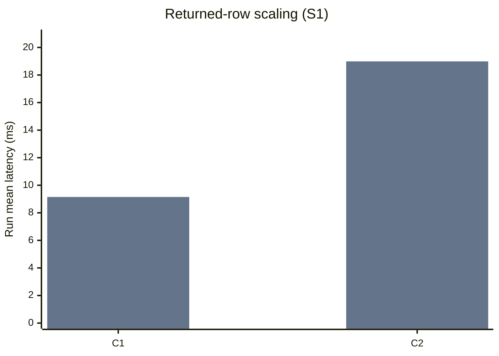


### Returned-row scaling (S2)

| Category | Workload / mode | Peak RSS (MiB) |
| --- | --- | --- |
| C1 | oyster-idle; operation=read; table=LargeRows; rows=10; iterations=100; callbacks=1; access=service; hook=false; pageSize=1000; scanRows=10000; enrichment=batch; mixed=unavailable; readTable=unavailable; queryShape=page; offset=0; hookControl=false; actionContract=auto; scanCoordination=unavailable; wholeScanRows=unavailable; lookupPattern=unavailable; validationOutcome=unavailable; transport=http; phase=warm; load=vus:1; n=3 | 748.07 |
| C2 | oyster-idle; operation=read; table=LargeRows; rows=1000; iterations=100; callbacks=1; access=service; hook=false; pageSize=1000; scanRows=10000; enrichment=batch; mixed=unavailable; readTable=unavailable; queryShape=page; offset=0; hookControl=false; actionContract=auto; scanCoordination=unavailable; wholeScanRows=unavailable; lookupPattern=unavailable; validationOutcome=unavailable; transport=http; phase=warm; load=vus:1; n=3 | 765.065 |

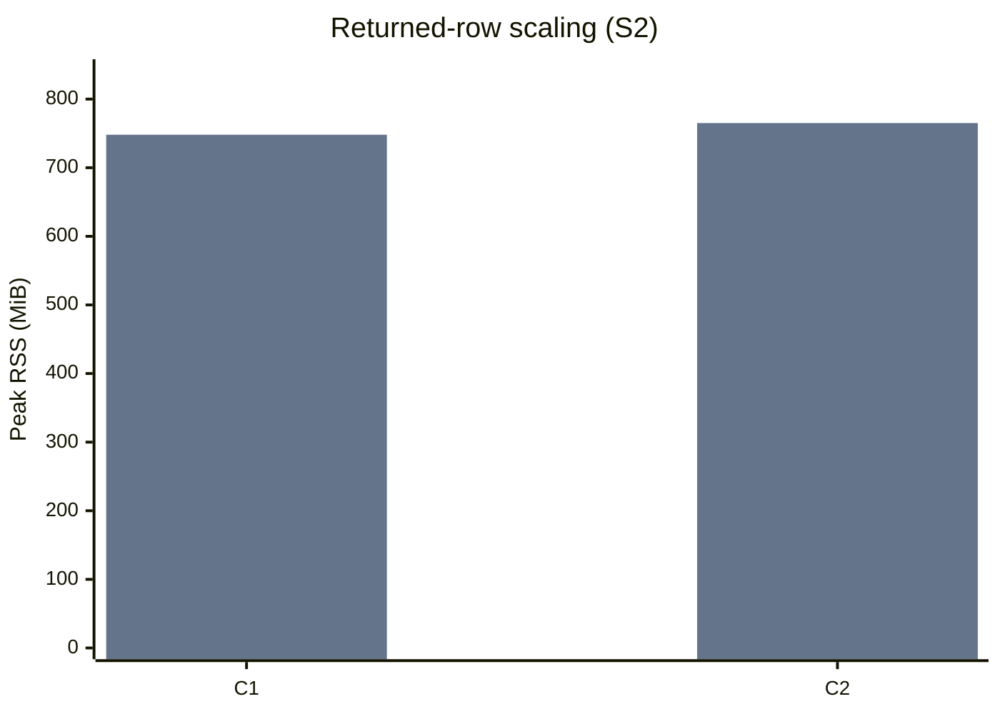


### Returned-row scaling (S3)

| Category | Workload / mode | Run mean latency (ms) |
| --- | --- | --- |
| C1 | native-empty; operation=read; table=LargeRows; rows=10; iterations=100; callbacks=1; access=service; hook=false; pageSize=1000; scanRows=10000; enrichment=batch; mixed=unavailable; readTable=unavailable; queryShape=page; offset=0; hookControl=false; actionContract=auto; scanCoordination=unavailable; wholeScanRows=unavailable; lookupPattern=unavailable; validationOutcome=unavailable; transport=http; phase=warm; load=vus:1; n=3 | 9.048 |
| C2 | native-empty; operation=read; table=LargeRows; rows=1000; iterations=100; callbacks=1; access=service; hook=false; pageSize=1000; scanRows=10000; enrichment=batch; mixed=unavailable; readTable=unavailable; queryShape=page; offset=0; hookControl=false; actionContract=auto; scanCoordination=unavailable; wholeScanRows=unavailable; lookupPattern=unavailable; validationOutcome=unavailable; transport=http; phase=warm; load=vus:1; n=3 | 19.149 |

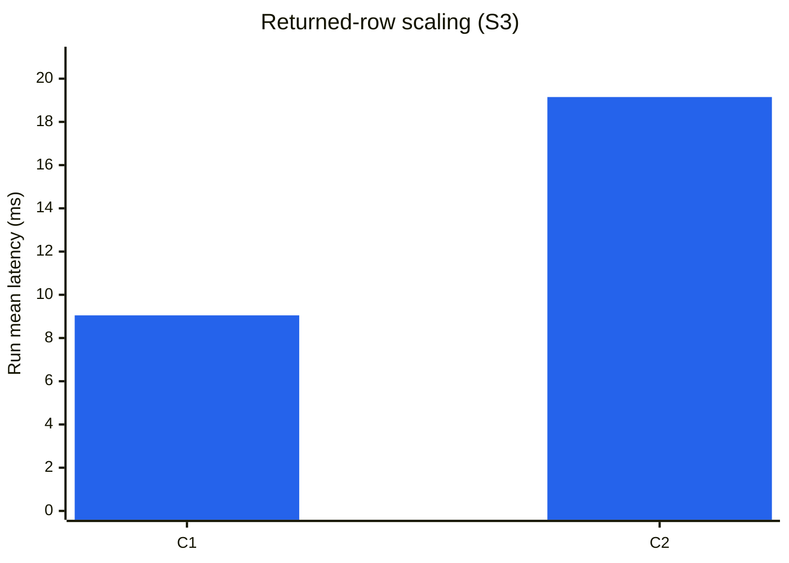


### Returned-row scaling (S4)

| Category | Workload / mode | Peak RSS (MiB) |
| --- | --- | --- |
| C1 | native-empty; operation=read; table=LargeRows; rows=10; iterations=100; callbacks=1; access=service; hook=false; pageSize=1000; scanRows=10000; enrichment=batch; mixed=unavailable; readTable=unavailable; queryShape=page; offset=0; hookControl=false; actionContract=auto; scanCoordination=unavailable; wholeScanRows=unavailable; lookupPattern=unavailable; validationOutcome=unavailable; transport=http; phase=warm; load=vus:1; n=3 | 769.663 |
| C2 | native-empty; operation=read; table=LargeRows; rows=1000; iterations=100; callbacks=1; access=service; hook=false; pageSize=1000; scanRows=10000; enrichment=batch; mixed=unavailable; readTable=unavailable; queryShape=page; offset=0; hookControl=false; actionContract=auto; scanCoordination=unavailable; wholeScanRows=unavailable; lookupPattern=unavailable; validationOutcome=unavailable; transport=http; phase=warm; load=vus:1; n=3 | 754.089 |

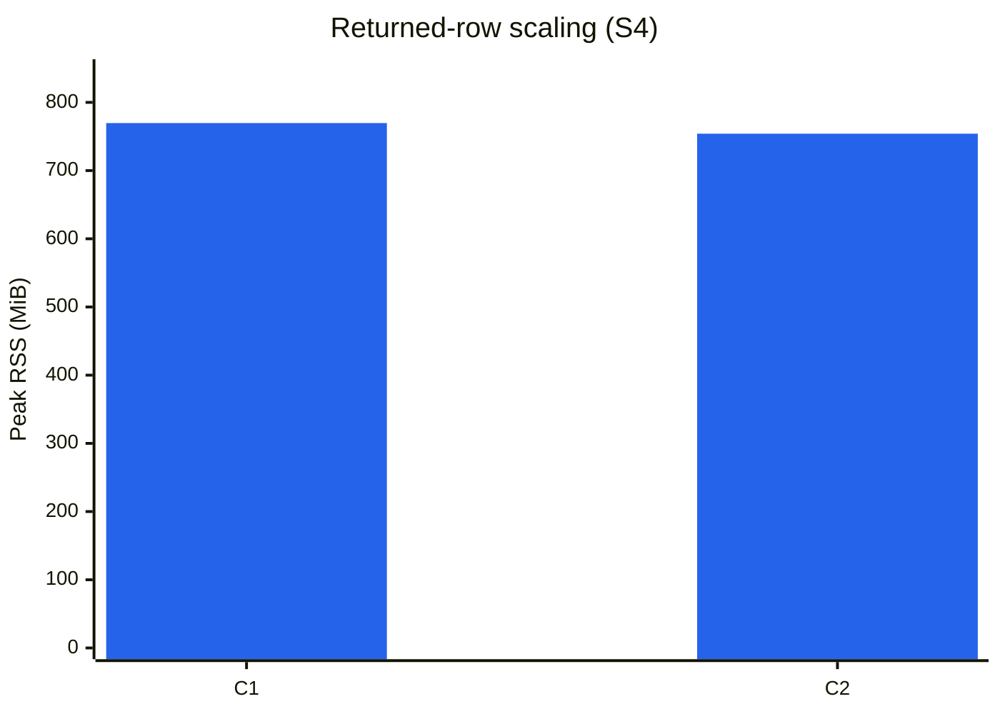


### Returned-row scaling (S5)

| Category | Workload / mode | Run mean latency (ms) |
| --- | --- | --- |
| C1 | wasm-empty; operation=read; table=LargeRows; rows=10; iterations=100; callbacks=1; access=service; hook=false; pageSize=1000; scanRows=10000; enrichment=batch; mixed=unavailable; readTable=unavailable; queryShape=page; offset=0; hookControl=false; actionContract=auto; scanCoordination=unavailable; wholeScanRows=unavailable; lookupPattern=unavailable; validationOutcome=unavailable; transport=http; phase=warm; load=vus:1; n=3 | 12.788 |
| C2 | wasm-empty; operation=read; table=LargeRows; rows=1000; iterations=100; callbacks=1; access=service; hook=false; pageSize=1000; scanRows=10000; enrichment=batch; mixed=unavailable; readTable=unavailable; queryShape=page; offset=0; hookControl=false; actionContract=auto; scanCoordination=unavailable; wholeScanRows=unavailable; lookupPattern=unavailable; validationOutcome=unavailable; transport=http; phase=warm; load=vus:1; n=3 | 30.728 |

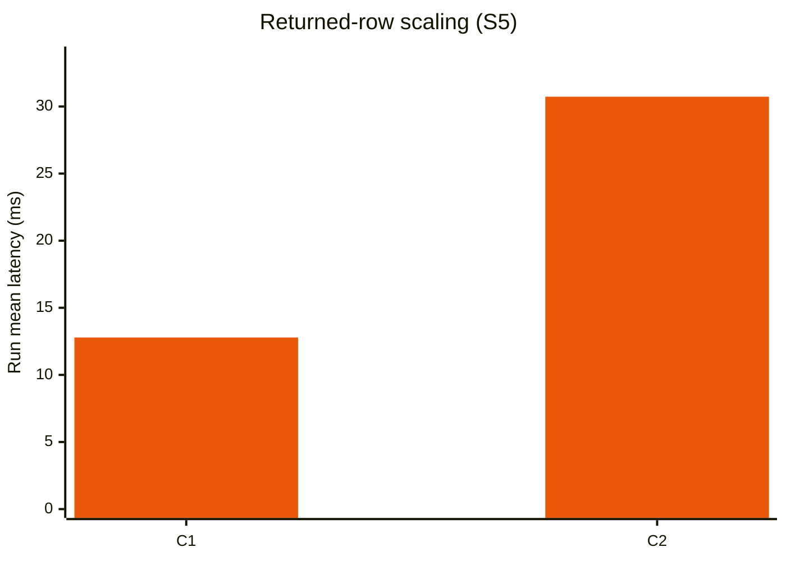

Oyster handlers: [Oyster empty handler](../../apps/extension/srv/BenchmarkService/OysterEmptyLargeRows/after-READ.js).

### Returned-row scaling (S6)

| Category | Workload / mode | Peak RSS (MiB) |
| --- | --- | --- |
| C1 | wasm-empty; operation=read; table=LargeRows; rows=10; iterations=100; callbacks=1; access=service; hook=false; pageSize=1000; scanRows=10000; enrichment=batch; mixed=unavailable; readTable=unavailable; queryShape=page; offset=0; hookControl=false; actionContract=auto; scanCoordination=unavailable; wholeScanRows=unavailable; lookupPattern=unavailable; validationOutcome=unavailable; transport=http; phase=warm; load=vus:1; n=3 | 772.477 |
| C2 | wasm-empty; operation=read; table=LargeRows; rows=1000; iterations=100; callbacks=1; access=service; hook=false; pageSize=1000; scanRows=10000; enrichment=batch; mixed=unavailable; readTable=unavailable; queryShape=page; offset=0; hookControl=false; actionContract=auto; scanCoordination=unavailable; wholeScanRows=unavailable; lookupPattern=unavailable; validationOutcome=unavailable; transport=http; phase=warm; load=vus:1; n=3 | 756.361 |

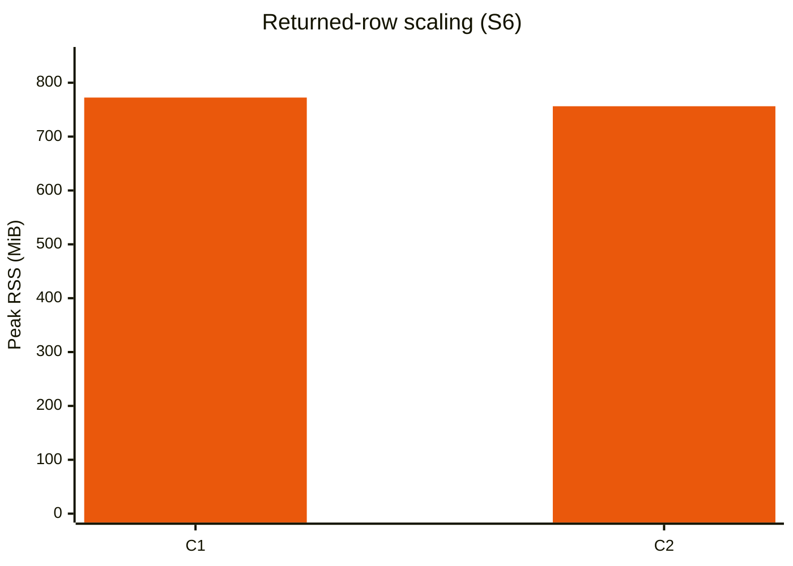

Oyster handlers: [Oyster empty handler](../../apps/extension/srv/BenchmarkService/OysterEmptyLargeRows/after-READ.js).

### Returned-row scaling (S7)

| Category | Workload / mode | Run mean latency (ms) |
| --- | --- | --- |
| C1 | native-compute; operation=read; table=LargeRows; rows=10; iterations=100; callbacks=1; access=service; hook=false; pageSize=1000; scanRows=10000; enrichment=batch; mixed=unavailable; readTable=unavailable; queryShape=page; offset=0; hookControl=false; actionContract=auto; scanCoordination=unavailable; wholeScanRows=unavailable; lookupPattern=unavailable; validationOutcome=unavailable; transport=http; phase=warm; load=vus:1; n=3 | 9.899 |
| C2 | native-compute; operation=read; table=LargeRows; rows=1000; iterations=100; callbacks=1; access=service; hook=false; pageSize=1000; scanRows=10000; enrichment=batch; mixed=unavailable; readTable=unavailable; queryShape=page; offset=0; hookControl=false; actionContract=auto; scanCoordination=unavailable; wholeScanRows=unavailable; lookupPattern=unavailable; validationOutcome=unavailable; transport=http; phase=warm; load=vus:1; n=3 | 19.266 |

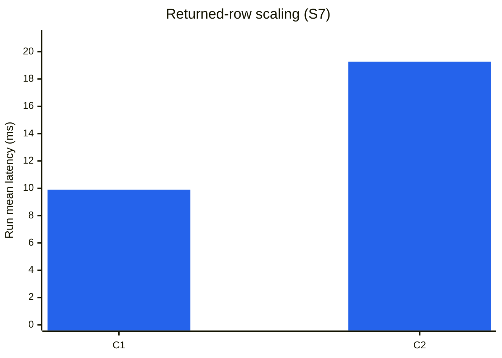


### Returned-row scaling (S8)

| Category | Workload / mode | Peak RSS (MiB) |
| --- | --- | --- |
| C1 | native-compute; operation=read; table=LargeRows; rows=10; iterations=100; callbacks=1; access=service; hook=false; pageSize=1000; scanRows=10000; enrichment=batch; mixed=unavailable; readTable=unavailable; queryShape=page; offset=0; hookControl=false; actionContract=auto; scanCoordination=unavailable; wholeScanRows=unavailable; lookupPattern=unavailable; validationOutcome=unavailable; transport=http; phase=warm; load=vus:1; n=3 | 768.647 |
| C2 | native-compute; operation=read; table=LargeRows; rows=1000; iterations=100; callbacks=1; access=service; hook=false; pageSize=1000; scanRows=10000; enrichment=batch; mixed=unavailable; readTable=unavailable; queryShape=page; offset=0; hookControl=false; actionContract=auto; scanCoordination=unavailable; wholeScanRows=unavailable; lookupPattern=unavailable; validationOutcome=unavailable; transport=http; phase=warm; load=vus:1; n=3 | 751.54 |

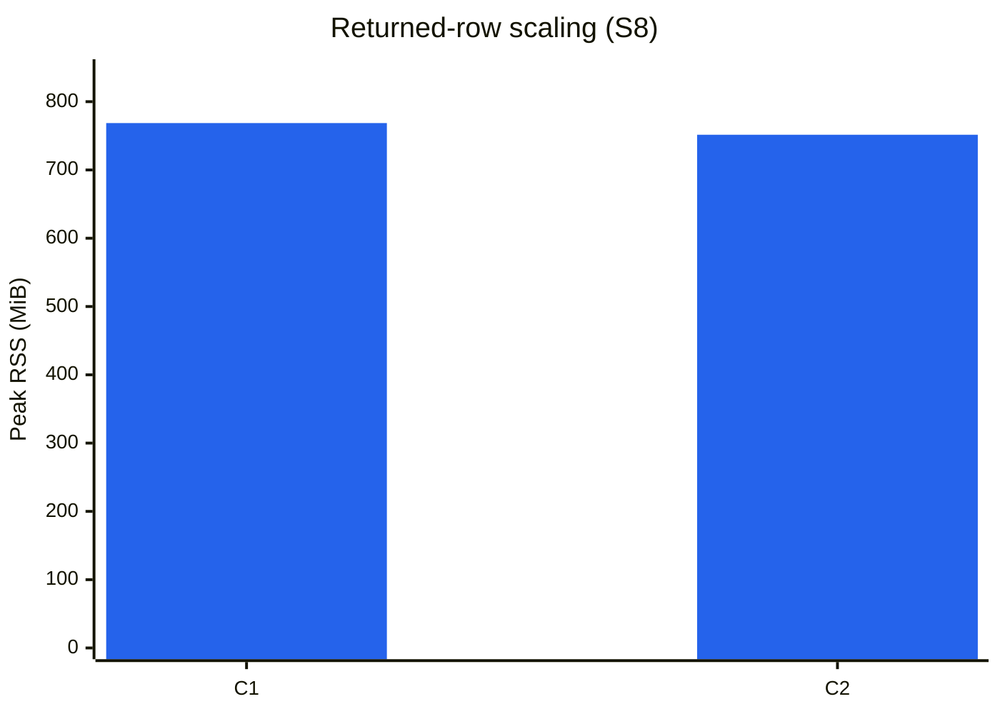


### Returned-row scaling (S9)

| Category | Workload / mode | Run mean latency (ms) |
| --- | --- | --- |
| C1 | wasm-compute; operation=read; table=LargeRows; rows=10; iterations=100; callbacks=1; access=service; hook=false; pageSize=1000; scanRows=10000; enrichment=batch; mixed=unavailable; readTable=unavailable; queryShape=page; offset=0; hookControl=false; actionContract=auto; scanCoordination=unavailable; wholeScanRows=unavailable; lookupPattern=unavailable; validationOutcome=unavailable; transport=http; phase=warm; load=vus:1; n=3 | 13.049 |
| C2 | wasm-compute; operation=read; table=LargeRows; rows=1000; iterations=100; callbacks=1; access=service; hook=false; pageSize=1000; scanRows=10000; enrichment=batch; mixed=unavailable; readTable=unavailable; queryShape=page; offset=0; hookControl=false; actionContract=auto; scanCoordination=unavailable; wholeScanRows=unavailable; lookupPattern=unavailable; validationOutcome=unavailable; transport=http; phase=warm; load=vus:1; n=3 | 50.685 |

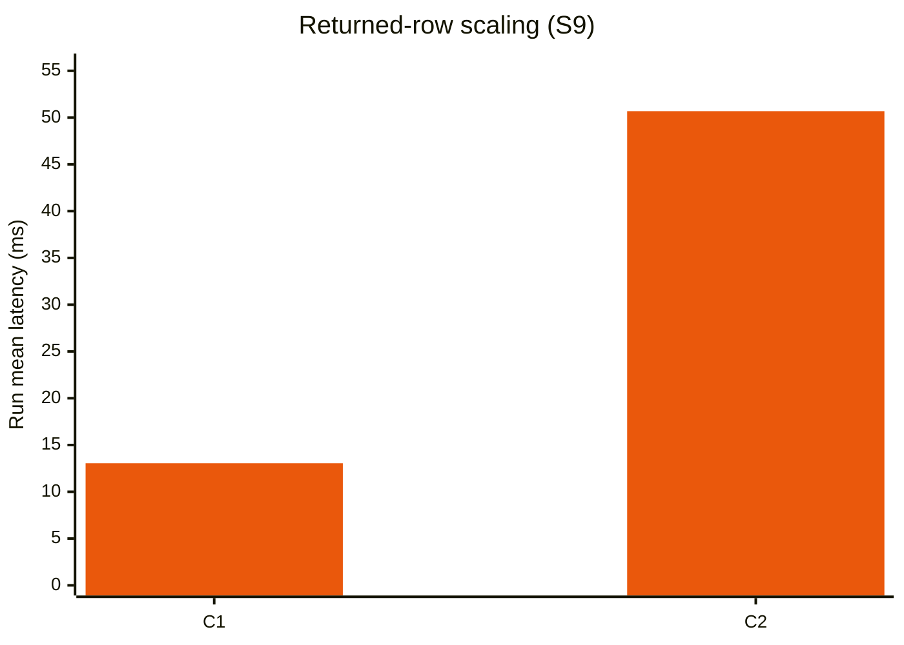

Oyster handlers: [Oyster calculation](../../apps/extension/srv/BenchmarkService/OysterCalculationLargeRows/after-READ.js).

### Returned-row scaling (S10)

| Category | Workload / mode | Peak RSS (MiB) |
| --- | --- | --- |
| C1 | wasm-compute; operation=read; table=LargeRows; rows=10; iterations=100; callbacks=1; access=service; hook=false; pageSize=1000; scanRows=10000; enrichment=batch; mixed=unavailable; readTable=unavailable; queryShape=page; offset=0; hookControl=false; actionContract=auto; scanCoordination=unavailable; wholeScanRows=unavailable; lookupPattern=unavailable; validationOutcome=unavailable; transport=http; phase=warm; load=vus:1; n=3 | 773.253 |
| C2 | wasm-compute; operation=read; table=LargeRows; rows=1000; iterations=100; callbacks=1; access=service; hook=false; pageSize=1000; scanRows=10000; enrichment=batch; mixed=unavailable; readTable=unavailable; queryShape=page; offset=0; hookControl=false; actionContract=auto; scanCoordination=unavailable; wholeScanRows=unavailable; lookupPattern=unavailable; validationOutcome=unavailable; transport=http; phase=warm; load=vus:1; n=3 | 752.676 |

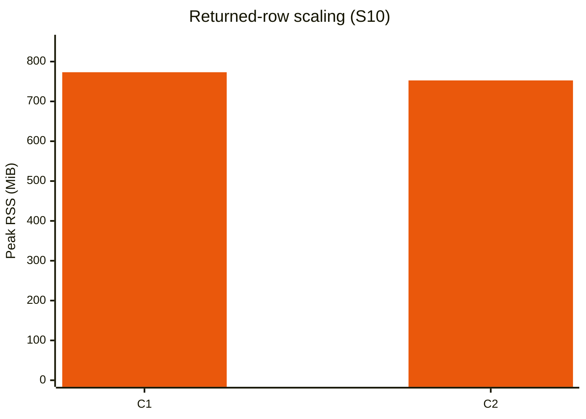

Oyster handlers: [Oyster calculation](../../apps/extension/srv/BenchmarkService/OysterCalculationLargeRows/after-READ.js).

### CPU iterations scaling (S11)

| Category | Workload / mode | Run mean latency (ms) |
| --- | --- | --- |
| C1 | native-compute; operation=action; table=SmallRows; rows=10; iterations=100; callbacks=1; access=service; hook=false; pageSize=1000; scanRows=10000; enrichment=batch; mixed=unavailable; readTable=unavailable; queryShape=page; offset=0; hookControl=false; actionContract=auto; scanCoordination=unavailable; wholeScanRows=unavailable; lookupPattern=unavailable; validationOutcome=unavailable; transport=http; phase=warm; load=vus:1; n=3 | 2.942 |
| C2 | native-compute; operation=action; table=SmallRows; rows=10; iterations=10000; callbacks=1; access=service; hook=false; pageSize=1000; scanRows=10000; enrichment=batch; mixed=unavailable; readTable=unavailable; queryShape=page; offset=0; hookControl=false; actionContract=auto; scanCoordination=unavailable; wholeScanRows=unavailable; lookupPattern=unavailable; validationOutcome=unavailable; transport=http; phase=warm; load=vus:1; n=3 | 3.057 |

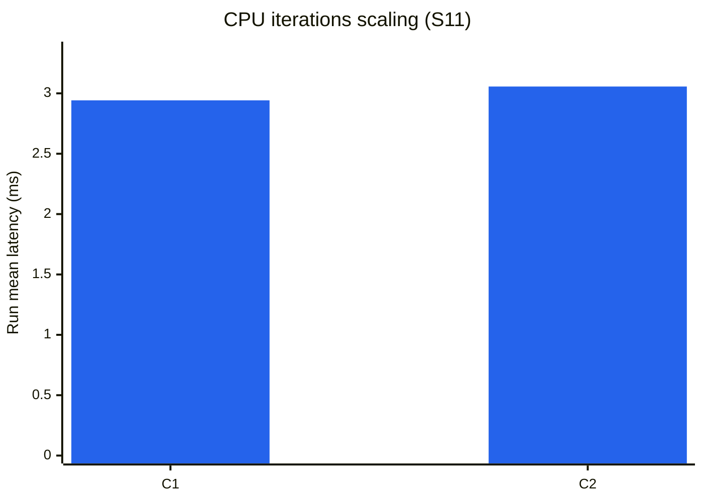


### CPU iterations scaling (S12)

| Category | Workload / mode | Run mean latency (ms) |
| --- | --- | --- |
| C1 | wasm-compute; operation=action; table=SmallRows; rows=10; iterations=100; callbacks=1; access=service; hook=false; pageSize=1000; scanRows=10000; enrichment=batch; mixed=unavailable; readTable=unavailable; queryShape=page; offset=0; hookControl=false; actionContract=auto; scanCoordination=unavailable; wholeScanRows=unavailable; lookupPattern=unavailable; validationOutcome=unavailable; transport=http; phase=warm; load=vus:1; n=3 | 5.598 |
| C2 | wasm-compute; operation=action; table=SmallRows; rows=10; iterations=10000; callbacks=1; access=service; hook=false; pageSize=1000; scanRows=10000; enrichment=batch; mixed=unavailable; readTable=unavailable; queryShape=page; offset=0; hookControl=false; actionContract=auto; scanCoordination=unavailable; wholeScanRows=unavailable; lookupPattern=unavailable; validationOutcome=unavailable; transport=http; phase=warm; load=vus:1; n=3 | 7.833 |

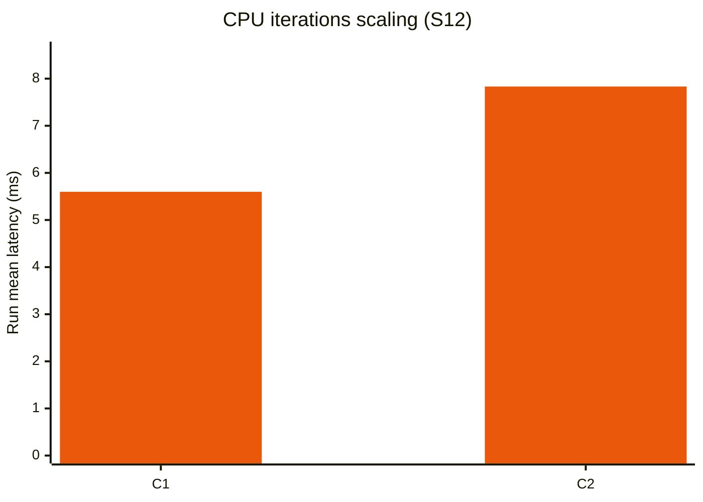

Oyster handlers: [Oyster calculation](../../apps/extension/srv/BenchmarkService/on-oysterCalculation.js).

### Scan row scaling (S13)

| Category | Workload / mode | Run mean latency (ms) |
| --- | --- | --- |
| C1 | native-compute; operation=scan; table=LargeRows; rows=10; iterations=100; callbacks=1; access=service; hook=false; pageSize=1000; scanRows=10000; enrichment=batch; mixed=unavailable; readTable=unavailable; queryShape=page; offset=0; hookControl=false; actionContract=auto; scanCoordination=unavailable; wholeScanRows=unavailable; lookupPattern=unavailable; validationOutcome=unavailable; transport=http; phase=warm; load=vus:1; n=3 | 108.764 |
| C2 | native-compute; operation=scan; table=LargeRows; rows=10; iterations=100; callbacks=1; access=service; hook=false; pageSize=1000; scanRows=50000; enrichment=batch; mixed=unavailable; readTable=unavailable; queryShape=page; offset=0; hookControl=false; actionContract=auto; scanCoordination=unavailable; wholeScanRows=unavailable; lookupPattern=unavailable; validationOutcome=unavailable; transport=http; phase=warm; load=vus:1; n=3 | 526.429 |

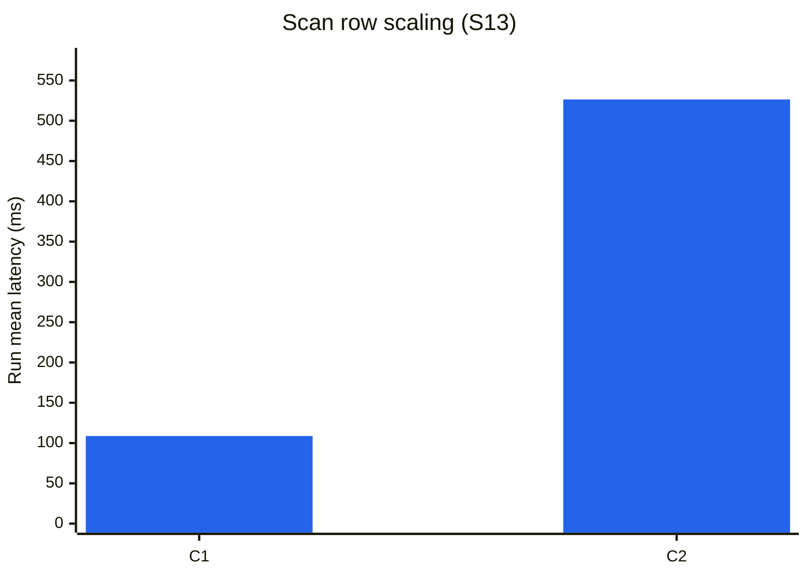


### Scan row scaling (S14)

| Category | Workload / mode | Peak RSS (MiB) |
| --- | --- | --- |
| C1 | native-compute; operation=scan; table=LargeRows; rows=10; iterations=100; callbacks=1; access=service; hook=false; pageSize=1000; scanRows=10000; enrichment=batch; mixed=unavailable; readTable=unavailable; queryShape=page; offset=0; hookControl=false; actionContract=auto; scanCoordination=unavailable; wholeScanRows=unavailable; lookupPattern=unavailable; validationOutcome=unavailable; transport=http; phase=warm; load=vus:1; n=3 | 748.328 |
| C2 | native-compute; operation=scan; table=LargeRows; rows=10; iterations=100; callbacks=1; access=service; hook=false; pageSize=1000; scanRows=50000; enrichment=batch; mixed=unavailable; readTable=unavailable; queryShape=page; offset=0; hookControl=false; actionContract=auto; scanCoordination=unavailable; wholeScanRows=unavailable; lookupPattern=unavailable; validationOutcome=unavailable; transport=http; phase=warm; load=vus:1; n=3 | 746.74 |

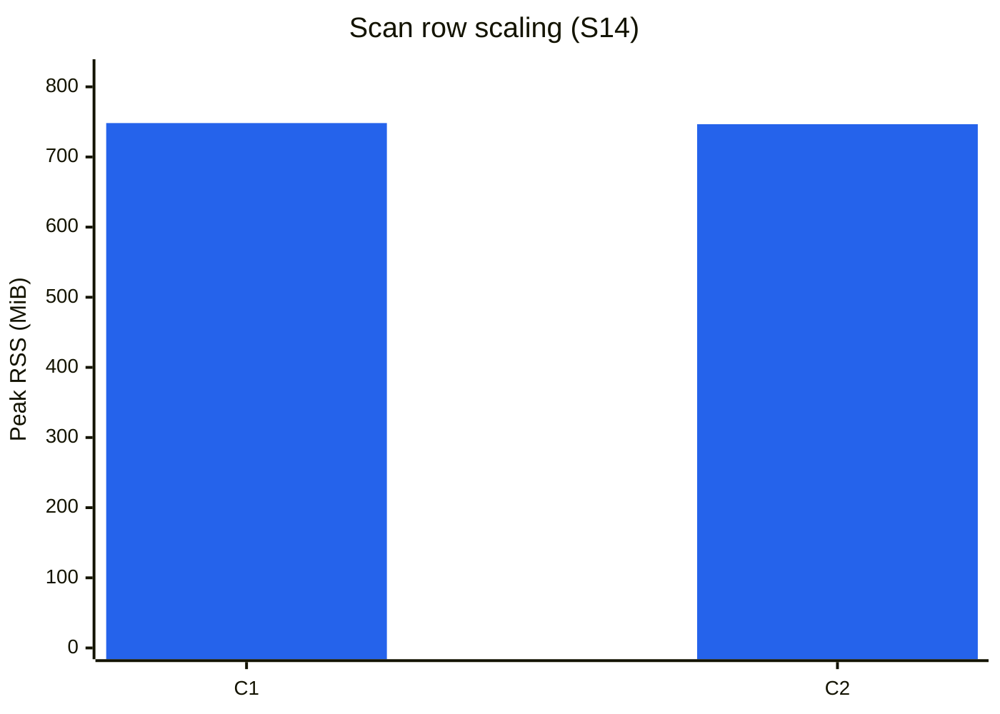


### Scan row scaling (S15)

| Category | Workload / mode | Run mean latency (ms) |
| --- | --- | --- |
| C1 | wasm-compute; operation=scan; table=LargeRows; rows=10; iterations=100; callbacks=1; access=service; hook=false; pageSize=1000; scanRows=10000; enrichment=batch; mixed=unavailable; readTable=unavailable; queryShape=page; offset=0; hookControl=false; actionContract=auto; scanCoordination=unavailable; wholeScanRows=unavailable; lookupPattern=unavailable; validationOutcome=unavailable; transport=http; phase=warm; load=vus:1; n=3 | 333.912 |
| C2 | wasm-compute; operation=scan; table=LargeRows; rows=10; iterations=100; callbacks=1; access=service; hook=false; pageSize=1000; scanRows=50000; enrichment=batch; mixed=unavailable; readTable=unavailable; queryShape=page; offset=0; hookControl=false; actionContract=auto; scanCoordination=unavailable; wholeScanRows=unavailable; lookupPattern=unavailable; validationOutcome=unavailable; transport=http; phase=warm; load=vus:1; n=3 | 1725.493 |

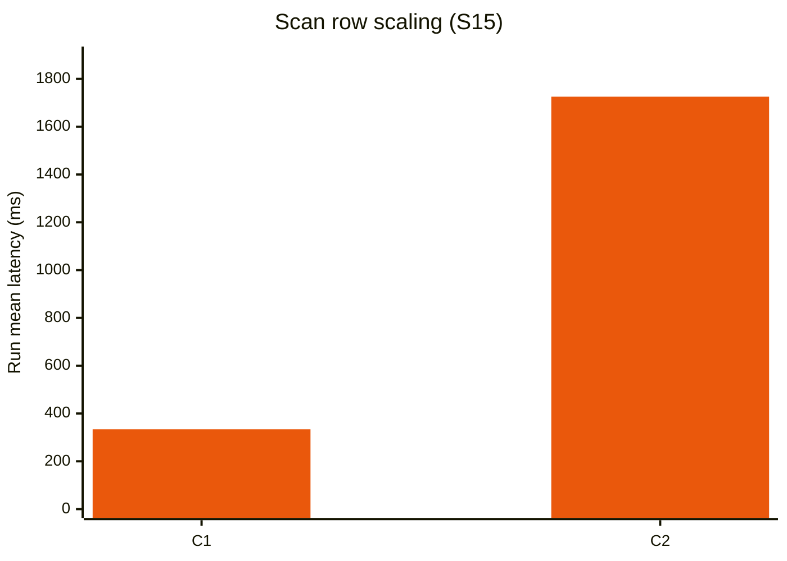

Oyster handlers: [Oyster calculation](../../apps/extension/srv/BenchmarkService/on-oysterScan.js).

### Scan row scaling (S16)

| Category | Workload / mode | Peak RSS (MiB) |
| --- | --- | --- |
| C1 | wasm-compute; operation=scan; table=LargeRows; rows=10; iterations=100; callbacks=1; access=service; hook=false; pageSize=1000; scanRows=10000; enrichment=batch; mixed=unavailable; readTable=unavailable; queryShape=page; offset=0; hookControl=false; actionContract=auto; scanCoordination=unavailable; wholeScanRows=unavailable; lookupPattern=unavailable; validationOutcome=unavailable; transport=http; phase=warm; load=vus:1; n=3 | 749.365 |
| C2 | wasm-compute; operation=scan; table=LargeRows; rows=10; iterations=100; callbacks=1; access=service; hook=false; pageSize=1000; scanRows=50000; enrichment=batch; mixed=unavailable; readTable=unavailable; queryShape=page; offset=0; hookControl=false; actionContract=auto; scanCoordination=unavailable; wholeScanRows=unavailable; lookupPattern=unavailable; validationOutcome=unavailable; transport=http; phase=warm; load=vus:1; n=3 | 752.079 |

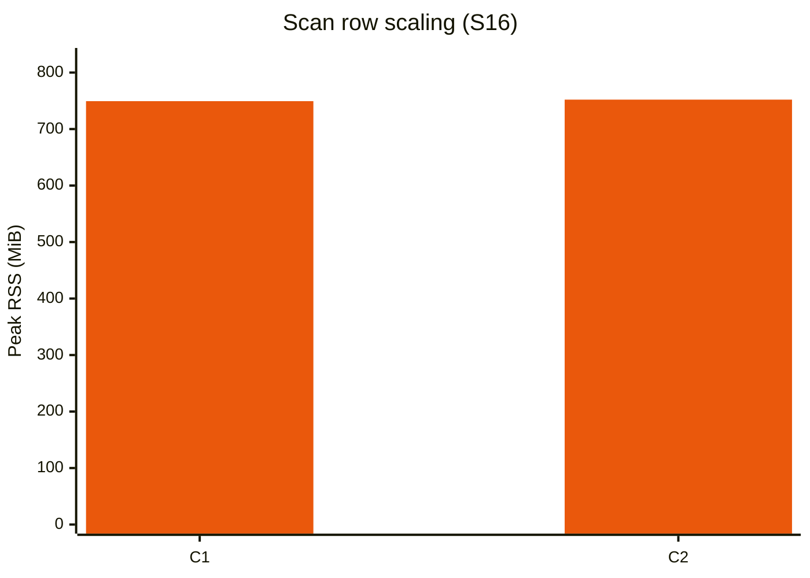

Oyster handlers: [Oyster calculation](../../apps/extension/srv/BenchmarkService/on-oysterScan.js).

### Callback fan-out (S17)

| Category | Workload / mode | Run mean latency (ms) |
| --- | --- | --- |
| C1 | native-compute-write; operation=action; table=SmallRows; rows=10; iterations=0; callbacks=1; access=service; hook=false; pageSize=1000; scanRows=10000; enrichment=batch; mixed=unavailable; readTable=unavailable; queryShape=page; offset=0; hookControl=false; actionContract=auto; scanCoordination=unavailable; wholeScanRows=unavailable; lookupPattern=unavailable; validationOutcome=unavailable; transport=http; phase=warm; load=vus:1; n=3 | 10.468 |
| C2 | native-compute-write; operation=action; table=SmallRows; rows=10; iterations=0; callbacks=10; access=service; hook=false; pageSize=1000; scanRows=10000; enrichment=batch; mixed=unavailable; readTable=unavailable; queryShape=page; offset=0; hookControl=false; actionContract=auto; scanCoordination=unavailable; wholeScanRows=unavailable; lookupPattern=unavailable; validationOutcome=unavailable; transport=http; phase=warm; load=vus:1; n=3 | 33.139 |

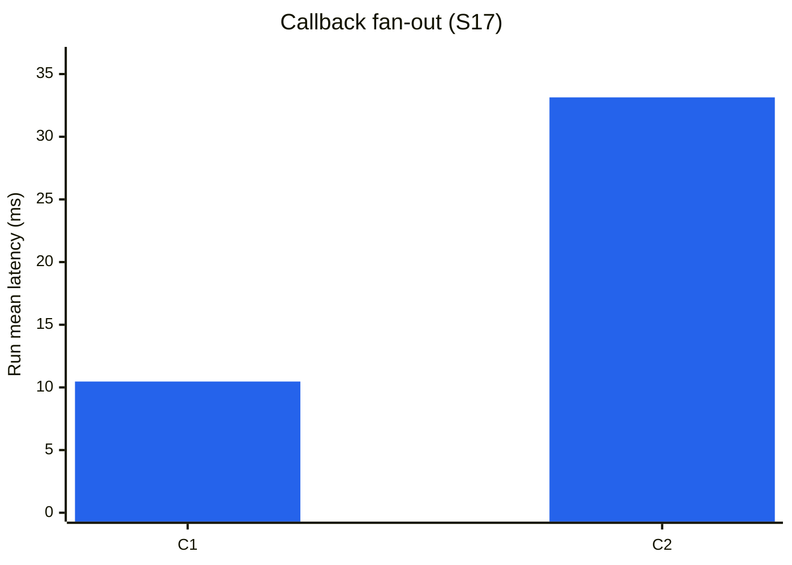


### Callback fan-out (S18)

| Category | Workload / mode | Run mean latency (ms) |
| --- | --- | --- |
| C1 | wasm-compute-write; operation=action; table=SmallRows; rows=10; iterations=0; callbacks=1; access=service; hook=false; pageSize=1000; scanRows=10000; enrichment=batch; mixed=unavailable; readTable=unavailable; queryShape=page; offset=0; hookControl=false; actionContract=auto; scanCoordination=unavailable; wholeScanRows=unavailable; lookupPattern=unavailable; validationOutcome=unavailable; transport=http; phase=warm; load=vus:1; n=3 | 13.963 |
| C2 | wasm-compute-write; operation=action; table=SmallRows; rows=10; iterations=0; callbacks=10; access=service; hook=false; pageSize=1000; scanRows=10000; enrichment=batch; mixed=unavailable; readTable=unavailable; queryShape=page; offset=0; hookControl=false; actionContract=auto; scanCoordination=unavailable; wholeScanRows=unavailable; lookupPattern=unavailable; validationOutcome=unavailable; transport=http; phase=warm; load=vus:1; n=3 | 39.172 |

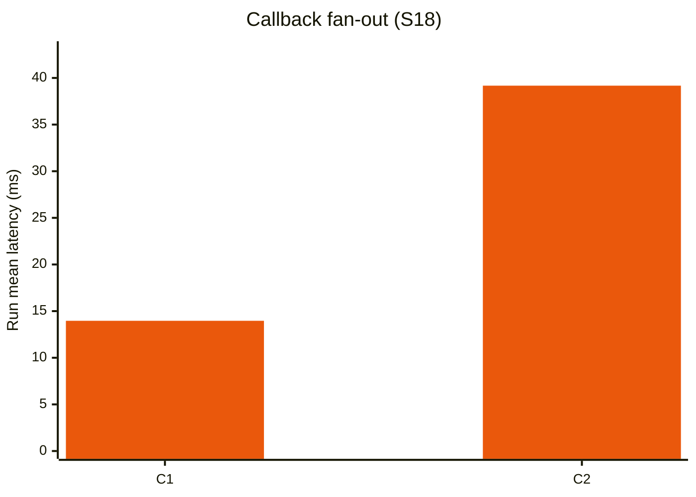

Oyster handlers: [Oyster CQL write](../../apps/extension/srv/BenchmarkService/on-oysterCqlWrite.js).

### Callback fan-out (S19)

| Category | Workload / mode | Run mean latency (ms) |
| --- | --- | --- |
| C1 | native-compute-read; operation=action; table=SmallRows; rows=10; iterations=0; callbacks=1; access=service; hook=false; pageSize=1000; scanRows=10000; enrichment=batch; mixed=unavailable; readTable=unavailable; queryShape=page; offset=0; hookControl=false; actionContract=auto; scanCoordination=unavailable; wholeScanRows=unavailable; lookupPattern=unavailable; validationOutcome=unavailable; transport=http; phase=warm; load=vus:1; n=3 | 9.583 |
| C2 | native-compute-read; operation=action; table=SmallRows; rows=10; iterations=0; callbacks=10; access=service; hook=false; pageSize=1000; scanRows=10000; enrichment=batch; mixed=unavailable; readTable=unavailable; queryShape=page; offset=0; hookControl=false; actionContract=auto; scanCoordination=unavailable; wholeScanRows=unavailable; lookupPattern=unavailable; validationOutcome=unavailable; transport=http; phase=warm; load=vus:1; n=3 | 34.341 |

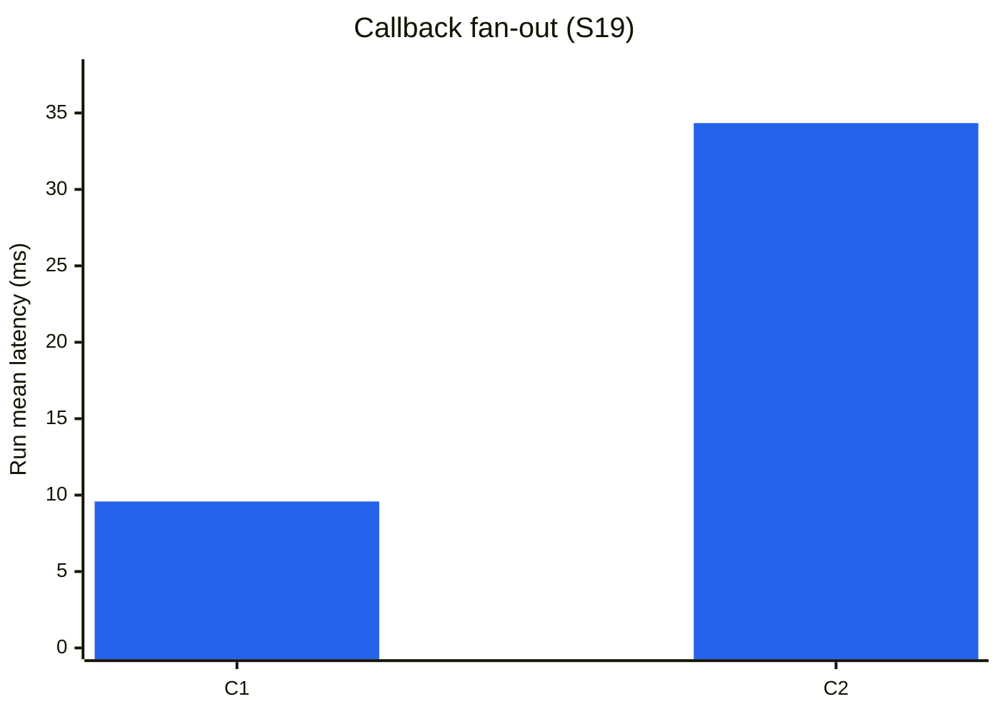


### Callback fan-out (S20)

| Category | Workload / mode | Run mean latency (ms) |
| --- | --- | --- |
| C1 | wasm-compute-read; operation=action; table=SmallRows; rows=10; iterations=0; callbacks=1; access=service; hook=false; pageSize=1000; scanRows=10000; enrichment=batch; mixed=unavailable; readTable=unavailable; queryShape=page; offset=0; hookControl=false; actionContract=auto; scanCoordination=unavailable; wholeScanRows=unavailable; lookupPattern=unavailable; validationOutcome=unavailable; transport=http; phase=warm; load=vus:1; n=3 | 12.296 |
| C2 | wasm-compute-read; operation=action; table=SmallRows; rows=10; iterations=0; callbacks=10; access=service; hook=false; pageSize=1000; scanRows=10000; enrichment=batch; mixed=unavailable; readTable=unavailable; queryShape=page; offset=0; hookControl=false; actionContract=auto; scanCoordination=unavailable; wholeScanRows=unavailable; lookupPattern=unavailable; validationOutcome=unavailable; transport=http; phase=warm; load=vus:1; n=3 | 41.725 |

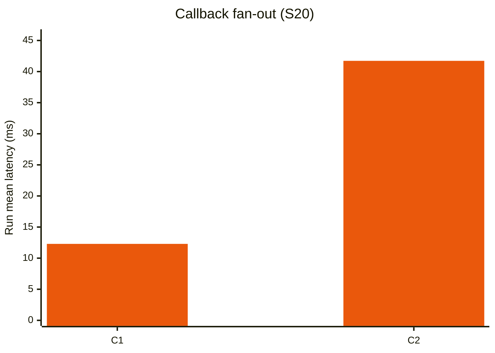

Oyster handlers: [Oyster CQL read](../../apps/extension/srv/BenchmarkService/on-oysterCqlRead.js).

### Load latency (S21)

| Category | Workload / mode | Mean run p95 latency (ms) |
| --- | --- | --- |
| C1 | native-compute-read; operation=action; table=SmallRows; rows=10; iterations=0; callbacks=1; access=service; hook=false; pageSize=1000; scanRows=10000; enrichment=batch; mixed=unavailable; readTable=unavailable; queryShape=page; offset=0; hookControl=false; actionContract=auto; scanCoordination=unavailable; wholeScanRows=unavailable; lookupPattern=unavailable; validationOutcome=unavailable; transport=http; phase=warm; load=vus:1; n=3 | 14.72 |
| C2 | native-compute-read; operation=action; table=SmallRows; rows=10; iterations=0; callbacks=1; access=service; hook=false; pageSize=1000; scanRows=10000; enrichment=batch; mixed=unavailable; readTable=unavailable; queryShape=page; offset=0; hookControl=false; actionContract=auto; scanCoordination=unavailable; wholeScanRows=unavailable; lookupPattern=unavailable; validationOutcome=unavailable; transport=http; phase=warm; load=vus:8; n=3 | 17.163 |
| C3 | native-compute-read; operation=action; table=SmallRows; rows=10; iterations=0; callbacks=1; access=service; hook=false; pageSize=1000; scanRows=10000; enrichment=batch; mixed=unavailable; readTable=unavailable; queryShape=page; offset=0; hookControl=false; actionContract=auto; scanCoordination=unavailable; wholeScanRows=unavailable; lookupPattern=unavailable; validationOutcome=unavailable; transport=http; phase=warm; load=vus:32; n=3 | 58.663 |

```mermaid
---
config:
  themeVariables:
    xyChart:
      plotColorPalette: "#2563eb"
  themeCSS: ".bar-plot-0 rect:nth-child(1) { fill: #2563eb; stroke: #2563eb; } .bar-plot-0 rect:nth-child(2) { fill: #2563eb; stroke: #2563eb; } .bar-plot-0 rect:nth-child(3) { fill: #2563eb; stroke: #2563eb; }"
---
xychart-beta
    title "Load latency (S21)"
    x-axis ["C1", "C2", "C3"]
    y-axis "Mean run p95 latency (ms)" 0 --> 64.529195
    bar [14.719561333333333, 17.16259066666667, 58.66290433333334]
```


### Successful throughput (S22)

| Category | Workload / mode | Successful throughput (requests/s) |
| --- | --- | --- |
| C1 | native-compute-read; operation=action; table=SmallRows; rows=10; iterations=0; callbacks=1; access=service; hook=false; pageSize=1000; scanRows=10000; enrichment=batch; mixed=unavailable; readTable=unavailable; queryShape=page; offset=0; hookControl=false; actionContract=auto; scanCoordination=unavailable; wholeScanRows=unavailable; lookupPattern=unavailable; validationOutcome=unavailable; transport=http; phase=warm; load=vus:1; n=3 | 104.903 |
| C2 | native-compute-read; operation=action; table=SmallRows; rows=10; iterations=0; callbacks=1; access=service; hook=false; pageSize=1000; scanRows=10000; enrichment=batch; mixed=unavailable; readTable=unavailable; queryShape=page; offset=0; hookControl=false; actionContract=auto; scanCoordination=unavailable; wholeScanRows=unavailable; lookupPattern=unavailable; validationOutcome=unavailable; transport=http; phase=warm; load=vus:8; n=3 | 628.222 |
| C3 | native-compute-read; operation=action; table=SmallRows; rows=10; iterations=0; callbacks=1; access=service; hook=false; pageSize=1000; scanRows=10000; enrichment=batch; mixed=unavailable; readTable=unavailable; queryShape=page; offset=0; hookControl=false; actionContract=auto; scanCoordination=unavailable; wholeScanRows=unavailable; lookupPattern=unavailable; validationOutcome=unavailable; transport=http; phase=warm; load=vus:32; n=3 | 658.581 |

```mermaid
---
config:
  themeVariables:
    xyChart:
      plotColorPalette: "#2563eb"
  themeCSS: ".bar-plot-0 rect:nth-child(1) { fill: #2563eb; stroke: #2563eb; } .bar-plot-0 rect:nth-child(2) { fill: #2563eb; stroke: #2563eb; } .bar-plot-0 rect:nth-child(3) { fill: #2563eb; stroke: #2563eb; }"
---
xychart-beta
    title "Successful throughput (S22)"
    x-axis ["C1", "C2", "C3"]
    y-axis "Successful throughput (requests/s)" 0 --> 724.4395
    bar [104.903066243096, 628.2223584182544, 658.5813677206297]
```


### Unrelated-request probe (S23)

| Category | Workload / mode | Unrelated-request probe p95 (ms) |
| --- | --- | --- |
| C1 | native-compute-read; operation=action; table=SmallRows; rows=10; iterations=0; callbacks=1; access=service; hook=false; pageSize=1000; scanRows=10000; enrichment=batch; mixed=unavailable; readTable=unavailable; queryShape=page; offset=0; hookControl=false; actionContract=auto; scanCoordination=unavailable; wholeScanRows=unavailable; lookupPattern=unavailable; validationOutcome=unavailable; transport=http; phase=warm; load=vus:8; n=3 | 88.041 |
| C2 | native-compute-read; operation=action; table=SmallRows; rows=10; iterations=0; callbacks=1; access=service; hook=false; pageSize=1000; scanRows=10000; enrichment=batch; mixed=unavailable; readTable=unavailable; queryShape=page; offset=0; hookControl=false; actionContract=auto; scanCoordination=unavailable; wholeScanRows=unavailable; lookupPattern=unavailable; validationOutcome=unavailable; transport=http; phase=warm; load=vus:32; n=3 | 143.423 |

```mermaid
---
config:
  themeVariables:
    xyChart:
      plotColorPalette: "#2563eb"
  themeCSS: ".bar-plot-0 rect:nth-child(1) { fill: #2563eb; stroke: #2563eb; } .bar-plot-0 rect:nth-child(2) { fill: #2563eb; stroke: #2563eb; }"
---
xychart-beta
    title "Unrelated-request probe (S23)"
    x-axis ["C1", "C2"]
    y-axis "Unrelated-request probe p95 (ms)" 0 --> 157.76579
    bar [88.04062700000001, 143.42344899999998]
```


### Load latency (S24)

| Category | Workload / mode | Mean run p95 latency (ms) |
| --- | --- | --- |
| C1 | wasm-compute-read; operation=action; table=SmallRows; rows=10; iterations=0; callbacks=1; access=service; hook=false; pageSize=1000; scanRows=10000; enrichment=batch; mixed=unavailable; readTable=unavailable; queryShape=page; offset=0; hookControl=false; actionContract=auto; scanCoordination=unavailable; wholeScanRows=unavailable; lookupPattern=unavailable; validationOutcome=unavailable; transport=http; phase=warm; load=vus:1; n=3 | 17.859 |
| C2 | wasm-compute-read; operation=action; table=SmallRows; rows=10; iterations=0; callbacks=1; access=service; hook=false; pageSize=1000; scanRows=10000; enrichment=batch; mixed=unavailable; readTable=unavailable; queryShape=page; offset=0; hookControl=false; actionContract=auto; scanCoordination=unavailable; wholeScanRows=unavailable; lookupPattern=unavailable; validationOutcome=unavailable; transport=http; phase=warm; load=vus:8; n=3 | 23.873 |
| C3 | wasm-compute-read; operation=action; table=SmallRows; rows=10; iterations=0; callbacks=1; access=service; hook=false; pageSize=1000; scanRows=10000; enrichment=batch; mixed=unavailable; readTable=unavailable; queryShape=page; offset=0; hookControl=false; actionContract=auto; scanCoordination=unavailable; wholeScanRows=unavailable; lookupPattern=unavailable; validationOutcome=unavailable; transport=http; phase=warm; load=vus:32; n=3 | 72.829 |

```mermaid
---
config:
  themeVariables:
    xyChart:
      plotColorPalette: "#ea580c"
  themeCSS: ".bar-plot-0 rect:nth-child(1) { fill: #ea580c; stroke: #ea580c; } .bar-plot-0 rect:nth-child(2) { fill: #ea580c; stroke: #ea580c; } .bar-plot-0 rect:nth-child(3) { fill: #ea580c; stroke: #ea580c; }"
---
xychart-beta
    title "Load latency (S24)"
    x-axis ["C1", "C2", "C3"]
    y-axis "Mean run p95 latency (ms)" 0 --> 80.112193
    bar [17.859286, 23.87301766666667, 72.82926633333334]
```

Oyster handlers: [Oyster CQL read](../../apps/extension/srv/BenchmarkService/on-oysterCqlRead.js).

### Successful throughput (S25)

| Category | Workload / mode | Successful throughput (requests/s) |
| --- | --- | --- |
| C1 | wasm-compute-read; operation=action; table=SmallRows; rows=10; iterations=0; callbacks=1; access=service; hook=false; pageSize=1000; scanRows=10000; enrichment=batch; mixed=unavailable; readTable=unavailable; queryShape=page; offset=0; hookControl=false; actionContract=auto; scanCoordination=unavailable; wholeScanRows=unavailable; lookupPattern=unavailable; validationOutcome=unavailable; transport=http; phase=warm; load=vus:1; n=3 | 80.259 |
| C2 | wasm-compute-read; operation=action; table=SmallRows; rows=10; iterations=0; callbacks=1; access=service; hook=false; pageSize=1000; scanRows=10000; enrichment=batch; mixed=unavailable; readTable=unavailable; queryShape=page; offset=0; hookControl=false; actionContract=auto; scanCoordination=unavailable; wholeScanRows=unavailable; lookupPattern=unavailable; validationOutcome=unavailable; transport=http; phase=warm; load=vus:8; n=3 | 439.17 |
| C3 | wasm-compute-read; operation=action; table=SmallRows; rows=10; iterations=0; callbacks=1; access=service; hook=false; pageSize=1000; scanRows=10000; enrichment=batch; mixed=unavailable; readTable=unavailable; queryShape=page; offset=0; hookControl=false; actionContract=auto; scanCoordination=unavailable; wholeScanRows=unavailable; lookupPattern=unavailable; validationOutcome=unavailable; transport=http; phase=warm; load=vus:32; n=3 | 524.154 |

```mermaid
---
config:
  themeVariables:
    xyChart:
      plotColorPalette: "#ea580c"
  themeCSS: ".bar-plot-0 rect:nth-child(1) { fill: #ea580c; stroke: #ea580c; } .bar-plot-0 rect:nth-child(2) { fill: #ea580c; stroke: #ea580c; } .bar-plot-0 rect:nth-child(3) { fill: #ea580c; stroke: #ea580c; }"
---
xychart-beta
    title "Successful throughput (S25)"
    x-axis ["C1", "C2", "C3"]
    y-axis "Successful throughput (requests/s)" 0 --> 576.56894
    bar [80.25921818728942, 439.16964352188364, 524.1535789263909]
```

Oyster handlers: [Oyster CQL read](../../apps/extension/srv/BenchmarkService/on-oysterCqlRead.js).

### Unrelated-request probe (S26)

| Category | Workload / mode | Unrelated-request probe p95 (ms) |
| --- | --- | --- |
| C1 | wasm-compute-read; operation=action; table=SmallRows; rows=10; iterations=0; callbacks=1; access=service; hook=false; pageSize=1000; scanRows=10000; enrichment=batch; mixed=unavailable; readTable=unavailable; queryShape=page; offset=0; hookControl=false; actionContract=auto; scanCoordination=unavailable; wholeScanRows=unavailable; lookupPattern=unavailable; validationOutcome=unavailable; transport=http; phase=warm; load=vus:8; n=3 | 85.771 |
| C2 | wasm-compute-read; operation=action; table=SmallRows; rows=10; iterations=0; callbacks=1; access=service; hook=false; pageSize=1000; scanRows=10000; enrichment=batch; mixed=unavailable; readTable=unavailable; queryShape=page; offset=0; hookControl=false; actionContract=auto; scanCoordination=unavailable; wholeScanRows=unavailable; lookupPattern=unavailable; validationOutcome=unavailable; transport=http; phase=warm; load=vus:32; n=3 | 145.103 |

```mermaid
---
config:
  themeVariables:
    xyChart:
      plotColorPalette: "#ea580c"
  themeCSS: ".bar-plot-0 rect:nth-child(1) { fill: #ea580c; stroke: #ea580c; } .bar-plot-0 rect:nth-child(2) { fill: #ea580c; stroke: #ea580c; }"
---
xychart-beta
    title "Unrelated-request probe (S26)"
    x-axis ["C1", "C2"]
    y-axis "Unrelated-request probe p95 (ms)" 0 --> 159.61314
    bar [85.77131733333334, 145.10285333333331]
```

Oyster handlers: [Oyster CQL read](../../apps/extension/srv/BenchmarkService/on-oysterCqlRead.js).

### Load latency (S27)

| Category | Workload / mode | Mean run p95 latency (ms) |
| --- | --- | --- |
| C1 | oyster-idle; operation=action; table=SmallRows; rows=10; iterations=100; callbacks=1; access=service; hook=false; pageSize=1000; scanRows=10000; enrichment=batch; mixed=unavailable; readTable=unavailable; queryShape=page; offset=0; hookControl=false; actionContract=auto; scanCoordination=unavailable; wholeScanRows=unavailable; lookupPattern=unavailable; validationOutcome=unavailable; transport=http; phase=warm; load=vus:1; n=3 | 3.718 |
| C2 | oyster-idle; operation=action; table=SmallRows; rows=10; iterations=100; callbacks=1; access=service; hook=false; pageSize=1000; scanRows=10000; enrichment=batch; mixed=unavailable; readTable=unavailable; queryShape=page; offset=0; hookControl=false; actionContract=auto; scanCoordination=unavailable; wholeScanRows=unavailable; lookupPattern=unavailable; validationOutcome=unavailable; transport=http; phase=warm; load=vus:8; n=3 | 4.558 |
| C3 | oyster-idle; operation=action; table=SmallRows; rows=10; iterations=100; callbacks=1; access=service; hook=false; pageSize=1000; scanRows=10000; enrichment=batch; mixed=unavailable; readTable=unavailable; queryShape=page; offset=0; hookControl=false; actionContract=auto; scanCoordination=unavailable; wholeScanRows=unavailable; lookupPattern=unavailable; validationOutcome=unavailable; transport=http; phase=warm; load=vus:32; n=3 | 16.99 |

```mermaid
---
config:
  themeVariables:
    xyChart:
      plotColorPalette: "#64748b"
  themeCSS: ".bar-plot-0 rect:nth-child(1) { fill: #64748b; stroke: #64748b; } .bar-plot-0 rect:nth-child(2) { fill: #64748b; stroke: #64748b; } .bar-plot-0 rect:nth-child(3) { fill: #64748b; stroke: #64748b; }"
---
xychart-beta
    title "Load latency (S27)"
    x-axis ["C1", "C2", "C3"]
    y-axis "Mean run p95 latency (ms)" 0 --> 18.68932
    bar [3.717626333333333, 4.55793, 16.990291]
```


### Successful throughput (S28)

| Category | Workload / mode | Successful throughput (requests/s) |
| --- | --- | --- |
| C1 | oyster-idle; operation=action; table=SmallRows; rows=10; iterations=100; callbacks=1; access=service; hook=false; pageSize=1000; scanRows=10000; enrichment=batch; mixed=unavailable; readTable=unavailable; queryShape=page; offset=0; hookControl=false; actionContract=auto; scanCoordination=unavailable; wholeScanRows=unavailable; lookupPattern=unavailable; validationOutcome=unavailable; transport=http; phase=warm; load=vus:1; n=3 | 330.18 |
| C2 | oyster-idle; operation=action; table=SmallRows; rows=10; iterations=100; callbacks=1; access=service; hook=false; pageSize=1000; scanRows=10000; enrichment=batch; mixed=unavailable; readTable=unavailable; queryShape=page; offset=0; hookControl=false; actionContract=auto; scanCoordination=unavailable; wholeScanRows=unavailable; lookupPattern=unavailable; validationOutcome=unavailable; transport=http; phase=warm; load=vus:8; n=3 | 2466.257 |
| C3 | oyster-idle; operation=action; table=SmallRows; rows=10; iterations=100; callbacks=1; access=service; hook=false; pageSize=1000; scanRows=10000; enrichment=batch; mixed=unavailable; readTable=unavailable; queryShape=page; offset=0; hookControl=false; actionContract=auto; scanCoordination=unavailable; wholeScanRows=unavailable; lookupPattern=unavailable; validationOutcome=unavailable; transport=http; phase=warm; load=vus:32; n=3 | 3027.081 |

```mermaid
---
config:
  themeVariables:
    xyChart:
      plotColorPalette: "#64748b"
  themeCSS: ".bar-plot-0 rect:nth-child(1) { fill: #64748b; stroke: #64748b; } .bar-plot-0 rect:nth-child(2) { fill: #64748b; stroke: #64748b; } .bar-plot-0 rect:nth-child(3) { fill: #64748b; stroke: #64748b; }"
---
xychart-beta
    title "Successful throughput (S28)"
    x-axis ["C1", "C2", "C3"]
    y-axis "Successful throughput (requests/s)" 0 --> 3329.7893
    bar [330.17959483555177, 2466.257380487121, 3027.0812130490704]
```


### Unrelated-request probe (S29)

| Category | Workload / mode | Unrelated-request probe p95 (ms) |
| --- | --- | --- |
| C1 | oyster-idle; operation=action; table=SmallRows; rows=10; iterations=100; callbacks=1; access=service; hook=false; pageSize=1000; scanRows=10000; enrichment=batch; mixed=unavailable; readTable=unavailable; queryShape=page; offset=0; hookControl=false; actionContract=auto; scanCoordination=unavailable; wholeScanRows=unavailable; lookupPattern=unavailable; validationOutcome=unavailable; transport=http; phase=warm; load=vus:8; n=3 | 94.252 |
| C2 | oyster-idle; operation=action; table=SmallRows; rows=10; iterations=100; callbacks=1; access=service; hook=false; pageSize=1000; scanRows=10000; enrichment=batch; mixed=unavailable; readTable=unavailable; queryShape=page; offset=0; hookControl=false; actionContract=auto; scanCoordination=unavailable; wholeScanRows=unavailable; lookupPattern=unavailable; validationOutcome=unavailable; transport=http; phase=warm; load=vus:32; n=3 | 140.118 |

```mermaid
---
config:
  themeVariables:
    xyChart:
      plotColorPalette: "#64748b"
  themeCSS: ".bar-plot-0 rect:nth-child(1) { fill: #64748b; stroke: #64748b; } .bar-plot-0 rect:nth-child(2) { fill: #64748b; stroke: #64748b; }"
---
xychart-beta
    title "Unrelated-request probe (S29)"
    x-axis ["C1", "C2"]
    y-axis "Unrelated-request probe p95 (ms)" 0 --> 154.12939
    bar [94.25175533333334, 140.117626]
```


### Load latency (S30)

| Category | Workload / mode | Mean run p95 latency (ms) |
| --- | --- | --- |
| C1 | native-compute-read; operation=read; table=SmallRows; rows=10; iterations=0; callbacks=1; access=service; hook=false; pageSize=1000; scanRows=10000; enrichment=batch; mixed=true; readTable=unavailable; queryShape=page; offset=0; hookControl=false; actionContract=auto; scanCoordination=unavailable; wholeScanRows=unavailable; lookupPattern=unavailable; validationOutcome=unavailable; transport=http; phase=warm; load=vus:1; n=3 | 18.73 |
| C2 | native-compute-read; operation=read; table=SmallRows; rows=10; iterations=0; callbacks=1; access=service; hook=false; pageSize=1000; scanRows=10000; enrichment=batch; mixed=true; readTable=unavailable; queryShape=page; offset=0; hookControl=false; actionContract=auto; scanCoordination=unavailable; wholeScanRows=unavailable; lookupPattern=unavailable; validationOutcome=unavailable; transport=http; phase=warm; load=vus:8; n=3 | 33.815 |
| C3 | native-compute-read; operation=read; table=SmallRows; rows=10; iterations=0; callbacks=1; access=service; hook=false; pageSize=1000; scanRows=10000; enrichment=batch; mixed=true; readTable=unavailable; queryShape=page; offset=0; hookControl=false; actionContract=auto; scanCoordination=unavailable; wholeScanRows=unavailable; lookupPattern=unavailable; validationOutcome=unavailable; transport=http; phase=warm; load=vus:32; n=3 | 109.54 |

```mermaid
---
config:
  themeVariables:
    xyChart:
      plotColorPalette: "#2563eb"
  themeCSS: ".bar-plot-0 rect:nth-child(1) { fill: #2563eb; stroke: #2563eb; } .bar-plot-0 rect:nth-child(2) { fill: #2563eb; stroke: #2563eb; } .bar-plot-0 rect:nth-child(3) { fill: #2563eb; stroke: #2563eb; }"
---
xychart-beta
    title "Load latency (S30)"
    x-axis ["C1", "C2", "C3"]
    y-axis "Mean run p95 latency (ms)" 0 --> 120.49355
    bar [18.730059333333333, 33.81492666666666, 109.53959466666667]
```


### Successful throughput (S31)

| Category | Workload / mode | Successful throughput (requests/s) |
| --- | --- | --- |
| C1 | native-compute-read; operation=read; table=SmallRows; rows=10; iterations=0; callbacks=1; access=service; hook=false; pageSize=1000; scanRows=10000; enrichment=batch; mixed=true; readTable=unavailable; queryShape=page; offset=0; hookControl=false; actionContract=auto; scanCoordination=unavailable; wholeScanRows=unavailable; lookupPattern=unavailable; validationOutcome=unavailable; transport=http; phase=warm; load=vus:1; n=3 | 70.551 |
| C2 | native-compute-read; operation=read; table=SmallRows; rows=10; iterations=0; callbacks=1; access=service; hook=false; pageSize=1000; scanRows=10000; enrichment=batch; mixed=true; readTable=unavailable; queryShape=page; offset=0; hookControl=false; actionContract=auto; scanCoordination=unavailable; wholeScanRows=unavailable; lookupPattern=unavailable; validationOutcome=unavailable; transport=http; phase=warm; load=vus:8; n=3 | 361.922 |
| C3 | native-compute-read; operation=read; table=SmallRows; rows=10; iterations=0; callbacks=1; access=service; hook=false; pageSize=1000; scanRows=10000; enrichment=batch; mixed=true; readTable=unavailable; queryShape=page; offset=0; hookControl=false; actionContract=auto; scanCoordination=unavailable; wholeScanRows=unavailable; lookupPattern=unavailable; validationOutcome=unavailable; transport=http; phase=warm; load=vus:32; n=3 | 376.682 |

```mermaid
---
config:
  themeVariables:
    xyChart:
      plotColorPalette: "#2563eb"
  themeCSS: ".bar-plot-0 rect:nth-child(1) { fill: #2563eb; stroke: #2563eb; } .bar-plot-0 rect:nth-child(2) { fill: #2563eb; stroke: #2563eb; } .bar-plot-0 rect:nth-child(3) { fill: #2563eb; stroke: #2563eb; }"
---
xychart-beta
    title "Successful throughput (S31)"
    x-axis ["C1", "C2", "C3"]
    y-axis "Successful throughput (requests/s)" 0 --> 414.3501
    bar [70.55134513228325, 361.92203593133405, 376.68190470442056]
```


### Unrelated-request probe (S32)

| Category | Workload / mode | Unrelated-request probe p95 (ms) |
| --- | --- | --- |
| C1 | native-compute-read; operation=read; table=SmallRows; rows=10; iterations=0; callbacks=1; access=service; hook=false; pageSize=1000; scanRows=10000; enrichment=batch; mixed=true; readTable=unavailable; queryShape=page; offset=0; hookControl=false; actionContract=auto; scanCoordination=unavailable; wholeScanRows=unavailable; lookupPattern=unavailable; validationOutcome=unavailable; transport=http; phase=warm; load=vus:8; n=3 | 89.82 |
| C2 | native-compute-read; operation=read; table=SmallRows; rows=10; iterations=0; callbacks=1; access=service; hook=false; pageSize=1000; scanRows=10000; enrichment=batch; mixed=true; readTable=unavailable; queryShape=page; offset=0; hookControl=false; actionContract=auto; scanCoordination=unavailable; wholeScanRows=unavailable; lookupPattern=unavailable; validationOutcome=unavailable; transport=http; phase=warm; load=vus:32; n=3 | 166.796 |

```mermaid
---
config:
  themeVariables:
    xyChart:
      plotColorPalette: "#2563eb"
  themeCSS: ".bar-plot-0 rect:nth-child(1) { fill: #2563eb; stroke: #2563eb; } .bar-plot-0 rect:nth-child(2) { fill: #2563eb; stroke: #2563eb; }"
---
xychart-beta
    title "Unrelated-request probe (S32)"
    x-axis ["C1", "C2"]
    y-axis "Unrelated-request probe p95 (ms)" 0 --> 183.47554
    bar [89.81999400000001, 166.795941]
```


### Load latency (S33)

| Category | Workload / mode | Mean run p95 latency (ms) |
| --- | --- | --- |
| C1 | wasm-compute-read; operation=read; table=SmallRows; rows=10; iterations=0; callbacks=1; access=service; hook=false; pageSize=1000; scanRows=10000; enrichment=batch; mixed=true; readTable=unavailable; queryShape=page; offset=0; hookControl=false; actionContract=auto; scanCoordination=unavailable; wholeScanRows=unavailable; lookupPattern=unavailable; validationOutcome=unavailable; transport=http; phase=warm; load=vus:1; n=3 | 22.357 |
| C2 | wasm-compute-read; operation=read; table=SmallRows; rows=10; iterations=0; callbacks=1; access=service; hook=false; pageSize=1000; scanRows=10000; enrichment=batch; mixed=true; readTable=unavailable; queryShape=page; offset=0; hookControl=false; actionContract=auto; scanCoordination=unavailable; wholeScanRows=unavailable; lookupPattern=unavailable; validationOutcome=unavailable; transport=http; phase=warm; load=vus:8; n=3 | 34.663 |
| C3 | wasm-compute-read; operation=read; table=SmallRows; rows=10; iterations=0; callbacks=1; access=service; hook=false; pageSize=1000; scanRows=10000; enrichment=batch; mixed=true; readTable=unavailable; queryShape=page; offset=0; hookControl=false; actionContract=auto; scanCoordination=unavailable; wholeScanRows=unavailable; lookupPattern=unavailable; validationOutcome=unavailable; transport=http; phase=warm; load=vus:32; n=3 | 124.326 |

```mermaid
---
config:
  themeVariables:
    xyChart:
      plotColorPalette: "#ea580c"
  themeCSS: ".bar-plot-0 rect:nth-child(1) { fill: #ea580c; stroke: #ea580c; } .bar-plot-0 rect:nth-child(2) { fill: #ea580c; stroke: #ea580c; } .bar-plot-0 rect:nth-child(3) { fill: #ea580c; stroke: #ea580c; }"
---
xychart-beta
    title "Load latency (S33)"
    x-axis ["C1", "C2", "C3"]
    y-axis "Mean run p95 latency (ms)" 0 --> 136.75858
    bar [22.35651233333333, 34.66346133333334, 124.32598033333333]
```

Oyster handlers: [Oyster CQL read: READ](../../apps/extension/srv/BenchmarkService/OysterCqlReadSmallRows/after-READ.js), [Oyster CQL read: INSERT](../../apps/extension/srv/BenchmarkService/OysterCqlReadWriteRows/before-CREATE.js), [Oyster CQL read: UPDATE](../../apps/extension/srv/BenchmarkService/OysterCqlReadWriteRows/before-UPDATE.js), [Oyster CQL read: action](../../apps/extension/srv/BenchmarkService/on-oysterCqlRead.js).

### Successful throughput (S34)

| Category | Workload / mode | Successful throughput (requests/s) |
| --- | --- | --- |
| C1 | wasm-compute-read; operation=read; table=SmallRows; rows=10; iterations=0; callbacks=1; access=service; hook=false; pageSize=1000; scanRows=10000; enrichment=batch; mixed=true; readTable=unavailable; queryShape=page; offset=0; hookControl=false; actionContract=auto; scanCoordination=unavailable; wholeScanRows=unavailable; lookupPattern=unavailable; validationOutcome=unavailable; transport=http; phase=warm; load=vus:1; n=3 | 58.748 |
| C2 | wasm-compute-read; operation=read; table=SmallRows; rows=10; iterations=0; callbacks=1; access=service; hook=false; pageSize=1000; scanRows=10000; enrichment=batch; mixed=true; readTable=unavailable; queryShape=page; offset=0; hookControl=false; actionContract=auto; scanCoordination=unavailable; wholeScanRows=unavailable; lookupPattern=unavailable; validationOutcome=unavailable; transport=http; phase=warm; load=vus:8; n=3 | 320.759 |
| C3 | wasm-compute-read; operation=read; table=SmallRows; rows=10; iterations=0; callbacks=1; access=service; hook=false; pageSize=1000; scanRows=10000; enrichment=batch; mixed=true; readTable=unavailable; queryShape=page; offset=0; hookControl=false; actionContract=auto; scanCoordination=unavailable; wholeScanRows=unavailable; lookupPattern=unavailable; validationOutcome=unavailable; transport=http; phase=warm; load=vus:32; n=3 | 328.343 |

```mermaid
---
config:
  themeVariables:
    xyChart:
      plotColorPalette: "#ea580c"
  themeCSS: ".bar-plot-0 rect:nth-child(1) { fill: #ea580c; stroke: #ea580c; } .bar-plot-0 rect:nth-child(2) { fill: #ea580c; stroke: #ea580c; } .bar-plot-0 rect:nth-child(3) { fill: #ea580c; stroke: #ea580c; }"
---
xychart-beta
    title "Successful throughput (S34)"
    x-axis ["C1", "C2", "C3"]
    y-axis "Successful throughput (requests/s)" 0 --> 361.17765
    bar [58.74781247664898, 320.7592207378771, 328.3433212647128]
```

Oyster handlers: [Oyster CQL read: READ](../../apps/extension/srv/BenchmarkService/OysterCqlReadSmallRows/after-READ.js), [Oyster CQL read: INSERT](../../apps/extension/srv/BenchmarkService/OysterCqlReadWriteRows/before-CREATE.js), [Oyster CQL read: UPDATE](../../apps/extension/srv/BenchmarkService/OysterCqlReadWriteRows/before-UPDATE.js), [Oyster CQL read: action](../../apps/extension/srv/BenchmarkService/on-oysterCqlRead.js).

### Unrelated-request probe (S35)

| Category | Workload / mode | Unrelated-request probe p95 (ms) |
| --- | --- | --- |
| C1 | wasm-compute-read; operation=read; table=SmallRows; rows=10; iterations=0; callbacks=1; access=service; hook=false; pageSize=1000; scanRows=10000; enrichment=batch; mixed=true; readTable=unavailable; queryShape=page; offset=0; hookControl=false; actionContract=auto; scanCoordination=unavailable; wholeScanRows=unavailable; lookupPattern=unavailable; validationOutcome=unavailable; transport=http; phase=warm; load=vus:8; n=3 | 83.411 |
| C2 | wasm-compute-read; operation=read; table=SmallRows; rows=10; iterations=0; callbacks=1; access=service; hook=false; pageSize=1000; scanRows=10000; enrichment=batch; mixed=true; readTable=unavailable; queryShape=page; offset=0; hookControl=false; actionContract=auto; scanCoordination=unavailable; wholeScanRows=unavailable; lookupPattern=unavailable; validationOutcome=unavailable; transport=http; phase=warm; load=vus:32; n=3 | 153.928 |

```mermaid
---
config:
  themeVariables:
    xyChart:
      plotColorPalette: "#ea580c"
  themeCSS: ".bar-plot-0 rect:nth-child(1) { fill: #ea580c; stroke: #ea580c; } .bar-plot-0 rect:nth-child(2) { fill: #ea580c; stroke: #ea580c; }"
---
xychart-beta
    title "Unrelated-request probe (S35)"
    x-axis ["C1", "C2"]
    y-axis "Unrelated-request probe p95 (ms)" 0 --> 169.32067
    bar [83.41086499999999, 153.927879]
```

Oyster handlers: [Oyster CQL read: READ](../../apps/extension/srv/BenchmarkService/OysterCqlReadSmallRows/after-READ.js), [Oyster CQL read: INSERT](../../apps/extension/srv/BenchmarkService/OysterCqlReadWriteRows/before-CREATE.js), [Oyster CQL read: UPDATE](../../apps/extension/srv/BenchmarkService/OysterCqlReadWriteRows/before-UPDATE.js), [Oyster CQL read: action](../../apps/extension/srv/BenchmarkService/on-oysterCqlRead.js).

### Load latency (S36)

| Category | Workload / mode | Mean run p95 latency (ms) |
| --- | --- | --- |
| C1 | oyster-idle; operation=read; table=SmallRows; rows=10; iterations=100; callbacks=1; access=service; hook=false; pageSize=1000; scanRows=10000; enrichment=batch; mixed=true; readTable=unavailable; queryShape=page; offset=0; hookControl=false; actionContract=auto; scanCoordination=unavailable; wholeScanRows=unavailable; lookupPattern=unavailable; validationOutcome=unavailable; transport=http; phase=warm; load=vus:1; n=3 | 15.954 |
| C2 | oyster-idle; operation=read; table=SmallRows; rows=10; iterations=100; callbacks=1; access=service; hook=false; pageSize=1000; scanRows=10000; enrichment=batch; mixed=true; readTable=unavailable; queryShape=page; offset=0; hookControl=false; actionContract=auto; scanCoordination=unavailable; wholeScanRows=unavailable; lookupPattern=unavailable; validationOutcome=unavailable; transport=http; phase=warm; load=vus:8; n=3 | 24.576 |
| C3 | oyster-idle; operation=read; table=SmallRows; rows=10; iterations=100; callbacks=1; access=service; hook=false; pageSize=1000; scanRows=10000; enrichment=batch; mixed=true; readTable=unavailable; queryShape=page; offset=0; hookControl=false; actionContract=auto; scanCoordination=unavailable; wholeScanRows=unavailable; lookupPattern=unavailable; validationOutcome=unavailable; transport=http; phase=warm; load=vus:32; n=3 | 81.458 |

```mermaid
---
config:
  themeVariables:
    xyChart:
      plotColorPalette: "#64748b"
  themeCSS: ".bar-plot-0 rect:nth-child(1) { fill: #64748b; stroke: #64748b; } .bar-plot-0 rect:nth-child(2) { fill: #64748b; stroke: #64748b; } .bar-plot-0 rect:nth-child(3) { fill: #64748b; stroke: #64748b; }"
---
xychart-beta
    title "Load latency (S36)"
    x-axis ["C1", "C2", "C3"]
    y-axis "Mean run p95 latency (ms)" 0 --> 89.603471
    bar [15.954176666666667, 24.575881, 81.45770133333333]
```


### Successful throughput (S37)

| Category | Workload / mode | Successful throughput (requests/s) |
| --- | --- | --- |
| C1 | oyster-idle; operation=read; table=SmallRows; rows=10; iterations=100; callbacks=1; access=service; hook=false; pageSize=1000; scanRows=10000; enrichment=batch; mixed=true; readTable=unavailable; queryShape=page; offset=0; hookControl=false; actionContract=auto; scanCoordination=unavailable; wholeScanRows=unavailable; lookupPattern=unavailable; validationOutcome=unavailable; transport=http; phase=warm; load=vus:1; n=3 | 95.001 |
| C2 | oyster-idle; operation=read; table=SmallRows; rows=10; iterations=100; callbacks=1; access=service; hook=false; pageSize=1000; scanRows=10000; enrichment=batch; mixed=true; readTable=unavailable; queryShape=page; offset=0; hookControl=false; actionContract=auto; scanCoordination=unavailable; wholeScanRows=unavailable; lookupPattern=unavailable; validationOutcome=unavailable; transport=http; phase=warm; load=vus:8; n=3 | 534.346 |
| C3 | oyster-idle; operation=read; table=SmallRows; rows=10; iterations=100; callbacks=1; access=service; hook=false; pageSize=1000; scanRows=10000; enrichment=batch; mixed=true; readTable=unavailable; queryShape=page; offset=0; hookControl=false; actionContract=auto; scanCoordination=unavailable; wholeScanRows=unavailable; lookupPattern=unavailable; validationOutcome=unavailable; transport=http; phase=warm; load=vus:32; n=3 | 570.22 |

```mermaid
---
config:
  themeVariables:
    xyChart:
      plotColorPalette: "#64748b"
  themeCSS: ".bar-plot-0 rect:nth-child(1) { fill: #64748b; stroke: #64748b; } .bar-plot-0 rect:nth-child(2) { fill: #64748b; stroke: #64748b; } .bar-plot-0 rect:nth-child(3) { fill: #64748b; stroke: #64748b; }"
---
xychart-beta
    title "Successful throughput (S37)"
    x-axis ["C1", "C2", "C3"]
    y-axis "Successful throughput (requests/s)" 0 --> 627.24171
    bar [95.00143659606, 534.3462898263435, 570.2197341852276]
```


### Unrelated-request probe (S38)

| Category | Workload / mode | Unrelated-request probe p95 (ms) |
| --- | --- | --- |
| C1 | oyster-idle; operation=read; table=SmallRows; rows=10; iterations=100; callbacks=1; access=service; hook=false; pageSize=1000; scanRows=10000; enrichment=batch; mixed=true; readTable=unavailable; queryShape=page; offset=0; hookControl=false; actionContract=auto; scanCoordination=unavailable; wholeScanRows=unavailable; lookupPattern=unavailable; validationOutcome=unavailable; transport=http; phase=warm; load=vus:8; n=3 | 94.146 |
| C2 | oyster-idle; operation=read; table=SmallRows; rows=10; iterations=100; callbacks=1; access=service; hook=false; pageSize=1000; scanRows=10000; enrichment=batch; mixed=true; readTable=unavailable; queryShape=page; offset=0; hookControl=false; actionContract=auto; scanCoordination=unavailable; wholeScanRows=unavailable; lookupPattern=unavailable; validationOutcome=unavailable; transport=http; phase=warm; load=vus:32; n=3 | 147.201 |

```mermaid
---
config:
  themeVariables:
    xyChart:
      plotColorPalette: "#64748b"
  themeCSS: ".bar-plot-0 rect:nth-child(1) { fill: #64748b; stroke: #64748b; } .bar-plot-0 rect:nth-child(2) { fill: #64748b; stroke: #64748b; }"
---
xychart-beta
    title "Unrelated-request probe (S38)"
    x-axis ["C1", "C2"]
    y-axis "Unrelated-request probe p95 (ms)" 0 --> 161.92148
    bar [94.14600433333334, 147.2013436666667]
```


Charts use a single basic Mermaid series with category mappings in the adjacent tables. Values are means of eligible independent run metrics. Missing or failed observations are omitted. No illustrative measurements are included. Scaling and fan-out conclusions require multiple values with every other workload dimension fixed; load sweeps also preserve the load kind. Missing sweeps leave those questions unanswered.

## Failures and limit probes

No failures or limit probes are recorded. This does not establish untested limits.

Failures, partial errors and dropped arrivals affect interpretation even when some requests succeed. Expected failures are not performance successes. A handler skipped after a failure cannot support a throughput improvement.

## Handler and correctness validation

| Manifest validation check | Recorded value |
| --- | --- |
| tenantFixtureVerified | true |

No explicit manifest-wide validation failure is recorded.

| Run | Correctness and rollback checks | Load probe |
| --- | --- | --- |
| scan/LargeRows/native-compute/direct/service/rows10/cpu100/calls1/scan50000-page1000 / rep 1 | {"preflight":{"passed":true,"status":200,"checksum":395359707,"rows":50000,"activation":{"passed":true,"handlerActive":true,"engine":"oyster"},"rollback":{"passed":true,"rejectionStatus":409,"insertedRowAbsent":true,"auxiliaryUnchanged":true}},"postflight":{"passed":true,"status":200,"checksum":395359707,"rows":50000,"activation":{"passed":true,"handlerActive":true,"engine":"oyster"}},"passed":true} | {"attempts":0,"errors":0,"droppedIterations":0} |
| scan/LargeRows/wasm-compute/direct/service/rows10/cpu100/calls1/scan50000-page1000 / rep 1 | {"preflight":{"passed":true,"status":200,"checksum":395359707,"rows":50000,"activation":{"passed":true,"handlerActive":true,"engine":"oyster"},"rollback":{"passed":true,"rejectionStatus":409,"insertedRowAbsent":true,"auxiliaryUnchanged":true}},"postflight":{"passed":true,"status":200,"checksum":395359707,"rows":50000,"activation":{"passed":true,"handlerActive":true,"engine":"oyster"}},"passed":true} | {"attempts":0,"errors":0,"droppedIterations":0} |
| create/WriteRows/native-compute/direct/service/rows10/cpu100/calls1/batch / rep 1 | {"preflight":{"passed":true,"status":201,"activation":{"passed":true,"handlerActive":true,"engine":"oyster"},"rollback":{"passed":true,"rejectionStatus":409,"insertedRowAbsent":true,"auxiliaryUnchanged":true},"persistedValue":2013694255,"persistedID":10840135},"postflight":{"passed":true,"status":201,"activation":{"passed":true,"handlerActive":true,"engine":"oyster"},"persistedValue":2013694255,"persistedID":10840136},"passed":true} | {"attempts":0,"errors":0,"droppedIterations":0} |
| create/WriteRows/wasm-compute/direct/service/rows10/cpu100/calls1/batch / rep 1 | {"preflight":{"passed":true,"status":201,"activation":{"passed":true,"handlerActive":true,"engine":"oyster"},"rollback":{"passed":true,"rejectionStatus":409,"insertedRowAbsent":true,"auxiliaryUnchanged":true},"persistedValue":2013694255,"persistedID":14040135},"postflight":{"passed":true,"status":201,"activation":{"passed":true,"handlerActive":true,"engine":"oyster"},"persistedValue":2013694255,"persistedID":14040136},"passed":true} | {"attempts":0,"errors":0,"droppedIterations":0} |
| read/LargeRows/oyster-idle/direct/service/rows1000/cpu100/calls1/batch/query-page-offset0 / rep 1 | {"preflight":{"passed":true,"status":200,"rows":1000,"activation":{"passed":true,"handlerActive":true,"engine":"oyster"},"rollback":{"passed":true,"rejectionStatus":409,"insertedRowAbsent":true,"auxiliaryUnchanged":true},"checksumsVerified":0,"queryShape":"page","offset":0,"referenceRowsVerified":1000},"postflight":{"passed":true,"status":200,"rows":1000,"activation":{"passed":true,"handlerActive":true,"engine":"oyster"},"checksumsVerified":0,"queryShape":"page","offset":0,"referenceRowsVerified":1000},"passed":true} | {"attempts":0,"errors":0,"droppedIterations":0} |
| action/SmallRows/native-compute-write/direct/service/rows10/cpu0/calls1/batch / rep 1 | {"preflight":{"passed":true,"status":200,"checksum":7,"activation":{"passed":true,"handlerActive":true,"engine":"oyster"},"rollback":{"passed":true,"rejectionStatus":409,"insertedRowAbsent":true,"auxiliaryUnchanged":true},"auxiliaryValue":7},"postflight":{"passed":true,"status":200,"checksum":7,"activation":{"passed":true,"handlerActive":true,"engine":"oyster"},"auxiliaryValue":7},"passed":true} | {"attempts":0,"errors":0,"droppedIterations":0} |
| action/SmallRows/wasm-compute-write/direct/service/rows10/cpu0/calls1/batch / rep 1 | {"preflight":{"passed":true,"status":200,"checksum":7,"activation":{"passed":true,"handlerActive":true,"engine":"oyster"},"rollback":{"passed":true,"rejectionStatus":409,"insertedRowAbsent":true,"auxiliaryUnchanged":true},"auxiliaryValue":7},"postflight":{"passed":true,"status":200,"checksum":7,"activation":{"passed":true,"handlerActive":true,"engine":"oyster"},"auxiliaryValue":7},"passed":true} | {"attempts":0,"errors":0,"droppedIterations":0} |
| update/WriteRows/native-validate/direct/service/rows10/cpu0/calls1/batch/decision-accepted / rep 1 | {"preflight":{"passed":true,"status":200,"activation":{"passed":true,"handlerActive":true,"engine":"oyster"},"rollback":{"passed":true,"rejectionStatus":409,"insertedRowAbsent":true,"auxiliaryUnchanged":true},"persistedValue":7,"persistedID":3259136,"validationOutcome":"accepted","amount":20},"postflight":{"passed":true,"status":200,"activation":{"passed":true,"handlerActive":true,"engine":"oyster"},"persistedValue":7,"persistedID":3259137,"validationOutcome":"accepted","amount":20},"passed":true} | {"attempts":0,"errors":0,"droppedIterations":0} |
| update/WriteRows/wasm-validate/direct/service/rows10/cpu0/calls1/batch/decision-accepted / rep 1 | {"preflight":{"passed":true,"status":200,"activation":{"passed":true,"handlerActive":true,"engine":"oyster"},"rollback":{"passed":true,"rejectionStatus":409,"insertedRowAbsent":true,"auxiliaryUnchanged":true},"persistedValue":7,"persistedID":3259136,"validationOutcome":"accepted","amount":20},"postflight":{"passed":true,"status":200,"activation":{"passed":true,"handlerActive":true,"engine":"oyster"},"persistedValue":7,"persistedID":3259137,"validationOutcome":"accepted","amount":20},"passed":true} | {"attempts":0,"errors":0,"droppedIterations":0} |
| update/WriteRows/native-compute-read/direct/service/rows10/cpu0/calls1/batch / rep 1 | {"preflight":{"passed":true,"status":200,"activation":{"passed":true,"handlerActive":true,"engine":"oyster"},"rollback":{"passed":true,"rejectionStatus":409,"insertedRowAbsent":true,"auxiliaryUnchanged":true},"persistedValue":40,"persistedID":3259136},"postflight":{"passed":true,"status":200,"activation":{"passed":true,"handlerActive":true,"engine":"oyster"},"persistedValue":84,"persistedID":3259137},"passed":true} | {"attempts":0,"errors":0,"droppedIterations":0} |
| update/WriteRows/wasm-compute-read/direct/service/rows10/cpu0/calls1/batch / rep 1 | {"preflight":{"passed":true,"status":200,"activation":{"passed":true,"handlerActive":true,"engine":"oyster"},"rollback":{"passed":true,"rejectionStatus":409,"insertedRowAbsent":true,"auxiliaryUnchanged":true},"persistedValue":40,"persistedID":3259136},"postflight":{"passed":true,"status":200,"activation":{"passed":true,"handlerActive":true,"engine":"oyster"},"persistedValue":84,"persistedID":3259137},"passed":true} | {"attempts":0,"errors":0,"droppedIterations":0} |
| action/SmallRows/native-compute-write/hook/service/rows10/cpu0/calls1/batch/contract-compute / rep 1 | {"preflight":{"passed":true,"status":200,"checksum":7,"activation":{"passed":true,"handlerActive":true,"engine":"oyster"},"rollback":{"passed":true,"rejectionStatus":409,"insertedRowAbsent":true,"auxiliaryUnchanged":true},"auxiliaryValue":7},"postflight":{"passed":true,"status":200,"checksum":7,"activation":{"passed":true,"handlerActive":true,"engine":"oyster"},"auxiliaryValue":7},"passed":true} | {"attempts":0,"errors":0,"droppedIterations":0} |
| action/SmallRows/wasm-compute-write/hook/service/rows10/cpu0/calls1/batch/contract-compute / rep 1 | {"preflight":{"passed":true,"status":200,"checksum":7,"activation":{"passed":true,"handlerActive":true,"engine":"oyster"},"rollback":{"passed":true,"rejectionStatus":409,"insertedRowAbsent":true,"auxiliaryUnchanged":true},"auxiliaryValue":7},"postflight":{"passed":true,"status":200,"checksum":7,"activation":{"passed":true,"handlerActive":true,"engine":"oyster"},"auxiliaryValue":7},"passed":true} | {"attempts":0,"errors":0,"droppedIterations":0} |
| action/SmallRows/native-compute-read/direct/service/rows10/cpu0/calls1/batch / rep 1 | {"preflight":{"passed":true,"status":200,"checksum":40,"activation":{"passed":true,"handlerActive":true,"engine":"oyster"},"rollback":{"passed":true,"rejectionStatus":409,"insertedRowAbsent":true,"auxiliaryUnchanged":true}},"postflight":{"passed":true,"status":200,"checksum":84,"activation":{"passed":true,"handlerActive":true,"engine":"oyster"}},"passed":true} | {"attempts":0,"errors":0,"droppedIterations":0} |
| action/SmallRows/wasm-compute-read/direct/service/rows10/cpu0/calls1/batch / rep 1 | {"preflight":{"passed":true,"status":200,"checksum":40,"activation":{"passed":true,"handlerActive":true,"engine":"oyster"},"rollback":{"passed":true,"rejectionStatus":409,"insertedRowAbsent":true,"auxiliaryUnchanged":true}},"postflight":{"passed":true,"status":200,"checksum":84,"activation":{"passed":true,"handlerActive":true,"engine":"oyster"}},"passed":true} | {"attempts":0,"errors":0,"droppedIterations":0} |
| action/SmallRows/native-validate-read/direct/service/rows10/cpu0/calls1/batch/decision-rejected / rep 1 | {"preflight":{"passed":true,"status":400,"activation":{"passed":true,"handlerActive":true,"engine":"oyster"},"rollback":{"passed":true,"rejectionStatus":409,"insertedRowAbsent":true,"auxiliaryUnchanged":true},"validationOutcome":"rejected","rejectionMessage":"Amount exceeds limit"},"postflight":{"passed":true,"status":400,"activation":{"passed":true,"handlerActive":true,"engine":"oyster"},"validationOutcome":"rejected","rejectionMessage":"Amount exceeds limit"},"passed":true,"measuredWritesUnchanged":true} | {"attempts":0,"errors":0,"droppedIterations":0} |
| action/SmallRows/wasm-validate-read/direct/service/rows10/cpu0/calls1/batch/decision-rejected / rep 1 | {"preflight":{"passed":true,"status":400,"activation":{"passed":true,"handlerActive":true,"engine":"oyster"},"rollback":{"passed":true,"rejectionStatus":409,"insertedRowAbsent":true,"auxiliaryUnchanged":true},"validationOutcome":"rejected","rejectionMessage":"Amount exceeds limit"},"postflight":{"passed":true,"status":400,"activation":{"passed":true,"handlerActive":true,"engine":"oyster"},"validationOutcome":"rejected","rejectionMessage":"Amount exceeds limit"},"passed":true,"measuredWritesUnchanged":true} | {"attempts":0,"errors":0,"droppedIterations":0} |
| create/WriteRows/native-validate-read/direct/service/rows10/cpu0/calls1/batch/decision-accepted / rep 1 | {"preflight":{"passed":true,"status":201,"activation":{"passed":true,"handlerActive":true,"engine":"oyster"},"rollback":{"passed":true,"rejectionStatus":409,"insertedRowAbsent":true,"auxiliaryUnchanged":true},"persistedValue":7,"persistedID":58840135,"validationOutcome":"accepted","amount":20},"postflight":{"passed":true,"status":201,"activation":{"passed":true,"handlerActive":true,"engine":"oyster"},"persistedValue":7,"persistedID":58840136,"validationOutcome":"accepted","amount":20},"passed":true} | {"attempts":0,"errors":0,"droppedIterations":0} |
| create/WriteRows/wasm-validate-read/direct/service/rows10/cpu0/calls1/batch/decision-accepted / rep 1 | {"preflight":{"passed":true,"status":201,"activation":{"passed":true,"handlerActive":true,"engine":"oyster"},"rollback":{"passed":true,"rejectionStatus":409,"insertedRowAbsent":true,"auxiliaryUnchanged":true},"persistedValue":7,"persistedID":62040135,"validationOutcome":"accepted","amount":20},"postflight":{"passed":true,"status":201,"activation":{"passed":true,"handlerActive":true,"engine":"oyster"},"persistedValue":7,"persistedID":62040136,"validationOutcome":"accepted","amount":20},"passed":true} | {"attempts":0,"errors":0,"droppedIterations":0} |
| update/WriteRows/native-empty/direct/service/rows10/cpu100/calls1/batch / rep 1 | {"preflight":{"passed":true,"status":200,"activation":{"passed":true,"handlerActive":true,"engine":"oyster"},"rollback":{"passed":true,"rejectionStatus":409,"insertedRowAbsent":true,"auxiliaryUnchanged":true},"persistedValue":7,"persistedID":3259136},"postflight":{"passed":true,"status":200,"activation":{"passed":true,"handlerActive":true,"engine":"oyster"},"persistedValue":7,"persistedID":3259137},"passed":true} | {"attempts":0,"errors":0,"droppedIterations":0} |
| update/WriteRows/wasm-empty/direct/service/rows10/cpu100/calls1/batch / rep 1 | {"preflight":{"passed":true,"status":200,"activation":{"passed":true,"handlerActive":true,"engine":"oyster"},"rollback":{"passed":true,"rejectionStatus":409,"insertedRowAbsent":true,"auxiliaryUnchanged":true},"persistedValue":7,"persistedID":3259136},"postflight":{"passed":true,"status":200,"activation":{"passed":true,"handlerActive":true,"engine":"oyster"},"persistedValue":7,"persistedID":3259137},"passed":true} | {"attempts":0,"errors":0,"droppedIterations":0} |
| action/SmallRows/native-validate/hook/service/rows10/cpu0/calls1/batch/decision-accepted / rep 1 | {"preflight":{"passed":true,"status":200,"activation":{"passed":true,"handlerActive":true,"engine":"oyster"},"rollback":{"passed":true,"rejectionStatus":409,"insertedRowAbsent":true,"auxiliaryUnchanged":true},"validationOutcome":"accepted","amount":20},"postflight":{"passed":true,"status":200,"activation":{"passed":true,"handlerActive":true,"engine":"oyster"},"validationOutcome":"accepted","amount":20},"passed":true} | {"attempts":0,"errors":0,"droppedIterations":0} |
| action/SmallRows/wasm-validate/hook/service/rows10/cpu0/calls1/batch/decision-accepted / rep 1 | {"preflight":{"passed":true,"status":200,"activation":{"passed":true,"handlerActive":true,"engine":"oyster"},"rollback":{"passed":true,"rejectionStatus":409,"insertedRowAbsent":true,"auxiliaryUnchanged":true},"validationOutcome":"accepted","amount":20},"postflight":{"passed":true,"status":200,"activation":{"passed":true,"handlerActive":true,"engine":"oyster"},"validationOutcome":"accepted","amount":20},"passed":true} | {"attempts":0,"errors":0,"droppedIterations":0} |
| read/SmallRows/native-empty/direct/service/rows10/cpu100/calls1/batch/query-page-offset0 / rep 1 | {"preflight":{"passed":true,"status":200,"rows":10,"activation":{"passed":true,"handlerActive":true,"engine":"oyster"},"rollback":{"passed":true,"rejectionStatus":409,"insertedRowAbsent":true,"auxiliaryUnchanged":true},"checksumsVerified":0,"queryShape":"page","offset":0,"referenceRowsVerified":10},"postflight":{"passed":true,"status":200,"rows":10,"activation":{"passed":true,"handlerActive":true,"engine":"oyster"},"checksumsVerified":0,"queryShape":"page","offset":0,"referenceRowsVerified":10},"passed":true} | {"attempts":0,"errors":0,"droppedIterations":0} |
| read/SmallRows/wasm-empty/direct/service/rows10/cpu100/calls1/batch/query-page-offset0 / rep 1 | {"preflight":{"passed":true,"status":200,"rows":10,"activation":{"passed":true,"handlerActive":true,"engine":"oyster"},"rollback":{"passed":true,"rejectionStatus":409,"insertedRowAbsent":true,"auxiliaryUnchanged":true},"checksumsVerified":0,"queryShape":"page","offset":0,"referenceRowsVerified":10},"postflight":{"passed":true,"status":200,"rows":10,"activation":{"passed":true,"handlerActive":true,"engine":"oyster"},"checksumsVerified":0,"queryShape":"page","offset":0,"referenceRowsVerified":10},"passed":true} | {"attempts":0,"errors":0,"droppedIterations":0} |
| update/WriteRows/native-compute-write/direct/service/rows10/cpu0/calls1/batch / rep 1 | {"preflight":{"passed":true,"status":200,"activation":{"passed":true,"handlerActive":true,"engine":"oyster"},"rollback":{"passed":true,"rejectionStatus":409,"insertedRowAbsent":true,"auxiliaryUnchanged":true},"persistedValue":7,"persistedID":3259136,"auxiliaryValue":7},"postflight":{"passed":true,"status":200,"activation":{"passed":true,"handlerActive":true,"engine":"oyster"},"persistedValue":7,"persistedID":3259137,"auxiliaryValue":7},"passed":true} | {"attempts":0,"errors":0,"droppedIterations":0} |
| update/WriteRows/wasm-compute-write/direct/service/rows10/cpu0/calls1/batch / rep 1 | {"preflight":{"passed":true,"status":200,"activation":{"passed":true,"handlerActive":true,"engine":"oyster"},"rollback":{"passed":true,"rejectionStatus":409,"insertedRowAbsent":true,"auxiliaryUnchanged":true},"persistedValue":7,"persistedID":3259136,"auxiliaryValue":7},"postflight":{"passed":true,"status":200,"activation":{"passed":true,"handlerActive":true,"engine":"oyster"},"persistedValue":7,"persistedID":3259137,"auxiliaryValue":7},"passed":true} | {"attempts":0,"errors":0,"droppedIterations":0} |
| action/SmallRows/native-validate-read/hook/service/rows10/cpu0/calls1/batch/decision-accepted / rep 1 | {"preflight":{"passed":true,"status":200,"activation":{"passed":true,"handlerActive":true,"engine":"oyster"},"rollback":{"passed":true,"rejectionStatus":409,"insertedRowAbsent":true,"auxiliaryUnchanged":true},"validationOutcome":"accepted","amount":20},"postflight":{"passed":true,"status":200,"activation":{"passed":true,"handlerActive":true,"engine":"oyster"},"validationOutcome":"accepted","amount":20},"passed":true} | {"attempts":0,"errors":0,"droppedIterations":0} |
| action/SmallRows/wasm-validate-read/hook/service/rows10/cpu0/calls1/batch/decision-accepted / rep 1 | {"preflight":{"passed":true,"status":200,"activation":{"passed":true,"handlerActive":true,"engine":"oyster"},"rollback":{"passed":true,"rejectionStatus":409,"insertedRowAbsent":true,"auxiliaryUnchanged":true},"validationOutcome":"accepted","amount":20},"postflight":{"passed":true,"status":200,"activation":{"passed":true,"handlerActive":true,"engine":"oyster"},"validationOutcome":"accepted","amount":20},"passed":true} | {"attempts":0,"errors":0,"droppedIterations":0} |
| read/SmallRows/oyster-idle/direct/service/rows10/cpu100/calls1/batch/query-page-offset0 / rep 1 | {"preflight":{"passed":true,"status":200,"rows":10,"activation":{"passed":true,"handlerActive":true,"engine":"oyster"},"rollback":{"passed":true,"rejectionStatus":409,"insertedRowAbsent":true,"auxiliaryUnchanged":true},"checksumsVerified":0,"queryShape":"page","offset":0,"referenceRowsVerified":10},"postflight":{"passed":true,"status":200,"rows":10,"activation":{"passed":true,"handlerActive":true,"engine":"oyster"},"checksumsVerified":0,"queryShape":"page","offset":0,"referenceRowsVerified":10},"passed":true} | {"attempts":0,"errors":0,"droppedIterations":0} |
| action/SmallRows/oyster-idle/hook/service/rows10/cpu100/calls1/batch/hook-control/contract-compute / rep 1 | {"preflight":{"passed":true,"status":200,"checksum":7,"activation":{"passed":true,"handlerActive":true,"engine":"oyster"},"rollback":{"passed":true,"rejectionStatus":409,"insertedRowAbsent":true,"auxiliaryUnchanged":true}},"postflight":{"passed":true,"status":200,"checksum":7,"activation":{"passed":true,"handlerActive":true,"engine":"oyster"}},"passed":true} | {"attempts":0,"errors":0,"droppedIterations":0} |
| action/SmallRows/native-empty/direct/service/rows10/cpu100/calls1/batch / rep 1 | {"preflight":{"passed":true,"status":204,"activation":{"passed":true,"handlerActive":true,"engine":"oyster"},"rollback":{"passed":true,"rejectionStatus":409,"insertedRowAbsent":true,"auxiliaryUnchanged":true}},"postflight":{"passed":true,"status":204,"activation":{"passed":true,"handlerActive":true,"engine":"oyster"}},"passed":true} | {"attempts":0,"errors":0,"droppedIterations":0} |
| action/SmallRows/wasm-empty/direct/service/rows10/cpu100/calls1/batch / rep 1 | {"preflight":{"passed":true,"status":204,"activation":{"passed":true,"handlerActive":true,"engine":"oyster"},"rollback":{"passed":true,"rejectionStatus":409,"insertedRowAbsent":true,"auxiliaryUnchanged":true}},"postflight":{"passed":true,"status":204,"activation":{"passed":true,"handlerActive":true,"engine":"oyster"}},"passed":true} | {"attempts":0,"errors":0,"droppedIterations":0} |
| create/WriteRows/native-validate-read/direct/service/rows10/cpu0/calls1/batch/decision-rejected / rep 1 | {"preflight":{"passed":true,"status":400,"activation":{"passed":true,"handlerActive":true,"engine":"oyster"},"rollback":{"passed":true,"rejectionStatus":409,"insertedRowAbsent":true,"auxiliaryUnchanged":true},"validationOutcome":"rejected","rejectionMessage":"Amount exceeds limit","writeUnchanged":true},"postflight":{"passed":true,"status":400,"activation":{"passed":true,"handlerActive":true,"engine":"oyster"},"validationOutcome":"rejected","rejectionMessage":"Amount exceeds limit","writeUnchanged":true},"passed":true,"measuredWritesUnchanged":true} | {"attempts":0,"errors":0,"droppedIterations":0} |
| create/WriteRows/wasm-validate-read/direct/service/rows10/cpu0/calls1/batch/decision-rejected / rep 1 | {"preflight":{"passed":true,"status":400,"activation":{"passed":true,"handlerActive":true,"engine":"oyster"},"rollback":{"passed":true,"rejectionStatus":409,"insertedRowAbsent":true,"auxiliaryUnchanged":true},"validationOutcome":"rejected","rejectionMessage":"Amount exceeds limit","writeUnchanged":true},"postflight":{"passed":true,"status":400,"activation":{"passed":true,"handlerActive":true,"engine":"oyster"},"validationOutcome":"rejected","rejectionMessage":"Amount exceeds limit","writeUnchanged":true},"passed":true,"measuredWritesUnchanged":true} | {"attempts":0,"errors":0,"droppedIterations":0} |
| action/SmallRows/oyster-idle/direct/service/rows10/cpu100/calls1/batch / rep 1 | {"preflight":{"passed":true,"status":204,"activation":{"passed":true,"handlerActive":true,"engine":"oyster"},"rollback":{"passed":true,"rejectionStatus":409,"insertedRowAbsent":true,"auxiliaryUnchanged":true}},"postflight":{"passed":true,"status":204,"activation":{"passed":true,"handlerActive":true,"engine":"oyster"}},"passed":true} | {"attempts":0,"errors":0,"droppedIterations":0} |
| action/SmallRows/native-empty/hook/service/rows10/cpu0/calls1/batch/contract-compute / rep 1 | {"preflight":{"passed":true,"status":200,"checksum":7,"activation":{"passed":true,"handlerActive":true,"engine":"oyster"},"rollback":{"passed":true,"rejectionStatus":409,"insertedRowAbsent":true,"auxiliaryUnchanged":true}},"postflight":{"passed":true,"status":200,"checksum":7,"activation":{"passed":true,"handlerActive":true,"engine":"oyster"}},"passed":true} | {"attempts":0,"errors":0,"droppedIterations":0} |
| action/SmallRows/wasm-empty/hook/service/rows10/cpu0/calls1/batch/contract-compute / rep 1 | {"preflight":{"passed":true,"status":200,"checksum":7,"activation":{"passed":true,"handlerActive":true,"engine":"oyster"},"rollback":{"passed":true,"rejectionStatus":409,"insertedRowAbsent":true,"auxiliaryUnchanged":true}},"postflight":{"passed":true,"status":200,"checksum":7,"activation":{"passed":true,"handlerActive":true,"engine":"oyster"}},"passed":true} | {"attempts":0,"errors":0,"droppedIterations":0} |
| action/SmallRows/native-validate-read/hook/service/rows10/cpu0/calls1/batch/decision-rejected / rep 1 | {"preflight":{"passed":true,"status":400,"activation":{"passed":true,"handlerActive":true,"engine":"oyster"},"rollback":{"passed":true,"rejectionStatus":409,"insertedRowAbsent":true,"auxiliaryUnchanged":true},"validationOutcome":"rejected","rejectionMessage":"Amount exceeds limit"},"postflight":{"passed":true,"status":400,"activation":{"passed":true,"handlerActive":true,"engine":"oyster"},"validationOutcome":"rejected","rejectionMessage":"Amount exceeds limit"},"passed":true,"measuredWritesUnchanged":true} | {"attempts":0,"errors":0,"droppedIterations":0} |
| action/SmallRows/wasm-validate-read/hook/service/rows10/cpu0/calls1/batch/decision-rejected / rep 1 | {"preflight":{"passed":true,"status":400,"activation":{"passed":true,"handlerActive":true,"engine":"oyster"},"rollback":{"passed":true,"rejectionStatus":409,"insertedRowAbsent":true,"auxiliaryUnchanged":true},"validationOutcome":"rejected","rejectionMessage":"Amount exceeds limit"},"postflight":{"passed":true,"status":400,"activation":{"passed":true,"handlerActive":true,"engine":"oyster"},"validationOutcome":"rejected","rejectionMessage":"Amount exceeds limit"},"passed":true,"measuredWritesUnchanged":true} | {"attempts":0,"errors":0,"droppedIterations":0} |
| update/WriteRows/oyster-idle/direct/service/rows10/cpu100/calls1/batch / rep 1 | {"preflight":{"passed":true,"status":200,"activation":{"passed":true,"handlerActive":true,"engine":"oyster"},"rollback":{"passed":true,"rejectionStatus":409,"insertedRowAbsent":true,"auxiliaryUnchanged":true},"persistedValue":7,"persistedID":3259136},"postflight":{"passed":true,"status":200,"activation":{"passed":true,"handlerActive":true,"engine":"oyster"},"persistedValue":7,"persistedID":3259137},"passed":true} | {"attempts":0,"errors":0,"droppedIterations":0} |
| action/SmallRows/native-compute/direct/service/rows10/cpu100/calls1/batch / rep 1 | {"preflight":{"passed":true,"status":200,"checksum":2013694255,"activation":{"passed":true,"handlerActive":true,"engine":"oyster"},"rollback":{"passed":true,"rejectionStatus":409,"insertedRowAbsent":true,"auxiliaryUnchanged":true}},"postflight":{"passed":true,"status":200,"checksum":2013694255,"activation":{"passed":true,"handlerActive":true,"engine":"oyster"}},"passed":true} | {"attempts":0,"errors":0,"droppedIterations":0} |
| action/SmallRows/wasm-compute/direct/service/rows10/cpu100/calls1/batch / rep 1 | {"preflight":{"passed":true,"status":200,"checksum":2013694255,"activation":{"passed":true,"handlerActive":true,"engine":"oyster"},"rollback":{"passed":true,"rejectionStatus":409,"insertedRowAbsent":true,"auxiliaryUnchanged":true}},"postflight":{"passed":true,"status":200,"checksum":2013694255,"activation":{"passed":true,"handlerActive":true,"engine":"oyster"}},"passed":true} | {"attempts":0,"errors":0,"droppedIterations":0} |
| action/SmallRows/native-compute-read/direct/db/rows10/cpu0/calls1/batch / rep 1 | {"preflight":{"passed":true,"status":200,"checksum":40,"activation":{"passed":true,"handlerActive":true,"engine":"oyster"},"rollback":{"passed":true,"rejectionStatus":409,"insertedRowAbsent":true,"auxiliaryUnchanged":true}},"postflight":{"passed":true,"status":200,"checksum":84,"activation":{"passed":true,"handlerActive":true,"engine":"oyster"}},"passed":true} | {"attempts":0,"errors":0,"droppedIterations":0} |
| read/LargeRows/oyster-idle/direct/service/rows10/cpu100/calls1/batch/query-page-offset0 / rep 1 | {"preflight":{"passed":true,"status":200,"rows":10,"activation":{"passed":true,"handlerActive":true,"engine":"oyster"},"rollback":{"passed":true,"rejectionStatus":409,"insertedRowAbsent":true,"auxiliaryUnchanged":true},"checksumsVerified":0,"queryShape":"page","offset":0,"referenceRowsVerified":10},"postflight":{"passed":true,"status":200,"rows":10,"activation":{"passed":true,"handlerActive":true,"engine":"oyster"},"checksumsVerified":0,"queryShape":"page","offset":0,"referenceRowsVerified":10},"passed":true} | {"attempts":0,"errors":0,"droppedIterations":0} |
| action/SmallRows/native-compute/direct/service/rows10/cpu10000/calls1/batch / rep 1 | {"preflight":{"passed":true,"status":200,"checksum":505434215,"activation":{"passed":true,"handlerActive":true,"engine":"oyster"},"rollback":{"passed":true,"rejectionStatus":409,"insertedRowAbsent":true,"auxiliaryUnchanged":true}},"postflight":{"passed":true,"status":200,"checksum":505434215,"activation":{"passed":true,"handlerActive":true,"engine":"oyster"}},"passed":true} | {"attempts":0,"errors":0,"droppedIterations":0} |
| action/SmallRows/wasm-compute/direct/service/rows10/cpu10000/calls1/batch / rep 1 | {"preflight":{"passed":true,"status":200,"checksum":505434215,"activation":{"passed":true,"handlerActive":true,"engine":"oyster"},"rollback":{"passed":true,"rejectionStatus":409,"insertedRowAbsent":true,"auxiliaryUnchanged":true}},"postflight":{"passed":true,"status":200,"checksum":505434215,"activation":{"passed":true,"handlerActive":true,"engine":"oyster"}},"passed":true} | {"attempts":0,"errors":0,"droppedIterations":0} |
| read/LargeRows/native-empty/direct/service/rows10/cpu100/calls1/batch/query-page-offset0 / rep 1 | {"preflight":{"passed":true,"status":200,"rows":10,"activation":{"passed":true,"handlerActive":true,"engine":"oyster"},"rollback":{"passed":true,"rejectionStatus":409,"insertedRowAbsent":true,"auxiliaryUnchanged":true},"checksumsVerified":0,"queryShape":"page","offset":0,"referenceRowsVerified":10},"postflight":{"passed":true,"status":200,"rows":10,"activation":{"passed":true,"handlerActive":true,"engine":"oyster"},"checksumsVerified":0,"queryShape":"page","offset":0,"referenceRowsVerified":10},"passed":true} | {"attempts":0,"errors":0,"droppedIterations":0} |
| read/LargeRows/wasm-empty/direct/service/rows10/cpu100/calls1/batch/query-page-offset0 / rep 1 | {"preflight":{"passed":true,"status":200,"rows":10,"activation":{"passed":true,"handlerActive":true,"engine":"oyster"},"rollback":{"passed":true,"rejectionStatus":409,"insertedRowAbsent":true,"auxiliaryUnchanged":true},"checksumsVerified":0,"queryShape":"page","offset":0,"referenceRowsVerified":10},"postflight":{"passed":true,"status":200,"rows":10,"activation":{"passed":true,"handlerActive":true,"engine":"oyster"},"checksumsVerified":0,"queryShape":"page","offset":0,"referenceRowsVerified":10},"passed":true} | {"attempts":0,"errors":0,"droppedIterations":0} |
| read/LargeRows/native-compute/direct/service/rows1000/cpu100/calls1/batch/query-page-offset0 / rep 1 | {"preflight":{"passed":true,"status":200,"rows":1000,"activation":{"passed":true,"handlerActive":true,"engine":"oyster"},"rollback":{"passed":true,"rejectionStatus":409,"insertedRowAbsent":true,"auxiliaryUnchanged":true},"checksumsVerified":1000,"queryShape":"page","offset":0,"referenceRowsVerified":1000},"postflight":{"passed":true,"status":200,"rows":1000,"activation":{"passed":true,"handlerActive":true,"engine":"oyster"},"checksumsVerified":1000,"queryShape":"page","offset":0,"referenceRowsVerified":1000},"passed":true} | {"attempts":0,"errors":0,"droppedIterations":0} |
| read/LargeRows/wasm-compute/direct/service/rows1000/cpu100/calls1/batch/query-page-offset0 / rep 1 | {"preflight":{"passed":true,"status":200,"rows":1000,"activation":{"passed":true,"handlerActive":true,"engine":"oyster"},"rollback":{"passed":true,"rejectionStatus":409,"insertedRowAbsent":true,"auxiliaryUnchanged":true},"checksumsVerified":1000,"queryShape":"page","offset":0,"referenceRowsVerified":1000},"postflight":{"passed":true,"status":200,"rows":1000,"activation":{"passed":true,"handlerActive":true,"engine":"oyster"},"checksumsVerified":1000,"queryShape":"page","offset":0,"referenceRowsVerified":1000},"passed":true} | {"attempts":0,"errors":0,"droppedIterations":0} |
| create/WriteRows/native-compute-write/direct/service/rows10/cpu0/calls1/batch / rep 1 | {"preflight":{"passed":true,"status":201,"activation":{"passed":true,"handlerActive":true,"engine":"oyster"},"rollback":{"passed":true,"rejectionStatus":409,"insertedRowAbsent":true,"auxiliaryUnchanged":true},"persistedValue":7,"persistedID":167640135,"auxiliaryValue":7},"postflight":{"passed":true,"status":201,"activation":{"passed":true,"handlerActive":true,"engine":"oyster"},"persistedValue":7,"persistedID":167640136,"auxiliaryValue":7},"passed":true} | {"attempts":0,"errors":0,"droppedIterations":0} |
| create/WriteRows/wasm-compute-write/direct/service/rows10/cpu0/calls1/batch / rep 1 | {"preflight":{"passed":true,"status":201,"activation":{"passed":true,"handlerActive":true,"engine":"oyster"},"rollback":{"passed":true,"rejectionStatus":409,"insertedRowAbsent":true,"auxiliaryUnchanged":true},"persistedValue":7,"persistedID":170840135,"auxiliaryValue":7},"postflight":{"passed":true,"status":201,"activation":{"passed":true,"handlerActive":true,"engine":"oyster"},"persistedValue":7,"persistedID":170840136,"auxiliaryValue":7},"passed":true} | {"attempts":0,"errors":0,"droppedIterations":0} |
| scan/LargeRows/native-compute/direct/service/rows10/cpu100/calls1/scan10000-page1000 / rep 1 | {"preflight":{"passed":true,"status":200,"checksum":935710557,"rows":10000,"activation":{"passed":true,"handlerActive":true,"engine":"oyster"},"rollback":{"passed":true,"rejectionStatus":409,"insertedRowAbsent":true,"auxiliaryUnchanged":true}},"postflight":{"passed":true,"status":200,"checksum":935710557,"rows":10000,"activation":{"passed":true,"handlerActive":true,"engine":"oyster"}},"passed":true} | {"attempts":0,"errors":0,"droppedIterations":0} |
| scan/LargeRows/wasm-compute/direct/service/rows10/cpu100/calls1/scan10000-page1000 / rep 1 | {"preflight":{"passed":true,"status":200,"checksum":935710557,"rows":10000,"activation":{"passed":true,"handlerActive":true,"engine":"oyster"},"rollback":{"passed":true,"rejectionStatus":409,"insertedRowAbsent":true,"auxiliaryUnchanged":true}},"postflight":{"passed":true,"status":200,"checksum":935710557,"rows":10000,"activation":{"passed":true,"handlerActive":true,"engine":"oyster"}},"passed":true} | {"attempts":0,"errors":0,"droppedIterations":0} |
| update/WriteRows/native-compute/direct/service/rows10/cpu100/calls1/batch / rep 1 | {"preflight":{"passed":true,"status":200,"activation":{"passed":true,"handlerActive":true,"engine":"oyster"},"rollback":{"passed":true,"rejectionStatus":409,"insertedRowAbsent":true,"auxiliaryUnchanged":true},"persistedValue":2013694255,"persistedID":3259136},"postflight":{"passed":true,"status":200,"activation":{"passed":true,"handlerActive":true,"engine":"oyster"},"persistedValue":2013694255,"persistedID":3259137},"passed":true} | {"attempts":0,"errors":0,"droppedIterations":0} |
| update/WriteRows/wasm-compute/direct/service/rows10/cpu100/calls1/batch / rep 1 | {"preflight":{"passed":true,"status":200,"activation":{"passed":true,"handlerActive":true,"engine":"oyster"},"rollback":{"passed":true,"rejectionStatus":409,"insertedRowAbsent":true,"auxiliaryUnchanged":true},"persistedValue":2013694255,"persistedID":3259136},"postflight":{"passed":true,"status":200,"activation":{"passed":true,"handlerActive":true,"engine":"oyster"},"persistedValue":2013694255,"persistedID":3259137},"passed":true} | {"attempts":0,"errors":0,"droppedIterations":0} |
| read/LargeRows/native-empty/direct/service/rows1000/cpu100/calls1/batch/query-page-offset0 / rep 1 | {"preflight":{"passed":true,"status":200,"rows":1000,"activation":{"passed":true,"handlerActive":true,"engine":"oyster"},"rollback":{"passed":true,"rejectionStatus":409,"insertedRowAbsent":true,"auxiliaryUnchanged":true},"checksumsVerified":0,"queryShape":"page","offset":0,"referenceRowsVerified":1000},"postflight":{"passed":true,"status":200,"rows":1000,"activation":{"passed":true,"handlerActive":true,"engine":"oyster"},"checksumsVerified":0,"queryShape":"page","offset":0,"referenceRowsVerified":1000},"passed":true} | {"attempts":0,"errors":0,"droppedIterations":0} |
| read/LargeRows/wasm-empty/direct/service/rows1000/cpu100/calls1/batch/query-page-offset0 / rep 1 | {"preflight":{"passed":true,"status":200,"rows":1000,"activation":{"passed":true,"handlerActive":true,"engine":"oyster"},"rollback":{"passed":true,"rejectionStatus":409,"insertedRowAbsent":true,"auxiliaryUnchanged":true},"checksumsVerified":0,"queryShape":"page","offset":0,"referenceRowsVerified":1000},"postflight":{"passed":true,"status":200,"rows":1000,"activation":{"passed":true,"handlerActive":true,"engine":"oyster"},"checksumsVerified":0,"queryShape":"page","offset":0,"referenceRowsVerified":1000},"passed":true} | {"attempts":0,"errors":0,"droppedIterations":0} |
| read/SmallRows/native-compute-read/direct/service/rows10/cpu0/calls1/batch/query-page-offset0 / rep 1 | {"preflight":{"passed":true,"status":200,"rows":10,"activation":{"passed":true,"handlerActive":true,"engine":"oyster"},"rollback":{"passed":true,"rejectionStatus":409,"insertedRowAbsent":true,"auxiliaryUnchanged":true},"checksumsVerified":10,"queryShape":"page","offset":0,"referenceRowsVerified":10,"mixedOperations":\[{"operation":"create","validation":{"passed":true,"status":201,"activation":{"passed":true,"handlerActive":true,"engine":"oyster"},"persistedValue":40,"persistedID":193240135}},{"operation":"update","validation":{"passed":true,"status":200,"activation":{"passed":true,"handlerActive":true,"engine":"oyster"},"persistedValue":40,"persistedID":3259136}},{"operation":"action","validation":{"passed":true,"status":200,"checksum":40,"activation":{"passed":true,"handlerActive":true,"engine":"oyster"}}}\]},"postflight":{"passed":true,"status":200,"rows":10,"activation":{"passed":true,"handlerActive":true,"engine":"oyster"},"checksumsVerified":10,"queryShape":"page","offset":0,"referenceRowsVerified":10,"mixedOperations":\[{"operation":"create","validation":{"passed":true,"status":201,"activation":{"passed":true,"handlerActive":true,"engine":"oyster"},"persistedValue":84,"persistedID":193240136}},{"operation":"update","validation":{"passed":true,"status":200,"activation":{"passed":true,"handlerActive":true,"engine":"oyster"},"persistedValue":84,"persistedID":3259137}},{"operation":"action","validation":{"passed":true,"status":200,"checksum":84,"activation":{"passed":true,"handlerActive":true,"engine":"oyster"}}}\]},"passed":true} | {"attempts":0,"errors":0,"droppedIterations":0} |
| read/SmallRows/wasm-compute-read/direct/service/rows10/cpu0/calls1/batch/query-page-offset0 / rep 1 | {"preflight":{"passed":true,"status":200,"rows":10,"activation":{"passed":true,"handlerActive":true,"engine":"oyster"},"rollback":{"passed":true,"rejectionStatus":409,"insertedRowAbsent":true,"auxiliaryUnchanged":true},"checksumsVerified":10,"queryShape":"page","offset":0,"referenceRowsVerified":10,"mixedOperations":\[{"operation":"create","validation":{"passed":true,"status":201,"activation":{"passed":true,"handlerActive":true,"engine":"oyster"},"persistedValue":40,"persistedID":196440135}},{"operation":"update","validation":{"passed":true,"status":200,"activation":{"passed":true,"handlerActive":true,"engine":"oyster"},"persistedValue":40,"persistedID":3259136}},{"operation":"action","validation":{"passed":true,"status":200,"checksum":40,"activation":{"passed":true,"handlerActive":true,"engine":"oyster"}}}\]},"postflight":{"passed":true,"status":200,"rows":10,"activation":{"passed":true,"handlerActive":true,"engine":"oyster"},"checksumsVerified":10,"queryShape":"page","offset":0,"referenceRowsVerified":10,"mixedOperations":\[{"operation":"create","validation":{"passed":true,"status":201,"activation":{"passed":true,"handlerActive":true,"engine":"oyster"},"persistedValue":84,"persistedID":196440136}},{"operation":"update","validation":{"passed":true,"status":200,"activation":{"passed":true,"handlerActive":true,"engine":"oyster"},"persistedValue":84,"persistedID":3259137}},{"operation":"action","validation":{"passed":true,"status":200,"checksum":84,"activation":{"passed":true,"handlerActive":true,"engine":"oyster"}}}\]},"passed":true} | {"attempts":0,"errors":0,"droppedIterations":0} |
| action/SmallRows/native-validate/direct/service/rows10/cpu0/calls1/batch/decision-accepted / rep 1 | {"preflight":{"passed":true,"status":200,"activation":{"passed":true,"handlerActive":true,"engine":"oyster"},"rollback":{"passed":true,"rejectionStatus":409,"insertedRowAbsent":true,"auxiliaryUnchanged":true},"validationOutcome":"accepted","amount":20},"postflight":{"passed":true,"status":200,"activation":{"passed":true,"handlerActive":true,"engine":"oyster"},"validationOutcome":"accepted","amount":20},"passed":true} | {"attempts":0,"errors":0,"droppedIterations":0} |
| action/SmallRows/wasm-validate/direct/service/rows10/cpu0/calls1/batch/decision-accepted / rep 1 | {"preflight":{"passed":true,"status":200,"activation":{"passed":true,"handlerActive":true,"engine":"oyster"},"rollback":{"passed":true,"rejectionStatus":409,"insertedRowAbsent":true,"auxiliaryUnchanged":true},"validationOutcome":"accepted","amount":20},"postflight":{"passed":true,"status":200,"activation":{"passed":true,"handlerActive":true,"engine":"oyster"},"validationOutcome":"accepted","amount":20},"passed":true} | {"attempts":0,"errors":0,"droppedIterations":0} |
| action/SmallRows/native-validate/direct/service/rows10/cpu0/calls1/batch/decision-rejected / rep 1 | {"preflight":{"passed":true,"status":400,"activation":{"passed":true,"handlerActive":true,"engine":"oyster"},"rollback":{"passed":true,"rejectionStatus":409,"insertedRowAbsent":true,"auxiliaryUnchanged":true},"validationOutcome":"rejected","rejectionMessage":"Amount exceeds limit"},"postflight":{"passed":true,"status":400,"activation":{"passed":true,"handlerActive":true,"engine":"oyster"},"validationOutcome":"rejected","rejectionMessage":"Amount exceeds limit"},"passed":true,"measuredWritesUnchanged":true} | {"attempts":0,"errors":0,"droppedIterations":0} |
| action/SmallRows/wasm-validate/direct/service/rows10/cpu0/calls1/batch/decision-rejected / rep 1 | {"preflight":{"passed":true,"status":400,"activation":{"passed":true,"handlerActive":true,"engine":"oyster"},"rollback":{"passed":true,"rejectionStatus":409,"insertedRowAbsent":true,"auxiliaryUnchanged":true},"validationOutcome":"rejected","rejectionMessage":"Amount exceeds limit"},"postflight":{"passed":true,"status":400,"activation":{"passed":true,"handlerActive":true,"engine":"oyster"},"validationOutcome":"rejected","rejectionMessage":"Amount exceeds limit"},"passed":true,"measuredWritesUnchanged":true} | {"attempts":0,"errors":0,"droppedIterations":0} |
| create/WriteRows/native-compute-read/direct/service/rows10/cpu0/calls1/batch / rep 1 | {"preflight":{"passed":true,"status":201,"activation":{"passed":true,"handlerActive":true,"engine":"oyster"},"rollback":{"passed":true,"rejectionStatus":409,"insertedRowAbsent":true,"auxiliaryUnchanged":true},"persistedValue":40,"persistedID":212440135},"postflight":{"passed":true,"status":201,"activation":{"passed":true,"handlerActive":true,"engine":"oyster"},"persistedValue":84,"persistedID":212440136},"passed":true} | {"attempts":0,"errors":0,"droppedIterations":0} |
| create/WriteRows/wasm-compute-read/direct/service/rows10/cpu0/calls1/batch / rep 1 | {"preflight":{"passed":true,"status":201,"activation":{"passed":true,"handlerActive":true,"engine":"oyster"},"rollback":{"passed":true,"rejectionStatus":409,"insertedRowAbsent":true,"auxiliaryUnchanged":true},"persistedValue":40,"persistedID":215640135},"postflight":{"passed":true,"status":201,"activation":{"passed":true,"handlerActive":true,"engine":"oyster"},"persistedValue":84,"persistedID":215640136},"passed":true} | {"attempts":0,"errors":0,"droppedIterations":0} |
| action/SmallRows/native-compute-read/direct/service/rows10/cpu0/calls10/batch / rep 1 | {"preflight":{"passed":true,"status":200,"checksum":337,"activation":{"passed":true,"handlerActive":true,"engine":"oyster"},"rollback":{"passed":true,"rejectionStatus":409,"insertedRowAbsent":true,"auxiliaryUnchanged":true}},"postflight":{"passed":true,"status":200,"checksum":777,"activation":{"passed":true,"handlerActive":true,"engine":"oyster"}},"passed":true} | {"attempts":0,"errors":0,"droppedIterations":0} |
| action/SmallRows/wasm-compute-read/direct/service/rows10/cpu0/calls10/batch / rep 1 | {"preflight":{"passed":true,"status":200,"checksum":337,"activation":{"passed":true,"handlerActive":true,"engine":"oyster"},"rollback":{"passed":true,"rejectionStatus":409,"insertedRowAbsent":true,"auxiliaryUnchanged":true}},"postflight":{"passed":true,"status":200,"checksum":777,"activation":{"passed":true,"handlerActive":true,"engine":"oyster"}},"passed":true} | {"attempts":0,"errors":0,"droppedIterations":0} |
| update/WriteRows/native-validate/direct/service/rows10/cpu0/calls1/batch/decision-rejected / rep 1 | {"preflight":{"passed":true,"status":400,"activation":{"passed":true,"handlerActive":true,"engine":"oyster"},"rollback":{"passed":true,"rejectionStatus":409,"insertedRowAbsent":true,"auxiliaryUnchanged":true},"validationOutcome":"rejected","rejectionMessage":"Amount exceeds limit","writeUnchanged":true},"postflight":{"passed":true,"status":400,"activation":{"passed":true,"handlerActive":true,"engine":"oyster"},"validationOutcome":"rejected","rejectionMessage":"Amount exceeds limit","writeUnchanged":true},"passed":true,"measuredWritesUnchanged":true} | {"attempts":0,"errors":0,"droppedIterations":0} |
| update/WriteRows/wasm-validate/direct/service/rows10/cpu0/calls1/batch/decision-rejected / rep 1 | {"preflight":{"passed":true,"status":400,"activation":{"passed":true,"handlerActive":true,"engine":"oyster"},"rollback":{"passed":true,"rejectionStatus":409,"insertedRowAbsent":true,"auxiliaryUnchanged":true},"validationOutcome":"rejected","rejectionMessage":"Amount exceeds limit","writeUnchanged":true},"postflight":{"passed":true,"status":400,"activation":{"passed":true,"handlerActive":true,"engine":"oyster"},"validationOutcome":"rejected","rejectionMessage":"Amount exceeds limit","writeUnchanged":true},"passed":true,"measuredWritesUnchanged":true} | {"attempts":0,"errors":0,"droppedIterations":0} |
| read/SmallRows/native-compute-read/direct/service/rows10/cpu0/calls1/batch/query-page-offset0 / rep 1 | {"preflight":{"passed":true,"status":200,"rows":10,"activation":{"passed":true,"handlerActive":true,"engine":"oyster"},"rollback":{"passed":true,"rejectionStatus":409,"insertedRowAbsent":true,"auxiliaryUnchanged":true},"checksumsVerified":10,"queryShape":"page","offset":0,"referenceRowsVerified":10},"postflight":{"passed":true,"status":200,"rows":10,"activation":{"passed":true,"handlerActive":true,"engine":"oyster"},"checksumsVerified":10,"queryShape":"page","offset":0,"referenceRowsVerified":10},"passed":true} | {"attempts":0,"errors":0,"droppedIterations":0} |
| read/SmallRows/wasm-compute-read/direct/service/rows10/cpu0/calls1/batch/query-page-offset0 / rep 1 | {"preflight":{"passed":true,"status":200,"rows":10,"activation":{"passed":true,"handlerActive":true,"engine":"oyster"},"rollback":{"passed":true,"rejectionStatus":409,"insertedRowAbsent":true,"auxiliaryUnchanged":true},"checksumsVerified":10,"queryShape":"page","offset":0,"referenceRowsVerified":10},"postflight":{"passed":true,"status":200,"rows":10,"activation":{"passed":true,"handlerActive":true,"engine":"oyster"},"checksumsVerified":10,"queryShape":"page","offset":0,"referenceRowsVerified":10},"passed":true} | {"attempts":0,"errors":0,"droppedIterations":0} |
| create/WriteRows/native-validate/direct/service/rows10/cpu0/calls1/batch/decision-rejected / rep 1 | {"preflight":{"passed":true,"status":400,"activation":{"passed":true,"handlerActive":true,"engine":"oyster"},"rollback":{"passed":true,"rejectionStatus":409,"insertedRowAbsent":true,"auxiliaryUnchanged":true},"validationOutcome":"rejected","rejectionMessage":"Amount exceeds limit","writeUnchanged":true},"postflight":{"passed":true,"status":400,"activation":{"passed":true,"handlerActive":true,"engine":"oyster"},"validationOutcome":"rejected","rejectionMessage":"Amount exceeds limit","writeUnchanged":true},"passed":true,"measuredWritesUnchanged":true} | {"attempts":0,"errors":0,"droppedIterations":0} |
| create/WriteRows/wasm-validate/direct/service/rows10/cpu0/calls1/batch/decision-rejected / rep 1 | {"preflight":{"passed":true,"status":400,"activation":{"passed":true,"handlerActive":true,"engine":"oyster"},"rollback":{"passed":true,"rejectionStatus":409,"insertedRowAbsent":true,"auxiliaryUnchanged":true},"validationOutcome":"rejected","rejectionMessage":"Amount exceeds limit","writeUnchanged":true},"postflight":{"passed":true,"status":400,"activation":{"passed":true,"handlerActive":true,"engine":"oyster"},"validationOutcome":"rejected","rejectionMessage":"Amount exceeds limit","writeUnchanged":true},"passed":true,"measuredWritesUnchanged":true} | {"attempts":0,"errors":0,"droppedIterations":0} |
| action/SmallRows/native-compute-read/hook/service/rows10/cpu0/calls1/batch/contract-compute / rep 1 | {"preflight":{"passed":true,"status":200,"checksum":40,"activation":{"passed":true,"handlerActive":true,"engine":"oyster"},"rollback":{"passed":true,"rejectionStatus":409,"insertedRowAbsent":true,"auxiliaryUnchanged":true}},"postflight":{"passed":true,"status":200,"checksum":84,"activation":{"passed":true,"handlerActive":true,"engine":"oyster"}},"passed":true} | {"attempts":0,"errors":0,"droppedIterations":0} |
| action/SmallRows/wasm-compute-read/hook/service/rows10/cpu0/calls1/batch/contract-compute / rep 1 | {"preflight":{"passed":true,"status":200,"checksum":40,"activation":{"passed":true,"handlerActive":true,"engine":"oyster"},"rollback":{"passed":true,"rejectionStatus":409,"insertedRowAbsent":true,"auxiliaryUnchanged":true}},"postflight":{"passed":true,"status":200,"checksum":84,"activation":{"passed":true,"handlerActive":true,"engine":"oyster"}},"passed":true} | {"attempts":0,"errors":0,"droppedIterations":0} |
| update/WriteRows/native-validate-read/direct/service/rows10/cpu0/calls1/batch/decision-accepted / rep 1 | {"preflight":{"passed":true,"status":200,"activation":{"passed":true,"handlerActive":true,"engine":"oyster"},"rollback":{"passed":true,"rejectionStatus":409,"insertedRowAbsent":true,"auxiliaryUnchanged":true},"persistedValue":7,"persistedID":3259136,"validationOutcome":"accepted","amount":20},"postflight":{"passed":true,"status":200,"activation":{"passed":true,"handlerActive":true,"engine":"oyster"},"persistedValue":7,"persistedID":3259137,"validationOutcome":"accepted","amount":20},"passed":true} | {"attempts":0,"errors":0,"droppedIterations":0} |
| update/WriteRows/wasm-validate-read/direct/service/rows10/cpu0/calls1/batch/decision-accepted / rep 1 | {"preflight":{"passed":true,"status":200,"activation":{"passed":true,"handlerActive":true,"engine":"oyster"},"rollback":{"passed":true,"rejectionStatus":409,"insertedRowAbsent":true,"auxiliaryUnchanged":true},"persistedValue":7,"persistedID":3259136,"validationOutcome":"accepted","amount":20},"postflight":{"passed":true,"status":200,"activation":{"passed":true,"handlerActive":true,"engine":"oyster"},"persistedValue":7,"persistedID":3259137,"validationOutcome":"accepted","amount":20},"passed":true} | {"attempts":0,"errors":0,"droppedIterations":0} |
| create/WriteRows/native-validate/direct/service/rows10/cpu0/calls1/batch/decision-accepted / rep 1 | {"preflight":{"passed":true,"status":201,"activation":{"passed":true,"handlerActive":true,"engine":"oyster"},"rollback":{"passed":true,"rejectionStatus":409,"insertedRowAbsent":true,"auxiliaryUnchanged":true},"persistedValue":7,"persistedID":257240135,"validationOutcome":"accepted","amount":20},"postflight":{"passed":true,"status":201,"activation":{"passed":true,"handlerActive":true,"engine":"oyster"},"persistedValue":7,"persistedID":257240136,"validationOutcome":"accepted","amount":20},"passed":true} | {"attempts":0,"errors":0,"droppedIterations":0} |
| create/WriteRows/wasm-validate/direct/service/rows10/cpu0/calls1/batch/decision-accepted / rep 1 | {"preflight":{"passed":true,"status":201,"activation":{"passed":true,"handlerActive":true,"engine":"oyster"},"rollback":{"passed":true,"rejectionStatus":409,"insertedRowAbsent":true,"auxiliaryUnchanged":true},"persistedValue":7,"persistedID":260440135,"validationOutcome":"accepted","amount":20},"postflight":{"passed":true,"status":201,"activation":{"passed":true,"handlerActive":true,"engine":"oyster"},"persistedValue":7,"persistedID":260440136,"validationOutcome":"accepted","amount":20},"passed":true} | {"attempts":0,"errors":0,"droppedIterations":0} |
| read/SmallRows/native-compute-write/direct/service/rows10/cpu0/calls1/batch/query-page-offset0 / rep 1 | {"preflight":{"passed":true,"status":200,"rows":10,"activation":{"passed":true,"handlerActive":true,"engine":"oyster"},"rollback":{"passed":true,"rejectionStatus":409,"insertedRowAbsent":true,"auxiliaryUnchanged":true},"checksumsVerified":10,"queryShape":"page","offset":0,"referenceRowsVerified":10,"auxiliaryValue":0},"postflight":{"passed":true,"status":200,"rows":10,"activation":{"passed":true,"handlerActive":true,"engine":"oyster"},"checksumsVerified":10,"queryShape":"page","offset":0,"referenceRowsVerified":10,"auxiliaryValue":0},"passed":true} | {"attempts":0,"errors":0,"droppedIterations":0} |
| read/SmallRows/wasm-compute-write/direct/service/rows10/cpu0/calls1/batch/query-page-offset0 / rep 1 | {"preflight":{"passed":true,"status":200,"rows":10,"activation":{"passed":true,"handlerActive":true,"engine":"oyster"},"rollback":{"passed":true,"rejectionStatus":409,"insertedRowAbsent":true,"auxiliaryUnchanged":true},"checksumsVerified":10,"queryShape":"page","offset":0,"referenceRowsVerified":10,"auxiliaryValue":0},"postflight":{"passed":true,"status":200,"rows":10,"activation":{"passed":true,"handlerActive":true,"engine":"oyster"},"checksumsVerified":10,"queryShape":"page","offset":0,"referenceRowsVerified":10,"auxiliaryValue":0},"passed":true} | {"attempts":0,"errors":0,"droppedIterations":0} |
| action/SmallRows/native-validate-read/direct/service/rows10/cpu0/calls1/batch/decision-accepted / rep 1 | {"preflight":{"passed":true,"status":200,"activation":{"passed":true,"handlerActive":true,"engine":"oyster"},"rollback":{"passed":true,"rejectionStatus":409,"insertedRowAbsent":true,"auxiliaryUnchanged":true},"validationOutcome":"accepted","amount":20},"postflight":{"passed":true,"status":200,"activation":{"passed":true,"handlerActive":true,"engine":"oyster"},"validationOutcome":"accepted","amount":20},"passed":true} | {"attempts":0,"errors":0,"droppedIterations":0} |
| action/SmallRows/wasm-validate-read/direct/service/rows10/cpu0/calls1/batch/decision-accepted / rep 1 | {"preflight":{"passed":true,"status":200,"activation":{"passed":true,"handlerActive":true,"engine":"oyster"},"rollback":{"passed":true,"rejectionStatus":409,"insertedRowAbsent":true,"auxiliaryUnchanged":true},"validationOutcome":"accepted","amount":20},"postflight":{"passed":true,"status":200,"activation":{"passed":true,"handlerActive":true,"engine":"oyster"},"validationOutcome":"accepted","amount":20},"passed":true} | {"attempts":0,"errors":0,"droppedIterations":0} |
| create/WriteRows/native-empty/direct/service/rows10/cpu100/calls1/batch / rep 1 | {"preflight":{"passed":true,"status":201,"activation":{"passed":true,"handlerActive":true,"engine":"oyster"},"rollback":{"passed":true,"rejectionStatus":409,"insertedRowAbsent":true,"auxiliaryUnchanged":true},"persistedValue":7,"persistedID":276440135},"postflight":{"passed":true,"status":201,"activation":{"passed":true,"handlerActive":true,"engine":"oyster"},"persistedValue":7,"persistedID":276440136},"passed":true} | {"attempts":0,"errors":0,"droppedIterations":0} |
| create/WriteRows/wasm-empty/direct/service/rows10/cpu100/calls1/batch / rep 1 | {"preflight":{"passed":true,"status":201,"activation":{"passed":true,"handlerActive":true,"engine":"oyster"},"rollback":{"passed":true,"rejectionStatus":409,"insertedRowAbsent":true,"auxiliaryUnchanged":true},"persistedValue":7,"persistedID":279640135},"postflight":{"passed":true,"status":201,"activation":{"passed":true,"handlerActive":true,"engine":"oyster"},"persistedValue":7,"persistedID":279640136},"passed":true} | {"attempts":0,"errors":0,"droppedIterations":0} |
| action/SmallRows/native-compute-read/direct/service/rows10/cpu0/calls1/batch/lookup-individual / rep 1 | {"preflight":{"passed":true,"status":200,"checksum":495,"activation":{"passed":true,"handlerActive":true,"engine":"oyster"},"rollback":{"passed":true,"rejectionStatus":409,"insertedRowAbsent":true,"auxiliaryUnchanged":true}},"postflight":{"passed":true,"status":200,"checksum":561,"activation":{"passed":true,"handlerActive":true,"engine":"oyster"}},"passed":true} | {"attempts":0,"errors":0,"droppedIterations":0} |
| action/SmallRows/wasm-compute-read/direct/service/rows10/cpu0/calls1/batch/lookup-individual / rep 1 | {"preflight":{"passed":true,"status":200,"checksum":495,"activation":{"passed":true,"handlerActive":true,"engine":"oyster"},"rollback":{"passed":true,"rejectionStatus":409,"insertedRowAbsent":true,"auxiliaryUnchanged":true}},"postflight":{"passed":true,"status":200,"checksum":561,"activation":{"passed":true,"handlerActive":true,"engine":"oyster"}},"passed":true} | {"attempts":0,"errors":0,"droppedIterations":0} |
| create/WriteRows/oyster-idle/direct/service/rows10/cpu100/calls1/batch / rep 1 | {"preflight":{"passed":true,"status":201,"activation":{"passed":true,"handlerActive":true,"engine":"oyster"},"rollback":{"passed":true,"rejectionStatus":409,"insertedRowAbsent":true,"auxiliaryUnchanged":true},"persistedValue":7,"persistedID":289240135},"postflight":{"passed":true,"status":201,"activation":{"passed":true,"handlerActive":true,"engine":"oyster"},"persistedValue":7,"persistedID":289240136},"passed":true} | {"attempts":0,"errors":0,"droppedIterations":0} |
| action/SmallRows/native-compute-write/direct/service/rows10/cpu0/calls10/batch / rep 1 | {"preflight":{"passed":true,"status":200,"checksum":7,"activation":{"passed":true,"handlerActive":true,"engine":"oyster"},"rollback":{"passed":true,"rejectionStatus":409,"insertedRowAbsent":true,"auxiliaryUnchanged":true},"auxiliaryValue":7},"postflight":{"passed":true,"status":200,"checksum":7,"activation":{"passed":true,"handlerActive":true,"engine":"oyster"},"auxiliaryValue":7},"passed":true} | {"attempts":0,"errors":0,"droppedIterations":0} |
| action/SmallRows/wasm-compute-write/direct/service/rows10/cpu0/calls10/batch / rep 1 | {"preflight":{"passed":true,"status":200,"checksum":7,"activation":{"passed":true,"handlerActive":true,"engine":"oyster"},"rollback":{"passed":true,"rejectionStatus":409,"insertedRowAbsent":true,"auxiliaryUnchanged":true},"auxiliaryValue":7},"postflight":{"passed":true,"status":200,"checksum":7,"activation":{"passed":true,"handlerActive":true,"engine":"oyster"},"auxiliaryValue":7},"passed":true} | {"attempts":0,"errors":0,"droppedIterations":0} |
| action/SmallRows/oyster-idle/direct/service/rows10/cpu100/calls1/batch/hook-control/contract-compute / rep 1 | {"preflight":{"passed":true,"status":200,"checksum":7,"activation":{"passed":true,"handlerActive":true,"engine":"oyster"},"rollback":{"passed":true,"rejectionStatus":409,"insertedRowAbsent":true,"auxiliaryUnchanged":true}},"postflight":{"passed":true,"status":200,"checksum":7,"activation":{"passed":true,"handlerActive":true,"engine":"oyster"}},"passed":true} | {"attempts":0,"errors":0,"droppedIterations":0} |
| update/WriteRows/native-validate-read/direct/service/rows10/cpu0/calls1/batch/decision-rejected / rep 1 | {"preflight":{"passed":true,"status":400,"activation":{"passed":true,"handlerActive":true,"engine":"oyster"},"rollback":{"passed":true,"rejectionStatus":409,"insertedRowAbsent":true,"auxiliaryUnchanged":true},"validationOutcome":"rejected","rejectionMessage":"Amount exceeds limit","writeUnchanged":true},"postflight":{"passed":true,"status":400,"activation":{"passed":true,"handlerActive":true,"engine":"oyster"},"validationOutcome":"rejected","rejectionMessage":"Amount exceeds limit","writeUnchanged":true},"passed":true,"measuredWritesUnchanged":true} | {"attempts":0,"errors":0,"droppedIterations":0} |
| update/WriteRows/wasm-validate-read/direct/service/rows10/cpu0/calls1/batch/decision-rejected / rep 1 | {"preflight":{"passed":true,"status":400,"activation":{"passed":true,"handlerActive":true,"engine":"oyster"},"rollback":{"passed":true,"rejectionStatus":409,"insertedRowAbsent":true,"auxiliaryUnchanged":true},"validationOutcome":"rejected","rejectionMessage":"Amount exceeds limit","writeUnchanged":true},"postflight":{"passed":true,"status":400,"activation":{"passed":true,"handlerActive":true,"engine":"oyster"},"validationOutcome":"rejected","rejectionMessage":"Amount exceeds limit","writeUnchanged":true},"passed":true,"measuredWritesUnchanged":true} | {"attempts":0,"errors":0,"droppedIterations":0} |
| action/SmallRows/native-compute-read/direct/service/rows10/cpu0/calls1/batch/lookup-batch / rep 1 | {"preflight":{"passed":true,"status":200,"checksum":495,"activation":{"passed":true,"handlerActive":true,"engine":"oyster"},"rollback":{"passed":true,"rejectionStatus":409,"insertedRowAbsent":true,"auxiliaryUnchanged":true}},"postflight":{"passed":true,"status":200,"checksum":561,"activation":{"passed":true,"handlerActive":true,"engine":"oyster"}},"passed":true} | {"attempts":0,"errors":0,"droppedIterations":0} |
| action/SmallRows/wasm-compute-read/direct/service/rows10/cpu0/calls1/batch/lookup-batch / rep 1 | {"preflight":{"passed":true,"status":200,"checksum":495,"activation":{"passed":true,"handlerActive":true,"engine":"oyster"},"rollback":{"passed":true,"rejectionStatus":409,"insertedRowAbsent":true,"auxiliaryUnchanged":true}},"postflight":{"passed":true,"status":200,"checksum":561,"activation":{"passed":true,"handlerActive":true,"engine":"oyster"}},"passed":true} | {"attempts":0,"errors":0,"droppedIterations":0} |
| action/SmallRows/native-validate/hook/service/rows10/cpu0/calls1/batch/decision-rejected / rep 1 | {"preflight":{"passed":true,"status":400,"activation":{"passed":true,"handlerActive":true,"engine":"oyster"},"rollback":{"passed":true,"rejectionStatus":409,"insertedRowAbsent":true,"auxiliaryUnchanged":true},"validationOutcome":"rejected","rejectionMessage":"Amount exceeds limit"},"postflight":{"passed":true,"status":400,"activation":{"passed":true,"handlerActive":true,"engine":"oyster"},"validationOutcome":"rejected","rejectionMessage":"Amount exceeds limit"},"passed":true,"measuredWritesUnchanged":true} | {"attempts":0,"errors":0,"droppedIterations":0} |
| action/SmallRows/wasm-validate/hook/service/rows10/cpu0/calls1/batch/decision-rejected / rep 1 | {"preflight":{"passed":true,"status":400,"activation":{"passed":true,"handlerActive":true,"engine":"oyster"},"rollback":{"passed":true,"rejectionStatus":409,"insertedRowAbsent":true,"auxiliaryUnchanged":true},"validationOutcome":"rejected","rejectionMessage":"Amount exceeds limit"},"postflight":{"passed":true,"status":400,"activation":{"passed":true,"handlerActive":true,"engine":"oyster"},"validationOutcome":"rejected","rejectionMessage":"Amount exceeds limit"},"passed":true,"measuredWritesUnchanged":true} | {"attempts":0,"errors":0,"droppedIterations":0} |
| read/SmallRows/oyster-idle/direct/service/rows10/cpu100/calls1/batch/query-page-offset0 / rep 1 | {"preflight":{"passed":true,"status":200,"rows":10,"activation":{"passed":true,"handlerActive":true,"engine":"oyster"},"rollback":{"passed":true,"rejectionStatus":409,"insertedRowAbsent":true,"auxiliaryUnchanged":true},"checksumsVerified":0,"queryShape":"page","offset":0,"referenceRowsVerified":10,"mixedOperations":\[{"operation":"create","validation":{"passed":true,"status":201,"activation":{"passed":true,"handlerActive":true,"engine":"oyster"},"persistedValue":7,"persistedID":321240135}},{"operation":"update","validation":{"passed":true,"status":200,"activation":{"passed":true,"handlerActive":true,"engine":"oyster"},"persistedValue":7,"persistedID":3259136}},{"operation":"action","validation":{"passed":true,"status":204,"activation":{"passed":true,"handlerActive":true,"engine":"oyster"}}}\]},"postflight":{"passed":true,"status":200,"rows":10,"activation":{"passed":true,"handlerActive":true,"engine":"oyster"},"checksumsVerified":0,"queryShape":"page","offset":0,"referenceRowsVerified":10,"mixedOperations":\[{"operation":"create","validation":{"passed":true,"status":201,"activation":{"passed":true,"handlerActive":true,"engine":"oyster"},"persistedValue":7,"persistedID":321240136}},{"operation":"update","validation":{"passed":true,"status":200,"activation":{"passed":true,"handlerActive":true,"engine":"oyster"},"persistedValue":7,"persistedID":3259137}},{"operation":"action","validation":{"passed":true,"status":204,"activation":{"passed":true,"handlerActive":true,"engine":"oyster"}}}\]},"passed":true} | {"attempts":0,"errors":0,"droppedIterations":0} |
| read/LargeRows/native-compute/direct/service/rows10/cpu100/calls1/batch/query-page-offset0 / rep 1 | {"preflight":{"passed":true,"status":200,"rows":10,"activation":{"passed":true,"handlerActive":true,"engine":"oyster"},"rollback":{"passed":true,"rejectionStatus":409,"insertedRowAbsent":true,"auxiliaryUnchanged":true},"checksumsVerified":10,"queryShape":"page","offset":0,"referenceRowsVerified":10},"postflight":{"passed":true,"status":200,"rows":10,"activation":{"passed":true,"handlerActive":true,"engine":"oyster"},"checksumsVerified":10,"queryShape":"page","offset":0,"referenceRowsVerified":10},"passed":true} | {"attempts":0,"errors":0,"droppedIterations":0} |
| read/LargeRows/wasm-compute/direct/service/rows10/cpu100/calls1/batch/query-page-offset0 / rep 1 | {"preflight":{"passed":true,"status":200,"rows":10,"activation":{"passed":true,"handlerActive":true,"engine":"oyster"},"rollback":{"passed":true,"rejectionStatus":409,"insertedRowAbsent":true,"auxiliaryUnchanged":true},"checksumsVerified":10,"queryShape":"page","offset":0,"referenceRowsVerified":10},"postflight":{"passed":true,"status":200,"rows":10,"activation":{"passed":true,"handlerActive":true,"engine":"oyster"},"checksumsVerified":10,"queryShape":"page","offset":0,"referenceRowsVerified":10},"passed":true} | {"attempts":0,"errors":0,"droppedIterations":0} |
| action/SmallRows/native-compute-write/direct/db/rows10/cpu0/calls1/batch / rep 1 | {"preflight":{"passed":true,"status":200,"checksum":7,"activation":{"passed":true,"handlerActive":true,"engine":"oyster"},"rollback":{"passed":true,"rejectionStatus":409,"insertedRowAbsent":true,"auxiliaryUnchanged":true},"auxiliaryValue":7},"postflight":{"passed":true,"status":200,"checksum":7,"activation":{"passed":true,"handlerActive":true,"engine":"oyster"},"auxiliaryValue":7},"passed":true} | {"attempts":0,"errors":0,"droppedIterations":0} |
| read/SmallRows/oyster-idle/direct/service/rows10/cpu100/calls1/batch/query-page-offset0 / rep 1 | {"preflight":{"passed":true,"status":200,"rows":10,"activation":{"passed":true,"handlerActive":true,"engine":"oyster"},"rollback":{"passed":true,"rejectionStatus":409,"insertedRowAbsent":true,"auxiliaryUnchanged":true},"checksumsVerified":0,"queryShape":"page","offset":0,"referenceRowsVerified":10,"mixedOperations":\[{"operation":"create","validation":{"passed":true,"status":201,"activation":{"passed":true,"handlerActive":true,"engine":"oyster"},"persistedValue":7,"persistedID":334040135}},{"operation":"update","validation":{"passed":true,"status":200,"activation":{"passed":true,"handlerActive":true,"engine":"oyster"},"persistedValue":7,"persistedID":3259136}},{"operation":"action","validation":{"passed":true,"status":204,"activation":{"passed":true,"handlerActive":true,"engine":"oyster"}}}\]},"postflight":{"passed":true,"status":200,"rows":10,"activation":{"passed":true,"handlerActive":true,"engine":"oyster"},"checksumsVerified":0,"queryShape":"page","offset":0,"referenceRowsVerified":10,"mixedOperations":\[{"operation":"create","validation":{"passed":true,"status":201,"activation":{"passed":true,"handlerActive":true,"engine":"oyster"},"persistedValue":7,"persistedID":334040136}},{"operation":"update","validation":{"passed":true,"status":200,"activation":{"passed":true,"handlerActive":true,"engine":"oyster"},"persistedValue":7,"persistedID":3259137}},{"operation":"action","validation":{"passed":true,"status":204,"activation":{"passed":true,"handlerActive":true,"engine":"oyster"}}}\]},"passed":true} | {"attempts":11,"errors":0,"droppedIterations":0,"meanMs":16.894537454545326,"p50Ms":7.1709749999999985,"p95Ms":107.01537099999999,"p99Ms":107.01537099999999} |
| action/SmallRows/oyster-idle/direct/service/rows10/cpu100/calls1/batch / rep 1 | {"preflight":{"passed":true,"status":204,"activation":{"passed":true,"handlerActive":true,"engine":"oyster"},"rollback":{"passed":true,"rejectionStatus":409,"insertedRowAbsent":true,"auxiliaryUnchanged":true}},"postflight":{"passed":true,"status":204,"activation":{"passed":true,"handlerActive":true,"engine":"oyster"}},"passed":true} | {"attempts":11,"errors":0,"droppedIterations":0,"meanMs":13.127348181818407,"p50Ms":5.317410999999993,"p95Ms":87.494932,"p99Ms":87.494932} |
| action/SmallRows/native-compute-read/direct/service/rows10/cpu0/calls1/batch / rep 1 | {"preflight":{"passed":true,"status":200,"checksum":40,"activation":{"passed":true,"handlerActive":true,"engine":"oyster"},"rollback":{"passed":true,"rejectionStatus":409,"insertedRowAbsent":true,"auxiliaryUnchanged":true}},"postflight":{"passed":true,"status":200,"checksum":84,"activation":{"passed":true,"handlerActive":true,"engine":"oyster"}},"passed":true} | {"attempts":11,"errors":0,"droppedIterations":0,"meanMs":16.804673909090933,"p50Ms":7.746256000000358,"p95Ms":98.66627299999999,"p99Ms":98.66627299999999} |
| action/SmallRows/wasm-compute-read/direct/service/rows10/cpu0/calls1/batch / rep 1 | {"preflight":{"passed":true,"status":200,"checksum":40,"activation":{"passed":true,"handlerActive":true,"engine":"oyster"},"rollback":{"passed":true,"rejectionStatus":409,"insertedRowAbsent":true,"auxiliaryUnchanged":true}},"postflight":{"passed":true,"status":200,"checksum":84,"activation":{"passed":true,"handlerActive":true,"engine":"oyster"}},"passed":true} | {"attempts":11,"errors":0,"droppedIterations":0,"meanMs":16.017329909090734,"p50Ms":9.918461000000207,"p95Ms":82.03410000000002,"p99Ms":82.03410000000002} |
| read/SmallRows/native-compute-read/direct/service/rows10/cpu0/calls1/batch/query-page-offset0 / rep 1 | {"preflight":{"passed":true,"status":200,"rows":10,"activation":{"passed":true,"handlerActive":true,"engine":"oyster"},"rollback":{"passed":true,"rejectionStatus":409,"insertedRowAbsent":true,"auxiliaryUnchanged":true},"checksumsVerified":10,"queryShape":"page","offset":0,"referenceRowsVerified":10,"mixedOperations":\[{"operation":"create","validation":{"passed":true,"status":201,"activation":{"passed":true,"handlerActive":true,"engine":"oyster"},"persistedValue":40,"persistedID":346840135}},{"operation":"update","validation":{"passed":true,"status":200,"activation":{"passed":true,"handlerActive":true,"engine":"oyster"},"persistedValue":40,"persistedID":3259136}},{"operation":"action","validation":{"passed":true,"status":200,"checksum":40,"activation":{"passed":true,"handlerActive":true,"engine":"oyster"}}}\]},"postflight":{"passed":true,"status":200,"rows":10,"activation":{"passed":true,"handlerActive":true,"engine":"oyster"},"checksumsVerified":10,"queryShape":"page","offset":0,"referenceRowsVerified":10,"mixedOperations":\[{"operation":"create","validation":{"passed":true,"status":201,"activation":{"passed":true,"handlerActive":true,"engine":"oyster"},"persistedValue":84,"persistedID":346840136}},{"operation":"update","validation":{"passed":true,"status":200,"activation":{"passed":true,"handlerActive":true,"engine":"oyster"},"persistedValue":84,"persistedID":3259137}},{"operation":"action","validation":{"passed":true,"status":200,"checksum":84,"activation":{"passed":true,"handlerActive":true,"engine":"oyster"}}}\]},"passed":true} | {"attempts":11,"errors":0,"droppedIterations":0,"meanMs":16.85249518181808,"p50Ms":8.455375999999887,"p95Ms":95.38899699999999,"p99Ms":95.38899699999999} |
| read/SmallRows/wasm-compute-read/direct/service/rows10/cpu0/calls1/batch/query-page-offset0 / rep 1 | {"preflight":{"passed":true,"status":200,"rows":10,"activation":{"passed":true,"handlerActive":true,"engine":"oyster"},"rollback":{"passed":true,"rejectionStatus":409,"insertedRowAbsent":true,"auxiliaryUnchanged":true},"checksumsVerified":10,"queryShape":"page","offset":0,"referenceRowsVerified":10,"mixedOperations":\[{"operation":"create","validation":{"passed":true,"status":201,"activation":{"passed":true,"handlerActive":true,"engine":"oyster"},"persistedValue":40,"persistedID":350040135}},{"operation":"update","validation":{"passed":true,"status":200,"activation":{"passed":true,"handlerActive":true,"engine":"oyster"},"persistedValue":40,"persistedID":3259136}},{"operation":"action","validation":{"passed":true,"status":200,"checksum":40,"activation":{"passed":true,"handlerActive":true,"engine":"oyster"}}}\]},"postflight":{"passed":true,"status":200,"rows":10,"activation":{"passed":true,"handlerActive":true,"engine":"oyster"},"checksumsVerified":10,"queryShape":"page","offset":0,"referenceRowsVerified":10,"mixedOperations":\[{"operation":"create","validation":{"passed":true,"status":201,"activation":{"passed":true,"handlerActive":true,"engine":"oyster"},"persistedValue":84,"persistedID":350040136}},{"operation":"update","validation":{"passed":true,"status":200,"activation":{"passed":true,"handlerActive":true,"engine":"oyster"},"persistedValue":84,"persistedID":3259137}},{"operation":"action","validation":{"passed":true,"status":200,"checksum":84,"activation":{"passed":true,"handlerActive":true,"engine":"oyster"}}}\]},"passed":true} | {"attempts":11,"errors":0,"droppedIterations":0,"meanMs":15.068206545454508,"p50Ms":8.319596999999703,"p95Ms":84.48408599999999,"p99Ms":84.48408599999999} |
| read/SmallRows/native-compute-read/direct/service/rows10/cpu0/calls1/batch/query-page-offset0 / rep 1 | {"preflight":{"passed":true,"status":200,"rows":10,"activation":{"passed":true,"handlerActive":true,"engine":"oyster"},"rollback":{"passed":true,"rejectionStatus":409,"insertedRowAbsent":true,"auxiliaryUnchanged":true},"checksumsVerified":10,"queryShape":"page","offset":0,"referenceRowsVerified":10,"mixedOperations":\[{"operation":"create","validation":{"passed":true,"status":201,"activation":{"passed":true,"handlerActive":true,"engine":"oyster"},"persistedValue":40,"persistedID":353240135}},{"operation":"update","validation":{"passed":true,"status":200,"activation":{"passed":true,"handlerActive":true,"engine":"oyster"},"persistedValue":40,"persistedID":3259136}},{"operation":"action","validation":{"passed":true,"status":200,"checksum":40,"activation":{"passed":true,"handlerActive":true,"engine":"oyster"}}}\]},"postflight":{"passed":true,"status":200,"rows":10,"activation":{"passed":true,"handlerActive":true,"engine":"oyster"},"checksumsVerified":10,"queryShape":"page","offset":0,"referenceRowsVerified":10,"mixedOperations":\[{"operation":"create","validation":{"passed":true,"status":201,"activation":{"passed":true,"handlerActive":true,"engine":"oyster"},"persistedValue":84,"persistedID":353240136}},{"operation":"update","validation":{"passed":true,"status":200,"activation":{"passed":true,"handlerActive":true,"engine":"oyster"},"persistedValue":84,"persistedID":3259137}},{"operation":"action","validation":{"passed":true,"status":200,"checksum":84,"activation":{"passed":true,"handlerActive":true,"engine":"oyster"}}}\]},"passed":true} | {"attempts":11,"errors":0,"droppedIterations":0,"meanMs":22.36279990909108,"p50Ms":8.544052000001102,"p95Ms":148.74763199999998,"p99Ms":148.74763199999998} |
| read/SmallRows/wasm-compute-read/direct/service/rows10/cpu0/calls1/batch/query-page-offset0 / rep 1 | {"preflight":{"passed":true,"status":200,"rows":10,"activation":{"passed":true,"handlerActive":true,"engine":"oyster"},"rollback":{"passed":true,"rejectionStatus":409,"insertedRowAbsent":true,"auxiliaryUnchanged":true},"checksumsVerified":10,"queryShape":"page","offset":0,"referenceRowsVerified":10,"mixedOperations":\[{"operation":"create","validation":{"passed":true,"status":201,"activation":{"passed":true,"handlerActive":true,"engine":"oyster"},"persistedValue":40,"persistedID":356440135}},{"operation":"update","validation":{"passed":true,"status":200,"activation":{"passed":true,"handlerActive":true,"engine":"oyster"},"persistedValue":40,"persistedID":3259136}},{"operation":"action","validation":{"passed":true,"status":200,"checksum":40,"activation":{"passed":true,"handlerActive":true,"engine":"oyster"}}}\]},"postflight":{"passed":true,"status":200,"rows":10,"activation":{"passed":true,"handlerActive":true,"engine":"oyster"},"checksumsVerified":10,"queryShape":"page","offset":0,"referenceRowsVerified":10,"mixedOperations":\[{"operation":"create","validation":{"passed":true,"status":201,"activation":{"passed":true,"handlerActive":true,"engine":"oyster"},"persistedValue":84,"persistedID":356440136}},{"operation":"update","validation":{"passed":true,"status":200,"activation":{"passed":true,"handlerActive":true,"engine":"oyster"},"persistedValue":84,"persistedID":3259137}},{"operation":"action","validation":{"passed":true,"status":200,"checksum":84,"activation":{"passed":true,"handlerActive":true,"engine":"oyster"}}}\]},"passed":true} | {"attempts":11,"errors":0,"droppedIterations":0,"meanMs":23.880309727272664,"p50Ms":10.832785999999942,"p95Ms":161.895904,"p99Ms":161.895904} |
| read/SmallRows/oyster-idle/direct/service/rows10/cpu100/calls1/batch/query-page-offset0 / rep 1 | {"preflight":{"passed":true,"status":200,"rows":10,"activation":{"passed":true,"handlerActive":true,"engine":"oyster"},"rollback":{"passed":true,"rejectionStatus":409,"insertedRowAbsent":true,"auxiliaryUnchanged":true},"checksumsVerified":0,"queryShape":"page","offset":0,"referenceRowsVerified":10,"mixedOperations":\[{"operation":"create","validation":{"passed":true,"status":201,"activation":{"passed":true,"handlerActive":true,"engine":"oyster"},"persistedValue":7,"persistedID":359640135}},{"operation":"update","validation":{"passed":true,"status":200,"activation":{"passed":true,"handlerActive":true,"engine":"oyster"},"persistedValue":7,"persistedID":3259136}},{"operation":"action","validation":{"passed":true,"status":204,"activation":{"passed":true,"handlerActive":true,"engine":"oyster"}}}\]},"postflight":{"passed":true,"status":200,"rows":10,"activation":{"passed":true,"handlerActive":true,"engine":"oyster"},"checksumsVerified":0,"queryShape":"page","offset":0,"referenceRowsVerified":10,"mixedOperations":\[{"operation":"create","validation":{"passed":true,"status":201,"activation":{"passed":true,"handlerActive":true,"engine":"oyster"},"persistedValue":7,"persistedID":359640136}},{"operation":"update","validation":{"passed":true,"status":200,"activation":{"passed":true,"handlerActive":true,"engine":"oyster"},"persistedValue":7,"persistedID":3259137}},{"operation":"action","validation":{"passed":true,"status":204,"activation":{"passed":true,"handlerActive":true,"engine":"oyster"}}}\]},"passed":true} | {"attempts":11,"errors":0,"droppedIterations":0,"meanMs":22.57631827272743,"p50Ms":10.274106000000302,"p95Ms":144.777237,"p99Ms":144.777237} |
| action/SmallRows/oyster-idle/direct/service/rows10/cpu100/calls1/batch / rep 1 | {"preflight":{"passed":true,"status":204,"activation":{"passed":true,"handlerActive":true,"engine":"oyster"},"rollback":{"passed":true,"rejectionStatus":409,"insertedRowAbsent":true,"auxiliaryUnchanged":true}},"postflight":{"passed":true,"status":204,"activation":{"passed":true,"handlerActive":true,"engine":"oyster"}},"passed":true} | {"attempts":11,"errors":0,"droppedIterations":0,"meanMs":27.522492636363516,"p50Ms":15.704355999999734,"p95Ms":156.78240800000003,"p99Ms":156.78240800000003} |
| action/SmallRows/native-compute-read/direct/service/rows10/cpu0/calls1/batch / rep 1 | {"preflight":{"passed":true,"status":200,"checksum":40,"activation":{"passed":true,"handlerActive":true,"engine":"oyster"},"rollback":{"passed":true,"rejectionStatus":409,"insertedRowAbsent":true,"auxiliaryUnchanged":true}},"postflight":{"passed":true,"status":200,"checksum":84,"activation":{"passed":true,"handlerActive":true,"engine":"oyster"}},"passed":true} | {"attempts":11,"errors":0,"droppedIterations":0,"meanMs":24.71344954545457,"p50Ms":11.179371000000174,"p95Ms":160.87205999999998,"p99Ms":160.87205999999998} |
| action/SmallRows/wasm-compute-read/direct/service/rows10/cpu0/calls1/batch / rep 1 | {"preflight":{"passed":true,"status":200,"checksum":40,"activation":{"passed":true,"handlerActive":true,"engine":"oyster"},"rollback":{"passed":true,"rejectionStatus":409,"insertedRowAbsent":true,"auxiliaryUnchanged":true}},"postflight":{"passed":true,"status":200,"checksum":84,"activation":{"passed":true,"handlerActive":true,"engine":"oyster"}},"passed":true} | {"attempts":11,"errors":0,"droppedIterations":0,"meanMs":23.78628590909075,"p50Ms":10.742369999999937,"p95Ms":147.355382,"p99Ms":147.355382} |
| action/SmallRows/oyster-idle/direct/service/rows10/cpu100/calls1/batch/hook-control/contract-compute / rep 2 | {"preflight":{"passed":true,"status":200,"checksum":7,"activation":{"passed":true,"handlerActive":true,"engine":"oyster"},"rollback":{"passed":true,"rejectionStatus":409,"insertedRowAbsent":true,"auxiliaryUnchanged":true}},"postflight":{"passed":true,"status":200,"checksum":7,"activation":{"passed":true,"handlerActive":true,"engine":"oyster"}},"passed":true} | {"attempts":0,"errors":0,"droppedIterations":0} |
| create/WriteRows/wasm-validate/direct/service/rows10/cpu0/calls1/batch/decision-rejected / rep 2 | {"preflight":{"passed":true,"status":400,"activation":{"passed":true,"handlerActive":true,"engine":"oyster"},"rollback":{"passed":true,"rejectionStatus":409,"insertedRowAbsent":true,"auxiliaryUnchanged":true},"validationOutcome":"rejected","rejectionMessage":"Amount exceeds limit","writeUnchanged":true},"postflight":{"passed":true,"status":400,"activation":{"passed":true,"handlerActive":true,"engine":"oyster"},"validationOutcome":"rejected","rejectionMessage":"Amount exceeds limit","writeUnchanged":true},"passed":true,"measuredWritesUnchanged":true} | {"attempts":0,"errors":0,"droppedIterations":0} |
| create/WriteRows/native-validate/direct/service/rows10/cpu0/calls1/batch/decision-rejected / rep 2 | {"preflight":{"passed":true,"status":400,"activation":{"passed":true,"handlerActive":true,"engine":"oyster"},"rollback":{"passed":true,"rejectionStatus":409,"insertedRowAbsent":true,"auxiliaryUnchanged":true},"validationOutcome":"rejected","rejectionMessage":"Amount exceeds limit","writeUnchanged":true},"postflight":{"passed":true,"status":400,"activation":{"passed":true,"handlerActive":true,"engine":"oyster"},"validationOutcome":"rejected","rejectionMessage":"Amount exceeds limit","writeUnchanged":true},"passed":true,"measuredWritesUnchanged":true} | {"attempts":0,"errors":0,"droppedIterations":0} |
| action/SmallRows/wasm-compute-read/hook/service/rows10/cpu0/calls1/batch/contract-compute / rep 2 | {"preflight":{"passed":true,"status":200,"checksum":40,"activation":{"passed":true,"handlerActive":true,"engine":"oyster"},"rollback":{"passed":true,"rejectionStatus":409,"insertedRowAbsent":true,"auxiliaryUnchanged":true}},"postflight":{"passed":true,"status":200,"checksum":84,"activation":{"passed":true,"handlerActive":true,"engine":"oyster"}},"passed":true} | {"attempts":0,"errors":0,"droppedIterations":0} |
| action/SmallRows/native-compute-read/hook/service/rows10/cpu0/calls1/batch/contract-compute / rep 2 | {"preflight":{"passed":true,"status":200,"checksum":40,"activation":{"passed":true,"handlerActive":true,"engine":"oyster"},"rollback":{"passed":true,"rejectionStatus":409,"insertedRowAbsent":true,"auxiliaryUnchanged":true}},"postflight":{"passed":true,"status":200,"checksum":84,"activation":{"passed":true,"handlerActive":true,"engine":"oyster"}},"passed":true} | {"attempts":0,"errors":0,"droppedIterations":0} |
| read/SmallRows/wasm-compute-write/direct/service/rows10/cpu0/calls1/batch/query-page-offset0 / rep 2 | {"preflight":{"passed":true,"status":200,"rows":10,"activation":{"passed":true,"handlerActive":true,"engine":"oyster"},"rollback":{"passed":true,"rejectionStatus":409,"insertedRowAbsent":true,"auxiliaryUnchanged":true},"checksumsVerified":10,"queryShape":"page","offset":0,"referenceRowsVerified":10,"auxiliaryValue":0},"postflight":{"passed":true,"status":200,"rows":10,"activation":{"passed":true,"handlerActive":true,"engine":"oyster"},"checksumsVerified":10,"queryShape":"page","offset":0,"referenceRowsVerified":10,"auxiliaryValue":0},"passed":true} | {"attempts":0,"errors":0,"droppedIterations":0} |
| read/SmallRows/native-compute-write/direct/service/rows10/cpu0/calls1/batch/query-page-offset0 / rep 2 | {"preflight":{"passed":true,"status":200,"rows":10,"activation":{"passed":true,"handlerActive":true,"engine":"oyster"},"rollback":{"passed":true,"rejectionStatus":409,"insertedRowAbsent":true,"auxiliaryUnchanged":true},"checksumsVerified":10,"queryShape":"page","offset":0,"referenceRowsVerified":10,"auxiliaryValue":0},"postflight":{"passed":true,"status":200,"rows":10,"activation":{"passed":true,"handlerActive":true,"engine":"oyster"},"checksumsVerified":10,"queryShape":"page","offset":0,"referenceRowsVerified":10,"auxiliaryValue":0},"passed":true} | {"attempts":0,"errors":0,"droppedIterations":0} |
| read/SmallRows/wasm-compute-read/direct/service/rows10/cpu0/calls1/batch/query-page-offset0 / rep 2 | {"preflight":{"passed":true,"status":200,"rows":10,"activation":{"passed":true,"handlerActive":true,"engine":"oyster"},"rollback":{"passed":true,"rejectionStatus":409,"insertedRowAbsent":true,"auxiliaryUnchanged":true},"checksumsVerified":10,"queryShape":"page","offset":0,"referenceRowsVerified":10},"postflight":{"passed":true,"status":200,"rows":10,"activation":{"passed":true,"handlerActive":true,"engine":"oyster"},"checksumsVerified":10,"queryShape":"page","offset":0,"referenceRowsVerified":10},"passed":true} | {"attempts":0,"errors":0,"droppedIterations":0} |
| read/SmallRows/native-compute-read/direct/service/rows10/cpu0/calls1/batch/query-page-offset0 / rep 2 | {"preflight":{"passed":true,"status":200,"rows":10,"activation":{"passed":true,"handlerActive":true,"engine":"oyster"},"rollback":{"passed":true,"rejectionStatus":409,"insertedRowAbsent":true,"auxiliaryUnchanged":true},"checksumsVerified":10,"queryShape":"page","offset":0,"referenceRowsVerified":10},"postflight":{"passed":true,"status":200,"rows":10,"activation":{"passed":true,"handlerActive":true,"engine":"oyster"},"checksumsVerified":10,"queryShape":"page","offset":0,"referenceRowsVerified":10},"passed":true} | {"attempts":0,"errors":0,"droppedIterations":0} |
| action/SmallRows/wasm-compute/direct/service/rows10/cpu100/calls1/batch / rep 2 | {"preflight":{"passed":true,"status":200,"checksum":2013694255,"activation":{"passed":true,"handlerActive":true,"engine":"oyster"},"rollback":{"passed":true,"rejectionStatus":409,"insertedRowAbsent":true,"auxiliaryUnchanged":true}},"postflight":{"passed":true,"status":200,"checksum":2013694255,"activation":{"passed":true,"handlerActive":true,"engine":"oyster"}},"passed":true} | {"attempts":0,"errors":0,"droppedIterations":0} |
| action/SmallRows/native-compute/direct/service/rows10/cpu100/calls1/batch / rep 2 | {"preflight":{"passed":true,"status":200,"checksum":2013694255,"activation":{"passed":true,"handlerActive":true,"engine":"oyster"},"rollback":{"passed":true,"rejectionStatus":409,"insertedRowAbsent":true,"auxiliaryUnchanged":true}},"postflight":{"passed":true,"status":200,"checksum":2013694255,"activation":{"passed":true,"handlerActive":true,"engine":"oyster"}},"passed":true} | {"attempts":0,"errors":0,"droppedIterations":0} |
| action/SmallRows/wasm-compute-write/direct/service/rows10/cpu0/calls10/batch / rep 2 | {"preflight":{"passed":true,"status":200,"checksum":7,"activation":{"passed":true,"handlerActive":true,"engine":"oyster"},"rollback":{"passed":true,"rejectionStatus":409,"insertedRowAbsent":true,"auxiliaryUnchanged":true},"auxiliaryValue":7},"postflight":{"passed":true,"status":200,"checksum":7,"activation":{"passed":true,"handlerActive":true,"engine":"oyster"},"auxiliaryValue":7},"passed":true} | {"attempts":0,"errors":0,"droppedIterations":0} |
| action/SmallRows/native-compute-write/direct/service/rows10/cpu0/calls10/batch / rep 2 | {"preflight":{"passed":true,"status":200,"checksum":7,"activation":{"passed":true,"handlerActive":true,"engine":"oyster"},"rollback":{"passed":true,"rejectionStatus":409,"insertedRowAbsent":true,"auxiliaryUnchanged":true},"auxiliaryValue":7},"postflight":{"passed":true,"status":200,"checksum":7,"activation":{"passed":true,"handlerActive":true,"engine":"oyster"},"auxiliaryValue":7},"passed":true} | {"attempts":0,"errors":0,"droppedIterations":0} |
| read/LargeRows/wasm-empty/direct/service/rows1000/cpu100/calls1/batch/query-page-offset0 / rep 2 | {"preflight":{"passed":true,"status":200,"rows":1000,"activation":{"passed":true,"handlerActive":true,"engine":"oyster"},"rollback":{"passed":true,"rejectionStatus":409,"insertedRowAbsent":true,"auxiliaryUnchanged":true},"checksumsVerified":0,"queryShape":"page","offset":0,"referenceRowsVerified":1000},"postflight":{"passed":true,"status":200,"rows":1000,"activation":{"passed":true,"handlerActive":true,"engine":"oyster"},"checksumsVerified":0,"queryShape":"page","offset":0,"referenceRowsVerified":1000},"passed":true} | {"attempts":0,"errors":0,"droppedIterations":0} |
| read/LargeRows/native-empty/direct/service/rows1000/cpu100/calls1/batch/query-page-offset0 / rep 2 | {"preflight":{"passed":true,"status":200,"rows":1000,"activation":{"passed":true,"handlerActive":true,"engine":"oyster"},"rollback":{"passed":true,"rejectionStatus":409,"insertedRowAbsent":true,"auxiliaryUnchanged":true},"checksumsVerified":0,"queryShape":"page","offset":0,"referenceRowsVerified":1000},"postflight":{"passed":true,"status":200,"rows":1000,"activation":{"passed":true,"handlerActive":true,"engine":"oyster"},"checksumsVerified":0,"queryShape":"page","offset":0,"referenceRowsVerified":1000},"passed":true} | {"attempts":0,"errors":0,"droppedIterations":0} |
| create/WriteRows/wasm-validate/direct/service/rows10/cpu0/calls1/batch/decision-accepted / rep 2 | {"preflight":{"passed":true,"status":201,"activation":{"passed":true,"handlerActive":true,"engine":"oyster"},"rollback":{"passed":true,"rejectionStatus":409,"insertedRowAbsent":true,"auxiliaryUnchanged":true},"persistedValue":7,"persistedID":420440135,"validationOutcome":"accepted","amount":20},"postflight":{"passed":true,"status":201,"activation":{"passed":true,"handlerActive":true,"engine":"oyster"},"persistedValue":7,"persistedID":420440136,"validationOutcome":"accepted","amount":20},"passed":true} | {"attempts":0,"errors":0,"droppedIterations":0} |
| create/WriteRows/native-validate/direct/service/rows10/cpu0/calls1/batch/decision-accepted / rep 2 | {"preflight":{"passed":true,"status":201,"activation":{"passed":true,"handlerActive":true,"engine":"oyster"},"rollback":{"passed":true,"rejectionStatus":409,"insertedRowAbsent":true,"auxiliaryUnchanged":true},"persistedValue":7,"persistedID":423640135,"validationOutcome":"accepted","amount":20},"postflight":{"passed":true,"status":201,"activation":{"passed":true,"handlerActive":true,"engine":"oyster"},"persistedValue":7,"persistedID":423640136,"validationOutcome":"accepted","amount":20},"passed":true} | {"attempts":0,"errors":0,"droppedIterations":0} |
| action/SmallRows/wasm-compute-read/direct/service/rows10/cpu0/calls1/batch / rep 2 | {"preflight":{"passed":true,"status":200,"checksum":40,"activation":{"passed":true,"handlerActive":true,"engine":"oyster"},"rollback":{"passed":true,"rejectionStatus":409,"insertedRowAbsent":true,"auxiliaryUnchanged":true}},"postflight":{"passed":true,"status":200,"checksum":84,"activation":{"passed":true,"handlerActive":true,"engine":"oyster"}},"passed":true} | {"attempts":0,"errors":0,"droppedIterations":0} |
| action/SmallRows/native-compute-read/direct/service/rows10/cpu0/calls1/batch / rep 2 | {"preflight":{"passed":true,"status":200,"checksum":40,"activation":{"passed":true,"handlerActive":true,"engine":"oyster"},"rollback":{"passed":true,"rejectionStatus":409,"insertedRowAbsent":true,"auxiliaryUnchanged":true}},"postflight":{"passed":true,"status":200,"checksum":84,"activation":{"passed":true,"handlerActive":true,"engine":"oyster"}},"passed":true} | {"attempts":0,"errors":0,"droppedIterations":0} |
| action/SmallRows/wasm-empty/direct/service/rows10/cpu100/calls1/batch / rep 2 | {"preflight":{"passed":true,"status":204,"activation":{"passed":true,"handlerActive":true,"engine":"oyster"},"rollback":{"passed":true,"rejectionStatus":409,"insertedRowAbsent":true,"auxiliaryUnchanged":true}},"postflight":{"passed":true,"status":204,"activation":{"passed":true,"handlerActive":true,"engine":"oyster"}},"passed":true} | {"attempts":0,"errors":0,"droppedIterations":0} |
| action/SmallRows/native-empty/direct/service/rows10/cpu100/calls1/batch / rep 2 | {"preflight":{"passed":true,"status":204,"activation":{"passed":true,"handlerActive":true,"engine":"oyster"},"rollback":{"passed":true,"rejectionStatus":409,"insertedRowAbsent":true,"auxiliaryUnchanged":true}},"postflight":{"passed":true,"status":204,"activation":{"passed":true,"handlerActive":true,"engine":"oyster"}},"passed":true} | {"attempts":0,"errors":0,"droppedIterations":0} |
| action/SmallRows/wasm-compute/direct/service/rows10/cpu10000/calls1/batch / rep 2 | {"preflight":{"passed":true,"status":200,"checksum":505434215,"activation":{"passed":true,"handlerActive":true,"engine":"oyster"},"rollback":{"passed":true,"rejectionStatus":409,"insertedRowAbsent":true,"auxiliaryUnchanged":true}},"postflight":{"passed":true,"status":200,"checksum":505434215,"activation":{"passed":true,"handlerActive":true,"engine":"oyster"}},"passed":true} | {"attempts":0,"errors":0,"droppedIterations":0} |
| action/SmallRows/native-compute/direct/service/rows10/cpu10000/calls1/batch / rep 2 | {"preflight":{"passed":true,"status":200,"checksum":505434215,"activation":{"passed":true,"handlerActive":true,"engine":"oyster"},"rollback":{"passed":true,"rejectionStatus":409,"insertedRowAbsent":true,"auxiliaryUnchanged":true}},"postflight":{"passed":true,"status":200,"checksum":505434215,"activation":{"passed":true,"handlerActive":true,"engine":"oyster"}},"passed":true} | {"attempts":0,"errors":0,"droppedIterations":0} |
| action/SmallRows/wasm-compute-read/direct/service/rows10/cpu0/calls1/batch/lookup-batch / rep 2 | {"preflight":{"passed":true,"status":200,"checksum":495,"activation":{"passed":true,"handlerActive":true,"engine":"oyster"},"rollback":{"passed":true,"rejectionStatus":409,"insertedRowAbsent":true,"auxiliaryUnchanged":true}},"postflight":{"passed":true,"status":200,"checksum":561,"activation":{"passed":true,"handlerActive":true,"engine":"oyster"}},"passed":true} | {"attempts":0,"errors":0,"droppedIterations":0} |
| action/SmallRows/native-compute-read/direct/service/rows10/cpu0/calls1/batch/lookup-batch / rep 2 | {"preflight":{"passed":true,"status":200,"checksum":495,"activation":{"passed":true,"handlerActive":true,"engine":"oyster"},"rollback":{"passed":true,"rejectionStatus":409,"insertedRowAbsent":true,"auxiliaryUnchanged":true}},"postflight":{"passed":true,"status":200,"checksum":561,"activation":{"passed":true,"handlerActive":true,"engine":"oyster"}},"passed":true} | {"attempts":0,"errors":0,"droppedIterations":0} |
| update/WriteRows/wasm-validate-read/direct/service/rows10/cpu0/calls1/batch/decision-accepted / rep 2 | {"preflight":{"passed":true,"status":200,"activation":{"passed":true,"handlerActive":true,"engine":"oyster"},"rollback":{"passed":true,"rejectionStatus":409,"insertedRowAbsent":true,"auxiliaryUnchanged":true},"persistedValue":7,"persistedID":3259136,"validationOutcome":"accepted","amount":20},"postflight":{"passed":true,"status":200,"activation":{"passed":true,"handlerActive":true,"engine":"oyster"},"persistedValue":7,"persistedID":3259137,"validationOutcome":"accepted","amount":20},"passed":true} | {"attempts":0,"errors":0,"droppedIterations":0} |
| update/WriteRows/native-validate-read/direct/service/rows10/cpu0/calls1/batch/decision-accepted / rep 2 | {"preflight":{"passed":true,"status":200,"activation":{"passed":true,"handlerActive":true,"engine":"oyster"},"rollback":{"passed":true,"rejectionStatus":409,"insertedRowAbsent":true,"auxiliaryUnchanged":true},"persistedValue":7,"persistedID":3259136,"validationOutcome":"accepted","amount":20},"postflight":{"passed":true,"status":200,"activation":{"passed":true,"handlerActive":true,"engine":"oyster"},"persistedValue":7,"persistedID":3259137,"validationOutcome":"accepted","amount":20},"passed":true} | {"attempts":0,"errors":0,"droppedIterations":0} |
| update/WriteRows/wasm-validate-read/direct/service/rows10/cpu0/calls1/batch/decision-rejected / rep 2 | {"preflight":{"passed":true,"status":400,"activation":{"passed":true,"handlerActive":true,"engine":"oyster"},"rollback":{"passed":true,"rejectionStatus":409,"insertedRowAbsent":true,"auxiliaryUnchanged":true},"validationOutcome":"rejected","rejectionMessage":"Amount exceeds limit","writeUnchanged":true},"postflight":{"passed":true,"status":400,"activation":{"passed":true,"handlerActive":true,"engine":"oyster"},"validationOutcome":"rejected","rejectionMessage":"Amount exceeds limit","writeUnchanged":true},"passed":true,"measuredWritesUnchanged":true} | {"attempts":0,"errors":0,"droppedIterations":0} |
| update/WriteRows/native-validate-read/direct/service/rows10/cpu0/calls1/batch/decision-rejected / rep 2 | {"preflight":{"passed":true,"status":400,"activation":{"passed":true,"handlerActive":true,"engine":"oyster"},"rollback":{"passed":true,"rejectionStatus":409,"insertedRowAbsent":true,"auxiliaryUnchanged":true},"validationOutcome":"rejected","rejectionMessage":"Amount exceeds limit","writeUnchanged":true},"postflight":{"passed":true,"status":400,"activation":{"passed":true,"handlerActive":true,"engine":"oyster"},"validationOutcome":"rejected","rejectionMessage":"Amount exceeds limit","writeUnchanged":true},"passed":true,"measuredWritesUnchanged":true} | {"attempts":0,"errors":0,"droppedIterations":0} |
| scan/LargeRows/wasm-compute/direct/service/rows10/cpu100/calls1/scan10000-page1000 / rep 2 | {"preflight":{"passed":true,"status":200,"checksum":935710557,"rows":10000,"activation":{"passed":true,"handlerActive":true,"engine":"oyster"},"rollback":{"passed":true,"rejectionStatus":409,"insertedRowAbsent":true,"auxiliaryUnchanged":true}},"postflight":{"passed":true,"status":200,"checksum":935710557,"rows":10000,"activation":{"passed":true,"handlerActive":true,"engine":"oyster"}},"passed":true} | {"attempts":0,"errors":0,"droppedIterations":0} |
| scan/LargeRows/native-compute/direct/service/rows10/cpu100/calls1/scan10000-page1000 / rep 2 | {"preflight":{"passed":true,"status":200,"checksum":935710557,"rows":10000,"activation":{"passed":true,"handlerActive":true,"engine":"oyster"},"rollback":{"passed":true,"rejectionStatus":409,"insertedRowAbsent":true,"auxiliaryUnchanged":true}},"postflight":{"passed":true,"status":200,"checksum":935710557,"rows":10000,"activation":{"passed":true,"handlerActive":true,"engine":"oyster"}},"passed":true} | {"attempts":0,"errors":0,"droppedIterations":0} |
| action/SmallRows/wasm-validate/hook/service/rows10/cpu0/calls1/batch/decision-rejected / rep 2 | {"preflight":{"passed":true,"status":400,"activation":{"passed":true,"handlerActive":true,"engine":"oyster"},"rollback":{"passed":true,"rejectionStatus":409,"insertedRowAbsent":true,"auxiliaryUnchanged":true},"validationOutcome":"rejected","rejectionMessage":"Amount exceeds limit"},"postflight":{"passed":true,"status":400,"activation":{"passed":true,"handlerActive":true,"engine":"oyster"},"validationOutcome":"rejected","rejectionMessage":"Amount exceeds limit"},"passed":true,"measuredWritesUnchanged":true} | {"attempts":0,"errors":0,"droppedIterations":0} |
| action/SmallRows/native-validate/hook/service/rows10/cpu0/calls1/batch/decision-rejected / rep 2 | {"preflight":{"passed":true,"status":400,"activation":{"passed":true,"handlerActive":true,"engine":"oyster"},"rollback":{"passed":true,"rejectionStatus":409,"insertedRowAbsent":true,"auxiliaryUnchanged":true},"validationOutcome":"rejected","rejectionMessage":"Amount exceeds limit"},"postflight":{"passed":true,"status":400,"activation":{"passed":true,"handlerActive":true,"engine":"oyster"},"validationOutcome":"rejected","rejectionMessage":"Amount exceeds limit"},"passed":true,"measuredWritesUnchanged":true} | {"attempts":0,"errors":0,"droppedIterations":0} |
| create/WriteRows/oyster-idle/direct/service/rows10/cpu100/calls1/batch / rep 2 | {"preflight":{"passed":true,"status":201,"activation":{"passed":true,"handlerActive":true,"engine":"oyster"},"rollback":{"passed":true,"rejectionStatus":409,"insertedRowAbsent":true,"auxiliaryUnchanged":true},"persistedValue":7,"persistedID":478040135},"postflight":{"passed":true,"status":201,"activation":{"passed":true,"handlerActive":true,"engine":"oyster"},"persistedValue":7,"persistedID":478040136},"passed":true} | {"attempts":0,"errors":0,"droppedIterations":0} |
| read/LargeRows/wasm-compute/direct/service/rows1000/cpu100/calls1/batch/query-page-offset0 / rep 2 | {"preflight":{"passed":true,"status":200,"rows":1000,"activation":{"passed":true,"handlerActive":true,"engine":"oyster"},"rollback":{"passed":true,"rejectionStatus":409,"insertedRowAbsent":true,"auxiliaryUnchanged":true},"checksumsVerified":1000,"queryShape":"page","offset":0,"referenceRowsVerified":1000},"postflight":{"passed":true,"status":200,"rows":1000,"activation":{"passed":true,"handlerActive":true,"engine":"oyster"},"checksumsVerified":1000,"queryShape":"page","offset":0,"referenceRowsVerified":1000},"passed":true} | {"attempts":0,"errors":0,"droppedIterations":0} |
| read/LargeRows/native-compute/direct/service/rows1000/cpu100/calls1/batch/query-page-offset0 / rep 2 | {"preflight":{"passed":true,"status":200,"rows":1000,"activation":{"passed":true,"handlerActive":true,"engine":"oyster"},"rollback":{"passed":true,"rejectionStatus":409,"insertedRowAbsent":true,"auxiliaryUnchanged":true},"checksumsVerified":1000,"queryShape":"page","offset":0,"referenceRowsVerified":1000},"postflight":{"passed":true,"status":200,"rows":1000,"activation":{"passed":true,"handlerActive":true,"engine":"oyster"},"checksumsVerified":1000,"queryShape":"page","offset":0,"referenceRowsVerified":1000},"passed":true} | {"attempts":0,"errors":0,"droppedIterations":0} |
| action/SmallRows/wasm-validate/hook/service/rows10/cpu0/calls1/batch/decision-accepted / rep 2 | {"preflight":{"passed":true,"status":200,"activation":{"passed":true,"handlerActive":true,"engine":"oyster"},"rollback":{"passed":true,"rejectionStatus":409,"insertedRowAbsent":true,"auxiliaryUnchanged":true},"validationOutcome":"accepted","amount":20},"postflight":{"passed":true,"status":200,"activation":{"passed":true,"handlerActive":true,"engine":"oyster"},"validationOutcome":"accepted","amount":20},"passed":true} | {"attempts":0,"errors":0,"droppedIterations":0} |
| action/SmallRows/native-validate/hook/service/rows10/cpu0/calls1/batch/decision-accepted / rep 2 | {"preflight":{"passed":true,"status":200,"activation":{"passed":true,"handlerActive":true,"engine":"oyster"},"rollback":{"passed":true,"rejectionStatus":409,"insertedRowAbsent":true,"auxiliaryUnchanged":true},"validationOutcome":"accepted","amount":20},"postflight":{"passed":true,"status":200,"activation":{"passed":true,"handlerActive":true,"engine":"oyster"},"validationOutcome":"accepted","amount":20},"passed":true} | {"attempts":0,"errors":0,"droppedIterations":0} |
| action/SmallRows/oyster-idle/direct/service/rows10/cpu100/calls1/batch / rep 2 | {"preflight":{"passed":true,"status":204,"activation":{"passed":true,"handlerActive":true,"engine":"oyster"},"rollback":{"passed":true,"rejectionStatus":409,"insertedRowAbsent":true,"auxiliaryUnchanged":true}},"postflight":{"passed":true,"status":204,"activation":{"passed":true,"handlerActive":true,"engine":"oyster"}},"passed":true} | {"attempts":0,"errors":0,"droppedIterations":0} |
| create/WriteRows/wasm-validate-read/direct/service/rows10/cpu0/calls1/batch/decision-rejected / rep 2 | {"preflight":{"passed":true,"status":400,"activation":{"passed":true,"handlerActive":true,"engine":"oyster"},"rollback":{"passed":true,"rejectionStatus":409,"insertedRowAbsent":true,"auxiliaryUnchanged":true},"validationOutcome":"rejected","rejectionMessage":"Amount exceeds limit","writeUnchanged":true},"postflight":{"passed":true,"status":400,"activation":{"passed":true,"handlerActive":true,"engine":"oyster"},"validationOutcome":"rejected","rejectionMessage":"Amount exceeds limit","writeUnchanged":true},"passed":true,"measuredWritesUnchanged":true} | {"attempts":0,"errors":0,"droppedIterations":0} |
| create/WriteRows/native-validate-read/direct/service/rows10/cpu0/calls1/batch/decision-rejected / rep 2 | {"preflight":{"passed":true,"status":400,"activation":{"passed":true,"handlerActive":true,"engine":"oyster"},"rollback":{"passed":true,"rejectionStatus":409,"insertedRowAbsent":true,"auxiliaryUnchanged":true},"validationOutcome":"rejected","rejectionMessage":"Amount exceeds limit","writeUnchanged":true},"postflight":{"passed":true,"status":400,"activation":{"passed":true,"handlerActive":true,"engine":"oyster"},"validationOutcome":"rejected","rejectionMessage":"Amount exceeds limit","writeUnchanged":true},"passed":true,"measuredWritesUnchanged":true} | {"attempts":0,"errors":0,"droppedIterations":0} |
| create/WriteRows/wasm-empty/direct/service/rows10/cpu100/calls1/batch / rep 2 | {"preflight":{"passed":true,"status":201,"activation":{"passed":true,"handlerActive":true,"engine":"oyster"},"rollback":{"passed":true,"rejectionStatus":409,"insertedRowAbsent":true,"auxiliaryUnchanged":true},"persistedValue":7,"persistedID":503640135},"postflight":{"passed":true,"status":201,"activation":{"passed":true,"handlerActive":true,"engine":"oyster"},"persistedValue":7,"persistedID":503640136},"passed":true} | {"attempts":0,"errors":0,"droppedIterations":0} |
| create/WriteRows/native-empty/direct/service/rows10/cpu100/calls1/batch / rep 2 | {"preflight":{"passed":true,"status":201,"activation":{"passed":true,"handlerActive":true,"engine":"oyster"},"rollback":{"passed":true,"rejectionStatus":409,"insertedRowAbsent":true,"auxiliaryUnchanged":true},"persistedValue":7,"persistedID":506840135},"postflight":{"passed":true,"status":201,"activation":{"passed":true,"handlerActive":true,"engine":"oyster"},"persistedValue":7,"persistedID":506840136},"passed":true} | {"attempts":0,"errors":0,"droppedIterations":0} |
| action/SmallRows/wasm-compute-read/direct/service/rows10/cpu0/calls1/batch/lookup-individual / rep 2 | {"preflight":{"passed":true,"status":200,"checksum":495,"activation":{"passed":true,"handlerActive":true,"engine":"oyster"},"rollback":{"passed":true,"rejectionStatus":409,"insertedRowAbsent":true,"auxiliaryUnchanged":true}},"postflight":{"passed":true,"status":200,"checksum":561,"activation":{"passed":true,"handlerActive":true,"engine":"oyster"}},"passed":true} | {"attempts":0,"errors":0,"droppedIterations":0} |
| action/SmallRows/native-compute-read/direct/service/rows10/cpu0/calls1/batch/lookup-individual / rep 2 | {"preflight":{"passed":true,"status":200,"checksum":495,"activation":{"passed":true,"handlerActive":true,"engine":"oyster"},"rollback":{"passed":true,"rejectionStatus":409,"insertedRowAbsent":true,"auxiliaryUnchanged":true}},"postflight":{"passed":true,"status":200,"checksum":561,"activation":{"passed":true,"handlerActive":true,"engine":"oyster"}},"passed":true} | {"attempts":0,"errors":0,"droppedIterations":0} |
| read/LargeRows/oyster-idle/direct/service/rows10/cpu100/calls1/batch/query-page-offset0 / rep 2 | {"preflight":{"passed":true,"status":200,"rows":10,"activation":{"passed":true,"handlerActive":true,"engine":"oyster"},"rollback":{"passed":true,"rejectionStatus":409,"insertedRowAbsent":true,"auxiliaryUnchanged":true},"checksumsVerified":0,"queryShape":"page","offset":0,"referenceRowsVerified":10},"postflight":{"passed":true,"status":200,"rows":10,"activation":{"passed":true,"handlerActive":true,"engine":"oyster"},"checksumsVerified":0,"queryShape":"page","offset":0,"referenceRowsVerified":10},"passed":true} | {"attempts":0,"errors":0,"droppedIterations":0} |
| update/WriteRows/wasm-compute-read/direct/service/rows10/cpu0/calls1/batch / rep 2 | {"preflight":{"passed":true,"status":200,"activation":{"passed":true,"handlerActive":true,"engine":"oyster"},"rollback":{"passed":true,"rejectionStatus":409,"insertedRowAbsent":true,"auxiliaryUnchanged":true},"persistedValue":40,"persistedID":3259136},"postflight":{"passed":true,"status":200,"activation":{"passed":true,"handlerActive":true,"engine":"oyster"},"persistedValue":84,"persistedID":3259137},"passed":true} | {"attempts":0,"errors":0,"droppedIterations":0} |
| update/WriteRows/native-compute-read/direct/service/rows10/cpu0/calls1/batch / rep 2 | {"preflight":{"passed":true,"status":200,"activation":{"passed":true,"handlerActive":true,"engine":"oyster"},"rollback":{"passed":true,"rejectionStatus":409,"insertedRowAbsent":true,"auxiliaryUnchanged":true},"persistedValue":40,"persistedID":3259136},"postflight":{"passed":true,"status":200,"activation":{"passed":true,"handlerActive":true,"engine":"oyster"},"persistedValue":84,"persistedID":3259137},"passed":true} | {"attempts":0,"errors":0,"droppedIterations":0} |
| read/SmallRows/oyster-idle/direct/service/rows10/cpu100/calls1/batch/query-page-offset0 / rep 2 | {"preflight":{"passed":true,"status":200,"rows":10,"activation":{"passed":true,"handlerActive":true,"engine":"oyster"},"rollback":{"passed":true,"rejectionStatus":409,"insertedRowAbsent":true,"auxiliaryUnchanged":true},"checksumsVerified":0,"queryShape":"page","offset":0,"referenceRowsVerified":10},"postflight":{"passed":true,"status":200,"rows":10,"activation":{"passed":true,"handlerActive":true,"engine":"oyster"},"checksumsVerified":0,"queryShape":"page","offset":0,"referenceRowsVerified":10},"passed":true} | {"attempts":0,"errors":0,"droppedIterations":0} |
| scan/LargeRows/wasm-compute/direct/service/rows10/cpu100/calls1/scan50000-page1000 / rep 2 | {"preflight":{"passed":true,"status":200,"checksum":395359707,"rows":50000,"activation":{"passed":true,"handlerActive":true,"engine":"oyster"},"rollback":{"passed":true,"rejectionStatus":409,"insertedRowAbsent":true,"auxiliaryUnchanged":true}},"postflight":{"passed":true,"status":200,"checksum":395359707,"rows":50000,"activation":{"passed":true,"handlerActive":true,"engine":"oyster"}},"passed":true} | {"attempts":0,"errors":0,"droppedIterations":0} |
| scan/LargeRows/native-compute/direct/service/rows10/cpu100/calls1/scan50000-page1000 / rep 2 | {"preflight":{"passed":true,"status":200,"checksum":395359707,"rows":50000,"activation":{"passed":true,"handlerActive":true,"engine":"oyster"},"rollback":{"passed":true,"rejectionStatus":409,"insertedRowAbsent":true,"auxiliaryUnchanged":true}},"postflight":{"passed":true,"status":200,"checksum":395359707,"rows":50000,"activation":{"passed":true,"handlerActive":true,"engine":"oyster"}},"passed":true} | {"attempts":0,"errors":0,"droppedIterations":0} |
| action/SmallRows/wasm-empty/hook/service/rows10/cpu0/calls1/batch/contract-compute / rep 2 | {"preflight":{"passed":true,"status":200,"checksum":7,"activation":{"passed":true,"handlerActive":true,"engine":"oyster"},"rollback":{"passed":true,"rejectionStatus":409,"insertedRowAbsent":true,"auxiliaryUnchanged":true}},"postflight":{"passed":true,"status":200,"checksum":7,"activation":{"passed":true,"handlerActive":true,"engine":"oyster"}},"passed":true} | {"attempts":0,"errors":0,"droppedIterations":0} |
| action/SmallRows/native-empty/hook/service/rows10/cpu0/calls1/batch/contract-compute / rep 2 | {"preflight":{"passed":true,"status":200,"checksum":7,"activation":{"passed":true,"handlerActive":true,"engine":"oyster"},"rollback":{"passed":true,"rejectionStatus":409,"insertedRowAbsent":true,"auxiliaryUnchanged":true}},"postflight":{"passed":true,"status":200,"checksum":7,"activation":{"passed":true,"handlerActive":true,"engine":"oyster"}},"passed":true} | {"attempts":0,"errors":0,"droppedIterations":0} |
| update/WriteRows/wasm-validate/direct/service/rows10/cpu0/calls1/batch/decision-rejected / rep 2 | {"preflight":{"passed":true,"status":400,"activation":{"passed":true,"handlerActive":true,"engine":"oyster"},"rollback":{"passed":true,"rejectionStatus":409,"insertedRowAbsent":true,"auxiliaryUnchanged":true},"validationOutcome":"rejected","rejectionMessage":"Amount exceeds limit","writeUnchanged":true},"postflight":{"passed":true,"status":400,"activation":{"passed":true,"handlerActive":true,"engine":"oyster"},"validationOutcome":"rejected","rejectionMessage":"Amount exceeds limit","writeUnchanged":true},"passed":true,"measuredWritesUnchanged":true} | {"attempts":0,"errors":0,"droppedIterations":0} |
| update/WriteRows/native-validate/direct/service/rows10/cpu0/calls1/batch/decision-rejected / rep 2 | {"preflight":{"passed":true,"status":400,"activation":{"passed":true,"handlerActive":true,"engine":"oyster"},"rollback":{"passed":true,"rejectionStatus":409,"insertedRowAbsent":true,"auxiliaryUnchanged":true},"validationOutcome":"rejected","rejectionMessage":"Amount exceeds limit","writeUnchanged":true},"postflight":{"passed":true,"status":400,"activation":{"passed":true,"handlerActive":true,"engine":"oyster"},"validationOutcome":"rejected","rejectionMessage":"Amount exceeds limit","writeUnchanged":true},"passed":true,"measuredWritesUnchanged":true} | {"attempts":0,"errors":0,"droppedIterations":0} |
| action/SmallRows/oyster-idle/hook/service/rows10/cpu100/calls1/batch/hook-control/contract-compute / rep 2 | {"preflight":{"passed":true,"status":200,"checksum":7,"activation":{"passed":true,"handlerActive":true,"engine":"oyster"},"rollback":{"passed":true,"rejectionStatus":409,"insertedRowAbsent":true,"auxiliaryUnchanged":true}},"postflight":{"passed":true,"status":200,"checksum":7,"activation":{"passed":true,"handlerActive":true,"engine":"oyster"}},"passed":true} | {"attempts":0,"errors":0,"droppedIterations":0} |
| read/SmallRows/oyster-idle/direct/service/rows10/cpu100/calls1/batch/query-page-offset0 / rep 2 | {"preflight":{"passed":true,"status":200,"rows":10,"activation":{"passed":true,"handlerActive":true,"engine":"oyster"},"rollback":{"passed":true,"rejectionStatus":409,"insertedRowAbsent":true,"auxiliaryUnchanged":true},"checksumsVerified":0,"queryShape":"page","offset":0,"referenceRowsVerified":10,"mixedOperations":\[{"operation":"create","validation":{"passed":true,"status":201,"activation":{"passed":true,"handlerActive":true,"engine":"oyster"},"persistedValue":7,"persistedID":551640135}},{"operation":"update","validation":{"passed":true,"status":200,"activation":{"passed":true,"handlerActive":true,"engine":"oyster"},"persistedValue":7,"persistedID":3259136}},{"operation":"action","validation":{"passed":true,"status":204,"activation":{"passed":true,"handlerActive":true,"engine":"oyster"}}}\]},"postflight":{"passed":true,"status":200,"rows":10,"activation":{"passed":true,"handlerActive":true,"engine":"oyster"},"checksumsVerified":0,"queryShape":"page","offset":0,"referenceRowsVerified":10,"mixedOperations":\[{"operation":"create","validation":{"passed":true,"status":201,"activation":{"passed":true,"handlerActive":true,"engine":"oyster"},"persistedValue":7,"persistedID":551640136}},{"operation":"update","validation":{"passed":true,"status":200,"activation":{"passed":true,"handlerActive":true,"engine":"oyster"},"persistedValue":7,"persistedID":3259137}},{"operation":"action","validation":{"passed":true,"status":204,"activation":{"passed":true,"handlerActive":true,"engine":"oyster"}}}\]},"passed":true} | {"attempts":0,"errors":0,"droppedIterations":0} |
| action/SmallRows/wasm-validate-read/hook/service/rows10/cpu0/calls1/batch/decision-accepted / rep 2 | {"preflight":{"passed":true,"status":200,"activation":{"passed":true,"handlerActive":true,"engine":"oyster"},"rollback":{"passed":true,"rejectionStatus":409,"insertedRowAbsent":true,"auxiliaryUnchanged":true},"validationOutcome":"accepted","amount":20},"postflight":{"passed":true,"status":200,"activation":{"passed":true,"handlerActive":true,"engine":"oyster"},"validationOutcome":"accepted","amount":20},"passed":true} | {"attempts":0,"errors":0,"droppedIterations":0} |
| action/SmallRows/native-validate-read/hook/service/rows10/cpu0/calls1/batch/decision-accepted / rep 2 | {"preflight":{"passed":true,"status":200,"activation":{"passed":true,"handlerActive":true,"engine":"oyster"},"rollback":{"passed":true,"rejectionStatus":409,"insertedRowAbsent":true,"auxiliaryUnchanged":true},"validationOutcome":"accepted","amount":20},"postflight":{"passed":true,"status":200,"activation":{"passed":true,"handlerActive":true,"engine":"oyster"},"validationOutcome":"accepted","amount":20},"passed":true} | {"attempts":0,"errors":0,"droppedIterations":0} |
| read/LargeRows/wasm-compute/direct/service/rows10/cpu100/calls1/batch/query-page-offset0 / rep 2 | {"preflight":{"passed":true,"status":200,"rows":10,"activation":{"passed":true,"handlerActive":true,"engine":"oyster"},"rollback":{"passed":true,"rejectionStatus":409,"insertedRowAbsent":true,"auxiliaryUnchanged":true},"checksumsVerified":10,"queryShape":"page","offset":0,"referenceRowsVerified":10},"postflight":{"passed":true,"status":200,"rows":10,"activation":{"passed":true,"handlerActive":true,"engine":"oyster"},"checksumsVerified":10,"queryShape":"page","offset":0,"referenceRowsVerified":10},"passed":true} | {"attempts":0,"errors":0,"droppedIterations":0} |
| read/LargeRows/native-compute/direct/service/rows10/cpu100/calls1/batch/query-page-offset0 / rep 2 | {"preflight":{"passed":true,"status":200,"rows":10,"activation":{"passed":true,"handlerActive":true,"engine":"oyster"},"rollback":{"passed":true,"rejectionStatus":409,"insertedRowAbsent":true,"auxiliaryUnchanged":true},"checksumsVerified":10,"queryShape":"page","offset":0,"referenceRowsVerified":10},"postflight":{"passed":true,"status":200,"rows":10,"activation":{"passed":true,"handlerActive":true,"engine":"oyster"},"checksumsVerified":10,"queryShape":"page","offset":0,"referenceRowsVerified":10},"passed":true} | {"attempts":0,"errors":0,"droppedIterations":0} |
| action/SmallRows/native-compute-read/direct/db/rows10/cpu0/calls1/batch / rep 2 | {"preflight":{"passed":true,"status":200,"checksum":40,"activation":{"passed":true,"handlerActive":true,"engine":"oyster"},"rollback":{"passed":true,"rejectionStatus":409,"insertedRowAbsent":true,"auxiliaryUnchanged":true}},"postflight":{"passed":true,"status":200,"checksum":84,"activation":{"passed":true,"handlerActive":true,"engine":"oyster"}},"passed":true} | {"attempts":0,"errors":0,"droppedIterations":0} |
| create/WriteRows/wasm-compute-read/direct/service/rows10/cpu0/calls1/batch / rep 2 | {"preflight":{"passed":true,"status":201,"activation":{"passed":true,"handlerActive":true,"engine":"oyster"},"rollback":{"passed":true,"rejectionStatus":409,"insertedRowAbsent":true,"auxiliaryUnchanged":true},"persistedValue":40,"persistedID":570840135},"postflight":{"passed":true,"status":201,"activation":{"passed":true,"handlerActive":true,"engine":"oyster"},"persistedValue":84,"persistedID":570840136},"passed":true} | {"attempts":0,"errors":0,"droppedIterations":0} |
| create/WriteRows/native-compute-read/direct/service/rows10/cpu0/calls1/batch / rep 2 | {"preflight":{"passed":true,"status":201,"activation":{"passed":true,"handlerActive":true,"engine":"oyster"},"rollback":{"passed":true,"rejectionStatus":409,"insertedRowAbsent":true,"auxiliaryUnchanged":true},"persistedValue":40,"persistedID":574040135},"postflight":{"passed":true,"status":201,"activation":{"passed":true,"handlerActive":true,"engine":"oyster"},"persistedValue":84,"persistedID":574040136},"passed":true} | {"attempts":0,"errors":0,"droppedIterations":0} |
| action/SmallRows/wasm-compute-write/hook/service/rows10/cpu0/calls1/batch/contract-compute / rep 2 | {"preflight":{"passed":true,"status":200,"checksum":7,"activation":{"passed":true,"handlerActive":true,"engine":"oyster"},"rollback":{"passed":true,"rejectionStatus":409,"insertedRowAbsent":true,"auxiliaryUnchanged":true},"auxiliaryValue":7},"postflight":{"passed":true,"status":200,"checksum":7,"activation":{"passed":true,"handlerActive":true,"engine":"oyster"},"auxiliaryValue":7},"passed":true} | {"attempts":0,"errors":0,"droppedIterations":0} |
| action/SmallRows/native-compute-write/hook/service/rows10/cpu0/calls1/batch/contract-compute / rep 2 | {"preflight":{"passed":true,"status":200,"checksum":7,"activation":{"passed":true,"handlerActive":true,"engine":"oyster"},"rollback":{"passed":true,"rejectionStatus":409,"insertedRowAbsent":true,"auxiliaryUnchanged":true},"auxiliaryValue":7},"postflight":{"passed":true,"status":200,"checksum":7,"activation":{"passed":true,"handlerActive":true,"engine":"oyster"},"auxiliaryValue":7},"passed":true} | {"attempts":0,"errors":0,"droppedIterations":0} |
| action/SmallRows/wasm-validate/direct/service/rows10/cpu0/calls1/batch/decision-rejected / rep 2 | {"preflight":{"passed":true,"status":400,"activation":{"passed":true,"handlerActive":true,"engine":"oyster"},"rollback":{"passed":true,"rejectionStatus":409,"insertedRowAbsent":true,"auxiliaryUnchanged":true},"validationOutcome":"rejected","rejectionMessage":"Amount exceeds limit"},"postflight":{"passed":true,"status":400,"activation":{"passed":true,"handlerActive":true,"engine":"oyster"},"validationOutcome":"rejected","rejectionMessage":"Amount exceeds limit"},"passed":true,"measuredWritesUnchanged":true} | {"attempts":0,"errors":0,"droppedIterations":0} |
| action/SmallRows/native-validate/direct/service/rows10/cpu0/calls1/batch/decision-rejected / rep 2 | {"preflight":{"passed":true,"status":400,"activation":{"passed":true,"handlerActive":true,"engine":"oyster"},"rollback":{"passed":true,"rejectionStatus":409,"insertedRowAbsent":true,"auxiliaryUnchanged":true},"validationOutcome":"rejected","rejectionMessage":"Amount exceeds limit"},"postflight":{"passed":true,"status":400,"activation":{"passed":true,"handlerActive":true,"engine":"oyster"},"validationOutcome":"rejected","rejectionMessage":"Amount exceeds limit"},"passed":true,"measuredWritesUnchanged":true} | {"attempts":0,"errors":0,"droppedIterations":0} |
| update/WriteRows/oyster-idle/direct/service/rows10/cpu100/calls1/batch / rep 2 | {"preflight":{"passed":true,"status":200,"activation":{"passed":true,"handlerActive":true,"engine":"oyster"},"rollback":{"passed":true,"rejectionStatus":409,"insertedRowAbsent":true,"auxiliaryUnchanged":true},"persistedValue":7,"persistedID":3259136},"postflight":{"passed":true,"status":200,"activation":{"passed":true,"handlerActive":true,"engine":"oyster"},"persistedValue":7,"persistedID":3259137},"passed":true} | {"attempts":0,"errors":0,"droppedIterations":0} |
| read/LargeRows/wasm-empty/direct/service/rows10/cpu100/calls1/batch/query-page-offset0 / rep 2 | {"preflight":{"passed":true,"status":200,"rows":10,"activation":{"passed":true,"handlerActive":true,"engine":"oyster"},"rollback":{"passed":true,"rejectionStatus":409,"insertedRowAbsent":true,"auxiliaryUnchanged":true},"checksumsVerified":0,"queryShape":"page","offset":0,"referenceRowsVerified":10},"postflight":{"passed":true,"status":200,"rows":10,"activation":{"passed":true,"handlerActive":true,"engine":"oyster"},"checksumsVerified":0,"queryShape":"page","offset":0,"referenceRowsVerified":10},"passed":true} | {"attempts":0,"errors":0,"droppedIterations":0} |
| read/LargeRows/native-empty/direct/service/rows10/cpu100/calls1/batch/query-page-offset0 / rep 2 | {"preflight":{"passed":true,"status":200,"rows":10,"activation":{"passed":true,"handlerActive":true,"engine":"oyster"},"rollback":{"passed":true,"rejectionStatus":409,"insertedRowAbsent":true,"auxiliaryUnchanged":true},"checksumsVerified":0,"queryShape":"page","offset":0,"referenceRowsVerified":10},"postflight":{"passed":true,"status":200,"rows":10,"activation":{"passed":true,"handlerActive":true,"engine":"oyster"},"checksumsVerified":0,"queryShape":"page","offset":0,"referenceRowsVerified":10},"passed":true} | {"attempts":0,"errors":0,"droppedIterations":0} |
| action/SmallRows/wasm-validate-read/direct/service/rows10/cpu0/calls1/batch/decision-rejected / rep 2 | {"preflight":{"passed":true,"status":400,"activation":{"passed":true,"handlerActive":true,"engine":"oyster"},"rollback":{"passed":true,"rejectionStatus":409,"insertedRowAbsent":true,"auxiliaryUnchanged":true},"validationOutcome":"rejected","rejectionMessage":"Amount exceeds limit"},"postflight":{"passed":true,"status":400,"activation":{"passed":true,"handlerActive":true,"engine":"oyster"},"validationOutcome":"rejected","rejectionMessage":"Amount exceeds limit"},"passed":true,"measuredWritesUnchanged":true} | {"attempts":0,"errors":0,"droppedIterations":0} |
| action/SmallRows/native-validate-read/direct/service/rows10/cpu0/calls1/batch/decision-rejected / rep 2 | {"preflight":{"passed":true,"status":400,"activation":{"passed":true,"handlerActive":true,"engine":"oyster"},"rollback":{"passed":true,"rejectionStatus":409,"insertedRowAbsent":true,"auxiliaryUnchanged":true},"validationOutcome":"rejected","rejectionMessage":"Amount exceeds limit"},"postflight":{"passed":true,"status":400,"activation":{"passed":true,"handlerActive":true,"engine":"oyster"},"validationOutcome":"rejected","rejectionMessage":"Amount exceeds limit"},"passed":true,"measuredWritesUnchanged":true} | {"attempts":0,"errors":0,"droppedIterations":0} |
| create/WriteRows/wasm-validate-read/direct/service/rows10/cpu0/calls1/batch/decision-accepted / rep 2 | {"preflight":{"passed":true,"status":201,"activation":{"passed":true,"handlerActive":true,"engine":"oyster"},"rollback":{"passed":true,"rejectionStatus":409,"insertedRowAbsent":true,"auxiliaryUnchanged":true},"persistedValue":7,"persistedID":606040135,"validationOutcome":"accepted","amount":20},"postflight":{"passed":true,"status":201,"activation":{"passed":true,"handlerActive":true,"engine":"oyster"},"persistedValue":7,"persistedID":606040136,"validationOutcome":"accepted","amount":20},"passed":true} | {"attempts":0,"errors":0,"droppedIterations":0} |
| create/WriteRows/native-validate-read/direct/service/rows10/cpu0/calls1/batch/decision-accepted / rep 2 | {"preflight":{"passed":true,"status":201,"activation":{"passed":true,"handlerActive":true,"engine":"oyster"},"rollback":{"passed":true,"rejectionStatus":409,"insertedRowAbsent":true,"auxiliaryUnchanged":true},"persistedValue":7,"persistedID":609240135,"validationOutcome":"accepted","amount":20},"postflight":{"passed":true,"status":201,"activation":{"passed":true,"handlerActive":true,"engine":"oyster"},"persistedValue":7,"persistedID":609240136,"validationOutcome":"accepted","amount":20},"passed":true} | {"attempts":0,"errors":0,"droppedIterations":0} |
| action/SmallRows/native-compute-write/direct/db/rows10/cpu0/calls1/batch / rep 2 | {"preflight":{"passed":true,"status":200,"checksum":7,"activation":{"passed":true,"handlerActive":true,"engine":"oyster"},"rollback":{"passed":true,"rejectionStatus":409,"insertedRowAbsent":true,"auxiliaryUnchanged":true},"auxiliaryValue":7},"postflight":{"passed":true,"status":200,"checksum":7,"activation":{"passed":true,"handlerActive":true,"engine":"oyster"},"auxiliaryValue":7},"passed":true} | {"attempts":0,"errors":0,"droppedIterations":0} |
| read/LargeRows/oyster-idle/direct/service/rows1000/cpu100/calls1/batch/query-page-offset0 / rep 2 | {"preflight":{"passed":true,"status":200,"rows":1000,"activation":{"passed":true,"handlerActive":true,"engine":"oyster"},"rollback":{"passed":true,"rejectionStatus":409,"insertedRowAbsent":true,"auxiliaryUnchanged":true},"checksumsVerified":0,"queryShape":"page","offset":0,"referenceRowsVerified":1000},"postflight":{"passed":true,"status":200,"rows":1000,"activation":{"passed":true,"handlerActive":true,"engine":"oyster"},"checksumsVerified":0,"queryShape":"page","offset":0,"referenceRowsVerified":1000},"passed":true} | {"attempts":0,"errors":0,"droppedIterations":0} |
| action/SmallRows/wasm-compute-read/direct/service/rows10/cpu0/calls10/batch / rep 2 | {"preflight":{"passed":true,"status":200,"checksum":337,"activation":{"passed":true,"handlerActive":true,"engine":"oyster"},"rollback":{"passed":true,"rejectionStatus":409,"insertedRowAbsent":true,"auxiliaryUnchanged":true}},"postflight":{"passed":true,"status":200,"checksum":777,"activation":{"passed":true,"handlerActive":true,"engine":"oyster"}},"passed":true} | {"attempts":0,"errors":0,"droppedIterations":0} |
| action/SmallRows/native-compute-read/direct/service/rows10/cpu0/calls10/batch / rep 2 | {"preflight":{"passed":true,"status":200,"checksum":337,"activation":{"passed":true,"handlerActive":true,"engine":"oyster"},"rollback":{"passed":true,"rejectionStatus":409,"insertedRowAbsent":true,"auxiliaryUnchanged":true}},"postflight":{"passed":true,"status":200,"checksum":777,"activation":{"passed":true,"handlerActive":true,"engine":"oyster"}},"passed":true} | {"attempts":0,"errors":0,"droppedIterations":0} |
| update/WriteRows/wasm-compute/direct/service/rows10/cpu100/calls1/batch / rep 2 | {"preflight":{"passed":true,"status":200,"activation":{"passed":true,"handlerActive":true,"engine":"oyster"},"rollback":{"passed":true,"rejectionStatus":409,"insertedRowAbsent":true,"auxiliaryUnchanged":true},"persistedValue":2013694255,"persistedID":3259136},"postflight":{"passed":true,"status":200,"activation":{"passed":true,"handlerActive":true,"engine":"oyster"},"persistedValue":2013694255,"persistedID":3259137},"passed":true} | {"attempts":0,"errors":0,"droppedIterations":0} |
| update/WriteRows/native-compute/direct/service/rows10/cpu100/calls1/batch / rep 2 | {"preflight":{"passed":true,"status":200,"activation":{"passed":true,"handlerActive":true,"engine":"oyster"},"rollback":{"passed":true,"rejectionStatus":409,"insertedRowAbsent":true,"auxiliaryUnchanged":true},"persistedValue":2013694255,"persistedID":3259136},"postflight":{"passed":true,"status":200,"activation":{"passed":true,"handlerActive":true,"engine":"oyster"},"persistedValue":2013694255,"persistedID":3259137},"passed":true} | {"attempts":0,"errors":0,"droppedIterations":0} |
| update/WriteRows/wasm-compute-write/direct/service/rows10/cpu0/calls1/batch / rep 2 | {"preflight":{"passed":true,"status":200,"activation":{"passed":true,"handlerActive":true,"engine":"oyster"},"rollback":{"passed":true,"rejectionStatus":409,"insertedRowAbsent":true,"auxiliaryUnchanged":true},"persistedValue":7,"persistedID":3259136,"auxiliaryValue":7},"postflight":{"passed":true,"status":200,"activation":{"passed":true,"handlerActive":true,"engine":"oyster"},"persistedValue":7,"persistedID":3259137,"auxiliaryValue":7},"passed":true} | {"attempts":0,"errors":0,"droppedIterations":0} |
| update/WriteRows/native-compute-write/direct/service/rows10/cpu0/calls1/batch / rep 2 | {"preflight":{"passed":true,"status":200,"activation":{"passed":true,"handlerActive":true,"engine":"oyster"},"rollback":{"passed":true,"rejectionStatus":409,"insertedRowAbsent":true,"auxiliaryUnchanged":true},"persistedValue":7,"persistedID":3259136,"auxiliaryValue":7},"postflight":{"passed":true,"status":200,"activation":{"passed":true,"handlerActive":true,"engine":"oyster"},"persistedValue":7,"persistedID":3259137,"auxiliaryValue":7},"passed":true} | {"attempts":0,"errors":0,"droppedIterations":0} |
| action/SmallRows/wasm-validate/direct/service/rows10/cpu0/calls1/batch/decision-accepted / rep 2 | {"preflight":{"passed":true,"status":200,"activation":{"passed":true,"handlerActive":true,"engine":"oyster"},"rollback":{"passed":true,"rejectionStatus":409,"insertedRowAbsent":true,"auxiliaryUnchanged":true},"validationOutcome":"accepted","amount":20},"postflight":{"passed":true,"status":200,"activation":{"passed":true,"handlerActive":true,"engine":"oyster"},"validationOutcome":"accepted","amount":20},"passed":true} | {"attempts":0,"errors":0,"droppedIterations":0} |
| action/SmallRows/native-validate/direct/service/rows10/cpu0/calls1/batch/decision-accepted / rep 2 | {"preflight":{"passed":true,"status":200,"activation":{"passed":true,"handlerActive":true,"engine":"oyster"},"rollback":{"passed":true,"rejectionStatus":409,"insertedRowAbsent":true,"auxiliaryUnchanged":true},"validationOutcome":"accepted","amount":20},"postflight":{"passed":true,"status":200,"activation":{"passed":true,"handlerActive":true,"engine":"oyster"},"validationOutcome":"accepted","amount":20},"passed":true} | {"attempts":0,"errors":0,"droppedIterations":0} |
| action/SmallRows/wasm-validate-read/hook/service/rows10/cpu0/calls1/batch/decision-rejected / rep 2 | {"preflight":{"passed":true,"status":400,"activation":{"passed":true,"handlerActive":true,"engine":"oyster"},"rollback":{"passed":true,"rejectionStatus":409,"insertedRowAbsent":true,"auxiliaryUnchanged":true},"validationOutcome":"rejected","rejectionMessage":"Amount exceeds limit"},"postflight":{"passed":true,"status":400,"activation":{"passed":true,"handlerActive":true,"engine":"oyster"},"validationOutcome":"rejected","rejectionMessage":"Amount exceeds limit"},"passed":true,"measuredWritesUnchanged":true} | {"attempts":0,"errors":0,"droppedIterations":0} |
| action/SmallRows/native-validate-read/hook/service/rows10/cpu0/calls1/batch/decision-rejected / rep 2 | {"preflight":{"passed":true,"status":400,"activation":{"passed":true,"handlerActive":true,"engine":"oyster"},"rollback":{"passed":true,"rejectionStatus":409,"insertedRowAbsent":true,"auxiliaryUnchanged":true},"validationOutcome":"rejected","rejectionMessage":"Amount exceeds limit"},"postflight":{"passed":true,"status":400,"activation":{"passed":true,"handlerActive":true,"engine":"oyster"},"validationOutcome":"rejected","rejectionMessage":"Amount exceeds limit"},"passed":true,"measuredWritesUnchanged":true} | {"attempts":0,"errors":0,"droppedIterations":0} |
| update/WriteRows/wasm-empty/direct/service/rows10/cpu100/calls1/batch / rep 2 | {"preflight":{"passed":true,"status":200,"activation":{"passed":true,"handlerActive":true,"engine":"oyster"},"rollback":{"passed":true,"rejectionStatus":409,"insertedRowAbsent":true,"auxiliaryUnchanged":true},"persistedValue":7,"persistedID":3259136},"postflight":{"passed":true,"status":200,"activation":{"passed":true,"handlerActive":true,"engine":"oyster"},"persistedValue":7,"persistedID":3259137},"passed":true} | {"attempts":0,"errors":0,"droppedIterations":0} |
| update/WriteRows/native-empty/direct/service/rows10/cpu100/calls1/batch / rep 2 | {"preflight":{"passed":true,"status":200,"activation":{"passed":true,"handlerActive":true,"engine":"oyster"},"rollback":{"passed":true,"rejectionStatus":409,"insertedRowAbsent":true,"auxiliaryUnchanged":true},"persistedValue":7,"persistedID":3259136},"postflight":{"passed":true,"status":200,"activation":{"passed":true,"handlerActive":true,"engine":"oyster"},"persistedValue":7,"persistedID":3259137},"passed":true} | {"attempts":0,"errors":0,"droppedIterations":0} |
| read/SmallRows/wasm-empty/direct/service/rows10/cpu100/calls1/batch/query-page-offset0 / rep 2 | {"preflight":{"passed":true,"status":200,"rows":10,"activation":{"passed":true,"handlerActive":true,"engine":"oyster"},"rollback":{"passed":true,"rejectionStatus":409,"insertedRowAbsent":true,"auxiliaryUnchanged":true},"checksumsVerified":0,"queryShape":"page","offset":0,"referenceRowsVerified":10},"postflight":{"passed":true,"status":200,"rows":10,"activation":{"passed":true,"handlerActive":true,"engine":"oyster"},"checksumsVerified":0,"queryShape":"page","offset":0,"referenceRowsVerified":10},"passed":true} | {"attempts":0,"errors":0,"droppedIterations":0} |
| read/SmallRows/native-empty/direct/service/rows10/cpu100/calls1/batch/query-page-offset0 / rep 2 | {"preflight":{"passed":true,"status":200,"rows":10,"activation":{"passed":true,"handlerActive":true,"engine":"oyster"},"rollback":{"passed":true,"rejectionStatus":409,"insertedRowAbsent":true,"auxiliaryUnchanged":true},"checksumsVerified":0,"queryShape":"page","offset":0,"referenceRowsVerified":10},"postflight":{"passed":true,"status":200,"rows":10,"activation":{"passed":true,"handlerActive":true,"engine":"oyster"},"checksumsVerified":0,"queryShape":"page","offset":0,"referenceRowsVerified":10},"passed":true} | {"attempts":0,"errors":0,"droppedIterations":0} |
| action/SmallRows/wasm-compute-write/direct/service/rows10/cpu0/calls1/batch / rep 2 | {"preflight":{"passed":true,"status":200,"checksum":7,"activation":{"passed":true,"handlerActive":true,"engine":"oyster"},"rollback":{"passed":true,"rejectionStatus":409,"insertedRowAbsent":true,"auxiliaryUnchanged":true},"auxiliaryValue":7},"postflight":{"passed":true,"status":200,"checksum":7,"activation":{"passed":true,"handlerActive":true,"engine":"oyster"},"auxiliaryValue":7},"passed":true} | {"attempts":0,"errors":0,"droppedIterations":0} |
| action/SmallRows/native-compute-write/direct/service/rows10/cpu0/calls1/batch / rep 2 | {"preflight":{"passed":true,"status":200,"checksum":7,"activation":{"passed":true,"handlerActive":true,"engine":"oyster"},"rollback":{"passed":true,"rejectionStatus":409,"insertedRowAbsent":true,"auxiliaryUnchanged":true},"auxiliaryValue":7},"postflight":{"passed":true,"status":200,"checksum":7,"activation":{"passed":true,"handlerActive":true,"engine":"oyster"},"auxiliaryValue":7},"passed":true} | {"attempts":0,"errors":0,"droppedIterations":0} |
| create/WriteRows/wasm-compute/direct/service/rows10/cpu100/calls1/batch / rep 2 | {"preflight":{"passed":true,"status":201,"activation":{"passed":true,"handlerActive":true,"engine":"oyster"},"rollback":{"passed":true,"rejectionStatus":409,"insertedRowAbsent":true,"auxiliaryUnchanged":true},"persistedValue":2013694255,"persistedID":670040135},"postflight":{"passed":true,"status":201,"activation":{"passed":true,"handlerActive":true,"engine":"oyster"},"persistedValue":2013694255,"persistedID":670040136},"passed":true} | {"attempts":0,"errors":0,"droppedIterations":0} |
| create/WriteRows/native-compute/direct/service/rows10/cpu100/calls1/batch / rep 2 | {"preflight":{"passed":true,"status":201,"activation":{"passed":true,"handlerActive":true,"engine":"oyster"},"rollback":{"passed":true,"rejectionStatus":409,"insertedRowAbsent":true,"auxiliaryUnchanged":true},"persistedValue":2013694255,"persistedID":673240135},"postflight":{"passed":true,"status":201,"activation":{"passed":true,"handlerActive":true,"engine":"oyster"},"persistedValue":2013694255,"persistedID":673240136},"passed":true} | {"attempts":0,"errors":0,"droppedIterations":0} |
| read/SmallRows/wasm-compute-read/direct/service/rows10/cpu0/calls1/batch/query-page-offset0 / rep 2 | {"preflight":{"passed":true,"status":200,"rows":10,"activation":{"passed":true,"handlerActive":true,"engine":"oyster"},"rollback":{"passed":true,"rejectionStatus":409,"insertedRowAbsent":true,"auxiliaryUnchanged":true},"checksumsVerified":10,"queryShape":"page","offset":0,"referenceRowsVerified":10,"mixedOperations":\[{"operation":"create","validation":{"passed":true,"status":201,"activation":{"passed":true,"handlerActive":true,"engine":"oyster"},"persistedValue":40,"persistedID":676440135}},{"operation":"update","validation":{"passed":true,"status":200,"activation":{"passed":true,"handlerActive":true,"engine":"oyster"},"persistedValue":40,"persistedID":3259136}},{"operation":"action","validation":{"passed":true,"status":200,"checksum":40,"activation":{"passed":true,"handlerActive":true,"engine":"oyster"}}}\]},"postflight":{"passed":true,"status":200,"rows":10,"activation":{"passed":true,"handlerActive":true,"engine":"oyster"},"checksumsVerified":10,"queryShape":"page","offset":0,"referenceRowsVerified":10,"mixedOperations":\[{"operation":"create","validation":{"passed":true,"status":201,"activation":{"passed":true,"handlerActive":true,"engine":"oyster"},"persistedValue":84,"persistedID":676440136}},{"operation":"update","validation":{"passed":true,"status":200,"activation":{"passed":true,"handlerActive":true,"engine":"oyster"},"persistedValue":84,"persistedID":3259137}},{"operation":"action","validation":{"passed":true,"status":200,"checksum":84,"activation":{"passed":true,"handlerActive":true,"engine":"oyster"}}}\]},"passed":true} | {"attempts":0,"errors":0,"droppedIterations":0} |
| read/SmallRows/native-compute-read/direct/service/rows10/cpu0/calls1/batch/query-page-offset0 / rep 2 | {"preflight":{"passed":true,"status":200,"rows":10,"activation":{"passed":true,"handlerActive":true,"engine":"oyster"},"rollback":{"passed":true,"rejectionStatus":409,"insertedRowAbsent":true,"auxiliaryUnchanged":true},"checksumsVerified":10,"queryShape":"page","offset":0,"referenceRowsVerified":10,"mixedOperations":\[{"operation":"create","validation":{"passed":true,"status":201,"activation":{"passed":true,"handlerActive":true,"engine":"oyster"},"persistedValue":40,"persistedID":679640135}},{"operation":"update","validation":{"passed":true,"status":200,"activation":{"passed":true,"handlerActive":true,"engine":"oyster"},"persistedValue":40,"persistedID":3259136}},{"operation":"action","validation":{"passed":true,"status":200,"checksum":40,"activation":{"passed":true,"handlerActive":true,"engine":"oyster"}}}\]},"postflight":{"passed":true,"status":200,"rows":10,"activation":{"passed":true,"handlerActive":true,"engine":"oyster"},"checksumsVerified":10,"queryShape":"page","offset":0,"referenceRowsVerified":10,"mixedOperations":\[{"operation":"create","validation":{"passed":true,"status":201,"activation":{"passed":true,"handlerActive":true,"engine":"oyster"},"persistedValue":84,"persistedID":679640136}},{"operation":"update","validation":{"passed":true,"status":200,"activation":{"passed":true,"handlerActive":true,"engine":"oyster"},"persistedValue":84,"persistedID":3259137}},{"operation":"action","validation":{"passed":true,"status":200,"checksum":84,"activation":{"passed":true,"handlerActive":true,"engine":"oyster"}}}\]},"passed":true} | {"attempts":0,"errors":0,"droppedIterations":0} |
| update/WriteRows/wasm-validate/direct/service/rows10/cpu0/calls1/batch/decision-accepted / rep 2 | {"preflight":{"passed":true,"status":200,"activation":{"passed":true,"handlerActive":true,"engine":"oyster"},"rollback":{"passed":true,"rejectionStatus":409,"insertedRowAbsent":true,"auxiliaryUnchanged":true},"persistedValue":7,"persistedID":3259136,"validationOutcome":"accepted","amount":20},"postflight":{"passed":true,"status":200,"activation":{"passed":true,"handlerActive":true,"engine":"oyster"},"persistedValue":7,"persistedID":3259137,"validationOutcome":"accepted","amount":20},"passed":true} | {"attempts":0,"errors":0,"droppedIterations":0} |
| update/WriteRows/native-validate/direct/service/rows10/cpu0/calls1/batch/decision-accepted / rep 2 | {"preflight":{"passed":true,"status":200,"activation":{"passed":true,"handlerActive":true,"engine":"oyster"},"rollback":{"passed":true,"rejectionStatus":409,"insertedRowAbsent":true,"auxiliaryUnchanged":true},"persistedValue":7,"persistedID":3259136,"validationOutcome":"accepted","amount":20},"postflight":{"passed":true,"status":200,"activation":{"passed":true,"handlerActive":true,"engine":"oyster"},"persistedValue":7,"persistedID":3259137,"validationOutcome":"accepted","amount":20},"passed":true} | {"attempts":0,"errors":0,"droppedIterations":0} |
| create/WriteRows/wasm-compute-write/direct/service/rows10/cpu0/calls1/batch / rep 2 | {"preflight":{"passed":true,"status":201,"activation":{"passed":true,"handlerActive":true,"engine":"oyster"},"rollback":{"passed":true,"rejectionStatus":409,"insertedRowAbsent":true,"auxiliaryUnchanged":true},"persistedValue":7,"persistedID":689240135,"auxiliaryValue":7},"postflight":{"passed":true,"status":201,"activation":{"passed":true,"handlerActive":true,"engine":"oyster"},"persistedValue":7,"persistedID":689240136,"auxiliaryValue":7},"passed":true} | {"attempts":0,"errors":0,"droppedIterations":0} |
| create/WriteRows/native-compute-write/direct/service/rows10/cpu0/calls1/batch / rep 2 | {"preflight":{"passed":true,"status":201,"activation":{"passed":true,"handlerActive":true,"engine":"oyster"},"rollback":{"passed":true,"rejectionStatus":409,"insertedRowAbsent":true,"auxiliaryUnchanged":true},"persistedValue":7,"persistedID":692440135,"auxiliaryValue":7},"postflight":{"passed":true,"status":201,"activation":{"passed":true,"handlerActive":true,"engine":"oyster"},"persistedValue":7,"persistedID":692440136,"auxiliaryValue":7},"passed":true} | {"attempts":0,"errors":0,"droppedIterations":0} |
| action/SmallRows/wasm-validate-read/direct/service/rows10/cpu0/calls1/batch/decision-accepted / rep 2 | {"preflight":{"passed":true,"status":200,"activation":{"passed":true,"handlerActive":true,"engine":"oyster"},"rollback":{"passed":true,"rejectionStatus":409,"insertedRowAbsent":true,"auxiliaryUnchanged":true},"validationOutcome":"accepted","amount":20},"postflight":{"passed":true,"status":200,"activation":{"passed":true,"handlerActive":true,"engine":"oyster"},"validationOutcome":"accepted","amount":20},"passed":true} | {"attempts":0,"errors":0,"droppedIterations":0} |
| action/SmallRows/native-validate-read/direct/service/rows10/cpu0/calls1/batch/decision-accepted / rep 2 | {"preflight":{"passed":true,"status":200,"activation":{"passed":true,"handlerActive":true,"engine":"oyster"},"rollback":{"passed":true,"rejectionStatus":409,"insertedRowAbsent":true,"auxiliaryUnchanged":true},"validationOutcome":"accepted","amount":20},"postflight":{"passed":true,"status":200,"activation":{"passed":true,"handlerActive":true,"engine":"oyster"},"validationOutcome":"accepted","amount":20},"passed":true} | {"attempts":0,"errors":0,"droppedIterations":0} |
| action/SmallRows/wasm-compute-read/direct/service/rows10/cpu0/calls1/batch / rep 2 | {"preflight":{"passed":true,"status":200,"checksum":40,"activation":{"passed":true,"handlerActive":true,"engine":"oyster"},"rollback":{"passed":true,"rejectionStatus":409,"insertedRowAbsent":true,"auxiliaryUnchanged":true}},"postflight":{"passed":true,"status":200,"checksum":84,"activation":{"passed":true,"handlerActive":true,"engine":"oyster"}},"passed":true} | {"attempts":11,"errors":0,"droppedIterations":0,"meanMs":16.65792572727254,"p50Ms":8.424103000000287,"p95Ms":93.88820899999999,"p99Ms":93.88820899999999} |
| action/SmallRows/native-compute-read/direct/service/rows10/cpu0/calls1/batch / rep 2 | {"preflight":{"passed":true,"status":200,"checksum":40,"activation":{"passed":true,"handlerActive":true,"engine":"oyster"},"rollback":{"passed":true,"rejectionStatus":409,"insertedRowAbsent":true,"auxiliaryUnchanged":true}},"postflight":{"passed":true,"status":200,"checksum":84,"activation":{"passed":true,"handlerActive":true,"engine":"oyster"}},"passed":true} | {"attempts":11,"errors":0,"droppedIterations":0,"meanMs":15.103950000000053,"p50Ms":7.907246999999188,"p95Ms":83.99296100000001,"p99Ms":83.99296100000001} |
| read/SmallRows/oyster-idle/direct/service/rows10/cpu100/calls1/batch/query-page-offset0 / rep 2 | {"preflight":{"passed":true,"status":200,"rows":10,"activation":{"passed":true,"handlerActive":true,"engine":"oyster"},"rollback":{"passed":true,"rejectionStatus":409,"insertedRowAbsent":true,"auxiliaryUnchanged":true},"checksumsVerified":0,"queryShape":"page","offset":0,"referenceRowsVerified":10,"mixedOperations":\[{"operation":"create","validation":{"passed":true,"status":201,"activation":{"passed":true,"handlerActive":true,"engine":"oyster"},"persistedValue":7,"persistedID":708440135}},{"operation":"update","validation":{"passed":true,"status":200,"activation":{"passed":true,"handlerActive":true,"engine":"oyster"},"persistedValue":7,"persistedID":3259136}},{"operation":"action","validation":{"passed":true,"status":204,"activation":{"passed":true,"handlerActive":true,"engine":"oyster"}}}\]},"postflight":{"passed":true,"status":200,"rows":10,"activation":{"passed":true,"handlerActive":true,"engine":"oyster"},"checksumsVerified":0,"queryShape":"page","offset":0,"referenceRowsVerified":10,"mixedOperations":\[{"operation":"create","validation":{"passed":true,"status":201,"activation":{"passed":true,"handlerActive":true,"engine":"oyster"},"persistedValue":7,"persistedID":708440136}},{"operation":"update","validation":{"passed":true,"status":200,"activation":{"passed":true,"handlerActive":true,"engine":"oyster"},"persistedValue":7,"persistedID":3259137}},{"operation":"action","validation":{"passed":true,"status":204,"activation":{"passed":true,"handlerActive":true,"engine":"oyster"}}}\]},"passed":true} | {"attempts":11,"errors":0,"droppedIterations":0,"meanMs":14.355447818181716,"p50Ms":6.774225000000115,"p95Ms":89.35912400000004,"p99Ms":89.35912400000004} |
| read/SmallRows/wasm-compute-read/direct/service/rows10/cpu0/calls1/batch/query-page-offset0 / rep 2 | {"preflight":{"passed":true,"status":200,"rows":10,"activation":{"passed":true,"handlerActive":true,"engine":"oyster"},"rollback":{"passed":true,"rejectionStatus":409,"insertedRowAbsent":true,"auxiliaryUnchanged":true},"checksumsVerified":10,"queryShape":"page","offset":0,"referenceRowsVerified":10,"mixedOperations":\[{"operation":"create","validation":{"passed":true,"status":201,"activation":{"passed":true,"handlerActive":true,"engine":"oyster"},"persistedValue":40,"persistedID":711640135}},{"operation":"update","validation":{"passed":true,"status":200,"activation":{"passed":true,"handlerActive":true,"engine":"oyster"},"persistedValue":40,"persistedID":3259136}},{"operation":"action","validation":{"passed":true,"status":200,"checksum":40,"activation":{"passed":true,"handlerActive":true,"engine":"oyster"}}}\]},"postflight":{"passed":true,"status":200,"rows":10,"activation":{"passed":true,"handlerActive":true,"engine":"oyster"},"checksumsVerified":10,"queryShape":"page","offset":0,"referenceRowsVerified":10,"mixedOperations":\[{"operation":"create","validation":{"passed":true,"status":201,"activation":{"passed":true,"handlerActive":true,"engine":"oyster"},"persistedValue":84,"persistedID":711640136}},{"operation":"update","validation":{"passed":true,"status":200,"activation":{"passed":true,"handlerActive":true,"engine":"oyster"},"persistedValue":84,"persistedID":3259137}},{"operation":"action","validation":{"passed":true,"status":200,"checksum":84,"activation":{"passed":true,"handlerActive":true,"engine":"oyster"}}}\]},"passed":true} | {"attempts":11,"errors":0,"droppedIterations":0,"meanMs":14.267579090908884,"p50Ms":7.017612999999983,"p95Ms":87.06215,"p99Ms":87.06215} |
| read/SmallRows/native-compute-read/direct/service/rows10/cpu0/calls1/batch/query-page-offset0 / rep 2 | {"preflight":{"passed":true,"status":200,"rows":10,"activation":{"passed":true,"handlerActive":true,"engine":"oyster"},"rollback":{"passed":true,"rejectionStatus":409,"insertedRowAbsent":true,"auxiliaryUnchanged":true},"checksumsVerified":10,"queryShape":"page","offset":0,"referenceRowsVerified":10,"mixedOperations":\[{"operation":"create","validation":{"passed":true,"status":201,"activation":{"passed":true,"handlerActive":true,"engine":"oyster"},"persistedValue":40,"persistedID":714840135}},{"operation":"update","validation":{"passed":true,"status":200,"activation":{"passed":true,"handlerActive":true,"engine":"oyster"},"persistedValue":40,"persistedID":3259136}},{"operation":"action","validation":{"passed":true,"status":200,"checksum":40,"activation":{"passed":true,"handlerActive":true,"engine":"oyster"}}}\]},"postflight":{"passed":true,"status":200,"rows":10,"activation":{"passed":true,"handlerActive":true,"engine":"oyster"},"checksumsVerified":10,"queryShape":"page","offset":0,"referenceRowsVerified":10,"mixedOperations":\[{"operation":"create","validation":{"passed":true,"status":201,"activation":{"passed":true,"handlerActive":true,"engine":"oyster"},"persistedValue":84,"persistedID":714840136}},{"operation":"update","validation":{"passed":true,"status":200,"activation":{"passed":true,"handlerActive":true,"engine":"oyster"},"persistedValue":84,"persistedID":3259137}},{"operation":"action","validation":{"passed":true,"status":200,"checksum":84,"activation":{"passed":true,"handlerActive":true,"engine":"oyster"}}}\]},"passed":true} | {"attempts":11,"errors":0,"droppedIterations":0,"meanMs":15.22060090909112,"p50Ms":9.969154000000344,"p95Ms":80.11583200000001,"p99Ms":80.11583200000001} |
| action/SmallRows/oyster-idle/direct/service/rows10/cpu100/calls1/batch / rep 2 | {"preflight":{"passed":true,"status":204,"activation":{"passed":true,"handlerActive":true,"engine":"oyster"},"rollback":{"passed":true,"rejectionStatus":409,"insertedRowAbsent":true,"auxiliaryUnchanged":true}},"postflight":{"passed":true,"status":204,"activation":{"passed":true,"handlerActive":true,"engine":"oyster"}},"passed":true} | {"attempts":11,"errors":0,"droppedIterations":0,"meanMs":15.89873509090911,"p50Ms":6.880052999998952,"p95Ms":100.246355,"p99Ms":100.246355} |
| read/SmallRows/oyster-idle/direct/service/rows10/cpu100/calls1/batch/query-page-offset0 / rep 2 | {"preflight":{"passed":true,"status":200,"rows":10,"activation":{"passed":true,"handlerActive":true,"engine":"oyster"},"rollback":{"passed":true,"rejectionStatus":409,"insertedRowAbsent":true,"auxiliaryUnchanged":true},"checksumsVerified":0,"queryShape":"page","offset":0,"referenceRowsVerified":10,"mixedOperations":\[{"operation":"create","validation":{"passed":true,"status":201,"activation":{"passed":true,"handlerActive":true,"engine":"oyster"},"persistedValue":7,"persistedID":721240135}},{"operation":"update","validation":{"passed":true,"status":200,"activation":{"passed":true,"handlerActive":true,"engine":"oyster"},"persistedValue":7,"persistedID":3259136}},{"operation":"action","validation":{"passed":true,"status":204,"activation":{"passed":true,"handlerActive":true,"engine":"oyster"}}}\]},"postflight":{"passed":true,"status":200,"rows":10,"activation":{"passed":true,"handlerActive":true,"engine":"oyster"},"checksumsVerified":0,"queryShape":"page","offset":0,"referenceRowsVerified":10,"mixedOperations":\[{"operation":"create","validation":{"passed":true,"status":201,"activation":{"passed":true,"handlerActive":true,"engine":"oyster"},"persistedValue":7,"persistedID":721240136}},{"operation":"update","validation":{"passed":true,"status":200,"activation":{"passed":true,"handlerActive":true,"engine":"oyster"},"persistedValue":7,"persistedID":3259137}},{"operation":"action","validation":{"passed":true,"status":204,"activation":{"passed":true,"handlerActive":true,"engine":"oyster"}}}\]},"passed":true} | {"attempts":11,"errors":0,"droppedIterations":0,"meanMs":24.25231909090923,"p50Ms":10.818594999999732,"p95Ms":155.087356,"p99Ms":155.087356} |
| action/SmallRows/oyster-idle/direct/service/rows10/cpu100/calls1/batch / rep 2 | {"preflight":{"passed":true,"status":204,"activation":{"passed":true,"handlerActive":true,"engine":"oyster"},"rollback":{"passed":true,"rejectionStatus":409,"insertedRowAbsent":true,"auxiliaryUnchanged":true}},"postflight":{"passed":true,"status":204,"activation":{"passed":true,"handlerActive":true,"engine":"oyster"}},"passed":true} | {"attempts":11,"errors":0,"droppedIterations":0,"meanMs":26.131032818181726,"p50Ms":15.256452999999965,"p95Ms":137.522377,"p99Ms":137.522377} |
| action/SmallRows/wasm-compute-read/direct/service/rows10/cpu0/calls1/batch / rep 2 | {"preflight":{"passed":true,"status":200,"checksum":40,"activation":{"passed":true,"handlerActive":true,"engine":"oyster"},"rollback":{"passed":true,"rejectionStatus":409,"insertedRowAbsent":true,"auxiliaryUnchanged":true}},"postflight":{"passed":true,"status":200,"checksum":84,"activation":{"passed":true,"handlerActive":true,"engine":"oyster"}},"passed":true} | {"attempts":11,"errors":0,"droppedIterations":0,"meanMs":23.61819099999974,"p50Ms":11.411556999999448,"p95Ms":145.17199499999998,"p99Ms":145.17199499999998} |
| action/SmallRows/native-compute-read/direct/service/rows10/cpu0/calls1/batch / rep 2 | {"preflight":{"passed":true,"status":200,"checksum":40,"activation":{"passed":true,"handlerActive":true,"engine":"oyster"},"rollback":{"passed":true,"rejectionStatus":409,"insertedRowAbsent":true,"auxiliaryUnchanged":true}},"postflight":{"passed":true,"status":200,"checksum":84,"activation":{"passed":true,"handlerActive":true,"engine":"oyster"}},"passed":true} | {"attempts":11,"errors":0,"droppedIterations":0,"meanMs":20.372520999999768,"p50Ms":9.263173000000052,"p95Ms":126.29950199999996,"p99Ms":126.29950199999996} |
| read/SmallRows/wasm-compute-read/direct/service/rows10/cpu0/calls1/batch/query-page-offset0 / rep 2 | {"preflight":{"passed":true,"status":200,"rows":10,"activation":{"passed":true,"handlerActive":true,"engine":"oyster"},"rollback":{"passed":true,"rejectionStatus":409,"insertedRowAbsent":true,"auxiliaryUnchanged":true},"checksumsVerified":10,"queryShape":"page","offset":0,"referenceRowsVerified":10,"mixedOperations":\[{"operation":"create","validation":{"passed":true,"status":201,"activation":{"passed":true,"handlerActive":true,"engine":"oyster"},"persistedValue":40,"persistedID":734040135}},{"operation":"update","validation":{"passed":true,"status":200,"activation":{"passed":true,"handlerActive":true,"engine":"oyster"},"persistedValue":40,"persistedID":3259136}},{"operation":"action","validation":{"passed":true,"status":200,"checksum":40,"activation":{"passed":true,"handlerActive":true,"engine":"oyster"}}}\]},"postflight":{"passed":true,"status":200,"rows":10,"activation":{"passed":true,"handlerActive":true,"engine":"oyster"},"checksumsVerified":10,"queryShape":"page","offset":0,"referenceRowsVerified":10,"mixedOperations":\[{"operation":"create","validation":{"passed":true,"status":201,"activation":{"passed":true,"handlerActive":true,"engine":"oyster"},"persistedValue":84,"persistedID":734040136}},{"operation":"update","validation":{"passed":true,"status":200,"activation":{"passed":true,"handlerActive":true,"engine":"oyster"},"persistedValue":84,"persistedID":3259137}},{"operation":"action","validation":{"passed":true,"status":200,"checksum":84,"activation":{"passed":true,"handlerActive":true,"engine":"oyster"}}}\]},"passed":true} | {"attempts":11,"errors":0,"droppedIterations":0,"meanMs":23.00316609090922,"p50Ms":9.896788999999444,"p95Ms":146.83263399999998,"p99Ms":146.83263399999998} |
| read/SmallRows/native-compute-read/direct/service/rows10/cpu0/calls1/batch/query-page-offset0 / rep 2 | {"preflight":{"passed":true,"status":200,"rows":10,"activation":{"passed":true,"handlerActive":true,"engine":"oyster"},"rollback":{"passed":true,"rejectionStatus":409,"insertedRowAbsent":true,"auxiliaryUnchanged":true},"checksumsVerified":10,"queryShape":"page","offset":0,"referenceRowsVerified":10,"mixedOperations":\[{"operation":"create","validation":{"passed":true,"status":201,"activation":{"passed":true,"handlerActive":true,"engine":"oyster"},"persistedValue":40,"persistedID":737240135}},{"operation":"update","validation":{"passed":true,"status":200,"activation":{"passed":true,"handlerActive":true,"engine":"oyster"},"persistedValue":40,"persistedID":3259136}},{"operation":"action","validation":{"passed":true,"status":200,"checksum":40,"activation":{"passed":true,"handlerActive":true,"engine":"oyster"}}}\]},"postflight":{"passed":true,"status":200,"rows":10,"activation":{"passed":true,"handlerActive":true,"engine":"oyster"},"checksumsVerified":10,"queryShape":"page","offset":0,"referenceRowsVerified":10,"mixedOperations":\[{"operation":"create","validation":{"passed":true,"status":201,"activation":{"passed":true,"handlerActive":true,"engine":"oyster"},"persistedValue":84,"persistedID":737240136}},{"operation":"update","validation":{"passed":true,"status":200,"activation":{"passed":true,"handlerActive":true,"engine":"oyster"},"persistedValue":84,"persistedID":3259137}},{"operation":"action","validation":{"passed":true,"status":200,"checksum":84,"activation":{"passed":true,"handlerActive":true,"engine":"oyster"}}}\]},"passed":true} | {"attempts":11,"errors":0,"droppedIterations":0,"meanMs":24.352301636363567,"p50Ms":10.847897000000103,"p95Ms":149.198013,"p99Ms":149.198013} |
| read/LargeRows/oyster-idle/direct/service/rows10/cpu100/calls1/batch/query-page-offset0 / rep 3 | {"preflight":{"passed":true,"status":200,"rows":10,"activation":{"passed":true,"handlerActive":true,"engine":"oyster"},"rollback":{"passed":true,"rejectionStatus":409,"insertedRowAbsent":true,"auxiliaryUnchanged":true},"checksumsVerified":0,"queryShape":"page","offset":0,"referenceRowsVerified":10},"postflight":{"passed":true,"status":200,"rows":10,"activation":{"passed":true,"handlerActive":true,"engine":"oyster"},"checksumsVerified":0,"queryShape":"page","offset":0,"referenceRowsVerified":10},"passed":true} | {"attempts":0,"errors":0,"droppedIterations":0} |
| action/SmallRows/native-validate-read/direct/service/rows10/cpu0/calls1/batch/decision-rejected / rep 3 | {"preflight":{"passed":true,"status":400,"activation":{"passed":true,"handlerActive":true,"engine":"oyster"},"rollback":{"passed":true,"rejectionStatus":409,"insertedRowAbsent":true,"auxiliaryUnchanged":true},"validationOutcome":"rejected","rejectionMessage":"Amount exceeds limit"},"postflight":{"passed":true,"status":400,"activation":{"passed":true,"handlerActive":true,"engine":"oyster"},"validationOutcome":"rejected","rejectionMessage":"Amount exceeds limit"},"passed":true,"measuredWritesUnchanged":true} | {"attempts":0,"errors":0,"droppedIterations":0} |
| action/SmallRows/wasm-validate-read/direct/service/rows10/cpu0/calls1/batch/decision-rejected / rep 3 | {"preflight":{"passed":true,"status":400,"activation":{"passed":true,"handlerActive":true,"engine":"oyster"},"rollback":{"passed":true,"rejectionStatus":409,"insertedRowAbsent":true,"auxiliaryUnchanged":true},"validationOutcome":"rejected","rejectionMessage":"Amount exceeds limit"},"postflight":{"passed":true,"status":400,"activation":{"passed":true,"handlerActive":true,"engine":"oyster"},"validationOutcome":"rejected","rejectionMessage":"Amount exceeds limit"},"passed":true,"measuredWritesUnchanged":true} | {"attempts":0,"errors":0,"droppedIterations":0} |
| read/LargeRows/native-compute/direct/service/rows1000/cpu100/calls1/batch/query-page-offset0 / rep 3 | {"preflight":{"passed":true,"status":200,"rows":1000,"activation":{"passed":true,"handlerActive":true,"engine":"oyster"},"rollback":{"passed":true,"rejectionStatus":409,"insertedRowAbsent":true,"auxiliaryUnchanged":true},"checksumsVerified":1000,"queryShape":"page","offset":0,"referenceRowsVerified":1000},"postflight":{"passed":true,"status":200,"rows":1000,"activation":{"passed":true,"handlerActive":true,"engine":"oyster"},"checksumsVerified":1000,"queryShape":"page","offset":0,"referenceRowsVerified":1000},"passed":true} | {"attempts":0,"errors":0,"droppedIterations":0} |
| read/LargeRows/wasm-compute/direct/service/rows1000/cpu100/calls1/batch/query-page-offset0 / rep 3 | {"preflight":{"passed":true,"status":200,"rows":1000,"activation":{"passed":true,"handlerActive":true,"engine":"oyster"},"rollback":{"passed":true,"rejectionStatus":409,"insertedRowAbsent":true,"auxiliaryUnchanged":true},"checksumsVerified":1000,"queryShape":"page","offset":0,"referenceRowsVerified":1000},"postflight":{"passed":true,"status":200,"rows":1000,"activation":{"passed":true,"handlerActive":true,"engine":"oyster"},"checksumsVerified":1000,"queryShape":"page","offset":0,"referenceRowsVerified":1000},"passed":true} | {"attempts":0,"errors":0,"droppedIterations":0} |
| update/WriteRows/native-validate/direct/service/rows10/cpu0/calls1/batch/decision-rejected / rep 3 | {"preflight":{"passed":true,"status":400,"activation":{"passed":true,"handlerActive":true,"engine":"oyster"},"rollback":{"passed":true,"rejectionStatus":409,"insertedRowAbsent":true,"auxiliaryUnchanged":true},"validationOutcome":"rejected","rejectionMessage":"Amount exceeds limit","writeUnchanged":true},"postflight":{"passed":true,"status":400,"activation":{"passed":true,"handlerActive":true,"engine":"oyster"},"validationOutcome":"rejected","rejectionMessage":"Amount exceeds limit","writeUnchanged":true},"passed":true,"measuredWritesUnchanged":true} | {"attempts":0,"errors":0,"droppedIterations":0} |
| update/WriteRows/wasm-validate/direct/service/rows10/cpu0/calls1/batch/decision-rejected / rep 3 | {"preflight":{"passed":true,"status":400,"activation":{"passed":true,"handlerActive":true,"engine":"oyster"},"rollback":{"passed":true,"rejectionStatus":409,"insertedRowAbsent":true,"auxiliaryUnchanged":true},"validationOutcome":"rejected","rejectionMessage":"Amount exceeds limit","writeUnchanged":true},"postflight":{"passed":true,"status":400,"activation":{"passed":true,"handlerActive":true,"engine":"oyster"},"validationOutcome":"rejected","rejectionMessage":"Amount exceeds limit","writeUnchanged":true},"passed":true,"measuredWritesUnchanged":true} | {"attempts":0,"errors":0,"droppedIterations":0} |
| action/SmallRows/native-compute-write/direct/service/rows10/cpu0/calls1/batch / rep 3 | {"preflight":{"passed":true,"status":200,"checksum":7,"activation":{"passed":true,"handlerActive":true,"engine":"oyster"},"rollback":{"passed":true,"rejectionStatus":409,"insertedRowAbsent":true,"auxiliaryUnchanged":true},"auxiliaryValue":7},"postflight":{"passed":true,"status":200,"checksum":7,"activation":{"passed":true,"handlerActive":true,"engine":"oyster"},"auxiliaryValue":7},"passed":true} | {"attempts":0,"errors":0,"droppedIterations":0} |
| action/SmallRows/wasm-compute-write/direct/service/rows10/cpu0/calls1/batch / rep 3 | {"preflight":{"passed":true,"status":200,"checksum":7,"activation":{"passed":true,"handlerActive":true,"engine":"oyster"},"rollback":{"passed":true,"rejectionStatus":409,"insertedRowAbsent":true,"auxiliaryUnchanged":true},"auxiliaryValue":7},"postflight":{"passed":true,"status":200,"checksum":7,"activation":{"passed":true,"handlerActive":true,"engine":"oyster"},"auxiliaryValue":7},"passed":true} | {"attempts":0,"errors":0,"droppedIterations":0} |
| action/SmallRows/native-compute-write/direct/service/rows10/cpu0/calls10/batch / rep 3 | {"preflight":{"passed":true,"status":200,"checksum":7,"activation":{"passed":true,"handlerActive":true,"engine":"oyster"},"rollback":{"passed":true,"rejectionStatus":409,"insertedRowAbsent":true,"auxiliaryUnchanged":true},"auxiliaryValue":7},"postflight":{"passed":true,"status":200,"checksum":7,"activation":{"passed":true,"handlerActive":true,"engine":"oyster"},"auxiliaryValue":7},"passed":true} | {"attempts":0,"errors":0,"droppedIterations":0} |
| action/SmallRows/wasm-compute-write/direct/service/rows10/cpu0/calls10/batch / rep 3 | {"preflight":{"passed":true,"status":200,"checksum":7,"activation":{"passed":true,"handlerActive":true,"engine":"oyster"},"rollback":{"passed":true,"rejectionStatus":409,"insertedRowAbsent":true,"auxiliaryUnchanged":true},"auxiliaryValue":7},"postflight":{"passed":true,"status":200,"checksum":7,"activation":{"passed":true,"handlerActive":true,"engine":"oyster"},"auxiliaryValue":7},"passed":true} | {"attempts":0,"errors":0,"droppedIterations":0} |
| action/SmallRows/native-validate-read/direct/service/rows10/cpu0/calls1/batch/decision-accepted / rep 3 | {"preflight":{"passed":true,"status":200,"activation":{"passed":true,"handlerActive":true,"engine":"oyster"},"rollback":{"passed":true,"rejectionStatus":409,"insertedRowAbsent":true,"auxiliaryUnchanged":true},"validationOutcome":"accepted","amount":20},"postflight":{"passed":true,"status":200,"activation":{"passed":true,"handlerActive":true,"engine":"oyster"},"validationOutcome":"accepted","amount":20},"passed":true} | {"attempts":0,"errors":0,"droppedIterations":0} |
| action/SmallRows/wasm-validate-read/direct/service/rows10/cpu0/calls1/batch/decision-accepted / rep 3 | {"preflight":{"passed":true,"status":200,"activation":{"passed":true,"handlerActive":true,"engine":"oyster"},"rollback":{"passed":true,"rejectionStatus":409,"insertedRowAbsent":true,"auxiliaryUnchanged":true},"validationOutcome":"accepted","amount":20},"postflight":{"passed":true,"status":200,"activation":{"passed":true,"handlerActive":true,"engine":"oyster"},"validationOutcome":"accepted","amount":20},"passed":true} | {"attempts":0,"errors":0,"droppedIterations":0} |
| update/WriteRows/native-compute-read/direct/service/rows10/cpu0/calls1/batch / rep 3 | {"preflight":{"passed":true,"status":200,"activation":{"passed":true,"handlerActive":true,"engine":"oyster"},"rollback":{"passed":true,"rejectionStatus":409,"insertedRowAbsent":true,"auxiliaryUnchanged":true},"persistedValue":40,"persistedID":3259136},"postflight":{"passed":true,"status":200,"activation":{"passed":true,"handlerActive":true,"engine":"oyster"},"persistedValue":84,"persistedID":3259137},"passed":true} | {"attempts":0,"errors":0,"droppedIterations":0} |
| update/WriteRows/wasm-compute-read/direct/service/rows10/cpu0/calls1/batch / rep 3 | {"preflight":{"passed":true,"status":200,"activation":{"passed":true,"handlerActive":true,"engine":"oyster"},"rollback":{"passed":true,"rejectionStatus":409,"insertedRowAbsent":true,"auxiliaryUnchanged":true},"persistedValue":40,"persistedID":3259136},"postflight":{"passed":true,"status":200,"activation":{"passed":true,"handlerActive":true,"engine":"oyster"},"persistedValue":84,"persistedID":3259137},"passed":true} | {"attempts":0,"errors":0,"droppedIterations":0} |
| read/SmallRows/oyster-idle/direct/service/rows10/cpu100/calls1/batch/query-page-offset0 / rep 3 | {"preflight":{"passed":true,"status":200,"rows":10,"activation":{"passed":true,"handlerActive":true,"engine":"oyster"},"rollback":{"passed":true,"rejectionStatus":409,"insertedRowAbsent":true,"auxiliaryUnchanged":true},"checksumsVerified":0,"queryShape":"page","offset":0,"referenceRowsVerified":10,"mixedOperations":\[{"operation":"create","validation":{"passed":true,"status":201,"activation":{"passed":true,"handlerActive":true,"engine":"oyster"},"persistedValue":7,"persistedID":788440135}},{"operation":"update","validation":{"passed":true,"status":200,"activation":{"passed":true,"handlerActive":true,"engine":"oyster"},"persistedValue":7,"persistedID":3259136}},{"operation":"action","validation":{"passed":true,"status":204,"activation":{"passed":true,"handlerActive":true,"engine":"oyster"}}}\]},"postflight":{"passed":true,"status":200,"rows":10,"activation":{"passed":true,"handlerActive":true,"engine":"oyster"},"checksumsVerified":0,"queryShape":"page","offset":0,"referenceRowsVerified":10,"mixedOperations":\[{"operation":"create","validation":{"passed":true,"status":201,"activation":{"passed":true,"handlerActive":true,"engine":"oyster"},"persistedValue":7,"persistedID":788440136}},{"operation":"update","validation":{"passed":true,"status":200,"activation":{"passed":true,"handlerActive":true,"engine":"oyster"},"persistedValue":7,"persistedID":3259137}},{"operation":"action","validation":{"passed":true,"status":204,"activation":{"passed":true,"handlerActive":true,"engine":"oyster"}}}\]},"passed":true} | {"attempts":0,"errors":0,"droppedIterations":0} |
| update/WriteRows/native-validate/direct/service/rows10/cpu0/calls1/batch/decision-accepted / rep 3 | {"preflight":{"passed":true,"status":200,"activation":{"passed":true,"handlerActive":true,"engine":"oyster"},"rollback":{"passed":true,"rejectionStatus":409,"insertedRowAbsent":true,"auxiliaryUnchanged":true},"persistedValue":7,"persistedID":3259136,"validationOutcome":"accepted","amount":20},"postflight":{"passed":true,"status":200,"activation":{"passed":true,"handlerActive":true,"engine":"oyster"},"persistedValue":7,"persistedID":3259137,"validationOutcome":"accepted","amount":20},"passed":true} | {"attempts":0,"errors":0,"droppedIterations":0} |
| update/WriteRows/wasm-validate/direct/service/rows10/cpu0/calls1/batch/decision-accepted / rep 3 | {"preflight":{"passed":true,"status":200,"activation":{"passed":true,"handlerActive":true,"engine":"oyster"},"rollback":{"passed":true,"rejectionStatus":409,"insertedRowAbsent":true,"auxiliaryUnchanged":true},"persistedValue":7,"persistedID":3259136,"validationOutcome":"accepted","amount":20},"postflight":{"passed":true,"status":200,"activation":{"passed":true,"handlerActive":true,"engine":"oyster"},"persistedValue":7,"persistedID":3259137,"validationOutcome":"accepted","amount":20},"passed":true} | {"attempts":0,"errors":0,"droppedIterations":0} |
| read/LargeRows/oyster-idle/direct/service/rows1000/cpu100/calls1/batch/query-page-offset0 / rep 3 | {"preflight":{"passed":true,"status":200,"rows":1000,"activation":{"passed":true,"handlerActive":true,"engine":"oyster"},"rollback":{"passed":true,"rejectionStatus":409,"insertedRowAbsent":true,"auxiliaryUnchanged":true},"checksumsVerified":0,"queryShape":"page","offset":0,"referenceRowsVerified":1000},"postflight":{"passed":true,"status":200,"rows":1000,"activation":{"passed":true,"handlerActive":true,"engine":"oyster"},"checksumsVerified":0,"queryShape":"page","offset":0,"referenceRowsVerified":1000},"passed":true} | {"attempts":0,"errors":0,"droppedIterations":0} |
| create/WriteRows/native-validate/direct/service/rows10/cpu0/calls1/batch/decision-rejected / rep 3 | {"preflight":{"passed":true,"status":400,"activation":{"passed":true,"handlerActive":true,"engine":"oyster"},"rollback":{"passed":true,"rejectionStatus":409,"insertedRowAbsent":true,"auxiliaryUnchanged":true},"validationOutcome":"rejected","rejectionMessage":"Amount exceeds limit","writeUnchanged":true},"postflight":{"passed":true,"status":400,"activation":{"passed":true,"handlerActive":true,"engine":"oyster"},"validationOutcome":"rejected","rejectionMessage":"Amount exceeds limit","writeUnchanged":true},"passed":true,"measuredWritesUnchanged":true} | {"attempts":0,"errors":0,"droppedIterations":0} |
| create/WriteRows/wasm-validate/direct/service/rows10/cpu0/calls1/batch/decision-rejected / rep 3 | {"preflight":{"passed":true,"status":400,"activation":{"passed":true,"handlerActive":true,"engine":"oyster"},"rollback":{"passed":true,"rejectionStatus":409,"insertedRowAbsent":true,"auxiliaryUnchanged":true},"validationOutcome":"rejected","rejectionMessage":"Amount exceeds limit","writeUnchanged":true},"postflight":{"passed":true,"status":400,"activation":{"passed":true,"handlerActive":true,"engine":"oyster"},"validationOutcome":"rejected","rejectionMessage":"Amount exceeds limit","writeUnchanged":true},"passed":true,"measuredWritesUnchanged":true} | {"attempts":0,"errors":0,"droppedIterations":0} |
| action/SmallRows/native-validate-read/hook/service/rows10/cpu0/calls1/batch/decision-rejected / rep 3 | {"preflight":{"passed":true,"status":400,"activation":{"passed":true,"handlerActive":true,"engine":"oyster"},"rollback":{"passed":true,"rejectionStatus":409,"insertedRowAbsent":true,"auxiliaryUnchanged":true},"validationOutcome":"rejected","rejectionMessage":"Amount exceeds limit"},"postflight":{"passed":true,"status":400,"activation":{"passed":true,"handlerActive":true,"engine":"oyster"},"validationOutcome":"rejected","rejectionMessage":"Amount exceeds limit"},"passed":true,"measuredWritesUnchanged":true} | {"attempts":0,"errors":0,"droppedIterations":0} |
| action/SmallRows/wasm-validate-read/hook/service/rows10/cpu0/calls1/batch/decision-rejected / rep 3 | {"preflight":{"passed":true,"status":400,"activation":{"passed":true,"handlerActive":true,"engine":"oyster"},"rollback":{"passed":true,"rejectionStatus":409,"insertedRowAbsent":true,"auxiliaryUnchanged":true},"validationOutcome":"rejected","rejectionMessage":"Amount exceeds limit"},"postflight":{"passed":true,"status":400,"activation":{"passed":true,"handlerActive":true,"engine":"oyster"},"validationOutcome":"rejected","rejectionMessage":"Amount exceeds limit"},"passed":true,"measuredWritesUnchanged":true} | {"attempts":0,"errors":0,"droppedIterations":0} |
| action/SmallRows/native-compute-read/direct/service/rows10/cpu0/calls10/batch / rep 3 | {"preflight":{"passed":true,"status":200,"checksum":337,"activation":{"passed":true,"handlerActive":true,"engine":"oyster"},"rollback":{"passed":true,"rejectionStatus":409,"insertedRowAbsent":true,"auxiliaryUnchanged":true}},"postflight":{"passed":true,"status":200,"checksum":777,"activation":{"passed":true,"handlerActive":true,"engine":"oyster"}},"passed":true} | {"attempts":0,"errors":0,"droppedIterations":0} |
| action/SmallRows/wasm-compute-read/direct/service/rows10/cpu0/calls10/batch / rep 3 | {"preflight":{"passed":true,"status":200,"checksum":337,"activation":{"passed":true,"handlerActive":true,"engine":"oyster"},"rollback":{"passed":true,"rejectionStatus":409,"insertedRowAbsent":true,"auxiliaryUnchanged":true}},"postflight":{"passed":true,"status":200,"checksum":777,"activation":{"passed":true,"handlerActive":true,"engine":"oyster"}},"passed":true} | {"attempts":0,"errors":0,"droppedIterations":0} |
| create/WriteRows/native-validate-read/direct/service/rows10/cpu0/calls1/batch/decision-rejected / rep 3 | {"preflight":{"passed":true,"status":400,"activation":{"passed":true,"handlerActive":true,"engine":"oyster"},"rollback":{"passed":true,"rejectionStatus":409,"insertedRowAbsent":true,"auxiliaryUnchanged":true},"validationOutcome":"rejected","rejectionMessage":"Amount exceeds limit","writeUnchanged":true},"postflight":{"passed":true,"status":400,"activation":{"passed":true,"handlerActive":true,"engine":"oyster"},"validationOutcome":"rejected","rejectionMessage":"Amount exceeds limit","writeUnchanged":true},"passed":true,"measuredWritesUnchanged":true} | {"attempts":0,"errors":0,"droppedIterations":0} |
| create/WriteRows/wasm-validate-read/direct/service/rows10/cpu0/calls1/batch/decision-rejected / rep 3 | {"preflight":{"passed":true,"status":400,"activation":{"passed":true,"handlerActive":true,"engine":"oyster"},"rollback":{"passed":true,"rejectionStatus":409,"insertedRowAbsent":true,"auxiliaryUnchanged":true},"validationOutcome":"rejected","rejectionMessage":"Amount exceeds limit","writeUnchanged":true},"postflight":{"passed":true,"status":400,"activation":{"passed":true,"handlerActive":true,"engine":"oyster"},"validationOutcome":"rejected","rejectionMessage":"Amount exceeds limit","writeUnchanged":true},"passed":true,"measuredWritesUnchanged":true} | {"attempts":0,"errors":0,"droppedIterations":0} |
| action/SmallRows/oyster-idle/hook/service/rows10/cpu100/calls1/batch/hook-control/contract-compute / rep 3 | {"preflight":{"passed":true,"status":200,"checksum":7,"activation":{"passed":true,"handlerActive":true,"engine":"oyster"},"rollback":{"passed":true,"rejectionStatus":409,"insertedRowAbsent":true,"auxiliaryUnchanged":true}},"postflight":{"passed":true,"status":200,"checksum":7,"activation":{"passed":true,"handlerActive":true,"engine":"oyster"}},"passed":true} | {"attempts":0,"errors":0,"droppedIterations":0} |
| action/SmallRows/native-validate/direct/service/rows10/cpu0/calls1/batch/decision-accepted / rep 3 | {"preflight":{"passed":true,"status":200,"activation":{"passed":true,"handlerActive":true,"engine":"oyster"},"rollback":{"passed":true,"rejectionStatus":409,"insertedRowAbsent":true,"auxiliaryUnchanged":true},"validationOutcome":"accepted","amount":20},"postflight":{"passed":true,"status":200,"activation":{"passed":true,"handlerActive":true,"engine":"oyster"},"validationOutcome":"accepted","amount":20},"passed":true} | {"attempts":0,"errors":0,"droppedIterations":0} |
| action/SmallRows/wasm-validate/direct/service/rows10/cpu0/calls1/batch/decision-accepted / rep 3 | {"preflight":{"passed":true,"status":200,"activation":{"passed":true,"handlerActive":true,"engine":"oyster"},"rollback":{"passed":true,"rejectionStatus":409,"insertedRowAbsent":true,"auxiliaryUnchanged":true},"validationOutcome":"accepted","amount":20},"postflight":{"passed":true,"status":200,"activation":{"passed":true,"handlerActive":true,"engine":"oyster"},"validationOutcome":"accepted","amount":20},"passed":true} | {"attempts":0,"errors":0,"droppedIterations":0} |
| read/SmallRows/native-compute-read/direct/service/rows10/cpu0/calls1/batch/query-page-offset0 / rep 3 | {"preflight":{"passed":true,"status":200,"rows":10,"activation":{"passed":true,"handlerActive":true,"engine":"oyster"},"rollback":{"passed":true,"rejectionStatus":409,"insertedRowAbsent":true,"auxiliaryUnchanged":true},"checksumsVerified":10,"queryShape":"page","offset":0,"referenceRowsVerified":10},"postflight":{"passed":true,"status":200,"rows":10,"activation":{"passed":true,"handlerActive":true,"engine":"oyster"},"checksumsVerified":10,"queryShape":"page","offset":0,"referenceRowsVerified":10},"passed":true} | {"attempts":0,"errors":0,"droppedIterations":0} |
| read/SmallRows/wasm-compute-read/direct/service/rows10/cpu0/calls1/batch/query-page-offset0 / rep 3 | {"preflight":{"passed":true,"status":200,"rows":10,"activation":{"passed":true,"handlerActive":true,"engine":"oyster"},"rollback":{"passed":true,"rejectionStatus":409,"insertedRowAbsent":true,"auxiliaryUnchanged":true},"checksumsVerified":10,"queryShape":"page","offset":0,"referenceRowsVerified":10},"postflight":{"passed":true,"status":200,"rows":10,"activation":{"passed":true,"handlerActive":true,"engine":"oyster"},"checksumsVerified":10,"queryShape":"page","offset":0,"referenceRowsVerified":10},"passed":true} | {"attempts":0,"errors":0,"droppedIterations":0} |
| create/WriteRows/native-compute/direct/service/rows10/cpu100/calls1/batch / rep 3 | {"preflight":{"passed":true,"status":201,"activation":{"passed":true,"handlerActive":true,"engine":"oyster"},"rollback":{"passed":true,"rejectionStatus":409,"insertedRowAbsent":true,"auxiliaryUnchanged":true},"persistedValue":2013694255,"persistedID":842840135},"postflight":{"passed":true,"status":201,"activation":{"passed":true,"handlerActive":true,"engine":"oyster"},"persistedValue":2013694255,"persistedID":842840136},"passed":true} | {"attempts":0,"errors":0,"droppedIterations":0} |
| create/WriteRows/wasm-compute/direct/service/rows10/cpu100/calls1/batch / rep 3 | {"preflight":{"passed":true,"status":201,"activation":{"passed":true,"handlerActive":true,"engine":"oyster"},"rollback":{"passed":true,"rejectionStatus":409,"insertedRowAbsent":true,"auxiliaryUnchanged":true},"persistedValue":2013694255,"persistedID":846040135},"postflight":{"passed":true,"status":201,"activation":{"passed":true,"handlerActive":true,"engine":"oyster"},"persistedValue":2013694255,"persistedID":846040136},"passed":true} | {"attempts":0,"errors":0,"droppedIterations":0} |
| update/WriteRows/native-compute-write/direct/service/rows10/cpu0/calls1/batch / rep 3 | {"preflight":{"passed":true,"status":200,"activation":{"passed":true,"handlerActive":true,"engine":"oyster"},"rollback":{"passed":true,"rejectionStatus":409,"insertedRowAbsent":true,"auxiliaryUnchanged":true},"persistedValue":7,"persistedID":3259136,"auxiliaryValue":7},"postflight":{"passed":true,"status":200,"activation":{"passed":true,"handlerActive":true,"engine":"oyster"},"persistedValue":7,"persistedID":3259137,"auxiliaryValue":7},"passed":true} | {"attempts":0,"errors":0,"droppedIterations":0} |
| update/WriteRows/wasm-compute-write/direct/service/rows10/cpu0/calls1/batch / rep 3 | {"preflight":{"passed":true,"status":200,"activation":{"passed":true,"handlerActive":true,"engine":"oyster"},"rollback":{"passed":true,"rejectionStatus":409,"insertedRowAbsent":true,"auxiliaryUnchanged":true},"persistedValue":7,"persistedID":3259136,"auxiliaryValue":7},"postflight":{"passed":true,"status":200,"activation":{"passed":true,"handlerActive":true,"engine":"oyster"},"persistedValue":7,"persistedID":3259137,"auxiliaryValue":7},"passed":true} | {"attempts":0,"errors":0,"droppedIterations":0} |
| action/SmallRows/native-empty/hook/service/rows10/cpu0/calls1/batch/contract-compute / rep 3 | {"preflight":{"passed":true,"status":200,"checksum":7,"activation":{"passed":true,"handlerActive":true,"engine":"oyster"},"rollback":{"passed":true,"rejectionStatus":409,"insertedRowAbsent":true,"auxiliaryUnchanged":true}},"postflight":{"passed":true,"status":200,"checksum":7,"activation":{"passed":true,"handlerActive":true,"engine":"oyster"}},"passed":true} | {"attempts":0,"errors":0,"droppedIterations":0} |
| action/SmallRows/wasm-empty/hook/service/rows10/cpu0/calls1/batch/contract-compute / rep 3 | {"preflight":{"passed":true,"status":200,"checksum":7,"activation":{"passed":true,"handlerActive":true,"engine":"oyster"},"rollback":{"passed":true,"rejectionStatus":409,"insertedRowAbsent":true,"auxiliaryUnchanged":true}},"postflight":{"passed":true,"status":200,"checksum":7,"activation":{"passed":true,"handlerActive":true,"engine":"oyster"}},"passed":true} | {"attempts":0,"errors":0,"droppedIterations":0} |
| create/WriteRows/native-validate/direct/service/rows10/cpu0/calls1/batch/decision-accepted / rep 3 | {"preflight":{"passed":true,"status":201,"activation":{"passed":true,"handlerActive":true,"engine":"oyster"},"rollback":{"passed":true,"rejectionStatus":409,"insertedRowAbsent":true,"auxiliaryUnchanged":true},"persistedValue":7,"persistedID":862040135,"validationOutcome":"accepted","amount":20},"postflight":{"passed":true,"status":201,"activation":{"passed":true,"handlerActive":true,"engine":"oyster"},"persistedValue":7,"persistedID":862040136,"validationOutcome":"accepted","amount":20},"passed":true} | {"attempts":0,"errors":0,"droppedIterations":0} |
| create/WriteRows/wasm-validate/direct/service/rows10/cpu0/calls1/batch/decision-accepted / rep 3 | {"preflight":{"passed":true,"status":201,"activation":{"passed":true,"handlerActive":true,"engine":"oyster"},"rollback":{"passed":true,"rejectionStatus":409,"insertedRowAbsent":true,"auxiliaryUnchanged":true},"persistedValue":7,"persistedID":865240135,"validationOutcome":"accepted","amount":20},"postflight":{"passed":true,"status":201,"activation":{"passed":true,"handlerActive":true,"engine":"oyster"},"persistedValue":7,"persistedID":865240136,"validationOutcome":"accepted","amount":20},"passed":true} | {"attempts":0,"errors":0,"droppedIterations":0} |
| scan/LargeRows/native-compute/direct/service/rows10/cpu100/calls1/scan10000-page1000 / rep 3 | {"preflight":{"passed":true,"status":200,"checksum":935710557,"rows":10000,"activation":{"passed":true,"handlerActive":true,"engine":"oyster"},"rollback":{"passed":true,"rejectionStatus":409,"insertedRowAbsent":true,"auxiliaryUnchanged":true}},"postflight":{"passed":true,"status":200,"checksum":935710557,"rows":10000,"activation":{"passed":true,"handlerActive":true,"engine":"oyster"}},"passed":true} | {"attempts":0,"errors":0,"droppedIterations":0} |
| scan/LargeRows/wasm-compute/direct/service/rows10/cpu100/calls1/scan10000-page1000 / rep 3 | {"preflight":{"passed":true,"status":200,"checksum":935710557,"rows":10000,"activation":{"passed":true,"handlerActive":true,"engine":"oyster"},"rollback":{"passed":true,"rejectionStatus":409,"insertedRowAbsent":true,"auxiliaryUnchanged":true}},"postflight":{"passed":true,"status":200,"checksum":935710557,"rows":10000,"activation":{"passed":true,"handlerActive":true,"engine":"oyster"}},"passed":true} | {"attempts":0,"errors":0,"droppedIterations":0} |
| read/SmallRows/native-compute-write/direct/service/rows10/cpu0/calls1/batch/query-page-offset0 / rep 3 | {"preflight":{"passed":true,"status":200,"rows":10,"activation":{"passed":true,"handlerActive":true,"engine":"oyster"},"rollback":{"passed":true,"rejectionStatus":409,"insertedRowAbsent":true,"auxiliaryUnchanged":true},"checksumsVerified":10,"queryShape":"page","offset":0,"referenceRowsVerified":10,"auxiliaryValue":0},"postflight":{"passed":true,"status":200,"rows":10,"activation":{"passed":true,"handlerActive":true,"engine":"oyster"},"checksumsVerified":10,"queryShape":"page","offset":0,"referenceRowsVerified":10,"auxiliaryValue":0},"passed":true} | {"attempts":0,"errors":0,"droppedIterations":0} |
| read/SmallRows/wasm-compute-write/direct/service/rows10/cpu0/calls1/batch/query-page-offset0 / rep 3 | {"preflight":{"passed":true,"status":200,"rows":10,"activation":{"passed":true,"handlerActive":true,"engine":"oyster"},"rollback":{"passed":true,"rejectionStatus":409,"insertedRowAbsent":true,"auxiliaryUnchanged":true},"checksumsVerified":10,"queryShape":"page","offset":0,"referenceRowsVerified":10,"auxiliaryValue":0},"postflight":{"passed":true,"status":200,"rows":10,"activation":{"passed":true,"handlerActive":true,"engine":"oyster"},"checksumsVerified":10,"queryShape":"page","offset":0,"referenceRowsVerified":10,"auxiliaryValue":0},"passed":true} | {"attempts":0,"errors":0,"droppedIterations":0} |
| action/SmallRows/native-empty/direct/service/rows10/cpu100/calls1/batch / rep 3 | {"preflight":{"passed":true,"status":204,"activation":{"passed":true,"handlerActive":true,"engine":"oyster"},"rollback":{"passed":true,"rejectionStatus":409,"insertedRowAbsent":true,"auxiliaryUnchanged":true}},"postflight":{"passed":true,"status":204,"activation":{"passed":true,"handlerActive":true,"engine":"oyster"}},"passed":true} | {"attempts":0,"errors":0,"droppedIterations":0} |
| action/SmallRows/wasm-empty/direct/service/rows10/cpu100/calls1/batch / rep 3 | {"preflight":{"passed":true,"status":204,"activation":{"passed":true,"handlerActive":true,"engine":"oyster"},"rollback":{"passed":true,"rejectionStatus":409,"insertedRowAbsent":true,"auxiliaryUnchanged":true}},"postflight":{"passed":true,"status":204,"activation":{"passed":true,"handlerActive":true,"engine":"oyster"}},"passed":true} | {"attempts":0,"errors":0,"droppedIterations":0} |
| create/WriteRows/oyster-idle/direct/service/rows10/cpu100/calls1/batch / rep 3 | {"preflight":{"passed":true,"status":201,"activation":{"passed":true,"handlerActive":true,"engine":"oyster"},"rollback":{"passed":true,"rejectionStatus":409,"insertedRowAbsent":true,"auxiliaryUnchanged":true},"persistedValue":7,"persistedID":887640135},"postflight":{"passed":true,"status":201,"activation":{"passed":true,"handlerActive":true,"engine":"oyster"},"persistedValue":7,"persistedID":887640136},"passed":true} | {"attempts":0,"errors":0,"droppedIterations":0} |
| action/SmallRows/native-validate-read/hook/service/rows10/cpu0/calls1/batch/decision-accepted / rep 3 | {"preflight":{"passed":true,"status":200,"activation":{"passed":true,"handlerActive":true,"engine":"oyster"},"rollback":{"passed":true,"rejectionStatus":409,"insertedRowAbsent":true,"auxiliaryUnchanged":true},"validationOutcome":"accepted","amount":20},"postflight":{"passed":true,"status":200,"activation":{"passed":true,"handlerActive":true,"engine":"oyster"},"validationOutcome":"accepted","amount":20},"passed":true} | {"attempts":0,"errors":0,"droppedIterations":0} |
| action/SmallRows/wasm-validate-read/hook/service/rows10/cpu0/calls1/batch/decision-accepted / rep 3 | {"preflight":{"passed":true,"status":200,"activation":{"passed":true,"handlerActive":true,"engine":"oyster"},"rollback":{"passed":true,"rejectionStatus":409,"insertedRowAbsent":true,"auxiliaryUnchanged":true},"validationOutcome":"accepted","amount":20},"postflight":{"passed":true,"status":200,"activation":{"passed":true,"handlerActive":true,"engine":"oyster"},"validationOutcome":"accepted","amount":20},"passed":true} | {"attempts":0,"errors":0,"droppedIterations":0} |
| action/SmallRows/native-compute-write/hook/service/rows10/cpu0/calls1/batch/contract-compute / rep 3 | {"preflight":{"passed":true,"status":200,"checksum":7,"activation":{"passed":true,"handlerActive":true,"engine":"oyster"},"rollback":{"passed":true,"rejectionStatus":409,"insertedRowAbsent":true,"auxiliaryUnchanged":true},"auxiliaryValue":7},"postflight":{"passed":true,"status":200,"checksum":7,"activation":{"passed":true,"handlerActive":true,"engine":"oyster"},"auxiliaryValue":7},"passed":true} | {"attempts":0,"errors":0,"droppedIterations":0} |
| action/SmallRows/wasm-compute-write/hook/service/rows10/cpu0/calls1/batch/contract-compute / rep 3 | {"preflight":{"passed":true,"status":200,"checksum":7,"activation":{"passed":true,"handlerActive":true,"engine":"oyster"},"rollback":{"passed":true,"rejectionStatus":409,"insertedRowAbsent":true,"auxiliaryUnchanged":true},"auxiliaryValue":7},"postflight":{"passed":true,"status":200,"checksum":7,"activation":{"passed":true,"handlerActive":true,"engine":"oyster"},"auxiliaryValue":7},"passed":true} | {"attempts":0,"errors":0,"droppedIterations":0} |
| create/WriteRows/native-compute-read/direct/service/rows10/cpu0/calls1/batch / rep 3 | {"preflight":{"passed":true,"status":201,"activation":{"passed":true,"handlerActive":true,"engine":"oyster"},"rollback":{"passed":true,"rejectionStatus":409,"insertedRowAbsent":true,"auxiliaryUnchanged":true},"persistedValue":40,"persistedID":903640135},"postflight":{"passed":true,"status":201,"activation":{"passed":true,"handlerActive":true,"engine":"oyster"},"persistedValue":84,"persistedID":903640136},"passed":true} | {"attempts":0,"errors":0,"droppedIterations":0} |
| create/WriteRows/wasm-compute-read/direct/service/rows10/cpu0/calls1/batch / rep 3 | {"preflight":{"passed":true,"status":201,"activation":{"passed":true,"handlerActive":true,"engine":"oyster"},"rollback":{"passed":true,"rejectionStatus":409,"insertedRowAbsent":true,"auxiliaryUnchanged":true},"persistedValue":40,"persistedID":906840135},"postflight":{"passed":true,"status":201,"activation":{"passed":true,"handlerActive":true,"engine":"oyster"},"persistedValue":84,"persistedID":906840136},"passed":true} | {"attempts":0,"errors":0,"droppedIterations":0} |
| update/WriteRows/native-empty/direct/service/rows10/cpu100/calls1/batch / rep 3 | {"preflight":{"passed":true,"status":200,"activation":{"passed":true,"handlerActive":true,"engine":"oyster"},"rollback":{"passed":true,"rejectionStatus":409,"insertedRowAbsent":true,"auxiliaryUnchanged":true},"persistedValue":7,"persistedID":3259136},"postflight":{"passed":true,"status":200,"activation":{"passed":true,"handlerActive":true,"engine":"oyster"},"persistedValue":7,"persistedID":3259137},"passed":true} | {"attempts":0,"errors":0,"droppedIterations":0} |
| update/WriteRows/wasm-empty/direct/service/rows10/cpu100/calls1/batch / rep 3 | {"preflight":{"passed":true,"status":200,"activation":{"passed":true,"handlerActive":true,"engine":"oyster"},"rollback":{"passed":true,"rejectionStatus":409,"insertedRowAbsent":true,"auxiliaryUnchanged":true},"persistedValue":7,"persistedID":3259136},"postflight":{"passed":true,"status":200,"activation":{"passed":true,"handlerActive":true,"engine":"oyster"},"persistedValue":7,"persistedID":3259137},"passed":true} | {"attempts":0,"errors":0,"droppedIterations":0} |
| update/WriteRows/native-compute/direct/service/rows10/cpu100/calls1/batch / rep 3 | {"preflight":{"passed":true,"status":200,"activation":{"passed":true,"handlerActive":true,"engine":"oyster"},"rollback":{"passed":true,"rejectionStatus":409,"insertedRowAbsent":true,"auxiliaryUnchanged":true},"persistedValue":2013694255,"persistedID":3259136},"postflight":{"passed":true,"status":200,"activation":{"passed":true,"handlerActive":true,"engine":"oyster"},"persistedValue":2013694255,"persistedID":3259137},"passed":true} | {"attempts":0,"errors":0,"droppedIterations":0} |
| update/WriteRows/wasm-compute/direct/service/rows10/cpu100/calls1/batch / rep 3 | {"preflight":{"passed":true,"status":200,"activation":{"passed":true,"handlerActive":true,"engine":"oyster"},"rollback":{"passed":true,"rejectionStatus":409,"insertedRowAbsent":true,"auxiliaryUnchanged":true},"persistedValue":2013694255,"persistedID":3259136},"postflight":{"passed":true,"status":200,"activation":{"passed":true,"handlerActive":true,"engine":"oyster"},"persistedValue":2013694255,"persistedID":3259137},"passed":true} | {"attempts":0,"errors":0,"droppedIterations":0} |
| action/SmallRows/native-compute-read/direct/service/rows10/cpu0/calls1/batch / rep 3 | {"preflight":{"passed":true,"status":200,"checksum":40,"activation":{"passed":true,"handlerActive":true,"engine":"oyster"},"rollback":{"passed":true,"rejectionStatus":409,"insertedRowAbsent":true,"auxiliaryUnchanged":true}},"postflight":{"passed":true,"status":200,"checksum":84,"activation":{"passed":true,"handlerActive":true,"engine":"oyster"}},"passed":true} | {"attempts":0,"errors":0,"droppedIterations":0} |
| action/SmallRows/wasm-compute-read/direct/service/rows10/cpu0/calls1/batch / rep 3 | {"preflight":{"passed":true,"status":200,"checksum":40,"activation":{"passed":true,"handlerActive":true,"engine":"oyster"},"rollback":{"passed":true,"rejectionStatus":409,"insertedRowAbsent":true,"auxiliaryUnchanged":true}},"postflight":{"passed":true,"status":200,"checksum":84,"activation":{"passed":true,"handlerActive":true,"engine":"oyster"}},"passed":true} | {"attempts":0,"errors":0,"droppedIterations":0} |
| update/WriteRows/native-validate-read/direct/service/rows10/cpu0/calls1/batch/decision-accepted / rep 3 | {"preflight":{"passed":true,"status":200,"activation":{"passed":true,"handlerActive":true,"engine":"oyster"},"rollback":{"passed":true,"rejectionStatus":409,"insertedRowAbsent":true,"auxiliaryUnchanged":true},"persistedValue":7,"persistedID":3259136,"validationOutcome":"accepted","amount":20},"postflight":{"passed":true,"status":200,"activation":{"passed":true,"handlerActive":true,"engine":"oyster"},"persistedValue":7,"persistedID":3259137,"validationOutcome":"accepted","amount":20},"passed":true} | {"attempts":0,"errors":0,"droppedIterations":0} |
| update/WriteRows/wasm-validate-read/direct/service/rows10/cpu0/calls1/batch/decision-accepted / rep 3 | {"preflight":{"passed":true,"status":200,"activation":{"passed":true,"handlerActive":true,"engine":"oyster"},"rollback":{"passed":true,"rejectionStatus":409,"insertedRowAbsent":true,"auxiliaryUnchanged":true},"persistedValue":7,"persistedID":3259136,"validationOutcome":"accepted","amount":20},"postflight":{"passed":true,"status":200,"activation":{"passed":true,"handlerActive":true,"engine":"oyster"},"persistedValue":7,"persistedID":3259137,"validationOutcome":"accepted","amount":20},"passed":true} | {"attempts":0,"errors":0,"droppedIterations":0} |
| action/SmallRows/oyster-idle/direct/service/rows10/cpu100/calls1/batch / rep 3 | {"preflight":{"passed":true,"status":204,"activation":{"passed":true,"handlerActive":true,"engine":"oyster"},"rollback":{"passed":true,"rejectionStatus":409,"insertedRowAbsent":true,"auxiliaryUnchanged":true}},"postflight":{"passed":true,"status":204,"activation":{"passed":true,"handlerActive":true,"engine":"oyster"}},"passed":true} | {"attempts":0,"errors":0,"droppedIterations":0} |
| read/SmallRows/native-empty/direct/service/rows10/cpu100/calls1/batch/query-page-offset0 / rep 3 | {"preflight":{"passed":true,"status":200,"rows":10,"activation":{"passed":true,"handlerActive":true,"engine":"oyster"},"rollback":{"passed":true,"rejectionStatus":409,"insertedRowAbsent":true,"auxiliaryUnchanged":true},"checksumsVerified":0,"queryShape":"page","offset":0,"referenceRowsVerified":10},"postflight":{"passed":true,"status":200,"rows":10,"activation":{"passed":true,"handlerActive":true,"engine":"oyster"},"checksumsVerified":0,"queryShape":"page","offset":0,"referenceRowsVerified":10},"passed":true} | {"attempts":0,"errors":0,"droppedIterations":0} |
| read/SmallRows/wasm-empty/direct/service/rows10/cpu100/calls1/batch/query-page-offset0 / rep 3 | {"preflight":{"passed":true,"status":200,"rows":10,"activation":{"passed":true,"handlerActive":true,"engine":"oyster"},"rollback":{"passed":true,"rejectionStatus":409,"insertedRowAbsent":true,"auxiliaryUnchanged":true},"checksumsVerified":0,"queryShape":"page","offset":0,"referenceRowsVerified":10},"postflight":{"passed":true,"status":200,"rows":10,"activation":{"passed":true,"handlerActive":true,"engine":"oyster"},"checksumsVerified":0,"queryShape":"page","offset":0,"referenceRowsVerified":10},"passed":true} | {"attempts":0,"errors":0,"droppedIterations":0} |
| update/WriteRows/native-validate-read/direct/service/rows10/cpu0/calls1/batch/decision-rejected / rep 3 | {"preflight":{"passed":true,"status":400,"activation":{"passed":true,"handlerActive":true,"engine":"oyster"},"rollback":{"passed":true,"rejectionStatus":409,"insertedRowAbsent":true,"auxiliaryUnchanged":true},"validationOutcome":"rejected","rejectionMessage":"Amount exceeds limit","writeUnchanged":true},"postflight":{"passed":true,"status":400,"activation":{"passed":true,"handlerActive":true,"engine":"oyster"},"validationOutcome":"rejected","rejectionMessage":"Amount exceeds limit","writeUnchanged":true},"passed":true,"measuredWritesUnchanged":true} | {"attempts":0,"errors":0,"droppedIterations":0} |
| update/WriteRows/wasm-validate-read/direct/service/rows10/cpu0/calls1/batch/decision-rejected / rep 3 | {"preflight":{"passed":true,"status":400,"activation":{"passed":true,"handlerActive":true,"engine":"oyster"},"rollback":{"passed":true,"rejectionStatus":409,"insertedRowAbsent":true,"auxiliaryUnchanged":true},"validationOutcome":"rejected","rejectionMessage":"Amount exceeds limit","writeUnchanged":true},"postflight":{"passed":true,"status":400,"activation":{"passed":true,"handlerActive":true,"engine":"oyster"},"validationOutcome":"rejected","rejectionMessage":"Amount exceeds limit","writeUnchanged":true},"passed":true,"measuredWritesUnchanged":true} | {"attempts":0,"errors":0,"droppedIterations":0} |
| action/SmallRows/native-compute-read/direct/db/rows10/cpu0/calls1/batch / rep 3 | {"preflight":{"passed":true,"status":200,"checksum":40,"activation":{"passed":true,"handlerActive":true,"engine":"oyster"},"rollback":{"passed":true,"rejectionStatus":409,"insertedRowAbsent":true,"auxiliaryUnchanged":true}},"postflight":{"passed":true,"status":200,"checksum":84,"activation":{"passed":true,"handlerActive":true,"engine":"oyster"}},"passed":true} | {"attempts":0,"errors":0,"droppedIterations":0} |
| update/WriteRows/oyster-idle/direct/service/rows10/cpu100/calls1/batch / rep 3 | {"preflight":{"passed":true,"status":200,"activation":{"passed":true,"handlerActive":true,"engine":"oyster"},"rollback":{"passed":true,"rejectionStatus":409,"insertedRowAbsent":true,"auxiliaryUnchanged":true},"persistedValue":7,"persistedID":3259136},"postflight":{"passed":true,"status":200,"activation":{"passed":true,"handlerActive":true,"engine":"oyster"},"persistedValue":7,"persistedID":3259137},"passed":true} | {"attempts":0,"errors":0,"droppedIterations":0} |
| read/SmallRows/oyster-idle/direct/service/rows10/cpu100/calls1/batch/query-page-offset0 / rep 3 | {"preflight":{"passed":true,"status":200,"rows":10,"activation":{"passed":true,"handlerActive":true,"engine":"oyster"},"rollback":{"passed":true,"rejectionStatus":409,"insertedRowAbsent":true,"auxiliaryUnchanged":true},"checksumsVerified":0,"queryShape":"page","offset":0,"referenceRowsVerified":10},"postflight":{"passed":true,"status":200,"rows":10,"activation":{"passed":true,"handlerActive":true,"engine":"oyster"},"checksumsVerified":0,"queryShape":"page","offset":0,"referenceRowsVerified":10},"passed":true} | {"attempts":0,"errors":0,"droppedIterations":0} |
| action/SmallRows/native-compute-read/direct/service/rows10/cpu0/calls1/batch/lookup-batch / rep 3 | {"preflight":{"passed":true,"status":200,"checksum":495,"activation":{"passed":true,"handlerActive":true,"engine":"oyster"},"rollback":{"passed":true,"rejectionStatus":409,"insertedRowAbsent":true,"auxiliaryUnchanged":true}},"postflight":{"passed":true,"status":200,"checksum":561,"activation":{"passed":true,"handlerActive":true,"engine":"oyster"}},"passed":true} | {"attempts":0,"errors":0,"droppedIterations":0} |
| action/SmallRows/wasm-compute-read/direct/service/rows10/cpu0/calls1/batch/lookup-batch / rep 3 | {"preflight":{"passed":true,"status":200,"checksum":495,"activation":{"passed":true,"handlerActive":true,"engine":"oyster"},"rollback":{"passed":true,"rejectionStatus":409,"insertedRowAbsent":true,"auxiliaryUnchanged":true}},"postflight":{"passed":true,"status":200,"checksum":561,"activation":{"passed":true,"handlerActive":true,"engine":"oyster"}},"passed":true} | {"attempts":0,"errors":0,"droppedIterations":0} |
| action/SmallRows/oyster-idle/direct/service/rows10/cpu100/calls1/batch/hook-control/contract-compute / rep 3 | {"preflight":{"passed":true,"status":200,"checksum":7,"activation":{"passed":true,"handlerActive":true,"engine":"oyster"},"rollback":{"passed":true,"rejectionStatus":409,"insertedRowAbsent":true,"auxiliaryUnchanged":true}},"postflight":{"passed":true,"status":200,"checksum":7,"activation":{"passed":true,"handlerActive":true,"engine":"oyster"}},"passed":true} | {"attempts":0,"errors":0,"droppedIterations":0} |
| create/WriteRows/native-validate-read/direct/service/rows10/cpu0/calls1/batch/decision-accepted / rep 3 | {"preflight":{"passed":true,"status":201,"activation":{"passed":true,"handlerActive":true,"engine":"oyster"},"rollback":{"passed":true,"rejectionStatus":409,"insertedRowAbsent":true,"auxiliaryUnchanged":true},"persistedValue":7,"persistedID":970840135,"validationOutcome":"accepted","amount":20},"postflight":{"passed":true,"status":201,"activation":{"passed":true,"handlerActive":true,"engine":"oyster"},"persistedValue":7,"persistedID":970840136,"validationOutcome":"accepted","amount":20},"passed":true} | {"attempts":0,"errors":0,"droppedIterations":0} |
| create/WriteRows/wasm-validate-read/direct/service/rows10/cpu0/calls1/batch/decision-accepted / rep 3 | {"preflight":{"passed":true,"status":201,"activation":{"passed":true,"handlerActive":true,"engine":"oyster"},"rollback":{"passed":true,"rejectionStatus":409,"insertedRowAbsent":true,"auxiliaryUnchanged":true},"persistedValue":7,"persistedID":974040135,"validationOutcome":"accepted","amount":20},"postflight":{"passed":true,"status":201,"activation":{"passed":true,"handlerActive":true,"engine":"oyster"},"persistedValue":7,"persistedID":974040136,"validationOutcome":"accepted","amount":20},"passed":true} | {"attempts":0,"errors":0,"droppedIterations":0} |
| action/SmallRows/native-validate/hook/service/rows10/cpu0/calls1/batch/decision-rejected / rep 3 | {"preflight":{"passed":true,"status":400,"activation":{"passed":true,"handlerActive":true,"engine":"oyster"},"rollback":{"passed":true,"rejectionStatus":409,"insertedRowAbsent":true,"auxiliaryUnchanged":true},"validationOutcome":"rejected","rejectionMessage":"Amount exceeds limit"},"postflight":{"passed":true,"status":400,"activation":{"passed":true,"handlerActive":true,"engine":"oyster"},"validationOutcome":"rejected","rejectionMessage":"Amount exceeds limit"},"passed":true,"measuredWritesUnchanged":true} | {"attempts":0,"errors":0,"droppedIterations":0} |
| action/SmallRows/wasm-validate/hook/service/rows10/cpu0/calls1/batch/decision-rejected / rep 3 | {"preflight":{"passed":true,"status":400,"activation":{"passed":true,"handlerActive":true,"engine":"oyster"},"rollback":{"passed":true,"rejectionStatus":409,"insertedRowAbsent":true,"auxiliaryUnchanged":true},"validationOutcome":"rejected","rejectionMessage":"Amount exceeds limit"},"postflight":{"passed":true,"status":400,"activation":{"passed":true,"handlerActive":true,"engine":"oyster"},"validationOutcome":"rejected","rejectionMessage":"Amount exceeds limit"},"passed":true,"measuredWritesUnchanged":true} | {"attempts":0,"errors":0,"droppedIterations":0} |
| action/SmallRows/native-compute/direct/service/rows10/cpu10000/calls1/batch / rep 3 | {"preflight":{"passed":true,"status":200,"checksum":505434215,"activation":{"passed":true,"handlerActive":true,"engine":"oyster"},"rollback":{"passed":true,"rejectionStatus":409,"insertedRowAbsent":true,"auxiliaryUnchanged":true}},"postflight":{"passed":true,"status":200,"checksum":505434215,"activation":{"passed":true,"handlerActive":true,"engine":"oyster"}},"passed":true} | {"attempts":0,"errors":0,"droppedIterations":0} |
| action/SmallRows/wasm-compute/direct/service/rows10/cpu10000/calls1/batch / rep 3 | {"preflight":{"passed":true,"status":200,"checksum":505434215,"activation":{"passed":true,"handlerActive":true,"engine":"oyster"},"rollback":{"passed":true,"rejectionStatus":409,"insertedRowAbsent":true,"auxiliaryUnchanged":true}},"postflight":{"passed":true,"status":200,"checksum":505434215,"activation":{"passed":true,"handlerActive":true,"engine":"oyster"}},"passed":true} | {"attempts":0,"errors":0,"droppedIterations":0} |
| action/SmallRows/native-compute-write/direct/db/rows10/cpu0/calls1/batch / rep 3 | {"preflight":{"passed":true,"status":200,"checksum":7,"activation":{"passed":true,"handlerActive":true,"engine":"oyster"},"rollback":{"passed":true,"rejectionStatus":409,"insertedRowAbsent":true,"auxiliaryUnchanged":true},"auxiliaryValue":7},"postflight":{"passed":true,"status":200,"checksum":7,"activation":{"passed":true,"handlerActive":true,"engine":"oyster"},"auxiliaryValue":7},"passed":true} | {"attempts":0,"errors":0,"droppedIterations":0} |
| create/WriteRows/native-compute-write/direct/service/rows10/cpu0/calls1/batch / rep 3 | {"preflight":{"passed":true,"status":201,"activation":{"passed":true,"handlerActive":true,"engine":"oyster"},"rollback":{"passed":true,"rejectionStatus":409,"insertedRowAbsent":true,"auxiliaryUnchanged":true},"persistedValue":7,"persistedID":993240135,"auxiliaryValue":7},"postflight":{"passed":true,"status":201,"activation":{"passed":true,"handlerActive":true,"engine":"oyster"},"persistedValue":7,"persistedID":993240136,"auxiliaryValue":7},"passed":true} | {"attempts":0,"errors":0,"droppedIterations":0} |
| create/WriteRows/wasm-compute-write/direct/service/rows10/cpu0/calls1/batch / rep 3 | {"preflight":{"passed":true,"status":201,"activation":{"passed":true,"handlerActive":true,"engine":"oyster"},"rollback":{"passed":true,"rejectionStatus":409,"insertedRowAbsent":true,"auxiliaryUnchanged":true},"persistedValue":7,"persistedID":996440135,"auxiliaryValue":7},"postflight":{"passed":true,"status":201,"activation":{"passed":true,"handlerActive":true,"engine":"oyster"},"persistedValue":7,"persistedID":996440136,"auxiliaryValue":7},"passed":true} | {"attempts":0,"errors":0,"droppedIterations":0} |
| action/SmallRows/native-validate/direct/service/rows10/cpu0/calls1/batch/decision-rejected / rep 3 | {"preflight":{"passed":true,"status":400,"activation":{"passed":true,"handlerActive":true,"engine":"oyster"},"rollback":{"passed":true,"rejectionStatus":409,"insertedRowAbsent":true,"auxiliaryUnchanged":true},"validationOutcome":"rejected","rejectionMessage":"Amount exceeds limit"},"postflight":{"passed":true,"status":400,"activation":{"passed":true,"handlerActive":true,"engine":"oyster"},"validationOutcome":"rejected","rejectionMessage":"Amount exceeds limit"},"passed":true,"measuredWritesUnchanged":true} | {"attempts":0,"errors":0,"droppedIterations":0} |
| action/SmallRows/wasm-validate/direct/service/rows10/cpu0/calls1/batch/decision-rejected / rep 3 | {"preflight":{"passed":true,"status":400,"activation":{"passed":true,"handlerActive":true,"engine":"oyster"},"rollback":{"passed":true,"rejectionStatus":409,"insertedRowAbsent":true,"auxiliaryUnchanged":true},"validationOutcome":"rejected","rejectionMessage":"Amount exceeds limit"},"postflight":{"passed":true,"status":400,"activation":{"passed":true,"handlerActive":true,"engine":"oyster"},"validationOutcome":"rejected","rejectionMessage":"Amount exceeds limit"},"passed":true,"measuredWritesUnchanged":true} | {"attempts":0,"errors":0,"droppedIterations":0} |
| read/LargeRows/native-empty/direct/service/rows10/cpu100/calls1/batch/query-page-offset0 / rep 3 | {"preflight":{"passed":true,"status":200,"rows":10,"activation":{"passed":true,"handlerActive":true,"engine":"oyster"},"rollback":{"passed":true,"rejectionStatus":409,"insertedRowAbsent":true,"auxiliaryUnchanged":true},"checksumsVerified":0,"queryShape":"page","offset":0,"referenceRowsVerified":10},"postflight":{"passed":true,"status":200,"rows":10,"activation":{"passed":true,"handlerActive":true,"engine":"oyster"},"checksumsVerified":0,"queryShape":"page","offset":0,"referenceRowsVerified":10},"passed":true} | {"attempts":0,"errors":0,"droppedIterations":0} |
| read/LargeRows/wasm-empty/direct/service/rows10/cpu100/calls1/batch/query-page-offset0 / rep 3 | {"preflight":{"passed":true,"status":200,"rows":10,"activation":{"passed":true,"handlerActive":true,"engine":"oyster"},"rollback":{"passed":true,"rejectionStatus":409,"insertedRowAbsent":true,"auxiliaryUnchanged":true},"checksumsVerified":0,"queryShape":"page","offset":0,"referenceRowsVerified":10},"postflight":{"passed":true,"status":200,"rows":10,"activation":{"passed":true,"handlerActive":true,"engine":"oyster"},"checksumsVerified":0,"queryShape":"page","offset":0,"referenceRowsVerified":10},"passed":true} | {"attempts":0,"errors":0,"droppedIterations":0} |
| read/LargeRows/native-empty/direct/service/rows1000/cpu100/calls1/batch/query-page-offset0 / rep 3 | {"preflight":{"passed":true,"status":200,"rows":1000,"activation":{"passed":true,"handlerActive":true,"engine":"oyster"},"rollback":{"passed":true,"rejectionStatus":409,"insertedRowAbsent":true,"auxiliaryUnchanged":true},"checksumsVerified":0,"queryShape":"page","offset":0,"referenceRowsVerified":1000},"postflight":{"passed":true,"status":200,"rows":1000,"activation":{"passed":true,"handlerActive":true,"engine":"oyster"},"checksumsVerified":0,"queryShape":"page","offset":0,"referenceRowsVerified":1000},"passed":true} | {"attempts":0,"errors":0,"droppedIterations":0} |
| read/LargeRows/wasm-empty/direct/service/rows1000/cpu100/calls1/batch/query-page-offset0 / rep 3 | {"preflight":{"passed":true,"status":200,"rows":1000,"activation":{"passed":true,"handlerActive":true,"engine":"oyster"},"rollback":{"passed":true,"rejectionStatus":409,"insertedRowAbsent":true,"auxiliaryUnchanged":true},"checksumsVerified":0,"queryShape":"page","offset":0,"referenceRowsVerified":1000},"postflight":{"passed":true,"status":200,"rows":1000,"activation":{"passed":true,"handlerActive":true,"engine":"oyster"},"checksumsVerified":0,"queryShape":"page","offset":0,"referenceRowsVerified":1000},"passed":true} | {"attempts":0,"errors":0,"droppedIterations":0} |
| read/LargeRows/native-compute/direct/service/rows10/cpu100/calls1/batch/query-page-offset0 / rep 3 | {"preflight":{"passed":true,"status":200,"rows":10,"activation":{"passed":true,"handlerActive":true,"engine":"oyster"},"rollback":{"passed":true,"rejectionStatus":409,"insertedRowAbsent":true,"auxiliaryUnchanged":true},"checksumsVerified":10,"queryShape":"page","offset":0,"referenceRowsVerified":10},"postflight":{"passed":true,"status":200,"rows":10,"activation":{"passed":true,"handlerActive":true,"engine":"oyster"},"checksumsVerified":10,"queryShape":"page","offset":0,"referenceRowsVerified":10},"passed":true} | {"attempts":0,"errors":0,"droppedIterations":0} |
| read/LargeRows/wasm-compute/direct/service/rows10/cpu100/calls1/batch/query-page-offset0 / rep 3 | {"preflight":{"passed":true,"status":200,"rows":10,"activation":{"passed":true,"handlerActive":true,"engine":"oyster"},"rollback":{"passed":true,"rejectionStatus":409,"insertedRowAbsent":true,"auxiliaryUnchanged":true},"checksumsVerified":10,"queryShape":"page","offset":0,"referenceRowsVerified":10},"postflight":{"passed":true,"status":200,"rows":10,"activation":{"passed":true,"handlerActive":true,"engine":"oyster"},"checksumsVerified":10,"queryShape":"page","offset":0,"referenceRowsVerified":10},"passed":true} | {"attempts":0,"errors":0,"droppedIterations":0} |
| create/WriteRows/native-empty/direct/service/rows10/cpu100/calls1/batch / rep 3 | {"preflight":{"passed":true,"status":201,"activation":{"passed":true,"handlerActive":true,"engine":"oyster"},"rollback":{"passed":true,"rejectionStatus":409,"insertedRowAbsent":true,"auxiliaryUnchanged":true},"persistedValue":7,"persistedID":1025240135},"postflight":{"passed":true,"status":201,"activation":{"passed":true,"handlerActive":true,"engine":"oyster"},"persistedValue":7,"persistedID":1025240136},"passed":true} | {"attempts":0,"errors":0,"droppedIterations":0} |
| create/WriteRows/wasm-empty/direct/service/rows10/cpu100/calls1/batch / rep 3 | {"preflight":{"passed":true,"status":201,"activation":{"passed":true,"handlerActive":true,"engine":"oyster"},"rollback":{"passed":true,"rejectionStatus":409,"insertedRowAbsent":true,"auxiliaryUnchanged":true},"persistedValue":7,"persistedID":1028440135},"postflight":{"passed":true,"status":201,"activation":{"passed":true,"handlerActive":true,"engine":"oyster"},"persistedValue":7,"persistedID":1028440136},"passed":true} | {"attempts":0,"errors":0,"droppedIterations":0} |
| action/SmallRows/native-validate/hook/service/rows10/cpu0/calls1/batch/decision-accepted / rep 3 | {"preflight":{"passed":true,"status":200,"activation":{"passed":true,"handlerActive":true,"engine":"oyster"},"rollback":{"passed":true,"rejectionStatus":409,"insertedRowAbsent":true,"auxiliaryUnchanged":true},"validationOutcome":"accepted","amount":20},"postflight":{"passed":true,"status":200,"activation":{"passed":true,"handlerActive":true,"engine":"oyster"},"validationOutcome":"accepted","amount":20},"passed":true} | {"attempts":0,"errors":0,"droppedIterations":0} |
| action/SmallRows/wasm-validate/hook/service/rows10/cpu0/calls1/batch/decision-accepted / rep 3 | {"preflight":{"passed":true,"status":200,"activation":{"passed":true,"handlerActive":true,"engine":"oyster"},"rollback":{"passed":true,"rejectionStatus":409,"insertedRowAbsent":true,"auxiliaryUnchanged":true},"validationOutcome":"accepted","amount":20},"postflight":{"passed":true,"status":200,"activation":{"passed":true,"handlerActive":true,"engine":"oyster"},"validationOutcome":"accepted","amount":20},"passed":true} | {"attempts":0,"errors":0,"droppedIterations":0} |
| action/SmallRows/native-compute-read/direct/service/rows10/cpu0/calls1/batch/lookup-individual / rep 3 | {"preflight":{"passed":true,"status":200,"checksum":495,"activation":{"passed":true,"handlerActive":true,"engine":"oyster"},"rollback":{"passed":true,"rejectionStatus":409,"insertedRowAbsent":true,"auxiliaryUnchanged":true}},"postflight":{"passed":true,"status":200,"checksum":561,"activation":{"passed":true,"handlerActive":true,"engine":"oyster"}},"passed":true} | {"attempts":0,"errors":0,"droppedIterations":0} |
| action/SmallRows/wasm-compute-read/direct/service/rows10/cpu0/calls1/batch/lookup-individual / rep 3 | {"preflight":{"passed":true,"status":200,"checksum":495,"activation":{"passed":true,"handlerActive":true,"engine":"oyster"},"rollback":{"passed":true,"rejectionStatus":409,"insertedRowAbsent":true,"auxiliaryUnchanged":true}},"postflight":{"passed":true,"status":200,"checksum":561,"activation":{"passed":true,"handlerActive":true,"engine":"oyster"}},"passed":true} | {"attempts":0,"errors":0,"droppedIterations":0} |
| action/SmallRows/native-compute-read/hook/service/rows10/cpu0/calls1/batch/contract-compute / rep 3 | {"preflight":{"passed":true,"status":200,"checksum":40,"activation":{"passed":true,"handlerActive":true,"engine":"oyster"},"rollback":{"passed":true,"rejectionStatus":409,"insertedRowAbsent":true,"auxiliaryUnchanged":true}},"postflight":{"passed":true,"status":200,"checksum":84,"activation":{"passed":true,"handlerActive":true,"engine":"oyster"}},"passed":true} | {"attempts":0,"errors":0,"droppedIterations":0} |
| action/SmallRows/wasm-compute-read/hook/service/rows10/cpu0/calls1/batch/contract-compute / rep 3 | {"preflight":{"passed":true,"status":200,"checksum":40,"activation":{"passed":true,"handlerActive":true,"engine":"oyster"},"rollback":{"passed":true,"rejectionStatus":409,"insertedRowAbsent":true,"auxiliaryUnchanged":true}},"postflight":{"passed":true,"status":200,"checksum":84,"activation":{"passed":true,"handlerActive":true,"engine":"oyster"}},"passed":true} | {"attempts":0,"errors":0,"droppedIterations":0} |
| action/SmallRows/native-compute/direct/service/rows10/cpu100/calls1/batch / rep 3 | {"preflight":{"passed":true,"status":200,"checksum":2013694255,"activation":{"passed":true,"handlerActive":true,"engine":"oyster"},"rollback":{"passed":true,"rejectionStatus":409,"insertedRowAbsent":true,"auxiliaryUnchanged":true}},"postflight":{"passed":true,"status":200,"checksum":2013694255,"activation":{"passed":true,"handlerActive":true,"engine":"oyster"}},"passed":true} | {"attempts":0,"errors":0,"droppedIterations":0} |
| action/SmallRows/wasm-compute/direct/service/rows10/cpu100/calls1/batch / rep 3 | {"preflight":{"passed":true,"status":200,"checksum":2013694255,"activation":{"passed":true,"handlerActive":true,"engine":"oyster"},"rollback":{"passed":true,"rejectionStatus":409,"insertedRowAbsent":true,"auxiliaryUnchanged":true}},"postflight":{"passed":true,"status":200,"checksum":2013694255,"activation":{"passed":true,"handlerActive":true,"engine":"oyster"}},"passed":true} | {"attempts":0,"errors":0,"droppedIterations":0} |
| read/SmallRows/native-compute-read/direct/service/rows10/cpu0/calls1/batch/query-page-offset0 / rep 3 | {"preflight":{"passed":true,"status":200,"rows":10,"activation":{"passed":true,"handlerActive":true,"engine":"oyster"},"rollback":{"passed":true,"rejectionStatus":409,"insertedRowAbsent":true,"auxiliaryUnchanged":true},"checksumsVerified":10,"queryShape":"page","offset":0,"referenceRowsVerified":10,"mixedOperations":\[{"operation":"create","validation":{"passed":true,"status":201,"activation":{"passed":true,"handlerActive":true,"engine":"oyster"},"persistedValue":40,"persistedID":1057240135}},{"operation":"update","validation":{"passed":true,"status":200,"activation":{"passed":true,"handlerActive":true,"engine":"oyster"},"persistedValue":40,"persistedID":3259136}},{"operation":"action","validation":{"passed":true,"status":200,"checksum":40,"activation":{"passed":true,"handlerActive":true,"engine":"oyster"}}}\]},"postflight":{"passed":true,"status":200,"rows":10,"activation":{"passed":true,"handlerActive":true,"engine":"oyster"},"checksumsVerified":10,"queryShape":"page","offset":0,"referenceRowsVerified":10,"mixedOperations":\[{"operation":"create","validation":{"passed":true,"status":201,"activation":{"passed":true,"handlerActive":true,"engine":"oyster"},"persistedValue":84,"persistedID":1057240136}},{"operation":"update","validation":{"passed":true,"status":200,"activation":{"passed":true,"handlerActive":true,"engine":"oyster"},"persistedValue":84,"persistedID":3259137}},{"operation":"action","validation":{"passed":true,"status":200,"checksum":84,"activation":{"passed":true,"handlerActive":true,"engine":"oyster"}}}\]},"passed":true} | {"attempts":0,"errors":0,"droppedIterations":0} |
| read/SmallRows/wasm-compute-read/direct/service/rows10/cpu0/calls1/batch/query-page-offset0 / rep 3 | {"preflight":{"passed":true,"status":200,"rows":10,"activation":{"passed":true,"handlerActive":true,"engine":"oyster"},"rollback":{"passed":true,"rejectionStatus":409,"insertedRowAbsent":true,"auxiliaryUnchanged":true},"checksumsVerified":10,"queryShape":"page","offset":0,"referenceRowsVerified":10,"mixedOperations":\[{"operation":"create","validation":{"passed":true,"status":201,"activation":{"passed":true,"handlerActive":true,"engine":"oyster"},"persistedValue":40,"persistedID":1060440135}},{"operation":"update","validation":{"passed":true,"status":200,"activation":{"passed":true,"handlerActive":true,"engine":"oyster"},"persistedValue":40,"persistedID":3259136}},{"operation":"action","validation":{"passed":true,"status":200,"checksum":40,"activation":{"passed":true,"handlerActive":true,"engine":"oyster"}}}\]},"postflight":{"passed":true,"status":200,"rows":10,"activation":{"passed":true,"handlerActive":true,"engine":"oyster"},"checksumsVerified":10,"queryShape":"page","offset":0,"referenceRowsVerified":10,"mixedOperations":\[{"operation":"create","validation":{"passed":true,"status":201,"activation":{"passed":true,"handlerActive":true,"engine":"oyster"},"persistedValue":84,"persistedID":1060440136}},{"operation":"update","validation":{"passed":true,"status":200,"activation":{"passed":true,"handlerActive":true,"engine":"oyster"},"persistedValue":84,"persistedID":3259137}},{"operation":"action","validation":{"passed":true,"status":200,"checksum":84,"activation":{"passed":true,"handlerActive":true,"engine":"oyster"}}}\]},"passed":true} | {"attempts":0,"errors":0,"droppedIterations":0} |
| scan/LargeRows/native-compute/direct/service/rows10/cpu100/calls1/scan50000-page1000 / rep 3 | {"preflight":{"passed":true,"status":200,"checksum":395359707,"rows":50000,"activation":{"passed":true,"handlerActive":true,"engine":"oyster"},"rollback":{"passed":true,"rejectionStatus":409,"insertedRowAbsent":true,"auxiliaryUnchanged":true}},"postflight":{"passed":true,"status":200,"checksum":395359707,"rows":50000,"activation":{"passed":true,"handlerActive":true,"engine":"oyster"}},"passed":true} | {"attempts":0,"errors":0,"droppedIterations":0} |
| scan/LargeRows/wasm-compute/direct/service/rows10/cpu100/calls1/scan50000-page1000 / rep 3 | {"preflight":{"passed":true,"status":200,"checksum":395359707,"rows":50000,"activation":{"passed":true,"handlerActive":true,"engine":"oyster"},"rollback":{"passed":true,"rejectionStatus":409,"insertedRowAbsent":true,"auxiliaryUnchanged":true}},"postflight":{"passed":true,"status":200,"checksum":395359707,"rows":50000,"activation":{"passed":true,"handlerActive":true,"engine":"oyster"}},"passed":true} | {"attempts":0,"errors":0,"droppedIterations":0} |
| read/SmallRows/oyster-idle/direct/service/rows10/cpu100/calls1/batch/query-page-offset0 / rep 3 | {"preflight":{"passed":true,"status":200,"rows":10,"activation":{"passed":true,"handlerActive":true,"engine":"oyster"},"rollback":{"passed":true,"rejectionStatus":409,"insertedRowAbsent":true,"auxiliaryUnchanged":true},"checksumsVerified":0,"queryShape":"page","offset":0,"referenceRowsVerified":10,"mixedOperations":\[{"operation":"create","validation":{"passed":true,"status":201,"activation":{"passed":true,"handlerActive":true,"engine":"oyster"},"persistedValue":7,"persistedID":1070040135}},{"operation":"update","validation":{"passed":true,"status":200,"activation":{"passed":true,"handlerActive":true,"engine":"oyster"},"persistedValue":7,"persistedID":3259136}},{"operation":"action","validation":{"passed":true,"status":204,"activation":{"passed":true,"handlerActive":true,"engine":"oyster"}}}\]},"postflight":{"passed":true,"status":200,"rows":10,"activation":{"passed":true,"handlerActive":true,"engine":"oyster"},"checksumsVerified":0,"queryShape":"page","offset":0,"referenceRowsVerified":10,"mixedOperations":\[{"operation":"create","validation":{"passed":true,"status":201,"activation":{"passed":true,"handlerActive":true,"engine":"oyster"},"persistedValue":7,"persistedID":1070040136}},{"operation":"update","validation":{"passed":true,"status":200,"activation":{"passed":true,"handlerActive":true,"engine":"oyster"},"persistedValue":7,"persistedID":3259137}},{"operation":"action","validation":{"passed":true,"status":204,"activation":{"passed":true,"handlerActive":true,"engine":"oyster"}}}\]},"passed":true} | {"attempts":11,"errors":0,"droppedIterations":0,"meanMs":15.453789272727409,"p50Ms":7.737914000000046,"p95Ms":86.06351799999999,"p99Ms":86.06351799999999} |
| action/SmallRows/oyster-idle/direct/service/rows10/cpu100/calls1/batch / rep 3 | {"preflight":{"passed":true,"status":204,"activation":{"passed":true,"handlerActive":true,"engine":"oyster"},"rollback":{"passed":true,"rejectionStatus":409,"insertedRowAbsent":true,"auxiliaryUnchanged":true}},"postflight":{"passed":true,"status":204,"activation":{"passed":true,"handlerActive":true,"engine":"oyster"}},"passed":true} | {"attempts":11,"errors":0,"droppedIterations":0,"meanMs":15.52737818181801,"p50Ms":7.295262999999977,"p95Ms":95.013979,"p99Ms":95.013979} |
| read/SmallRows/native-compute-read/direct/service/rows10/cpu0/calls1/batch/query-page-offset0 / rep 3 | {"preflight":{"passed":true,"status":200,"rows":10,"activation":{"passed":true,"handlerActive":true,"engine":"oyster"},"rollback":{"passed":true,"rejectionStatus":409,"insertedRowAbsent":true,"auxiliaryUnchanged":true},"checksumsVerified":10,"queryShape":"page","offset":0,"referenceRowsVerified":10,"mixedOperations":\[{"operation":"create","validation":{"passed":true,"status":201,"activation":{"passed":true,"handlerActive":true,"engine":"oyster"},"persistedValue":40,"persistedID":1076440135}},{"operation":"update","validation":{"passed":true,"status":200,"activation":{"passed":true,"handlerActive":true,"engine":"oyster"},"persistedValue":40,"persistedID":3259136}},{"operation":"action","validation":{"passed":true,"status":200,"checksum":40,"activation":{"passed":true,"handlerActive":true,"engine":"oyster"}}}\]},"postflight":{"passed":true,"status":200,"rows":10,"activation":{"passed":true,"handlerActive":true,"engine":"oyster"},"checksumsVerified":10,"queryShape":"page","offset":0,"referenceRowsVerified":10,"mixedOperations":\[{"operation":"create","validation":{"passed":true,"status":201,"activation":{"passed":true,"handlerActive":true,"engine":"oyster"},"persistedValue":84,"persistedID":1076440136}},{"operation":"update","validation":{"passed":true,"status":200,"activation":{"passed":true,"handlerActive":true,"engine":"oyster"},"persistedValue":84,"persistedID":3259137}},{"operation":"action","validation":{"passed":true,"status":200,"checksum":84,"activation":{"passed":true,"handlerActive":true,"engine":"oyster"}}}\]},"passed":true} | {"attempts":11,"errors":0,"droppedIterations":0,"meanMs":17.076663636363484,"p50Ms":9.3247080000001,"p95Ms":93.95515300000002,"p99Ms":93.95515300000002} |
| read/SmallRows/wasm-compute-read/direct/service/rows10/cpu0/calls1/batch/query-page-offset0 / rep 3 | {"preflight":{"passed":true,"status":200,"rows":10,"activation":{"passed":true,"handlerActive":true,"engine":"oyster"},"rollback":{"passed":true,"rejectionStatus":409,"insertedRowAbsent":true,"auxiliaryUnchanged":true},"checksumsVerified":10,"queryShape":"page","offset":0,"referenceRowsVerified":10,"mixedOperations":\[{"operation":"create","validation":{"passed":true,"status":201,"activation":{"passed":true,"handlerActive":true,"engine":"oyster"},"persistedValue":40,"persistedID":1079640135}},{"operation":"update","validation":{"passed":true,"status":200,"activation":{"passed":true,"handlerActive":true,"engine":"oyster"},"persistedValue":40,"persistedID":3259136}},{"operation":"action","validation":{"passed":true,"status":200,"checksum":40,"activation":{"passed":true,"handlerActive":true,"engine":"oyster"}}}\]},"postflight":{"passed":true,"status":200,"rows":10,"activation":{"passed":true,"handlerActive":true,"engine":"oyster"},"checksumsVerified":10,"queryShape":"page","offset":0,"referenceRowsVerified":10,"mixedOperations":\[{"operation":"create","validation":{"passed":true,"status":201,"activation":{"passed":true,"handlerActive":true,"engine":"oyster"},"persistedValue":84,"persistedID":1079640136}},{"operation":"update","validation":{"passed":true,"status":200,"activation":{"passed":true,"handlerActive":true,"engine":"oyster"},"persistedValue":84,"persistedID":3259137}},{"operation":"action","validation":{"passed":true,"status":200,"checksum":84,"activation":{"passed":true,"handlerActive":true,"engine":"oyster"}}}\]},"passed":true} | {"attempts":11,"errors":0,"droppedIterations":0,"meanMs":13.46303372727286,"p50Ms":6.64306600000009,"p95Ms":78.68635899999998,"p99Ms":78.68635899999998} |
| action/SmallRows/native-compute-read/direct/service/rows10/cpu0/calls1/batch / rep 3 | {"preflight":{"passed":true,"status":200,"checksum":40,"activation":{"passed":true,"handlerActive":true,"engine":"oyster"},"rollback":{"passed":true,"rejectionStatus":409,"insertedRowAbsent":true,"auxiliaryUnchanged":true}},"postflight":{"passed":true,"status":200,"checksum":84,"activation":{"passed":true,"handlerActive":true,"engine":"oyster"}},"passed":true} | {"attempts":11,"errors":0,"droppedIterations":0,"meanMs":14.029548999999896,"p50Ms":7.833611000000019,"p95Ms":81.462647,"p99Ms":81.462647} |
| action/SmallRows/wasm-compute-read/direct/service/rows10/cpu0/calls1/batch / rep 3 | {"preflight":{"passed":true,"status":200,"checksum":40,"activation":{"passed":true,"handlerActive":true,"engine":"oyster"},"rollback":{"passed":true,"rejectionStatus":409,"insertedRowAbsent":true,"auxiliaryUnchanged":true}},"postflight":{"passed":true,"status":200,"checksum":84,"activation":{"passed":true,"handlerActive":true,"engine":"oyster"}},"passed":true} | {"attempts":11,"errors":0,"droppedIterations":0,"meanMs":13.636026363636189,"p50Ms":6.835519999999633,"p95Ms":81.39164300000002,"p99Ms":81.39164300000002} |
| action/SmallRows/oyster-idle/direct/service/rows10/cpu100/calls1/batch / rep 3 | {"preflight":{"passed":true,"status":204,"activation":{"passed":true,"handlerActive":true,"engine":"oyster"},"rollback":{"passed":true,"rejectionStatus":409,"insertedRowAbsent":true,"auxiliaryUnchanged":true}},"postflight":{"passed":true,"status":204,"activation":{"passed":true,"handlerActive":true,"engine":"oyster"}},"passed":true} | {"attempts":11,"errors":0,"droppedIterations":0,"meanMs":22.173429181818154,"p50Ms":11.767454000000726,"p95Ms":126.048093,"p99Ms":126.048093} |
| action/SmallRows/native-compute-read/direct/service/rows10/cpu0/calls1/batch / rep 3 | {"preflight":{"passed":true,"status":200,"checksum":40,"activation":{"passed":true,"handlerActive":true,"engine":"oyster"},"rollback":{"passed":true,"rejectionStatus":409,"insertedRowAbsent":true,"auxiliaryUnchanged":true}},"postflight":{"passed":true,"status":200,"checksum":84,"activation":{"passed":true,"handlerActive":true,"engine":"oyster"}},"passed":true} | {"attempts":11,"errors":0,"droppedIterations":0,"meanMs":21.77877518181804,"p50Ms":9.18674800000008,"p95Ms":143.098785,"p99Ms":143.098785} |
| action/SmallRows/wasm-compute-read/direct/service/rows10/cpu0/calls1/batch / rep 3 | {"preflight":{"passed":true,"status":200,"checksum":40,"activation":{"passed":true,"handlerActive":true,"engine":"oyster"},"rollback":{"passed":true,"rejectionStatus":409,"insertedRowAbsent":true,"auxiliaryUnchanged":true}},"postflight":{"passed":true,"status":200,"checksum":84,"activation":{"passed":true,"handlerActive":true,"engine":"oyster"}},"passed":true} | {"attempts":11,"errors":0,"droppedIterations":0,"meanMs":21.069806363636346,"p50Ms":9.227041999999983,"p95Ms":142.78118299999997,"p99Ms":142.78118299999997} |
| read/SmallRows/oyster-idle/direct/service/rows10/cpu100/calls1/batch/query-page-offset0 / rep 3 | {"preflight":{"passed":true,"status":200,"rows":10,"activation":{"passed":true,"handlerActive":true,"engine":"oyster"},"rollback":{"passed":true,"rejectionStatus":409,"insertedRowAbsent":true,"auxiliaryUnchanged":true},"checksumsVerified":0,"queryShape":"page","offset":0,"referenceRowsVerified":10,"mixedOperations":\[{"operation":"create","validation":{"passed":true,"status":201,"activation":{"passed":true,"handlerActive":true,"engine":"oyster"},"persistedValue":7,"persistedID":1098840135}},{"operation":"update","validation":{"passed":true,"status":200,"activation":{"passed":true,"handlerActive":true,"engine":"oyster"},"persistedValue":7,"persistedID":3259136}},{"operation":"action","validation":{"passed":true,"status":204,"activation":{"passed":true,"handlerActive":true,"engine":"oyster"}}}\]},"postflight":{"passed":true,"status":200,"rows":10,"activation":{"passed":true,"handlerActive":true,"engine":"oyster"},"checksumsVerified":0,"queryShape":"page","offset":0,"referenceRowsVerified":10,"mixedOperations":\[{"operation":"create","validation":{"passed":true,"status":201,"activation":{"passed":true,"handlerActive":true,"engine":"oyster"},"persistedValue":7,"persistedID":1098840136}},{"operation":"update","validation":{"passed":true,"status":200,"activation":{"passed":true,"handlerActive":true,"engine":"oyster"},"persistedValue":7,"persistedID":3259137}},{"operation":"action","validation":{"passed":true,"status":204,"activation":{"passed":true,"handlerActive":true,"engine":"oyster"}}}\]},"passed":true} | {"attempts":11,"errors":0,"droppedIterations":0,"meanMs":23.823890909090945,"p50Ms":11.550228000000061,"p95Ms":141.73943800000004,"p99Ms":141.73943800000004} |
| read/SmallRows/native-compute-read/direct/service/rows10/cpu0/calls1/batch/query-page-offset0 / rep 3 | {"preflight":{"passed":true,"status":200,"rows":10,"activation":{"passed":true,"handlerActive":true,"engine":"oyster"},"rollback":{"passed":true,"rejectionStatus":409,"insertedRowAbsent":true,"auxiliaryUnchanged":true},"checksumsVerified":10,"queryShape":"page","offset":0,"referenceRowsVerified":10,"mixedOperations":\[{"operation":"create","validation":{"passed":true,"status":201,"activation":{"passed":true,"handlerActive":true,"engine":"oyster"},"persistedValue":40,"persistedID":1102040135}},{"operation":"update","validation":{"passed":true,"status":200,"activation":{"passed":true,"handlerActive":true,"engine":"oyster"},"persistedValue":40,"persistedID":3259136}},{"operation":"action","validation":{"passed":true,"status":200,"checksum":40,"activation":{"passed":true,"handlerActive":true,"engine":"oyster"}}}\]},"postflight":{"passed":true,"status":200,"rows":10,"activation":{"passed":true,"handlerActive":true,"engine":"oyster"},"checksumsVerified":10,"queryShape":"page","offset":0,"referenceRowsVerified":10,"mixedOperations":\[{"operation":"create","validation":{"passed":true,"status":201,"activation":{"passed":true,"handlerActive":true,"engine":"oyster"},"persistedValue":84,"persistedID":1102040136}},{"operation":"update","validation":{"passed":true,"status":200,"activation":{"passed":true,"handlerActive":true,"engine":"oyster"},"persistedValue":84,"persistedID":3259137}},{"operation":"action","validation":{"passed":true,"status":200,"checksum":84,"activation":{"passed":true,"handlerActive":true,"engine":"oyster"}}}\]},"passed":true} | {"attempts":11,"errors":0,"droppedIterations":0,"meanMs":30.47078818181816,"p50Ms":13.080427000000782,"p95Ms":202.44217799999998,"p99Ms":202.44217799999998} |
| read/SmallRows/wasm-compute-read/direct/service/rows10/cpu0/calls1/batch/query-page-offset0 / rep 3 | {"preflight":{"passed":true,"status":200,"rows":10,"activation":{"passed":true,"handlerActive":true,"engine":"oyster"},"rollback":{"passed":true,"rejectionStatus":409,"insertedRowAbsent":true,"auxiliaryUnchanged":true},"checksumsVerified":10,"queryShape":"page","offset":0,"referenceRowsVerified":10,"mixedOperations":\[{"operation":"create","validation":{"passed":true,"status":201,"activation":{"passed":true,"handlerActive":true,"engine":"oyster"},"persistedValue":40,"persistedID":1105240135}},{"operation":"update","validation":{"passed":true,"status":200,"activation":{"passed":true,"handlerActive":true,"engine":"oyster"},"persistedValue":40,"persistedID":3259136}},{"operation":"action","validation":{"passed":true,"status":200,"checksum":40,"activation":{"passed":true,"handlerActive":true,"engine":"oyster"}}}\]},"postflight":{"passed":true,"status":200,"rows":10,"activation":{"passed":true,"handlerActive":true,"engine":"oyster"},"checksumsVerified":10,"queryShape":"page","offset":0,"referenceRowsVerified":10,"mixedOperations":\[{"operation":"create","validation":{"passed":true,"status":201,"activation":{"passed":true,"handlerActive":true,"engine":"oyster"},"persistedValue":84,"persistedID":1105240136}},{"operation":"update","validation":{"passed":true,"status":200,"activation":{"passed":true,"handlerActive":true,"engine":"oyster"},"persistedValue":84,"persistedID":3259137}},{"operation":"action","validation":{"passed":true,"status":200,"checksum":84,"activation":{"passed":true,"handlerActive":true,"engine":"oyster"}}}\]},"passed":true} | {"attempts":11,"errors":0,"droppedIterations":0,"meanMs":22.75572354545487,"p50Ms":9.221010999999635,"p95Ms":153.05509899999998,"p99Ms":153.05509899999998} |
| scan/LargeRows/native-compute/direct/service/rows10/cpu100/calls1/scan50000-page1000 / rep 1 | {"passed":true,"everyChecksumVerified":true,"rows":1000000} | unavailable |
| scan/LargeRows/wasm-compute/direct/service/rows10/cpu100/calls1/scan50000-page1000 / rep 1 | {"passed":true,"everyChecksumVerified":true,"rows":1000000} | unavailable |
| scan/LargeRows/wasm-compute/direct/service/rows10/cpu100/calls1/scan50000-page1000 / rep 2 | {"passed":true,"everyChecksumVerified":true,"rows":1000000} | unavailable |
| scan/LargeRows/native-compute/direct/service/rows10/cpu100/calls1/scan50000-page1000 / rep 2 | {"passed":true,"everyChecksumVerified":true,"rows":1000000} | unavailable |
| scan/LargeRows/native-compute/direct/service/rows10/cpu100/calls1/scan50000-page1000 / rep 3 | {"passed":true,"everyChecksumVerified":true,"rows":1000000} | unavailable |
| scan/LargeRows/wasm-compute/direct/service/rows10/cpu100/calls1/scan50000-page1000 / rep 3 | {"passed":true,"everyChecksumVerified":true,"rows":1000000} | unavailable |

Validation and handler execution must be checked before interpreting timing. Skipped, blocked or explicitly invalid handler probes are excluded from findings and successful charts. Probe latency alone does not prove handler correctness. Query-count, result correctness, rollback and side-effect checks are established only by the recorded validation evidence.

## Reproduction metadata

| Run completion field | Recorded value |
| --- | --- |
| plannedRuns | 351 |
| records | 351 |
| failedRecords | 0 |
| passed | true |

| Field | Recorded value |
| --- | --- |
| id | cloud-2026-11-07T11-53-12-946Z |
| startedAt | 2026-11-07T11:53:12.949Z |
| finishedAt | 2026-11-07T13:40:20.669Z |
| settings.suite | long |
| settings.seed | 42 |
| settings.transport | http |
| settings.warmup | 3 |
| settings.duration | 10 |
| settings.repetitions | 3 |
| settings.pilot | false |
| environment.execution | cloud |
| environment.database | HANA |
| environment.measurementProtocol | closed-loop-concurrency |
| environment.workloadRateCapRps | unavailable |
| environment.hana.instanceID | 25a70e86-5e59-4a68-b3ee-d35e9272c85c |
| environment.hana.memoryGiB | 32 |
| environment.hana.storageGiB | 160 |
| environment.foundation | https://api.cf.eu12-002.hana.ondemand.com |
| environment.region | eu12 |
| environment.node | v24.22.1 |
| environment.network.mode | cf-router |
| environment.network.protocol | https: |
| environment.network.hostname | d034457-oyster-perf-srv.cfapps.eu12-002.hana.ondemand.com |
| environment.network.port | 443 |
| environment.network.tls | true |
| environment.network.path | CF router |
| environment.runner.instanceID | unavailable |
| environment.runner.taskName | unavailable |
| environment.runner.memoryLimit | 1024m |
| environment.runner.dependencyTreeExitCode | 0 |
| environment.runner.dependencies.autocannon | 9.0.0 |
| environment.deployedArtifacts.providerBuildSha256 | unavailable |
| environment.deployedArtifacts.extensionArchiveSha256 | unavailable |
| environment.deployedArtifacts.deploymentArchiveSha256 | b9a3afb505ca009ad80162b01466d7a8d19c63c69756e0d566bcd324a8df7b7b |
| environment.authenticationRenewals | \[{"startedAt":"2026-11-07T11:53:12.949Z","finishedAt":"2026-11-07T11:53:13.125Z","expiresAt":"2026-11-07T23:53:13.000Z","tenant":"23f8432a-6464-445a-966a-415a4a0ae3f9"}\] |
| environment.hanaDiagnostics | Unavailable: no HANA server resource diagnostics are collected. |
| environment.provider.tenant | 23f8432a-6464-445a-966a-415a4a0ae3f9 |
| environment.provider.instance.ID | 95a6cf76-ffb6-47b5-840b-4f15f0788157 |
| environment.provider.instance.pid | 250 |
| environment.provider.instance.hostname | 130c3931-12b3-443d-7da7-fd83 |
| environment.provider.instance.startedAt | 2026-11-07T09:38:25.664Z |
| environment.provider.instance.cfInstanceID | 130c3931-12b3-443d-7da7-fd83 |
| environment.provider.instance.cfInstanceIndex | 0 |
| environment.provider.versions.node | v24.22.1 |
| environment.provider.versions.cds | 10.2.2 |
| environment.provider.versions.oyster | 0.5.6 |
| environment.provider.versions.mtxs | 4.2.1 |
| environment.provider.versions.hana | 3.1.2 |
| environment.provider.memoryLimit.bytes | 1073741824 |
| environment.provider.memoryLimit.source | MEMORY\_LIMIT |
| environment.provider.plugins | \["@sap/cds-mtxs","@sap/cds-fiori","@cap-js/hana","@sap/cds-oyster"\] |
| environment.provider.logging.levels.compile | warn |
| environment.provider.logging.levels.cli | warn |
| environment.provider.logging.levels.rest | warn |
| environment.provider.logging.levels.odata | warn |
| environment.provider.logging.default | unavailable |
| environment.provider.engine | oyster |
| environment.provider.limits.maxExecutionTime | 3000 |
| environment.provider.limits.maxMemory | 4194304 |
| environment.provider.limits.maxCallbacks | 100 |
| environment.provider.limits.maxDepth | 10 |
| environment.provider.limits.continueOnError | false |
| environment.provider.limits.limitedAfterRead | false |
| environment.provider.limits.maxCallbackPayload | 10240 |
| environment.provider.limits.maxCQNDepth | 10 |
| environment.provider.limits.maxResultSize | 1000 |
| environment.provider.annotations | \[{"name":"BenchmarkExtensionService.oysterCalculation","phase":"on","event":"oysterCalculation","extId":"65ff7172-22b7-473b-be35-9c684714fc53"},{"name":"BenchmarkExtensionService.oysterCqlRead","phase":"on","event":"oysterCqlRead","extId":"65ff7172-22b7-473b-be35-9c684714fc53"},{"name":"BenchmarkExtensionService.oysterCqlWrite","phase":"on","event":"oysterCqlWrite","extId":"65ff7172-22b7-473b-be35-9c684714fc53"},{"name":"BenchmarkExtensionService.oysterEmpty","phase":"on","event":"oysterEmpty","extId":"65ff7172-22b7-473b-be35-9c684714fc53"},{"name":"BenchmarkExtensionService.oysterValidation","phase":"on","event":"oysterValidation","extId":"65ff7172-22b7-473b-be35-9c684714fc53"},{"name":"BenchmarkExtensionService.oysterValidationRead","phase":"on","event":"oysterValidationRead","extId":"65ff7172-22b7-473b-be35-9c684714fc53"},{"name":"BenchmarkService.oysterCalculation","phase":"on","event":"oysterCalculation","extId":"65ff7172-22b7-473b-be35-9c684714fc53"},{"name":"BenchmarkService.OysterCalculationLargeRows","phase":"after","event":"READ","extId":"65ff7172-22b7-473b-be35-9c684714fc53"},{"name":"BenchmarkService.OysterCalculationSmallRows","phase":"after","event":"READ","extId":"65ff7172-22b7-473b-be35-9c684714fc53"},{"name":"BenchmarkService.OysterCalculationWriteRows","phase":"before","event":"CREATE","extId":"65ff7172-22b7-473b-be35-9c684714fc53"},{"name":"BenchmarkService.OysterCalculationWriteRows","phase":"before","event":"UPDATE","extId":"65ff7172-22b7-473b-be35-9c684714fc53"},{"name":"BenchmarkService.oysterCqlRead","phase":"on","event":"oysterCqlRead","extId":"65ff7172-22b7-473b-be35-9c684714fc53"},{"name":"BenchmarkService.OysterCqlReadLargeRows","phase":"after","event":"READ","extId":"65ff7172-22b7-473b-be35-9c684714fc53"},{"name":"BenchmarkService.OysterCqlReadSmallRows","phase":"after","event":"READ","extId":"65ff7172-22b7-473b-be35-9c684714fc53"},{"name":"BenchmarkService.OysterCqlReadWriteRows","phase":"before","event":"CREATE","extId":"65ff7172-22b7-473b-be35-9c684714fc53"},{"name":"BenchmarkService.OysterCqlReadWriteRows","phase":"before","event":"UPDATE","extId":"65ff7172-22b7-473b-be35-9c684714fc53"},{"name":"BenchmarkService.oysterCqlWrite","phase":"on","event":"oysterCqlWrite","extId":"65ff7172-22b7-473b-be35-9c684714fc53"},{"name":"BenchmarkService.OysterCqlWriteLargeRows","phase":"after","event":"READ","extId":"65ff7172-22b7-473b-be35-9c684714fc53"},{"name":"BenchmarkService.OysterCqlWriteSmallRows","phase":"after","event":"READ","extId":"65ff7172-22b7-473b-be35-9c684714fc53"},{"name":"BenchmarkService.OysterCqlWriteWriteRows","phase":"before","event":"CREATE","extId":"65ff7172-22b7-473b-be35-9c684714fc53"},{"name":"BenchmarkService.OysterCqlWriteWriteRows","phase":"before","event":"UPDATE","extId":"65ff7172-22b7-473b-be35-9c684714fc53"},{"name":"BenchmarkService.OysterEmptyLargeRows","phase":"after","event":"READ","extId":"65ff7172-22b7-473b-be35-9c684714fc53"},{"name":"BenchmarkService.OysterEmptySmallRows","phase":"after","event":"READ","extId":"65ff7172-22b7-473b-be35-9c684714fc53"},{"name":"BenchmarkService.OysterEmptyWriteRows","phase":"before","event":"CREATE","extId":"65ff7172-22b7-473b-be35-9c684714fc53"},{"name":"BenchmarkService.OysterEmptyWriteRows","phase":"before","event":"UPDATE","extId":"65ff7172-22b7-473b-be35-9c684714fc53"},{"name":"BenchmarkService.oysterLookupBatch","phase":"on","event":"oysterLookupBatch","extId":"65ff7172-22b7-473b-be35-9c684714fc53"},{"name":"BenchmarkService.oysterLookupIndividual","phase":"on","event":"oysterLookupIndividual","extId":"65ff7172-22b7-473b-be35-9c684714fc53"},{"name":"BenchmarkService.oysterNoop","phase":"on","event":"oysterNoop","extId":"65ff7172-22b7-473b-be35-9c684714fc53"},{"name":"BenchmarkService.oysterScan","phase":"on","event":"oysterScan","extId":"65ff7172-22b7-473b-be35-9c684714fc53"},{"name":"BenchmarkService.oysterValidation","phase":"on","event":"oysterValidation","extId":"65ff7172-22b7-473b-be35-9c684714fc53"},{"name":"BenchmarkService.oysterValidationRead","phase":"on","event":"oysterValidationRead","extId":"65ff7172-22b7-473b-be35-9c684714fc53"},{"name":"BenchmarkService.OysterValidationReadWriteRows","phase":"before","event":"CREATE","extId":"65ff7172-22b7-473b-be35-9c684714fc53"},{"name":"BenchmarkService.OysterValidationReadWriteRows","phase":"before","event":"UPDATE","extId":"65ff7172-22b7-473b-be35-9c684714fc53"},{"name":"BenchmarkService.OysterValidationWriteRows","phase":"before","event":"CREATE","extId":"65ff7172-22b7-473b-be35-9c684714fc53"},{"name":"BenchmarkService.OysterValidationWriteRows","phase":"before","event":"UPDATE","extId":"65ff7172-22b7-473b-be35-9c684714fc53"}\] |
| environment.provider.extensions | \[{"ID":"65ff7172-22b7-473b-be35-9c684714fc53","activated":"database","appid":null,"blockedCodeReason":null,"cdsOysterVersion":"0.5.6","isBlockedCode":false,"tag":"oyster-benchmark-extension","timestamp":"2026-11-06T22:54:12.310Z","version":"2026-11-06T22:54:12.310Z","csnSha256":"33f10a920da1cbe49742f9dc9fedb328eb7ab11714a22617951f295609d26e95","codeHandlers":35,"parseError":false,"active":true,"versionMatches":true,"annotationsMatch":true}\] |
| environment.provider.extensionHealthy | true |
| environment.provider.extensionFingerprint | c0adabef5593247bb9b9e38aa5ec349f12864f1c3f006f31f57378af3fb24ab5 |
| environment.provider.lease.owner | unavailable |
| environment.provider.lease.expiresAt | unavailable |
| environment.provider.lease.instanceID | 95a6cf76-ffb6-47b5-840b-4f15f0788157 |
| environment.provider.lease.active | false |
| environment.provider.reset.ID | 78557aca-adef-47c8-be70-aeaee6a92cd9 |
| environment.provider.reset.completedAt | 2026-11-07T11:52:14.186Z |
| environment.provider.reset.error | unavailable |
| environment.provider.reset.instanceID | 95a6cf76-ffb6-47b5-840b-4f15f0788157 |
| environment.provider.reset.startedAt | 2026-11-07T11:51:33.465Z |
| environment.provider.reset.status | succeeded |
| environment.provider.resetting | false |
| environment.provider.metrics.running | false |
| environment.tenant | 23f8432a-6464-445a-966a-415a4a0ae3f9 |
| environment.dependencies.@sap/cds | 10.2.2 |
| environment.dependencies.@sap/cds-oyster | 0.5.6 |
| environment.dependencies.@sap/cds-mtxs | 4.2.1 |
| environment.dependencies.@cap-js/hana | 3.1.2 |
| environment.dependencies.autocannon | 9.0.0 |
| environment.sourceHashes.apps/provider/db/schema.cds | 8be719b3a99c4027b48e5e1d0818a2bde4257826457c84490e321934e58137f1 |
| environment.sourceHashes.apps/provider/srv/admin-service.cds | e796e04966f1363ad7b594fae1916de46d0bfe370b0ffdcc3c018596a55dc7bc |
| environment.sourceHashes.apps/provider/srv/admin-service.js | e461f34d1a8227af3cd1e4d59fdb22023d522292b408a0e47a3a66b8e8d1e942 |
| environment.sourceHashes.apps/provider/srv/benchmark-service.cds | 8bac71a3758925f387950cbb1e3411700b62c2fe17cd9543f8749502bc6e76cf |
| environment.sourceHashes.apps/provider/srv/benchmark-service.js | 4b0c68b66f7786c115e822e0987d8c0124a0b49b3f79d98ddf088b4048c23fd9 |
| environment.sourceHashes.apps/provider/srv/evidence-service.cds | 2d66a2a58798591628220690fa8715651a43213ab35da97b7dcf40adbaf85d07 |
| environment.sourceHashes.apps/provider/srv/evidence-service.js | 70b51010752b69d916dbc52e6455270afb64af1290a2757868a1c76d81af5275 |
| environment.sourceHashes.apps/provider/srv/extension-service.cds | 3ff599db92e66eda03fa42a2a1a53b09483019c68dc1e3f5521d7afacf88af8e |
| environment.sourceHashes.apps/provider/srv/extension-service.js | 549bb1dcdb7bad38c57b358b50b56ab113ec5880867c8f64fbcadb10ab411119 |
| environment.sourceHashes.apps/provider/srv/lib/cloud-control.js | 9152539da27d60f0d1a15f37ac4dda07fd66860d788b3e64c7c4a3f7d6ea9210 |
| environment.sourceHashes.apps/provider/srv/lib/diagnostics.js | 64705192a43c77a717d1f2c246695646b0fd1490d02ad76cc3db769f383d2ab2 |
| environment.sourceHashes.apps/provider/srv/lib/fixture-data.js | 08df4c42bc5db53c0811ece57140022093f1e7d98e6a4e883d07f52a08e4e67e |
| environment.sourceHashes.apps/provider/srv/lib/fixture-reference.js | 64947e38d5cca1a9d9ae9b6f119a55919ad79114cff2aabf779ef99926bae490 |
| environment.sourceHashes.apps/provider/srv/lib/provider-state.js | cc12c1076627965db384258e1fc7c4406047fb0ba0c97fe7c061493f0b86ff09 |
| environment.sourceHashes.apps/provider/srv/lib/resources.js | cc5af7fd7786f791ed5ea2ffac6ba20bd13aa7eb0cf2f6619e7fc5d142ae308d |
| environment.sourceHashes.apps/provider/srv/lib/validation.js | 21a780d4a04b7dcc75c52d0b90296116c943eb169ca9991941210bc96cf9a66a |
| environment.sourceHashes.apps/provider/srv/lib/workload.js | 799dfd8f304679e66b22db6c7a59a54e7df327808f6d481282870222f48dc87b |
| environment.sourceHashes.bench/cloud/auth.js | 47c1d85d6dae69082f1981660ed40e9af87e114df935be7e374fc9fc0610a3ea |
| environment.sourceHashes.bench/cloud/evidence.js | c728eb366334dff8f3c1ad33695cfe4bc0c5b0f3ff62b4ca5e7b8163627c2cdb |
| environment.sourceHashes.bench/cloud/export.js | d0b4993287d3a8023f8431ebe3ea9558a32bc9314c0a05d6b831405ab0350b7c |
| environment.sourceHashes.bench/cloud/fixture.js | f27b46882ed45dd0e22e719fafb88f40fd578e8c78ff3b1a2fa564aad229487f |
| environment.sourceHashes.bench/cloud/run.js | a50d82a47fa6de36365f469caf9d3961c0017fd5c2b8e396c00a7660ce401911 |
| environment.sourceHashes.bench/fixture.js | 0aa985e0bd567874487dda9ac918ae6d5c6d34f65cccb6571248b97ced1ac568 |
| environment.sourceHashes.bench/load-worker.js | a8f90133960b8c811064e17a93169265c7cc1d15ea0b7607004a81c3c00f1a91 |
| environment.sourceHashes.bench/load.js | 6667a0ad6e159ebcd667751f2350e8e775a7c2cedde73e021c61d3ea332cfa0a |
| environment.sourceHashes.bench/process.js | 0f2624276d8d530df66adc8c41cdba457d66749fbc8be20d0239d235a1589140 |
| environment.sourceHashes.bench/report-view.js | c159c41aba3819e25faac0f8ded8efe146bf7d317593db4ce8284c46481fd845 |
| environment.sourceHashes.bench/report.js | 8f498173edc1344d4b038f90674b66797c506e00a5711404829ab85108874a10 |
| environment.sourceHashes.bench/reports.js | 85bcce9b8c7a63982ccdcc5c51e0b1fb7148ea246eddc748aba8c4efc894bca4 |
| environment.sourceHashes.bench/requests.js | a813fd7ef46e2cc7c4dbd8a4f61a36b40d8527374d9d1ecae604621a52b6d9a0 |
| environment.sourceHashes.bench/resources.js | d3ecfe04ef2fc7b0d41626377486b1f313fd12e171a1b6d98be125aa75cede2e |
| environment.sourceHashes.bench/run.js | a1683c3f315cd38acab2250b810af51cd826beaba640dd4558e81ebca8286dd1 |
| environment.sourceHashes.bench/scenarios.js | b33f714b6a8a59ad03c8cdf58e7538d3c8fd0a94e655ee55d39f018365d6df8b |
| environment.sourceHashes.bench/verify.js | e50b0ee7ec39a5984525898b28db30707217ba73e9238cc2ba91c7f23ea9f09f |
| environment.sourceHashes.bench/whole-scan.js | db3794b17d2d93fa5cde8f0440ae1311758ca4d55c6ee7de95cd2dbeba31deba |
| environment.sourceHashes.build-manifest.json | 2dd1853b16b03ee6787b764e1626dd9887af98a356b0ecbb92245d2766dcd621 |
| environment.sourceHashes.extensions/benchmark/srv/BenchmarkExtensionService/on-oysterCalculation.js | b370fd3f835929fca9dfa3c8e097b1222e70dd3211d062bf776cde0f9aa8cf16 |
| environment.sourceHashes.extensions/benchmark/srv/BenchmarkExtensionService/on-oysterCqlRead.js | 13693aacb722408ce29b807685367131cce34365453a6db98b9b0803a2580a5a |
| environment.sourceHashes.extensions/benchmark/srv/BenchmarkExtensionService/on-oysterCqlWrite.js | 1f4819dd33e10e8a943aa0c661ff80a4ed09551ad8d23fef17dd87b76b74b4b9 |
| environment.sourceHashes.extensions/benchmark/srv/BenchmarkExtensionService/on-oysterEmpty.js | d36c0ff185865d2eaee7eebcd10417f709ec50a2dd39abab4472cd166263f4be |
| environment.sourceHashes.extensions/benchmark/srv/BenchmarkExtensionService/on-oysterValidation.js | 1e1b28b458e8619d90f74a67e55ef441dd5295fde42c54402fa378d0e3025e8d |
| environment.sourceHashes.extensions/benchmark/srv/BenchmarkExtensionService/on-oysterValidationRead.js | 35f4d1c8b55693257b485360b97654287fa84de5d449004d030e5b12ab7b7190 |
| environment.sourceHashes.extensions/benchmark/srv/BenchmarkService/OysterCalculationLargeRows/after-READ.js | 0f6fc64e6e972dad8ce950e1f65bbd7286e0671e594f74d6398da090ee2bd48a |
| environment.sourceHashes.extensions/benchmark/srv/BenchmarkService/OysterCalculationSmallRows/after-READ.js | 0f6fc64e6e972dad8ce950e1f65bbd7286e0671e594f74d6398da090ee2bd48a |
| environment.sourceHashes.extensions/benchmark/srv/BenchmarkService/OysterCalculationWriteRows/before-CREATE.js | 4272ddfb2361e75e6dc2b9023c0e11c621fe04bc19aa2492c6eecd7b2014ad14 |
| environment.sourceHashes.extensions/benchmark/srv/BenchmarkService/OysterCalculationWriteRows/before-UPDATE.js | 4272ddfb2361e75e6dc2b9023c0e11c621fe04bc19aa2492c6eecd7b2014ad14 |
| environment.sourceHashes.extensions/benchmark/srv/BenchmarkService/OysterCqlReadLargeRows/after-READ.js | 746ba43a2bea76b071b5a70aadabb278d81b937e19689383137b8397947d1fde |
| environment.sourceHashes.extensions/benchmark/srv/BenchmarkService/OysterCqlReadSmallRows/after-READ.js | 746ba43a2bea76b071b5a70aadabb278d81b937e19689383137b8397947d1fde |
| environment.sourceHashes.extensions/benchmark/srv/BenchmarkService/OysterCqlReadWriteRows/before-CREATE.js | 961b231726ac0bc2349730f5f78ced949ca34ef53244d85591c661f0b1ba3370 |
| environment.sourceHashes.extensions/benchmark/srv/BenchmarkService/OysterCqlReadWriteRows/before-UPDATE.js | 961b231726ac0bc2349730f5f78ced949ca34ef53244d85591c661f0b1ba3370 |
| environment.sourceHashes.extensions/benchmark/srv/BenchmarkService/OysterCqlWriteLargeRows/after-READ.js | 885179c00b59ea8986779bd52e50478522285c2039a145bf45199c5bed7a9613 |
| environment.sourceHashes.extensions/benchmark/srv/BenchmarkService/OysterCqlWriteSmallRows/after-READ.js | 885179c00b59ea8986779bd52e50478522285c2039a145bf45199c5bed7a9613 |
| environment.sourceHashes.extensions/benchmark/srv/BenchmarkService/OysterCqlWriteWriteRows/before-CREATE.js | bbb9e4d35dc174474087b770248bba3cbbf39b63ca82870bf1df1e17cf35c7fd |
| environment.sourceHashes.extensions/benchmark/srv/BenchmarkService/OysterCqlWriteWriteRows/before-UPDATE.js | bbb9e4d35dc174474087b770248bba3cbbf39b63ca82870bf1df1e17cf35c7fd |
| environment.sourceHashes.extensions/benchmark/srv/BenchmarkService/OysterEmptyLargeRows/after-READ.js | d7c0332f5c528370b3d8f7684de9a89a56eeeab1600fdad867e7ca954a0125c1 |
| environment.sourceHashes.extensions/benchmark/srv/BenchmarkService/OysterEmptySmallRows/after-READ.js | d7c0332f5c528370b3d8f7684de9a89a56eeeab1600fdad867e7ca954a0125c1 |
| environment.sourceHashes.extensions/benchmark/srv/BenchmarkService/OysterEmptyWriteRows/before-CREATE.js | 449444874806a0c2980be2d5e7a01eef196fbb78283f8996152bf9dec1deab55 |
| environment.sourceHashes.extensions/benchmark/srv/BenchmarkService/OysterEmptyWriteRows/before-UPDATE.js | 449444874806a0c2980be2d5e7a01eef196fbb78283f8996152bf9dec1deab55 |
| environment.sourceHashes.extensions/benchmark/srv/BenchmarkService/OysterValidationReadWriteRows/before-CREATE.js | 2c074e14d443068ecfc2095137d6e77e1f3d02e2b0452fe65dfeba86c4da5ad4 |
| environment.sourceHashes.extensions/benchmark/srv/BenchmarkService/OysterValidationReadWriteRows/before-UPDATE.js | 32ef941620345d3a2df6af5362a737904c7e2f72103c597706e5060cf658d9ce |
| environment.sourceHashes.extensions/benchmark/srv/BenchmarkService/OysterValidationWriteRows/before-CREATE.js | fe31122e71d9b4f1cb70b12ced6a60fb9fd518a9f58bc56a9e252595dfcba75b |
| environment.sourceHashes.extensions/benchmark/srv/BenchmarkService/OysterValidationWriteRows/before-UPDATE.js | ed4e02269fee97bde5c5d07296901dc4ce8c985a4c633b2b86393498c7467f44 |
| environment.sourceHashes.extensions/benchmark/srv/BenchmarkService/on-oysterCalculation.js | b370fd3f835929fca9dfa3c8e097b1222e70dd3211d062bf776cde0f9aa8cf16 |
| environment.sourceHashes.extensions/benchmark/srv/BenchmarkService/on-oysterCqlRead.js | 13693aacb722408ce29b807685367131cce34365453a6db98b9b0803a2580a5a |
| environment.sourceHashes.extensions/benchmark/srv/BenchmarkService/on-oysterCqlWrite.js | 1f4819dd33e10e8a943aa0c661ff80a4ed09551ad8d23fef17dd87b76b74b4b9 |
| environment.sourceHashes.extensions/benchmark/srv/BenchmarkService/on-oysterLookupBatch.js | 112d6dca622ff27f31da02f2ba8094ab94d434a187e646fa977ebc61926d1622 |
| environment.sourceHashes.extensions/benchmark/srv/BenchmarkService/on-oysterLookupIndividual.js | 12e264e0d4738422b1deb82a44c8bc6e67af88ad56589a95cbdb3c393f17aecd |
| environment.sourceHashes.extensions/benchmark/srv/BenchmarkService/on-oysterNoop.js | 449444874806a0c2980be2d5e7a01eef196fbb78283f8996152bf9dec1deab55 |
| environment.sourceHashes.extensions/benchmark/srv/BenchmarkService/on-oysterScan.js | a205177bde01770782f5dd1c6faff4f2b8f1a4f2c183ff0a5f9600d393475d2b |
| environment.sourceHashes.extensions/benchmark/srv/BenchmarkService/on-oysterValidation.js | 1e1b28b458e8619d90f74a67e55ef441dd5295fde42c54402fa378d0e3025e8d |
| environment.sourceHashes.extensions/benchmark/srv/BenchmarkService/on-oysterValidationRead.js | 35f4d1c8b55693257b485360b97654287fa84de5d449004d030e5b12ab7b7190 |
| environment.sourceHashes.extensions/benchmark/srv/index.cds | 7d41a61b525cd420b48db3eb9191ade2d9d9bd115dc47f91079585de3caf9065 |
| environment.sourceHashes.lib/diagnostics.js | cff60f0f7a8949019d2c348faa27f6ef8d92c27a01a23dac625670edfdbd472c |
| environment.sourceHashes.lib/validation.js | 31dc8b9ca8b4a6283985cdfd16e223cb8592df030b485636b9f06f14ca9f6f1f |
| environment.sourceHashes.lib/workload.js | e28b6d19ac2af4f255c878d1bda475b5e88fd5f6aa1beb3705496e1cdad14361 |
| environment.sourceHashes.package-lock.json | 04e92d2c974c782b257dabb03db9acbea0479a606be443ed97cf77db93559b23 |
| environment.sourceHashes.package.json | 2f3b60ae57d873cf44eb7e244e7e7e64b4b2540ec00788e76dc65220fbe7dc7f |
| environment.sourceHashes.stage.js | d4c4e11eab3bcb2cc4520f725b62e48cd884a100972b972cebaa8ba03e096f9a |
| environment.sourceHashes.task.js | 26300f5be2fb9cdc73399f43a84642bd2408029eb4129822b598b64f89f86072 |
| environment.buildLockSha256 | 04e92d2c974c782b257dabb03db9acbea0479a606be443ed97cf77db93559b23 |
| environment.buildManifestSha256 | 2dd1853b16b03ee6787b764e1626dd9887af98a356b0ecbb92245d2766dcd621 |
| environment.runnerDependencyLockSha256 | 04e92d2c974c782b257dabb03db9acbea0479a606be443ed97cf77db93559b23 |
| environment.rootDependencyLockSha256 | dfe222651c394fe4ed695ffc9c0d06a323ee14f5a1b2b913bc2ff1fa935f08a5 |
| fixture.valid | true |
| fixture.source | Authenticated tenant database compared with retained provider CSV files |
| fixture.hashes.apps/provider/db/data/perf-SmallRows.csv | 4a7bdbd4851607a2fa22524bd4db8d8361813a5c8a5b47826d71a4c532ca8a9a |
| fixture.hashes.apps/provider/db/data/perf-LargeRows.csv | ceefad384cc700ed3366cde6f4d8e88c26afb94daca938567b3ad2ac6225392c |
| fixture.hashes.apps/provider/db/data/perf-WriteRows.csv | 8a1ab271811071eb83fa6ac075be2c625aa90a900a4d884485252f88c048a4a1 |
| fixture.hashes.apps/provider/db/data/perf-LookupRows.csv | 8b46fe21f92b833d7bab5eb7486aa5df87708fdb55167f0825039b76cc7a917f |
| fixture.hashes.apps/provider/db/data/perf-SideEffectRows.csv | bf09dc0f2814be9b863c388ecd6709ecf2d891773c1db87bcdbb6bca2826bb14 |
| fixture.tables.SmallRows.count | 1000 |
| fixture.tables.SmallRows.uniqueKeys | 1000 |
| fixture.tables.SmallRows.minID | 123201 |
| fixture.tables.SmallRows.maxID | 124200 |
| fixture.tables.SmallRows.minValue | 0 |
| fixture.tables.SmallRows.maxValue | 100 |
| fixture.tables.SmallRows.minTextBytes | 11 |
| fixture.tables.SmallRows.maxTextBytes | 11 |
| fixture.tables.SmallRows.canonicalHash | 8d6cfe5da437820165246496024f4c82837f29b10076d53fc8fab607a52db777 |
| fixture.tables.LargeRows.count | 1000000 |
| fixture.tables.LargeRows.uniqueKeys | 1000000 |
| fixture.tables.LargeRows.minID | 4888521 |
| fixture.tables.LargeRows.maxID | 5888520 |
| fixture.tables.LargeRows.minValue | 0 |
| fixture.tables.LargeRows.maxValue | 100 |
| fixture.tables.LargeRows.minTextBytes | 12 |
| fixture.tables.LargeRows.maxTextBytes | 12 |
| fixture.tables.LargeRows.canonicalHash | 0a892c9b9c8540f8aa763147218ba865b29a658c9888bd0811d4b515017a0c11 |
| fixture.tables.WriteRows.count | 1000 |
| fixture.tables.WriteRows.uniqueKeys | 1000 |
| fixture.tables.WriteRows.minID | 3259136 |
| fixture.tables.WriteRows.maxID | 3260135 |
| fixture.tables.WriteRows.minValue | 0 |
| fixture.tables.WriteRows.maxValue | 100 |
| fixture.tables.WriteRows.minTextBytes | 12 |
| fixture.tables.WriteRows.maxTextBytes | 12 |
| fixture.tables.WriteRows.canonicalHash | 34ebd489b470f5bfdcce3b2d58da675250793fd965218c20c8c7d2a9876ce93c |
| fixture.tables.LookupRows.count | 1000 |
| fixture.tables.LookupRows.uniqueKeys | 1000 |
| fixture.tables.LookupRows.minID | 3868513 |
| fixture.tables.LookupRows.maxID | 3869512 |
| fixture.tables.LookupRows.minValue | 0 |
| fixture.tables.LookupRows.maxValue | 100 |
| fixture.tables.LookupRows.minTextBytes | 12 |
| fixture.tables.LookupRows.maxTextBytes | 12 |
| fixture.tables.LookupRows.canonicalHash | 465b105e72b23514873282760cc36b00e2ed54287b01cf970d04684b04d5639b |
| fixture.tables.SideEffectRows.count | 1000 |
| fixture.tables.SideEffectRows.uniqueKeys | 1000 |
| fixture.tables.SideEffectRows.minID | 1380586 |
| fixture.tables.SideEffectRows.maxID | 1381585 |
| fixture.tables.SideEffectRows.minValue | 0 |
| fixture.tables.SideEffectRows.maxValue | 100 |
| fixture.tables.SideEffectRows.minTextBytes | 12 |
| fixture.tables.SideEffectRows.maxTextBytes | 12 |
| fixture.tables.SideEffectRows.canonicalHash | 3b0f53157bc5f72c2e2f87f68bc06fb30fe6fc4da80228f2595acae52d4a6de3 |
| fixture.sources.SmallRows.count | 1000 |
| fixture.sources.SmallRows.uniqueKeys | 1000 |
| fixture.sources.SmallRows.minID | 123201 |
| fixture.sources.SmallRows.maxID | 124200 |
| fixture.sources.SmallRows.minValue | 0 |
| fixture.sources.SmallRows.maxValue | 100 |
| fixture.sources.SmallRows.minTextBytes | 11 |
| fixture.sources.SmallRows.maxTextBytes | 11 |
| fixture.sources.SmallRows.canonicalHash | 8d6cfe5da437820165246496024f4c82837f29b10076d53fc8fab607a52db777 |
| fixture.sources.SmallRows.csvSha256 | 4a7bdbd4851607a2fa22524bd4db8d8361813a5c8a5b47826d71a4c532ca8a9a |
| fixture.sources.LargeRows.count | 1000000 |
| fixture.sources.LargeRows.uniqueKeys | 1000000 |
| fixture.sources.LargeRows.minID | 4888521 |
| fixture.sources.LargeRows.maxID | 5888520 |
| fixture.sources.LargeRows.minValue | 0 |
| fixture.sources.LargeRows.maxValue | 100 |
| fixture.sources.LargeRows.minTextBytes | 12 |
| fixture.sources.LargeRows.maxTextBytes | 12 |
| fixture.sources.LargeRows.canonicalHash | 0a892c9b9c8540f8aa763147218ba865b29a658c9888bd0811d4b515017a0c11 |
| fixture.sources.LargeRows.csvSha256 | ceefad384cc700ed3366cde6f4d8e88c26afb94daca938567b3ad2ac6225392c |
| fixture.sources.WriteRows.count | 1000 |
| fixture.sources.WriteRows.uniqueKeys | 1000 |
| fixture.sources.WriteRows.minID | 3259136 |
| fixture.sources.WriteRows.maxID | 3260135 |
| fixture.sources.WriteRows.minValue | 0 |
| fixture.sources.WriteRows.maxValue | 100 |
| fixture.sources.WriteRows.minTextBytes | 12 |
| fixture.sources.WriteRows.maxTextBytes | 12 |
| fixture.sources.WriteRows.canonicalHash | 34ebd489b470f5bfdcce3b2d58da675250793fd965218c20c8c7d2a9876ce93c |
| fixture.sources.WriteRows.csvSha256 | 8a1ab271811071eb83fa6ac075be2c625aa90a900a4d884485252f88c048a4a1 |
| fixture.sources.LookupRows.count | 1000 |
| fixture.sources.LookupRows.uniqueKeys | 1000 |
| fixture.sources.LookupRows.minID | 3868513 |
| fixture.sources.LookupRows.maxID | 3869512 |
| fixture.sources.LookupRows.minValue | 0 |
| fixture.sources.LookupRows.maxValue | 100 |
| fixture.sources.LookupRows.minTextBytes | 12 |
| fixture.sources.LookupRows.maxTextBytes | 12 |
| fixture.sources.LookupRows.canonicalHash | 465b105e72b23514873282760cc36b00e2ed54287b01cf970d04684b04d5639b |
| fixture.sources.LookupRows.csvSha256 | 8b46fe21f92b833d7bab5eb7486aa5df87708fdb55167f0825039b76cc7a917f |
| fixture.sources.SideEffectRows.count | 1000 |
| fixture.sources.SideEffectRows.uniqueKeys | 1000 |
| fixture.sources.SideEffectRows.minID | 1380586 |
| fixture.sources.SideEffectRows.maxID | 1381585 |
| fixture.sources.SideEffectRows.minValue | 0 |
| fixture.sources.SideEffectRows.maxValue | 100 |
| fixture.sources.SideEffectRows.minTextBytes | 12 |
| fixture.sources.SideEffectRows.maxTextBytes | 12 |
| fixture.sources.SideEffectRows.canonicalHash | 3b0f53157bc5f72c2e2f87f68bc06fb30fe6fc4da80228f2595acae52d4a6de3 |
| fixture.sources.SideEffectRows.csvSha256 | bf09dc0f2814be9b863c388ecd6709ecf2d891773c1db87bcdbb6bca2826bb14 |

The manifest records actual versions, configuration, hardware, source revision, fixture hashes and timing settings when provided. Measurements cover the client request through transaction completion; handler-only diagnostics have a different boundary. Warm-up and process startup are outside warm timing. Renderer version and renderer validation are established only if recorded in the manifest.

## Execution paths

These diagrams describe the intended fixture paths and timing boundaries; validation establishes which paths executed in each run.

### Native workload

```mermaid
sequenceDiagram
    participant Client
    participant CAP
    participant Native as Native handler
    participant DB as Database
    Client->>CAP: HTTP or service request
    CAP->>Native: Invoke workload handler
    Native->>Native: Deterministic computation
    opt Auxiliary service read or write
        Native->>CAP: srv.run query in request context
        CAP->>DB: Execute query
        DB-->>CAP: Query result
        CAP-->>Native: Query result
    end
    Native-->>CAP: Handler completes
    CAP->>DB: Complete request transaction
    DB-->>CAP: Completion
    CAP-->>Client: Request result
```

### Oyster and srvQuery callback

```mermaid
sequenceDiagram
    participant Client
    participant CAP
    participant Host as Oyster host
    participant WASM as WASM sandbox
    participant DB as Database
    Client->>CAP: HTTP or service request
    CAP->>Host: Invoke deployed handler
    Host->>WASM: Serialize request and execute handler
    WASM->>WASM: Deterministic computation
    opt Auxiliary read or write
        WASM->>Host: srvQuery callback with serialized CQL
        Host->>Host: Validate query and restore CAP context
        Host->>CAP: srv.run query in request context
        CAP->>DB: Execute query
        DB-->>CAP: Query result
        CAP-->>Host: Query result
        Host-->>WASM: Serialized callback result
    end
    WASM-->>Host: Serialized handler result
    Host-->>CAP: Handler completes
    CAP->>DB: Complete request transaction
    DB-->>CAP: Completion
    CAP-->>Client: Request result
```

### Declared extension point

```mermaid
sequenceDiagram
    participant Client
    participant App as Application handler
    participant Hook as Extension service hook
    participant Handler as Native or Oyster implementation
    Client->>App: Trigger operation
    App->>Hook: Await declared hook with fixed parameters
    alt Hook implementation present
        Hook->>Handler: Invoke implementation in request context
        Handler-->>Hook: Implementation completes
    else No hook implementation
        Hook->>Hook: Unimplemented hook control
    end
    Hook-->>App: Hook completes
    App-->>Client: Operation and transaction complete
```

## Evidence

[Manifest](manifest.json), [Results CSV](results.csv).

No raw run files are recorded.

## Interpretation of benchmark findings

| Benchmark comparison | Observed result |
| --- | --- |
| CAP custom logic with and without DB | Native empty-handler controls: F2: Native handler overhead, 0.1 ms (0.721%), n=3; F3: Native handler overhead, 0.159 ms (1.304%), n=3; F4: Native handler overhead, 0.094 ms (1.113%), n=3; F5: Native handler overhead, 0.607 ms (6.195%), n=3; F6: Native handler overhead, -0.366 ms (-10.931%), n=3; F7: Native handler overhead, -0.102 ms (-0.32%), n=3 Native incremental service IO: Unanswered: no eligible matched controls. Native CPU controls: F67: Native CPU handler overhead, -0.142 ms (-0.945%), n=3; F68: Native CPU handler overhead, 0.116 ms (0.538%), n=3; F69: Native CPU handler overhead, 1.026 ms (7.712%), n=3; F70: Native CPU handler overhead, 0.85 ms (9.864%), n=3 Primary DB-backed operations are identified in the matched workload; auxiliary IO increments include service dispatch, query execution and transaction work. The computation execution-location rows compare native and WASM logic without auxiliary IO. |
| Execution in Oyster | F14: Sandbox path versus native handler, 1.951 ms (13.123%), n=3; F15: Sandbox path versus native handler, 11.579 ms (60.559%), n=3; F16: Sandbox path versus native handler, 2.239 ms (77.083%), n=3; F17: Sandbox path versus native handler, 3.76 ms (27.095%), n=3; F18: Sandbox path versus native handler, 2.52 ms (24.303%), n=3; F19: Sandbox path versus native handler, 2.248 ms (89.047%), n=3; F20: Sandbox path versus native handler, 3.74 ms (41.323%), n=3; F21: Execution-location penalty for CPU work, 1199.064 ms (227.671%), n=3; F22: Execution-location penalty for CPU work, 3.425 ms (23.222%), n=3; F23: Execution-location penalty for CPU work, 31.419 ms (163.561%), n=3; F24: Execution-location penalty for CPU work, 2.477 ms (17.088%), n=3; F25: Execution-location penalty for CPU work, 2.656 ms (90.712%), n=3; F26: Execution-location penalty for CPU work, 3.15 ms (32.076%), n=3; F27: Execution-location penalty for CPU work, 4.776 ms (168.019%), n=3; F28: Execution-location penalty for CPU work, 225.148 ms (207.171%), n=3; F29: Execution-location penalty for CPU work, 1187.636 ms (241.242%), n=3 The empty-handler comparison covers the sandbox execution path; the computation comparison covers equivalent loop parameters in native and WASM handlers. |
| Net Oyster overhead | F8: Total empty sandbox path, 2.051 ms (13.905%), n=3; F9: Total empty sandbox path, 11.738 ms (62.84%), n=3; F10: Total empty sandbox path, 3.854 ms (28.968%), n=3; F11: Total empty sandbox path, 3.127 ms (32.007%), n=3; F12: Total empty sandbox path, 1.882 ms (65.98%), n=3; F13: Total empty sandbox path, 3.638 ms (40.868%), n=3; F30: CPU plus auxiliary read path, 2.714 ms (30.215%), n=3; F31: CPU plus auxiliary read path, 4.34 ms (24.8%), n=3; F32: CPU plus auxiliary read path, 5.343 ms (64.794%), n=3; F33: CPU plus auxiliary read path, 4.133 ms (24.365%), n=3; F34: CPU plus auxiliary read path, 2.887 ms (20.623%), n=3; F35: CPU plus auxiliary read path, 7.384 ms (21.494%), n=3; F36: CPU plus auxiliary read path, 3.199 ms (25.783%), n=3; F37: CPU plus auxiliary read path, 7.52 ms (22.855%), n=3; F38: CPU plus auxiliary read path, 3.551 ms (36.305%), n=3; F39: CPU plus auxiliary write path, 3.495 ms (33.163%), n=3; F40: CPU plus auxiliary write path, 2.491 ms (15.03%), n=3; F41: CPU plus auxiliary write path, 2.712 ms (23.536%), n=3; F42: CPU plus auxiliary write path, 3.757 ms (21.765%), n=3; F43: CPU plus auxiliary write path, 6.033 ms (18.186%), n=3; F44: CPU plus auxiliary write path, 3.998 ms (22.176%), n=3; F66: Unimplemented hook routing, -0.061 ms (-2.357%), n=3 Each delta uses the stated baseline and complete request boundary. Empty-sandbox, IO-path and hook-routing deltas are separate empirical comparisons and cannot be added as isolated component costs. |
| Callbacks versus native CQL | Unanswered: no eligible matched controls. Callback-attribution percentages use native incremental IO as their denominator. The four-mode difference-of-differences is an empirical path comparison; query construction, validation, serialization, service/DB execution and interactions may contribute. Native service versus database controls: F71: Native service versus database read, 0.375 ms (4.451%), n=3; F72: Native service versus database write, 0.044 ms (0.972%), n=3 |
| Large-result loops | S1: oyster-idle, rows 10 to 1000, Run mean latency (ms) 9.15 to 18.99; S3: native-empty, rows 10 to 1000, Run mean latency (ms) 9.048 to 19.149; S5: wasm-empty, rows 10 to 1000, Run mean latency (ms) 12.788 to 30.728; S7: native-compute, rows 10 to 1000, Run mean latency (ms) 9.899 to 19.266; S9: wasm-compute, rows 10 to 1000, Run mean latency (ms) 13.049 to 50.685; S11: native-compute, iterations 100 to 10000, Run mean latency (ms) 2.942 to 3.057; S12: wasm-compute, iterations 100 to 10000, Run mean latency (ms) 5.598 to 7.833; S13: native-compute, scanRows 10000 to 50000, Run mean latency (ms) 108.764 to 526.429; S15: wasm-compute, scanRows 10000 to 50000, Run mean latency (ms) 333.912 to 1725.493 See the identified scaling tables for all intermediate values, repetition counts and the fixed workload. Returned-row, scan-row and computation-iteration sweeps answer different loop questions; a missing dimension remains unanswered. |
| Heavy-load behavior | S21: native-compute-read, load 1 to 32, Mean run p95 latency (ms) 14.72 to 58.663; S22: native-compute-read, load 1 to 32, Successful throughput (requests/s) 104.903 to 658.581; S23: native-compute-read, load 8 to 32, Unrelated-request probe p95 (ms) 88.041 to 143.423; S24: wasm-compute-read, load 1 to 32, Mean run p95 latency (ms) 17.859 to 72.829; S25: wasm-compute-read, load 1 to 32, Successful throughput (requests/s) 80.259 to 524.154; S26: wasm-compute-read, load 8 to 32, Unrelated-request probe p95 (ms) 85.771 to 145.103; S27: oyster-idle, load 1 to 32, Mean run p95 latency (ms) 3.718 to 16.99; S28: oyster-idle, load 1 to 32, Successful throughput (requests/s) 330.18 to 3027.081; S29: oyster-idle, load 8 to 32, Unrelated-request probe p95 (ms) 94.252 to 140.118; S30: native-compute-read, load 1 to 32, Mean run p95 latency (ms) 18.73 to 109.54; S31: native-compute-read, load 1 to 32, Successful throughput (requests/s) 70.551 to 376.682; S32: native-compute-read, load 8 to 32, Unrelated-request probe p95 (ms) 89.82 to 166.796; S33: wasm-compute-read, load 1 to 32, Mean run p95 latency (ms) 22.357 to 124.326; S34: wasm-compute-read, load 1 to 32, Successful throughput (requests/s) 58.748 to 328.343; S35: wasm-compute-read, load 8 to 32, Unrelated-request probe p95 (ms) 83.411 to 153.928; S36: oyster-idle, load 1 to 32, Mean run p95 latency (ms) 15.954 to 81.458; S37: oyster-idle, load 1 to 32, Successful throughput (requests/s) 95.001 to 570.22; S38: oyster-idle, load 8 to 32, Unrelated-request probe p95 (ms) 94.146 to 147.201 Capacity is unanswered: no matched scheduled-arrival sweep. Generator saturation is unverified because scheduled-arrival client CPU evidence is missing. 0 warm load runs record errors or dropped starts; consult the failure table. CPU isolation is unverified. |

Conclusions apply only to the measured fixture, settings and host. A single matched repetition does not establish stable overhead or capacity.

## Named use-case comparisons

**Blue: native. Orange: Oyster. Gray: no-handler controls.** These vertical charts retain the individual READ, INSERT, UPDATE, action and extension-point comparisons.

### INSERT without callbacks

```mermaid
---
config:
  xyChart:
    width: 1400
    height: 480
    xAxis:
      labelFontSize: 13
  themeVariables:
    xyChart:
      plotColorPalette: "#64748b"
  themeCSS: ".bar-plot-0 rect:nth-child(1) { fill: #2563eb; stroke: #2563eb; } .bar-plot-0 rect:nth-child(2) { fill: #ea580c; stroke: #ea580c; } .bar-plot-0 rect:nth-child(3) { fill: #2563eb; stroke: #2563eb; } .bar-plot-0 rect:nth-child(4) { fill: #ea580c; stroke: #ea580c; }"
---
xychart-beta
    title "INSERT without callbacks"
    x-axis ["Native empty handler (14.896 ms)", "Oyster empty handler (16.847 ms)", "Native calculation (14.754 ms)", "Oyster calculation (18.179 ms)"]
    y-axis "Mean request time (ms)" 0 --> 19.997121
    bar [14.895967562278825, 16.846547667343135, 14.754006090829925, 18.179200474605935]
```

Inserts one row. The same calculation runs 100 iterations per request. Compares execution in the application with execution in Oyster. Empty handlers skip the calculation; no-handler controls perform only the ordinary request. Oyster minus its matched control, [empty handler](../../apps/extension/srv/BenchmarkService/OysterEmptyWriteRows/before-CREATE.js): **+1.951 ms**; [calculation](../../apps/extension/srv/BenchmarkService/OysterCalculationWriteRows/before-CREATE.js): **+3.425 ms**.

### INSERT: accepted business constraint without callbacks

```mermaid
---
config:
  xyChart:
    width: 1400
    height: 480
    xAxis:
      labelFontSize: 13
  themeVariables:
    xyChart:
      plotColorPalette: "#64748b"
  themeCSS: ".bar-plot-0 rect:nth-child(1) { fill: #2563eb; stroke: #2563eb; } .bar-plot-0 rect:nth-child(2) { fill: #ea580c; stroke: #ea580c; }"
---
xychart-beta
    title "INSERT: accepted business constraint without callbacks"
    x-axis ["Native constraint (14.3 ms)", "Oyster constraint (17.4 ms)"]
    y-axis "Mean request time (ms)" 0 --> 19.139751
    bar [14.3002521677478, 17.39977354411354]
```

Inserts one row. Checks quantity × unitPrice against a fixed limit of 1,000. Measures accepted requests, without a synthetic calculation loop. Oyster minus its matched control, [calculation](../../apps/extension/srv/BenchmarkService/OysterValidationWriteRows/before-CREATE.js): **+3.1 ms**.

### INSERT: accepted business constraint with database queries

```mermaid
---
config:
  xyChart:
    width: 1400
    height: 480
    xAxis:
      labelFontSize: 13
  themeVariables:
    xyChart:
      plotColorPalette: "#64748b"
  themeCSS: ".bar-plot-0 rect:nth-child(1) { fill: #2563eb; stroke: #2563eb; } .bar-plot-0 rect:nth-child(2) { fill: #ea580c; stroke: #ea580c; }"
---
xychart-beta
    title "INSERT: accepted business constraint with database queries"
    x-axis ["Native constraint + lookup (18.062 ms)", "Oyster constraint + lookup (20.127 ms)"]
    y-axis "Mean request time (ms)" 0 --> 22.139996
    bar [18.062305369230558, 20.127269313554585]
```

Inserts one row. Checks quantity × unitPrice against a limit retrieved by one database query. Measures accepted requests, without a synthetic calculation loop. Oyster minus its matched control, [CQL read](../../apps/extension/srv/BenchmarkService/OysterValidationReadWriteRows/before-CREATE.js): **+2.065 ms**.

### INSERT: rejected business constraint without callbacks

```mermaid
---
config:
  xyChart:
    width: 1400
    height: 480
    xAxis:
      labelFontSize: 13
  themeVariables:
    xyChart:
      plotColorPalette: "#64748b"
  themeCSS: ".bar-plot-0 rect:nth-child(1) { fill: #2563eb; stroke: #2563eb; } .bar-plot-0 rect:nth-child(2) { fill: #ea580c; stroke: #ea580c; }"
---
xychart-beta
    title "INSERT: rejected business constraint without callbacks"
    x-axis ["Native constraint (3.219 ms)", "Oyster constraint (6.591 ms)"]
    y-axis "Mean request time (ms)" 0 --> 7.2505446
    bar [3.218926167618948, 6.591404178665706]
```

Inserts one row. Checks quantity × unitPrice against a fixed limit of 1,000. Measures rejected requests, without a synthetic calculation loop. Oyster minus its matched control, [calculation](../../apps/extension/srv/BenchmarkService/OysterValidationWriteRows/before-CREATE.js): **+3.372 ms**.

### INSERT: rejected business constraint with database queries

```mermaid
---
config:
  xyChart:
    width: 1400
    height: 480
    xAxis:
      labelFontSize: 13
  themeVariables:
    xyChart:
      plotColorPalette: "#64748b"
  themeCSS: ".bar-plot-0 rect:nth-child(1) { fill: #2563eb; stroke: #2563eb; } .bar-plot-0 rect:nth-child(2) { fill: #ea580c; stroke: #ea580c; }"
---
xychart-beta
    title "INSERT: rejected business constraint with database queries"
    x-axis ["Native constraint + lookup (10.081 ms)", "Oyster constraint + lookup (12.508 ms)"]
    y-axis "Mean request time (ms)" 0 --> 13.758252
    bar [10.081434817704096, 12.507501990808256]
```

Inserts one row. Checks quantity × unitPrice against a limit retrieved by one database query. Measures rejected requests, without a synthetic calculation loop. Oyster minus its matched control, [CQL read](../../apps/extension/srv/BenchmarkService/OysterValidationReadWriteRows/before-CREATE.js): **+2.426 ms**.

### INSERT with database queries

```mermaid
---
config:
  xyChart:
    width: 1400
    height: 480
    xAxis:
      labelFontSize: 13
  themeVariables:
    xyChart:
      plotColorPalette: "#64748b"
  themeCSS: ".bar-plot-0 rect:nth-child(1) { fill: #2563eb; stroke: #2563eb; } .bar-plot-0 rect:nth-child(2) { fill: #ea580c; stroke: #ea580c; } .bar-plot-0 rect:nth-child(3) { fill: #2563eb; stroke: #2563eb; } .bar-plot-0 rect:nth-child(4) { fill: #ea580c; stroke: #ea580c; }"
---
xychart-beta
    title "INSERT with database queries"
    x-axis ["Native CQL read (17.24 ms)", "Oyster CQL read (21.373 ms)", "Native CQL write (17.275 ms)", "Oyster CQL write (21.032 ms)"]
    y-axis "Mean request time (ms)" 0 --> 23.50991
    bar [17.23981727792795, 21.372645906550314, 17.275477671767515, 21.032237725269084]
```

Inserts one row. It also performs 1 auxiliary CQL read per request. Compares execution in the application with execution in Oyster. The CQL update variant uses 1 auxiliary statements per request. Oyster minus its matched control, [CQL read](../../apps/extension/srv/BenchmarkService/OysterCqlReadWriteRows/before-CREATE.js): **+4.133 ms**; [CQL update](../../apps/extension/srv/BenchmarkService/OysterCqlWriteWriteRows/before-CREATE.js): **+3.757 ms**.

### UPDATE: accepted business constraint without callbacks

```mermaid
---
config:
  xyChart:
    width: 1400
    height: 480
    xAxis:
      labelFontSize: 13
  themeVariables:
    xyChart:
      plotColorPalette: "#64748b"
  themeCSS: ".bar-plot-0 rect:nth-child(1) { fill: #2563eb; stroke: #2563eb; } .bar-plot-0 rect:nth-child(2) { fill: #ea580c; stroke: #ea580c; }"
---
xychart-beta
    title "UPDATE: accepted business constraint without callbacks"
    x-axis ["Native constraint (14.51 ms)", "Oyster constraint (16.189 ms)"]
    y-axis "Mean request time (ms)" 0 --> 17.807419
    bar [14.509512483090772, 16.188562347024558]
```

Updates one existing row. Checks quantity × unitPrice against a fixed limit of 1,000. Measures accepted requests, without a synthetic calculation loop. Oyster minus its matched control, [calculation](../../apps/extension/srv/BenchmarkService/OysterValidationWriteRows/before-UPDATE.js): **+1.679 ms**.

### UPDATE: accepted business constraint with database queries

```mermaid
---
config:
  xyChart:
    width: 1400
    height: 480
    xAxis:
      labelFontSize: 13
  themeVariables:
    xyChart:
      plotColorPalette: "#64748b"
  themeCSS: ".bar-plot-0 rect:nth-child(1) { fill: #2563eb; stroke: #2563eb; } .bar-plot-0 rect:nth-child(2) { fill: #ea580c; stroke: #ea580c; }"
---
xychart-beta
    title "UPDATE: accepted business constraint with database queries"
    x-axis ["Native constraint + lookup (17.038 ms)", "Oyster constraint + lookup (20.323 ms)"]
    y-axis "Mean request time (ms)" 0 --> 22.355686
    bar [17.03814095691859, 20.323350552754558]
```

Updates one existing row. Checks quantity × unitPrice against a limit retrieved by one database query. Measures accepted requests, without a synthetic calculation loop. Oyster minus its matched control, [CQL read](../../apps/extension/srv/BenchmarkService/OysterValidationReadWriteRows/before-UPDATE.js): **+3.285 ms**.

### UPDATE with database queries

```mermaid
---
config:
  xyChart:
    width: 1400
    height: 480
    xAxis:
      labelFontSize: 13
  themeVariables:
    xyChart:
      plotColorPalette: "#64748b"
  themeCSS: ".bar-plot-0 rect:nth-child(1) { fill: #2563eb; stroke: #2563eb; } .bar-plot-0 rect:nth-child(2) { fill: #ea580c; stroke: #ea580c; } .bar-plot-0 rect:nth-child(3) { fill: #2563eb; stroke: #2563eb; } .bar-plot-0 rect:nth-child(4) { fill: #ea580c; stroke: #ea580c; }"
---
xychart-beta
    title "UPDATE with database queries"
    x-axis ["Native CQL read (17.459 ms)", "Oyster CQL read (21.799 ms)", "Native CQL write (17.739 ms)", "Oyster CQL write (20.23 ms)"]
    y-axis "Mean request time (ms)" 0 --> 23.979424
    bar [17.459498807203804, 21.79947676403621, 17.73946348766161, 20.230258972267574]
```

Updates one existing row. It also performs 1 auxiliary CQL read per request. Compares execution in the application with execution in Oyster. The CQL update variant uses 1 auxiliary statements per request. Oyster minus its matched control, [CQL read](../../apps/extension/srv/BenchmarkService/OysterCqlReadWriteRows/before-UPDATE.js): **+4.34 ms**; [CQL update](../../apps/extension/srv/BenchmarkService/OysterCqlWriteWriteRows/before-UPDATE.js): **+2.491 ms**.

### UPDATE without callbacks

```mermaid
---
config:
  xyChart:
    width: 1400
    height: 480
    xAxis:
      labelFontSize: 13
  themeVariables:
    xyChart:
      plotColorPalette: "#64748b"
  themeCSS: ".bar-plot-0 rect:nth-child(1) { fill: #2563eb; stroke: #2563eb; } .bar-plot-0 rect:nth-child(2) { fill: #ea580c; stroke: #ea580c; } .bar-plot-0 rect:nth-child(3) { fill: #2563eb; stroke: #2563eb; } .bar-plot-0 rect:nth-child(4) { fill: #ea580c; stroke: #ea580c; }"
---
xychart-beta
    title "UPDATE without callbacks"
    x-axis ["Native empty handler (13.7 ms)", "Oyster empty handler (17.46 ms)", "Native calculation (14.725 ms)", "Oyster calculation (17.203 ms)"]
    y-axis "Mean request time (ms)" 0 --> 19.206013
    bar [13.699624488545581, 17.460011736235916, 14.725313714073488, 17.202588841292517]
```

Updates one existing row. The same calculation runs 100 iterations per request. Compares execution in the application with execution in Oyster. Empty handlers skip the calculation; no-handler controls perform only the ordinary request. Oyster minus its matched control, [empty handler](../../apps/extension/srv/BenchmarkService/OysterEmptyWriteRows/before-UPDATE.js): **+3.76 ms**; [calculation](../../apps/extension/srv/BenchmarkService/OysterCalculationWriteRows/before-UPDATE.js): **+2.477 ms**.

### UPDATE: rejected business constraint without callbacks

```mermaid
---
config:
  xyChart:
    width: 1400
    height: 480
    xAxis:
      labelFontSize: 13
  themeVariables:
    xyChart:
      plotColorPalette: "#64748b"
  themeCSS: ".bar-plot-0 rect:nth-child(1) { fill: #2563eb; stroke: #2563eb; } .bar-plot-0 rect:nth-child(2) { fill: #ea580c; stroke: #ea580c; }"
---
xychart-beta
    title "UPDATE: rejected business constraint without callbacks"
    x-axis ["Native constraint (3.384 ms)", "Oyster constraint (6.271 ms)"]
    y-axis "Mean request time (ms)" 0 --> 6.8984323
    bar [3.3844887456653034, 6.271302052243314]
```

Updates one existing row. Checks quantity × unitPrice against a fixed limit of 1,000. Measures rejected requests, without a synthetic calculation loop. Oyster minus its matched control, [calculation](../../apps/extension/srv/BenchmarkService/OysterValidationWriteRows/before-UPDATE.js): **+2.887 ms**.

### UPDATE: rejected business constraint with database queries

```mermaid
---
config:
  xyChart:
    width: 1400
    height: 480
    xAxis:
      labelFontSize: 13
  themeVariables:
    xyChart:
      plotColorPalette: "#64748b"
  themeCSS: ".bar-plot-0 rect:nth-child(1) { fill: #2563eb; stroke: #2563eb; } .bar-plot-0 rect:nth-child(2) { fill: #ea580c; stroke: #ea580c; }"
---
xychart-beta
    title "UPDATE: rejected business constraint with database queries"
    x-axis ["Native constraint + lookup (9.523 ms)", "Oyster constraint + lookup (13.885 ms)"]
    y-axis "Mean request time (ms)" 0 --> 15.273027
    bar [9.522640573062958, 13.884570079522613]
```

Updates one existing row. Checks quantity × unitPrice against a limit retrieved by one database query. Measures rejected requests, without a synthetic calculation loop. Oyster minus its matched control, [CQL read](../../apps/extension/srv/BenchmarkService/OysterValidationReadWriteRows/before-UPDATE.js): **+4.362 ms**.

### READ 10 rows from million-row table without callbacks

```mermaid
---
config:
  xyChart:
    width: 1400
    height: 480
    xAxis:
      labelFontSize: 13
  themeVariables:
    xyChart:
      plotColorPalette: "#64748b"
  themeCSS: ".bar-plot-0 rect:nth-child(1) { fill: #2563eb; stroke: #2563eb; } .bar-plot-0 rect:nth-child(2) { fill: #ea580c; stroke: #ea580c; } .bar-plot-0 rect:nth-child(3) { fill: #2563eb; stroke: #2563eb; } .bar-plot-0 rect:nth-child(4) { fill: #ea580c; stroke: #ea580c; }"
---
xychart-beta
    title "READ 10 rows from million-row table without callbacks"
    x-axis ["Native empty handler (9.048 ms)", "Oyster empty handler (12.788 ms)", "Native calculation (9.899 ms)", "Oyster calculation (13.049 ms)"]
    y-axis "Mean request time (ms)" 0 --> 14.35372
    bar [9.048263313166402, 12.787914268936385, 9.898677029548024, 13.04883611014246]
```

Reads 10 rows from the million-row table. Reads an ordered page. The same calculation runs 100 iterations for every returned row. Compares execution in the application with execution in Oyster. Empty handlers skip the calculation; no-handler controls perform only the ordinary request. Oyster minus its matched control, [empty handler](../../apps/extension/srv/BenchmarkService/OysterEmptyLargeRows/after-READ.js): **+3.74 ms**; [calculation](../../apps/extension/srv/BenchmarkService/OysterCalculationLargeRows/after-READ.js): **+3.15 ms**.

### READ 1,000 rows from million-row table without callbacks

```mermaid
---
config:
  xyChart:
    width: 1400
    height: 480
    xAxis:
      labelFontSize: 13
  themeVariables:
    xyChart:
      plotColorPalette: "#64748b"
  themeCSS: ".bar-plot-0 rect:nth-child(1) { fill: #2563eb; stroke: #2563eb; } .bar-plot-0 rect:nth-child(2) { fill: #ea580c; stroke: #ea580c; } .bar-plot-0 rect:nth-child(3) { fill: #2563eb; stroke: #2563eb; } .bar-plot-0 rect:nth-child(4) { fill: #ea580c; stroke: #ea580c; }"
---
xychart-beta
    title "READ 1,000 rows from million-row table without callbacks"
    x-axis ["Native empty handler (19.149 ms)", "Oyster empty handler (30.728 ms)", "Native calculation (19.266 ms)", "Oyster calculation (50.685 ms)"]
    y-axis "Mean request time (ms)" 0 --> 55.753079
    bar [19.149323731246213, 30.72818007932538, 19.265611800036456, 50.68461686116064]
```

Reads 1,000 rows from the million-row table. Reads an ordered page. The same calculation runs 100 iterations for every returned row. Compares execution in the application with execution in Oyster. Empty handlers skip the calculation; no-handler controls perform only the ordinary request. Oyster minus its matched control, [empty handler](../../apps/extension/srv/BenchmarkService/OysterEmptyLargeRows/after-READ.js): **+11.579 ms**; [calculation](../../apps/extension/srv/BenchmarkService/OysterCalculationLargeRows/after-READ.js): **+31.419 ms**.

### READ 10 rows from 1,000-row table without callbacks

```mermaid
---
config:
  xyChart:
    width: 1400
    height: 480
    xAxis:
      labelFontSize: 13
  themeVariables:
    xyChart:
      plotColorPalette: "#64748b"
  themeCSS: ".bar-plot-0 rect:nth-child(1) { fill: #2563eb; stroke: #2563eb; } .bar-plot-0 rect:nth-child(2) { fill: #ea580c; stroke: #ea580c; }"
---
xychart-beta
    title "READ 10 rows from 1,000-row table without callbacks"
    x-axis ["Native empty handler (10.397 ms)", "Oyster empty handler (12.917 ms)"]
    y-axis "Mean request time (ms)" 0 --> 14.208902
    bar [10.397448487506788, 12.917183255744385]
```

Reads 10 rows from the 1,000-row table. Reads an ordered page. The handler does nothing. Compares an application handler with an Oyster handler. Empty handlers skip the calculation; no-handler controls perform only the ordinary request. Oyster minus its matched control, [empty handler](../../apps/extension/srv/BenchmarkService/OysterEmptySmallRows/after-READ.js): **+2.52 ms**.

### READ 10 rows from 1,000-row table with database queries

```mermaid
---
config:
  xyChart:
    width: 1400
    height: 480
    xAxis:
      labelFontSize: 13
  themeVariables:
    xyChart:
      plotColorPalette: "#64748b"
  themeCSS: ".bar-plot-0 rect:nth-child(1) { fill: #2563eb; stroke: #2563eb; } .bar-plot-0 rect:nth-child(2) { fill: #ea580c; stroke: #ea580c; } .bar-plot-0 rect:nth-child(3) { fill: #2563eb; stroke: #2563eb; } .bar-plot-0 rect:nth-child(4) { fill: #ea580c; stroke: #ea580c; }"
---
xychart-beta
    title "READ 10 rows from 1,000-row table with database queries"
    x-axis ["Native CQL read (12.828 ms)", "Oyster CQL read (16.027 ms)", "Native CQL write (17.984 ms)", "Oyster CQL write (21.982 ms)"]
    y-axis "Mean request time (ms)" 0 --> 24.180496
    bar [12.827990196413628, 16.02668006174952, 17.984006503694513, 21.982269490449426]
```

Reads 10 rows from the 1,000-row table. Reads an ordered page. It also performs 1 auxiliary CQL read per request. Compares execution in the application with execution in Oyster. The CQL update variant uses 2 auxiliary statements per request. Oyster minus its matched control, [CQL read](../../apps/extension/srv/BenchmarkService/OysterCqlReadSmallRows/after-READ.js): **+3.199 ms**; [CQL update](../../apps/extension/srv/BenchmarkService/OysterCqlWriteSmallRows/after-READ.js): **+3.998 ms**.

### Action with database queries

```mermaid
---
config:
  xyChart:
    width: 1400
    height: 480
    xAxis:
      labelFontSize: 13
  themeVariables:
    xyChart:
      plotColorPalette: "#64748b"
  themeCSS: ".bar-plot-0 rect:nth-child(1) { fill: #2563eb; stroke: #2563eb; } .bar-plot-0 rect:nth-child(2) { fill: #ea580c; stroke: #ea580c; } .bar-plot-0 rect:nth-child(3) { fill: #2563eb; stroke: #2563eb; } .bar-plot-0 rect:nth-child(4) { fill: #ea580c; stroke: #ea580c; }"
---
xychart-beta
    title "Action with database queries"
    x-axis ["Native CQL read (9.583 ms)", "Oyster CQL read (12.296 ms)", "Native CQL write (10.468 ms)", "Oyster CQL write (13.963 ms)"]
    y-axis "Mean request time (ms)" 0 --> 15.358782
    bar [9.582610683988701, 12.296226153352448, 10.46759528034769, 13.962529096891435]
```

Calls an action and waits for it to finish. It also performs 1 auxiliary CQL read per request. Compares execution in the application with execution in Oyster. The CQL update variant uses 1 auxiliary statements per request. Oyster minus its matched control, [CQL read](../../apps/extension/srv/BenchmarkService/on-oysterCqlRead.js): **+2.714 ms**; [CQL update](../../apps/extension/srv/BenchmarkService/on-oysterCqlWrite.js): **+3.495 ms**.

### Action: rejected business constraint without callbacks

```mermaid
---
config:
  xyChart:
    width: 1400
    height: 480
    xAxis:
      labelFontSize: 13
  themeVariables:
    xyChart:
      plotColorPalette: "#64748b"
  themeCSS: ".bar-plot-0 rect:nth-child(1) { fill: #2563eb; stroke: #2563eb; } .bar-plot-0 rect:nth-child(2) { fill: #ea580c; stroke: #ea580c; }"
---
xychart-beta
    title "Action: rejected business constraint without callbacks"
    x-axis ["Native constraint (2.929 ms)", "Oyster constraint (5.781 ms)"]
    y-axis "Mean request time (ms)" 0 --> 6.3595952
    bar [2.929337851345887, 5.781450214112361]
```

Calls an action and waits for it to finish. Checks quantity × unitPrice against a fixed limit of 1,000. Measures rejected requests, without a synthetic calculation loop. Oyster minus its matched control, [calculation](../../apps/extension/srv/BenchmarkService/on-oysterValidation.js): **+2.852 ms**.

### Action: rejected business constraint with database queries

```mermaid
---
config:
  xyChart:
    width: 1400
    height: 480
    xAxis:
      labelFontSize: 13
  themeVariables:
    xyChart:
      plotColorPalette: "#64748b"
  themeCSS: ".bar-plot-0 rect:nth-child(1) { fill: #2563eb; stroke: #2563eb; } .bar-plot-0 rect:nth-child(2) { fill: #ea580c; stroke: #ea580c; }"
---
xychart-beta
    title "Action: rejected business constraint with database queries"
    x-axis ["Native constraint + lookup (10.123 ms)", "Oyster constraint + lookup (13.437 ms)"]
    y-axis "Mean request time (ms)" 0 --> 14.780626
    bar [10.122723270176445, 13.43693303941265]
```

Calls an action and waits for it to finish. Checks quantity × unitPrice against a limit retrieved by one database query. Measures rejected requests, without a synthetic calculation loop. Oyster minus its matched control, [CQL read](../../apps/extension/srv/BenchmarkService/on-oysterValidationRead.js): **+3.314 ms**.

### Action without callbacks

```mermaid
---
config:
  xyChart:
    width: 1400
    height: 480
    xAxis:
      labelFontSize: 13
  themeVariables:
    xyChart:
      plotColorPalette: "#64748b"
  themeCSS: ".bar-plot-0 rect:nth-child(1) { fill: #2563eb; stroke: #2563eb; } .bar-plot-0 rect:nth-child(2) { fill: #ea580c; stroke: #ea580c; } .bar-plot-0 rect:nth-child(3) { fill: #2563eb; stroke: #2563eb; } .bar-plot-0 rect:nth-child(4) { fill: #ea580c; stroke: #ea580c; }"
---
xychart-beta
    title "Action without callbacks"
    x-axis ["Native empty handler (2.618 ms)", "Oyster empty handler (4.866 ms)", "Native calculation (2.942 ms)", "Oyster calculation (5.598 ms)"]
    y-axis "Mean request time (ms)" 0 --> 6.1581724
    bar [2.617674653480662, 4.8656064923319216, 2.9421468104976394, 5.598338522006656]
```

Calls an action and waits for it to finish. The same calculation runs 100 iterations per request. Compares execution in the application with execution in Oyster. Empty handlers skip the calculation; no-handler controls perform only the ordinary request. Oyster minus its matched control, [empty handler](../../apps/extension/srv/BenchmarkService/on-oysterNoop.js): **+2.248 ms**; [calculation](../../apps/extension/srv/BenchmarkService/on-oysterCalculation.js): **+2.656 ms**.

### Action without callbacks

```mermaid
---
config:
  xyChart:
    width: 1400
    height: 480
    xAxis:
      labelFontSize: 13
  themeVariables:
    xyChart:
      plotColorPalette: "#64748b"
  themeCSS: ".bar-plot-0 rect:nth-child(1) { fill: #2563eb; stroke: #2563eb; } .bar-plot-0 rect:nth-child(2) { fill: #ea580c; stroke: #ea580c; }"
---
xychart-beta
    title "Action without callbacks"
    x-axis ["Native calculation (3.057 ms)", "Oyster calculation (7.833 ms)"]
    y-axis "Mean request time (ms)" 0 --> 8.6160449
    bar [3.056541466631163, 7.832768135771016]
```

Calls an action and waits for it to finish. The same calculation runs 10,000 iterations per request. Compares execution in the application with execution in Oyster. Empty handlers skip the calculation; no-handler controls perform only the ordinary request. Oyster minus its matched control, [calculation](../../apps/extension/srv/BenchmarkService/on-oysterCalculation.js): **+4.776 ms**.

### Action: accepted business constraint without callbacks

```mermaid
---
config:
  xyChart:
    width: 1400
    height: 480
    xAxis:
      labelFontSize: 13
  themeVariables:
    xyChart:
      plotColorPalette: "#64748b"
  themeCSS: ".bar-plot-0 rect:nth-child(1) { fill: #2563eb; stroke: #2563eb; } .bar-plot-0 rect:nth-child(2) { fill: #ea580c; stroke: #ea580c; }"
---
xychart-beta
    title "Action: accepted business constraint without callbacks"
    x-axis ["Native constraint (2.717 ms)", "Oyster constraint (5.089 ms)"]
    y-axis "Mean request time (ms)" 0 --> 5.5979455
    bar [2.7170925272887607, 5.089041340607243]
```

Calls an action and waits for it to finish. Checks quantity × unitPrice against a fixed limit of 1,000. Measures accepted requests, without a synthetic calculation loop. Oyster minus its matched control, [calculation](../../apps/extension/srv/BenchmarkService/on-oysterValidation.js): **+2.372 ms**.

### Action: accepted business constraint with database queries

```mermaid
---
config:
  xyChart:
    width: 1400
    height: 480
    xAxis:
      labelFontSize: 13
  themeVariables:
    xyChart:
      plotColorPalette: "#64748b"
  themeCSS: ".bar-plot-0 rect:nth-child(1) { fill: #2563eb; stroke: #2563eb; } .bar-plot-0 rect:nth-child(2) { fill: #ea580c; stroke: #ea580c; }"
---
xychart-beta
    title "Action: accepted business constraint with database queries"
    x-axis ["Native constraint + lookup (9.645 ms)", "Oyster constraint + lookup (12.466 ms)"]
    y-axis "Mean request time (ms)" 0 --> 13.712435
    bar [9.64491570305625, 12.465849709348426]
```

Calls an action and waits for it to finish. Checks quantity × unitPrice against a limit retrieved by one database query. Measures accepted requests, without a synthetic calculation loop. Oyster minus its matched control, [CQL read](../../apps/extension/srv/BenchmarkService/on-oysterValidationRead.js): **+2.821 ms**.

### READ loop over 50,000 rows with paged queries

```mermaid
---
config:
  xyChart:
    width: 1400
    height: 480
    xAxis:
      labelFontSize: 13
  themeVariables:
    xyChart:
      plotColorPalette: "#64748b"
  themeCSS: ".bar-plot-0 rect:nth-child(1) { fill: #2563eb; stroke: #2563eb; } .bar-plot-0 rect:nth-child(2) { fill: #ea580c; stroke: #ea580c; }"
---
xychart-beta
    title "READ loop over 50,000 rows with paged queries"
    x-axis ["Native calculation (526.429 ms)", "Oyster calculation (1725.493 ms)"]
    y-axis "Mean request time (ms)" 0 --> 1898.0421
    bar [526.4285618214655, 1725.4928574333335]
```

Reads pages of 1,000 rows and performs 100 calculation iterations per row. Native queries run through the service; Oyster uses one callback per page. Oyster minus its matched control, [calculation](../../apps/extension/srv/BenchmarkService/on-oysterScan.js): **+1199.064 ms**.

### READ loop over 10,000 rows with paged queries

```mermaid
---
config:
  xyChart:
    width: 1400
    height: 480
    xAxis:
      labelFontSize: 13
  themeVariables:
    xyChart:
      plotColorPalette: "#64748b"
  themeCSS: ".bar-plot-0 rect:nth-child(1) { fill: #2563eb; stroke: #2563eb; } .bar-plot-0 rect:nth-child(2) { fill: #ea580c; stroke: #ea580c; }"
---
xychart-beta
    title "READ loop over 10,000 rows with paged queries"
    x-axis ["Native calculation (108.764 ms)", "Oyster calculation (333.912 ms)"]
    y-axis "Mean request time (ms)" 0 --> 367.3029
    bar [108.76411702836879, 333.9117304808429]
```

Reads pages of 1,000 rows and performs 100 calculation iterations per row. Native queries run through the service; Oyster uses one callback per page. Oyster minus its matched control, [calculation](../../apps/extension/srv/BenchmarkService/on-oysterScan.js): **+225.148 ms**.

### Action through an extension point without callbacks

```mermaid
---
config:
  xyChart:
    width: 1400
    height: 480
    xAxis:
      labelFontSize: 13
  themeVariables:
    xyChart:
      plotColorPalette: "#64748b"
  themeCSS: ".bar-plot-0 rect:nth-child(1) { fill: #2563eb; stroke: #2563eb; } .bar-plot-0 rect:nth-child(2) { fill: #ea580c; stroke: #ea580c; }"
---
xychart-beta
    title "Action through an extension point without callbacks"
    x-axis ["Native empty handler (3.077 ms)", "Oyster empty handler (5.316 ms)"]
    y-axis "Mean request time (ms)" 0 --> 5.8477356
    bar [3.0770515414784865, 5.31612323346068]
```

Calls an action and waits for it to finish. The handler does nothing. Compares an application handler with an Oyster handler. Empty handlers skip the calculation; no-handler controls perform only the ordinary request. Oyster minus its matched control, [empty handler](../../apps/extension/srv/BenchmarkExtensionService/on-oysterEmpty.js): **+2.239 ms**.

### Action through an extension point with database queries

```mermaid
---
config:
  xyChart:
    width: 1400
    height: 480
    xAxis:
      labelFontSize: 13
  themeVariables:
    xyChart:
      plotColorPalette: "#64748b"
  themeCSS: ".bar-plot-0 rect:nth-child(1) { fill: #2563eb; stroke: #2563eb; } .bar-plot-0 rect:nth-child(2) { fill: #ea580c; stroke: #ea580c; } .bar-plot-0 rect:nth-child(3) { fill: #2563eb; stroke: #2563eb; } .bar-plot-0 rect:nth-child(4) { fill: #ea580c; stroke: #ea580c; }"
---
xychart-beta
    title "Action through an extension point with database queries"
    x-axis ["Native CQL read (8.781 ms)", "Oyster CQL read (14.124 ms)", "Native CQL write (11.473 ms)", "Oyster CQL write (14.186 ms)"]
    y-axis "Mean request time (ms)" 0 --> 15.604069
    bar [8.781164938673088, 14.123995068615281, 11.473332713129748, 14.185516988181154]
```

Calls an action and waits for it to finish. It also performs 1 auxiliary CQL read per request. The application invokes the handler through a declared extension point. Compares execution in the application with execution in Oyster. The CQL update variant uses 1 auxiliary statements per request. Oyster minus its matched control, [CQL read](../../apps/extension/srv/BenchmarkExtensionService/on-oysterCqlRead.js): **+5.343 ms**; [CQL update](../../apps/extension/srv/BenchmarkExtensionService/on-oysterCqlWrite.js): **+2.712 ms**.

### Action through an extension point: accepted business constraint without callbacks

```mermaid
---
config:
  xyChart:
    width: 1400
    height: 480
    xAxis:
      labelFontSize: 13
  themeVariables:
    xyChart:
      plotColorPalette: "#64748b"
  themeCSS: ".bar-plot-0 rect:nth-child(1) { fill: #2563eb; stroke: #2563eb; } .bar-plot-0 rect:nth-child(2) { fill: #ea580c; stroke: #ea580c; }"
---
xychart-beta
    title "Action through an extension point: accepted business constraint without callbacks"
    x-axis ["Native constraint (3.091 ms)", "Oyster constraint (5.098 ms)"]
    y-axis "Mean request time (ms)" 0 --> 5.6082254
    bar [3.0908775661950134, 5.098386698873182]
```

Calls an action and waits for it to finish. Checks quantity × unitPrice against a fixed limit of 1,000. Measures accepted requests through a predefined extension point, without a synthetic calculation loop. Oyster minus its matched control, [calculation](../../apps/extension/srv/BenchmarkExtensionService/on-oysterValidation.js): **+2.008 ms**.

### Action through an extension point: accepted business constraint with database queries

```mermaid
---
config:
  xyChart:
    width: 1400
    height: 480
    xAxis:
      labelFontSize: 13
  themeVariables:
    xyChart:
      plotColorPalette: "#64748b"
  themeCSS: ".bar-plot-0 rect:nth-child(1) { fill: #2563eb; stroke: #2563eb; } .bar-plot-0 rect:nth-child(2) { fill: #ea580c; stroke: #ea580c; }"
---
xychart-beta
    title "Action through an extension point: accepted business constraint with database queries"
    x-axis ["Native constraint + lookup (8.321 ms)", "Oyster constraint + lookup (12.511 ms)"]
    y-axis "Mean request time (ms)" 0 --> 13.761953
    bar [8.320702442852786, 12.510866668809463]
```

Calls an action and waits for it to finish. Checks quantity × unitPrice against a limit retrieved by one database query. Measures accepted requests through a predefined extension point, without a synthetic calculation loop. Oyster minus its matched control, [CQL read](../../apps/extension/srv/BenchmarkExtensionService/on-oysterValidationRead.js): **+4.19 ms**.

### Action through an extension point: rejected business constraint without callbacks

```mermaid
---
config:
  xyChart:
    width: 1400
    height: 480
    xAxis:
      labelFontSize: 13
  themeVariables:
    xyChart:
      plotColorPalette: "#64748b"
  themeCSS: ".bar-plot-0 rect:nth-child(1) { fill: #2563eb; stroke: #2563eb; } .bar-plot-0 rect:nth-child(2) { fill: #ea580c; stroke: #ea580c; }"
---
xychart-beta
    title "Action through an extension point: rejected business constraint without callbacks"
    x-axis ["Native constraint (3.974 ms)", "Oyster constraint (5.937 ms)"]
    y-axis "Mean request time (ms)" 0 --> 6.5301938
    bar [3.9740979343187113, 5.936539839005996]
```

Calls an action and waits for it to finish. Checks quantity × unitPrice against a fixed limit of 1,000. Measures rejected requests through a predefined extension point, without a synthetic calculation loop. Oyster minus its matched control, [calculation](../../apps/extension/srv/BenchmarkExtensionService/on-oysterValidation.js): **+1.962 ms**.

### Action through an extension point: rejected business constraint with database queries

```mermaid
---
config:
  xyChart:
    width: 1400
    height: 480
    xAxis:
      labelFontSize: 13
  themeVariables:
    xyChart:
      plotColorPalette: "#64748b"
  themeCSS: ".bar-plot-0 rect:nth-child(1) { fill: #2563eb; stroke: #2563eb; } .bar-plot-0 rect:nth-child(2) { fill: #ea580c; stroke: #ea580c; }"
---
xychart-beta
    title "Action through an extension point: rejected business constraint with database queries"
    x-axis ["Native constraint + lookup (9.601 ms)", "Oyster constraint + lookup (12.578 ms)"]
    y-axis "Mean request time (ms)" 0 --> 13.835987
    bar [9.601316354801535, 12.578170196207523]
```

Calls an action and waits for it to finish. Checks quantity × unitPrice against a limit retrieved by one database query. Measures rejected requests through a predefined extension point, without a synthetic calculation loop. Oyster minus its matched control, [CQL read](../../apps/extension/srv/BenchmarkExtensionService/on-oysterValidationRead.js): **+2.977 ms**.
