# Oyster performance report: cloud-2026-11-07T09-46-27-082Z

Requests travel from the CF runner through the CF router over HTTPS to the provider. End-to-end measurements include TLS and CF router costs; native and Oyster pairs share this path. These measurements do not isolate handler costs at microsecond precision.

102 measured runs are recorded. Tables retain all observations; findings and charts exclude failed, skipped, blocked and limit-probe runs.

## Findings

| Question | Comparison | Matched workload | Pairs | Mean delta (ms) | Mean paired delta (%) | Delta SD (ms) | Evidence row | Oyster handlers |
| --- | --- | --- | --- | --- | --- | --- | --- | --- |
| Native handler overhead | native-empty minus oyster-idle | operation=create; table=WriteRows; rows=10; iterations=100; callbacks=1; access=service; hook=false; pageSize=1000; scanRows=10000; enrichment=batch; mixed=unavailable; readTable=unavailable; queryShape=page; offset=0; hookControl=false; actionContract=auto; scanCoordination=unavailable; wholeScanRows=unavailable; lookupPattern=unavailable; validationOutcome=unavailable; transport=http; phase=warm; load=vus:1 | 1 | -2.442 | -15.103 | unavailable | F2 | unavailable |
| Native handler overhead | native-empty minus oyster-idle | operation=action; table=SmallRows; rows=10; iterations=100; callbacks=1; access=service; hook=false; pageSize=1000; scanRows=10000; enrichment=batch; mixed=unavailable; readTable=unavailable; queryShape=page; offset=0; hookControl=false; actionContract=auto; scanCoordination=unavailable; wholeScanRows=unavailable; lookupPattern=unavailable; validationOutcome=unavailable; transport=http; phase=warm; load=vus:1 | 1 | -0.426 | -12.108 | unavailable | F3 | unavailable |
| Native handler overhead | native-empty minus oyster-idle | operation=read; table=LargeRows; rows=1000; iterations=100; callbacks=1; access=service; hook=false; pageSize=1000; scanRows=10000; enrichment=batch; mixed=unavailable; readTable=unavailable; queryShape=page; offset=0; hookControl=false; actionContract=auto; scanCoordination=unavailable; wholeScanRows=unavailable; lookupPattern=unavailable; validationOutcome=unavailable; transport=http; phase=warm; load=vus:1 | 1 | -1.724 | -8.222 | unavailable | F4 | unavailable |
| Native handler overhead | native-empty minus oyster-idle | operation=read; table=LargeRows; rows=10; iterations=100; callbacks=1; access=service; hook=false; pageSize=1000; scanRows=10000; enrichment=batch; mixed=unavailable; readTable=unavailable; queryShape=page; offset=0; hookControl=false; actionContract=auto; scanCoordination=unavailable; wholeScanRows=unavailable; lookupPattern=unavailable; validationOutcome=unavailable; transport=http; phase=warm; load=vus:1 | 1 | -3.584 | -26.612 | unavailable | F5 | unavailable |
| Native handler overhead | native-empty minus oyster-idle | operation=update; table=WriteRows; rows=10; iterations=100; callbacks=1; access=service; hook=false; pageSize=1000; scanRows=10000; enrichment=batch; mixed=unavailable; readTable=unavailable; queryShape=page; offset=0; hookControl=false; actionContract=auto; scanCoordination=unavailable; wholeScanRows=unavailable; lookupPattern=unavailable; validationOutcome=unavailable; transport=http; phase=warm; load=vus:1 | 1 | -0.084 | -0.579 | unavailable | F6 | unavailable |
| Native handler overhead | native-empty minus oyster-idle | operation=read; table=SmallRows; rows=10; iterations=100; callbacks=1; access=service; hook=false; pageSize=1000; scanRows=10000; enrichment=batch; mixed=unavailable; readTable=unavailable; queryShape=page; offset=0; hookControl=false; actionContract=auto; scanCoordination=unavailable; wholeScanRows=unavailable; lookupPattern=unavailable; validationOutcome=unavailable; transport=http; phase=warm; load=vus:1 | 1 | -0.033 | -0.329 | unavailable | F7 | unavailable |
| Total empty sandbox path | wasm-empty minus oyster-idle | operation=create; table=WriteRows; rows=10; iterations=100; callbacks=1; access=service; hook=false; pageSize=1000; scanRows=10000; enrichment=batch; mixed=unavailable; readTable=unavailable; queryShape=page; offset=0; hookControl=false; actionContract=auto; scanCoordination=unavailable; wholeScanRows=unavailable; lookupPattern=unavailable; validationOutcome=unavailable; transport=http; phase=warm; load=vus:1 | 1 | 2.544 | 15.735 | unavailable | F8 | [wasm-empty](../../apps/extension/srv/BenchmarkService/OysterEmptyWriteRows/before-CREATE.js) |
| Total empty sandbox path | wasm-empty minus oyster-idle | operation=action; table=SmallRows; rows=10; iterations=100; callbacks=1; access=service; hook=false; pageSize=1000; scanRows=10000; enrichment=batch; mixed=unavailable; readTable=unavailable; queryShape=page; offset=0; hookControl=false; actionContract=auto; scanCoordination=unavailable; wholeScanRows=unavailable; lookupPattern=unavailable; validationOutcome=unavailable; transport=http; phase=warm; load=vus:1 | 1 | 2.431 | 69.092 | unavailable | F9 | [wasm-empty](../../apps/extension/srv/BenchmarkService/on-oysterNoop.js) |
| Total empty sandbox path | wasm-empty minus oyster-idle | operation=read; table=LargeRows; rows=1000; iterations=100; callbacks=1; access=service; hook=false; pageSize=1000; scanRows=10000; enrichment=batch; mixed=unavailable; readTable=unavailable; queryShape=page; offset=0; hookControl=false; actionContract=auto; scanCoordination=unavailable; wholeScanRows=unavailable; lookupPattern=unavailable; validationOutcome=unavailable; transport=http; phase=warm; load=vus:1 | 1 | 8.263 | 39.418 | unavailable | F10 | [wasm-empty](../../apps/extension/srv/BenchmarkService/OysterEmptyLargeRows/after-READ.js) |
| Total empty sandbox path | wasm-empty minus oyster-idle | operation=read; table=LargeRows; rows=10; iterations=100; callbacks=1; access=service; hook=false; pageSize=1000; scanRows=10000; enrichment=batch; mixed=unavailable; readTable=unavailable; queryShape=page; offset=0; hookControl=false; actionContract=auto; scanCoordination=unavailable; wholeScanRows=unavailable; lookupPattern=unavailable; validationOutcome=unavailable; transport=http; phase=warm; load=vus:1 | 1 | -1.411 | -10.478 | unavailable | F11 | [wasm-empty](../../apps/extension/srv/BenchmarkService/OysterEmptyLargeRows/after-READ.js) |
| Total empty sandbox path | wasm-empty minus oyster-idle | operation=update; table=WriteRows; rows=10; iterations=100; callbacks=1; access=service; hook=false; pageSize=1000; scanRows=10000; enrichment=batch; mixed=unavailable; readTable=unavailable; queryShape=page; offset=0; hookControl=false; actionContract=auto; scanCoordination=unavailable; wholeScanRows=unavailable; lookupPattern=unavailable; validationOutcome=unavailable; transport=http; phase=warm; load=vus:1 | 1 | 3.914 | 27.019 | unavailable | F12 | [wasm-empty](../../apps/extension/srv/BenchmarkService/OysterEmptyWriteRows/before-UPDATE.js) |
| Total empty sandbox path | wasm-empty minus oyster-idle | operation=read; table=SmallRows; rows=10; iterations=100; callbacks=1; access=service; hook=false; pageSize=1000; scanRows=10000; enrichment=batch; mixed=unavailable; readTable=unavailable; queryShape=page; offset=0; hookControl=false; actionContract=auto; scanCoordination=unavailable; wholeScanRows=unavailable; lookupPattern=unavailable; validationOutcome=unavailable; transport=http; phase=warm; load=vus:1 | 1 | 3.159 | 31.095 | unavailable | F13 | [wasm-empty](../../apps/extension/srv/BenchmarkService/OysterEmptySmallRows/after-READ.js) |
| Sandbox path versus native handler | wasm-empty minus native-empty | operation=action; table=SmallRows; rows=10; iterations=0; callbacks=1; access=service; hook=true; pageSize=1000; scanRows=10000; enrichment=batch; mixed=unavailable; readTable=unavailable; queryShape=page; offset=0; hookControl=false; actionContract=compute; scanCoordination=unavailable; wholeScanRows=unavailable; lookupPattern=unavailable; validationOutcome=unavailable; transport=http; phase=warm; load=vus:1 | 1 | 2.484 | 71.884 | unavailable | F14 | [wasm-empty](../../apps/extension/srv/BenchmarkExtensionService/on-oysterEmpty.js) |
| Sandbox path versus native handler | wasm-empty minus native-empty | operation=create; table=WriteRows; rows=10; iterations=100; callbacks=1; access=service; hook=false; pageSize=1000; scanRows=10000; enrichment=batch; mixed=unavailable; readTable=unavailable; queryShape=page; offset=0; hookControl=false; actionContract=auto; scanCoordination=unavailable; wholeScanRows=unavailable; lookupPattern=unavailable; validationOutcome=unavailable; transport=http; phase=warm; load=vus:1 | 1 | 4.987 | 36.323 | unavailable | F15 | [wasm-empty](../../apps/extension/srv/BenchmarkService/OysterEmptyWriteRows/before-CREATE.js) |
| Sandbox path versus native handler | wasm-empty minus native-empty | operation=action; table=SmallRows; rows=10; iterations=100; callbacks=1; access=service; hook=false; pageSize=1000; scanRows=10000; enrichment=batch; mixed=unavailable; readTable=unavailable; queryShape=page; offset=0; hookControl=false; actionContract=auto; scanCoordination=unavailable; wholeScanRows=unavailable; lookupPattern=unavailable; validationOutcome=unavailable; transport=http; phase=warm; load=vus:1 | 1 | 2.858 | 92.387 | unavailable | F16 | [wasm-empty](../../apps/extension/srv/BenchmarkService/on-oysterNoop.js) |
| Sandbox path versus native handler | wasm-empty minus native-empty | operation=read; table=LargeRows; rows=1000; iterations=100; callbacks=1; access=service; hook=false; pageSize=1000; scanRows=10000; enrichment=batch; mixed=unavailable; readTable=unavailable; queryShape=page; offset=0; hookControl=false; actionContract=auto; scanCoordination=unavailable; wholeScanRows=unavailable; lookupPattern=unavailable; validationOutcome=unavailable; transport=http; phase=warm; load=vus:1 | 1 | 9.986 | 51.908 | unavailable | F17 | [wasm-empty](../../apps/extension/srv/BenchmarkService/OysterEmptyLargeRows/after-READ.js) |
| Sandbox path versus native handler | wasm-empty minus native-empty | operation=read; table=LargeRows; rows=10; iterations=100; callbacks=1; access=service; hook=false; pageSize=1000; scanRows=10000; enrichment=batch; mixed=unavailable; readTable=unavailable; queryShape=page; offset=0; hookControl=false; actionContract=auto; scanCoordination=unavailable; wholeScanRows=unavailable; lookupPattern=unavailable; validationOutcome=unavailable; transport=http; phase=warm; load=vus:1 | 1 | 2.173 | 21.984 | unavailable | F18 | [wasm-empty](../../apps/extension/srv/BenchmarkService/OysterEmptyLargeRows/after-READ.js) |
| Sandbox path versus native handler | wasm-empty minus native-empty | operation=update; table=WriteRows; rows=10; iterations=100; callbacks=1; access=service; hook=false; pageSize=1000; scanRows=10000; enrichment=batch; mixed=unavailable; readTable=unavailable; queryShape=page; offset=0; hookControl=false; actionContract=auto; scanCoordination=unavailable; wholeScanRows=unavailable; lookupPattern=unavailable; validationOutcome=unavailable; transport=http; phase=warm; load=vus:1 | 1 | 3.997 | 27.758 | unavailable | F19 | [wasm-empty](../../apps/extension/srv/BenchmarkService/OysterEmptyWriteRows/before-UPDATE.js) |
| Sandbox path versus native handler | wasm-empty minus native-empty | operation=read; table=SmallRows; rows=10; iterations=100; callbacks=1; access=service; hook=false; pageSize=1000; scanRows=10000; enrichment=batch; mixed=unavailable; readTable=unavailable; queryShape=page; offset=0; hookControl=false; actionContract=auto; scanCoordination=unavailable; wholeScanRows=unavailable; lookupPattern=unavailable; validationOutcome=unavailable; transport=http; phase=warm; load=vus:1 | 1 | 3.193 | 31.528 | unavailable | F20 | [wasm-empty](../../apps/extension/srv/BenchmarkService/OysterEmptySmallRows/after-READ.js) |
| Execution-location penalty for CPU work | wasm-compute minus native-compute | operation=create; table=WriteRows; rows=10; iterations=100; callbacks=1; access=service; hook=false; pageSize=1000; scanRows=10000; enrichment=batch; mixed=unavailable; readTable=unavailable; queryShape=page; offset=0; hookControl=false; actionContract=auto; scanCoordination=unavailable; wholeScanRows=unavailable; lookupPattern=unavailable; validationOutcome=unavailable; transport=http; phase=warm; load=vus:1 | 1 | 1.658 | 10.293 | unavailable | F21 | [wasm-compute](../../apps/extension/srv/BenchmarkService/OysterCalculationWriteRows/before-CREATE.js) |
| Execution-location penalty for CPU work | wasm-compute minus native-compute | operation=action; table=SmallRows; rows=10; iterations=100; callbacks=1; access=service; hook=false; pageSize=1000; scanRows=10000; enrichment=batch; mixed=unavailable; readTable=unavailable; queryShape=page; offset=0; hookControl=false; actionContract=auto; scanCoordination=unavailable; wholeScanRows=unavailable; lookupPattern=unavailable; validationOutcome=unavailable; transport=http; phase=warm; load=vus:1 | 1 | 1.495 | 45.157 | unavailable | F22 | [wasm-compute](../../apps/extension/srv/BenchmarkService/on-oysterCalculation.js) |
| Execution-location penalty for CPU work | wasm-compute minus native-compute | operation=read; table=LargeRows; rows=1000; iterations=100; callbacks=1; access=service; hook=false; pageSize=1000; scanRows=10000; enrichment=batch; mixed=unavailable; readTable=unavailable; queryShape=page; offset=0; hookControl=false; actionContract=auto; scanCoordination=unavailable; wholeScanRows=unavailable; lookupPattern=unavailable; validationOutcome=unavailable; transport=http; phase=warm; load=vus:1 | 1 | 27.274 | 110.171 | unavailable | F23 | [wasm-compute](../../apps/extension/srv/BenchmarkService/OysterCalculationLargeRows/after-READ.js) |
| Execution-location penalty for CPU work | wasm-compute minus native-compute | operation=scan; table=LargeRows; rows=10; iterations=100; callbacks=1; access=service; hook=false; pageSize=1000; scanRows=10000; enrichment=batch; mixed=unavailable; readTable=unavailable; queryShape=page; offset=0; hookControl=false; actionContract=auto; scanCoordination=unavailable; wholeScanRows=unavailable; lookupPattern=unavailable; validationOutcome=unavailable; transport=http; phase=warm; load=vus:1 | 1 | 222.516 | 164.753 | unavailable | F24 | [wasm-compute](../../apps/extension/srv/BenchmarkService/on-oysterScan.js) |
| Execution-location penalty for CPU work | wasm-compute minus native-compute | operation=read; table=LargeRows; rows=10; iterations=100; callbacks=1; access=service; hook=false; pageSize=1000; scanRows=10000; enrichment=batch; mixed=unavailable; readTable=unavailable; queryShape=page; offset=0; hookControl=false; actionContract=auto; scanCoordination=unavailable; wholeScanRows=unavailable; lookupPattern=unavailable; validationOutcome=unavailable; transport=http; phase=warm; load=vus:1 | 1 | 2.157 | 19.535 | unavailable | F25 | [wasm-compute](../../apps/extension/srv/BenchmarkService/OysterCalculationLargeRows/after-READ.js) |
| Execution-location penalty for CPU work | wasm-compute minus native-compute | operation=update; table=WriteRows; rows=10; iterations=100; callbacks=1; access=service; hook=false; pageSize=1000; scanRows=10000; enrichment=batch; mixed=unavailable; readTable=unavailable; queryShape=page; offset=0; hookControl=false; actionContract=auto; scanCoordination=unavailable; wholeScanRows=unavailable; lookupPattern=unavailable; validationOutcome=unavailable; transport=http; phase=warm; load=vus:1 | 1 | 2.609 | 19.408 | unavailable | F26 | [wasm-compute](../../apps/extension/srv/BenchmarkService/OysterCalculationWriteRows/before-UPDATE.js) |
| CPU plus auxiliary read path | wasm-compute-read minus native-compute-read | operation=action; table=SmallRows; rows=10; iterations=0; callbacks=1; access=service; hook=false; pageSize=1000; scanRows=10000; enrichment=batch; mixed=unavailable; readTable=unavailable; queryShape=page; offset=0; hookControl=false; actionContract=auto; scanCoordination=unavailable; wholeScanRows=unavailable; lookupPattern=batch; validationOutcome=unavailable; transport=http; phase=warm; load=vus:1 | 1 | 8.216 | 80.773 | unavailable | F27 | [wasm-compute-read](../../apps/extension/srv/BenchmarkService/on-oysterLookupBatch.js) |
| CPU plus auxiliary read path | wasm-compute-read minus native-compute-read | operation=action; table=SmallRows; rows=10; iterations=0; callbacks=1; access=service; hook=true; pageSize=1000; scanRows=10000; enrichment=batch; mixed=unavailable; readTable=unavailable; queryShape=page; offset=0; hookControl=false; actionContract=compute; scanCoordination=unavailable; wholeScanRows=unavailable; lookupPattern=unavailable; validationOutcome=unavailable; transport=http; phase=warm; load=vus:1 | 1 | 4.464 | 44.681 | unavailable | F28 | [wasm-compute-read](../../apps/extension/srv/BenchmarkExtensionService/on-oysterCqlRead.js) |
| CPU plus auxiliary read path | wasm-compute-read minus native-compute-read | operation=update; table=WriteRows; rows=10; iterations=0; callbacks=1; access=service; hook=false; pageSize=1000; scanRows=10000; enrichment=batch; mixed=unavailable; readTable=unavailable; queryShape=page; offset=0; hookControl=false; actionContract=auto; scanCoordination=unavailable; wholeScanRows=unavailable; lookupPattern=unavailable; validationOutcome=unavailable; transport=http; phase=warm; load=vus:1 | 1 | 0.418 | 2.165 | unavailable | F29 | [wasm-compute-read](../../apps/extension/srv/BenchmarkService/OysterCqlReadWriteRows/before-UPDATE.js) |
| CPU plus auxiliary read path | wasm-compute-read minus native-compute-read | operation=read; table=SmallRows; rows=10; iterations=0; callbacks=1; access=service; hook=false; pageSize=1000; scanRows=10000; enrichment=batch; mixed=unavailable; readTable=unavailable; queryShape=page; offset=0; hookControl=false; actionContract=auto; scanCoordination=unavailable; wholeScanRows=unavailable; lookupPattern=unavailable; validationOutcome=unavailable; transport=http; phase=warm; load=vus:1 | 1 | 3.379 | 25.78 | unavailable | F30 | [wasm-compute-read](../../apps/extension/srv/BenchmarkService/OysterCqlReadSmallRows/after-READ.js) |
| CPU plus auxiliary read path | wasm-compute-read minus native-compute-read | operation=create; table=WriteRows; rows=10; iterations=0; callbacks=1; access=service; hook=false; pageSize=1000; scanRows=10000; enrichment=batch; mixed=unavailable; readTable=unavailable; queryShape=page; offset=0; hookControl=false; actionContract=auto; scanCoordination=unavailable; wholeScanRows=unavailable; lookupPattern=unavailable; validationOutcome=unavailable; transport=http; phase=warm; load=vus:1 | 1 | 3.748 | 17.686 | unavailable | F31 | [wasm-compute-read](../../apps/extension/srv/BenchmarkService/OysterCqlReadWriteRows/before-CREATE.js) |
| CPU plus auxiliary read path | wasm-compute-read minus native-compute-read | operation=action; table=SmallRows; rows=10; iterations=0; callbacks=1; access=service; hook=false; pageSize=1000; scanRows=10000; enrichment=batch; mixed=unavailable; readTable=unavailable; queryShape=page; offset=0; hookControl=false; actionContract=auto; scanCoordination=unavailable; wholeScanRows=unavailable; lookupPattern=unavailable; validationOutcome=unavailable; transport=http; phase=warm; load=vus:1 | 1 | 0.277 | 2.464 | unavailable | F32 | [wasm-compute-read](../../apps/extension/srv/BenchmarkService/on-oysterCqlRead.js) |
| CPU plus auxiliary read path | wasm-compute-read minus native-compute-read | operation=action; table=SmallRows; rows=10; iterations=0; callbacks=10; access=service; hook=false; pageSize=1000; scanRows=10000; enrichment=batch; mixed=unavailable; readTable=unavailable; queryShape=page; offset=0; hookControl=false; actionContract=auto; scanCoordination=unavailable; wholeScanRows=unavailable; lookupPattern=unavailable; validationOutcome=unavailable; transport=http; phase=warm; load=vus:1 | 1 | 25.911 | 78.362 | unavailable | F33 | [wasm-compute-read](../../apps/extension/srv/BenchmarkService/on-oysterCqlRead.js) |
| CPU plus auxiliary read path | wasm-compute-read minus native-compute-read | operation=action; table=SmallRows; rows=10; iterations=0; callbacks=1; access=service; hook=false; pageSize=1000; scanRows=10000; enrichment=batch; mixed=unavailable; readTable=unavailable; queryShape=page; offset=0; hookControl=false; actionContract=auto; scanCoordination=unavailable; wholeScanRows=unavailable; lookupPattern=individual; validationOutcome=unavailable; transport=http; phase=warm; load=vus:1 | 1 | 9.819 | 29.007 | unavailable | F34 | [wasm-compute-read](../../apps/extension/srv/BenchmarkService/on-oysterLookupIndividual.js) |
| CPU plus auxiliary write path | wasm-compute-write minus native-compute-write | operation=action; table=SmallRows; rows=10; iterations=0; callbacks=1; access=service; hook=true; pageSize=1000; scanRows=10000; enrichment=batch; mixed=unavailable; readTable=unavailable; queryShape=page; offset=0; hookControl=false; actionContract=compute; scanCoordination=unavailable; wholeScanRows=unavailable; lookupPattern=unavailable; validationOutcome=unavailable; transport=http; phase=warm; load=vus:1 | 1 | 2.782 | 23.084 | unavailable | F35 | [wasm-compute-write](../../apps/extension/srv/BenchmarkExtensionService/on-oysterCqlWrite.js) |
| CPU plus auxiliary write path | wasm-compute-write minus native-compute-write | operation=update; table=WriteRows; rows=10; iterations=0; callbacks=1; access=service; hook=false; pageSize=1000; scanRows=10000; enrichment=batch; mixed=unavailable; readTable=unavailable; queryShape=page; offset=0; hookControl=false; actionContract=auto; scanCoordination=unavailable; wholeScanRows=unavailable; lookupPattern=unavailable; validationOutcome=unavailable; transport=http; phase=warm; load=vus:1 | 1 | 2.881 | 17.273 | unavailable | F36 | [wasm-compute-write](../../apps/extension/srv/BenchmarkService/OysterCqlWriteWriteRows/before-UPDATE.js) |
| CPU plus auxiliary write path | wasm-compute-write minus native-compute-write | operation=read; table=SmallRows; rows=10; iterations=0; callbacks=1; access=service; hook=false; pageSize=1000; scanRows=10000; enrichment=batch; mixed=unavailable; readTable=unavailable; queryShape=page; offset=0; hookControl=false; actionContract=auto; scanCoordination=unavailable; wholeScanRows=unavailable; lookupPattern=unavailable; validationOutcome=unavailable; transport=http; phase=warm; load=vus:1 | 1 | 11.008 | 64.372 | unavailable | F37 | [wasm-compute-write](../../apps/extension/srv/BenchmarkService/OysterCqlWriteSmallRows/after-READ.js) |
| CPU plus auxiliary write path | wasm-compute-write minus native-compute-write | operation=create; table=WriteRows; rows=10; iterations=0; callbacks=1; access=service; hook=false; pageSize=1000; scanRows=10000; enrichment=batch; mixed=unavailable; readTable=unavailable; queryShape=page; offset=0; hookControl=false; actionContract=auto; scanCoordination=unavailable; wholeScanRows=unavailable; lookupPattern=unavailable; validationOutcome=unavailable; transport=http; phase=warm; load=vus:1 | 1 | 3.527 | 21.688 | unavailable | F38 | [wasm-compute-write](../../apps/extension/srv/BenchmarkService/OysterCqlWriteWriteRows/before-CREATE.js) |
| CPU plus auxiliary write path | wasm-compute-write minus native-compute-write | operation=action; table=SmallRows; rows=10; iterations=0; callbacks=1; access=service; hook=false; pageSize=1000; scanRows=10000; enrichment=batch; mixed=unavailable; readTable=unavailable; queryShape=page; offset=0; hookControl=false; actionContract=auto; scanCoordination=unavailable; wholeScanRows=unavailable; lookupPattern=unavailable; validationOutcome=unavailable; transport=http; phase=warm; load=vus:1 | 1 | -0.023 | -0.175 | unavailable | F39 | [wasm-compute-write](../../apps/extension/srv/BenchmarkService/on-oysterCqlWrite.js) |
| CPU plus auxiliary write path | wasm-compute-write minus native-compute-write | operation=action; table=SmallRows; rows=10; iterations=0; callbacks=10; access=service; hook=false; pageSize=1000; scanRows=10000; enrichment=batch; mixed=unavailable; readTable=unavailable; queryShape=page; offset=0; hookControl=false; actionContract=auto; scanCoordination=unavailable; wholeScanRows=unavailable; lookupPattern=unavailable; validationOutcome=unavailable; transport=http; phase=warm; load=vus:1 | 1 | 5.924 | 15.391 | unavailable | F40 | [wasm-compute-write](../../apps/extension/srv/BenchmarkService/on-oysterCqlWrite.js) |
| Native auxiliary read increment | native-compute-read minus native-compute | Unanswered: no eligible matched warm low-load repetition tuples | 0 | unavailable | unavailable | unavailable | unavailable | unavailable |
| Native auxiliary write increment | native-compute-write minus native-compute | Unanswered: no eligible matched warm low-load repetition tuples | 0 | unavailable | unavailable | unavailable | unavailable | unavailable |
| Business constraint | wasm-validate minus native-validate | operation=action; table=SmallRows; rows=10; iterations=0; callbacks=1; access=service; hook=false; pageSize=1000; scanRows=10000; enrichment=batch; mixed=unavailable; readTable=unavailable; queryShape=page; offset=0; hookControl=false; actionContract=auto; scanCoordination=unavailable; wholeScanRows=unavailable; lookupPattern=unavailable; validationOutcome=accepted; transport=http; phase=warm; load=vus:1 | 1 | 3.477 | 165.316 | unavailable | F46 | [wasm-validate](../../apps/extension/srv/BenchmarkService/on-oysterValidation.js) |
| Business constraint | wasm-validate minus native-validate | operation=create; table=WriteRows; rows=10; iterations=0; callbacks=1; access=service; hook=false; pageSize=1000; scanRows=10000; enrichment=batch; mixed=unavailable; readTable=unavailable; queryShape=page; offset=0; hookControl=false; actionContract=auto; scanCoordination=unavailable; wholeScanRows=unavailable; lookupPattern=unavailable; validationOutcome=rejected; transport=http; phase=warm; load=vus:1 | 1 | 2.594 | 63.682 | unavailable | F47 | [wasm-validate](../../apps/extension/srv/BenchmarkService/OysterValidationWriteRows/before-CREATE.js) |
| Business constraint | wasm-validate minus native-validate | operation=action; table=SmallRows; rows=10; iterations=0; callbacks=1; access=service; hook=false; pageSize=1000; scanRows=10000; enrichment=batch; mixed=unavailable; readTable=unavailable; queryShape=page; offset=0; hookControl=false; actionContract=auto; scanCoordination=unavailable; wholeScanRows=unavailable; lookupPattern=unavailable; validationOutcome=rejected; transport=http; phase=warm; load=vus:1 | 1 | 2.446 | 66.989 | unavailable | F48 | [wasm-validate](../../apps/extension/srv/BenchmarkService/on-oysterValidation.js) |
| Business constraint | wasm-validate minus native-validate | operation=action; table=SmallRows; rows=10; iterations=0; callbacks=1; access=service; hook=true; pageSize=1000; scanRows=10000; enrichment=batch; mixed=unavailable; readTable=unavailable; queryShape=page; offset=0; hookControl=false; actionContract=auto; scanCoordination=unavailable; wholeScanRows=unavailable; lookupPattern=unavailable; validationOutcome=rejected; transport=http; phase=warm; load=vus:1 | 1 | 2.488 | 87.316 | unavailable | F49 | [wasm-validate](../../apps/extension/srv/BenchmarkExtensionService/on-oysterValidation.js) |
| Business constraint | wasm-validate minus native-validate | operation=create; table=WriteRows; rows=10; iterations=0; callbacks=1; access=service; hook=false; pageSize=1000; scanRows=10000; enrichment=batch; mixed=unavailable; readTable=unavailable; queryShape=page; offset=0; hookControl=false; actionContract=auto; scanCoordination=unavailable; wholeScanRows=unavailable; lookupPattern=unavailable; validationOutcome=accepted; transport=http; phase=warm; load=vus:1 | 1 | -0.034 | -0.196 | unavailable | F50 | [wasm-validate](../../apps/extension/srv/BenchmarkService/OysterValidationWriteRows/before-CREATE.js) |
| Business constraint | wasm-validate minus native-validate | operation=update; table=WriteRows; rows=10; iterations=0; callbacks=1; access=service; hook=false; pageSize=1000; scanRows=10000; enrichment=batch; mixed=unavailable; readTable=unavailable; queryShape=page; offset=0; hookControl=false; actionContract=auto; scanCoordination=unavailable; wholeScanRows=unavailable; lookupPattern=unavailable; validationOutcome=rejected; transport=http; phase=warm; load=vus:1 | 1 | 2.885 | 77.099 | unavailable | F51 | [wasm-validate](../../apps/extension/srv/BenchmarkService/OysterValidationWriteRows/before-UPDATE.js) |
| Business constraint | wasm-validate minus native-validate | operation=action; table=SmallRows; rows=10; iterations=0; callbacks=1; access=service; hook=true; pageSize=1000; scanRows=10000; enrichment=batch; mixed=unavailable; readTable=unavailable; queryShape=page; offset=0; hookControl=false; actionContract=auto; scanCoordination=unavailable; wholeScanRows=unavailable; lookupPattern=unavailable; validationOutcome=accepted; transport=http; phase=warm; load=vus:1 | 1 | 2.632 | 85.763 | unavailable | F52 | [wasm-validate](../../apps/extension/srv/BenchmarkExtensionService/on-oysterValidation.js) |
| Business constraint | wasm-validate minus native-validate | operation=update; table=WriteRows; rows=10; iterations=0; callbacks=1; access=service; hook=false; pageSize=1000; scanRows=10000; enrichment=batch; mixed=unavailable; readTable=unavailable; queryShape=page; offset=0; hookControl=false; actionContract=auto; scanCoordination=unavailable; wholeScanRows=unavailable; lookupPattern=unavailable; validationOutcome=accepted; transport=http; phase=warm; load=vus:1 | 1 | 3.386 | 24.244 | unavailable | F53 | [wasm-validate](../../apps/extension/srv/BenchmarkService/OysterValidationWriteRows/before-UPDATE.js) |
| Business constraint with one lookup | wasm-validate-read minus native-validate-read | operation=action; table=SmallRows; rows=10; iterations=0; callbacks=1; access=service; hook=false; pageSize=1000; scanRows=10000; enrichment=batch; mixed=unavailable; readTable=unavailable; queryShape=page; offset=0; hookControl=false; actionContract=auto; scanCoordination=unavailable; wholeScanRows=unavailable; lookupPattern=unavailable; validationOutcome=accepted; transport=http; phase=warm; load=vus:1 | 1 | 4.539 | 49.194 | unavailable | F54 | [wasm-validate-read](../../apps/extension/srv/BenchmarkService/on-oysterValidationRead.js) |
| Business constraint with one lookup | wasm-validate-read minus native-validate-read | operation=create; table=WriteRows; rows=10; iterations=0; callbacks=1; access=service; hook=false; pageSize=1000; scanRows=10000; enrichment=batch; mixed=unavailable; readTable=unavailable; queryShape=page; offset=0; hookControl=false; actionContract=auto; scanCoordination=unavailable; wholeScanRows=unavailable; lookupPattern=unavailable; validationOutcome=rejected; transport=http; phase=warm; load=vus:1 | 1 | 5.734 | 56.322 | unavailable | F55 | [wasm-validate-read](../../apps/extension/srv/BenchmarkService/OysterValidationReadWriteRows/before-CREATE.js) |
| Business constraint with one lookup | wasm-validate-read minus native-validate-read | operation=action; table=SmallRows; rows=10; iterations=0; callbacks=1; access=service; hook=false; pageSize=1000; scanRows=10000; enrichment=batch; mixed=unavailable; readTable=unavailable; queryShape=page; offset=0; hookControl=false; actionContract=auto; scanCoordination=unavailable; wholeScanRows=unavailable; lookupPattern=unavailable; validationOutcome=rejected; transport=http; phase=warm; load=vus:1 | 1 | 3.685 | 37.353 | unavailable | F56 | [wasm-validate-read](../../apps/extension/srv/BenchmarkService/on-oysterValidationRead.js) |
| Business constraint with one lookup | wasm-validate-read minus native-validate-read | operation=action; table=SmallRows; rows=10; iterations=0; callbacks=1; access=service; hook=true; pageSize=1000; scanRows=10000; enrichment=batch; mixed=unavailable; readTable=unavailable; queryShape=page; offset=0; hookControl=false; actionContract=auto; scanCoordination=unavailable; wholeScanRows=unavailable; lookupPattern=unavailable; validationOutcome=rejected; transport=http; phase=warm; load=vus:1 | 1 | 2.794 | 27.458 | unavailable | F57 | [wasm-validate-read](../../apps/extension/srv/BenchmarkExtensionService/on-oysterValidationRead.js) |
| Business constraint with one lookup | wasm-validate-read minus native-validate-read | operation=create; table=WriteRows; rows=10; iterations=0; callbacks=1; access=service; hook=false; pageSize=1000; scanRows=10000; enrichment=batch; mixed=unavailable; readTable=unavailable; queryShape=page; offset=0; hookControl=false; actionContract=auto; scanCoordination=unavailable; wholeScanRows=unavailable; lookupPattern=unavailable; validationOutcome=accepted; transport=http; phase=warm; load=vus:1 | 1 | 6.018 | 34.406 | unavailable | F58 | [wasm-validate-read](../../apps/extension/srv/BenchmarkService/OysterValidationReadWriteRows/before-CREATE.js) |
| Business constraint with one lookup | wasm-validate-read minus native-validate-read | operation=update; table=WriteRows; rows=10; iterations=0; callbacks=1; access=service; hook=false; pageSize=1000; scanRows=10000; enrichment=batch; mixed=unavailable; readTable=unavailable; queryShape=page; offset=0; hookControl=false; actionContract=auto; scanCoordination=unavailable; wholeScanRows=unavailable; lookupPattern=unavailable; validationOutcome=rejected; transport=http; phase=warm; load=vus:1 | 1 | 3.048 | 30.566 | unavailable | F59 | [wasm-validate-read](../../apps/extension/srv/BenchmarkService/OysterValidationReadWriteRows/before-UPDATE.js) |
| Business constraint with one lookup | wasm-validate-read minus native-validate-read | operation=action; table=SmallRows; rows=10; iterations=0; callbacks=1; access=service; hook=true; pageSize=1000; scanRows=10000; enrichment=batch; mixed=unavailable; readTable=unavailable; queryShape=page; offset=0; hookControl=false; actionContract=auto; scanCoordination=unavailable; wholeScanRows=unavailable; lookupPattern=unavailable; validationOutcome=accepted; transport=http; phase=warm; load=vus:1 | 1 | -1.282 | -10.426 | unavailable | F60 | [wasm-validate-read](../../apps/extension/srv/BenchmarkExtensionService/on-oysterValidationRead.js) |
| Business constraint with one lookup | wasm-validate-read minus native-validate-read | operation=update; table=WriteRows; rows=10; iterations=0; callbacks=1; access=service; hook=false; pageSize=1000; scanRows=10000; enrichment=batch; mixed=unavailable; readTable=unavailable; queryShape=page; offset=0; hookControl=false; actionContract=auto; scanCoordination=unavailable; wholeScanRows=unavailable; lookupPattern=unavailable; validationOutcome=accepted; transport=http; phase=warm; load=vus:1 | 1 | 5.154 | 24.866 | unavailable | F61 | [wasm-validate-read](../../apps/extension/srv/BenchmarkService/OysterValidationReadWriteRows/before-UPDATE.js) |
| Unimplemented hook routing | oyster-idle hook=true minus oyster-idle hook=false | operation=action; table=SmallRows; rows=10; iterations=100; callbacks=1; access=service; pageSize=1000; scanRows=10000; enrichment=batch; mixed=unavailable; readTable=unavailable; queryShape=page; offset=0; hookControl=true; actionContract=compute; scanCoordination=unavailable; wholeScanRows=unavailable; lookupPattern=unavailable; validationOutcome=unavailable; transport=http; phase=warm; load=vus:1 | 1 | -0.463 | -12.256 | unavailable | F62 | unavailable |
| Native CPU handler overhead | native-compute minus native-empty | operation=create; table=WriteRows; rows=10; iterations=100; callbacks=1; access=service; hook=false; pageSize=1000; scanRows=10000; enrichment=batch; mixed=unavailable; readTable=unavailable; queryShape=page; offset=0; hookControl=false; actionContract=auto; scanCoordination=unavailable; wholeScanRows=unavailable; lookupPattern=unavailable; validationOutcome=unavailable; transport=http; phase=warm; load=vus:1 | 1 | 2.38 | 17.337 | unavailable | F63 | unavailable |
| Native CPU handler overhead | native-compute minus native-empty | operation=read; table=LargeRows; rows=1000; iterations=100; callbacks=1; access=service; hook=false; pageSize=1000; scanRows=10000; enrichment=batch; mixed=unavailable; readTable=unavailable; queryShape=page; offset=0; hookControl=false; actionContract=auto; scanCoordination=unavailable; wholeScanRows=unavailable; lookupPattern=unavailable; validationOutcome=unavailable; transport=http; phase=warm; load=vus:1 | 1 | 5.518 | 28.681 | unavailable | F64 | unavailable |
| Native CPU handler overhead | native-compute minus native-empty | operation=read; table=LargeRows; rows=10; iterations=100; callbacks=1; access=service; hook=false; pageSize=1000; scanRows=10000; enrichment=batch; mixed=unavailable; readTable=unavailable; queryShape=page; offset=0; hookControl=false; actionContract=auto; scanCoordination=unavailable; wholeScanRows=unavailable; lookupPattern=unavailable; validationOutcome=unavailable; transport=http; phase=warm; load=vus:1 | 1 | 1.161 | 11.747 | unavailable | F65 | unavailable |
| Native CPU handler overhead | native-compute minus native-empty | operation=update; table=WriteRows; rows=10; iterations=100; callbacks=1; access=service; hook=false; pageSize=1000; scanRows=10000; enrichment=batch; mixed=unavailable; readTable=unavailable; queryShape=page; offset=0; hookControl=false; actionContract=auto; scanCoordination=unavailable; wholeScanRows=unavailable; lookupPattern=unavailable; validationOutcome=unavailable; transport=http; phase=warm; load=vus:1 | 1 | -0.959 | -6.657 | unavailable | F66 | unavailable |
| Native service versus database read | native-compute-read access=service minus access=db | operation=action; table=SmallRows; rows=10; iterations=0; callbacks=1; hook=false; pageSize=1000; scanRows=10000; enrichment=batch; mixed=unavailable; readTable=unavailable; queryShape=page; offset=0; hookControl=false; actionContract=auto; scanCoordination=unavailable; wholeScanRows=unavailable; lookupPattern=unavailable; validationOutcome=unavailable; transport=http; phase=warm; load=vus:1 | 1 | 0.062 | 0.55 | unavailable | F67 | unavailable |
| Native service versus database write | native-compute-write access=service minus access=db | operation=action; table=SmallRows; rows=10; iterations=0; callbacks=1; hook=false; pageSize=1000; scanRows=10000; enrichment=batch; mixed=unavailable; readTable=unavailable; queryShape=page; offset=0; hookControl=false; actionContract=auto; scanCoordination=unavailable; wholeScanRows=unavailable; lookupPattern=unavailable; validationOutcome=unavailable; transport=http; phase=warm; load=vus:1 | 1 | 3.252 | 32.581 | unavailable | F68 | unavailable |
| Oyster versus direct database read | wasm-compute-read access=service minus native-compute-read access=db | operation=action; table=SmallRows; rows=10; iterations=0; callbacks=1; hook=false; pageSize=1000; scanRows=10000; enrichment=batch; mixed=unavailable; readTable=unavailable; queryShape=page; offset=0; hookControl=false; actionContract=auto; scanCoordination=unavailable; wholeScanRows=unavailable; lookupPattern=unavailable; validationOutcome=unavailable; transport=http; phase=warm; load=vus:1 | 1 | 0.339 | 3.028 | unavailable | F72 | [wasm-compute-read](../../apps/extension/srv/BenchmarkService/on-oysterCqlRead.js) |
| Oyster versus direct database write | wasm-compute-write access=service minus native-compute-write access=db | operation=action; table=SmallRows; rows=10; iterations=0; callbacks=1; hook=false; pageSize=1000; scanRows=10000; enrichment=batch; mixed=unavailable; readTable=unavailable; queryShape=page; offset=0; hookControl=false; actionContract=auto; scanCoordination=unavailable; wholeScanRows=unavailable; lookupPattern=unavailable; validationOutcome=unavailable; transport=http; phase=warm; load=vus:1 | 1 | 3.229 | 32.349 | unavailable | F73 | [wasm-compute-write](../../apps/extension/srv/BenchmarkService/on-oysterCqlWrite.js) |

Pairs use run means from the same independent repetition, operation, table, returned rows, computation iterations, nominal callback loop count, data-access path, hook, page size, scan rows, enrichment, mixed flag, read table, query shape, offset, hook control, transport, phase and load. Scenario IDs, modes and expectedCallbacks metadata are excluded from the workload match. Only warm serial or one-user load results support the overhead table. A missing or duplicated repetition pair is excluded. Positive delta means a slower target. Percentages are the arithmetic mean of paired relative deltas; a zero baseline leaves its percentage unavailable. SD uses independent repetition deltas and is unavailable for a single pair.

Unimplemented hook routing compares oyster-idle hook=true with oyster-idle hook=false only when both declare hookControl=true. Only this pairing omits hook from matching; its controls must preserve identical external requests, response shape and application work. The fixture validation establishes those contracts. These differences describe complete execution paths. Percentiles are per-run observations; differences between percentiles do not isolate component distributions.

## Callback attribution

| Question | Comparison | Matched workload | Pairs | Mean delta (ms) | Mean percentage of native incremental IO (%) | Delta SD (ms) | Evidence row | Oyster handlers |
| --- | --- | --- | --- | --- | --- | --- | --- | --- |
| Auxiliary read | (wasm-compute-read minus wasm-compute) minus (native-compute-read minus native-compute) | Unanswered: no eligible matched warm low-load repetition tuples | 0 | unavailable | unavailable | unavailable | unavailable | unavailable |
| Auxiliary write | (wasm-compute-write minus wasm-compute) minus (native-compute-write minus native-compute) | Unanswered: no eligible matched warm low-load repetition tuples | 0 | unavailable | unavailable | unavailable | unavailable | unavailable |

Within each independent repetition, auxiliary read/write attribution is (WASM computation plus IO minus WASM computation) minus (native computation plus IO minus native computation). All four eligible modes must match every workload dimension, transport, phase and load exactly. The nominal callback loop count stays fixed; expectedCallbacks records actual callback expectations and can differ between computation and IO modes. Percentages are the mean of repetition-level deltas divided by the native incremental IO cost in the same repetition; a zero denominator is unavailable. This is an empirical path comparison, including query construction, validation, serialization, service/DB execution and their interactions. It does not establish an isolated additive callback cost.

## Callback attribution against direct database queries

| Question | Comparison | Matched workload | Pairs | Mean delta (ms) | Mean percentage of native direct-query increment (%) | Delta SD (ms) | Evidence row | Oyster handlers |
| --- | --- | --- | --- | --- | --- | --- | --- | --- |
| Direct database read | Oyster CQL increment minus native direct database increment | Unanswered: no eligible matched warm low-load repetition tuples | 0 | unavailable | unavailable | unavailable | unavailable | unavailable |
| Direct database write | Oyster CQL increment minus native direct database increment | Unanswered: no eligible matched warm low-load repetition tuples | 0 | unavailable | unavailable | unavailable | unavailable | unavailable |

This comparison subtracts calculation-only time on each path, then compares Oyster service-scoped CQL with native direct database CQL. All four observations must belong to the same independent repetition and match the remaining workload fields. The supporting attribution is retained in this detailed report.

## Per-run latency and throughput

| Run | Mode | Samples | Successes | Accepted requests | Expected rejections | Errors | Dropped starts | p50 (ms) | p95 (ms) | p99 (ms) | Mean (ms) | Successful requests/s | Offered requests/s | Completed requests/s | Elapsed (s) | Sample cap reached | Expected callbacks |
| --- | --- | --- | --- | --- | --- | --- | --- | --- | --- | --- | --- | --- | --- | --- | --- | --- | --- |
| action/SmallRows/native-compute-read/direct/service/rows10/cpu0/calls1/batch/lookup-batch / rep 1 | native-compute-read | 387 | 387 | 387 | 0 | 0 | unavailable | 9.859 | 12.262 | 16.592 | 10.171 | 96.163 | unavailable | 96.163 | 4.024 | false | 0 |
| action/SmallRows/wasm-compute-read/direct/service/rows10/cpu0/calls1/batch/lookup-batch / rep 1 | [wasm-compute-read](../../apps/extension/srv/BenchmarkService/on-oysterLookupBatch.js) | 215 | 215 | 215 | 0 | 0 | unavailable | 13.914 | 33.318 | 46.441 | 18.387 | 53.418 | unavailable | 53.418 | 4.025 | false | 1 |
| action/SmallRows/native-empty/hook/service/rows10/cpu0/calls1/batch/contract-compute / rep 1 | native-empty | 1131 | 1131 | 1131 | 0 | 0 | unavailable | 3.376 | 4.075 | 5.95 | 3.456 | 281.023 | unavailable | 281.023 | 4.025 | false | 0 |
| action/SmallRows/wasm-empty/hook/service/rows10/cpu0/calls1/batch/contract-compute / rep 1 | [wasm-empty](../../apps/extension/srv/BenchmarkExtensionService/on-oysterEmpty.js) | 662 | 662 | 662 | 0 | 0 | unavailable | 5.748 | 7.103 | 10.041 | 5.94 | 164.437 | unavailable | 164.437 | 4.026 | false | 0 |
| create/WriteRows/native-compute/direct/service/rows10/cpu100/calls1/batch / rep 1 | native-compute | 244 | 244 | 244 | 0 | 0 | unavailable | 14.895 | 19.023 | 55.264 | 16.109 | 60.614 | unavailable | 60.614 | 4.025 | false | 0 |
| create/WriteRows/wasm-compute/direct/service/rows10/cpu100/calls1/batch / rep 1 | [wasm-compute](../../apps/extension/srv/BenchmarkService/OysterCalculationWriteRows/before-CREATE.js) | 222 | 222 | 222 | 0 | 0 | unavailable | 17.439 | 20.618 | 23.515 | 17.767 | 55.161 | unavailable | 55.161 | 4.025 | false | 0 |
| update/WriteRows/native-compute-read/direct/service/rows10/cpu0/calls1/batch / rep 1 | native-compute-read | 205 | 205 | 205 | 0 | 0 | unavailable | 15.727 | 41.951 | 46.266 | 19.299 | 50.937 | unavailable | 50.937 | 4.025 | false | 0 |
| update/WriteRows/wasm-compute-read/direct/service/rows10/cpu0/calls1/batch / rep 1 | [wasm-compute-read](../../apps/extension/srv/BenchmarkService/OysterCqlReadWriteRows/before-UPDATE.js) | 201 | 201 | 201 | 0 | 0 | unavailable | 19.286 | 22.948 | 29.98 | 19.717 | 49.955 | unavailable | 49.955 | 4.024 | false | 1 |
| read/SmallRows/native-compute-write/direct/service/rows10/cpu0/calls1/batch/query-page-offset0 / rep 1 | native-compute-write | 231 | 231 | 231 | 0 | 0 | unavailable | 16.598 | 19.933 | 26.729 | 17.101 | 57.354 | unavailable | 57.354 | 4.028 | false | 0 |
| read/SmallRows/wasm-compute-write/direct/service/rows10/cpu0/calls1/batch/query-page-offset0 / rep 1 | [wasm-compute-write](../../apps/extension/srv/BenchmarkService/OysterCqlWriteSmallRows/after-READ.js) | 141 | 141 | 141 | 0 | 0 | unavailable | 21.67 | 55.433 | 74.207 | 28.109 | 35.012 | unavailable | 35.012 | 4.027 | false | 2 |
| action/SmallRows/native-validate-read/direct/service/rows10/cpu0/calls1/batch/decision-accepted / rep 1 | native-validate-read | 427 | 427 | 427 | 0 | 0 | unavailable | 9.007 | 10.638 | 13.491 | 9.226 | 106.089 | unavailable | 106.089 | 4.025 | false | 0 |
| action/SmallRows/wasm-validate-read/direct/service/rows10/cpu0/calls1/batch/decision-accepted / rep 1 | [wasm-validate-read](../../apps/extension/srv/BenchmarkService/on-oysterValidationRead.js) | 287 | 287 | 287 | 0 | 0 | unavailable | 11.792 | 28.422 | 41.432 | 13.765 | 71.273 | unavailable | 71.273 | 4.027 | false | 1 |
| create/WriteRows/native-compute-write/direct/service/rows10/cpu0/calls1/batch / rep 1 | native-compute-write | 243 | 243 | 243 | 0 | 0 | unavailable | 15.859 | 18.956 | 20.989 | 16.263 | 60.357 | unavailable | 60.357 | 4.026 | false | 0 |
| create/WriteRows/wasm-compute-write/direct/service/rows10/cpu0/calls1/batch / rep 1 | [wasm-compute-write](../../apps/extension/srv/BenchmarkService/OysterCqlWriteWriteRows/before-CREATE.js) | 200 | 200 | 200 | 0 | 0 | unavailable | 19.499 | 21.971 | 24.821 | 19.791 | 49.703 | unavailable | 49.703 | 4.024 | false | 1 |
| action/SmallRows/native-compute-write/direct/service/rows10/cpu0/calls1/batch / rep 1 | native-compute-write | 299 | 299 | 299 | 0 | 0 | unavailable | 9.348 | 29.167 | 41.84 | 13.235 | 74.277 | unavailable | 74.277 | 4.025 | false | 0 |
| action/SmallRows/wasm-compute-write/direct/service/rows10/cpu0/calls1/batch / rep 1 | [wasm-compute-write](../../apps/extension/srv/BenchmarkService/on-oysterCqlWrite.js) | 299 | 299 | 299 | 0 | 0 | unavailable | 12.954 | 15.336 | 19.847 | 13.211 | 74.29 | unavailable | 74.29 | 4.025 | false | 1 |
| action/SmallRows/oyster-idle/direct/service/rows10/cpu100/calls1/batch / rep 1 | oyster-idle | 1112 | 1112 | 1112 | 0 | 0 | unavailable | 3.385 | 4.358 | 6.183 | 3.519 | 276.401 | unavailable | 276.401 | 4.023 | false | 0 |
| action/SmallRows/native-compute-read/direct/service/rows10/cpu0/calls1/batch / rep 1 | native-compute-read | 351 | 351 | 351 | 0 | 0 | unavailable | 9.153 | 25.713 | 37.786 | 11.25 | 87.215 | unavailable | 87.215 | 4.025 | false | 0 |
| action/SmallRows/wasm-compute-read/direct/service/rows10/cpu0/calls1/batch / rep 1 | [wasm-compute-read](../../apps/extension/srv/BenchmarkService/on-oysterCqlRead.js) | 342 | 342 | 342 | 0 | 0 | unavailable | 11.335 | 13.195 | 15.353 | 11.527 | 85.048 | unavailable | 85.048 | 4.021 | false | 1 |
| read/LargeRows/oyster-idle/direct/service/rows1000/cpu100/calls1/batch/query-page-offset0 / rep 1 | oyster-idle | 189 | 189 | 189 | 0 | 0 | unavailable | 17.691 | 40.148 | 51.635 | 20.962 | 46.967 | unavailable | 46.967 | 4.024 | false | 0 |
| update/WriteRows/native-compute-write/direct/service/rows10/cpu0/calls1/batch / rep 1 | native-compute-write | 237 | 237 | 237 | 0 | 0 | unavailable | 16.297 | 20.241 | 23.222 | 16.681 | 58.872 | unavailable | 58.872 | 4.026 | false | 0 |
| update/WriteRows/wasm-compute-write/direct/service/rows10/cpu0/calls1/batch / rep 1 | [wasm-compute-write](../../apps/extension/srv/BenchmarkService/OysterCqlWriteWriteRows/before-UPDATE.js) | 202 | 202 | 202 | 0 | 0 | unavailable | 19.209 | 22.302 | 25.848 | 19.562 | 50.211 | unavailable | 50.211 | 4.023 | false | 1 |
| action/SmallRows/native-empty/direct/service/rows10/cpu100/calls1/batch / rep 1 | native-empty | 1263 | 1263 | 1263 | 0 | 0 | unavailable | 2.989 | 3.789 | 5.486 | 3.093 | 314.009 | unavailable | 314.009 | 4.022 | false | 0 |
| action/SmallRows/wasm-empty/direct/service/rows10/cpu100/calls1/batch / rep 1 | [wasm-empty](../../apps/extension/srv/BenchmarkService/on-oysterNoop.js) | 661 | 661 | 661 | 0 | 0 | unavailable | 5.846 | 6.929 | 7.707 | 5.951 | 164.365 | unavailable | 164.365 | 4.022 | false | 0 |
| create/WriteRows/native-validate-read/direct/service/rows10/cpu0/calls1/batch/decision-rejected / rep 1 | native-validate-read | 387 | 387 | 0 | 387 | 0 | unavailable | 10.046 | 11.395 | 14.553 | 10.181 | 95.991 | unavailable | 95.991 | 4.032 | false | 0 |
| create/WriteRows/wasm-validate-read/direct/service/rows10/cpu0/calls1/batch/decision-rejected / rep 1 | [wasm-validate-read](../../apps/extension/srv/BenchmarkService/OysterValidationReadWriteRows/before-CREATE.js) | 248 | 248 | 0 | 248 | 0 | unavailable | 13.272 | 36.408 | 45.51 | 15.914 | 61.473 | unavailable | 61.473 | 4.034 | false | 1 |
| action/SmallRows/native-validate-read/direct/service/rows10/cpu0/calls1/batch/decision-rejected / rep 1 | native-validate-read | 400 | 400 | 0 | 400 | 0 | unavailable | 9.71 | 11.524 | 12.79 | 9.866 | 99.245 | unavailable | 99.245 | 4.03 | false | 0 |
| action/SmallRows/wasm-validate-read/direct/service/rows10/cpu0/calls1/batch/decision-rejected / rep 1 | [wasm-validate-read](../../apps/extension/srv/BenchmarkService/on-oysterValidationRead.js) | 291 | 291 | 0 | 291 | 0 | unavailable | 12.058 | 26.398 | 34.762 | 13.551 | 72.177 | unavailable | 72.177 | 4.032 | false | 1 |
| action/SmallRows/native-validate/hook/service/rows10/cpu0/calls1/batch/decision-rejected / rep 1 | native-validate | 1369 | 1369 | 0 | 1369 | 0 | unavailable | 2.708 | 3.661 | 6.04 | 2.849 | 339.608 | unavailable | 339.608 | 4.031 | false | 0 |
| action/SmallRows/wasm-validate/hook/service/rows10/cpu0/calls1/batch/decision-rejected / rep 1 | [wasm-validate](../../apps/extension/srv/BenchmarkExtensionService/on-oysterValidation.js) | 736 | 736 | 0 | 736 | 0 | unavailable | 5.184 | 6.454 | 7.603 | 5.337 | 182.578 | unavailable | 182.578 | 4.031 | false | 0 |
| create/WriteRows/native-validate/direct/service/rows10/cpu0/calls1/batch/decision-accepted / rep 1 | native-validate | 227 | 227 | 227 | 0 | 0 | unavailable | 14.266 | 37.893 | 42.225 | 17.438 | 56.405 | unavailable | 56.405 | 4.024 | false | 0 |
| create/WriteRows/wasm-validate/direct/service/rows10/cpu0/calls1/batch/decision-accepted / rep 1 | [wasm-validate](../../apps/extension/srv/BenchmarkService/OysterValidationWriteRows/before-CREATE.js) | 227 | 227 | 227 | 0 | 0 | unavailable | 16.984 | 20.345 | 24.148 | 17.403 | 56.374 | unavailable | 56.374 | 4.027 | false | 0 |
| action/SmallRows/native-compute-read/direct/service/rows10/cpu0/calls10/batch / rep 1 | native-compute-read | 120 | 120 | 120 | 0 | 0 | unavailable | 32.555 | 36.978 | 40.515 | 33.066 | 29.785 | unavailable | 29.785 | 4.029 | false | 0 |
| action/SmallRows/wasm-compute-read/direct/service/rows10/cpu0/calls10/batch / rep 1 | [wasm-compute-read](../../apps/extension/srv/BenchmarkService/on-oysterCqlRead.js) | 67 | 67 | 67 | 0 | 0 | unavailable | 41.717 | 124.243 | 203.005 | 58.977 | 16.633 | unavailable | 16.633 | 4.028 | false | 10 |
| action/SmallRows/native-validate/direct/service/rows10/cpu0/calls1/batch/decision-rejected / rep 1 | native-validate | 1073 | 1073 | 0 | 1073 | 0 | unavailable | 3.463 | 4.778 | 7.307 | 3.652 | 265.959 | unavailable | 265.959 | 4.034 | false | 0 |
| action/SmallRows/wasm-validate/direct/service/rows10/cpu0/calls1/batch/decision-rejected / rep 1 | [wasm-validate](../../apps/extension/srv/BenchmarkService/on-oysterValidation.js) | 644 | 644 | 0 | 644 | 0 | unavailable | 5.967 | 7.144 | 9.098 | 6.098 | 159.686 | unavailable | 159.686 | 4.033 | false | 0 |
| action/SmallRows/native-compute-write/hook/service/rows10/cpu0/calls1/batch/contract-compute / rep 1 | native-compute-write | 327 | 327 | 327 | 0 | 0 | unavailable | 9.771 | 26.196 | 40.005 | 12.053 | 81.182 | unavailable | 81.182 | 4.028 | false | 0 |
| action/SmallRows/wasm-compute-write/hook/service/rows10/cpu0/calls1/batch/contract-compute / rep 1 | [wasm-compute-write](../../apps/extension/srv/BenchmarkExtensionService/on-oysterCqlWrite.js) | 266 | 266 | 266 | 0 | 0 | unavailable | 14.46 | 17.058 | 22.268 | 14.836 | 66.083 | unavailable | 66.083 | 4.025 | false | 1 |
| create/WriteRows/oyster-idle/direct/service/rows10/cpu100/calls1/batch / rep 1 | oyster-idle | 245 | 245 | 245 | 0 | 0 | unavailable | 13.553 | 35.679 | 43.608 | 16.171 | 60.88 | unavailable | 60.88 | 4.024 | false | 0 |
| update/WriteRows/native-validate/direct/service/rows10/cpu0/calls1/batch/decision-rejected / rep 1 | native-validate | 1045 | 1045 | 0 | 1045 | 0 | unavailable | 3.563 | 4.867 | 7.557 | 3.742 | 259.187 | unavailable | 259.187 | 4.032 | false | 0 |
| update/WriteRows/wasm-validate/direct/service/rows10/cpu0/calls1/batch/decision-rejected / rep 1 | [wasm-validate](../../apps/extension/srv/BenchmarkService/OysterValidationWriteRows/before-UPDATE.js) | 591 | 591 | 0 | 591 | 0 | unavailable | 6.475 | 7.8 | 10.698 | 6.627 | 146.528 | unavailable | 146.528 | 4.033 | false | 0 |
| scan/LargeRows/native-compute/direct/service/rows10/cpu100/calls1/scan10000-page1000 / rep 1 | native-compute | 29 | 29 | 29 | 0 | 0 | unavailable | 107.879 | 274.56 | 326.222 | 135.06 | 7.208 | unavailable | 7.208 | 4.023 | false | 0 |
| scan/LargeRows/wasm-compute/direct/service/rows10/cpu100/calls1/scan10000-page1000 / rep 1 | [wasm-compute](../../apps/extension/srv/BenchmarkService/on-oysterScan.js) | 11 | 11 | 11 | 0 | 0 | unavailable | 360.666 | 384.446 | 384.446 | 357.576 | 2.735 | unavailable | 2.735 | 4.022 | false | 10 |
| action/SmallRows/native-compute-read/hook/service/rows10/cpu0/calls1/batch/contract-compute / rep 1 | native-compute-read | 394 | 394 | 394 | 0 | 0 | unavailable | 9.826 | 11.363 | 14.06 | 9.99 | 97.965 | unavailable | 97.965 | 4.022 | false | 0 |
| action/SmallRows/wasm-compute-read/hook/service/rows10/cpu0/calls1/batch/contract-compute / rep 1 | [wasm-compute-read](../../apps/extension/srv/BenchmarkExtensionService/on-oysterCqlRead.js) | 273 | 273 | 273 | 0 | 0 | unavailable | 12.093 | 28.443 | 35.19 | 14.453 | 67.86 | unavailable | 67.86 | 4.023 | false | 1 |
| read/SmallRows/native-compute-read/direct/service/rows10/cpu0/calls1/batch/query-page-offset0 / rep 1 | native-compute-read | 301 | 301 | 301 | 0 | 0 | unavailable | 12.865 | 14.827 | 17.012 | 13.108 | 74.781 | unavailable | 74.781 | 4.025 | false | 0 |
| read/SmallRows/wasm-compute-read/direct/service/rows10/cpu0/calls1/batch/query-page-offset0 / rep 1 | [wasm-compute-read](../../apps/extension/srv/BenchmarkService/OysterCqlReadSmallRows/after-READ.js) | 240 | 240 | 240 | 0 | 0 | unavailable | 16.078 | 19.237 | 21.134 | 16.487 | 59.608 | unavailable | 59.608 | 4.026 | false | 1 |
| read/LargeRows/oyster-idle/direct/service/rows10/cpu100/calls1/batch/query-page-offset0 / rep 1 | oyster-idle | 294 | 294 | 294 | 0 | 0 | unavailable | 9.153 | 31.882 | 46.669 | 13.466 | 73.014 | unavailable | 73.014 | 4.027 | false | 0 |
| read/LargeRows/native-empty/direct/service/rows1000/cpu100/calls1/batch/query-page-offset0 / rep 1 | native-empty | 206 | 206 | 206 | 0 | 0 | unavailable | 18.827 | 22.408 | 23.581 | 19.239 | 51.192 | unavailable | 51.192 | 4.024 | false | 0 |
| read/LargeRows/wasm-empty/direct/service/rows1000/cpu100/calls1/batch/query-page-offset0 / rep 1 | [wasm-empty](../../apps/extension/srv/BenchmarkService/OysterEmptyLargeRows/after-READ.js) | 136 | 136 | 136 | 0 | 0 | unavailable | 28.642 | 33.18 | 38.7 | 29.225 | 33.793 | unavailable | 33.793 | 4.024 | false | 0 |
| read/LargeRows/native-compute/direct/service/rows1000/cpu100/calls1/batch/query-page-offset0 / rep 1 | native-compute | 160 | 160 | 160 | 0 | 0 | unavailable | 19.186 | 55.685 | 87.924 | 24.756 | 39.731 | unavailable | 39.731 | 4.027 | false | 0 |
| read/LargeRows/wasm-compute/direct/service/rows1000/cpu100/calls1/batch/query-page-offset0 / rep 1 | [wasm-compute](../../apps/extension/srv/BenchmarkService/OysterCalculationLargeRows/after-READ.js) | 76 | 76 | 76 | 0 | 0 | unavailable | 51.055 | 59.194 | 73.568 | 52.031 | 18.889 | unavailable | 18.889 | 4.023 | false | 0 |
| action/SmallRows/oyster-idle/hook/service/rows10/cpu100/calls1/batch/hook-control/contract-compute / rep 1 | oyster-idle | 1177 | 1177 | 1177 | 0 | 0 | unavailable | 3.206 | 4.218 | 5.891 | 3.317 | 292.328 | unavailable | 292.328 | 4.026 | false | 0 |
| action/SmallRows/native-validate-read/hook/service/rows10/cpu0/calls1/batch/decision-accepted / rep 1 | native-validate-read | 321 | 321 | 321 | 0 | 0 | unavailable | 9.96 | 26.952 | 37.643 | 12.297 | 79.805 | unavailable | 79.805 | 4.022 | false | 0 |
| action/SmallRows/wasm-validate-read/hook/service/rows10/cpu0/calls1/batch/decision-accepted / rep 1 | [wasm-validate-read](../../apps/extension/srv/BenchmarkExtensionService/on-oysterValidationRead.js) | 358 | 358 | 358 | 0 | 0 | unavailable | 10.739 | 12.716 | 18.045 | 11.015 | 88.914 | unavailable | 88.914 | 4.026 | false | 1 |
| action/SmallRows/native-validate/hook/service/rows10/cpu0/calls1/batch/decision-accepted / rep 1 | native-validate | 1271 | 1271 | 1271 | 0 | 0 | unavailable | 2.82 | 4.327 | 5.305 | 3.069 | 316.054 | unavailable | 316.054 | 4.021 | false | 0 |
| action/SmallRows/wasm-validate/hook/service/rows10/cpu0/calls1/batch/decision-accepted / rep 1 | [wasm-validate](../../apps/extension/srv/BenchmarkExtensionService/on-oysterValidation.js) | 688 | 688 | 688 | 0 | 0 | unavailable | 5.556 | 6.698 | 8.77 | 5.7 | 171.072 | unavailable | 171.072 | 4.022 | false | 0 |
| update/WriteRows/native-compute/direct/service/rows10/cpu100/calls1/batch / rep 1 | native-compute | 294 | 294 | 294 | 0 | 0 | unavailable | 13.228 | 14.828 | 18.572 | 13.442 | 73.086 | unavailable | 73.086 | 4.023 | false | 0 |
| update/WriteRows/wasm-compute/direct/service/rows10/cpu100/calls1/batch / rep 1 | [wasm-compute](../../apps/extension/srv/BenchmarkService/OysterCalculationWriteRows/before-UPDATE.js) | 246 | 246 | 246 | 0 | 0 | unavailable | 15.315 | 17.846 | 44.783 | 16.051 | 61.086 | unavailable | 61.086 | 4.027 | false | 0 |
| action/SmallRows/native-compute-read/direct/db/rows10/cpu0/calls1/batch / rep 1 | native-compute-read | 352 | 352 | 352 | 0 | 0 | unavailable | 9.757 | 22.676 | 39.855 | 11.188 | 87.51 | unavailable | 87.51 | 4.022 | false | 0 |
| update/WriteRows/native-empty/direct/service/rows10/cpu100/calls1/batch / rep 1 | native-empty | 274 | 274 | 274 | 0 | 0 | unavailable | 14.148 | 16.18 | 19.064 | 14.401 | 68.113 | unavailable | 68.113 | 4.023 | false | 0 |
| update/WriteRows/wasm-empty/direct/service/rows10/cpu100/calls1/batch / rep 1 | [wasm-empty](../../apps/extension/srv/BenchmarkService/OysterEmptyWriteRows/before-UPDATE.js) | 215 | 215 | 215 | 0 | 0 | unavailable | 17.28 | 25.148 | 43.03 | 18.398 | 53.423 | unavailable | 53.423 | 4.024 | false | 0 |
| create/WriteRows/native-validate/direct/service/rows10/cpu0/calls1/batch/decision-rejected / rep 1 | native-validate | 960 | 960 | 0 | 960 | 0 | unavailable | 3.887 | 5.263 | 7.822 | 4.074 | 237.762 | unavailable | 237.762 | 4.038 | false | 0 |
| create/WriteRows/wasm-validate/direct/service/rows10/cpu0/calls1/batch/decision-rejected / rep 1 | [wasm-validate](../../apps/extension/srv/BenchmarkService/OysterValidationWriteRows/before-CREATE.js) | 589 | 589 | 0 | 589 | 0 | unavailable | 6.506 | 7.969 | 9.002 | 6.668 | 146.039 | unavailable | 146.039 | 4.033 | false | 0 |
| create/WriteRows/native-validate-read/direct/service/rows10/cpu0/calls1/batch/decision-accepted / rep 1 | native-validate-read | 226 | 226 | 226 | 0 | 0 | unavailable | 16.671 | 21.368 | 43.011 | 17.492 | 56.151 | unavailable | 56.151 | 4.025 | false | 0 |
| create/WriteRows/wasm-validate-read/direct/service/rows10/cpu0/calls1/batch/decision-accepted / rep 1 | [wasm-validate-read](../../apps/extension/srv/BenchmarkService/OysterValidationReadWriteRows/before-CREATE.js) | 168 | 168 | 168 | 0 | 0 | unavailable | 20.211 | 41.883 | 88.185 | 23.51 | 41.706 | unavailable | 41.706 | 4.028 | false | 1 |
| action/SmallRows/native-compute-read/direct/service/rows10/cpu0/calls1/batch/lookup-individual / rep 1 | native-compute-read | 117 | 117 | 117 | 0 | 0 | unavailable | 33.072 | 39.082 | 41.76 | 33.851 | 29.079 | unavailable | 29.079 | 4.023 | false | 0 |
| action/SmallRows/wasm-compute-read/direct/service/rows10/cpu0/calls1/batch/lookup-individual / rep 1 | [wasm-compute-read](../../apps/extension/srv/BenchmarkService/on-oysterLookupIndividual.js) | 91 | 91 | 91 | 0 | 0 | unavailable | 38.756 | 60.137 | 162.291 | 43.67 | 22.599 | unavailable | 22.599 | 4.027 | false | 10 |
| action/SmallRows/native-validate/direct/service/rows10/cpu0/calls1/batch/decision-accepted / rep 1 | native-validate | 1849 | 1849 | 1849 | 0 | 0 | unavailable | 1.972 | 2.845 | 5.387 | 2.103 | 459.369 | unavailable | 459.369 | 4.025 | false | 0 |
| action/SmallRows/wasm-validate/direct/service/rows10/cpu0/calls1/batch/decision-accepted / rep 1 | [wasm-validate](../../apps/extension/srv/BenchmarkService/on-oysterValidation.js) | 704 | 704 | 704 | 0 | 0 | unavailable | 5.446 | 6.652 | 7.683 | 5.58 | 174.874 | unavailable | 174.874 | 4.026 | false | 0 |
| create/WriteRows/native-compute-read/direct/service/rows10/cpu0/calls1/batch / rep 1 | native-compute-read | 187 | 187 | 187 | 0 | 0 | unavailable | 19.069 | 43.864 | 53.959 | 21.195 | 46.472 | unavailable | 46.472 | 4.024 | false | 0 |
| create/WriteRows/wasm-compute-read/direct/service/rows10/cpu0/calls1/batch / rep 1 | [wasm-compute-read](../../apps/extension/srv/BenchmarkService/OysterCqlReadWriteRows/before-CREATE.js) | 157 | 157 | 157 | 0 | 0 | unavailable | 22.309 | 30.954 | 79.615 | 24.943 | 39.008 | unavailable | 39.008 | 4.025 | false | 1 |
| action/SmallRows/native-compute-write/direct/db/rows10/cpu0/calls1/batch / rep 1 | native-compute-write | 395 | 395 | 395 | 0 | 0 | unavailable | 9.689 | 12.634 | 16.854 | 9.982 | 98.186 | unavailable | 98.186 | 4.023 | false | 0 |
| action/SmallRows/native-compute-write/direct/service/rows10/cpu0/calls10/batch / rep 1 | native-compute-write | 103 | 103 | 103 | 0 | 0 | unavailable | 34.112 | 42.366 | 127.971 | 38.488 | 25.599 | unavailable | 25.599 | 4.024 | false | 0 |
| action/SmallRows/wasm-compute-write/direct/service/rows10/cpu0/calls10/batch / rep 1 | [wasm-compute-write](../../apps/extension/srv/BenchmarkService/on-oysterCqlWrite.js) | 89 | 89 | 89 | 0 | 0 | unavailable | 38.262 | 47.212 | 210.39 | 44.412 | 22.118 | unavailable | 22.118 | 4.024 | false | 10 |
| create/WriteRows/native-empty/direct/service/rows10/cpu100/calls1/batch / rep 1 | native-empty | 288 | 288 | 288 | 0 | 0 | unavailable | 13.395 | 15.678 | 23.218 | 13.729 | 71.59 | unavailable | 71.59 | 4.023 | false | 0 |
| create/WriteRows/wasm-empty/direct/service/rows10/cpu100/calls1/batch / rep 1 | [wasm-empty](../../apps/extension/srv/BenchmarkService/OysterEmptyWriteRows/before-CREATE.js) | 211 | 211 | 211 | 0 | 0 | unavailable | 16.987 | 37.353 | 47.11 | 18.715 | 52.419 | unavailable | 52.419 | 4.025 | false | 0 |
| action/SmallRows/native-validate-read/hook/service/rows10/cpu0/calls1/batch/decision-rejected / rep 1 | native-validate-read | 387 | 387 | 0 | 387 | 0 | unavailable | 8.657 | 15.129 | 40.585 | 10.176 | 95.882 | unavailable | 95.882 | 4.036 | false | 0 |
| action/SmallRows/wasm-validate-read/hook/service/rows10/cpu0/calls1/batch/decision-rejected / rep 1 | [wasm-validate-read](../../apps/extension/srv/BenchmarkExtensionService/on-oysterValidationRead.js) | 304 | 304 | 0 | 304 | 0 | unavailable | 12.671 | 14.795 | 18.295 | 12.97 | 75.319 | unavailable | 75.319 | 4.036 | false | 1 |
| update/WriteRows/native-validate-read/direct/service/rows10/cpu0/calls1/batch/decision-accepted / rep 1 | native-validate-read | 191 | 191 | 191 | 0 | 0 | unavailable | 19.908 | 24.385 | 50.276 | 20.726 | 47.489 | unavailable | 47.489 | 4.022 | false | 0 |
| update/WriteRows/wasm-validate-read/direct/service/rows10/cpu0/calls1/batch/decision-accepted / rep 1 | [wasm-validate-read](../../apps/extension/srv/BenchmarkService/OysterValidationReadWriteRows/before-UPDATE.js) | 153 | 153 | 153 | 0 | 0 | unavailable | 21.041 | 69.569 | 84.294 | 25.88 | 38.033 | unavailable | 38.033 | 4.023 | false | 1 |
| read/SmallRows/oyster-idle/direct/service/rows10/cpu100/calls1/batch/query-page-offset0 / rep 1 | oyster-idle | 388 | 388 | 388 | 0 | 0 | unavailable | 9.95 | 11.62 | 15.588 | 10.16 | 96.385 | unavailable | 96.385 | 4.026 | false | 0 |
| action/SmallRows/oyster-idle/direct/service/rows10/cpu100/calls1/batch/hook-control/contract-compute / rep 1 | oyster-idle | 1034 | 1034 | 1034 | 0 | 0 | unavailable | 3.582 | 5.081 | 6.339 | 3.781 | 256.978 | unavailable | 256.978 | 4.024 | false | 0 |
| action/SmallRows/native-compute/direct/service/rows10/cpu100/calls1/batch / rep 1 | native-compute | 1180 | 1180 | 1180 | 0 | 0 | unavailable | 3.185 | 4.132 | 6.61 | 3.312 | 293.271 | unavailable | 293.271 | 4.024 | false | 0 |
| action/SmallRows/wasm-compute/direct/service/rows10/cpu100/calls1/batch / rep 1 | [wasm-compute](../../apps/extension/srv/BenchmarkService/on-oysterCalculation.js) | 816 | 816 | 816 | 0 | 0 | unavailable | 4.649 | 5.893 | 8.079 | 4.807 | 202.726 | unavailable | 202.726 | 4.025 | false | 0 |
| read/LargeRows/native-empty/direct/service/rows10/cpu100/calls1/batch/query-page-offset0 / rep 1 | native-empty | 399 | 399 | 399 | 0 | 0 | unavailable | 9.667 | 11.948 | 14.413 | 9.883 | 99.041 | unavailable | 99.041 | 4.029 | false | 0 |
| read/LargeRows/wasm-empty/direct/service/rows10/cpu100/calls1/batch/query-page-offset0 / rep 1 | [wasm-empty](../../apps/extension/srv/BenchmarkService/OysterEmptyLargeRows/after-READ.js) | 327 | 327 | 327 | 0 | 0 | unavailable | 11.704 | 13.911 | 17.754 | 12.055 | 81.281 | unavailable | 81.281 | 4.023 | false | 0 |
| update/WriteRows/oyster-idle/direct/service/rows10/cpu100/calls1/batch / rep 1 | oyster-idle | 272 | 272 | 272 | 0 | 0 | unavailable | 14.303 | 15.96 | 20.791 | 14.485 | 67.625 | unavailable | 67.625 | 4.022 | false | 0 |
| read/SmallRows/native-empty/direct/service/rows10/cpu100/calls1/batch/query-page-offset0 / rep 1 | native-empty | 390 | 390 | 390 | 0 | 0 | unavailable | 9.852 | 12.006 | 15.582 | 10.127 | 96.954 | unavailable | 96.954 | 4.023 | false | 0 |
| read/SmallRows/wasm-empty/direct/service/rows10/cpu100/calls1/batch/query-page-offset0 / rep 1 | [wasm-empty](../../apps/extension/srv/BenchmarkService/OysterEmptySmallRows/after-READ.js) | 297 | 297 | 297 | 0 | 0 | unavailable | 13.099 | 15.437 | 18.599 | 13.319 | 73.821 | unavailable | 73.821 | 4.023 | false | 0 |
| update/WriteRows/native-validate/direct/service/rows10/cpu0/calls1/batch/decision-accepted / rep 1 | native-validate | 283 | 283 | 283 | 0 | 0 | unavailable | 13.617 | 16.759 | 18.858 | 13.966 | 70.32 | unavailable | 70.32 | 4.024 | false | 0 |
| update/WriteRows/wasm-validate/direct/service/rows10/cpu0/calls1/batch/decision-accepted / rep 1 | [wasm-validate](../../apps/extension/srv/BenchmarkService/OysterValidationWriteRows/before-UPDATE.js) | 228 | 228 | 228 | 0 | 0 | unavailable | 17.112 | 19.635 | 21.485 | 17.352 | 56.66 | unavailable | 56.66 | 4.024 | false | 0 |
| read/LargeRows/native-compute/direct/service/rows10/cpu100/calls1/batch/query-page-offset0 / rep 1 | native-compute | 357 | 357 | 357 | 0 | 0 | unavailable | 10.797 | 13.164 | 15.963 | 11.044 | 88.765 | unavailable | 88.765 | 4.022 | false | 0 |
| read/LargeRows/wasm-compute/direct/service/rows10/cpu100/calls1/batch/query-page-offset0 / rep 1 | [wasm-compute](../../apps/extension/srv/BenchmarkService/OysterCalculationLargeRows/after-READ.js) | 299 | 299 | 299 | 0 | 0 | unavailable | 12.951 | 15.234 | 18.231 | 13.201 | 74.319 | unavailable | 74.319 | 4.023 | false | 0 |
| update/WriteRows/native-validate-read/direct/service/rows10/cpu0/calls1/batch/decision-rejected / rep 1 | native-validate-read | 395 | 395 | 0 | 395 | 0 | unavailable | 9.726 | 11.691 | 15.027 | 9.971 | 97.964 | unavailable | 97.964 | 4.032 | false | 0 |
| update/WriteRows/wasm-validate-read/direct/service/rows10/cpu0/calls1/batch/decision-rejected / rep 1 | [wasm-validate-read](../../apps/extension/srv/BenchmarkService/OysterValidationReadWriteRows/before-UPDATE.js) | 303 | 303 | 0 | 303 | 0 | unavailable | 12.682 | 15.19 | 20.863 | 13.019 | 75.058 | unavailable | 75.058 | 4.037 | false | 1 |
| action/SmallRows/oyster-idle/direct/service/rows10/cpu100/calls1/batch / rep 1 | oyster-idle | 10053 | 10053 | 10053 | 0 | 0 | unavailable | 2.936 | 4.496 | 7.447 | 3.145 | 2478.666 | unavailable | 2478.666 | 4.056 | false | 0 |
| action/SmallRows/native-compute-read/direct/service/rows10/cpu0/calls1/batch / rep 1 | native-compute-read | 2250 | 2250 | 2250 | 0 | 0 | unavailable | 13.032 | 22.397 | 34.845 | 14.141 | 554.266 | unavailable | 554.266 | 4.059 | false | 0 |
| action/SmallRows/wasm-compute-read/direct/service/rows10/cpu0/calls1/batch / rep 1 | [wasm-compute-read](../../apps/extension/srv/BenchmarkService/on-oysterCqlRead.js) | 1818 | 1818 | 1818 | 0 | 0 | unavailable | 16.956 | 23.18 | 28.939 | 17.528 | 447.834 | unavailable | 447.834 | 4.06 | false | 1 |
| action/SmallRows/oyster-idle/direct/service/rows10/cpu100/calls1/batch / rep 1 | oyster-idle | 11893 | 11893 | 11893 | 0 | 0 | unavailable | 9.637 | 16.335 | 20.458 | 10.734 | 2917.952 | unavailable | 2917.952 | 4.076 | false | 0 |
| action/SmallRows/native-compute-read/direct/service/rows10/cpu0/calls1/batch / rep 1 | native-compute-read | 2766 | 2766 | 2766 | 0 | 0 | unavailable | 45.236 | 55.349 | 69.65 | 46.07 | 678.281 | unavailable | 678.281 | 4.078 | false | 0 |
| action/SmallRows/wasm-compute-read/direct/service/rows10/cpu0/calls1/batch / rep 1 | [wasm-compute-read](../../apps/extension/srv/BenchmarkService/on-oysterCqlRead.js) | 2276 | 2276 | 2276 | 0 | 0 | unavailable | 53.734 | 67.213 | 84.071 | 55.911 | 557.871 | unavailable | 557.871 | 4.08 | false | 1 |

Every workload dimension appears in the table. The static endpoint protocol records warmed measurements. Historical cold timings and limit probes, when present, remain separate; a fresh server process does not establish a cold operating-system cache. Unavailable metrics are never replaced with zero. Display values round to three decimals, retaining three significant digits for smaller nonzero values; JSON and CSV preserve the recorded precision.

## Independent repetition variability

| Mode | Workload | Mean n | Mean of run means (ms) | SD of run means (ms) | Min run mean (ms) | Max run mean (ms) | p95 n | Mean run p95 (ms) | SD run p95 (ms) | Throughput n | Mean successful requests/s | SD successful requests/s |
| --- | --- | --- | --- | --- | --- | --- | --- | --- | --- | --- | --- | --- |
| native-compute-read | operation=action; table=SmallRows; rows=10; iterations=0; callbacks=1; access=service; hook=false; pageSize=1000; scanRows=10000; enrichment=batch; mixed=unavailable; readTable=unavailable; queryShape=page; offset=0; hookControl=false; actionContract=auto; scanCoordination=unavailable; wholeScanRows=unavailable; lookupPattern=batch; validationOutcome=unavailable; transport=http; phase=warm; load=vus:1 | 1 | 10.171 | unavailable | 10.171 | 10.171 | 1 | 12.262 | unavailable | 1 | 96.163 | unavailable |
| [wasm-compute-read](../../apps/extension/srv/BenchmarkService/on-oysterLookupBatch.js) | operation=action; table=SmallRows; rows=10; iterations=0; callbacks=1; access=service; hook=false; pageSize=1000; scanRows=10000; enrichment=batch; mixed=unavailable; readTable=unavailable; queryShape=page; offset=0; hookControl=false; actionContract=auto; scanCoordination=unavailable; wholeScanRows=unavailable; lookupPattern=batch; validationOutcome=unavailable; transport=http; phase=warm; load=vus:1 | 1 | 18.387 | unavailable | 18.387 | 18.387 | 1 | 33.318 | unavailable | 1 | 53.418 | unavailable |
| native-empty | operation=action; table=SmallRows; rows=10; iterations=0; callbacks=1; access=service; hook=true; pageSize=1000; scanRows=10000; enrichment=batch; mixed=unavailable; readTable=unavailable; queryShape=page; offset=0; hookControl=false; actionContract=compute; scanCoordination=unavailable; wholeScanRows=unavailable; lookupPattern=unavailable; validationOutcome=unavailable; transport=http; phase=warm; load=vus:1 | 1 | 3.456 | unavailable | 3.456 | 3.456 | 1 | 4.075 | unavailable | 1 | 281.023 | unavailable |
| [wasm-empty](../../apps/extension/srv/BenchmarkExtensionService/on-oysterEmpty.js) | operation=action; table=SmallRows; rows=10; iterations=0; callbacks=1; access=service; hook=true; pageSize=1000; scanRows=10000; enrichment=batch; mixed=unavailable; readTable=unavailable; queryShape=page; offset=0; hookControl=false; actionContract=compute; scanCoordination=unavailable; wholeScanRows=unavailable; lookupPattern=unavailable; validationOutcome=unavailable; transport=http; phase=warm; load=vus:1 | 1 | 5.94 | unavailable | 5.94 | 5.94 | 1 | 7.103 | unavailable | 1 | 164.437 | unavailable |
| native-compute | operation=create; table=WriteRows; rows=10; iterations=100; callbacks=1; access=service; hook=false; pageSize=1000; scanRows=10000; enrichment=batch; mixed=unavailable; readTable=unavailable; queryShape=page; offset=0; hookControl=false; actionContract=auto; scanCoordination=unavailable; wholeScanRows=unavailable; lookupPattern=unavailable; validationOutcome=unavailable; transport=http; phase=warm; load=vus:1 | 1 | 16.109 | unavailable | 16.109 | 16.109 | 1 | 19.023 | unavailable | 1 | 60.614 | unavailable |
| [wasm-compute](../../apps/extension/srv/BenchmarkService/OysterCalculationWriteRows/before-CREATE.js) | operation=create; table=WriteRows; rows=10; iterations=100; callbacks=1; access=service; hook=false; pageSize=1000; scanRows=10000; enrichment=batch; mixed=unavailable; readTable=unavailable; queryShape=page; offset=0; hookControl=false; actionContract=auto; scanCoordination=unavailable; wholeScanRows=unavailable; lookupPattern=unavailable; validationOutcome=unavailable; transport=http; phase=warm; load=vus:1 | 1 | 17.767 | unavailable | 17.767 | 17.767 | 1 | 20.618 | unavailable | 1 | 55.161 | unavailable |
| native-compute-read | operation=update; table=WriteRows; rows=10; iterations=0; callbacks=1; access=service; hook=false; pageSize=1000; scanRows=10000; enrichment=batch; mixed=unavailable; readTable=unavailable; queryShape=page; offset=0; hookControl=false; actionContract=auto; scanCoordination=unavailable; wholeScanRows=unavailable; lookupPattern=unavailable; validationOutcome=unavailable; transport=http; phase=warm; load=vus:1 | 1 | 19.299 | unavailable | 19.299 | 19.299 | 1 | 41.951 | unavailable | 1 | 50.937 | unavailable |
| [wasm-compute-read](../../apps/extension/srv/BenchmarkService/OysterCqlReadWriteRows/before-UPDATE.js) | operation=update; table=WriteRows; rows=10; iterations=0; callbacks=1; access=service; hook=false; pageSize=1000; scanRows=10000; enrichment=batch; mixed=unavailable; readTable=unavailable; queryShape=page; offset=0; hookControl=false; actionContract=auto; scanCoordination=unavailable; wholeScanRows=unavailable; lookupPattern=unavailable; validationOutcome=unavailable; transport=http; phase=warm; load=vus:1 | 1 | 19.717 | unavailable | 19.717 | 19.717 | 1 | 22.948 | unavailable | 1 | 49.955 | unavailable |
| native-compute-write | operation=read; table=SmallRows; rows=10; iterations=0; callbacks=1; access=service; hook=false; pageSize=1000; scanRows=10000; enrichment=batch; mixed=unavailable; readTable=unavailable; queryShape=page; offset=0; hookControl=false; actionContract=auto; scanCoordination=unavailable; wholeScanRows=unavailable; lookupPattern=unavailable; validationOutcome=unavailable; transport=http; phase=warm; load=vus:1 | 1 | 17.101 | unavailable | 17.101 | 17.101 | 1 | 19.933 | unavailable | 1 | 57.354 | unavailable |
| [wasm-compute-write](../../apps/extension/srv/BenchmarkService/OysterCqlWriteSmallRows/after-READ.js) | operation=read; table=SmallRows; rows=10; iterations=0; callbacks=1; access=service; hook=false; pageSize=1000; scanRows=10000; enrichment=batch; mixed=unavailable; readTable=unavailable; queryShape=page; offset=0; hookControl=false; actionContract=auto; scanCoordination=unavailable; wholeScanRows=unavailable; lookupPattern=unavailable; validationOutcome=unavailable; transport=http; phase=warm; load=vus:1 | 1 | 28.109 | unavailable | 28.109 | 28.109 | 1 | 55.433 | unavailable | 1 | 35.012 | unavailable |
| native-validate-read | operation=action; table=SmallRows; rows=10; iterations=0; callbacks=1; access=service; hook=false; pageSize=1000; scanRows=10000; enrichment=batch; mixed=unavailable; readTable=unavailable; queryShape=page; offset=0; hookControl=false; actionContract=auto; scanCoordination=unavailable; wholeScanRows=unavailable; lookupPattern=unavailable; validationOutcome=accepted; transport=http; phase=warm; load=vus:1 | 1 | 9.226 | unavailable | 9.226 | 9.226 | 1 | 10.638 | unavailable | 1 | 106.089 | unavailable |
| [wasm-validate-read](../../apps/extension/srv/BenchmarkService/on-oysterValidationRead.js) | operation=action; table=SmallRows; rows=10; iterations=0; callbacks=1; access=service; hook=false; pageSize=1000; scanRows=10000; enrichment=batch; mixed=unavailable; readTable=unavailable; queryShape=page; offset=0; hookControl=false; actionContract=auto; scanCoordination=unavailable; wholeScanRows=unavailable; lookupPattern=unavailable; validationOutcome=accepted; transport=http; phase=warm; load=vus:1 | 1 | 13.765 | unavailable | 13.765 | 13.765 | 1 | 28.422 | unavailable | 1 | 71.273 | unavailable |
| native-compute-write | operation=create; table=WriteRows; rows=10; iterations=0; callbacks=1; access=service; hook=false; pageSize=1000; scanRows=10000; enrichment=batch; mixed=unavailable; readTable=unavailable; queryShape=page; offset=0; hookControl=false; actionContract=auto; scanCoordination=unavailable; wholeScanRows=unavailable; lookupPattern=unavailable; validationOutcome=unavailable; transport=http; phase=warm; load=vus:1 | 1 | 16.263 | unavailable | 16.263 | 16.263 | 1 | 18.956 | unavailable | 1 | 60.357 | unavailable |
| [wasm-compute-write](../../apps/extension/srv/BenchmarkService/OysterCqlWriteWriteRows/before-CREATE.js) | operation=create; table=WriteRows; rows=10; iterations=0; callbacks=1; access=service; hook=false; pageSize=1000; scanRows=10000; enrichment=batch; mixed=unavailable; readTable=unavailable; queryShape=page; offset=0; hookControl=false; actionContract=auto; scanCoordination=unavailable; wholeScanRows=unavailable; lookupPattern=unavailable; validationOutcome=unavailable; transport=http; phase=warm; load=vus:1 | 1 | 19.791 | unavailable | 19.791 | 19.791 | 1 | 21.971 | unavailable | 1 | 49.703 | unavailable |
| native-compute-write | operation=action; table=SmallRows; rows=10; iterations=0; callbacks=1; access=service; hook=false; pageSize=1000; scanRows=10000; enrichment=batch; mixed=unavailable; readTable=unavailable; queryShape=page; offset=0; hookControl=false; actionContract=auto; scanCoordination=unavailable; wholeScanRows=unavailable; lookupPattern=unavailable; validationOutcome=unavailable; transport=http; phase=warm; load=vus:1 | 1 | 13.235 | unavailable | 13.235 | 13.235 | 1 | 29.167 | unavailable | 1 | 74.277 | unavailable |
| [wasm-compute-write](../../apps/extension/srv/BenchmarkService/on-oysterCqlWrite.js) | operation=action; table=SmallRows; rows=10; iterations=0; callbacks=1; access=service; hook=false; pageSize=1000; scanRows=10000; enrichment=batch; mixed=unavailable; readTable=unavailable; queryShape=page; offset=0; hookControl=false; actionContract=auto; scanCoordination=unavailable; wholeScanRows=unavailable; lookupPattern=unavailable; validationOutcome=unavailable; transport=http; phase=warm; load=vus:1 | 1 | 13.211 | unavailable | 13.211 | 13.211 | 1 | 15.336 | unavailable | 1 | 74.29 | unavailable |
| oyster-idle | operation=action; table=SmallRows; rows=10; iterations=100; callbacks=1; access=service; hook=false; pageSize=1000; scanRows=10000; enrichment=batch; mixed=unavailable; readTable=unavailable; queryShape=page; offset=0; hookControl=false; actionContract=auto; scanCoordination=unavailable; wholeScanRows=unavailable; lookupPattern=unavailable; validationOutcome=unavailable; transport=http; phase=warm; load=vus:1 | 1 | 3.519 | unavailable | 3.519 | 3.519 | 1 | 4.358 | unavailable | 1 | 276.401 | unavailable |
| native-compute-read | operation=action; table=SmallRows; rows=10; iterations=0; callbacks=1; access=service; hook=false; pageSize=1000; scanRows=10000; enrichment=batch; mixed=unavailable; readTable=unavailable; queryShape=page; offset=0; hookControl=false; actionContract=auto; scanCoordination=unavailable; wholeScanRows=unavailable; lookupPattern=unavailable; validationOutcome=unavailable; transport=http; phase=warm; load=vus:1 | 1 | 11.25 | unavailable | 11.25 | 11.25 | 1 | 25.713 | unavailable | 1 | 87.215 | unavailable |
| [wasm-compute-read](../../apps/extension/srv/BenchmarkService/on-oysterCqlRead.js) | operation=action; table=SmallRows; rows=10; iterations=0; callbacks=1; access=service; hook=false; pageSize=1000; scanRows=10000; enrichment=batch; mixed=unavailable; readTable=unavailable; queryShape=page; offset=0; hookControl=false; actionContract=auto; scanCoordination=unavailable; wholeScanRows=unavailable; lookupPattern=unavailable; validationOutcome=unavailable; transport=http; phase=warm; load=vus:1 | 1 | 11.527 | unavailable | 11.527 | 11.527 | 1 | 13.195 | unavailable | 1 | 85.048 | unavailable |
| oyster-idle | operation=read; table=LargeRows; rows=1000; iterations=100; callbacks=1; access=service; hook=false; pageSize=1000; scanRows=10000; enrichment=batch; mixed=unavailable; readTable=unavailable; queryShape=page; offset=0; hookControl=false; actionContract=auto; scanCoordination=unavailable; wholeScanRows=unavailable; lookupPattern=unavailable; validationOutcome=unavailable; transport=http; phase=warm; load=vus:1 | 1 | 20.962 | unavailable | 20.962 | 20.962 | 1 | 40.148 | unavailable | 1 | 46.967 | unavailable |
| native-compute-write | operation=update; table=WriteRows; rows=10; iterations=0; callbacks=1; access=service; hook=false; pageSize=1000; scanRows=10000; enrichment=batch; mixed=unavailable; readTable=unavailable; queryShape=page; offset=0; hookControl=false; actionContract=auto; scanCoordination=unavailable; wholeScanRows=unavailable; lookupPattern=unavailable; validationOutcome=unavailable; transport=http; phase=warm; load=vus:1 | 1 | 16.681 | unavailable | 16.681 | 16.681 | 1 | 20.241 | unavailable | 1 | 58.872 | unavailable |
| [wasm-compute-write](../../apps/extension/srv/BenchmarkService/OysterCqlWriteWriteRows/before-UPDATE.js) | operation=update; table=WriteRows; rows=10; iterations=0; callbacks=1; access=service; hook=false; pageSize=1000; scanRows=10000; enrichment=batch; mixed=unavailable; readTable=unavailable; queryShape=page; offset=0; hookControl=false; actionContract=auto; scanCoordination=unavailable; wholeScanRows=unavailable; lookupPattern=unavailable; validationOutcome=unavailable; transport=http; phase=warm; load=vus:1 | 1 | 19.562 | unavailable | 19.562 | 19.562 | 1 | 22.302 | unavailable | 1 | 50.211 | unavailable |
| native-empty | operation=action; table=SmallRows; rows=10; iterations=100; callbacks=1; access=service; hook=false; pageSize=1000; scanRows=10000; enrichment=batch; mixed=unavailable; readTable=unavailable; queryShape=page; offset=0; hookControl=false; actionContract=auto; scanCoordination=unavailable; wholeScanRows=unavailable; lookupPattern=unavailable; validationOutcome=unavailable; transport=http; phase=warm; load=vus:1 | 1 | 3.093 | unavailable | 3.093 | 3.093 | 1 | 3.789 | unavailable | 1 | 314.009 | unavailable |
| [wasm-empty](../../apps/extension/srv/BenchmarkService/on-oysterNoop.js) | operation=action; table=SmallRows; rows=10; iterations=100; callbacks=1; access=service; hook=false; pageSize=1000; scanRows=10000; enrichment=batch; mixed=unavailable; readTable=unavailable; queryShape=page; offset=0; hookControl=false; actionContract=auto; scanCoordination=unavailable; wholeScanRows=unavailable; lookupPattern=unavailable; validationOutcome=unavailable; transport=http; phase=warm; load=vus:1 | 1 | 5.951 | unavailable | 5.951 | 5.951 | 1 | 6.929 | unavailable | 1 | 164.365 | unavailable |
| native-validate-read | operation=create; table=WriteRows; rows=10; iterations=0; callbacks=1; access=service; hook=false; pageSize=1000; scanRows=10000; enrichment=batch; mixed=unavailable; readTable=unavailable; queryShape=page; offset=0; hookControl=false; actionContract=auto; scanCoordination=unavailable; wholeScanRows=unavailable; lookupPattern=unavailable; validationOutcome=rejected; transport=http; phase=warm; load=vus:1 | 1 | 10.181 | unavailable | 10.181 | 10.181 | 1 | 11.395 | unavailable | 1 | 95.991 | unavailable |
| [wasm-validate-read](../../apps/extension/srv/BenchmarkService/OysterValidationReadWriteRows/before-CREATE.js) | operation=create; table=WriteRows; rows=10; iterations=0; callbacks=1; access=service; hook=false; pageSize=1000; scanRows=10000; enrichment=batch; mixed=unavailable; readTable=unavailable; queryShape=page; offset=0; hookControl=false; actionContract=auto; scanCoordination=unavailable; wholeScanRows=unavailable; lookupPattern=unavailable; validationOutcome=rejected; transport=http; phase=warm; load=vus:1 | 1 | 15.914 | unavailable | 15.914 | 15.914 | 1 | 36.408 | unavailable | 1 | 61.473 | unavailable |
| native-validate-read | operation=action; table=SmallRows; rows=10; iterations=0; callbacks=1; access=service; hook=false; pageSize=1000; scanRows=10000; enrichment=batch; mixed=unavailable; readTable=unavailable; queryShape=page; offset=0; hookControl=false; actionContract=auto; scanCoordination=unavailable; wholeScanRows=unavailable; lookupPattern=unavailable; validationOutcome=rejected; transport=http; phase=warm; load=vus:1 | 1 | 9.866 | unavailable | 9.866 | 9.866 | 1 | 11.524 | unavailable | 1 | 99.245 | unavailable |
| [wasm-validate-read](../../apps/extension/srv/BenchmarkService/on-oysterValidationRead.js) | operation=action; table=SmallRows; rows=10; iterations=0; callbacks=1; access=service; hook=false; pageSize=1000; scanRows=10000; enrichment=batch; mixed=unavailable; readTable=unavailable; queryShape=page; offset=0; hookControl=false; actionContract=auto; scanCoordination=unavailable; wholeScanRows=unavailable; lookupPattern=unavailable; validationOutcome=rejected; transport=http; phase=warm; load=vus:1 | 1 | 13.551 | unavailable | 13.551 | 13.551 | 1 | 26.398 | unavailable | 1 | 72.177 | unavailable |
| native-validate | operation=action; table=SmallRows; rows=10; iterations=0; callbacks=1; access=service; hook=true; pageSize=1000; scanRows=10000; enrichment=batch; mixed=unavailable; readTable=unavailable; queryShape=page; offset=0; hookControl=false; actionContract=auto; scanCoordination=unavailable; wholeScanRows=unavailable; lookupPattern=unavailable; validationOutcome=rejected; transport=http; phase=warm; load=vus:1 | 1 | 2.849 | unavailable | 2.849 | 2.849 | 1 | 3.661 | unavailable | 1 | 339.608 | unavailable |
| [wasm-validate](../../apps/extension/srv/BenchmarkExtensionService/on-oysterValidation.js) | operation=action; table=SmallRows; rows=10; iterations=0; callbacks=1; access=service; hook=true; pageSize=1000; scanRows=10000; enrichment=batch; mixed=unavailable; readTable=unavailable; queryShape=page; offset=0; hookControl=false; actionContract=auto; scanCoordination=unavailable; wholeScanRows=unavailable; lookupPattern=unavailable; validationOutcome=rejected; transport=http; phase=warm; load=vus:1 | 1 | 5.337 | unavailable | 5.337 | 5.337 | 1 | 6.454 | unavailable | 1 | 182.578 | unavailable |
| native-validate | operation=create; table=WriteRows; rows=10; iterations=0; callbacks=1; access=service; hook=false; pageSize=1000; scanRows=10000; enrichment=batch; mixed=unavailable; readTable=unavailable; queryShape=page; offset=0; hookControl=false; actionContract=auto; scanCoordination=unavailable; wholeScanRows=unavailable; lookupPattern=unavailable; validationOutcome=accepted; transport=http; phase=warm; load=vus:1 | 1 | 17.438 | unavailable | 17.438 | 17.438 | 1 | 37.893 | unavailable | 1 | 56.405 | unavailable |
| [wasm-validate](../../apps/extension/srv/BenchmarkService/OysterValidationWriteRows/before-CREATE.js) | operation=create; table=WriteRows; rows=10; iterations=0; callbacks=1; access=service; hook=false; pageSize=1000; scanRows=10000; enrichment=batch; mixed=unavailable; readTable=unavailable; queryShape=page; offset=0; hookControl=false; actionContract=auto; scanCoordination=unavailable; wholeScanRows=unavailable; lookupPattern=unavailable; validationOutcome=accepted; transport=http; phase=warm; load=vus:1 | 1 | 17.403 | unavailable | 17.403 | 17.403 | 1 | 20.345 | unavailable | 1 | 56.374 | unavailable |
| native-compute-read | operation=action; table=SmallRows; rows=10; iterations=0; callbacks=10; access=service; hook=false; pageSize=1000; scanRows=10000; enrichment=batch; mixed=unavailable; readTable=unavailable; queryShape=page; offset=0; hookControl=false; actionContract=auto; scanCoordination=unavailable; wholeScanRows=unavailable; lookupPattern=unavailable; validationOutcome=unavailable; transport=http; phase=warm; load=vus:1 | 1 | 33.066 | unavailable | 33.066 | 33.066 | 1 | 36.978 | unavailable | 1 | 29.785 | unavailable |
| [wasm-compute-read](../../apps/extension/srv/BenchmarkService/on-oysterCqlRead.js) | operation=action; table=SmallRows; rows=10; iterations=0; callbacks=10; access=service; hook=false; pageSize=1000; scanRows=10000; enrichment=batch; mixed=unavailable; readTable=unavailable; queryShape=page; offset=0; hookControl=false; actionContract=auto; scanCoordination=unavailable; wholeScanRows=unavailable; lookupPattern=unavailable; validationOutcome=unavailable; transport=http; phase=warm; load=vus:1 | 1 | 58.977 | unavailable | 58.977 | 58.977 | 1 | 124.243 | unavailable | 1 | 16.633 | unavailable |
| native-validate | operation=action; table=SmallRows; rows=10; iterations=0; callbacks=1; access=service; hook=false; pageSize=1000; scanRows=10000; enrichment=batch; mixed=unavailable; readTable=unavailable; queryShape=page; offset=0; hookControl=false; actionContract=auto; scanCoordination=unavailable; wholeScanRows=unavailable; lookupPattern=unavailable; validationOutcome=rejected; transport=http; phase=warm; load=vus:1 | 1 | 3.652 | unavailable | 3.652 | 3.652 | 1 | 4.778 | unavailable | 1 | 265.959 | unavailable |
| [wasm-validate](../../apps/extension/srv/BenchmarkService/on-oysterValidation.js) | operation=action; table=SmallRows; rows=10; iterations=0; callbacks=1; access=service; hook=false; pageSize=1000; scanRows=10000; enrichment=batch; mixed=unavailable; readTable=unavailable; queryShape=page; offset=0; hookControl=false; actionContract=auto; scanCoordination=unavailable; wholeScanRows=unavailable; lookupPattern=unavailable; validationOutcome=rejected; transport=http; phase=warm; load=vus:1 | 1 | 6.098 | unavailable | 6.098 | 6.098 | 1 | 7.144 | unavailable | 1 | 159.686 | unavailable |
| native-compute-write | operation=action; table=SmallRows; rows=10; iterations=0; callbacks=1; access=service; hook=true; pageSize=1000; scanRows=10000; enrichment=batch; mixed=unavailable; readTable=unavailable; queryShape=page; offset=0; hookControl=false; actionContract=compute; scanCoordination=unavailable; wholeScanRows=unavailable; lookupPattern=unavailable; validationOutcome=unavailable; transport=http; phase=warm; load=vus:1 | 1 | 12.053 | unavailable | 12.053 | 12.053 | 1 | 26.196 | unavailable | 1 | 81.182 | unavailable |
| [wasm-compute-write](../../apps/extension/srv/BenchmarkExtensionService/on-oysterCqlWrite.js) | operation=action; table=SmallRows; rows=10; iterations=0; callbacks=1; access=service; hook=true; pageSize=1000; scanRows=10000; enrichment=batch; mixed=unavailable; readTable=unavailable; queryShape=page; offset=0; hookControl=false; actionContract=compute; scanCoordination=unavailable; wholeScanRows=unavailable; lookupPattern=unavailable; validationOutcome=unavailable; transport=http; phase=warm; load=vus:1 | 1 | 14.836 | unavailable | 14.836 | 14.836 | 1 | 17.058 | unavailable | 1 | 66.083 | unavailable |
| oyster-idle | operation=create; table=WriteRows; rows=10; iterations=100; callbacks=1; access=service; hook=false; pageSize=1000; scanRows=10000; enrichment=batch; mixed=unavailable; readTable=unavailable; queryShape=page; offset=0; hookControl=false; actionContract=auto; scanCoordination=unavailable; wholeScanRows=unavailable; lookupPattern=unavailable; validationOutcome=unavailable; transport=http; phase=warm; load=vus:1 | 1 | 16.171 | unavailable | 16.171 | 16.171 | 1 | 35.679 | unavailable | 1 | 60.88 | unavailable |
| native-validate | operation=update; table=WriteRows; rows=10; iterations=0; callbacks=1; access=service; hook=false; pageSize=1000; scanRows=10000; enrichment=batch; mixed=unavailable; readTable=unavailable; queryShape=page; offset=0; hookControl=false; actionContract=auto; scanCoordination=unavailable; wholeScanRows=unavailable; lookupPattern=unavailable; validationOutcome=rejected; transport=http; phase=warm; load=vus:1 | 1 | 3.742 | unavailable | 3.742 | 3.742 | 1 | 4.867 | unavailable | 1 | 259.187 | unavailable |
| [wasm-validate](../../apps/extension/srv/BenchmarkService/OysterValidationWriteRows/before-UPDATE.js) | operation=update; table=WriteRows; rows=10; iterations=0; callbacks=1; access=service; hook=false; pageSize=1000; scanRows=10000; enrichment=batch; mixed=unavailable; readTable=unavailable; queryShape=page; offset=0; hookControl=false; actionContract=auto; scanCoordination=unavailable; wholeScanRows=unavailable; lookupPattern=unavailable; validationOutcome=rejected; transport=http; phase=warm; load=vus:1 | 1 | 6.627 | unavailable | 6.627 | 6.627 | 1 | 7.8 | unavailable | 1 | 146.528 | unavailable |
| native-compute | operation=scan; table=LargeRows; rows=10; iterations=100; callbacks=1; access=service; hook=false; pageSize=1000; scanRows=10000; enrichment=batch; mixed=unavailable; readTable=unavailable; queryShape=page; offset=0; hookControl=false; actionContract=auto; scanCoordination=unavailable; wholeScanRows=unavailable; lookupPattern=unavailable; validationOutcome=unavailable; transport=http; phase=warm; load=vus:1 | 1 | 135.06 | unavailable | 135.06 | 135.06 | 1 | 274.56 | unavailable | 1 | 7.208 | unavailable |
| [wasm-compute](../../apps/extension/srv/BenchmarkService/on-oysterScan.js) | operation=scan; table=LargeRows; rows=10; iterations=100; callbacks=1; access=service; hook=false; pageSize=1000; scanRows=10000; enrichment=batch; mixed=unavailable; readTable=unavailable; queryShape=page; offset=0; hookControl=false; actionContract=auto; scanCoordination=unavailable; wholeScanRows=unavailable; lookupPattern=unavailable; validationOutcome=unavailable; transport=http; phase=warm; load=vus:1 | 1 | 357.576 | unavailable | 357.576 | 357.576 | 1 | 384.446 | unavailable | 1 | 2.735 | unavailable |
| native-compute-read | operation=action; table=SmallRows; rows=10; iterations=0; callbacks=1; access=service; hook=true; pageSize=1000; scanRows=10000; enrichment=batch; mixed=unavailable; readTable=unavailable; queryShape=page; offset=0; hookControl=false; actionContract=compute; scanCoordination=unavailable; wholeScanRows=unavailable; lookupPattern=unavailable; validationOutcome=unavailable; transport=http; phase=warm; load=vus:1 | 1 | 9.99 | unavailable | 9.99 | 9.99 | 1 | 11.363 | unavailable | 1 | 97.965 | unavailable |
| [wasm-compute-read](../../apps/extension/srv/BenchmarkExtensionService/on-oysterCqlRead.js) | operation=action; table=SmallRows; rows=10; iterations=0; callbacks=1; access=service; hook=true; pageSize=1000; scanRows=10000; enrichment=batch; mixed=unavailable; readTable=unavailable; queryShape=page; offset=0; hookControl=false; actionContract=compute; scanCoordination=unavailable; wholeScanRows=unavailable; lookupPattern=unavailable; validationOutcome=unavailable; transport=http; phase=warm; load=vus:1 | 1 | 14.453 | unavailable | 14.453 | 14.453 | 1 | 28.443 | unavailable | 1 | 67.86 | unavailable |
| native-compute-read | operation=read; table=SmallRows; rows=10; iterations=0; callbacks=1; access=service; hook=false; pageSize=1000; scanRows=10000; enrichment=batch; mixed=unavailable; readTable=unavailable; queryShape=page; offset=0; hookControl=false; actionContract=auto; scanCoordination=unavailable; wholeScanRows=unavailable; lookupPattern=unavailable; validationOutcome=unavailable; transport=http; phase=warm; load=vus:1 | 1 | 13.108 | unavailable | 13.108 | 13.108 | 1 | 14.827 | unavailable | 1 | 74.781 | unavailable |
| [wasm-compute-read](../../apps/extension/srv/BenchmarkService/OysterCqlReadSmallRows/after-READ.js) | operation=read; table=SmallRows; rows=10; iterations=0; callbacks=1; access=service; hook=false; pageSize=1000; scanRows=10000; enrichment=batch; mixed=unavailable; readTable=unavailable; queryShape=page; offset=0; hookControl=false; actionContract=auto; scanCoordination=unavailable; wholeScanRows=unavailable; lookupPattern=unavailable; validationOutcome=unavailable; transport=http; phase=warm; load=vus:1 | 1 | 16.487 | unavailable | 16.487 | 16.487 | 1 | 19.237 | unavailable | 1 | 59.608 | unavailable |
| oyster-idle | operation=read; table=LargeRows; rows=10; iterations=100; callbacks=1; access=service; hook=false; pageSize=1000; scanRows=10000; enrichment=batch; mixed=unavailable; readTable=unavailable; queryShape=page; offset=0; hookControl=false; actionContract=auto; scanCoordination=unavailable; wholeScanRows=unavailable; lookupPattern=unavailable; validationOutcome=unavailable; transport=http; phase=warm; load=vus:1 | 1 | 13.466 | unavailable | 13.466 | 13.466 | 1 | 31.882 | unavailable | 1 | 73.014 | unavailable |
| native-empty | operation=read; table=LargeRows; rows=1000; iterations=100; callbacks=1; access=service; hook=false; pageSize=1000; scanRows=10000; enrichment=batch; mixed=unavailable; readTable=unavailable; queryShape=page; offset=0; hookControl=false; actionContract=auto; scanCoordination=unavailable; wholeScanRows=unavailable; lookupPattern=unavailable; validationOutcome=unavailable; transport=http; phase=warm; load=vus:1 | 1 | 19.239 | unavailable | 19.239 | 19.239 | 1 | 22.408 | unavailable | 1 | 51.192 | unavailable |
| [wasm-empty](../../apps/extension/srv/BenchmarkService/OysterEmptyLargeRows/after-READ.js) | operation=read; table=LargeRows; rows=1000; iterations=100; callbacks=1; access=service; hook=false; pageSize=1000; scanRows=10000; enrichment=batch; mixed=unavailable; readTable=unavailable; queryShape=page; offset=0; hookControl=false; actionContract=auto; scanCoordination=unavailable; wholeScanRows=unavailable; lookupPattern=unavailable; validationOutcome=unavailable; transport=http; phase=warm; load=vus:1 | 1 | 29.225 | unavailable | 29.225 | 29.225 | 1 | 33.18 | unavailable | 1 | 33.793 | unavailable |
| native-compute | operation=read; table=LargeRows; rows=1000; iterations=100; callbacks=1; access=service; hook=false; pageSize=1000; scanRows=10000; enrichment=batch; mixed=unavailable; readTable=unavailable; queryShape=page; offset=0; hookControl=false; actionContract=auto; scanCoordination=unavailable; wholeScanRows=unavailable; lookupPattern=unavailable; validationOutcome=unavailable; transport=http; phase=warm; load=vus:1 | 1 | 24.756 | unavailable | 24.756 | 24.756 | 1 | 55.685 | unavailable | 1 | 39.731 | unavailable |
| [wasm-compute](../../apps/extension/srv/BenchmarkService/OysterCalculationLargeRows/after-READ.js) | operation=read; table=LargeRows; rows=1000; iterations=100; callbacks=1; access=service; hook=false; pageSize=1000; scanRows=10000; enrichment=batch; mixed=unavailable; readTable=unavailable; queryShape=page; offset=0; hookControl=false; actionContract=auto; scanCoordination=unavailable; wholeScanRows=unavailable; lookupPattern=unavailable; validationOutcome=unavailable; transport=http; phase=warm; load=vus:1 | 1 | 52.031 | unavailable | 52.031 | 52.031 | 1 | 59.194 | unavailable | 1 | 18.889 | unavailable |
| oyster-idle | operation=action; table=SmallRows; rows=10; iterations=100; callbacks=1; access=service; hook=true; pageSize=1000; scanRows=10000; enrichment=batch; mixed=unavailable; readTable=unavailable; queryShape=page; offset=0; hookControl=true; actionContract=compute; scanCoordination=unavailable; wholeScanRows=unavailable; lookupPattern=unavailable; validationOutcome=unavailable; transport=http; phase=warm; load=vus:1 | 1 | 3.317 | unavailable | 3.317 | 3.317 | 1 | 4.218 | unavailable | 1 | 292.328 | unavailable |
| native-validate-read | operation=action; table=SmallRows; rows=10; iterations=0; callbacks=1; access=service; hook=true; pageSize=1000; scanRows=10000; enrichment=batch; mixed=unavailable; readTable=unavailable; queryShape=page; offset=0; hookControl=false; actionContract=auto; scanCoordination=unavailable; wholeScanRows=unavailable; lookupPattern=unavailable; validationOutcome=accepted; transport=http; phase=warm; load=vus:1 | 1 | 12.297 | unavailable | 12.297 | 12.297 | 1 | 26.952 | unavailable | 1 | 79.805 | unavailable |
| [wasm-validate-read](../../apps/extension/srv/BenchmarkExtensionService/on-oysterValidationRead.js) | operation=action; table=SmallRows; rows=10; iterations=0; callbacks=1; access=service; hook=true; pageSize=1000; scanRows=10000; enrichment=batch; mixed=unavailable; readTable=unavailable; queryShape=page; offset=0; hookControl=false; actionContract=auto; scanCoordination=unavailable; wholeScanRows=unavailable; lookupPattern=unavailable; validationOutcome=accepted; transport=http; phase=warm; load=vus:1 | 1 | 11.015 | unavailable | 11.015 | 11.015 | 1 | 12.716 | unavailable | 1 | 88.914 | unavailable |
| native-validate | operation=action; table=SmallRows; rows=10; iterations=0; callbacks=1; access=service; hook=true; pageSize=1000; scanRows=10000; enrichment=batch; mixed=unavailable; readTable=unavailable; queryShape=page; offset=0; hookControl=false; actionContract=auto; scanCoordination=unavailable; wholeScanRows=unavailable; lookupPattern=unavailable; validationOutcome=accepted; transport=http; phase=warm; load=vus:1 | 1 | 3.069 | unavailable | 3.069 | 3.069 | 1 | 4.327 | unavailable | 1 | 316.054 | unavailable |
| [wasm-validate](../../apps/extension/srv/BenchmarkExtensionService/on-oysterValidation.js) | operation=action; table=SmallRows; rows=10; iterations=0; callbacks=1; access=service; hook=true; pageSize=1000; scanRows=10000; enrichment=batch; mixed=unavailable; readTable=unavailable; queryShape=page; offset=0; hookControl=false; actionContract=auto; scanCoordination=unavailable; wholeScanRows=unavailable; lookupPattern=unavailable; validationOutcome=accepted; transport=http; phase=warm; load=vus:1 | 1 | 5.7 | unavailable | 5.7 | 5.7 | 1 | 6.698 | unavailable | 1 | 171.072 | unavailable |
| native-compute | operation=update; table=WriteRows; rows=10; iterations=100; callbacks=1; access=service; hook=false; pageSize=1000; scanRows=10000; enrichment=batch; mixed=unavailable; readTable=unavailable; queryShape=page; offset=0; hookControl=false; actionContract=auto; scanCoordination=unavailable; wholeScanRows=unavailable; lookupPattern=unavailable; validationOutcome=unavailable; transport=http; phase=warm; load=vus:1 | 1 | 13.442 | unavailable | 13.442 | 13.442 | 1 | 14.828 | unavailable | 1 | 73.086 | unavailable |
| [wasm-compute](../../apps/extension/srv/BenchmarkService/OysterCalculationWriteRows/before-UPDATE.js) | operation=update; table=WriteRows; rows=10; iterations=100; callbacks=1; access=service; hook=false; pageSize=1000; scanRows=10000; enrichment=batch; mixed=unavailable; readTable=unavailable; queryShape=page; offset=0; hookControl=false; actionContract=auto; scanCoordination=unavailable; wholeScanRows=unavailable; lookupPattern=unavailable; validationOutcome=unavailable; transport=http; phase=warm; load=vus:1 | 1 | 16.051 | unavailable | 16.051 | 16.051 | 1 | 17.846 | unavailable | 1 | 61.086 | unavailable |
| native-compute-read | operation=action; table=SmallRows; rows=10; iterations=0; callbacks=1; access=db; hook=false; pageSize=1000; scanRows=10000; enrichment=batch; mixed=unavailable; readTable=unavailable; queryShape=page; offset=0; hookControl=false; actionContract=auto; scanCoordination=unavailable; wholeScanRows=unavailable; lookupPattern=unavailable; validationOutcome=unavailable; transport=http; phase=warm; load=vus:1 | 1 | 11.188 | unavailable | 11.188 | 11.188 | 1 | 22.676 | unavailable | 1 | 87.51 | unavailable |
| native-empty | operation=update; table=WriteRows; rows=10; iterations=100; callbacks=1; access=service; hook=false; pageSize=1000; scanRows=10000; enrichment=batch; mixed=unavailable; readTable=unavailable; queryShape=page; offset=0; hookControl=false; actionContract=auto; scanCoordination=unavailable; wholeScanRows=unavailable; lookupPattern=unavailable; validationOutcome=unavailable; transport=http; phase=warm; load=vus:1 | 1 | 14.401 | unavailable | 14.401 | 14.401 | 1 | 16.18 | unavailable | 1 | 68.113 | unavailable |
| [wasm-empty](../../apps/extension/srv/BenchmarkService/OysterEmptyWriteRows/before-UPDATE.js) | operation=update; table=WriteRows; rows=10; iterations=100; callbacks=1; access=service; hook=false; pageSize=1000; scanRows=10000; enrichment=batch; mixed=unavailable; readTable=unavailable; queryShape=page; offset=0; hookControl=false; actionContract=auto; scanCoordination=unavailable; wholeScanRows=unavailable; lookupPattern=unavailable; validationOutcome=unavailable; transport=http; phase=warm; load=vus:1 | 1 | 18.398 | unavailable | 18.398 | 18.398 | 1 | 25.148 | unavailable | 1 | 53.423 | unavailable |
| native-validate | operation=create; table=WriteRows; rows=10; iterations=0; callbacks=1; access=service; hook=false; pageSize=1000; scanRows=10000; enrichment=batch; mixed=unavailable; readTable=unavailable; queryShape=page; offset=0; hookControl=false; actionContract=auto; scanCoordination=unavailable; wholeScanRows=unavailable; lookupPattern=unavailable; validationOutcome=rejected; transport=http; phase=warm; load=vus:1 | 1 | 4.074 | unavailable | 4.074 | 4.074 | 1 | 5.263 | unavailable | 1 | 237.762 | unavailable |
| [wasm-validate](../../apps/extension/srv/BenchmarkService/OysterValidationWriteRows/before-CREATE.js) | operation=create; table=WriteRows; rows=10; iterations=0; callbacks=1; access=service; hook=false; pageSize=1000; scanRows=10000; enrichment=batch; mixed=unavailable; readTable=unavailable; queryShape=page; offset=0; hookControl=false; actionContract=auto; scanCoordination=unavailable; wholeScanRows=unavailable; lookupPattern=unavailable; validationOutcome=rejected; transport=http; phase=warm; load=vus:1 | 1 | 6.668 | unavailable | 6.668 | 6.668 | 1 | 7.969 | unavailable | 1 | 146.039 | unavailable |
| native-validate-read | operation=create; table=WriteRows; rows=10; iterations=0; callbacks=1; access=service; hook=false; pageSize=1000; scanRows=10000; enrichment=batch; mixed=unavailable; readTable=unavailable; queryShape=page; offset=0; hookControl=false; actionContract=auto; scanCoordination=unavailable; wholeScanRows=unavailable; lookupPattern=unavailable; validationOutcome=accepted; transport=http; phase=warm; load=vus:1 | 1 | 17.492 | unavailable | 17.492 | 17.492 | 1 | 21.368 | unavailable | 1 | 56.151 | unavailable |
| [wasm-validate-read](../../apps/extension/srv/BenchmarkService/OysterValidationReadWriteRows/before-CREATE.js) | operation=create; table=WriteRows; rows=10; iterations=0; callbacks=1; access=service; hook=false; pageSize=1000; scanRows=10000; enrichment=batch; mixed=unavailable; readTable=unavailable; queryShape=page; offset=0; hookControl=false; actionContract=auto; scanCoordination=unavailable; wholeScanRows=unavailable; lookupPattern=unavailable; validationOutcome=accepted; transport=http; phase=warm; load=vus:1 | 1 | 23.51 | unavailable | 23.51 | 23.51 | 1 | 41.883 | unavailable | 1 | 41.706 | unavailable |
| native-compute-read | operation=action; table=SmallRows; rows=10; iterations=0; callbacks=1; access=service; hook=false; pageSize=1000; scanRows=10000; enrichment=batch; mixed=unavailable; readTable=unavailable; queryShape=page; offset=0; hookControl=false; actionContract=auto; scanCoordination=unavailable; wholeScanRows=unavailable; lookupPattern=individual; validationOutcome=unavailable; transport=http; phase=warm; load=vus:1 | 1 | 33.851 | unavailable | 33.851 | 33.851 | 1 | 39.082 | unavailable | 1 | 29.079 | unavailable |
| [wasm-compute-read](../../apps/extension/srv/BenchmarkService/on-oysterLookupIndividual.js) | operation=action; table=SmallRows; rows=10; iterations=0; callbacks=1; access=service; hook=false; pageSize=1000; scanRows=10000; enrichment=batch; mixed=unavailable; readTable=unavailable; queryShape=page; offset=0; hookControl=false; actionContract=auto; scanCoordination=unavailable; wholeScanRows=unavailable; lookupPattern=individual; validationOutcome=unavailable; transport=http; phase=warm; load=vus:1 | 1 | 43.67 | unavailable | 43.67 | 43.67 | 1 | 60.137 | unavailable | 1 | 22.599 | unavailable |
| native-validate | operation=action; table=SmallRows; rows=10; iterations=0; callbacks=1; access=service; hook=false; pageSize=1000; scanRows=10000; enrichment=batch; mixed=unavailable; readTable=unavailable; queryShape=page; offset=0; hookControl=false; actionContract=auto; scanCoordination=unavailable; wholeScanRows=unavailable; lookupPattern=unavailable; validationOutcome=accepted; transport=http; phase=warm; load=vus:1 | 1 | 2.103 | unavailable | 2.103 | 2.103 | 1 | 2.845 | unavailable | 1 | 459.369 | unavailable |
| [wasm-validate](../../apps/extension/srv/BenchmarkService/on-oysterValidation.js) | operation=action; table=SmallRows; rows=10; iterations=0; callbacks=1; access=service; hook=false; pageSize=1000; scanRows=10000; enrichment=batch; mixed=unavailable; readTable=unavailable; queryShape=page; offset=0; hookControl=false; actionContract=auto; scanCoordination=unavailable; wholeScanRows=unavailable; lookupPattern=unavailable; validationOutcome=accepted; transport=http; phase=warm; load=vus:1 | 1 | 5.58 | unavailable | 5.58 | 5.58 | 1 | 6.652 | unavailable | 1 | 174.874 | unavailable |
| native-compute-read | operation=create; table=WriteRows; rows=10; iterations=0; callbacks=1; access=service; hook=false; pageSize=1000; scanRows=10000; enrichment=batch; mixed=unavailable; readTable=unavailable; queryShape=page; offset=0; hookControl=false; actionContract=auto; scanCoordination=unavailable; wholeScanRows=unavailable; lookupPattern=unavailable; validationOutcome=unavailable; transport=http; phase=warm; load=vus:1 | 1 | 21.195 | unavailable | 21.195 | 21.195 | 1 | 43.864 | unavailable | 1 | 46.472 | unavailable |
| [wasm-compute-read](../../apps/extension/srv/BenchmarkService/OysterCqlReadWriteRows/before-CREATE.js) | operation=create; table=WriteRows; rows=10; iterations=0; callbacks=1; access=service; hook=false; pageSize=1000; scanRows=10000; enrichment=batch; mixed=unavailable; readTable=unavailable; queryShape=page; offset=0; hookControl=false; actionContract=auto; scanCoordination=unavailable; wholeScanRows=unavailable; lookupPattern=unavailable; validationOutcome=unavailable; transport=http; phase=warm; load=vus:1 | 1 | 24.943 | unavailable | 24.943 | 24.943 | 1 | 30.954 | unavailable | 1 | 39.008 | unavailable |
| native-compute-write | operation=action; table=SmallRows; rows=10; iterations=0; callbacks=1; access=db; hook=false; pageSize=1000; scanRows=10000; enrichment=batch; mixed=unavailable; readTable=unavailable; queryShape=page; offset=0; hookControl=false; actionContract=auto; scanCoordination=unavailable; wholeScanRows=unavailable; lookupPattern=unavailable; validationOutcome=unavailable; transport=http; phase=warm; load=vus:1 | 1 | 9.982 | unavailable | 9.982 | 9.982 | 1 | 12.634 | unavailable | 1 | 98.186 | unavailable |
| native-compute-write | operation=action; table=SmallRows; rows=10; iterations=0; callbacks=10; access=service; hook=false; pageSize=1000; scanRows=10000; enrichment=batch; mixed=unavailable; readTable=unavailable; queryShape=page; offset=0; hookControl=false; actionContract=auto; scanCoordination=unavailable; wholeScanRows=unavailable; lookupPattern=unavailable; validationOutcome=unavailable; transport=http; phase=warm; load=vus:1 | 1 | 38.488 | unavailable | 38.488 | 38.488 | 1 | 42.366 | unavailable | 1 | 25.599 | unavailable |
| [wasm-compute-write](../../apps/extension/srv/BenchmarkService/on-oysterCqlWrite.js) | operation=action; table=SmallRows; rows=10; iterations=0; callbacks=10; access=service; hook=false; pageSize=1000; scanRows=10000; enrichment=batch; mixed=unavailable; readTable=unavailable; queryShape=page; offset=0; hookControl=false; actionContract=auto; scanCoordination=unavailable; wholeScanRows=unavailable; lookupPattern=unavailable; validationOutcome=unavailable; transport=http; phase=warm; load=vus:1 | 1 | 44.412 | unavailable | 44.412 | 44.412 | 1 | 47.212 | unavailable | 1 | 22.118 | unavailable |
| native-empty | operation=create; table=WriteRows; rows=10; iterations=100; callbacks=1; access=service; hook=false; pageSize=1000; scanRows=10000; enrichment=batch; mixed=unavailable; readTable=unavailable; queryShape=page; offset=0; hookControl=false; actionContract=auto; scanCoordination=unavailable; wholeScanRows=unavailable; lookupPattern=unavailable; validationOutcome=unavailable; transport=http; phase=warm; load=vus:1 | 1 | 13.729 | unavailable | 13.729 | 13.729 | 1 | 15.678 | unavailable | 1 | 71.59 | unavailable |
| [wasm-empty](../../apps/extension/srv/BenchmarkService/OysterEmptyWriteRows/before-CREATE.js) | operation=create; table=WriteRows; rows=10; iterations=100; callbacks=1; access=service; hook=false; pageSize=1000; scanRows=10000; enrichment=batch; mixed=unavailable; readTable=unavailable; queryShape=page; offset=0; hookControl=false; actionContract=auto; scanCoordination=unavailable; wholeScanRows=unavailable; lookupPattern=unavailable; validationOutcome=unavailable; transport=http; phase=warm; load=vus:1 | 1 | 18.715 | unavailable | 18.715 | 18.715 | 1 | 37.353 | unavailable | 1 | 52.419 | unavailable |
| native-validate-read | operation=action; table=SmallRows; rows=10; iterations=0; callbacks=1; access=service; hook=true; pageSize=1000; scanRows=10000; enrichment=batch; mixed=unavailable; readTable=unavailable; queryShape=page; offset=0; hookControl=false; actionContract=auto; scanCoordination=unavailable; wholeScanRows=unavailable; lookupPattern=unavailable; validationOutcome=rejected; transport=http; phase=warm; load=vus:1 | 1 | 10.176 | unavailable | 10.176 | 10.176 | 1 | 15.129 | unavailable | 1 | 95.882 | unavailable |
| [wasm-validate-read](../../apps/extension/srv/BenchmarkExtensionService/on-oysterValidationRead.js) | operation=action; table=SmallRows; rows=10; iterations=0; callbacks=1; access=service; hook=true; pageSize=1000; scanRows=10000; enrichment=batch; mixed=unavailable; readTable=unavailable; queryShape=page; offset=0; hookControl=false; actionContract=auto; scanCoordination=unavailable; wholeScanRows=unavailable; lookupPattern=unavailable; validationOutcome=rejected; transport=http; phase=warm; load=vus:1 | 1 | 12.97 | unavailable | 12.97 | 12.97 | 1 | 14.795 | unavailable | 1 | 75.319 | unavailable |
| native-validate-read | operation=update; table=WriteRows; rows=10; iterations=0; callbacks=1; access=service; hook=false; pageSize=1000; scanRows=10000; enrichment=batch; mixed=unavailable; readTable=unavailable; queryShape=page; offset=0; hookControl=false; actionContract=auto; scanCoordination=unavailable; wholeScanRows=unavailable; lookupPattern=unavailable; validationOutcome=accepted; transport=http; phase=warm; load=vus:1 | 1 | 20.726 | unavailable | 20.726 | 20.726 | 1 | 24.385 | unavailable | 1 | 47.489 | unavailable |
| [wasm-validate-read](../../apps/extension/srv/BenchmarkService/OysterValidationReadWriteRows/before-UPDATE.js) | operation=update; table=WriteRows; rows=10; iterations=0; callbacks=1; access=service; hook=false; pageSize=1000; scanRows=10000; enrichment=batch; mixed=unavailable; readTable=unavailable; queryShape=page; offset=0; hookControl=false; actionContract=auto; scanCoordination=unavailable; wholeScanRows=unavailable; lookupPattern=unavailable; validationOutcome=accepted; transport=http; phase=warm; load=vus:1 | 1 | 25.88 | unavailable | 25.88 | 25.88 | 1 | 69.569 | unavailable | 1 | 38.033 | unavailable |
| oyster-idle | operation=read; table=SmallRows; rows=10; iterations=100; callbacks=1; access=service; hook=false; pageSize=1000; scanRows=10000; enrichment=batch; mixed=unavailable; readTable=unavailable; queryShape=page; offset=0; hookControl=false; actionContract=auto; scanCoordination=unavailable; wholeScanRows=unavailable; lookupPattern=unavailable; validationOutcome=unavailable; transport=http; phase=warm; load=vus:1 | 1 | 10.16 | unavailable | 10.16 | 10.16 | 1 | 11.62 | unavailable | 1 | 96.385 | unavailable |
| oyster-idle | operation=action; table=SmallRows; rows=10; iterations=100; callbacks=1; access=service; hook=false; pageSize=1000; scanRows=10000; enrichment=batch; mixed=unavailable; readTable=unavailable; queryShape=page; offset=0; hookControl=true; actionContract=compute; scanCoordination=unavailable; wholeScanRows=unavailable; lookupPattern=unavailable; validationOutcome=unavailable; transport=http; phase=warm; load=vus:1 | 1 | 3.781 | unavailable | 3.781 | 3.781 | 1 | 5.081 | unavailable | 1 | 256.978 | unavailable |
| native-compute | operation=action; table=SmallRows; rows=10; iterations=100; callbacks=1; access=service; hook=false; pageSize=1000; scanRows=10000; enrichment=batch; mixed=unavailable; readTable=unavailable; queryShape=page; offset=0; hookControl=false; actionContract=auto; scanCoordination=unavailable; wholeScanRows=unavailable; lookupPattern=unavailable; validationOutcome=unavailable; transport=http; phase=warm; load=vus:1 | 1 | 3.312 | unavailable | 3.312 | 3.312 | 1 | 4.132 | unavailable | 1 | 293.271 | unavailable |
| [wasm-compute](../../apps/extension/srv/BenchmarkService/on-oysterCalculation.js) | operation=action; table=SmallRows; rows=10; iterations=100; callbacks=1; access=service; hook=false; pageSize=1000; scanRows=10000; enrichment=batch; mixed=unavailable; readTable=unavailable; queryShape=page; offset=0; hookControl=false; actionContract=auto; scanCoordination=unavailable; wholeScanRows=unavailable; lookupPattern=unavailable; validationOutcome=unavailable; transport=http; phase=warm; load=vus:1 | 1 | 4.807 | unavailable | 4.807 | 4.807 | 1 | 5.893 | unavailable | 1 | 202.726 | unavailable |
| native-empty | operation=read; table=LargeRows; rows=10; iterations=100; callbacks=1; access=service; hook=false; pageSize=1000; scanRows=10000; enrichment=batch; mixed=unavailable; readTable=unavailable; queryShape=page; offset=0; hookControl=false; actionContract=auto; scanCoordination=unavailable; wholeScanRows=unavailable; lookupPattern=unavailable; validationOutcome=unavailable; transport=http; phase=warm; load=vus:1 | 1 | 9.883 | unavailable | 9.883 | 9.883 | 1 | 11.948 | unavailable | 1 | 99.041 | unavailable |
| [wasm-empty](../../apps/extension/srv/BenchmarkService/OysterEmptyLargeRows/after-READ.js) | operation=read; table=LargeRows; rows=10; iterations=100; callbacks=1; access=service; hook=false; pageSize=1000; scanRows=10000; enrichment=batch; mixed=unavailable; readTable=unavailable; queryShape=page; offset=0; hookControl=false; actionContract=auto; scanCoordination=unavailable; wholeScanRows=unavailable; lookupPattern=unavailable; validationOutcome=unavailable; transport=http; phase=warm; load=vus:1 | 1 | 12.055 | unavailable | 12.055 | 12.055 | 1 | 13.911 | unavailable | 1 | 81.281 | unavailable |
| oyster-idle | operation=update; table=WriteRows; rows=10; iterations=100; callbacks=1; access=service; hook=false; pageSize=1000; scanRows=10000; enrichment=batch; mixed=unavailable; readTable=unavailable; queryShape=page; offset=0; hookControl=false; actionContract=auto; scanCoordination=unavailable; wholeScanRows=unavailable; lookupPattern=unavailable; validationOutcome=unavailable; transport=http; phase=warm; load=vus:1 | 1 | 14.485 | unavailable | 14.485 | 14.485 | 1 | 15.96 | unavailable | 1 | 67.625 | unavailable |
| native-empty | operation=read; table=SmallRows; rows=10; iterations=100; callbacks=1; access=service; hook=false; pageSize=1000; scanRows=10000; enrichment=batch; mixed=unavailable; readTable=unavailable; queryShape=page; offset=0; hookControl=false; actionContract=auto; scanCoordination=unavailable; wholeScanRows=unavailable; lookupPattern=unavailable; validationOutcome=unavailable; transport=http; phase=warm; load=vus:1 | 1 | 10.127 | unavailable | 10.127 | 10.127 | 1 | 12.006 | unavailable | 1 | 96.954 | unavailable |
| [wasm-empty](../../apps/extension/srv/BenchmarkService/OysterEmptySmallRows/after-READ.js) | operation=read; table=SmallRows; rows=10; iterations=100; callbacks=1; access=service; hook=false; pageSize=1000; scanRows=10000; enrichment=batch; mixed=unavailable; readTable=unavailable; queryShape=page; offset=0; hookControl=false; actionContract=auto; scanCoordination=unavailable; wholeScanRows=unavailable; lookupPattern=unavailable; validationOutcome=unavailable; transport=http; phase=warm; load=vus:1 | 1 | 13.319 | unavailable | 13.319 | 13.319 | 1 | 15.437 | unavailable | 1 | 73.821 | unavailable |
| native-validate | operation=update; table=WriteRows; rows=10; iterations=0; callbacks=1; access=service; hook=false; pageSize=1000; scanRows=10000; enrichment=batch; mixed=unavailable; readTable=unavailable; queryShape=page; offset=0; hookControl=false; actionContract=auto; scanCoordination=unavailable; wholeScanRows=unavailable; lookupPattern=unavailable; validationOutcome=accepted; transport=http; phase=warm; load=vus:1 | 1 | 13.966 | unavailable | 13.966 | 13.966 | 1 | 16.759 | unavailable | 1 | 70.32 | unavailable |
| [wasm-validate](../../apps/extension/srv/BenchmarkService/OysterValidationWriteRows/before-UPDATE.js) | operation=update; table=WriteRows; rows=10; iterations=0; callbacks=1; access=service; hook=false; pageSize=1000; scanRows=10000; enrichment=batch; mixed=unavailable; readTable=unavailable; queryShape=page; offset=0; hookControl=false; actionContract=auto; scanCoordination=unavailable; wholeScanRows=unavailable; lookupPattern=unavailable; validationOutcome=accepted; transport=http; phase=warm; load=vus:1 | 1 | 17.352 | unavailable | 17.352 | 17.352 | 1 | 19.635 | unavailable | 1 | 56.66 | unavailable |
| native-compute | operation=read; table=LargeRows; rows=10; iterations=100; callbacks=1; access=service; hook=false; pageSize=1000; scanRows=10000; enrichment=batch; mixed=unavailable; readTable=unavailable; queryShape=page; offset=0; hookControl=false; actionContract=auto; scanCoordination=unavailable; wholeScanRows=unavailable; lookupPattern=unavailable; validationOutcome=unavailable; transport=http; phase=warm; load=vus:1 | 1 | 11.044 | unavailable | 11.044 | 11.044 | 1 | 13.164 | unavailable | 1 | 88.765 | unavailable |
| [wasm-compute](../../apps/extension/srv/BenchmarkService/OysterCalculationLargeRows/after-READ.js) | operation=read; table=LargeRows; rows=10; iterations=100; callbacks=1; access=service; hook=false; pageSize=1000; scanRows=10000; enrichment=batch; mixed=unavailable; readTable=unavailable; queryShape=page; offset=0; hookControl=false; actionContract=auto; scanCoordination=unavailable; wholeScanRows=unavailable; lookupPattern=unavailable; validationOutcome=unavailable; transport=http; phase=warm; load=vus:1 | 1 | 13.201 | unavailable | 13.201 | 13.201 | 1 | 15.234 | unavailable | 1 | 74.319 | unavailable |
| native-validate-read | operation=update; table=WriteRows; rows=10; iterations=0; callbacks=1; access=service; hook=false; pageSize=1000; scanRows=10000; enrichment=batch; mixed=unavailable; readTable=unavailable; queryShape=page; offset=0; hookControl=false; actionContract=auto; scanCoordination=unavailable; wholeScanRows=unavailable; lookupPattern=unavailable; validationOutcome=rejected; transport=http; phase=warm; load=vus:1 | 1 | 9.971 | unavailable | 9.971 | 9.971 | 1 | 11.691 | unavailable | 1 | 97.964 | unavailable |
| [wasm-validate-read](../../apps/extension/srv/BenchmarkService/OysterValidationReadWriteRows/before-UPDATE.js) | operation=update; table=WriteRows; rows=10; iterations=0; callbacks=1; access=service; hook=false; pageSize=1000; scanRows=10000; enrichment=batch; mixed=unavailable; readTable=unavailable; queryShape=page; offset=0; hookControl=false; actionContract=auto; scanCoordination=unavailable; wholeScanRows=unavailable; lookupPattern=unavailable; validationOutcome=rejected; transport=http; phase=warm; load=vus:1 | 1 | 13.019 | unavailable | 13.019 | 13.019 | 1 | 15.19 | unavailable | 1 | 75.058 | unavailable |
| oyster-idle | operation=action; table=SmallRows; rows=10; iterations=100; callbacks=1; access=service; hook=false; pageSize=1000; scanRows=10000; enrichment=batch; mixed=unavailable; readTable=unavailable; queryShape=page; offset=0; hookControl=false; actionContract=auto; scanCoordination=unavailable; wholeScanRows=unavailable; lookupPattern=unavailable; validationOutcome=unavailable; transport=http; phase=warm; load=vus:8 | 1 | 3.145 | unavailable | 3.145 | 3.145 | 1 | 4.496 | unavailable | 1 | 2478.666 | unavailable |
| native-compute-read | operation=action; table=SmallRows; rows=10; iterations=0; callbacks=1; access=service; hook=false; pageSize=1000; scanRows=10000; enrichment=batch; mixed=unavailable; readTable=unavailable; queryShape=page; offset=0; hookControl=false; actionContract=auto; scanCoordination=unavailable; wholeScanRows=unavailable; lookupPattern=unavailable; validationOutcome=unavailable; transport=http; phase=warm; load=vus:8 | 1 | 14.141 | unavailable | 14.141 | 14.141 | 1 | 22.397 | unavailable | 1 | 554.266 | unavailable |
| [wasm-compute-read](../../apps/extension/srv/BenchmarkService/on-oysterCqlRead.js) | operation=action; table=SmallRows; rows=10; iterations=0; callbacks=1; access=service; hook=false; pageSize=1000; scanRows=10000; enrichment=batch; mixed=unavailable; readTable=unavailable; queryShape=page; offset=0; hookControl=false; actionContract=auto; scanCoordination=unavailable; wholeScanRows=unavailable; lookupPattern=unavailable; validationOutcome=unavailable; transport=http; phase=warm; load=vus:8 | 1 | 17.528 | unavailable | 17.528 | 17.528 | 1 | 23.18 | unavailable | 1 | 447.834 | unavailable |
| oyster-idle | operation=action; table=SmallRows; rows=10; iterations=100; callbacks=1; access=service; hook=false; pageSize=1000; scanRows=10000; enrichment=batch; mixed=unavailable; readTable=unavailable; queryShape=page; offset=0; hookControl=false; actionContract=auto; scanCoordination=unavailable; wholeScanRows=unavailable; lookupPattern=unavailable; validationOutcome=unavailable; transport=http; phase=warm; load=vus:32 | 1 | 10.734 | unavailable | 10.734 | 10.734 | 1 | 16.335 | unavailable | 1 | 2917.952 | unavailable |
| native-compute-read | operation=action; table=SmallRows; rows=10; iterations=0; callbacks=1; access=service; hook=false; pageSize=1000; scanRows=10000; enrichment=batch; mixed=unavailable; readTable=unavailable; queryShape=page; offset=0; hookControl=false; actionContract=auto; scanCoordination=unavailable; wholeScanRows=unavailable; lookupPattern=unavailable; validationOutcome=unavailable; transport=http; phase=warm; load=vus:32 | 1 | 46.07 | unavailable | 46.07 | 46.07 | 1 | 55.349 | unavailable | 1 | 678.281 | unavailable |
| [wasm-compute-read](../../apps/extension/srv/BenchmarkService/on-oysterCqlRead.js) | operation=action; table=SmallRows; rows=10; iterations=0; callbacks=1; access=service; hook=false; pageSize=1000; scanRows=10000; enrichment=batch; mixed=unavailable; readTable=unavailable; queryShape=page; offset=0; hookControl=false; actionContract=auto; scanCoordination=unavailable; wholeScanRows=unavailable; lookupPattern=unavailable; validationOutcome=unavailable; transport=http; phase=warm; load=vus:32 | 1 | 55.911 | unavailable | 55.911 | 55.911 | 1 | 67.213 | unavailable | 1 | 557.871 | unavailable |

Each n counts eligible independent repetitions for that metric. Missing metrics reduce n. Duplicate repetition IDs within a mode and workload are excluded from variability and charts. Run percentiles are summarized across repetitions and are never pooled into a request-level percentile or treated as independent experiments.

## Per-run resources


| Run | Mode | Server CPU (%) | Peak RSS (MiB) | Event-loop p99 (ms) | GC count | GC time (ms) | Client CPU (%) |
| --- | --- | --- | --- | --- | --- | --- | --- |
| action/SmallRows/native-compute-read/direct/service/rows10/cpu0/calls1/batch/lookup-batch / rep 1 | native-compute-read | 30.763 | 631.293 | 11.411 | 3 | 10.785 | unavailable |
| action/SmallRows/wasm-compute-read/direct/service/rows10/cpu0/calls1/batch/lookup-batch / rep 1 | [wasm-compute-read](../../apps/extension/srv/BenchmarkService/on-oysterLookupBatch.js) | 39.053 | 637.383 | 11.608 | 2 | 7.654 | unavailable |
| action/SmallRows/native-empty/hook/service/rows10/cpu0/calls1/batch/contract-compute / rep 1 | native-empty | 20.707 | 635.941 | 11.141 | 3 | 9.388 | unavailable |
| action/SmallRows/wasm-empty/hook/service/rows10/cpu0/calls1/batch/contract-compute / rep 1 | [wasm-empty](../../apps/extension/srv/BenchmarkExtensionService/on-oysterEmpty.js) | 54.575 | 648.742 | 11.477 | 2 | 7.547 | unavailable |
| create/WriteRows/native-compute/direct/service/rows10/cpu100/calls1/batch / rep 1 | native-compute | 33.302 | 648.742 | 12.19 | 2 | 13.227 | unavailable |
| create/WriteRows/wasm-compute/direct/service/rows10/cpu100/calls1/batch / rep 1 | [wasm-compute](../../apps/extension/srv/BenchmarkService/OysterCalculationWriteRows/before-CREATE.js) | 46.674 | 651.57 | 11.551 | 2 | 11.229 | unavailable |
| update/WriteRows/native-compute-read/direct/service/rows10/cpu0/calls1/batch / rep 1 | native-compute-read | 27.189 | 651.57 | 11.608 | 2 | 9.332 | unavailable |
| update/WriteRows/wasm-compute-read/direct/service/rows10/cpu0/calls1/batch / rep 1 | [wasm-compute-read](../../apps/extension/srv/BenchmarkService/OysterCqlReadWriteRows/before-UPDATE.js) | 44.175 | 650.828 | 11.215 | 2 | 7.959 | unavailable |
| read/SmallRows/native-compute-write/direct/service/rows10/cpu0/calls1/batch/query-page-offset0 / rep 1 | native-compute-write | 30.844 | 642.324 | 11.706 | 2 | 7.872 | unavailable |
| read/SmallRows/wasm-compute-write/direct/service/rows10/cpu0/calls1/batch/query-page-offset0 / rep 1 | [wasm-compute-write](../../apps/extension/srv/BenchmarkService/OysterCqlWriteSmallRows/after-READ.js) | 34.443 | 639.324 | 11.887 | 2 | 11.083 | unavailable |
| action/SmallRows/native-validate-read/direct/service/rows10/cpu0/calls1/batch/decision-accepted / rep 1 | native-validate-read | 27.855 | 637.762 | 11.223 | 2 | 7.567 | unavailable |
| action/SmallRows/wasm-validate-read/direct/service/rows10/cpu0/calls1/batch/decision-accepted / rep 1 | [wasm-validate-read](../../apps/extension/srv/BenchmarkService/on-oysterValidationRead.js) | 40.098 | 642.27 | 11.272 | 1 | 2.693 | unavailable |
| create/WriteRows/native-compute-write/direct/service/rows10/cpu0/calls1/batch / rep 1 | native-compute-write | 31.817 | 640.684 | 11.649 | 2 | 11.729 | unavailable |
| create/WriteRows/wasm-compute-write/direct/service/rows10/cpu0/calls1/batch / rep 1 | [wasm-compute-write](../../apps/extension/srv/BenchmarkService/OysterCqlWriteWriteRows/before-CREATE.js) | 42.411 | 643.422 | 11.665 | 2 | 8.665 | unavailable |
| action/SmallRows/native-compute-write/direct/service/rows10/cpu0/calls1/batch / rep 1 | native-compute-write | 24.102 | 641.422 | 12.05 | 3 | 11.7 | unavailable |
| action/SmallRows/wasm-compute-write/direct/service/rows10/cpu0/calls1/batch / rep 1 | [wasm-compute-write](../../apps/extension/srv/BenchmarkService/on-oysterCqlWrite.js) | 47.696 | 643.012 | 11.616 | 1 | 5.445 | unavailable |
| action/SmallRows/oyster-idle/direct/service/rows10/cpu100/calls1/batch / rep 1 | oyster-idle | 21.419 | 639.391 | 11.174 | 2 | 7.405 | unavailable |
| action/SmallRows/native-compute-read/direct/service/rows10/cpu0/calls1/batch / rep 1 | native-compute-read | 24.336 | 639.391 | 11.485 | 1 | 3.892 | unavailable |
| action/SmallRows/wasm-compute-read/direct/service/rows10/cpu0/calls1/batch / rep 1 | [wasm-compute-read](../../apps/extension/srv/BenchmarkService/on-oysterCqlRead.js) | 48.125 | 647.227 | 11.452 | 2 | 7.038 | unavailable |
| read/LargeRows/oyster-idle/direct/service/rows1000/cpu100/calls1/batch/query-page-offset0 / rep 1 | oyster-idle | 41.743 | 644.684 | 11.862 | 17 | 44.8 | unavailable |
| update/WriteRows/native-compute-write/direct/service/rows10/cpu0/calls1/batch / rep 1 | native-compute-write | 30.784 | 644.684 | 11.993 | 4 | 16.158 | unavailable |
| update/WriteRows/wasm-compute-write/direct/service/rows10/cpu0/calls1/batch / rep 1 | [wasm-compute-write](../../apps/extension/srv/BenchmarkService/OysterCqlWriteWriteRows/before-UPDATE.js) | 40.202 | 644.98 | 11.567 | 2 | 6.721 | unavailable |
| action/SmallRows/native-empty/direct/service/rows10/cpu100/calls1/batch / rep 1 | native-empty | 17.723 | 643.359 | 11.215 | 2 | 7.286 | unavailable |
| action/SmallRows/wasm-empty/direct/service/rows10/cpu100/calls1/batch / rep 1 | [wasm-empty](../../apps/extension/srv/BenchmarkService/on-oysterNoop.js) | 53.503 | 650.266 | 11.133 | 2 | 7.02 | unavailable |
| create/WriteRows/native-validate-read/direct/service/rows10/cpu0/calls1/batch/decision-rejected / rep 1 | native-validate-read | 33.546 | 649.766 | 11.379 | 4 | 13.636 | unavailable |
| create/WriteRows/wasm-validate-read/direct/service/rows10/cpu0/calls1/batch/decision-rejected / rep 1 | [wasm-validate-read](../../apps/extension/srv/BenchmarkService/OysterValidationReadWriteRows/before-CREATE.js) | 42.41 | 648.676 | 11.403 | 1 | 3.201 | unavailable |
| action/SmallRows/native-validate-read/direct/service/rows10/cpu0/calls1/batch/decision-rejected / rep 1 | native-validate-read | 31.732 | 645.117 | 11.215 | 3 | 11.698 | unavailable |
| action/SmallRows/wasm-validate-read/direct/service/rows10/cpu0/calls1/batch/decision-rejected / rep 1 | [wasm-validate-read](../../apps/extension/srv/BenchmarkService/on-oysterValidationRead.js) | 47.567 | 646.738 | 11.69 | 2 | 7.409 | unavailable |
| action/SmallRows/native-validate/hook/service/rows10/cpu0/calls1/batch/decision-rejected / rep 1 | native-validate | 33.587 | 646.539 | 11.42 | 4 | 9.527 | unavailable |
| action/SmallRows/wasm-validate/hook/service/rows10/cpu0/calls1/batch/decision-rejected / rep 1 | [wasm-validate](../../apps/extension/srv/BenchmarkExtensionService/on-oysterValidation.js) | 62.267 | 654.16 | 11.338 | 4 | 9.919 | unavailable |
| create/WriteRows/native-validate/direct/service/rows10/cpu0/calls1/batch/decision-accepted / rep 1 | native-validate | 24.941 | 654.16 | 11.338 | 2 | 10.384 | unavailable |
| create/WriteRows/wasm-validate/direct/service/rows10/cpu0/calls1/batch/decision-accepted / rep 1 | [wasm-validate](../../apps/extension/srv/BenchmarkService/OysterValidationWriteRows/before-CREATE.js) | 39.001 | 656.66 | 11.567 | 2 | 11.333 | unavailable |
| action/SmallRows/native-compute-read/direct/service/rows10/cpu0/calls10/batch / rep 1 | native-compute-read | 34.413 | 656.66 | 11.928 | 2 | 10.115 | unavailable |
| action/SmallRows/wasm-compute-read/direct/service/rows10/cpu0/calls10/batch / rep 1 | [wasm-compute-read](../../apps/extension/srv/BenchmarkService/on-oysterCqlRead.js) | 33.815 | 649.453 | 11.067 | 1 | 4.92 | unavailable |
| action/SmallRows/native-validate/direct/service/rows10/cpu0/calls1/batch/decision-rejected / rep 1 | native-validate | 26.614 | 647.082 | 11.436 | 3 | 7.839 | unavailable |
| action/SmallRows/wasm-validate/direct/service/rows10/cpu0/calls1/batch/decision-rejected / rep 1 | [wasm-validate](../../apps/extension/srv/BenchmarkService/on-oysterValidation.js) | 55.28 | 654.426 | 11.215 | 2 | 5.381 | unavailable |
| action/SmallRows/native-compute-write/hook/service/rows10/cpu0/calls1/batch/contract-compute / rep 1 | native-compute-write | 24.197 | 653.926 | 11.51 | 4 | 13.771 | unavailable |
| action/SmallRows/wasm-compute-write/hook/service/rows10/cpu0/calls1/batch/contract-compute / rep 1 | [wasm-compute-write](../../apps/extension/srv/BenchmarkExtensionService/on-oysterCqlWrite.js) | 38.664 | 649.738 | 11.543 | 1 | 4.887 | unavailable |
| create/WriteRows/oyster-idle/direct/service/rows10/cpu100/calls1/batch / rep 1 | oyster-idle | 26.774 | 648.359 | 11.756 | 2 | 11.435 | unavailable |
| update/WriteRows/native-validate/direct/service/rows10/cpu0/calls1/batch/decision-rejected / rep 1 | native-validate | 29.994 | 648.359 | 11.559 | 3 | 8.976 | unavailable |
| update/WriteRows/wasm-validate/direct/service/rows10/cpu0/calls1/batch/decision-rejected / rep 1 | [wasm-validate](../../apps/extension/srv/BenchmarkService/OysterValidationWriteRows/before-UPDATE.js) | 53.273 | 656.762 | 11.051 | 2 | 6.569 | unavailable |
| scan/LargeRows/native-compute/direct/service/rows10/cpu100/calls1/scan10000-page1000 / rep 1 | native-compute | 46.47 | 656.262 | 12.911 | 18 | 63.652 | unavailable |
| scan/LargeRows/wasm-compute/direct/service/rows10/cpu100/calls1/scan10000-page1000 / rep 1 | [wasm-compute](../../apps/extension/srv/BenchmarkService/on-oysterScan.js) | 90.113 | 655.969 | 12.009 | 9 | 32.141 | unavailable |
| action/SmallRows/native-compute-read/hook/service/rows10/cpu0/calls1/batch/contract-compute / rep 1 | native-compute-read | 31.606 | 651.242 | 11.977 | 2 | 7.81 | unavailable |
| action/SmallRows/wasm-compute-read/hook/service/rows10/cpu0/calls1/batch/contract-compute / rep 1 | [wasm-compute-read](../../apps/extension/srv/BenchmarkExtensionService/on-oysterCqlRead.js) | 41.613 | 650.043 | 11.592 | 3 | 9.79 | unavailable |
| read/SmallRows/native-compute-read/direct/service/rows10/cpu0/calls1/batch/query-page-offset0 / rep 1 | native-compute-read | 31.065 | 647.32 | 12.247 | 2 | 9.947 | unavailable |
| read/SmallRows/wasm-compute-read/direct/service/rows10/cpu0/calls1/batch/query-page-offset0 / rep 1 | [wasm-compute-read](../../apps/extension/srv/BenchmarkService/OysterCqlReadSmallRows/after-READ.js) | 43.368 | 651.41 | 11.87 | 3 | 14.063 | unavailable |
| read/LargeRows/oyster-idle/direct/service/rows10/cpu100/calls1/batch/query-page-offset0 / rep 1 | oyster-idle | 23.286 | 649.305 | 12.173 | 2 | 8.306 | unavailable |
| read/LargeRows/native-empty/direct/service/rows1000/cpu100/calls1/batch/query-page-offset0 / rep 1 | native-empty | 48.789 | 649.305 | 12.263 | 20 | 59.849 | unavailable |
| read/LargeRows/wasm-empty/direct/service/rows1000/cpu100/calls1/batch/query-page-offset0 / rep 1 | [wasm-empty](../../apps/extension/srv/BenchmarkService/OysterEmptyLargeRows/after-READ.js) | 73.243 | 656.816 | 12.165 | 14 | 40.26 | unavailable |
| read/LargeRows/native-compute/direct/service/rows1000/cpu100/calls1/batch/query-page-offset0 / rep 1 | native-compute | 42.115 | 656.234 | 12.009 | 16 | 50.59 | unavailable |
| read/LargeRows/wasm-compute/direct/service/rows1000/cpu100/calls1/batch/query-page-offset0 / rep 1 | [wasm-compute](../../apps/extension/srv/BenchmarkService/OysterCalculationLargeRows/after-READ.js) | 75.991 | 658.719 | 11.887 | 7 | 22.497 | unavailable |
| action/SmallRows/oyster-idle/hook/service/rows10/cpu100/calls1/batch/hook-control/contract-compute / rep 1 | oyster-idle | 23.33 | 662.621 | 11.19 | 2 | 7.405 | unavailable |
| action/SmallRows/native-validate-read/hook/service/rows10/cpu0/calls1/batch/decision-accepted / rep 1 | native-validate-read | 26.729 | 661.063 | 11.919 | 3 | 11.343 | unavailable |
| action/SmallRows/wasm-validate-read/hook/service/rows10/cpu0/calls1/batch/decision-accepted / rep 1 | [wasm-validate-read](../../apps/extension/srv/BenchmarkExtensionService/on-oysterValidationRead.js) | 51.361 | 664.055 | 11.649 | 4 | 14.591 | unavailable |
| action/SmallRows/native-validate/hook/service/rows10/cpu0/calls1/batch/decision-accepted / rep 1 | native-validate | 20.162 | 661.516 | 10.977 | 2 | 7.576 | unavailable |
| action/SmallRows/wasm-validate/hook/service/rows10/cpu0/calls1/batch/decision-accepted / rep 1 | [wasm-validate](../../apps/extension/srv/BenchmarkExtensionService/on-oysterValidation.js) | 50.75 | 666.496 | 11.051 | 1 | 2.478 | unavailable |
| update/WriteRows/native-compute/direct/service/rows10/cpu100/calls1/batch / rep 1 | native-compute | 27.43 | 665.996 | 11.477 | 2 | 8.097 | unavailable |
| update/WriteRows/wasm-compute/direct/service/rows10/cpu100/calls1/batch / rep 1 | [wasm-compute](../../apps/extension/srv/BenchmarkService/OysterCalculationWriteRows/before-UPDATE.js) | 39.596 | 669.449 | 11.551 | 1 | 3.448 | unavailable |
| action/SmallRows/native-compute-read/direct/db/rows10/cpu0/calls1/batch / rep 1 | native-compute-read | 23.656 | 668.949 | 11.928 | 1 | 3.506 | unavailable |
| update/WriteRows/native-empty/direct/service/rows10/cpu100/calls1/batch / rep 1 | native-empty | 28.612 | 668.445 | 11.969 | 2 | 7.428 | unavailable |
| update/WriteRows/wasm-empty/direct/service/rows10/cpu100/calls1/batch / rep 1 | [wasm-empty](../../apps/extension/srv/BenchmarkService/OysterEmptyWriteRows/before-UPDATE.js) | 41.247 | 670.762 | 11.846 | 4 | 12.779 | unavailable |
| create/WriteRows/native-validate/direct/service/rows10/cpu0/calls1/batch/decision-rejected / rep 1 | native-validate | 28.912 | 670.262 | 11.551 | 3 | 8.541 | unavailable |
| create/WriteRows/wasm-validate/direct/service/rows10/cpu0/calls1/batch/decision-rejected / rep 1 | [wasm-validate](../../apps/extension/srv/BenchmarkService/OysterValidationWriteRows/before-CREATE.js) | 52.913 | 674.254 | 11.198 | 2 | 5.601 | unavailable |
| create/WriteRows/native-validate-read/direct/service/rows10/cpu0/calls1/batch/decision-accepted / rep 1 | native-validate-read | 31.605 | 674.254 | 11.674 | 2 | 11.531 | unavailable |
| create/WriteRows/wasm-validate-read/direct/service/rows10/cpu0/calls1/batch/decision-accepted / rep 1 | [wasm-validate-read](../../apps/extension/srv/BenchmarkService/OysterValidationReadWriteRows/before-CREATE.js) | 37.622 | 668.859 | 11.649 | 2 | 10.766 | unavailable |
| action/SmallRows/native-compute-read/direct/service/rows10/cpu0/calls1/batch/lookup-individual / rep 1 | native-compute-read | 31.916 | 665.156 | 11.379 | 2 | 8.875 | unavailable |
| action/SmallRows/wasm-compute-read/direct/service/rows10/cpu0/calls1/batch/lookup-individual / rep 1 | [wasm-compute-read](../../apps/extension/srv/BenchmarkService/on-oysterLookupIndividual.js) | 40.042 | 665.199 | 11.297 | 2 | 10.994 | unavailable |
| action/SmallRows/native-validate/direct/service/rows10/cpu0/calls1/batch/decision-accepted / rep 1 | native-validate | 24.265 | 661.035 | 11.076 | 3 | 11.898 | unavailable |
| action/SmallRows/wasm-validate/direct/service/rows10/cpu0/calls1/batch/decision-accepted / rep 1 | [wasm-validate](../../apps/extension/srv/BenchmarkService/on-oysterValidation.js) | 56.708 | 669.184 | 11.28 | 4 | 11.871 | unavailable |
| create/WriteRows/native-compute-read/direct/service/rows10/cpu0/calls1/batch / rep 1 | native-compute-read | 34.873 | 668.684 | 12.018 | 4 | 16.291 | unavailable |
| create/WriteRows/wasm-compute-read/direct/service/rows10/cpu0/calls1/batch / rep 1 | [wasm-compute-read](../../apps/extension/srv/BenchmarkService/OysterCqlReadWriteRows/before-CREATE.js) | 40.81 | 667.047 | 11.682 | 2 | 12.589 | unavailable |
| action/SmallRows/native-compute-write/direct/db/rows10/cpu0/calls1/batch / rep 1 | native-compute-write | 24.665 | 663.914 | 11.608 | 2 | 6.846 | unavailable |
| action/SmallRows/native-compute-write/direct/service/rows10/cpu0/calls10/batch / rep 1 | native-compute-write | 28.217 | 663.914 | 11.321 | 4 | 13.993 | unavailable |
| action/SmallRows/wasm-compute-write/direct/service/rows10/cpu0/calls10/batch / rep 1 | [wasm-compute-write](../../apps/extension/srv/BenchmarkService/on-oysterCqlWrite.js) | 34.039 | 662.617 | 11.182 | 1 | 3.51 | unavailable |
| create/WriteRows/native-empty/direct/service/rows10/cpu100/calls1/batch / rep 1 | native-empty | 29.4 | 660.156 | 11.895 | 2 | 12.408 | unavailable |
| create/WriteRows/wasm-empty/direct/service/rows10/cpu100/calls1/batch / rep 1 | [wasm-empty](../../apps/extension/srv/BenchmarkService/OysterEmptyWriteRows/before-CREATE.js) | 38.434 | 663.789 | 11.338 | 4 | 13.954 | unavailable |
| action/SmallRows/native-validate-read/hook/service/rows10/cpu0/calls1/batch/decision-rejected / rep 1 | native-validate-read | 29.839 | 663.289 | 11.338 | 4 | 11.126 | unavailable |
| action/SmallRows/wasm-validate-read/hook/service/rows10/cpu0/calls1/batch/decision-rejected / rep 1 | [wasm-validate-read](../../apps/extension/srv/BenchmarkExtensionService/on-oysterValidationRead.js) | 48.131 | 662.098 | 11.461 | 4 | 14.194 | unavailable |
| update/WriteRows/native-validate-read/direct/service/rows10/cpu0/calls1/batch/decision-accepted / rep 1 | native-validate-read | 30.485 | 658.25 | 12.042 | 2 | 10.563 | unavailable |
| update/WriteRows/wasm-validate-read/direct/service/rows10/cpu0/calls1/batch/decision-accepted / rep 1 | [wasm-validate-read](../../apps/extension/srv/BenchmarkService/OysterValidationReadWriteRows/before-UPDATE.js) | 37.576 | 659.512 | 11.379 | 2 | 9.271 | unavailable |
| read/SmallRows/oyster-idle/direct/service/rows10/cpu100/calls1/batch/query-page-offset0 / rep 1 | oyster-idle | 28.969 | 658.469 | 11.985 | 2 | 9.286 | unavailable |
| action/SmallRows/oyster-idle/direct/service/rows10/cpu100/calls1/batch/hook-control/contract-compute / rep 1 | oyster-idle | 18.791 | 658.469 | 11.272 | 2 | 10.555 | unavailable |
| action/SmallRows/native-compute/direct/service/rows10/cpu100/calls1/batch / rep 1 | native-compute | 19.011 | 658.469 | 11.092 | 2 | 7.973 | unavailable |
| action/SmallRows/wasm-compute/direct/service/rows10/cpu100/calls1/batch / rep 1 | [wasm-compute](../../apps/extension/srv/BenchmarkService/on-oysterCalculation.js) | 58.592 | 669.914 | 10.969 | 4 | 11.593 | unavailable |
| read/LargeRows/native-empty/direct/service/rows10/cpu100/calls1/batch/query-page-offset0 / rep 1 | native-empty | 27.319 | 669.91 | 11.575 | 3 | 13.318 | unavailable |
| read/LargeRows/wasm-empty/direct/service/rows10/cpu100/calls1/batch/query-page-offset0 / rep 1 | [wasm-empty](../../apps/extension/srv/BenchmarkService/OysterEmptyLargeRows/after-READ.js) | 45.479 | 672.699 | 12.157 | 2 | 9.132 | unavailable |
| update/WriteRows/oyster-idle/direct/service/rows10/cpu100/calls1/batch / rep 1 | oyster-idle | 26.379 | 672.199 | 11.96 | 2 | 7.72 | unavailable |
| read/SmallRows/native-empty/direct/service/rows10/cpu100/calls1/batch/query-page-offset0 / rep 1 | native-empty | 30.45 | 672.199 | 12.034 | 2 | 10.21 | unavailable |
| read/SmallRows/wasm-empty/direct/service/rows10/cpu100/calls1/batch/query-page-offset0 / rep 1 | [wasm-empty](../../apps/extension/srv/BenchmarkService/OysterEmptySmallRows/after-READ.js) | 47.273 | 674.199 | 12.116 | 4 | 14.05 | unavailable |
| update/WriteRows/native-validate/direct/service/rows10/cpu0/calls1/batch/decision-accepted / rep 1 | native-validate | 26.064 | 673.699 | 11.526 | 2 | 7.596 | unavailable |
| update/WriteRows/wasm-validate/direct/service/rows10/cpu0/calls1/batch/decision-accepted / rep 1 | [wasm-validate](../../apps/extension/srv/BenchmarkService/OysterValidationWriteRows/before-UPDATE.js) | 39.464 | 674.199 | 11.543 | 2 | 7.686 | unavailable |
| read/LargeRows/native-compute/direct/service/rows10/cpu100/calls1/batch/query-page-offset0 / rep 1 | native-compute | 28.703 | 673.699 | 12.001 | 2 | 9.445 | unavailable |
| read/LargeRows/wasm-compute/direct/service/rows10/cpu100/calls1/batch/query-page-offset0 / rep 1 | [wasm-compute](../../apps/extension/srv/BenchmarkService/OysterCalculationLargeRows/after-READ.js) | 44.912 | 675.199 | 12.313 | 1 | 4.659 | unavailable |
| update/WriteRows/native-validate-read/direct/service/rows10/cpu0/calls1/batch/decision-rejected / rep 1 | native-validate-read | 27.284 | 674.699 | 11.936 | 2 | 6.935 | unavailable |
| update/WriteRows/wasm-validate-read/direct/service/rows10/cpu0/calls1/batch/decision-rejected / rep 1 | [wasm-validate-read](../../apps/extension/srv/BenchmarkService/OysterValidationReadWriteRows/before-UPDATE.js) | 48.35 | 668.484 | 11.657 | 2 | 9.649 | unavailable |
| action/SmallRows/oyster-idle/direct/service/rows10/cpu100/calls1/batch / rep 1 | oyster-idle | 90.182 | 666.77 | 12.263 | 21 | 71.016 | unavailable |
| action/SmallRows/native-compute-read/direct/service/rows10/cpu0/calls1/batch / rep 1 | native-compute-read | 98.328 | 666.77 | 15.483 | 12 | 49.376 | unavailable |
| action/SmallRows/wasm-compute-read/direct/service/rows10/cpu0/calls1/batch / rep 1 | [wasm-compute-read](../../apps/extension/srv/BenchmarkService/on-oysterCqlRead.js) | 224.526 | 671.574 | 14.066 | 10 | 41.863 | unavailable |
| action/SmallRows/oyster-idle/direct/service/rows10/cpu100/calls1/batch / rep 1 | oyster-idle | 101.142 | 665.715 | 18.94 | 22 | 75.06 | unavailable |
| action/SmallRows/native-compute-read/direct/service/rows10/cpu0/calls1/batch / rep 1 | native-compute-read | 103.756 | 665.715 | 16.392 | 15 | 66.376 | unavailable |
| action/SmallRows/wasm-compute-read/direct/service/rows10/cpu0/calls1/batch / rep 1 | [wasm-compute-read](../../apps/extension/srv/BenchmarkService/on-oysterCqlRead.js) | 261.04 | 701.578 | 17.089 | 15 | 69.968 | unavailable |

| Run | Generator CPU (%) | Generator peak RSS (MiB) | Generator event-loop p99 (ms) |
| --- | --- | --- | --- |
| action/SmallRows/native-compute-read/direct/service/rows10/cpu0/calls1/batch/lookup-batch / rep 1 | 7.165 | 90.57 | 10.92 |
| action/SmallRows/wasm-compute-read/direct/service/rows10/cpu0/calls1/batch/lookup-batch / rep 1 | 5.769 | 88.18 | 11.182 |
| action/SmallRows/native-empty/hook/service/rows10/cpu0/calls1/batch/contract-compute / rep 1 | 12.352 | 97.395 | 11.018 |
| action/SmallRows/wasm-empty/hook/service/rows10/cpu0/calls1/batch/contract-compute / rep 1 | 9.129 | 95.754 | 10.994 |
| create/WriteRows/native-compute/direct/service/rows10/cpu100/calls1/batch / rep 1 | 6.004 | 88.746 | 10.985 |
| create/WriteRows/wasm-compute/direct/service/rows10/cpu100/calls1/batch / rep 1 | 5.714 | 89.809 | 10.879 |
| update/WriteRows/native-compute-read/direct/service/rows10/cpu0/calls1/batch / rep 1 | 5.168 | 86.781 | 11.215 |
| update/WriteRows/wasm-compute-read/direct/service/rows10/cpu0/calls1/batch / rep 1 | 5.109 | 87.164 | 10.838 |
| read/SmallRows/native-compute-write/direct/service/rows10/cpu0/calls1/batch/query-page-offset0 / rep 1 | 5.798 | 90.984 | 11.035 |
| read/SmallRows/wasm-compute-write/direct/service/rows10/cpu0/calls1/batch/query-page-offset0 / rep 1 | 4.422 | 89.117 | 10.895 |
| action/SmallRows/native-validate-read/direct/service/rows10/cpu0/calls1/batch/decision-accepted / rep 1 | 7.527 | 89.605 | 10.953 |
| action/SmallRows/wasm-validate-read/direct/service/rows10/cpu0/calls1/batch/decision-accepted / rep 1 | 6.535 | 90.313 | 11.502 |
| create/WriteRows/native-compute-write/direct/service/rows10/cpu0/calls1/batch / rep 1 | 5.632 | 91.754 | 10.928 |
| create/WriteRows/wasm-compute-write/direct/service/rows10/cpu0/calls1/batch / rep 1 | 5.176 | 88.992 | 10.871 |
| action/SmallRows/native-compute-write/direct/service/rows10/cpu0/calls1/batch / rep 1 | 6.313 | 91.574 | 11.125 |
| action/SmallRows/wasm-compute-write/direct/service/rows10/cpu0/calls1/batch / rep 1 | 6.786 | 90.586 | 10.887 |
| action/SmallRows/oyster-idle/direct/service/rows10/cpu100/calls1/batch / rep 1 | 11.552 | 92.633 | 11.272 |
| action/SmallRows/native-compute-read/direct/service/rows10/cpu0/calls1/batch / rep 1 | 6.94 | 88.164 | 11.043 |
| action/SmallRows/wasm-compute-read/direct/service/rows10/cpu0/calls1/batch / rep 1 | 7.112 | 89.59 | 10.928 |
| read/LargeRows/oyster-idle/direct/service/rows1000/cpu100/calls1/batch/query-page-offset0 / rep 1 | 6.966 | 100.605 | 11.067 |
| update/WriteRows/native-compute-write/direct/service/rows10/cpu0/calls1/batch / rep 1 | 5.934 | 89.301 | 11.051 |
| update/WriteRows/wasm-compute-write/direct/service/rows10/cpu0/calls1/batch / rep 1 | 5.609 | 89.988 | 11.239 |
| action/SmallRows/native-empty/direct/service/rows10/cpu100/calls1/batch / rep 1 | 12.045 | 94.613 | 10.945 |
| action/SmallRows/wasm-empty/direct/service/rows10/cpu100/calls1/batch / rep 1 | 8.829 | 89.484 | 11.067 |
| create/WriteRows/native-validate-read/direct/service/rows10/cpu0/calls1/batch/decision-rejected / rep 1 | 7.19 | 92.277 | 10.945 |
| create/WriteRows/wasm-validate-read/direct/service/rows10/cpu0/calls1/batch/decision-rejected / rep 1 | 6.008 | 87.328 | 10.953 |
| action/SmallRows/native-validate-read/direct/service/rows10/cpu0/calls1/batch/decision-rejected / rep 1 | 7.159 | 90.566 | 10.871 |
| action/SmallRows/wasm-validate-read/direct/service/rows10/cpu0/calls1/batch/decision-rejected / rep 1 | 6.694 | 89.074 | 11.018 |
| action/SmallRows/native-validate/hook/service/rows10/cpu0/calls1/batch/decision-rejected / rep 1 | 13.59 | 95.754 | 11.035 |
| action/SmallRows/wasm-validate/hook/service/rows10/cpu0/calls1/batch/decision-rejected / rep 1 | 9.853 | 90.066 | 10.871 |
| create/WriteRows/native-validate/direct/service/rows10/cpu0/calls1/batch/decision-accepted / rep 1 | 5.471 | 92.066 | 10.871 |
| create/WriteRows/wasm-validate/direct/service/rows10/cpu0/calls1/batch/decision-accepted / rep 1 | 5.722 | 87.602 | 10.822 |
| action/SmallRows/native-compute-read/direct/service/rows10/cpu0/calls10/batch / rep 1 | 4.218 | 87.867 | 10.879 |
| action/SmallRows/wasm-compute-read/direct/service/rows10/cpu0/calls10/batch / rep 1 | 3.736 | 88.582 | 10.568 |
| action/SmallRows/native-validate/direct/service/rows10/cpu0/calls1/batch/decision-rejected / rep 1 | 11.706 | 97.051 | 11.035 |
| action/SmallRows/wasm-validate/direct/service/rows10/cpu0/calls1/batch/decision-rejected / rep 1 | 9.996 | 96.07 | 10.863 |
| action/SmallRows/native-compute-write/hook/service/rows10/cpu0/calls1/batch/contract-compute / rep 1 | 6.917 | 92.563 | 10.912 |
| action/SmallRows/wasm-compute-write/hook/service/rows10/cpu0/calls1/batch/contract-compute / rep 1 | 6.355 | 86.973 | 11.01 |
| create/WriteRows/oyster-idle/direct/service/rows10/cpu100/calls1/batch / rep 1 | 5.664 | 89.574 | 10.805 |
| update/WriteRows/native-validate/direct/service/rows10/cpu0/calls1/batch/decision-rejected / rep 1 | 11.57 | 98.113 | 11.026 |
| update/WriteRows/wasm-validate/direct/service/rows10/cpu0/calls1/batch/decision-rejected / rep 1 | 10.068 | 93.344 | 11.395 |
| scan/LargeRows/native-compute/direct/service/rows10/cpu100/calls1/scan10000-page1000 / rep 1 | 2.6 | 88.352 | 10.658 |
| scan/LargeRows/wasm-compute/direct/service/rows10/cpu100/calls1/scan10000-page1000 / rep 1 | 2.411 | 89.453 | 10.609 |
| action/SmallRows/native-compute-read/hook/service/rows10/cpu0/calls1/batch/contract-compute / rep 1 | 7.276 | 89.094 | 10.969 |
| action/SmallRows/wasm-compute-read/hook/service/rows10/cpu0/calls1/batch/contract-compute / rep 1 | 6.191 | 91.441 | 11.043 |
| read/SmallRows/native-compute-read/direct/service/rows10/cpu0/calls1/batch/query-page-offset0 / rep 1 | 6.636 | 90.098 | 10.936 |
| read/SmallRows/wasm-compute-read/direct/service/rows10/cpu0/calls1/batch/query-page-offset0 / rep 1 | 5.871 | 89.594 | 10.838 |
| read/LargeRows/oyster-idle/direct/service/rows10/cpu100/calls1/batch/query-page-offset0 / rep 1 | 6.38 | 89.168 | 10.904 |
| read/LargeRows/native-empty/direct/service/rows1000/cpu100/calls1/batch/query-page-offset0 / rep 1 | 7.354 | 96.137 | 10.887 |
| read/LargeRows/wasm-empty/direct/service/rows1000/cpu100/calls1/batch/query-page-offset0 / rep 1 | 6.352 | 96.121 | 10.805 |
| read/LargeRows/native-compute/direct/service/rows1000/cpu100/calls1/batch/query-page-offset0 / rep 1 | 6.957 | 100.859 | 11.051 |
| read/LargeRows/wasm-compute/direct/service/rows1000/cpu100/calls1/batch/query-page-offset0 / rep 1 | 4.556 | 94.492 | 10.797 |
| action/SmallRows/oyster-idle/hook/service/rows10/cpu100/calls1/batch/hook-control/contract-compute / rep 1 | 12.793 | 96.031 | 11.026 |
| action/SmallRows/native-validate-read/hook/service/rows10/cpu0/calls1/batch/decision-accepted / rep 1 | 6.6 | 89.141 | 10.871 |
| action/SmallRows/wasm-validate-read/hook/service/rows10/cpu0/calls1/batch/decision-accepted / rep 1 | 6.919 | 89.461 | 11.239 |
| action/SmallRows/native-validate/hook/service/rows10/cpu0/calls1/batch/decision-accepted / rep 1 | 13.645 | 94.262 | 11.043 |
| action/SmallRows/wasm-validate/hook/service/rows10/cpu0/calls1/batch/decision-accepted / rep 1 | 9.927 | 95.027 | 10.928 |
| update/WriteRows/native-compute/direct/service/rows10/cpu100/calls1/batch / rep 1 | 6.32 | 89.734 | 10.879 |
| update/WriteRows/wasm-compute/direct/service/rows10/cpu100/calls1/batch / rep 1 | 6.229 | 88.059 | 10.854 |
| action/SmallRows/native-compute-read/direct/db/rows10/cpu0/calls1/batch / rep 1 | 7.122 | 88.465 | 11.256 |
| update/WriteRows/native-empty/direct/service/rows10/cpu100/calls1/batch / rep 1 | 6.144 | 90.527 | 10.748 |
| update/WriteRows/wasm-empty/direct/service/rows10/cpu100/calls1/batch / rep 1 | 5.573 | 89.941 | 10.961 |
| create/WriteRows/native-validate/direct/service/rows10/cpu0/calls1/batch/decision-rejected / rep 1 | 11.619 | 93.637 | 10.969 |
| create/WriteRows/wasm-validate/direct/service/rows10/cpu0/calls1/batch/decision-rejected / rep 1 | 9.497 | 94.559 | 11.035 |
| create/WriteRows/native-validate-read/direct/service/rows10/cpu0/calls1/batch/decision-accepted / rep 1 | 5.951 | 88.113 | 11.002 |
| create/WriteRows/wasm-validate-read/direct/service/rows10/cpu0/calls1/batch/decision-accepted / rep 1 | 5.228 | 87.652 | 10.945 |
| action/SmallRows/native-compute-read/direct/service/rows10/cpu0/calls1/batch/lookup-individual / rep 1 | 4.294 | 87.809 | 10.871 |
| action/SmallRows/wasm-compute-read/direct/service/rows10/cpu0/calls1/batch/lookup-individual / rep 1 | 4.132 | 91.125 | 10.912 |
| action/SmallRows/native-validate/direct/service/rows10/cpu0/calls1/batch/decision-accepted / rep 1 | 15.882 | 97.816 | 11.633 |
| action/SmallRows/wasm-validate/direct/service/rows10/cpu0/calls1/batch/decision-accepted / rep 1 | 9.798 | 95.633 | 11.043 |
| create/WriteRows/native-compute-read/direct/service/rows10/cpu0/calls1/batch / rep 1 | 5.293 | 87.449 | 10.838 |
| create/WriteRows/wasm-compute-read/direct/service/rows10/cpu0/calls1/batch / rep 1 | 4.904 | 86.375 | 11.018 |
| action/SmallRows/native-compute-write/direct/db/rows10/cpu0/calls1/batch / rep 1 | 7.293 | 88.305 | 10.904 |
| action/SmallRows/native-compute-write/direct/service/rows10/cpu0/calls10/batch / rep 1 | 4.155 | 89.922 | 10.822 |
| action/SmallRows/wasm-compute-write/direct/service/rows10/cpu0/calls10/batch / rep 1 | 3.735 | 88.07 | 10.904 |
| create/WriteRows/native-empty/direct/service/rows10/cpu100/calls1/batch / rep 1 | 6.241 | 89.109 | 10.92 |
| create/WriteRows/wasm-empty/direct/service/rows10/cpu100/calls1/batch / rep 1 | 5.641 | 90.438 | 10.871 |
| action/SmallRows/native-validate-read/hook/service/rows10/cpu0/calls1/batch/decision-rejected / rep 1 | 7.779 | 90.063 | 11.28 |
| action/SmallRows/wasm-validate-read/hook/service/rows10/cpu0/calls1/batch/decision-rejected / rep 1 | 6.653 | 90.59 | 10.994 |
| update/WriteRows/native-validate-read/direct/service/rows10/cpu0/calls1/batch/decision-accepted / rep 1 | 5.319 | 89.613 | 10.895 |
| update/WriteRows/wasm-validate-read/direct/service/rows10/cpu0/calls1/batch/decision-accepted / rep 1 | 4.665 | 88.23 | 10.92 |
| read/SmallRows/oyster-idle/direct/service/rows10/cpu100/calls1/batch/query-page-offset0 / rep 1 | 6.992 | 89.109 | 10.904 |
| action/SmallRows/oyster-idle/direct/service/rows10/cpu100/calls1/batch/hook-control/contract-compute / rep 1 | 12.081 | 95.535 | 11.1 |
| action/SmallRows/native-compute/direct/service/rows10/cpu100/calls1/batch / rep 1 | 12.747 | 95.551 | 11.026 |
| action/SmallRows/wasm-compute/direct/service/rows10/cpu100/calls1/batch / rep 1 | 10.639 | 92.426 | 10.985 |
| read/LargeRows/native-empty/direct/service/rows10/cpu100/calls1/batch/query-page-offset0 / rep 1 | 7.488 | 90.102 | 11.043 |
| read/LargeRows/wasm-empty/direct/service/rows10/cpu100/calls1/batch/query-page-offset0 / rep 1 | 7.053 | 91.551 | 11.018 |
| update/WriteRows/oyster-idle/direct/service/rows10/cpu100/calls1/batch / rep 1 | 6.458 | 88.129 | 10.879 |
| read/SmallRows/native-empty/direct/service/rows10/cpu100/calls1/batch/query-page-offset0 / rep 1 | 7.373 | 87.488 | 11.059 |
| read/SmallRows/wasm-empty/direct/service/rows10/cpu100/calls1/batch/query-page-offset0 / rep 1 | 6.416 | 90.867 | 11.002 |
| update/WriteRows/native-validate/direct/service/rows10/cpu0/calls1/batch/decision-accepted / rep 1 | 6.065 | 89.559 | 10.969 |
| update/WriteRows/wasm-validate/direct/service/rows10/cpu0/calls1/batch/decision-accepted / rep 1 | 5.707 | 89.602 | 11.174 |
| read/LargeRows/native-compute/direct/service/rows10/cpu100/calls1/batch/query-page-offset0 / rep 1 | 7.132 | 87.273 | 10.936 |
| read/LargeRows/wasm-compute/direct/service/rows10/cpu100/calls1/batch/query-page-offset0 / rep 1 | 6.412 | 90.129 | 10.895 |
| update/WriteRows/native-validate-read/direct/service/rows10/cpu0/calls1/batch/decision-rejected / rep 1 | 7.629 | 91.555 | 10.945 |
| update/WriteRows/wasm-validate-read/direct/service/rows10/cpu0/calls1/batch/decision-rejected / rep 1 | 7.064 | 88.777 | 10.953 |
| action/SmallRows/oyster-idle/direct/service/rows10/cpu100/calls1/batch / rep 1 | 55.25 | 112.332 | 11.248 |
| action/SmallRows/native-compute-read/direct/service/rows10/cpu0/calls1/batch / rep 1 | 22.168 | 111.004 | 10.985 |
| action/SmallRows/wasm-compute-read/direct/service/rows10/cpu0/calls1/batch / rep 1 | 19.129 | 110.895 | 11.141 |
| action/SmallRows/oyster-idle/direct/service/rows10/cpu100/calls1/batch / rep 1 | 66.715 | 116.934 | 12.993 |
| action/SmallRows/native-compute-read/direct/service/rows10/cpu0/calls1/batch / rep 1 | 27.15 | 114.465 | 11.829 |
| action/SmallRows/wasm-compute-read/direct/service/rows10/cpu0/calls1/batch / rep 1 | 25.034 | 120.719 | 11.379 |

Provider and generator samples belong to separate CF containers. CPU, RSS and event-loop evidence are needed to assess generator saturation. Missing HANA server diagnostics and scheduled-arrival sweeps leave database attribution and arrival-rate capacity unanswered.

## Measured charts


### Returned-row scaling (S1)

| Category | Workload / mode | Run mean latency (ms) |
| --- | --- | --- |
| C1 | oyster-idle; operation=read; table=LargeRows; rows=10; iterations=100; callbacks=1; access=service; hook=false; pageSize=1000; scanRows=10000; enrichment=batch; mixed=unavailable; readTable=unavailable; queryShape=page; offset=0; hookControl=false; actionContract=auto; scanCoordination=unavailable; wholeScanRows=unavailable; lookupPattern=unavailable; validationOutcome=unavailable; transport=http; phase=warm; load=vus:1; n=1 | 13.466 |
| C2 | oyster-idle; operation=read; table=LargeRows; rows=1000; iterations=100; callbacks=1; access=service; hook=false; pageSize=1000; scanRows=10000; enrichment=batch; mixed=unavailable; readTable=unavailable; queryShape=page; offset=0; hookControl=false; actionContract=auto; scanCoordination=unavailable; wholeScanRows=unavailable; lookupPattern=unavailable; validationOutcome=unavailable; transport=http; phase=warm; load=vus:1; n=1 | 20.962 |

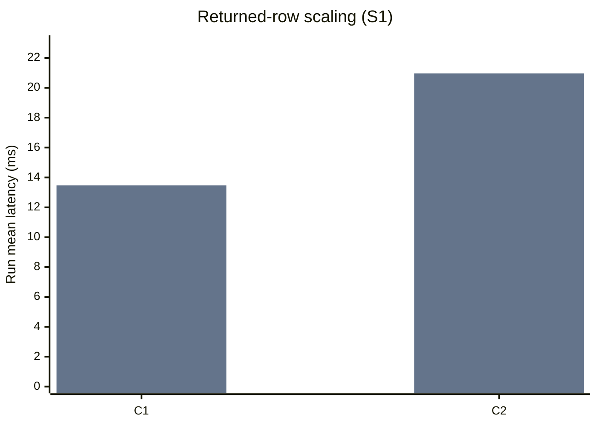


### Returned-row scaling (S2)

| Category | Workload / mode | Peak RSS (MiB) |
| --- | --- | --- |
| C1 | oyster-idle; operation=read; table=LargeRows; rows=10; iterations=100; callbacks=1; access=service; hook=false; pageSize=1000; scanRows=10000; enrichment=batch; mixed=unavailable; readTable=unavailable; queryShape=page; offset=0; hookControl=false; actionContract=auto; scanCoordination=unavailable; wholeScanRows=unavailable; lookupPattern=unavailable; validationOutcome=unavailable; transport=http; phase=warm; load=vus:1; n=1 | 649.305 |
| C2 | oyster-idle; operation=read; table=LargeRows; rows=1000; iterations=100; callbacks=1; access=service; hook=false; pageSize=1000; scanRows=10000; enrichment=batch; mixed=unavailable; readTable=unavailable; queryShape=page; offset=0; hookControl=false; actionContract=auto; scanCoordination=unavailable; wholeScanRows=unavailable; lookupPattern=unavailable; validationOutcome=unavailable; transport=http; phase=warm; load=vus:1; n=1 | 644.684 |

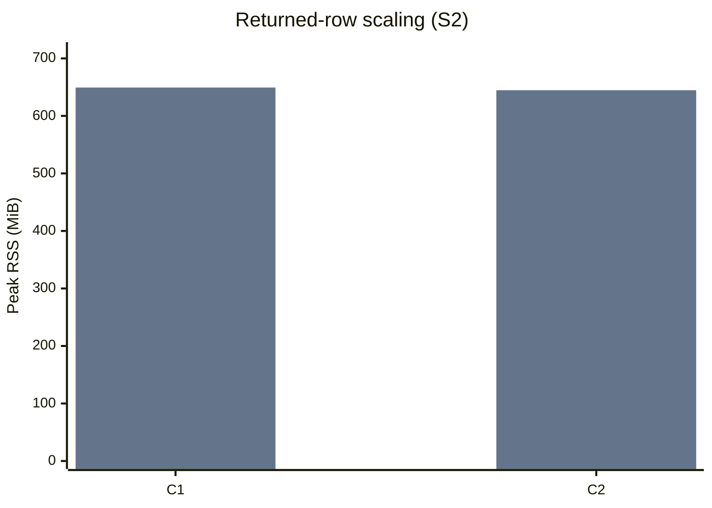


### Returned-row scaling (S3)

| Category | Workload / mode | Run mean latency (ms) |
| --- | --- | --- |
| C1 | native-empty; operation=read; table=LargeRows; rows=10; iterations=100; callbacks=1; access=service; hook=false; pageSize=1000; scanRows=10000; enrichment=batch; mixed=unavailable; readTable=unavailable; queryShape=page; offset=0; hookControl=false; actionContract=auto; scanCoordination=unavailable; wholeScanRows=unavailable; lookupPattern=unavailable; validationOutcome=unavailable; transport=http; phase=warm; load=vus:1; n=1 | 9.883 |
| C2 | native-empty; operation=read; table=LargeRows; rows=1000; iterations=100; callbacks=1; access=service; hook=false; pageSize=1000; scanRows=10000; enrichment=batch; mixed=unavailable; readTable=unavailable; queryShape=page; offset=0; hookControl=false; actionContract=auto; scanCoordination=unavailable; wholeScanRows=unavailable; lookupPattern=unavailable; validationOutcome=unavailable; transport=http; phase=warm; load=vus:1; n=1 | 19.239 |

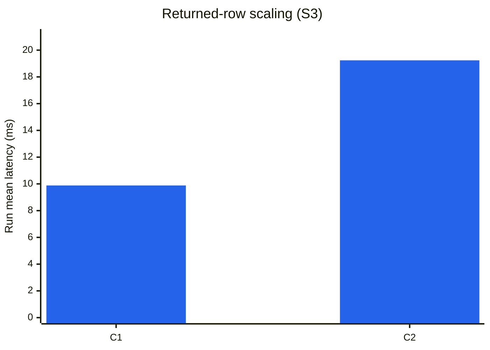


### Returned-row scaling (S4)

| Category | Workload / mode | Peak RSS (MiB) |
| --- | --- | --- |
| C1 | native-empty; operation=read; table=LargeRows; rows=10; iterations=100; callbacks=1; access=service; hook=false; pageSize=1000; scanRows=10000; enrichment=batch; mixed=unavailable; readTable=unavailable; queryShape=page; offset=0; hookControl=false; actionContract=auto; scanCoordination=unavailable; wholeScanRows=unavailable; lookupPattern=unavailable; validationOutcome=unavailable; transport=http; phase=warm; load=vus:1; n=1 | 669.91 |
| C2 | native-empty; operation=read; table=LargeRows; rows=1000; iterations=100; callbacks=1; access=service; hook=false; pageSize=1000; scanRows=10000; enrichment=batch; mixed=unavailable; readTable=unavailable; queryShape=page; offset=0; hookControl=false; actionContract=auto; scanCoordination=unavailable; wholeScanRows=unavailable; lookupPattern=unavailable; validationOutcome=unavailable; transport=http; phase=warm; load=vus:1; n=1 | 649.305 |

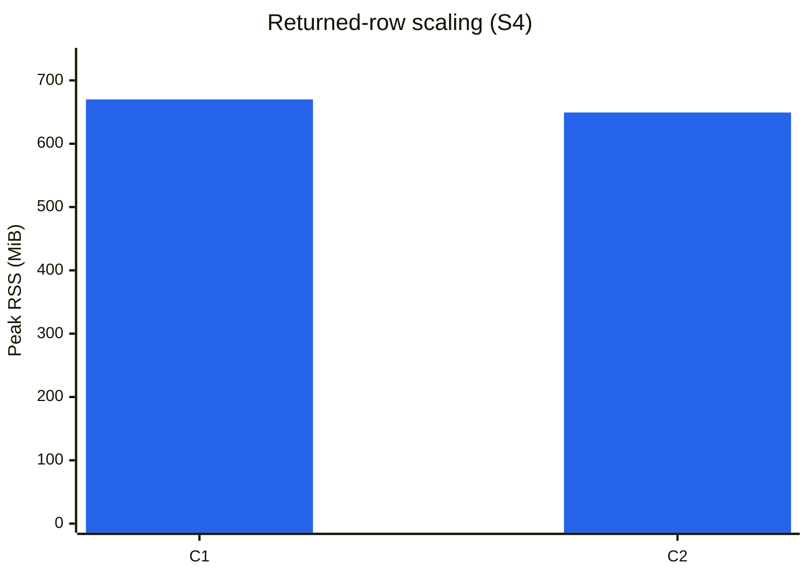


### Returned-row scaling (S5)

| Category | Workload / mode | Run mean latency (ms) |
| --- | --- | --- |
| C1 | wasm-empty; operation=read; table=LargeRows; rows=10; iterations=100; callbacks=1; access=service; hook=false; pageSize=1000; scanRows=10000; enrichment=batch; mixed=unavailable; readTable=unavailable; queryShape=page; offset=0; hookControl=false; actionContract=auto; scanCoordination=unavailable; wholeScanRows=unavailable; lookupPattern=unavailable; validationOutcome=unavailable; transport=http; phase=warm; load=vus:1; n=1 | 12.055 |
| C2 | wasm-empty; operation=read; table=LargeRows; rows=1000; iterations=100; callbacks=1; access=service; hook=false; pageSize=1000; scanRows=10000; enrichment=batch; mixed=unavailable; readTable=unavailable; queryShape=page; offset=0; hookControl=false; actionContract=auto; scanCoordination=unavailable; wholeScanRows=unavailable; lookupPattern=unavailable; validationOutcome=unavailable; transport=http; phase=warm; load=vus:1; n=1 | 29.225 |

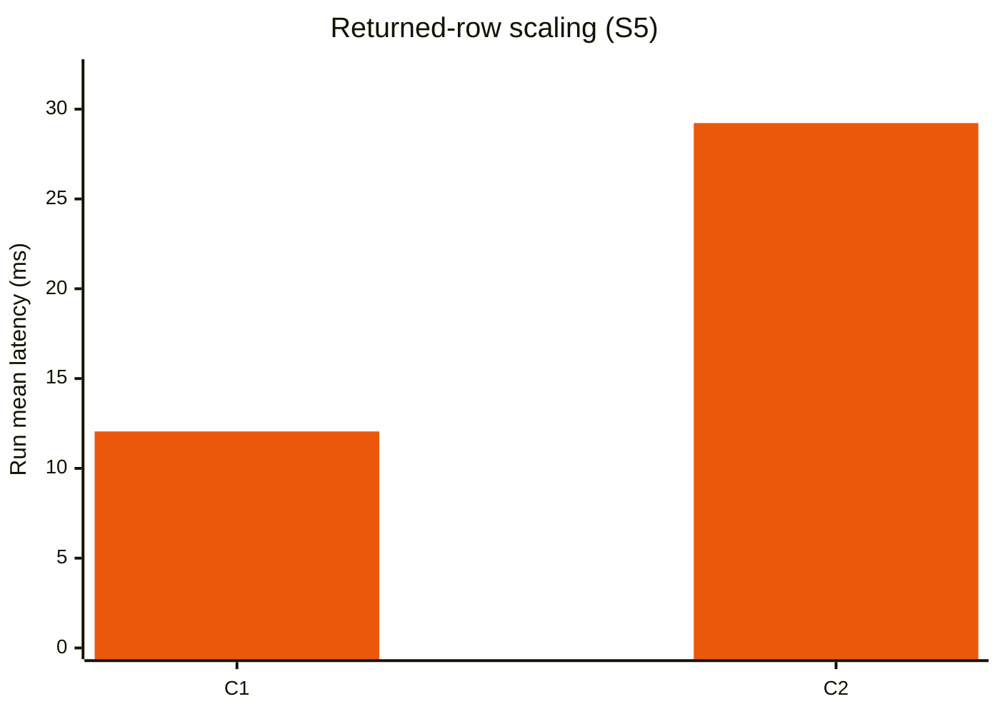

Oyster handlers: [Oyster empty handler](../../apps/extension/srv/BenchmarkService/OysterEmptyLargeRows/after-READ.js).

### Returned-row scaling (S6)

| Category | Workload / mode | Peak RSS (MiB) |
| --- | --- | --- |
| C1 | wasm-empty; operation=read; table=LargeRows; rows=10; iterations=100; callbacks=1; access=service; hook=false; pageSize=1000; scanRows=10000; enrichment=batch; mixed=unavailable; readTable=unavailable; queryShape=page; offset=0; hookControl=false; actionContract=auto; scanCoordination=unavailable; wholeScanRows=unavailable; lookupPattern=unavailable; validationOutcome=unavailable; transport=http; phase=warm; load=vus:1; n=1 | 672.699 |
| C2 | wasm-empty; operation=read; table=LargeRows; rows=1000; iterations=100; callbacks=1; access=service; hook=false; pageSize=1000; scanRows=10000; enrichment=batch; mixed=unavailable; readTable=unavailable; queryShape=page; offset=0; hookControl=false; actionContract=auto; scanCoordination=unavailable; wholeScanRows=unavailable; lookupPattern=unavailable; validationOutcome=unavailable; transport=http; phase=warm; load=vus:1; n=1 | 656.816 |

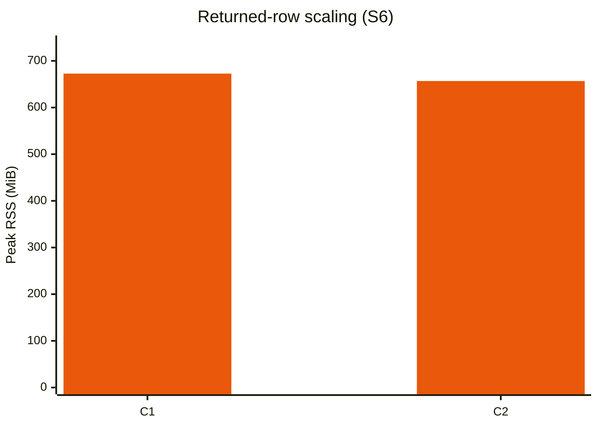

Oyster handlers: [Oyster empty handler](../../apps/extension/srv/BenchmarkService/OysterEmptyLargeRows/after-READ.js).

### Returned-row scaling (S7)

| Category | Workload / mode | Run mean latency (ms) |
| --- | --- | --- |
| C1 | native-compute; operation=read; table=LargeRows; rows=10; iterations=100; callbacks=1; access=service; hook=false; pageSize=1000; scanRows=10000; enrichment=batch; mixed=unavailable; readTable=unavailable; queryShape=page; offset=0; hookControl=false; actionContract=auto; scanCoordination=unavailable; wholeScanRows=unavailable; lookupPattern=unavailable; validationOutcome=unavailable; transport=http; phase=warm; load=vus:1; n=1 | 11.044 |
| C2 | native-compute; operation=read; table=LargeRows; rows=1000; iterations=100; callbacks=1; access=service; hook=false; pageSize=1000; scanRows=10000; enrichment=batch; mixed=unavailable; readTable=unavailable; queryShape=page; offset=0; hookControl=false; actionContract=auto; scanCoordination=unavailable; wholeScanRows=unavailable; lookupPattern=unavailable; validationOutcome=unavailable; transport=http; phase=warm; load=vus:1; n=1 | 24.756 |

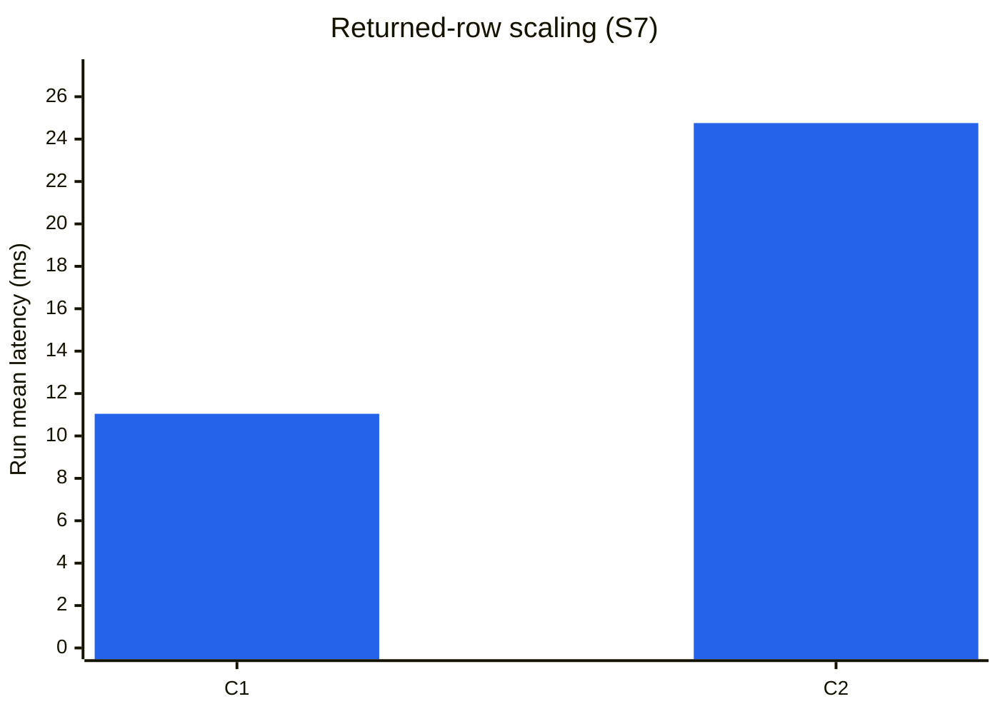


### Returned-row scaling (S8)

| Category | Workload / mode | Peak RSS (MiB) |
| --- | --- | --- |
| C1 | native-compute; operation=read; table=LargeRows; rows=10; iterations=100; callbacks=1; access=service; hook=false; pageSize=1000; scanRows=10000; enrichment=batch; mixed=unavailable; readTable=unavailable; queryShape=page; offset=0; hookControl=false; actionContract=auto; scanCoordination=unavailable; wholeScanRows=unavailable; lookupPattern=unavailable; validationOutcome=unavailable; transport=http; phase=warm; load=vus:1; n=1 | 673.699 |
| C2 | native-compute; operation=read; table=LargeRows; rows=1000; iterations=100; callbacks=1; access=service; hook=false; pageSize=1000; scanRows=10000; enrichment=batch; mixed=unavailable; readTable=unavailable; queryShape=page; offset=0; hookControl=false; actionContract=auto; scanCoordination=unavailable; wholeScanRows=unavailable; lookupPattern=unavailable; validationOutcome=unavailable; transport=http; phase=warm; load=vus:1; n=1 | 656.234 |

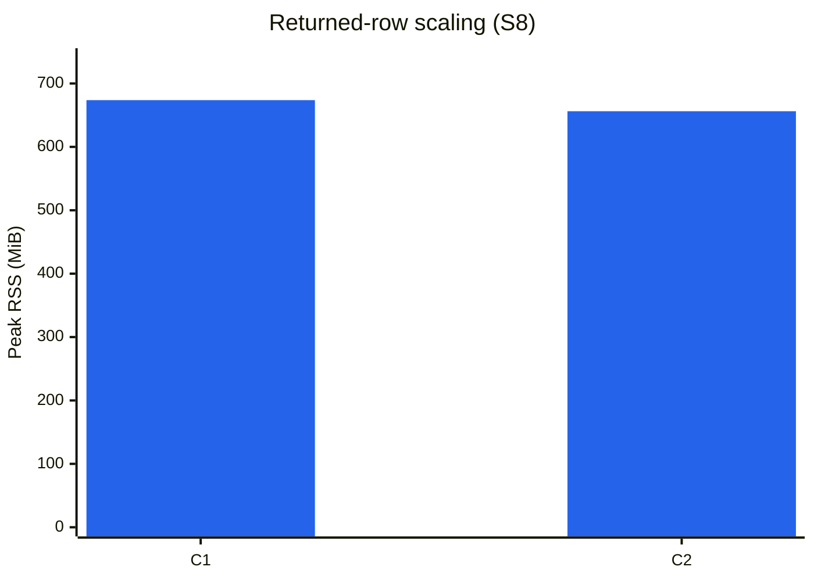


### Returned-row scaling (S9)

| Category | Workload / mode | Run mean latency (ms) |
| --- | --- | --- |
| C1 | wasm-compute; operation=read; table=LargeRows; rows=10; iterations=100; callbacks=1; access=service; hook=false; pageSize=1000; scanRows=10000; enrichment=batch; mixed=unavailable; readTable=unavailable; queryShape=page; offset=0; hookControl=false; actionContract=auto; scanCoordination=unavailable; wholeScanRows=unavailable; lookupPattern=unavailable; validationOutcome=unavailable; transport=http; phase=warm; load=vus:1; n=1 | 13.201 |
| C2 | wasm-compute; operation=read; table=LargeRows; rows=1000; iterations=100; callbacks=1; access=service; hook=false; pageSize=1000; scanRows=10000; enrichment=batch; mixed=unavailable; readTable=unavailable; queryShape=page; offset=0; hookControl=false; actionContract=auto; scanCoordination=unavailable; wholeScanRows=unavailable; lookupPattern=unavailable; validationOutcome=unavailable; transport=http; phase=warm; load=vus:1; n=1 | 52.031 |

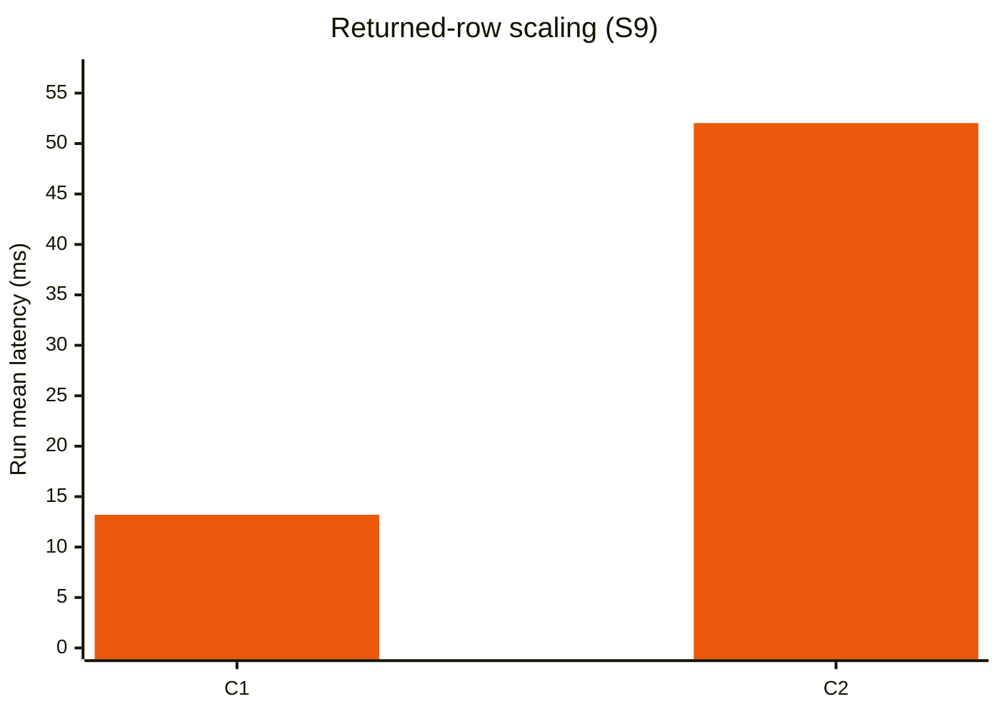

Oyster handlers: [Oyster calculation](../../apps/extension/srv/BenchmarkService/OysterCalculationLargeRows/after-READ.js).

### Returned-row scaling (S10)

| Category | Workload / mode | Peak RSS (MiB) |
| --- | --- | --- |
| C1 | wasm-compute; operation=read; table=LargeRows; rows=10; iterations=100; callbacks=1; access=service; hook=false; pageSize=1000; scanRows=10000; enrichment=batch; mixed=unavailable; readTable=unavailable; queryShape=page; offset=0; hookControl=false; actionContract=auto; scanCoordination=unavailable; wholeScanRows=unavailable; lookupPattern=unavailable; validationOutcome=unavailable; transport=http; phase=warm; load=vus:1; n=1 | 675.199 |
| C2 | wasm-compute; operation=read; table=LargeRows; rows=1000; iterations=100; callbacks=1; access=service; hook=false; pageSize=1000; scanRows=10000; enrichment=batch; mixed=unavailable; readTable=unavailable; queryShape=page; offset=0; hookControl=false; actionContract=auto; scanCoordination=unavailable; wholeScanRows=unavailable; lookupPattern=unavailable; validationOutcome=unavailable; transport=http; phase=warm; load=vus:1; n=1 | 658.719 |

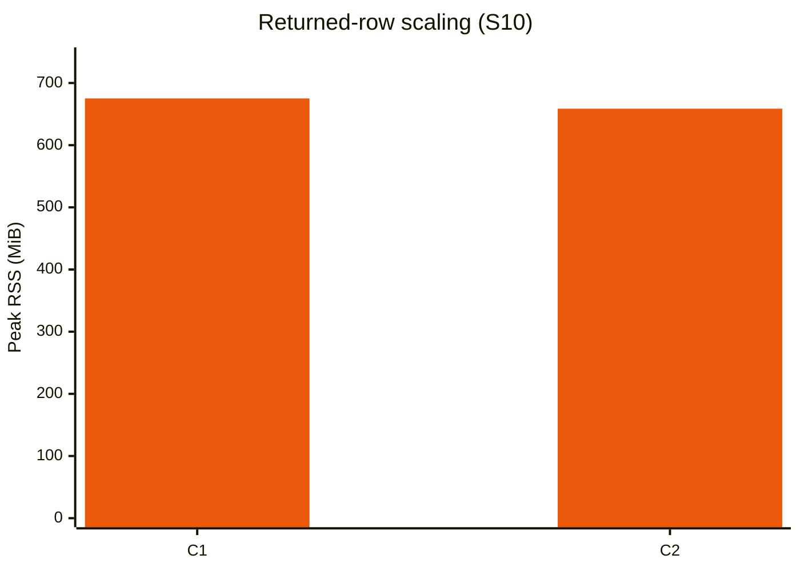

Oyster handlers: [Oyster calculation](../../apps/extension/srv/BenchmarkService/OysterCalculationLargeRows/after-READ.js).

### Callback fan-out (S11)

| Category | Workload / mode | Run mean latency (ms) |
| --- | --- | --- |
| C1 | native-compute-write; operation=action; table=SmallRows; rows=10; iterations=0; callbacks=1; access=service; hook=false; pageSize=1000; scanRows=10000; enrichment=batch; mixed=unavailable; readTable=unavailable; queryShape=page; offset=0; hookControl=false; actionContract=auto; scanCoordination=unavailable; wholeScanRows=unavailable; lookupPattern=unavailable; validationOutcome=unavailable; transport=http; phase=warm; load=vus:1; n=1 | 13.235 |
| C2 | native-compute-write; operation=action; table=SmallRows; rows=10; iterations=0; callbacks=10; access=service; hook=false; pageSize=1000; scanRows=10000; enrichment=batch; mixed=unavailable; readTable=unavailable; queryShape=page; offset=0; hookControl=false; actionContract=auto; scanCoordination=unavailable; wholeScanRows=unavailable; lookupPattern=unavailable; validationOutcome=unavailable; transport=http; phase=warm; load=vus:1; n=1 | 38.488 |

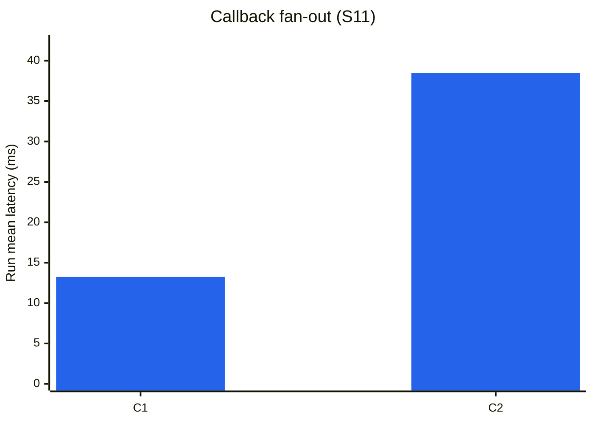


### Callback fan-out (S12)

| Category | Workload / mode | Run mean latency (ms) |
| --- | --- | --- |
| C1 | wasm-compute-write; operation=action; table=SmallRows; rows=10; iterations=0; callbacks=1; access=service; hook=false; pageSize=1000; scanRows=10000; enrichment=batch; mixed=unavailable; readTable=unavailable; queryShape=page; offset=0; hookControl=false; actionContract=auto; scanCoordination=unavailable; wholeScanRows=unavailable; lookupPattern=unavailable; validationOutcome=unavailable; transport=http; phase=warm; load=vus:1; n=1 | 13.211 |
| C2 | wasm-compute-write; operation=action; table=SmallRows; rows=10; iterations=0; callbacks=10; access=service; hook=false; pageSize=1000; scanRows=10000; enrichment=batch; mixed=unavailable; readTable=unavailable; queryShape=page; offset=0; hookControl=false; actionContract=auto; scanCoordination=unavailable; wholeScanRows=unavailable; lookupPattern=unavailable; validationOutcome=unavailable; transport=http; phase=warm; load=vus:1; n=1 | 44.412 |

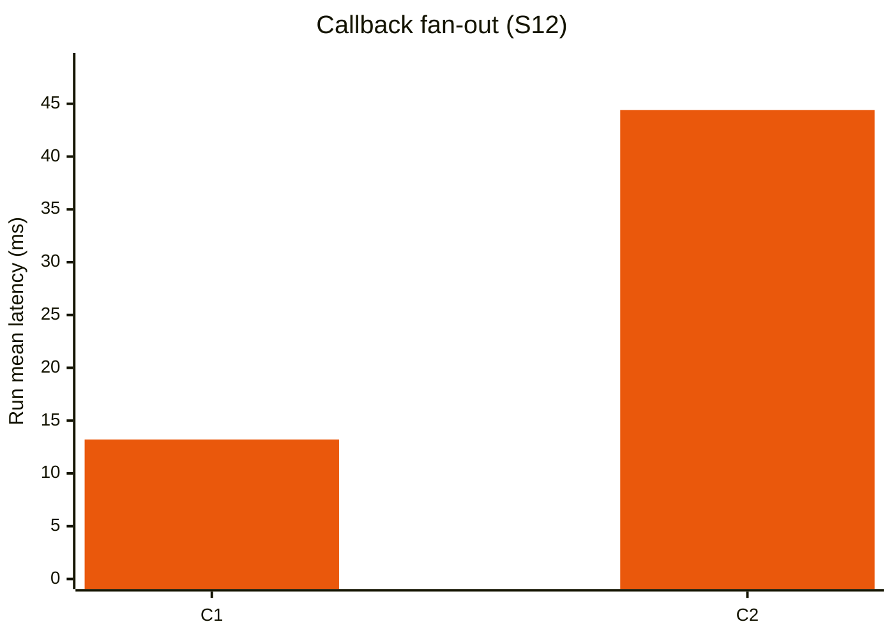

Oyster handlers: [Oyster CQL write](../../apps/extension/srv/BenchmarkService/on-oysterCqlWrite.js).

### Callback fan-out (S13)

| Category | Workload / mode | Run mean latency (ms) |
| --- | --- | --- |
| C1 | native-compute-read; operation=action; table=SmallRows; rows=10; iterations=0; callbacks=1; access=service; hook=false; pageSize=1000; scanRows=10000; enrichment=batch; mixed=unavailable; readTable=unavailable; queryShape=page; offset=0; hookControl=false; actionContract=auto; scanCoordination=unavailable; wholeScanRows=unavailable; lookupPattern=unavailable; validationOutcome=unavailable; transport=http; phase=warm; load=vus:1; n=1 | 11.25 |
| C2 | native-compute-read; operation=action; table=SmallRows; rows=10; iterations=0; callbacks=10; access=service; hook=false; pageSize=1000; scanRows=10000; enrichment=batch; mixed=unavailable; readTable=unavailable; queryShape=page; offset=0; hookControl=false; actionContract=auto; scanCoordination=unavailable; wholeScanRows=unavailable; lookupPattern=unavailable; validationOutcome=unavailable; transport=http; phase=warm; load=vus:1; n=1 | 33.066 |


### Callback fan-out (S14)

| Category | Workload / mode | Run mean latency (ms) |
| --- | --- | --- |
| C1 | wasm-compute-read; operation=action; table=SmallRows; rows=10; iterations=0; callbacks=1; access=service; hook=false; pageSize=1000; scanRows=10000; enrichment=batch; mixed=unavailable; readTable=unavailable; queryShape=page; offset=0; hookControl=false; actionContract=auto; scanCoordination=unavailable; wholeScanRows=unavailable; lookupPattern=unavailable; validationOutcome=unavailable; transport=http; phase=warm; load=vus:1; n=1 | 11.527 |
| C2 | wasm-compute-read; operation=action; table=SmallRows; rows=10; iterations=0; callbacks=10; access=service; hook=false; pageSize=1000; scanRows=10000; enrichment=batch; mixed=unavailable; readTable=unavailable; queryShape=page; offset=0; hookControl=false; actionContract=auto; scanCoordination=unavailable; wholeScanRows=unavailable; lookupPattern=unavailable; validationOutcome=unavailable; transport=http; phase=warm; load=vus:1; n=1 | 58.977 |

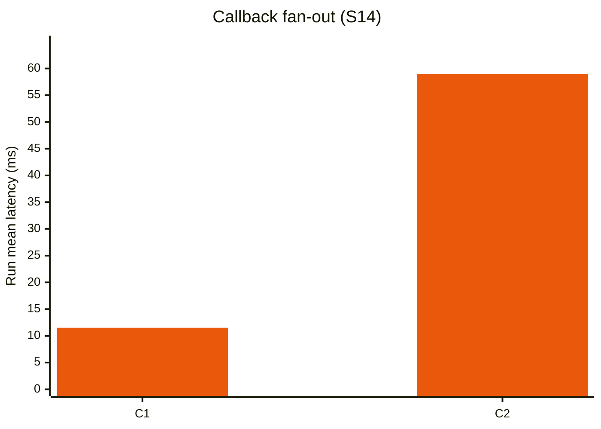

Oyster handlers: [Oyster CQL read](../../apps/extension/srv/BenchmarkService/on-oysterCqlRead.js).

### Load latency (S15)

| Category | Workload / mode | Mean run p95 latency (ms) |
| --- | --- | --- |
| C1 | oyster-idle; operation=action; table=SmallRows; rows=10; iterations=100; callbacks=1; access=service; hook=false; pageSize=1000; scanRows=10000; enrichment=batch; mixed=unavailable; readTable=unavailable; queryShape=page; offset=0; hookControl=false; actionContract=auto; scanCoordination=unavailable; wholeScanRows=unavailable; lookupPattern=unavailable; validationOutcome=unavailable; transport=http; phase=warm; load=vus:1; n=1 | 4.358 |
| C2 | oyster-idle; operation=action; table=SmallRows; rows=10; iterations=100; callbacks=1; access=service; hook=false; pageSize=1000; scanRows=10000; enrichment=batch; mixed=unavailable; readTable=unavailable; queryShape=page; offset=0; hookControl=false; actionContract=auto; scanCoordination=unavailable; wholeScanRows=unavailable; lookupPattern=unavailable; validationOutcome=unavailable; transport=http; phase=warm; load=vus:8; n=1 | 4.496 |
| C3 | oyster-idle; operation=action; table=SmallRows; rows=10; iterations=100; callbacks=1; access=service; hook=false; pageSize=1000; scanRows=10000; enrichment=batch; mixed=unavailable; readTable=unavailable; queryShape=page; offset=0; hookControl=false; actionContract=auto; scanCoordination=unavailable; wholeScanRows=unavailable; lookupPattern=unavailable; validationOutcome=unavailable; transport=http; phase=warm; load=vus:32; n=1 | 16.335 |

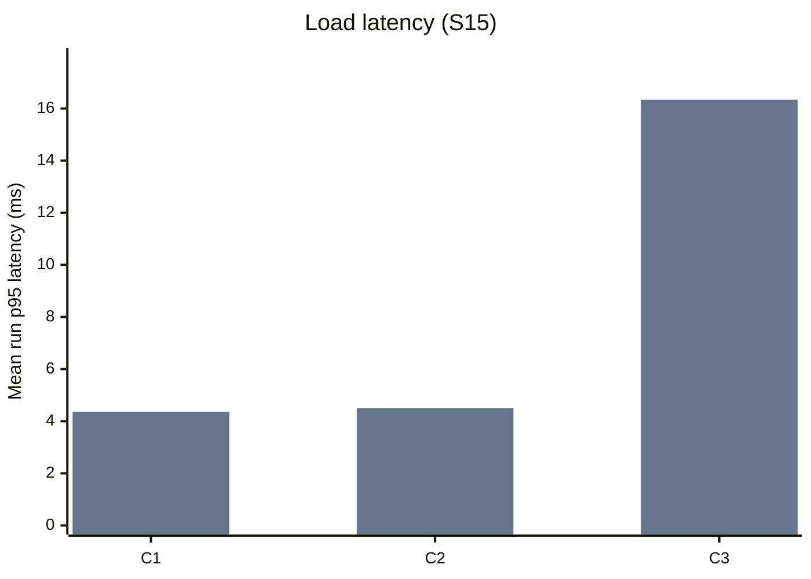


### Successful throughput (S16)

| Category | Workload / mode | Successful throughput (requests/s) |
| --- | --- | --- |
| C1 | oyster-idle; operation=action; table=SmallRows; rows=10; iterations=100; callbacks=1; access=service; hook=false; pageSize=1000; scanRows=10000; enrichment=batch; mixed=unavailable; readTable=unavailable; queryShape=page; offset=0; hookControl=false; actionContract=auto; scanCoordination=unavailable; wholeScanRows=unavailable; lookupPattern=unavailable; validationOutcome=unavailable; transport=http; phase=warm; load=vus:1; n=1 | 276.401 |
| C2 | oyster-idle; operation=action; table=SmallRows; rows=10; iterations=100; callbacks=1; access=service; hook=false; pageSize=1000; scanRows=10000; enrichment=batch; mixed=unavailable; readTable=unavailable; queryShape=page; offset=0; hookControl=false; actionContract=auto; scanCoordination=unavailable; wholeScanRows=unavailable; lookupPattern=unavailable; validationOutcome=unavailable; transport=http; phase=warm; load=vus:8; n=1 | 2478.666 |
| C3 | oyster-idle; operation=action; table=SmallRows; rows=10; iterations=100; callbacks=1; access=service; hook=false; pageSize=1000; scanRows=10000; enrichment=batch; mixed=unavailable; readTable=unavailable; queryShape=page; offset=0; hookControl=false; actionContract=auto; scanCoordination=unavailable; wholeScanRows=unavailable; lookupPattern=unavailable; validationOutcome=unavailable; transport=http; phase=warm; load=vus:32; n=1 | 2917.952 |

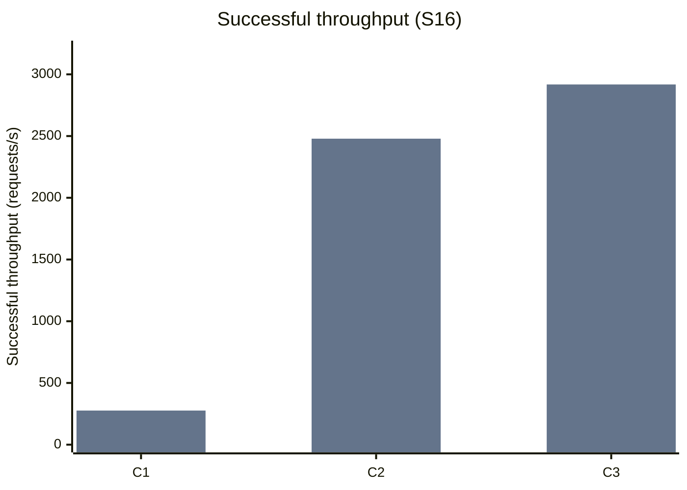


### Unrelated-request probe (S17)

| Category | Workload / mode | Unrelated-request probe p95 (ms) |
| --- | --- | --- |
| C1 | oyster-idle; operation=action; table=SmallRows; rows=10; iterations=100; callbacks=1; access=service; hook=false; pageSize=1000; scanRows=10000; enrichment=batch; mixed=unavailable; readTable=unavailable; queryShape=page; offset=0; hookControl=false; actionContract=auto; scanCoordination=unavailable; wholeScanRows=unavailable; lookupPattern=unavailable; validationOutcome=unavailable; transport=http; phase=warm; load=vus:8; n=1 | 89.029 |
| C2 | oyster-idle; operation=action; table=SmallRows; rows=10; iterations=100; callbacks=1; access=service; hook=false; pageSize=1000; scanRows=10000; enrichment=batch; mixed=unavailable; readTable=unavailable; queryShape=page; offset=0; hookControl=false; actionContract=auto; scanCoordination=unavailable; wholeScanRows=unavailable; lookupPattern=unavailable; validationOutcome=unavailable; transport=http; phase=warm; load=vus:32; n=1 | 155.899 |

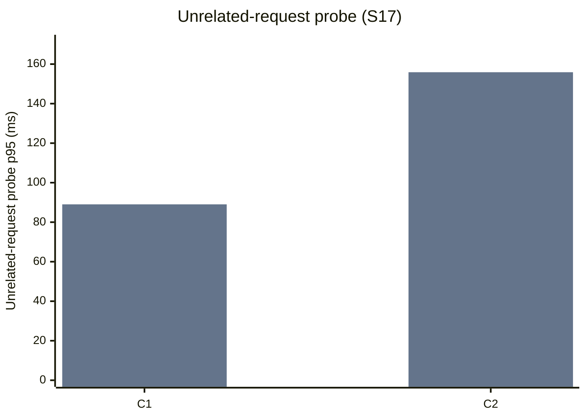


### Load latency (S18)

| Category | Workload / mode | Mean run p95 latency (ms) |
| --- | --- | --- |
| C1 | native-compute-read; operation=action; table=SmallRows; rows=10; iterations=0; callbacks=1; access=service; hook=false; pageSize=1000; scanRows=10000; enrichment=batch; mixed=unavailable; readTable=unavailable; queryShape=page; offset=0; hookControl=false; actionContract=auto; scanCoordination=unavailable; wholeScanRows=unavailable; lookupPattern=unavailable; validationOutcome=unavailable; transport=http; phase=warm; load=vus:1; n=1 | 25.713 |
| C2 | native-compute-read; operation=action; table=SmallRows; rows=10; iterations=0; callbacks=1; access=service; hook=false; pageSize=1000; scanRows=10000; enrichment=batch; mixed=unavailable; readTable=unavailable; queryShape=page; offset=0; hookControl=false; actionContract=auto; scanCoordination=unavailable; wholeScanRows=unavailable; lookupPattern=unavailable; validationOutcome=unavailable; transport=http; phase=warm; load=vus:8; n=1 | 22.397 |
| C3 | native-compute-read; operation=action; table=SmallRows; rows=10; iterations=0; callbacks=1; access=service; hook=false; pageSize=1000; scanRows=10000; enrichment=batch; mixed=unavailable; readTable=unavailable; queryShape=page; offset=0; hookControl=false; actionContract=auto; scanCoordination=unavailable; wholeScanRows=unavailable; lookupPattern=unavailable; validationOutcome=unavailable; transport=http; phase=warm; load=vus:32; n=1 | 55.349 |

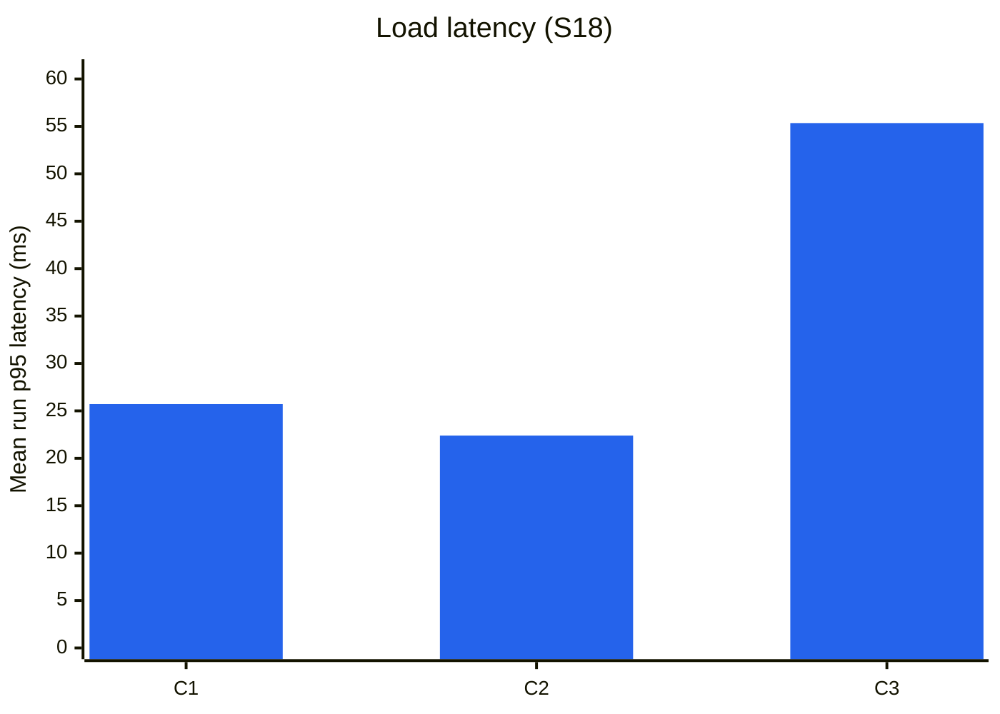


### Successful throughput (S19)

| Category | Workload / mode | Successful throughput (requests/s) |
| --- | --- | --- |
| C1 | native-compute-read; operation=action; table=SmallRows; rows=10; iterations=0; callbacks=1; access=service; hook=false; pageSize=1000; scanRows=10000; enrichment=batch; mixed=unavailable; readTable=unavailable; queryShape=page; offset=0; hookControl=false; actionContract=auto; scanCoordination=unavailable; wholeScanRows=unavailable; lookupPattern=unavailable; validationOutcome=unavailable; transport=http; phase=warm; load=vus:1; n=1 | 87.215 |
| C2 | native-compute-read; operation=action; table=SmallRows; rows=10; iterations=0; callbacks=1; access=service; hook=false; pageSize=1000; scanRows=10000; enrichment=batch; mixed=unavailable; readTable=unavailable; queryShape=page; offset=0; hookControl=false; actionContract=auto; scanCoordination=unavailable; wholeScanRows=unavailable; lookupPattern=unavailable; validationOutcome=unavailable; transport=http; phase=warm; load=vus:8; n=1 | 554.266 |
| C3 | native-compute-read; operation=action; table=SmallRows; rows=10; iterations=0; callbacks=1; access=service; hook=false; pageSize=1000; scanRows=10000; enrichment=batch; mixed=unavailable; readTable=unavailable; queryShape=page; offset=0; hookControl=false; actionContract=auto; scanCoordination=unavailable; wholeScanRows=unavailable; lookupPattern=unavailable; validationOutcome=unavailable; transport=http; phase=warm; load=vus:32; n=1 | 678.281 |

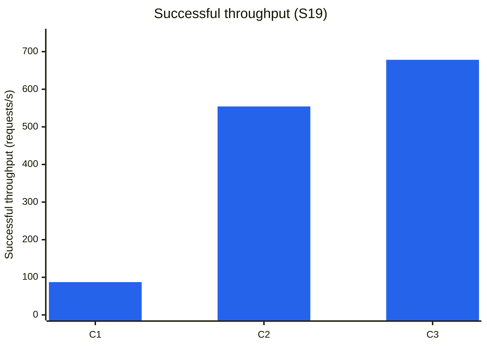


### Unrelated-request probe (S20)

| Category | Workload / mode | Unrelated-request probe p95 (ms) |
| --- | --- | --- |
| C1 | native-compute-read; operation=action; table=SmallRows; rows=10; iterations=0; callbacks=1; access=service; hook=false; pageSize=1000; scanRows=10000; enrichment=batch; mixed=unavailable; readTable=unavailable; queryShape=page; offset=0; hookControl=false; actionContract=auto; scanCoordination=unavailable; wholeScanRows=unavailable; lookupPattern=unavailable; validationOutcome=unavailable; transport=http; phase=warm; load=vus:8; n=1 | 85.336 |
| C2 | native-compute-read; operation=action; table=SmallRows; rows=10; iterations=0; callbacks=1; access=service; hook=false; pageSize=1000; scanRows=10000; enrichment=batch; mixed=unavailable; readTable=unavailable; queryShape=page; offset=0; hookControl=false; actionContract=auto; scanCoordination=unavailable; wholeScanRows=unavailable; lookupPattern=unavailable; validationOutcome=unavailable; transport=http; phase=warm; load=vus:32; n=1 | 136.132 |

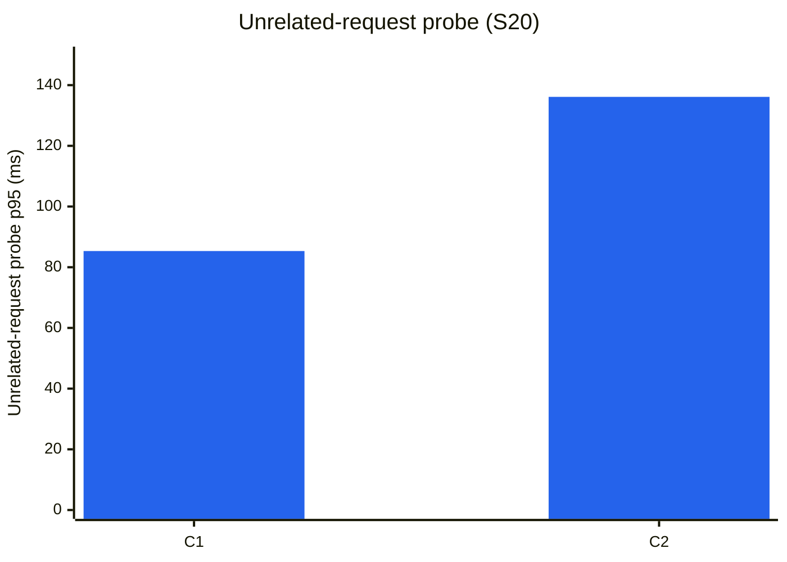


### Load latency (S21)

| Category | Workload / mode | Mean run p95 latency (ms) |
| --- | --- | --- |
| C1 | wasm-compute-read; operation=action; table=SmallRows; rows=10; iterations=0; callbacks=1; access=service; hook=false; pageSize=1000; scanRows=10000; enrichment=batch; mixed=unavailable; readTable=unavailable; queryShape=page; offset=0; hookControl=false; actionContract=auto; scanCoordination=unavailable; wholeScanRows=unavailable; lookupPattern=unavailable; validationOutcome=unavailable; transport=http; phase=warm; load=vus:1; n=1 | 13.195 |
| C2 | wasm-compute-read; operation=action; table=SmallRows; rows=10; iterations=0; callbacks=1; access=service; hook=false; pageSize=1000; scanRows=10000; enrichment=batch; mixed=unavailable; readTable=unavailable; queryShape=page; offset=0; hookControl=false; actionContract=auto; scanCoordination=unavailable; wholeScanRows=unavailable; lookupPattern=unavailable; validationOutcome=unavailable; transport=http; phase=warm; load=vus:8; n=1 | 23.18 |
| C3 | wasm-compute-read; operation=action; table=SmallRows; rows=10; iterations=0; callbacks=1; access=service; hook=false; pageSize=1000; scanRows=10000; enrichment=batch; mixed=unavailable; readTable=unavailable; queryShape=page; offset=0; hookControl=false; actionContract=auto; scanCoordination=unavailable; wholeScanRows=unavailable; lookupPattern=unavailable; validationOutcome=unavailable; transport=http; phase=warm; load=vus:32; n=1 | 67.213 |

```mermaid
---
config:
  themeVariables:
    xyChart:
      plotColorPalette: "#ea580c"
  themeCSS: ".bar-plot-0 rect:nth-child(1) { fill: #ea580c; stroke: #ea580c; } .bar-plot-0 rect:nth-child(2) { fill: #ea580c; stroke: #ea580c; } .bar-plot-0 rect:nth-child(3) { fill: #ea580c; stroke: #ea580c; }"
---
xychart-beta
    title "Load latency (S21)"
    x-axis ["C1", "C2", "C3"]
    y-axis "Mean run p95 latency (ms)" 0 --> 73.934418
    bar [13.194588, 23.18021, 67.213107]
```

Oyster handlers: [Oyster CQL read](../../apps/extension/srv/BenchmarkService/on-oysterCqlRead.js).

### Successful throughput (S22)

| Category | Workload / mode | Successful throughput (requests/s) |
| --- | --- | --- |
| C1 | wasm-compute-read; operation=action; table=SmallRows; rows=10; iterations=0; callbacks=1; access=service; hook=false; pageSize=1000; scanRows=10000; enrichment=batch; mixed=unavailable; readTable=unavailable; queryShape=page; offset=0; hookControl=false; actionContract=auto; scanCoordination=unavailable; wholeScanRows=unavailable; lookupPattern=unavailable; validationOutcome=unavailable; transport=http; phase=warm; load=vus:1; n=1 | 85.048 |
| C2 | wasm-compute-read; operation=action; table=SmallRows; rows=10; iterations=0; callbacks=1; access=service; hook=false; pageSize=1000; scanRows=10000; enrichment=batch; mixed=unavailable; readTable=unavailable; queryShape=page; offset=0; hookControl=false; actionContract=auto; scanCoordination=unavailable; wholeScanRows=unavailable; lookupPattern=unavailable; validationOutcome=unavailable; transport=http; phase=warm; load=vus:8; n=1 | 447.834 |
| C3 | wasm-compute-read; operation=action; table=SmallRows; rows=10; iterations=0; callbacks=1; access=service; hook=false; pageSize=1000; scanRows=10000; enrichment=batch; mixed=unavailable; readTable=unavailable; queryShape=page; offset=0; hookControl=false; actionContract=auto; scanCoordination=unavailable; wholeScanRows=unavailable; lookupPattern=unavailable; validationOutcome=unavailable; transport=http; phase=warm; load=vus:32; n=1 | 557.871 |

```mermaid
---
config:
  themeVariables:
    xyChart:
      plotColorPalette: "#ea580c"
  themeCSS: ".bar-plot-0 rect:nth-child(1) { fill: #ea580c; stroke: #ea580c; } .bar-plot-0 rect:nth-child(2) { fill: #ea580c; stroke: #ea580c; } .bar-plot-0 rect:nth-child(3) { fill: #ea580c; stroke: #ea580c; }"
---
xychart-beta
    title "Successful throughput (S22)"
    x-axis ["C1", "C2", "C3"]
    y-axis "Successful throughput (requests/s)" 0 --> 613.65796
    bar [85.04769029463414, 447.8337194444156, 557.870874376003]
```

Oyster handlers: [Oyster CQL read](../../apps/extension/srv/BenchmarkService/on-oysterCqlRead.js).

### Unrelated-request probe (S23)

| Category | Workload / mode | Unrelated-request probe p95 (ms) |
| --- | --- | --- |
| C1 | wasm-compute-read; operation=action; table=SmallRows; rows=10; iterations=0; callbacks=1; access=service; hook=false; pageSize=1000; scanRows=10000; enrichment=batch; mixed=unavailable; readTable=unavailable; queryShape=page; offset=0; hookControl=false; actionContract=auto; scanCoordination=unavailable; wholeScanRows=unavailable; lookupPattern=unavailable; validationOutcome=unavailable; transport=http; phase=warm; load=vus:8; n=1 | 89.612 |
| C2 | wasm-compute-read; operation=action; table=SmallRows; rows=10; iterations=0; callbacks=1; access=service; hook=false; pageSize=1000; scanRows=10000; enrichment=batch; mixed=unavailable; readTable=unavailable; queryShape=page; offset=0; hookControl=false; actionContract=auto; scanCoordination=unavailable; wholeScanRows=unavailable; lookupPattern=unavailable; validationOutcome=unavailable; transport=http; phase=warm; load=vus:32; n=1 | 131.85 |

```mermaid
---
config:
  themeVariables:
    xyChart:
      plotColorPalette: "#ea580c"
  themeCSS: ".bar-plot-0 rect:nth-child(1) { fill: #ea580c; stroke: #ea580c; } .bar-plot-0 rect:nth-child(2) { fill: #ea580c; stroke: #ea580c; }"
---
xychart-beta
    title "Unrelated-request probe (S23)"
    x-axis ["C1", "C2"]
    y-axis "Unrelated-request probe p95 (ms)" 0 --> 145.03476
    bar [89.611539, 131.84978299999997]
```

Oyster handlers: [Oyster CQL read](../../apps/extension/srv/BenchmarkService/on-oysterCqlRead.js).

Charts use a single basic Mermaid series with category mappings in the adjacent tables. Values are means of eligible independent run metrics. Missing or failed observations are omitted. No illustrative measurements are included. Scaling and fan-out conclusions require multiple values with every other workload dimension fixed; load sweeps also preserve the load kind. Missing sweeps leave those questions unanswered.

## Failures and limit probes

No failures or limit probes are recorded. This does not establish untested limits.

Failures, partial errors and dropped arrivals affect interpretation even when some requests succeed. Expected failures are not performance successes. A handler skipped after a failure cannot support a throughput improvement.

## Handler and correctness validation

| Manifest validation check | Recorded value |
| --- | --- |
| tenantFixtureVerified | true |

No explicit manifest-wide validation failure is recorded.

| Run | Correctness and rollback checks | Load probe |
| --- | --- | --- |
| action/SmallRows/native-compute-read/direct/service/rows10/cpu0/calls1/batch/lookup-batch / rep 1 | {"preflight":{"passed":true,"status":200,"checksum":495,"activation":{"passed":true,"handlerActive":true,"engine":"oyster"},"rollback":{"passed":true,"rejectionStatus":409,"insertedRowAbsent":true,"auxiliaryUnchanged":true}},"postflight":{"passed":true,"status":200,"checksum":561,"activation":{"passed":true,"handlerActive":true,"engine":"oyster"}},"passed":true} | {"attempts":0,"errors":0,"droppedIterations":0} |
| action/SmallRows/wasm-compute-read/direct/service/rows10/cpu0/calls1/batch/lookup-batch / rep 1 | {"preflight":{"passed":true,"status":200,"checksum":495,"activation":{"passed":true,"handlerActive":true,"engine":"oyster"},"rollback":{"passed":true,"rejectionStatus":409,"insertedRowAbsent":true,"auxiliaryUnchanged":true}},"postflight":{"passed":true,"status":200,"checksum":561,"activation":{"passed":true,"handlerActive":true,"engine":"oyster"}},"passed":true} | {"attempts":0,"errors":0,"droppedIterations":0} |
| action/SmallRows/native-empty/hook/service/rows10/cpu0/calls1/batch/contract-compute / rep 1 | {"preflight":{"passed":true,"status":200,"checksum":7,"activation":{"passed":true,"handlerActive":true,"engine":"oyster"},"rollback":{"passed":true,"rejectionStatus":409,"insertedRowAbsent":true,"auxiliaryUnchanged":true}},"postflight":{"passed":true,"status":200,"checksum":7,"activation":{"passed":true,"handlerActive":true,"engine":"oyster"}},"passed":true} | {"attempts":0,"errors":0,"droppedIterations":0} |
| action/SmallRows/wasm-empty/hook/service/rows10/cpu0/calls1/batch/contract-compute / rep 1 | {"preflight":{"passed":true,"status":200,"checksum":7,"activation":{"passed":true,"handlerActive":true,"engine":"oyster"},"rollback":{"passed":true,"rejectionStatus":409,"insertedRowAbsent":true,"auxiliaryUnchanged":true}},"postflight":{"passed":true,"status":200,"checksum":7,"activation":{"passed":true,"handlerActive":true,"engine":"oyster"}},"passed":true} | {"attempts":0,"errors":0,"droppedIterations":0} |
| create/WriteRows/native-compute/direct/service/rows10/cpu100/calls1/batch / rep 1 | {"preflight":{"passed":true,"status":201,"activation":{"passed":true,"handlerActive":true,"engine":"oyster"},"rollback":{"passed":true,"rejectionStatus":409,"insertedRowAbsent":true,"auxiliaryUnchanged":true},"persistedValue":2013694255,"persistedID":17240135},"postflight":{"passed":true,"status":201,"activation":{"passed":true,"handlerActive":true,"engine":"oyster"},"persistedValue":2013694255,"persistedID":17240136},"passed":true} | {"attempts":0,"errors":0,"droppedIterations":0} |
| create/WriteRows/wasm-compute/direct/service/rows10/cpu100/calls1/batch / rep 1 | {"preflight":{"passed":true,"status":201,"activation":{"passed":true,"handlerActive":true,"engine":"oyster"},"rollback":{"passed":true,"rejectionStatus":409,"insertedRowAbsent":true,"auxiliaryUnchanged":true},"persistedValue":2013694255,"persistedID":20440135},"postflight":{"passed":true,"status":201,"activation":{"passed":true,"handlerActive":true,"engine":"oyster"},"persistedValue":2013694255,"persistedID":20440136},"passed":true} | {"attempts":0,"errors":0,"droppedIterations":0} |
| update/WriteRows/native-compute-read/direct/service/rows10/cpu0/calls1/batch / rep 1 | {"preflight":{"passed":true,"status":200,"activation":{"passed":true,"handlerActive":true,"engine":"oyster"},"rollback":{"passed":true,"rejectionStatus":409,"insertedRowAbsent":true,"auxiliaryUnchanged":true},"persistedValue":40,"persistedID":3259136},"postflight":{"passed":true,"status":200,"activation":{"passed":true,"handlerActive":true,"engine":"oyster"},"persistedValue":84,"persistedID":3259137},"passed":true} | {"attempts":0,"errors":0,"droppedIterations":0} |
| update/WriteRows/wasm-compute-read/direct/service/rows10/cpu0/calls1/batch / rep 1 | {"preflight":{"passed":true,"status":200,"activation":{"passed":true,"handlerActive":true,"engine":"oyster"},"rollback":{"passed":true,"rejectionStatus":409,"insertedRowAbsent":true,"auxiliaryUnchanged":true},"persistedValue":40,"persistedID":3259136},"postflight":{"passed":true,"status":200,"activation":{"passed":true,"handlerActive":true,"engine":"oyster"},"persistedValue":84,"persistedID":3259137},"passed":true} | {"attempts":0,"errors":0,"droppedIterations":0} |
| read/SmallRows/native-compute-write/direct/service/rows10/cpu0/calls1/batch/query-page-offset0 / rep 1 | {"preflight":{"passed":true,"status":200,"activation":{"passed":true,"handlerActive":true,"engine":"oyster"},"rollback":{"passed":true,"rejectionStatus":409,"insertedRowAbsent":true,"auxiliaryUnchanged":true},"rows":10,"checksumsVerified":10,"queryShape":"page","offset":0,"referenceRowsVerified":10,"auxiliaryValue":0},"postflight":{"passed":true,"status":200,"activation":{"passed":true,"handlerActive":true,"engine":"oyster"},"rows":10,"checksumsVerified":10,"queryShape":"page","offset":0,"referenceRowsVerified":10,"auxiliaryValue":0},"passed":true} | {"attempts":0,"errors":0,"droppedIterations":0} |
| read/SmallRows/wasm-compute-write/direct/service/rows10/cpu0/calls1/batch/query-page-offset0 / rep 1 | {"preflight":{"passed":true,"status":200,"activation":{"passed":true,"handlerActive":true,"engine":"oyster"},"rollback":{"passed":true,"rejectionStatus":409,"insertedRowAbsent":true,"auxiliaryUnchanged":true},"rows":10,"checksumsVerified":10,"queryShape":"page","offset":0,"referenceRowsVerified":10,"auxiliaryValue":0},"postflight":{"passed":true,"status":200,"activation":{"passed":true,"handlerActive":true,"engine":"oyster"},"rows":10,"checksumsVerified":10,"queryShape":"page","offset":0,"referenceRowsVerified":10,"auxiliaryValue":0},"passed":true} | {"attempts":0,"errors":0,"droppedIterations":0} |
| action/SmallRows/native-validate-read/direct/service/rows10/cpu0/calls1/batch/decision-accepted / rep 1 | {"preflight":{"passed":true,"status":200,"activation":{"passed":true,"handlerActive":true,"engine":"oyster"},"rollback":{"passed":true,"rejectionStatus":409,"insertedRowAbsent":true,"auxiliaryUnchanged":true},"validationOutcome":"accepted","amount":20},"postflight":{"passed":true,"status":200,"activation":{"passed":true,"handlerActive":true,"engine":"oyster"},"validationOutcome":"accepted","amount":20},"passed":true} | {"attempts":0,"errors":0,"droppedIterations":0} |
| action/SmallRows/wasm-validate-read/direct/service/rows10/cpu0/calls1/batch/decision-accepted / rep 1 | {"preflight":{"passed":true,"status":200,"activation":{"passed":true,"handlerActive":true,"engine":"oyster"},"rollback":{"passed":true,"rejectionStatus":409,"insertedRowAbsent":true,"auxiliaryUnchanged":true},"validationOutcome":"accepted","amount":20},"postflight":{"passed":true,"status":200,"activation":{"passed":true,"handlerActive":true,"engine":"oyster"},"validationOutcome":"accepted","amount":20},"passed":true} | {"attempts":0,"errors":0,"droppedIterations":0} |
| create/WriteRows/native-compute-write/direct/service/rows10/cpu0/calls1/batch / rep 1 | {"preflight":{"passed":true,"status":201,"activation":{"passed":true,"handlerActive":true,"engine":"oyster"},"rollback":{"passed":true,"rejectionStatus":409,"insertedRowAbsent":true,"auxiliaryUnchanged":true},"persistedValue":7,"persistedID":42840135,"auxiliaryValue":7},"postflight":{"passed":true,"status":201,"activation":{"passed":true,"handlerActive":true,"engine":"oyster"},"persistedValue":7,"persistedID":42840136,"auxiliaryValue":7},"passed":true} | {"attempts":0,"errors":0,"droppedIterations":0} |
| create/WriteRows/wasm-compute-write/direct/service/rows10/cpu0/calls1/batch / rep 1 | {"preflight":{"passed":true,"status":201,"activation":{"passed":true,"handlerActive":true,"engine":"oyster"},"rollback":{"passed":true,"rejectionStatus":409,"insertedRowAbsent":true,"auxiliaryUnchanged":true},"persistedValue":7,"persistedID":46040135,"auxiliaryValue":7},"postflight":{"passed":true,"status":201,"activation":{"passed":true,"handlerActive":true,"engine":"oyster"},"persistedValue":7,"persistedID":46040136,"auxiliaryValue":7},"passed":true} | {"attempts":0,"errors":0,"droppedIterations":0} |
| action/SmallRows/native-compute-write/direct/service/rows10/cpu0/calls1/batch / rep 1 | {"preflight":{"passed":true,"status":200,"checksum":7,"activation":{"passed":true,"handlerActive":true,"engine":"oyster"},"rollback":{"passed":true,"rejectionStatus":409,"insertedRowAbsent":true,"auxiliaryUnchanged":true},"auxiliaryValue":7},"postflight":{"passed":true,"status":200,"checksum":7,"activation":{"passed":true,"handlerActive":true,"engine":"oyster"},"auxiliaryValue":7},"passed":true} | {"attempts":0,"errors":0,"droppedIterations":0} |
| action/SmallRows/wasm-compute-write/direct/service/rows10/cpu0/calls1/batch / rep 1 | {"preflight":{"passed":true,"status":200,"checksum":7,"activation":{"passed":true,"handlerActive":true,"engine":"oyster"},"rollback":{"passed":true,"rejectionStatus":409,"insertedRowAbsent":true,"auxiliaryUnchanged":true},"auxiliaryValue":7},"postflight":{"passed":true,"status":200,"checksum":7,"activation":{"passed":true,"handlerActive":true,"engine":"oyster"},"auxiliaryValue":7},"passed":true} | {"attempts":0,"errors":0,"droppedIterations":0} |
| action/SmallRows/oyster-idle/direct/service/rows10/cpu100/calls1/batch / rep 1 | {"preflight":{"passed":true,"status":204,"activation":{"passed":true,"handlerActive":true,"engine":"oyster"},"rollback":{"passed":true,"rejectionStatus":409,"insertedRowAbsent":true,"auxiliaryUnchanged":true}},"postflight":{"passed":true,"status":204,"activation":{"passed":true,"handlerActive":true,"engine":"oyster"}},"passed":true} | {"attempts":0,"errors":0,"droppedIterations":0} |
| action/SmallRows/native-compute-read/direct/service/rows10/cpu0/calls1/batch / rep 1 | {"preflight":{"passed":true,"status":200,"checksum":40,"activation":{"passed":true,"handlerActive":true,"engine":"oyster"},"rollback":{"passed":true,"rejectionStatus":409,"insertedRowAbsent":true,"auxiliaryUnchanged":true}},"postflight":{"passed":true,"status":200,"checksum":84,"activation":{"passed":true,"handlerActive":true,"engine":"oyster"}},"passed":true} | {"attempts":0,"errors":0,"droppedIterations":0} |
| action/SmallRows/wasm-compute-read/direct/service/rows10/cpu0/calls1/batch / rep 1 | {"preflight":{"passed":true,"status":200,"checksum":40,"activation":{"passed":true,"handlerActive":true,"engine":"oyster"},"rollback":{"passed":true,"rejectionStatus":409,"insertedRowAbsent":true,"auxiliaryUnchanged":true}},"postflight":{"passed":true,"status":200,"checksum":84,"activation":{"passed":true,"handlerActive":true,"engine":"oyster"}},"passed":true} | {"attempts":0,"errors":0,"droppedIterations":0} |
| read/LargeRows/oyster-idle/direct/service/rows1000/cpu100/calls1/batch/query-page-offset0 / rep 1 | {"preflight":{"passed":true,"status":200,"activation":{"passed":true,"handlerActive":true,"engine":"oyster"},"rollback":{"passed":true,"rejectionStatus":409,"insertedRowAbsent":true,"auxiliaryUnchanged":true},"rows":1000,"checksumsVerified":0,"queryShape":"page","offset":0,"referenceRowsVerified":1000},"postflight":{"passed":true,"status":200,"activation":{"passed":true,"handlerActive":true,"engine":"oyster"},"rows":1000,"checksumsVerified":0,"queryShape":"page","offset":0,"referenceRowsVerified":1000},"passed":true} | {"attempts":0,"errors":0,"droppedIterations":0} |
| update/WriteRows/native-compute-write/direct/service/rows10/cpu0/calls1/batch / rep 1 | {"preflight":{"passed":true,"status":200,"activation":{"passed":true,"handlerActive":true,"engine":"oyster"},"rollback":{"passed":true,"rejectionStatus":409,"insertedRowAbsent":true,"auxiliaryUnchanged":true},"persistedValue":7,"persistedID":3259136,"auxiliaryValue":7},"postflight":{"passed":true,"status":200,"activation":{"passed":true,"handlerActive":true,"engine":"oyster"},"persistedValue":7,"persistedID":3259137,"auxiliaryValue":7},"passed":true} | {"attempts":0,"errors":0,"droppedIterations":0} |
| update/WriteRows/wasm-compute-write/direct/service/rows10/cpu0/calls1/batch / rep 1 | {"preflight":{"passed":true,"status":200,"activation":{"passed":true,"handlerActive":true,"engine":"oyster"},"rollback":{"passed":true,"rejectionStatus":409,"insertedRowAbsent":true,"auxiliaryUnchanged":true},"persistedValue":7,"persistedID":3259136,"auxiliaryValue":7},"postflight":{"passed":true,"status":200,"activation":{"passed":true,"handlerActive":true,"engine":"oyster"},"persistedValue":7,"persistedID":3259137,"auxiliaryValue":7},"passed":true} | {"attempts":0,"errors":0,"droppedIterations":0} |
| action/SmallRows/native-empty/direct/service/rows10/cpu100/calls1/batch / rep 1 | {"preflight":{"passed":true,"status":204,"activation":{"passed":true,"handlerActive":true,"engine":"oyster"},"rollback":{"passed":true,"rejectionStatus":409,"insertedRowAbsent":true,"auxiliaryUnchanged":true}},"postflight":{"passed":true,"status":204,"activation":{"passed":true,"handlerActive":true,"engine":"oyster"}},"passed":true} | {"attempts":0,"errors":0,"droppedIterations":0} |
| action/SmallRows/wasm-empty/direct/service/rows10/cpu100/calls1/batch / rep 1 | {"preflight":{"passed":true,"status":204,"activation":{"passed":true,"handlerActive":true,"engine":"oyster"},"rollback":{"passed":true,"rejectionStatus":409,"insertedRowAbsent":true,"auxiliaryUnchanged":true}},"postflight":{"passed":true,"status":204,"activation":{"passed":true,"handlerActive":true,"engine":"oyster"}},"passed":true} | {"attempts":0,"errors":0,"droppedIterations":0} |
| create/WriteRows/native-validate-read/direct/service/rows10/cpu0/calls1/batch/decision-rejected / rep 1 | {"preflight":{"passed":true,"status":400,"activation":{"passed":true,"handlerActive":true,"engine":"oyster"},"rollback":{"passed":true,"rejectionStatus":409,"insertedRowAbsent":true,"auxiliaryUnchanged":true},"validationOutcome":"rejected","writeUnchanged":true,"rejectionMessage":"Amount exceeds limit"},"postflight":{"passed":true,"status":400,"activation":{"passed":true,"handlerActive":true,"engine":"oyster"},"validationOutcome":"rejected","writeUnchanged":true,"rejectionMessage":"Amount exceeds limit"},"passed":true,"measuredWritesUnchanged":true} | {"attempts":0,"errors":0,"droppedIterations":0} |
| create/WriteRows/wasm-validate-read/direct/service/rows10/cpu0/calls1/batch/decision-rejected / rep 1 | {"preflight":{"passed":true,"status":400,"activation":{"passed":true,"handlerActive":true,"engine":"oyster"},"rollback":{"passed":true,"rejectionStatus":409,"insertedRowAbsent":true,"auxiliaryUnchanged":true},"validationOutcome":"rejected","writeUnchanged":true,"rejectionMessage":"Amount exceeds limit"},"postflight":{"passed":true,"status":400,"activation":{"passed":true,"handlerActive":true,"engine":"oyster"},"validationOutcome":"rejected","writeUnchanged":true,"rejectionMessage":"Amount exceeds limit"},"passed":true,"measuredWritesUnchanged":true} | {"attempts":0,"errors":0,"droppedIterations":0} |
| action/SmallRows/native-validate-read/direct/service/rows10/cpu0/calls1/batch/decision-rejected / rep 1 | {"preflight":{"passed":true,"status":400,"activation":{"passed":true,"handlerActive":true,"engine":"oyster"},"rollback":{"passed":true,"rejectionStatus":409,"insertedRowAbsent":true,"auxiliaryUnchanged":true},"validationOutcome":"rejected","rejectionMessage":"Amount exceeds limit"},"postflight":{"passed":true,"status":400,"activation":{"passed":true,"handlerActive":true,"engine":"oyster"},"validationOutcome":"rejected","rejectionMessage":"Amount exceeds limit"},"passed":true,"measuredWritesUnchanged":true} | {"attempts":0,"errors":0,"droppedIterations":0} |
| action/SmallRows/wasm-validate-read/direct/service/rows10/cpu0/calls1/batch/decision-rejected / rep 1 | {"preflight":{"passed":true,"status":400,"activation":{"passed":true,"handlerActive":true,"engine":"oyster"},"rollback":{"passed":true,"rejectionStatus":409,"insertedRowAbsent":true,"auxiliaryUnchanged":true},"validationOutcome":"rejected","rejectionMessage":"Amount exceeds limit"},"postflight":{"passed":true,"status":400,"activation":{"passed":true,"handlerActive":true,"engine":"oyster"},"validationOutcome":"rejected","rejectionMessage":"Amount exceeds limit"},"passed":true,"measuredWritesUnchanged":true} | {"attempts":0,"errors":0,"droppedIterations":0} |
| action/SmallRows/native-validate/hook/service/rows10/cpu0/calls1/batch/decision-rejected / rep 1 | {"preflight":{"passed":true,"status":400,"activation":{"passed":true,"handlerActive":true,"engine":"oyster"},"rollback":{"passed":true,"rejectionStatus":409,"insertedRowAbsent":true,"auxiliaryUnchanged":true},"validationOutcome":"rejected","rejectionMessage":"Amount exceeds limit"},"postflight":{"passed":true,"status":400,"activation":{"passed":true,"handlerActive":true,"engine":"oyster"},"validationOutcome":"rejected","rejectionMessage":"Amount exceeds limit"},"passed":true,"measuredWritesUnchanged":true} | {"attempts":0,"errors":0,"droppedIterations":0} |
| action/SmallRows/wasm-validate/hook/service/rows10/cpu0/calls1/batch/decision-rejected / rep 1 | {"preflight":{"passed":true,"status":400,"activation":{"passed":true,"handlerActive":true,"engine":"oyster"},"rollback":{"passed":true,"rejectionStatus":409,"insertedRowAbsent":true,"auxiliaryUnchanged":true},"validationOutcome":"rejected","rejectionMessage":"Amount exceeds limit"},"postflight":{"passed":true,"status":400,"activation":{"passed":true,"handlerActive":true,"engine":"oyster"},"validationOutcome":"rejected","rejectionMessage":"Amount exceeds limit"},"passed":true,"measuredWritesUnchanged":true} | {"attempts":0,"errors":0,"droppedIterations":0} |
| create/WriteRows/native-validate/direct/service/rows10/cpu0/calls1/batch/decision-accepted / rep 1 | {"preflight":{"passed":true,"status":201,"activation":{"passed":true,"handlerActive":true,"engine":"oyster"},"rollback":{"passed":true,"rejectionStatus":409,"insertedRowAbsent":true,"auxiliaryUnchanged":true},"persistedValue":7,"persistedID":100440135,"validationOutcome":"accepted","amount":20},"postflight":{"passed":true,"status":201,"activation":{"passed":true,"handlerActive":true,"engine":"oyster"},"persistedValue":7,"persistedID":100440136,"validationOutcome":"accepted","amount":20},"passed":true} | {"attempts":0,"errors":0,"droppedIterations":0} |
| create/WriteRows/wasm-validate/direct/service/rows10/cpu0/calls1/batch/decision-accepted / rep 1 | {"preflight":{"passed":true,"status":201,"activation":{"passed":true,"handlerActive":true,"engine":"oyster"},"rollback":{"passed":true,"rejectionStatus":409,"insertedRowAbsent":true,"auxiliaryUnchanged":true},"persistedValue":7,"persistedID":103640135,"validationOutcome":"accepted","amount":20},"postflight":{"passed":true,"status":201,"activation":{"passed":true,"handlerActive":true,"engine":"oyster"},"persistedValue":7,"persistedID":103640136,"validationOutcome":"accepted","amount":20},"passed":true} | {"attempts":0,"errors":0,"droppedIterations":0} |
| action/SmallRows/native-compute-read/direct/service/rows10/cpu0/calls10/batch / rep 1 | {"preflight":{"passed":true,"status":200,"checksum":337,"activation":{"passed":true,"handlerActive":true,"engine":"oyster"},"rollback":{"passed":true,"rejectionStatus":409,"insertedRowAbsent":true,"auxiliaryUnchanged":true}},"postflight":{"passed":true,"status":200,"checksum":777,"activation":{"passed":true,"handlerActive":true,"engine":"oyster"}},"passed":true} | {"attempts":0,"errors":0,"droppedIterations":0} |
| action/SmallRows/wasm-compute-read/direct/service/rows10/cpu0/calls10/batch / rep 1 | {"preflight":{"passed":true,"status":200,"checksum":337,"activation":{"passed":true,"handlerActive":true,"engine":"oyster"},"rollback":{"passed":true,"rejectionStatus":409,"insertedRowAbsent":true,"auxiliaryUnchanged":true}},"postflight":{"passed":true,"status":200,"checksum":777,"activation":{"passed":true,"handlerActive":true,"engine":"oyster"}},"passed":true} | {"attempts":0,"errors":0,"droppedIterations":0} |
| action/SmallRows/native-validate/direct/service/rows10/cpu0/calls1/batch/decision-rejected / rep 1 | {"preflight":{"passed":true,"status":400,"activation":{"passed":true,"handlerActive":true,"engine":"oyster"},"rollback":{"passed":true,"rejectionStatus":409,"insertedRowAbsent":true,"auxiliaryUnchanged":true},"validationOutcome":"rejected","rejectionMessage":"Amount exceeds limit"},"postflight":{"passed":true,"status":400,"activation":{"passed":true,"handlerActive":true,"engine":"oyster"},"validationOutcome":"rejected","rejectionMessage":"Amount exceeds limit"},"passed":true,"measuredWritesUnchanged":true} | {"attempts":0,"errors":0,"droppedIterations":0} |
| action/SmallRows/wasm-validate/direct/service/rows10/cpu0/calls1/batch/decision-rejected / rep 1 | {"preflight":{"passed":true,"status":400,"activation":{"passed":true,"handlerActive":true,"engine":"oyster"},"rollback":{"passed":true,"rejectionStatus":409,"insertedRowAbsent":true,"auxiliaryUnchanged":true},"validationOutcome":"rejected","rejectionMessage":"Amount exceeds limit"},"postflight":{"passed":true,"status":400,"activation":{"passed":true,"handlerActive":true,"engine":"oyster"},"validationOutcome":"rejected","rejectionMessage":"Amount exceeds limit"},"passed":true,"measuredWritesUnchanged":true} | {"attempts":0,"errors":0,"droppedIterations":0} |
| action/SmallRows/native-compute-write/hook/service/rows10/cpu0/calls1/batch/contract-compute / rep 1 | {"preflight":{"passed":true,"status":200,"checksum":7,"activation":{"passed":true,"handlerActive":true,"engine":"oyster"},"rollback":{"passed":true,"rejectionStatus":409,"insertedRowAbsent":true,"auxiliaryUnchanged":true},"auxiliaryValue":7},"postflight":{"passed":true,"status":200,"checksum":7,"activation":{"passed":true,"handlerActive":true,"engine":"oyster"},"auxiliaryValue":7},"passed":true} | {"attempts":0,"errors":0,"droppedIterations":0} |
| action/SmallRows/wasm-compute-write/hook/service/rows10/cpu0/calls1/batch/contract-compute / rep 1 | {"preflight":{"passed":true,"status":200,"checksum":7,"activation":{"passed":true,"handlerActive":true,"engine":"oyster"},"rollback":{"passed":true,"rejectionStatus":409,"insertedRowAbsent":true,"auxiliaryUnchanged":true},"auxiliaryValue":7},"postflight":{"passed":true,"status":200,"checksum":7,"activation":{"passed":true,"handlerActive":true,"engine":"oyster"},"auxiliaryValue":7},"passed":true} | {"attempts":0,"errors":0,"droppedIterations":0} |
| create/WriteRows/oyster-idle/direct/service/rows10/cpu100/calls1/batch / rep 1 | {"preflight":{"passed":true,"status":201,"activation":{"passed":true,"handlerActive":true,"engine":"oyster"},"rollback":{"passed":true,"rejectionStatus":409,"insertedRowAbsent":true,"auxiliaryUnchanged":true},"persistedValue":7,"persistedID":126040135},"postflight":{"passed":true,"status":201,"activation":{"passed":true,"handlerActive":true,"engine":"oyster"},"persistedValue":7,"persistedID":126040136},"passed":true} | {"attempts":0,"errors":0,"droppedIterations":0} |
| update/WriteRows/native-validate/direct/service/rows10/cpu0/calls1/batch/decision-rejected / rep 1 | {"preflight":{"passed":true,"status":400,"activation":{"passed":true,"handlerActive":true,"engine":"oyster"},"rollback":{"passed":true,"rejectionStatus":409,"insertedRowAbsent":true,"auxiliaryUnchanged":true},"validationOutcome":"rejected","writeUnchanged":true,"rejectionMessage":"Amount exceeds limit"},"postflight":{"passed":true,"status":400,"activation":{"passed":true,"handlerActive":true,"engine":"oyster"},"validationOutcome":"rejected","writeUnchanged":true,"rejectionMessage":"Amount exceeds limit"},"passed":true,"measuredWritesUnchanged":true} | {"attempts":0,"errors":0,"droppedIterations":0} |
| update/WriteRows/wasm-validate/direct/service/rows10/cpu0/calls1/batch/decision-rejected / rep 1 | {"preflight":{"passed":true,"status":400,"activation":{"passed":true,"handlerActive":true,"engine":"oyster"},"rollback":{"passed":true,"rejectionStatus":409,"insertedRowAbsent":true,"auxiliaryUnchanged":true},"validationOutcome":"rejected","writeUnchanged":true,"rejectionMessage":"Amount exceeds limit"},"postflight":{"passed":true,"status":400,"activation":{"passed":true,"handlerActive":true,"engine":"oyster"},"validationOutcome":"rejected","writeUnchanged":true,"rejectionMessage":"Amount exceeds limit"},"passed":true,"measuredWritesUnchanged":true} | {"attempts":0,"errors":0,"droppedIterations":0} |
| scan/LargeRows/native-compute/direct/service/rows10/cpu100/calls1/scan10000-page1000 / rep 1 | {"preflight":{"passed":true,"status":200,"checksum":935710557,"activation":{"passed":true,"handlerActive":true,"engine":"oyster"},"rollback":{"passed":true,"rejectionStatus":409,"insertedRowAbsent":true,"auxiliaryUnchanged":true},"rows":10000},"postflight":{"passed":true,"status":200,"checksum":935710557,"activation":{"passed":true,"handlerActive":true,"engine":"oyster"},"rows":10000},"passed":true} | {"attempts":0,"errors":0,"droppedIterations":0} |
| scan/LargeRows/wasm-compute/direct/service/rows10/cpu100/calls1/scan10000-page1000 / rep 1 | {"preflight":{"passed":true,"status":200,"checksum":935710557,"activation":{"passed":true,"handlerActive":true,"engine":"oyster"},"rollback":{"passed":true,"rejectionStatus":409,"insertedRowAbsent":true,"auxiliaryUnchanged":true},"rows":10000},"postflight":{"passed":true,"status":200,"checksum":935710557,"activation":{"passed":true,"handlerActive":true,"engine":"oyster"},"rows":10000},"passed":true} | {"attempts":0,"errors":0,"droppedIterations":0} |
| action/SmallRows/native-compute-read/hook/service/rows10/cpu0/calls1/batch/contract-compute / rep 1 | {"preflight":{"passed":true,"status":200,"checksum":40,"activation":{"passed":true,"handlerActive":true,"engine":"oyster"},"rollback":{"passed":true,"rejectionStatus":409,"insertedRowAbsent":true,"auxiliaryUnchanged":true}},"postflight":{"passed":true,"status":200,"checksum":84,"activation":{"passed":true,"handlerActive":true,"engine":"oyster"}},"passed":true} | {"attempts":0,"errors":0,"droppedIterations":0} |
| action/SmallRows/wasm-compute-read/hook/service/rows10/cpu0/calls1/batch/contract-compute / rep 1 | {"preflight":{"passed":true,"status":200,"checksum":40,"activation":{"passed":true,"handlerActive":true,"engine":"oyster"},"rollback":{"passed":true,"rejectionStatus":409,"insertedRowAbsent":true,"auxiliaryUnchanged":true}},"postflight":{"passed":true,"status":200,"checksum":84,"activation":{"passed":true,"handlerActive":true,"engine":"oyster"}},"passed":true} | {"attempts":0,"errors":0,"droppedIterations":0} |
| read/SmallRows/native-compute-read/direct/service/rows10/cpu0/calls1/batch/query-page-offset0 / rep 1 | {"preflight":{"passed":true,"status":200,"activation":{"passed":true,"handlerActive":true,"engine":"oyster"},"rollback":{"passed":true,"rejectionStatus":409,"insertedRowAbsent":true,"auxiliaryUnchanged":true},"rows":10,"checksumsVerified":10,"queryShape":"page","offset":0,"referenceRowsVerified":10},"postflight":{"passed":true,"status":200,"activation":{"passed":true,"handlerActive":true,"engine":"oyster"},"rows":10,"checksumsVerified":10,"queryShape":"page","offset":0,"referenceRowsVerified":10},"passed":true} | {"attempts":0,"errors":0,"droppedIterations":0} |
| read/SmallRows/wasm-compute-read/direct/service/rows10/cpu0/calls1/batch/query-page-offset0 / rep 1 | {"preflight":{"passed":true,"status":200,"activation":{"passed":true,"handlerActive":true,"engine":"oyster"},"rollback":{"passed":true,"rejectionStatus":409,"insertedRowAbsent":true,"auxiliaryUnchanged":true},"rows":10,"checksumsVerified":10,"queryShape":"page","offset":0,"referenceRowsVerified":10},"postflight":{"passed":true,"status":200,"activation":{"passed":true,"handlerActive":true,"engine":"oyster"},"rows":10,"checksumsVerified":10,"queryShape":"page","offset":0,"referenceRowsVerified":10},"passed":true} | {"attempts":0,"errors":0,"droppedIterations":0} |
| read/LargeRows/oyster-idle/direct/service/rows10/cpu100/calls1/batch/query-page-offset0 / rep 1 | {"preflight":{"passed":true,"status":200,"activation":{"passed":true,"handlerActive":true,"engine":"oyster"},"rollback":{"passed":true,"rejectionStatus":409,"insertedRowAbsent":true,"auxiliaryUnchanged":true},"rows":10,"checksumsVerified":0,"queryShape":"page","offset":0,"referenceRowsVerified":10},"postflight":{"passed":true,"status":200,"activation":{"passed":true,"handlerActive":true,"engine":"oyster"},"rows":10,"checksumsVerified":0,"queryShape":"page","offset":0,"referenceRowsVerified":10},"passed":true} | {"attempts":0,"errors":0,"droppedIterations":0} |
| read/LargeRows/native-empty/direct/service/rows1000/cpu100/calls1/batch/query-page-offset0 / rep 1 | {"preflight":{"passed":true,"status":200,"activation":{"passed":true,"handlerActive":true,"engine":"oyster"},"rollback":{"passed":true,"rejectionStatus":409,"insertedRowAbsent":true,"auxiliaryUnchanged":true},"rows":1000,"checksumsVerified":0,"queryShape":"page","offset":0,"referenceRowsVerified":1000},"postflight":{"passed":true,"status":200,"activation":{"passed":true,"handlerActive":true,"engine":"oyster"},"rows":1000,"checksumsVerified":0,"queryShape":"page","offset":0,"referenceRowsVerified":1000},"passed":true} | {"attempts":0,"errors":0,"droppedIterations":0} |
| read/LargeRows/wasm-empty/direct/service/rows1000/cpu100/calls1/batch/query-page-offset0 / rep 1 | {"preflight":{"passed":true,"status":200,"activation":{"passed":true,"handlerActive":true,"engine":"oyster"},"rollback":{"passed":true,"rejectionStatus":409,"insertedRowAbsent":true,"auxiliaryUnchanged":true},"rows":1000,"checksumsVerified":0,"queryShape":"page","offset":0,"referenceRowsVerified":1000},"postflight":{"passed":true,"status":200,"activation":{"passed":true,"handlerActive":true,"engine":"oyster"},"rows":1000,"checksumsVerified":0,"queryShape":"page","offset":0,"referenceRowsVerified":1000},"passed":true} | {"attempts":0,"errors":0,"droppedIterations":0} |
| read/LargeRows/native-compute/direct/service/rows1000/cpu100/calls1/batch/query-page-offset0 / rep 1 | {"preflight":{"passed":true,"status":200,"activation":{"passed":true,"handlerActive":true,"engine":"oyster"},"rollback":{"passed":true,"rejectionStatus":409,"insertedRowAbsent":true,"auxiliaryUnchanged":true},"rows":1000,"checksumsVerified":1000,"queryShape":"page","offset":0,"referenceRowsVerified":1000},"postflight":{"passed":true,"status":200,"activation":{"passed":true,"handlerActive":true,"engine":"oyster"},"rows":1000,"checksumsVerified":1000,"queryShape":"page","offset":0,"referenceRowsVerified":1000},"passed":true} | {"attempts":0,"errors":0,"droppedIterations":0} |
| read/LargeRows/wasm-compute/direct/service/rows1000/cpu100/calls1/batch/query-page-offset0 / rep 1 | {"preflight":{"passed":true,"status":200,"activation":{"passed":true,"handlerActive":true,"engine":"oyster"},"rollback":{"passed":true,"rejectionStatus":409,"insertedRowAbsent":true,"auxiliaryUnchanged":true},"rows":1000,"checksumsVerified":1000,"queryShape":"page","offset":0,"referenceRowsVerified":1000},"postflight":{"passed":true,"status":200,"activation":{"passed":true,"handlerActive":true,"engine":"oyster"},"rows":1000,"checksumsVerified":1000,"queryShape":"page","offset":0,"referenceRowsVerified":1000},"passed":true} | {"attempts":0,"errors":0,"droppedIterations":0} |
| action/SmallRows/oyster-idle/hook/service/rows10/cpu100/calls1/batch/hook-control/contract-compute / rep 1 | {"preflight":{"passed":true,"status":200,"checksum":7,"activation":{"passed":true,"handlerActive":true,"engine":"oyster"},"rollback":{"passed":true,"rejectionStatus":409,"insertedRowAbsent":true,"auxiliaryUnchanged":true}},"postflight":{"passed":true,"status":200,"checksum":7,"activation":{"passed":true,"handlerActive":true,"engine":"oyster"}},"passed":true} | {"attempts":0,"errors":0,"droppedIterations":0} |
| action/SmallRows/native-validate-read/hook/service/rows10/cpu0/calls1/batch/decision-accepted / rep 1 | {"preflight":{"passed":true,"status":200,"activation":{"passed":true,"handlerActive":true,"engine":"oyster"},"rollback":{"passed":true,"rejectionStatus":409,"insertedRowAbsent":true,"auxiliaryUnchanged":true},"validationOutcome":"accepted","amount":20},"postflight":{"passed":true,"status":200,"activation":{"passed":true,"handlerActive":true,"engine":"oyster"},"validationOutcome":"accepted","amount":20},"passed":true} | {"attempts":0,"errors":0,"droppedIterations":0} |
| action/SmallRows/wasm-validate-read/hook/service/rows10/cpu0/calls1/batch/decision-accepted / rep 1 | {"preflight":{"passed":true,"status":200,"activation":{"passed":true,"handlerActive":true,"engine":"oyster"},"rollback":{"passed":true,"rejectionStatus":409,"insertedRowAbsent":true,"auxiliaryUnchanged":true},"validationOutcome":"accepted","amount":20},"postflight":{"passed":true,"status":200,"activation":{"passed":true,"handlerActive":true,"engine":"oyster"},"validationOutcome":"accepted","amount":20},"passed":true} | {"attempts":0,"errors":0,"droppedIterations":0} |
| action/SmallRows/native-validate/hook/service/rows10/cpu0/calls1/batch/decision-accepted / rep 1 | {"preflight":{"passed":true,"status":200,"activation":{"passed":true,"handlerActive":true,"engine":"oyster"},"rollback":{"passed":true,"rejectionStatus":409,"insertedRowAbsent":true,"auxiliaryUnchanged":true},"validationOutcome":"accepted","amount":20},"postflight":{"passed":true,"status":200,"activation":{"passed":true,"handlerActive":true,"engine":"oyster"},"validationOutcome":"accepted","amount":20},"passed":true} | {"attempts":0,"errors":0,"droppedIterations":0} |
| action/SmallRows/wasm-validate/hook/service/rows10/cpu0/calls1/batch/decision-accepted / rep 1 | {"preflight":{"passed":true,"status":200,"activation":{"passed":true,"handlerActive":true,"engine":"oyster"},"rollback":{"passed":true,"rejectionStatus":409,"insertedRowAbsent":true,"auxiliaryUnchanged":true},"validationOutcome":"accepted","amount":20},"postflight":{"passed":true,"status":200,"activation":{"passed":true,"handlerActive":true,"engine":"oyster"},"validationOutcome":"accepted","amount":20},"passed":true} | {"attempts":0,"errors":0,"droppedIterations":0} |
| update/WriteRows/native-compute/direct/service/rows10/cpu100/calls1/batch / rep 1 | {"preflight":{"passed":true,"status":200,"activation":{"passed":true,"handlerActive":true,"engine":"oyster"},"rollback":{"passed":true,"rejectionStatus":409,"insertedRowAbsent":true,"auxiliaryUnchanged":true},"persistedValue":2013694255,"persistedID":3259136},"postflight":{"passed":true,"status":200,"activation":{"passed":true,"handlerActive":true,"engine":"oyster"},"persistedValue":2013694255,"persistedID":3259137},"passed":true} | {"attempts":0,"errors":0,"droppedIterations":0} |
| update/WriteRows/wasm-compute/direct/service/rows10/cpu100/calls1/batch / rep 1 | {"preflight":{"passed":true,"status":200,"activation":{"passed":true,"handlerActive":true,"engine":"oyster"},"rollback":{"passed":true,"rejectionStatus":409,"insertedRowAbsent":true,"auxiliaryUnchanged":true},"persistedValue":2013694255,"persistedID":3259136},"postflight":{"passed":true,"status":200,"activation":{"passed":true,"handlerActive":true,"engine":"oyster"},"persistedValue":2013694255,"persistedID":3259137},"passed":true} | {"attempts":0,"errors":0,"droppedIterations":0} |
| action/SmallRows/native-compute-read/direct/db/rows10/cpu0/calls1/batch / rep 1 | {"preflight":{"passed":true,"status":200,"checksum":40,"activation":{"passed":true,"handlerActive":true,"engine":"oyster"},"rollback":{"passed":true,"rejectionStatus":409,"insertedRowAbsent":true,"auxiliaryUnchanged":true}},"postflight":{"passed":true,"status":200,"checksum":84,"activation":{"passed":true,"handlerActive":true,"engine":"oyster"}},"passed":true} | {"attempts":0,"errors":0,"droppedIterations":0} |
| update/WriteRows/native-empty/direct/service/rows10/cpu100/calls1/batch / rep 1 | {"preflight":{"passed":true,"status":200,"activation":{"passed":true,"handlerActive":true,"engine":"oyster"},"rollback":{"passed":true,"rejectionStatus":409,"insertedRowAbsent":true,"auxiliaryUnchanged":true},"persistedValue":7,"persistedID":3259136},"postflight":{"passed":true,"status":200,"activation":{"passed":true,"handlerActive":true,"engine":"oyster"},"persistedValue":7,"persistedID":3259137},"passed":true} | {"attempts":0,"errors":0,"droppedIterations":0} |
| update/WriteRows/wasm-empty/direct/service/rows10/cpu100/calls1/batch / rep 1 | {"preflight":{"passed":true,"status":200,"activation":{"passed":true,"handlerActive":true,"engine":"oyster"},"rollback":{"passed":true,"rejectionStatus":409,"insertedRowAbsent":true,"auxiliaryUnchanged":true},"persistedValue":7,"persistedID":3259136},"postflight":{"passed":true,"status":200,"activation":{"passed":true,"handlerActive":true,"engine":"oyster"},"persistedValue":7,"persistedID":3259137},"passed":true} | {"attempts":0,"errors":0,"droppedIterations":0} |
| create/WriteRows/native-validate/direct/service/rows10/cpu0/calls1/batch/decision-rejected / rep 1 | {"preflight":{"passed":true,"status":400,"activation":{"passed":true,"handlerActive":true,"engine":"oyster"},"rollback":{"passed":true,"rejectionStatus":409,"insertedRowAbsent":true,"auxiliaryUnchanged":true},"validationOutcome":"rejected","writeUnchanged":true,"rejectionMessage":"Amount exceeds limit"},"postflight":{"passed":true,"status":400,"activation":{"passed":true,"handlerActive":true,"engine":"oyster"},"validationOutcome":"rejected","writeUnchanged":true,"rejectionMessage":"Amount exceeds limit"},"passed":true,"measuredWritesUnchanged":true} | {"attempts":0,"errors":0,"droppedIterations":0} |
| create/WriteRows/wasm-validate/direct/service/rows10/cpu0/calls1/batch/decision-rejected / rep 1 | {"preflight":{"passed":true,"status":400,"activation":{"passed":true,"handlerActive":true,"engine":"oyster"},"rollback":{"passed":true,"rejectionStatus":409,"insertedRowAbsent":true,"auxiliaryUnchanged":true},"validationOutcome":"rejected","writeUnchanged":true,"rejectionMessage":"Amount exceeds limit"},"postflight":{"passed":true,"status":400,"activation":{"passed":true,"handlerActive":true,"engine":"oyster"},"validationOutcome":"rejected","writeUnchanged":true,"rejectionMessage":"Amount exceeds limit"},"passed":true,"measuredWritesUnchanged":true} | {"attempts":0,"errors":0,"droppedIterations":0} |
| create/WriteRows/native-validate-read/direct/service/rows10/cpu0/calls1/batch/decision-accepted / rep 1 | {"preflight":{"passed":true,"status":201,"activation":{"passed":true,"handlerActive":true,"engine":"oyster"},"rollback":{"passed":true,"rejectionStatus":409,"insertedRowAbsent":true,"auxiliaryUnchanged":true},"persistedValue":7,"persistedID":209240135,"validationOutcome":"accepted","amount":20},"postflight":{"passed":true,"status":201,"activation":{"passed":true,"handlerActive":true,"engine":"oyster"},"persistedValue":7,"persistedID":209240136,"validationOutcome":"accepted","amount":20},"passed":true} | {"attempts":0,"errors":0,"droppedIterations":0} |
| create/WriteRows/wasm-validate-read/direct/service/rows10/cpu0/calls1/batch/decision-accepted / rep 1 | {"preflight":{"passed":true,"status":201,"activation":{"passed":true,"handlerActive":true,"engine":"oyster"},"rollback":{"passed":true,"rejectionStatus":409,"insertedRowAbsent":true,"auxiliaryUnchanged":true},"persistedValue":7,"persistedID":212440135,"validationOutcome":"accepted","amount":20},"postflight":{"passed":true,"status":201,"activation":{"passed":true,"handlerActive":true,"engine":"oyster"},"persistedValue":7,"persistedID":212440136,"validationOutcome":"accepted","amount":20},"passed":true} | {"attempts":0,"errors":0,"droppedIterations":0} |
| action/SmallRows/native-compute-read/direct/service/rows10/cpu0/calls1/batch/lookup-individual / rep 1 | {"preflight":{"passed":true,"status":200,"checksum":495,"activation":{"passed":true,"handlerActive":true,"engine":"oyster"},"rollback":{"passed":true,"rejectionStatus":409,"insertedRowAbsent":true,"auxiliaryUnchanged":true}},"postflight":{"passed":true,"status":200,"checksum":561,"activation":{"passed":true,"handlerActive":true,"engine":"oyster"}},"passed":true} | {"attempts":0,"errors":0,"droppedIterations":0} |
| action/SmallRows/wasm-compute-read/direct/service/rows10/cpu0/calls1/batch/lookup-individual / rep 1 | {"preflight":{"passed":true,"status":200,"checksum":495,"activation":{"passed":true,"handlerActive":true,"engine":"oyster"},"rollback":{"passed":true,"rejectionStatus":409,"insertedRowAbsent":true,"auxiliaryUnchanged":true}},"postflight":{"passed":true,"status":200,"checksum":561,"activation":{"passed":true,"handlerActive":true,"engine":"oyster"}},"passed":true} | {"attempts":0,"errors":0,"droppedIterations":0} |
| action/SmallRows/native-validate/direct/service/rows10/cpu0/calls1/batch/decision-accepted / rep 1 | {"preflight":{"passed":true,"status":200,"activation":{"passed":true,"handlerActive":true,"engine":"oyster"},"rollback":{"passed":true,"rejectionStatus":409,"insertedRowAbsent":true,"auxiliaryUnchanged":true},"validationOutcome":"accepted","amount":20},"postflight":{"passed":true,"status":200,"activation":{"passed":true,"handlerActive":true,"engine":"oyster"},"validationOutcome":"accepted","amount":20},"passed":true} | {"attempts":0,"errors":0,"droppedIterations":0} |
| action/SmallRows/wasm-validate/direct/service/rows10/cpu0/calls1/batch/decision-accepted / rep 1 | {"preflight":{"passed":true,"status":200,"activation":{"passed":true,"handlerActive":true,"engine":"oyster"},"rollback":{"passed":true,"rejectionStatus":409,"insertedRowAbsent":true,"auxiliaryUnchanged":true},"validationOutcome":"accepted","amount":20},"postflight":{"passed":true,"status":200,"activation":{"passed":true,"handlerActive":true,"engine":"oyster"},"validationOutcome":"accepted","amount":20},"passed":true} | {"attempts":0,"errors":0,"droppedIterations":0} |
| create/WriteRows/native-compute-read/direct/service/rows10/cpu0/calls1/batch / rep 1 | {"preflight":{"passed":true,"status":201,"activation":{"passed":true,"handlerActive":true,"engine":"oyster"},"rollback":{"passed":true,"rejectionStatus":409,"insertedRowAbsent":true,"auxiliaryUnchanged":true},"persistedValue":40,"persistedID":228440135},"postflight":{"passed":true,"status":201,"activation":{"passed":true,"handlerActive":true,"engine":"oyster"},"persistedValue":84,"persistedID":228440136},"passed":true} | {"attempts":0,"errors":0,"droppedIterations":0} |
| create/WriteRows/wasm-compute-read/direct/service/rows10/cpu0/calls1/batch / rep 1 | {"preflight":{"passed":true,"status":201,"activation":{"passed":true,"handlerActive":true,"engine":"oyster"},"rollback":{"passed":true,"rejectionStatus":409,"insertedRowAbsent":true,"auxiliaryUnchanged":true},"persistedValue":40,"persistedID":231640135},"postflight":{"passed":true,"status":201,"activation":{"passed":true,"handlerActive":true,"engine":"oyster"},"persistedValue":84,"persistedID":231640136},"passed":true} | {"attempts":0,"errors":0,"droppedIterations":0} |
| action/SmallRows/native-compute-write/direct/db/rows10/cpu0/calls1/batch / rep 1 | {"preflight":{"passed":true,"status":200,"checksum":7,"activation":{"passed":true,"handlerActive":true,"engine":"oyster"},"rollback":{"passed":true,"rejectionStatus":409,"insertedRowAbsent":true,"auxiliaryUnchanged":true},"auxiliaryValue":7},"postflight":{"passed":true,"status":200,"checksum":7,"activation":{"passed":true,"handlerActive":true,"engine":"oyster"},"auxiliaryValue":7},"passed":true} | {"attempts":0,"errors":0,"droppedIterations":0} |
| action/SmallRows/native-compute-write/direct/service/rows10/cpu0/calls10/batch / rep 1 | {"preflight":{"passed":true,"status":200,"checksum":7,"activation":{"passed":true,"handlerActive":true,"engine":"oyster"},"rollback":{"passed":true,"rejectionStatus":409,"insertedRowAbsent":true,"auxiliaryUnchanged":true},"auxiliaryValue":7},"postflight":{"passed":true,"status":200,"checksum":7,"activation":{"passed":true,"handlerActive":true,"engine":"oyster"},"auxiliaryValue":7},"passed":true} | {"attempts":0,"errors":0,"droppedIterations":0} |
| action/SmallRows/wasm-compute-write/direct/service/rows10/cpu0/calls10/batch / rep 1 | {"preflight":{"passed":true,"status":200,"checksum":7,"activation":{"passed":true,"handlerActive":true,"engine":"oyster"},"rollback":{"passed":true,"rejectionStatus":409,"insertedRowAbsent":true,"auxiliaryUnchanged":true},"auxiliaryValue":7},"postflight":{"passed":true,"status":200,"checksum":7,"activation":{"passed":true,"handlerActive":true,"engine":"oyster"},"auxiliaryValue":7},"passed":true} | {"attempts":0,"errors":0,"droppedIterations":0} |
| create/WriteRows/native-empty/direct/service/rows10/cpu100/calls1/batch / rep 1 | {"preflight":{"passed":true,"status":201,"activation":{"passed":true,"handlerActive":true,"engine":"oyster"},"rollback":{"passed":true,"rejectionStatus":409,"insertedRowAbsent":true,"auxiliaryUnchanged":true},"persistedValue":7,"persistedID":244440135},"postflight":{"passed":true,"status":201,"activation":{"passed":true,"handlerActive":true,"engine":"oyster"},"persistedValue":7,"persistedID":244440136},"passed":true} | {"attempts":0,"errors":0,"droppedIterations":0} |
| create/WriteRows/wasm-empty/direct/service/rows10/cpu100/calls1/batch / rep 1 | {"preflight":{"passed":true,"status":201,"activation":{"passed":true,"handlerActive":true,"engine":"oyster"},"rollback":{"passed":true,"rejectionStatus":409,"insertedRowAbsent":true,"auxiliaryUnchanged":true},"persistedValue":7,"persistedID":247640135},"postflight":{"passed":true,"status":201,"activation":{"passed":true,"handlerActive":true,"engine":"oyster"},"persistedValue":7,"persistedID":247640136},"passed":true} | {"attempts":0,"errors":0,"droppedIterations":0} |
| action/SmallRows/native-validate-read/hook/service/rows10/cpu0/calls1/batch/decision-rejected / rep 1 | {"preflight":{"passed":true,"status":400,"activation":{"passed":true,"handlerActive":true,"engine":"oyster"},"rollback":{"passed":true,"rejectionStatus":409,"insertedRowAbsent":true,"auxiliaryUnchanged":true},"validationOutcome":"rejected","rejectionMessage":"Amount exceeds limit"},"postflight":{"passed":true,"status":400,"activation":{"passed":true,"handlerActive":true,"engine":"oyster"},"validationOutcome":"rejected","rejectionMessage":"Amount exceeds limit"},"passed":true,"measuredWritesUnchanged":true} | {"attempts":0,"errors":0,"droppedIterations":0} |
| action/SmallRows/wasm-validate-read/hook/service/rows10/cpu0/calls1/batch/decision-rejected / rep 1 | {"preflight":{"passed":true,"status":400,"activation":{"passed":true,"handlerActive":true,"engine":"oyster"},"rollback":{"passed":true,"rejectionStatus":409,"insertedRowAbsent":true,"auxiliaryUnchanged":true},"validationOutcome":"rejected","rejectionMessage":"Amount exceeds limit"},"postflight":{"passed":true,"status":400,"activation":{"passed":true,"handlerActive":true,"engine":"oyster"},"validationOutcome":"rejected","rejectionMessage":"Amount exceeds limit"},"passed":true,"measuredWritesUnchanged":true} | {"attempts":0,"errors":0,"droppedIterations":0} |
| update/WriteRows/native-validate-read/direct/service/rows10/cpu0/calls1/batch/decision-accepted / rep 1 | {"preflight":{"passed":true,"status":200,"activation":{"passed":true,"handlerActive":true,"engine":"oyster"},"rollback":{"passed":true,"rejectionStatus":409,"insertedRowAbsent":true,"auxiliaryUnchanged":true},"persistedValue":7,"persistedID":3259136,"validationOutcome":"accepted","amount":20},"postflight":{"passed":true,"status":200,"activation":{"passed":true,"handlerActive":true,"engine":"oyster"},"persistedValue":7,"persistedID":3259137,"validationOutcome":"accepted","amount":20},"passed":true} | {"attempts":0,"errors":0,"droppedIterations":0} |
| update/WriteRows/wasm-validate-read/direct/service/rows10/cpu0/calls1/batch/decision-accepted / rep 1 | {"preflight":{"passed":true,"status":200,"activation":{"passed":true,"handlerActive":true,"engine":"oyster"},"rollback":{"passed":true,"rejectionStatus":409,"insertedRowAbsent":true,"auxiliaryUnchanged":true},"persistedValue":7,"persistedID":3259136,"validationOutcome":"accepted","amount":20},"postflight":{"passed":true,"status":200,"activation":{"passed":true,"handlerActive":true,"engine":"oyster"},"persistedValue":7,"persistedID":3259137,"validationOutcome":"accepted","amount":20},"passed":true} | {"attempts":0,"errors":0,"droppedIterations":0} |
| read/SmallRows/oyster-idle/direct/service/rows10/cpu100/calls1/batch/query-page-offset0 / rep 1 | {"preflight":{"passed":true,"status":200,"activation":{"passed":true,"handlerActive":true,"engine":"oyster"},"rollback":{"passed":true,"rejectionStatus":409,"insertedRowAbsent":true,"auxiliaryUnchanged":true},"rows":10,"checksumsVerified":0,"queryShape":"page","offset":0,"referenceRowsVerified":10},"postflight":{"passed":true,"status":200,"activation":{"passed":true,"handlerActive":true,"engine":"oyster"},"rows":10,"checksumsVerified":0,"queryShape":"page","offset":0,"referenceRowsVerified":10},"passed":true} | {"attempts":0,"errors":0,"droppedIterations":0} |
| action/SmallRows/oyster-idle/direct/service/rows10/cpu100/calls1/batch/hook-control/contract-compute / rep 1 | {"preflight":{"passed":true,"status":200,"checksum":7,"activation":{"passed":true,"handlerActive":true,"engine":"oyster"},"rollback":{"passed":true,"rejectionStatus":409,"insertedRowAbsent":true,"auxiliaryUnchanged":true}},"postflight":{"passed":true,"status":200,"checksum":7,"activation":{"passed":true,"handlerActive":true,"engine":"oyster"}},"passed":true} | {"attempts":0,"errors":0,"droppedIterations":0} |
| action/SmallRows/native-compute/direct/service/rows10/cpu100/calls1/batch / rep 1 | {"preflight":{"passed":true,"status":200,"checksum":2013694255,"activation":{"passed":true,"handlerActive":true,"engine":"oyster"},"rollback":{"passed":true,"rejectionStatus":409,"insertedRowAbsent":true,"auxiliaryUnchanged":true}},"postflight":{"passed":true,"status":200,"checksum":2013694255,"activation":{"passed":true,"handlerActive":true,"engine":"oyster"}},"passed":true} | {"attempts":0,"errors":0,"droppedIterations":0} |
| action/SmallRows/wasm-compute/direct/service/rows10/cpu100/calls1/batch / rep 1 | {"preflight":{"passed":true,"status":200,"checksum":2013694255,"activation":{"passed":true,"handlerActive":true,"engine":"oyster"},"rollback":{"passed":true,"rejectionStatus":409,"insertedRowAbsent":true,"auxiliaryUnchanged":true}},"postflight":{"passed":true,"status":200,"checksum":2013694255,"activation":{"passed":true,"handlerActive":true,"engine":"oyster"}},"passed":true} | {"attempts":0,"errors":0,"droppedIterations":0} |
| read/LargeRows/native-empty/direct/service/rows10/cpu100/calls1/batch/query-page-offset0 / rep 1 | {"preflight":{"passed":true,"status":200,"activation":{"passed":true,"handlerActive":true,"engine":"oyster"},"rollback":{"passed":true,"rejectionStatus":409,"insertedRowAbsent":true,"auxiliaryUnchanged":true},"rows":10,"checksumsVerified":0,"queryShape":"page","offset":0,"referenceRowsVerified":10},"postflight":{"passed":true,"status":200,"activation":{"passed":true,"handlerActive":true,"engine":"oyster"},"rows":10,"checksumsVerified":0,"queryShape":"page","offset":0,"referenceRowsVerified":10},"passed":true} | {"attempts":0,"errors":0,"droppedIterations":0} |
| read/LargeRows/wasm-empty/direct/service/rows10/cpu100/calls1/batch/query-page-offset0 / rep 1 | {"preflight":{"passed":true,"status":200,"activation":{"passed":true,"handlerActive":true,"engine":"oyster"},"rollback":{"passed":true,"rejectionStatus":409,"insertedRowAbsent":true,"auxiliaryUnchanged":true},"rows":10,"checksumsVerified":0,"queryShape":"page","offset":0,"referenceRowsVerified":10},"postflight":{"passed":true,"status":200,"activation":{"passed":true,"handlerActive":true,"engine":"oyster"},"rows":10,"checksumsVerified":0,"queryShape":"page","offset":0,"referenceRowsVerified":10},"passed":true} | {"attempts":0,"errors":0,"droppedIterations":0} |
| update/WriteRows/oyster-idle/direct/service/rows10/cpu100/calls1/batch / rep 1 | {"preflight":{"passed":true,"status":200,"activation":{"passed":true,"handlerActive":true,"engine":"oyster"},"rollback":{"passed":true,"rejectionStatus":409,"insertedRowAbsent":true,"auxiliaryUnchanged":true},"persistedValue":7,"persistedID":3259136},"postflight":{"passed":true,"status":200,"activation":{"passed":true,"handlerActive":true,"engine":"oyster"},"persistedValue":7,"persistedID":3259137},"passed":true} | {"attempts":0,"errors":0,"droppedIterations":0} |
| read/SmallRows/native-empty/direct/service/rows10/cpu100/calls1/batch/query-page-offset0 / rep 1 | {"preflight":{"passed":true,"status":200,"activation":{"passed":true,"handlerActive":true,"engine":"oyster"},"rollback":{"passed":true,"rejectionStatus":409,"insertedRowAbsent":true,"auxiliaryUnchanged":true},"rows":10,"checksumsVerified":0,"queryShape":"page","offset":0,"referenceRowsVerified":10},"postflight":{"passed":true,"status":200,"activation":{"passed":true,"handlerActive":true,"engine":"oyster"},"rows":10,"checksumsVerified":0,"queryShape":"page","offset":0,"referenceRowsVerified":10},"passed":true} | {"attempts":0,"errors":0,"droppedIterations":0} |
| read/SmallRows/wasm-empty/direct/service/rows10/cpu100/calls1/batch/query-page-offset0 / rep 1 | {"preflight":{"passed":true,"status":200,"activation":{"passed":true,"handlerActive":true,"engine":"oyster"},"rollback":{"passed":true,"rejectionStatus":409,"insertedRowAbsent":true,"auxiliaryUnchanged":true},"rows":10,"checksumsVerified":0,"queryShape":"page","offset":0,"referenceRowsVerified":10},"postflight":{"passed":true,"status":200,"activation":{"passed":true,"handlerActive":true,"engine":"oyster"},"rows":10,"checksumsVerified":0,"queryShape":"page","offset":0,"referenceRowsVerified":10},"passed":true} | {"attempts":0,"errors":0,"droppedIterations":0} |
| update/WriteRows/native-validate/direct/service/rows10/cpu0/calls1/batch/decision-accepted / rep 1 | {"preflight":{"passed":true,"status":200,"activation":{"passed":true,"handlerActive":true,"engine":"oyster"},"rollback":{"passed":true,"rejectionStatus":409,"insertedRowAbsent":true,"auxiliaryUnchanged":true},"persistedValue":7,"persistedID":3259136,"validationOutcome":"accepted","amount":20},"postflight":{"passed":true,"status":200,"activation":{"passed":true,"handlerActive":true,"engine":"oyster"},"persistedValue":7,"persistedID":3259137,"validationOutcome":"accepted","amount":20},"passed":true} | {"attempts":0,"errors":0,"droppedIterations":0} |
| update/WriteRows/wasm-validate/direct/service/rows10/cpu0/calls1/batch/decision-accepted / rep 1 | {"preflight":{"passed":true,"status":200,"activation":{"passed":true,"handlerActive":true,"engine":"oyster"},"rollback":{"passed":true,"rejectionStatus":409,"insertedRowAbsent":true,"auxiliaryUnchanged":true},"persistedValue":7,"persistedID":3259136,"validationOutcome":"accepted","amount":20},"postflight":{"passed":true,"status":200,"activation":{"passed":true,"handlerActive":true,"engine":"oyster"},"persistedValue":7,"persistedID":3259137,"validationOutcome":"accepted","amount":20},"passed":true} | {"attempts":0,"errors":0,"droppedIterations":0} |
| read/LargeRows/native-compute/direct/service/rows10/cpu100/calls1/batch/query-page-offset0 / rep 1 | {"preflight":{"passed":true,"status":200,"activation":{"passed":true,"handlerActive":true,"engine":"oyster"},"rollback":{"passed":true,"rejectionStatus":409,"insertedRowAbsent":true,"auxiliaryUnchanged":true},"rows":10,"checksumsVerified":10,"queryShape":"page","offset":0,"referenceRowsVerified":10},"postflight":{"passed":true,"status":200,"activation":{"passed":true,"handlerActive":true,"engine":"oyster"},"rows":10,"checksumsVerified":10,"queryShape":"page","offset":0,"referenceRowsVerified":10},"passed":true} | {"attempts":0,"errors":0,"droppedIterations":0} |
| read/LargeRows/wasm-compute/direct/service/rows10/cpu100/calls1/batch/query-page-offset0 / rep 1 | {"preflight":{"passed":true,"status":200,"activation":{"passed":true,"handlerActive":true,"engine":"oyster"},"rollback":{"passed":true,"rejectionStatus":409,"insertedRowAbsent":true,"auxiliaryUnchanged":true},"rows":10,"checksumsVerified":10,"queryShape":"page","offset":0,"referenceRowsVerified":10},"postflight":{"passed":true,"status":200,"activation":{"passed":true,"handlerActive":true,"engine":"oyster"},"rows":10,"checksumsVerified":10,"queryShape":"page","offset":0,"referenceRowsVerified":10},"passed":true} | {"attempts":0,"errors":0,"droppedIterations":0} |
| update/WriteRows/native-validate-read/direct/service/rows10/cpu0/calls1/batch/decision-rejected / rep 1 | {"preflight":{"passed":true,"status":400,"activation":{"passed":true,"handlerActive":true,"engine":"oyster"},"rollback":{"passed":true,"rejectionStatus":409,"insertedRowAbsent":true,"auxiliaryUnchanged":true},"validationOutcome":"rejected","writeUnchanged":true,"rejectionMessage":"Amount exceeds limit"},"postflight":{"passed":true,"status":400,"activation":{"passed":true,"handlerActive":true,"engine":"oyster"},"validationOutcome":"rejected","writeUnchanged":true,"rejectionMessage":"Amount exceeds limit"},"passed":true,"measuredWritesUnchanged":true} | {"attempts":0,"errors":0,"droppedIterations":0} |
| update/WriteRows/wasm-validate-read/direct/service/rows10/cpu0/calls1/batch/decision-rejected / rep 1 | {"preflight":{"passed":true,"status":400,"activation":{"passed":true,"handlerActive":true,"engine":"oyster"},"rollback":{"passed":true,"rejectionStatus":409,"insertedRowAbsent":true,"auxiliaryUnchanged":true},"validationOutcome":"rejected","writeUnchanged":true,"rejectionMessage":"Amount exceeds limit"},"postflight":{"passed":true,"status":400,"activation":{"passed":true,"handlerActive":true,"engine":"oyster"},"validationOutcome":"rejected","writeUnchanged":true,"rejectionMessage":"Amount exceeds limit"},"passed":true,"measuredWritesUnchanged":true} | {"attempts":0,"errors":0,"droppedIterations":0} |
| action/SmallRows/oyster-idle/direct/service/rows10/cpu100/calls1/batch / rep 1 | {"preflight":{"passed":true,"status":204,"activation":{"passed":true,"handlerActive":true,"engine":"oyster"},"rollback":{"passed":true,"rejectionStatus":409,"insertedRowAbsent":true,"auxiliaryUnchanged":true}},"postflight":{"passed":true,"status":204,"activation":{"passed":true,"handlerActive":true,"engine":"oyster"}},"passed":true} | {"attempts":5,"errors":0,"droppedIterations":0,"meanMs":23.291031000000096,"p50Ms":6.843589000000065,"p95Ms":89.02859600000002,"p99Ms":89.02859600000002} |
| action/SmallRows/native-compute-read/direct/service/rows10/cpu0/calls1/batch / rep 1 | {"preflight":{"passed":true,"status":200,"checksum":40,"activation":{"passed":true,"handlerActive":true,"engine":"oyster"},"rollback":{"passed":true,"rejectionStatus":409,"insertedRowAbsent":true,"auxiliaryUnchanged":true}},"postflight":{"passed":true,"status":200,"checksum":84,"activation":{"passed":true,"handlerActive":true,"engine":"oyster"}},"passed":true} | {"attempts":5,"errors":0,"droppedIterations":0,"meanMs":21.563718799999844,"p50Ms":5.868046999999933,"p95Ms":85.33571899999998,"p99Ms":85.33571899999998} |
| action/SmallRows/wasm-compute-read/direct/service/rows10/cpu0/calls1/batch / rep 1 | {"preflight":{"passed":true,"status":200,"checksum":40,"activation":{"passed":true,"handlerActive":true,"engine":"oyster"},"rollback":{"passed":true,"rejectionStatus":409,"insertedRowAbsent":true,"auxiliaryUnchanged":true}},"postflight":{"passed":true,"status":200,"checksum":84,"activation":{"passed":true,"handlerActive":true,"engine":"oyster"}},"passed":true} | {"attempts":5,"errors":0,"droppedIterations":0,"meanMs":24.029142,"p50Ms":7.8821029999999155,"p95Ms":89.611539,"p99Ms":89.611539} |
| action/SmallRows/oyster-idle/direct/service/rows10/cpu100/calls1/batch / rep 1 | {"preflight":{"passed":true,"status":204,"activation":{"passed":true,"handlerActive":true,"engine":"oyster"},"rollback":{"passed":true,"rejectionStatus":409,"insertedRowAbsent":true,"auxiliaryUnchanged":true}},"postflight":{"passed":true,"status":204,"activation":{"passed":true,"handlerActive":true,"engine":"oyster"}},"passed":true} | {"attempts":5,"errors":0,"droppedIterations":0,"meanMs":42.634098199999876,"p50Ms":17.214130999999952,"p95Ms":155.899165,"p99Ms":155.899165} |
| action/SmallRows/native-compute-read/direct/service/rows10/cpu0/calls1/batch / rep 1 | {"preflight":{"passed":true,"status":200,"checksum":40,"activation":{"passed":true,"handlerActive":true,"engine":"oyster"},"rollback":{"passed":true,"rejectionStatus":409,"insertedRowAbsent":true,"auxiliaryUnchanged":true}},"postflight":{"passed":true,"status":200,"checksum":84,"activation":{"passed":true,"handlerActive":true,"engine":"oyster"}},"passed":true} | {"attempts":5,"errors":0,"droppedIterations":0,"meanMs":36.09062720000005,"p50Ms":11.591480000000047,"p95Ms":136.13239300000004,"p99Ms":136.13239300000004} |
| action/SmallRows/wasm-compute-read/direct/service/rows10/cpu0/calls1/batch / rep 1 | {"preflight":{"passed":true,"status":200,"checksum":40,"activation":{"passed":true,"handlerActive":true,"engine":"oyster"},"rollback":{"passed":true,"rejectionStatus":409,"insertedRowAbsent":true,"auxiliaryUnchanged":true}},"postflight":{"passed":true,"status":200,"checksum":84,"activation":{"passed":true,"handlerActive":true,"engine":"oyster"}},"passed":true} | {"attempts":5,"errors":0,"droppedIterations":0,"meanMs":33.507531199999875,"p50Ms":9.19930499999964,"p95Ms":131.84978299999997,"p99Ms":131.84978299999997} |

Validation and handler execution must be checked before interpreting timing. Skipped, blocked or explicitly invalid handler probes are excluded from findings and successful charts. Probe latency alone does not prove handler correctness. Query-count, result correctness, rollback and side-effect checks are established only by the recorded validation evidence.

## Reproduction metadata

| Run completion field | Recorded value |
| --- | --- |
| plannedRuns | 102 |
| records | 102 |
| failedRecords | 0 |
| passed | true |

| Field | Recorded value |
| --- | --- |
| id | cloud-2026-11-07T09-46-27-082Z |
| startedAt | 2026-11-07T09:46:27.084Z |
| finishedAt | 2026-11-07T10:04:04.860Z |
| settings.suite | short |
| settings.seed | 42 |
| settings.transport | http |
| settings.warmup | 2 |
| settings.duration | 4 |
| settings.repetitions | 1 |
| settings.pilot | false |
| environment.execution | cloud |
| environment.database | HANA |
| environment.measurementProtocol | closed-loop-concurrency |
| environment.workloadRateCapRps | unavailable |
| environment.hana.instanceID | 25a70e86-5e59-4a68-b3ee-d35e9272c85c |
| environment.hana.memoryGiB | 32 |
| environment.hana.storageGiB | 160 |
| environment.foundation | https://api.cf.eu12-002.hana.ondemand.com |
| environment.region | eu12 |
| environment.node | v24.22.1 |
| environment.network.mode | cf-router |
| environment.network.protocol | https: |
| environment.network.hostname | d034457-oyster-perf-srv.cfapps.eu12-002.hana.ondemand.com |
| environment.network.port | 443 |
| environment.network.tls | true |
| environment.network.path | CF router |
| environment.runner.instanceID | unavailable |
| environment.runner.taskName | unavailable |
| environment.runner.memoryLimit | 1024m |
| environment.runner.dependencyTreeExitCode | 0 |
| environment.runner.dependencies.autocannon | 9.0.0 |
| environment.deployedArtifacts.providerBuildSha256 | unavailable |
| environment.deployedArtifacts.extensionArchiveSha256 | unavailable |
| environment.deployedArtifacts.deploymentArchiveSha256 | 3f7bf976324491a41c845bb33e3a5c59af1057dbcadb4cf25511938c7bb78cbe |
| environment.authenticationRenewals | \[{"startedAt":"2026-11-07T09:46:27.084Z","finishedAt":"2026-11-07T09:46:27.248Z","expiresAt":"2026-11-07T21:46:27.000Z","tenant":"23f8432a-6464-445a-966a-415a4a0ae3f9"}\] |
| environment.hanaDiagnostics | Unavailable: no HANA server resource diagnostics are collected. |
| environment.provider.tenant | 23f8432a-6464-445a-966a-415a4a0ae3f9 |
| environment.provider.instance.ID | 95a6cf76-ffb6-47b5-840b-4f15f0788157 |
| environment.provider.instance.pid | 250 |
| environment.provider.instance.hostname | 130c3931-12b3-443d-7da7-fd83 |
| environment.provider.instance.startedAt | 2026-11-07T09:38:25.664Z |
| environment.provider.instance.cfInstanceID | 130c3931-12b3-443d-7da7-fd83 |
| environment.provider.instance.cfInstanceIndex | 0 |
| environment.provider.versions.node | v24.22.1 |
| environment.provider.versions.cds | 10.2.2 |
| environment.provider.versions.oyster | 0.5.6 |
| environment.provider.versions.mtxs | 4.2.1 |
| environment.provider.versions.hana | 3.1.2 |
| environment.provider.memoryLimit.bytes | 1073741824 |
| environment.provider.memoryLimit.source | MEMORY\_LIMIT |
| environment.provider.plugins | \["@sap/cds-mtxs","@sap/cds-fiori","@cap-js/hana","@sap/cds-oyster"\] |
| environment.provider.logging.levels.compile | warn |
| environment.provider.logging.levels.cli | warn |
| environment.provider.logging.levels.rest | warn |
| environment.provider.logging.levels.odata | warn |
| environment.provider.logging.default | unavailable |
| environment.provider.engine | oyster |
| environment.provider.limits.maxExecutionTime | 3000 |
| environment.provider.limits.maxMemory | 4194304 |
| environment.provider.limits.maxCallbacks | 100 |
| environment.provider.limits.maxDepth | 10 |
| environment.provider.limits.continueOnError | false |
| environment.provider.limits.limitedAfterRead | false |
| environment.provider.limits.maxCallbackPayload | 10240 |
| environment.provider.limits.maxCQNDepth | 10 |
| environment.provider.limits.maxResultSize | 1000 |
| environment.provider.annotations | \[{"name":"BenchmarkExtensionService.oysterCalculation","phase":"on","event":"oysterCalculation","extId":"65ff7172-22b7-473b-be35-9c684714fc53"},{"name":"BenchmarkExtensionService.oysterCqlRead","phase":"on","event":"oysterCqlRead","extId":"65ff7172-22b7-473b-be35-9c684714fc53"},{"name":"BenchmarkExtensionService.oysterCqlWrite","phase":"on","event":"oysterCqlWrite","extId":"65ff7172-22b7-473b-be35-9c684714fc53"},{"name":"BenchmarkExtensionService.oysterEmpty","phase":"on","event":"oysterEmpty","extId":"65ff7172-22b7-473b-be35-9c684714fc53"},{"name":"BenchmarkExtensionService.oysterValidation","phase":"on","event":"oysterValidation","extId":"65ff7172-22b7-473b-be35-9c684714fc53"},{"name":"BenchmarkExtensionService.oysterValidationRead","phase":"on","event":"oysterValidationRead","extId":"65ff7172-22b7-473b-be35-9c684714fc53"},{"name":"BenchmarkService.oysterCalculation","phase":"on","event":"oysterCalculation","extId":"65ff7172-22b7-473b-be35-9c684714fc53"},{"name":"BenchmarkService.OysterCalculationLargeRows","phase":"after","event":"READ","extId":"65ff7172-22b7-473b-be35-9c684714fc53"},{"name":"BenchmarkService.OysterCalculationSmallRows","phase":"after","event":"READ","extId":"65ff7172-22b7-473b-be35-9c684714fc53"},{"name":"BenchmarkService.OysterCalculationWriteRows","phase":"before","event":"CREATE","extId":"65ff7172-22b7-473b-be35-9c684714fc53"},{"name":"BenchmarkService.OysterCalculationWriteRows","phase":"before","event":"UPDATE","extId":"65ff7172-22b7-473b-be35-9c684714fc53"},{"name":"BenchmarkService.oysterCqlRead","phase":"on","event":"oysterCqlRead","extId":"65ff7172-22b7-473b-be35-9c684714fc53"},{"name":"BenchmarkService.OysterCqlReadLargeRows","phase":"after","event":"READ","extId":"65ff7172-22b7-473b-be35-9c684714fc53"},{"name":"BenchmarkService.OysterCqlReadSmallRows","phase":"after","event":"READ","extId":"65ff7172-22b7-473b-be35-9c684714fc53"},{"name":"BenchmarkService.OysterCqlReadWriteRows","phase":"before","event":"CREATE","extId":"65ff7172-22b7-473b-be35-9c684714fc53"},{"name":"BenchmarkService.OysterCqlReadWriteRows","phase":"before","event":"UPDATE","extId":"65ff7172-22b7-473b-be35-9c684714fc53"},{"name":"BenchmarkService.oysterCqlWrite","phase":"on","event":"oysterCqlWrite","extId":"65ff7172-22b7-473b-be35-9c684714fc53"},{"name":"BenchmarkService.OysterCqlWriteLargeRows","phase":"after","event":"READ","extId":"65ff7172-22b7-473b-be35-9c684714fc53"},{"name":"BenchmarkService.OysterCqlWriteSmallRows","phase":"after","event":"READ","extId":"65ff7172-22b7-473b-be35-9c684714fc53"},{"name":"BenchmarkService.OysterCqlWriteWriteRows","phase":"before","event":"CREATE","extId":"65ff7172-22b7-473b-be35-9c684714fc53"},{"name":"BenchmarkService.OysterCqlWriteWriteRows","phase":"before","event":"UPDATE","extId":"65ff7172-22b7-473b-be35-9c684714fc53"},{"name":"BenchmarkService.OysterEmptyLargeRows","phase":"after","event":"READ","extId":"65ff7172-22b7-473b-be35-9c684714fc53"},{"name":"BenchmarkService.OysterEmptySmallRows","phase":"after","event":"READ","extId":"65ff7172-22b7-473b-be35-9c684714fc53"},{"name":"BenchmarkService.OysterEmptyWriteRows","phase":"before","event":"CREATE","extId":"65ff7172-22b7-473b-be35-9c684714fc53"},{"name":"BenchmarkService.OysterEmptyWriteRows","phase":"before","event":"UPDATE","extId":"65ff7172-22b7-473b-be35-9c684714fc53"},{"name":"BenchmarkService.oysterLookupBatch","phase":"on","event":"oysterLookupBatch","extId":"65ff7172-22b7-473b-be35-9c684714fc53"},{"name":"BenchmarkService.oysterLookupIndividual","phase":"on","event":"oysterLookupIndividual","extId":"65ff7172-22b7-473b-be35-9c684714fc53"},{"name":"BenchmarkService.oysterNoop","phase":"on","event":"oysterNoop","extId":"65ff7172-22b7-473b-be35-9c684714fc53"},{"name":"BenchmarkService.oysterScan","phase":"on","event":"oysterScan","extId":"65ff7172-22b7-473b-be35-9c684714fc53"},{"name":"BenchmarkService.oysterValidation","phase":"on","event":"oysterValidation","extId":"65ff7172-22b7-473b-be35-9c684714fc53"},{"name":"BenchmarkService.oysterValidationRead","phase":"on","event":"oysterValidationRead","extId":"65ff7172-22b7-473b-be35-9c684714fc53"},{"name":"BenchmarkService.OysterValidationReadWriteRows","phase":"before","event":"CREATE","extId":"65ff7172-22b7-473b-be35-9c684714fc53"},{"name":"BenchmarkService.OysterValidationReadWriteRows","phase":"before","event":"UPDATE","extId":"65ff7172-22b7-473b-be35-9c684714fc53"},{"name":"BenchmarkService.OysterValidationWriteRows","phase":"before","event":"CREATE","extId":"65ff7172-22b7-473b-be35-9c684714fc53"},{"name":"BenchmarkService.OysterValidationWriteRows","phase":"before","event":"UPDATE","extId":"65ff7172-22b7-473b-be35-9c684714fc53"}\] |
| environment.provider.extensions | \[{"ID":"65ff7172-22b7-473b-be35-9c684714fc53","activated":"database","appid":null,"blockedCodeReason":null,"cdsOysterVersion":"0.5.6","isBlockedCode":false,"tag":"oyster-benchmark-extension","timestamp":"2026-11-06T22:54:12.310Z","version":"2026-11-06T22:54:12.310Z","csnSha256":"33f10a920da1cbe49742f9dc9fedb328eb7ab11714a22617951f295609d26e95","codeHandlers":35,"parseError":false,"active":true,"versionMatches":true,"annotationsMatch":true}\] |
| environment.provider.extensionHealthy | true |
| environment.provider.extensionFingerprint | c0adabef5593247bb9b9e38aa5ec349f12864f1c3f006f31f57378af3fb24ab5 |
| environment.provider.lease.owner | unavailable |
| environment.provider.lease.expiresAt | unavailable |
| environment.provider.lease.instanceID | 95a6cf76-ffb6-47b5-840b-4f15f0788157 |
| environment.provider.lease.active | false |
| environment.provider.reset.ID | e9cfb5d6-d17e-4dc3-aae4-a05bf65faa9b |
| environment.provider.reset.completedAt | 2026-11-07T09:40:43.076Z |
| environment.provider.reset.error | unavailable |
| environment.provider.reset.instanceID | 95a6cf76-ffb6-47b5-840b-4f15f0788157 |
| environment.provider.reset.startedAt | 2026-11-07T09:40:03.812Z |
| environment.provider.reset.status | succeeded |
| environment.provider.resetting | false |
| environment.provider.metrics.running | false |
| environment.tenant | 23f8432a-6464-445a-966a-415a4a0ae3f9 |
| environment.dependencies.@sap/cds | 10.2.2 |
| environment.dependencies.@sap/cds-oyster | 0.5.6 |
| environment.dependencies.@sap/cds-mtxs | 4.2.1 |
| environment.dependencies.@cap-js/hana | 3.1.2 |
| environment.dependencies.autocannon | 9.0.0 |
| environment.sourceHashes.apps/provider/db/schema.cds | 8be719b3a99c4027b48e5e1d0818a2bde4257826457c84490e321934e58137f1 |
| environment.sourceHashes.apps/provider/srv/admin-service.cds | e796e04966f1363ad7b594fae1916de46d0bfe370b0ffdcc3c018596a55dc7bc |
| environment.sourceHashes.apps/provider/srv/admin-service.js | e461f34d1a8227af3cd1e4d59fdb22023d522292b408a0e47a3a66b8e8d1e942 |
| environment.sourceHashes.apps/provider/srv/benchmark-service.cds | 8bac71a3758925f387950cbb1e3411700b62c2fe17cd9543f8749502bc6e76cf |
| environment.sourceHashes.apps/provider/srv/benchmark-service.js | 4b0c68b66f7786c115e822e0987d8c0124a0b49b3f79d98ddf088b4048c23fd9 |
| environment.sourceHashes.apps/provider/srv/evidence-service.cds | 2d66a2a58798591628220690fa8715651a43213ab35da97b7dcf40adbaf85d07 |
| environment.sourceHashes.apps/provider/srv/evidence-service.js | 70b51010752b69d916dbc52e6455270afb64af1290a2757868a1c76d81af5275 |
| environment.sourceHashes.apps/provider/srv/extension-service.cds | 3ff599db92e66eda03fa42a2a1a53b09483019c68dc1e3f5521d7afacf88af8e |
| environment.sourceHashes.apps/provider/srv/extension-service.js | 549bb1dcdb7bad38c57b358b50b56ab113ec5880867c8f64fbcadb10ab411119 |
| environment.sourceHashes.apps/provider/srv/lib/cloud-control.js | 9152539da27d60f0d1a15f37ac4dda07fd66860d788b3e64c7c4a3f7d6ea9210 |
| environment.sourceHashes.apps/provider/srv/lib/diagnostics.js | 64705192a43c77a717d1f2c246695646b0fd1490d02ad76cc3db769f383d2ab2 |
| environment.sourceHashes.apps/provider/srv/lib/fixture-data.js | 08df4c42bc5db53c0811ece57140022093f1e7d98e6a4e883d07f52a08e4e67e |
| environment.sourceHashes.apps/provider/srv/lib/fixture-reference.js | 64947e38d5cca1a9d9ae9b6f119a55919ad79114cff2aabf779ef99926bae490 |
| environment.sourceHashes.apps/provider/srv/lib/provider-state.js | cc12c1076627965db384258e1fc7c4406047fb0ba0c97fe7c061493f0b86ff09 |
| environment.sourceHashes.apps/provider/srv/lib/resources.js | cc5af7fd7786f791ed5ea2ffac6ba20bd13aa7eb0cf2f6619e7fc5d142ae308d |
| environment.sourceHashes.apps/provider/srv/lib/validation.js | 21a780d4a04b7dcc75c52d0b90296116c943eb169ca9991941210bc96cf9a66a |
| environment.sourceHashes.apps/provider/srv/lib/workload.js | 799dfd8f304679e66b22db6c7a59a54e7df327808f6d481282870222f48dc87b |
| environment.sourceHashes.bench/cloud/auth.js | 47c1d85d6dae69082f1981660ed40e9af87e114df935be7e374fc9fc0610a3ea |
| environment.sourceHashes.bench/cloud/evidence.js | c728eb366334dff8f3c1ad33695cfe4bc0c5b0f3ff62b4ca5e7b8163627c2cdb |
| environment.sourceHashes.bench/cloud/export.js | d0b4993287d3a8023f8431ebe3ea9558a32bc9314c0a05d6b831405ab0350b7c |
| environment.sourceHashes.bench/cloud/fixture.js | f27b46882ed45dd0e22e719fafb88f40fd578e8c78ff3b1a2fa564aad229487f |
| environment.sourceHashes.bench/cloud/run.js | 6ac1e4dc24e9a49e877e9330e4dfbbd4dadb78754cda3aa23ea7c81cdbc3d7da |
| environment.sourceHashes.bench/fixture.js | 0aa985e0bd567874487dda9ac918ae6d5c6d34f65cccb6571248b97ced1ac568 |
| environment.sourceHashes.bench/load-worker.js | a8f90133960b8c811064e17a93169265c7cc1d15ea0b7607004a81c3c00f1a91 |
| environment.sourceHashes.bench/load.js | 6667a0ad6e159ebcd667751f2350e8e775a7c2cedde73e021c61d3ea332cfa0a |
| environment.sourceHashes.bench/process.js | 0f2624276d8d530df66adc8c41cdba457d66749fbc8be20d0239d235a1589140 |
| environment.sourceHashes.bench/report-view.js | c159c41aba3819e25faac0f8ded8efe146bf7d317593db4ce8284c46481fd845 |
| environment.sourceHashes.bench/report.js | 8f498173edc1344d4b038f90674b66797c506e00a5711404829ab85108874a10 |
| environment.sourceHashes.bench/reports.js | 85bcce9b8c7a63982ccdcc5c51e0b1fb7148ea246eddc748aba8c4efc894bca4 |
| environment.sourceHashes.bench/requests.js | a813fd7ef46e2cc7c4dbd8a4f61a36b40d8527374d9d1ecae604621a52b6d9a0 |
| environment.sourceHashes.bench/resources.js | d3ecfe04ef2fc7b0d41626377486b1f313fd12e171a1b6d98be125aa75cede2e |
| environment.sourceHashes.bench/run.js | a1683c3f315cd38acab2250b810af51cd826beaba640dd4558e81ebca8286dd1 |
| environment.sourceHashes.bench/scenarios.js | b33f714b6a8a59ad03c8cdf58e7538d3c8fd0a94e655ee55d39f018365d6df8b |
| environment.sourceHashes.bench/verify.js | e50b0ee7ec39a5984525898b28db30707217ba73e9238cc2ba91c7f23ea9f09f |
| environment.sourceHashes.bench/whole-scan.js | db3794b17d2d93fa5cde8f0440ae1311758ca4d55c6ee7de95cd2dbeba31deba |
| environment.sourceHashes.build-manifest.json | c01c722461e4c70c4ea8905acf3898376e93f6e521def762fe941b6aa7f05818 |
| environment.sourceHashes.extensions/benchmark/srv/BenchmarkExtensionService/on-oysterCalculation.js | b370fd3f835929fca9dfa3c8e097b1222e70dd3211d062bf776cde0f9aa8cf16 |
| environment.sourceHashes.extensions/benchmark/srv/BenchmarkExtensionService/on-oysterCqlRead.js | 13693aacb722408ce29b807685367131cce34365453a6db98b9b0803a2580a5a |
| environment.sourceHashes.extensions/benchmark/srv/BenchmarkExtensionService/on-oysterCqlWrite.js | 1f4819dd33e10e8a943aa0c661ff80a4ed09551ad8d23fef17dd87b76b74b4b9 |
| environment.sourceHashes.extensions/benchmark/srv/BenchmarkExtensionService/on-oysterEmpty.js | d36c0ff185865d2eaee7eebcd10417f709ec50a2dd39abab4472cd166263f4be |
| environment.sourceHashes.extensions/benchmark/srv/BenchmarkExtensionService/on-oysterValidation.js | 1e1b28b458e8619d90f74a67e55ef441dd5295fde42c54402fa378d0e3025e8d |
| environment.sourceHashes.extensions/benchmark/srv/BenchmarkExtensionService/on-oysterValidationRead.js | 35f4d1c8b55693257b485360b97654287fa84de5d449004d030e5b12ab7b7190 |
| environment.sourceHashes.extensions/benchmark/srv/BenchmarkService/OysterCalculationLargeRows/after-READ.js | 0f6fc64e6e972dad8ce950e1f65bbd7286e0671e594f74d6398da090ee2bd48a |
| environment.sourceHashes.extensions/benchmark/srv/BenchmarkService/OysterCalculationSmallRows/after-READ.js | 0f6fc64e6e972dad8ce950e1f65bbd7286e0671e594f74d6398da090ee2bd48a |
| environment.sourceHashes.extensions/benchmark/srv/BenchmarkService/OysterCalculationWriteRows/before-CREATE.js | 4272ddfb2361e75e6dc2b9023c0e11c621fe04bc19aa2492c6eecd7b2014ad14 |
| environment.sourceHashes.extensions/benchmark/srv/BenchmarkService/OysterCalculationWriteRows/before-UPDATE.js | 4272ddfb2361e75e6dc2b9023c0e11c621fe04bc19aa2492c6eecd7b2014ad14 |
| environment.sourceHashes.extensions/benchmark/srv/BenchmarkService/OysterCqlReadLargeRows/after-READ.js | 746ba43a2bea76b071b5a70aadabb278d81b937e19689383137b8397947d1fde |
| environment.sourceHashes.extensions/benchmark/srv/BenchmarkService/OysterCqlReadSmallRows/after-READ.js | 746ba43a2bea76b071b5a70aadabb278d81b937e19689383137b8397947d1fde |
| environment.sourceHashes.extensions/benchmark/srv/BenchmarkService/OysterCqlReadWriteRows/before-CREATE.js | 961b231726ac0bc2349730f5f78ced949ca34ef53244d85591c661f0b1ba3370 |
| environment.sourceHashes.extensions/benchmark/srv/BenchmarkService/OysterCqlReadWriteRows/before-UPDATE.js | 961b231726ac0bc2349730f5f78ced949ca34ef53244d85591c661f0b1ba3370 |
| environment.sourceHashes.extensions/benchmark/srv/BenchmarkService/OysterCqlWriteLargeRows/after-READ.js | 885179c00b59ea8986779bd52e50478522285c2039a145bf45199c5bed7a9613 |
| environment.sourceHashes.extensions/benchmark/srv/BenchmarkService/OysterCqlWriteSmallRows/after-READ.js | 885179c00b59ea8986779bd52e50478522285c2039a145bf45199c5bed7a9613 |
| environment.sourceHashes.extensions/benchmark/srv/BenchmarkService/OysterCqlWriteWriteRows/before-CREATE.js | bbb9e4d35dc174474087b770248bba3cbbf39b63ca82870bf1df1e17cf35c7fd |
| environment.sourceHashes.extensions/benchmark/srv/BenchmarkService/OysterCqlWriteWriteRows/before-UPDATE.js | bbb9e4d35dc174474087b770248bba3cbbf39b63ca82870bf1df1e17cf35c7fd |
| environment.sourceHashes.extensions/benchmark/srv/BenchmarkService/OysterEmptyLargeRows/after-READ.js | d7c0332f5c528370b3d8f7684de9a89a56eeeab1600fdad867e7ca954a0125c1 |
| environment.sourceHashes.extensions/benchmark/srv/BenchmarkService/OysterEmptySmallRows/after-READ.js | d7c0332f5c528370b3d8f7684de9a89a56eeeab1600fdad867e7ca954a0125c1 |
| environment.sourceHashes.extensions/benchmark/srv/BenchmarkService/OysterEmptyWriteRows/before-CREATE.js | 449444874806a0c2980be2d5e7a01eef196fbb78283f8996152bf9dec1deab55 |
| environment.sourceHashes.extensions/benchmark/srv/BenchmarkService/OysterEmptyWriteRows/before-UPDATE.js | 449444874806a0c2980be2d5e7a01eef196fbb78283f8996152bf9dec1deab55 |
| environment.sourceHashes.extensions/benchmark/srv/BenchmarkService/OysterValidationReadWriteRows/before-CREATE.js | 2c074e14d443068ecfc2095137d6e77e1f3d02e2b0452fe65dfeba86c4da5ad4 |
| environment.sourceHashes.extensions/benchmark/srv/BenchmarkService/OysterValidationReadWriteRows/before-UPDATE.js | 32ef941620345d3a2df6af5362a737904c7e2f72103c597706e5060cf658d9ce |
| environment.sourceHashes.extensions/benchmark/srv/BenchmarkService/OysterValidationWriteRows/before-CREATE.js | fe31122e71d9b4f1cb70b12ced6a60fb9fd518a9f58bc56a9e252595dfcba75b |
| environment.sourceHashes.extensions/benchmark/srv/BenchmarkService/OysterValidationWriteRows/before-UPDATE.js | ed4e02269fee97bde5c5d07296901dc4ce8c985a4c633b2b86393498c7467f44 |
| environment.sourceHashes.extensions/benchmark/srv/BenchmarkService/on-oysterCalculation.js | b370fd3f835929fca9dfa3c8e097b1222e70dd3211d062bf776cde0f9aa8cf16 |
| environment.sourceHashes.extensions/benchmark/srv/BenchmarkService/on-oysterCqlRead.js | 13693aacb722408ce29b807685367131cce34365453a6db98b9b0803a2580a5a |
| environment.sourceHashes.extensions/benchmark/srv/BenchmarkService/on-oysterCqlWrite.js | 1f4819dd33e10e8a943aa0c661ff80a4ed09551ad8d23fef17dd87b76b74b4b9 |
| environment.sourceHashes.extensions/benchmark/srv/BenchmarkService/on-oysterLookupBatch.js | 112d6dca622ff27f31da02f2ba8094ab94d434a187e646fa977ebc61926d1622 |
| environment.sourceHashes.extensions/benchmark/srv/BenchmarkService/on-oysterLookupIndividual.js | 12e264e0d4738422b1deb82a44c8bc6e67af88ad56589a95cbdb3c393f17aecd |
| environment.sourceHashes.extensions/benchmark/srv/BenchmarkService/on-oysterNoop.js | 449444874806a0c2980be2d5e7a01eef196fbb78283f8996152bf9dec1deab55 |
| environment.sourceHashes.extensions/benchmark/srv/BenchmarkService/on-oysterScan.js | a205177bde01770782f5dd1c6faff4f2b8f1a4f2c183ff0a5f9600d393475d2b |
| environment.sourceHashes.extensions/benchmark/srv/BenchmarkService/on-oysterValidation.js | 1e1b28b458e8619d90f74a67e55ef441dd5295fde42c54402fa378d0e3025e8d |
| environment.sourceHashes.extensions/benchmark/srv/BenchmarkService/on-oysterValidationRead.js | 35f4d1c8b55693257b485360b97654287fa84de5d449004d030e5b12ab7b7190 |
| environment.sourceHashes.extensions/benchmark/srv/index.cds | 7d41a61b525cd420b48db3eb9191ade2d9d9bd115dc47f91079585de3caf9065 |
| environment.sourceHashes.lib/diagnostics.js | cff60f0f7a8949019d2c348faa27f6ef8d92c27a01a23dac625670edfdbd472c |
| environment.sourceHashes.lib/validation.js | 31dc8b9ca8b4a6283985cdfd16e223cb8592df030b485636b9f06f14ca9f6f1f |
| environment.sourceHashes.lib/workload.js | e28b6d19ac2af4f255c878d1bda475b5e88fd5f6aa1beb3705496e1cdad14361 |
| environment.sourceHashes.package-lock.json | 04e92d2c974c782b257dabb03db9acbea0479a606be443ed97cf77db93559b23 |
| environment.sourceHashes.package.json | 2f3b60ae57d873cf44eb7e244e7e7e64b4b2540ec00788e76dc65220fbe7dc7f |
| environment.sourceHashes.stage.js | d4c4e11eab3bcb2cc4520f725b62e48cd884a100972b972cebaa8ba03e096f9a |
| environment.sourceHashes.task.js | 26300f5be2fb9cdc73399f43a84642bd2408029eb4129822b598b64f89f86072 |
| environment.buildLockSha256 | 04e92d2c974c782b257dabb03db9acbea0479a606be443ed97cf77db93559b23 |
| environment.buildManifestSha256 | c01c722461e4c70c4ea8905acf3898376e93f6e521def762fe941b6aa7f05818 |
| environment.runnerDependencyLockSha256 | 04e92d2c974c782b257dabb03db9acbea0479a606be443ed97cf77db93559b23 |
| environment.rootDependencyLockSha256 | dfe222651c394fe4ed695ffc9c0d06a323ee14f5a1b2b913bc2ff1fa935f08a5 |
| fixture.valid | true |
| fixture.source | Authenticated tenant database compared with retained provider CSV files |
| fixture.hashes.apps/provider/db/data/perf-SmallRows.csv | 4a7bdbd4851607a2fa22524bd4db8d8361813a5c8a5b47826d71a4c532ca8a9a |
| fixture.hashes.apps/provider/db/data/perf-LargeRows.csv | ceefad384cc700ed3366cde6f4d8e88c26afb94daca938567b3ad2ac6225392c |
| fixture.hashes.apps/provider/db/data/perf-WriteRows.csv | 8a1ab271811071eb83fa6ac075be2c625aa90a900a4d884485252f88c048a4a1 |
| fixture.hashes.apps/provider/db/data/perf-LookupRows.csv | 8b46fe21f92b833d7bab5eb7486aa5df87708fdb55167f0825039b76cc7a917f |
| fixture.hashes.apps/provider/db/data/perf-SideEffectRows.csv | bf09dc0f2814be9b863c388ecd6709ecf2d891773c1db87bcdbb6bca2826bb14 |
| fixture.tables.SmallRows.count | 1000 |
| fixture.tables.SmallRows.uniqueKeys | 1000 |
| fixture.tables.SmallRows.minID | 123201 |
| fixture.tables.SmallRows.maxID | 124200 |
| fixture.tables.SmallRows.minValue | 0 |
| fixture.tables.SmallRows.maxValue | 100 |
| fixture.tables.SmallRows.minTextBytes | 11 |
| fixture.tables.SmallRows.maxTextBytes | 11 |
| fixture.tables.SmallRows.canonicalHash | 8d6cfe5da437820165246496024f4c82837f29b10076d53fc8fab607a52db777 |
| fixture.tables.LargeRows.count | 1000000 |
| fixture.tables.LargeRows.uniqueKeys | 1000000 |
| fixture.tables.LargeRows.minID | 4888521 |
| fixture.tables.LargeRows.maxID | 5888520 |
| fixture.tables.LargeRows.minValue | 0 |
| fixture.tables.LargeRows.maxValue | 100 |
| fixture.tables.LargeRows.minTextBytes | 12 |
| fixture.tables.LargeRows.maxTextBytes | 12 |
| fixture.tables.LargeRows.canonicalHash | 0a892c9b9c8540f8aa763147218ba865b29a658c9888bd0811d4b515017a0c11 |
| fixture.tables.WriteRows.count | 1000 |
| fixture.tables.WriteRows.uniqueKeys | 1000 |
| fixture.tables.WriteRows.minID | 3259136 |
| fixture.tables.WriteRows.maxID | 3260135 |
| fixture.tables.WriteRows.minValue | 0 |
| fixture.tables.WriteRows.maxValue | 100 |
| fixture.tables.WriteRows.minTextBytes | 12 |
| fixture.tables.WriteRows.maxTextBytes | 12 |
| fixture.tables.WriteRows.canonicalHash | 34ebd489b470f5bfdcce3b2d58da675250793fd965218c20c8c7d2a9876ce93c |
| fixture.tables.LookupRows.count | 1000 |
| fixture.tables.LookupRows.uniqueKeys | 1000 |
| fixture.tables.LookupRows.minID | 3868513 |
| fixture.tables.LookupRows.maxID | 3869512 |
| fixture.tables.LookupRows.minValue | 0 |
| fixture.tables.LookupRows.maxValue | 100 |
| fixture.tables.LookupRows.minTextBytes | 12 |
| fixture.tables.LookupRows.maxTextBytes | 12 |
| fixture.tables.LookupRows.canonicalHash | 465b105e72b23514873282760cc36b00e2ed54287b01cf970d04684b04d5639b |
| fixture.tables.SideEffectRows.count | 1000 |
| fixture.tables.SideEffectRows.uniqueKeys | 1000 |
| fixture.tables.SideEffectRows.minID | 1380586 |
| fixture.tables.SideEffectRows.maxID | 1381585 |
| fixture.tables.SideEffectRows.minValue | 0 |
| fixture.tables.SideEffectRows.maxValue | 100 |
| fixture.tables.SideEffectRows.minTextBytes | 12 |
| fixture.tables.SideEffectRows.maxTextBytes | 12 |
| fixture.tables.SideEffectRows.canonicalHash | 3b0f53157bc5f72c2e2f87f68bc06fb30fe6fc4da80228f2595acae52d4a6de3 |
| fixture.sources.SmallRows.count | 1000 |
| fixture.sources.SmallRows.uniqueKeys | 1000 |
| fixture.sources.SmallRows.minID | 123201 |
| fixture.sources.SmallRows.maxID | 124200 |
| fixture.sources.SmallRows.minValue | 0 |
| fixture.sources.SmallRows.maxValue | 100 |
| fixture.sources.SmallRows.minTextBytes | 11 |
| fixture.sources.SmallRows.maxTextBytes | 11 |
| fixture.sources.SmallRows.canonicalHash | 8d6cfe5da437820165246496024f4c82837f29b10076d53fc8fab607a52db777 |
| fixture.sources.SmallRows.csvSha256 | 4a7bdbd4851607a2fa22524bd4db8d8361813a5c8a5b47826d71a4c532ca8a9a |
| fixture.sources.LargeRows.count | 1000000 |
| fixture.sources.LargeRows.uniqueKeys | 1000000 |
| fixture.sources.LargeRows.minID | 4888521 |
| fixture.sources.LargeRows.maxID | 5888520 |
| fixture.sources.LargeRows.minValue | 0 |
| fixture.sources.LargeRows.maxValue | 100 |
| fixture.sources.LargeRows.minTextBytes | 12 |
| fixture.sources.LargeRows.maxTextBytes | 12 |
| fixture.sources.LargeRows.canonicalHash | 0a892c9b9c8540f8aa763147218ba865b29a658c9888bd0811d4b515017a0c11 |
| fixture.sources.LargeRows.csvSha256 | ceefad384cc700ed3366cde6f4d8e88c26afb94daca938567b3ad2ac6225392c |
| fixture.sources.WriteRows.count | 1000 |
| fixture.sources.WriteRows.uniqueKeys | 1000 |
| fixture.sources.WriteRows.minID | 3259136 |
| fixture.sources.WriteRows.maxID | 3260135 |
| fixture.sources.WriteRows.minValue | 0 |
| fixture.sources.WriteRows.maxValue | 100 |
| fixture.sources.WriteRows.minTextBytes | 12 |
| fixture.sources.WriteRows.maxTextBytes | 12 |
| fixture.sources.WriteRows.canonicalHash | 34ebd489b470f5bfdcce3b2d58da675250793fd965218c20c8c7d2a9876ce93c |
| fixture.sources.WriteRows.csvSha256 | 8a1ab271811071eb83fa6ac075be2c625aa90a900a4d884485252f88c048a4a1 |
| fixture.sources.LookupRows.count | 1000 |
| fixture.sources.LookupRows.uniqueKeys | 1000 |
| fixture.sources.LookupRows.minID | 3868513 |
| fixture.sources.LookupRows.maxID | 3869512 |
| fixture.sources.LookupRows.minValue | 0 |
| fixture.sources.LookupRows.maxValue | 100 |
| fixture.sources.LookupRows.minTextBytes | 12 |
| fixture.sources.LookupRows.maxTextBytes | 12 |
| fixture.sources.LookupRows.canonicalHash | 465b105e72b23514873282760cc36b00e2ed54287b01cf970d04684b04d5639b |
| fixture.sources.LookupRows.csvSha256 | 8b46fe21f92b833d7bab5eb7486aa5df87708fdb55167f0825039b76cc7a917f |
| fixture.sources.SideEffectRows.count | 1000 |
| fixture.sources.SideEffectRows.uniqueKeys | 1000 |
| fixture.sources.SideEffectRows.minID | 1380586 |
| fixture.sources.SideEffectRows.maxID | 1381585 |
| fixture.sources.SideEffectRows.minValue | 0 |
| fixture.sources.SideEffectRows.maxValue | 100 |
| fixture.sources.SideEffectRows.minTextBytes | 12 |
| fixture.sources.SideEffectRows.maxTextBytes | 12 |
| fixture.sources.SideEffectRows.canonicalHash | 3b0f53157bc5f72c2e2f87f68bc06fb30fe6fc4da80228f2595acae52d4a6de3 |
| fixture.sources.SideEffectRows.csvSha256 | bf09dc0f2814be9b863c388ecd6709ecf2d891773c1db87bcdbb6bca2826bb14 |

The manifest records actual versions, configuration, hardware, source revision, fixture hashes and timing settings when provided. Measurements cover the client request through transaction completion; handler-only diagnostics have a different boundary. Warm-up and process startup are outside warm timing. Renderer version and renderer validation are established only if recorded in the manifest.

## Execution paths

These diagrams describe the intended fixture paths and timing boundaries; validation establishes which paths executed in each run.

### Native workload

```mermaid
sequenceDiagram
    participant Client
    participant CAP
    participant Native as Native handler
    participant DB as Database
    Client->>CAP: HTTP or service request
    CAP->>Native: Invoke workload handler
    Native->>Native: Deterministic computation
    opt Auxiliary service read or write
        Native->>CAP: srv.run query in request context
        CAP->>DB: Execute query
        DB-->>CAP: Query result
        CAP-->>Native: Query result
    end
    Native-->>CAP: Handler completes
    CAP->>DB: Complete request transaction
    DB-->>CAP: Completion
    CAP-->>Client: Request result
```

### Oyster and srvQuery callback

```mermaid
sequenceDiagram
    participant Client
    participant CAP
    participant Host as Oyster host
    participant WASM as WASM sandbox
    participant DB as Database
    Client->>CAP: HTTP or service request
    CAP->>Host: Invoke deployed handler
    Host->>WASM: Serialize request and execute handler
    WASM->>WASM: Deterministic computation
    opt Auxiliary read or write
        WASM->>Host: srvQuery callback with serialized CQL
        Host->>Host: Validate query and restore CAP context
        Host->>CAP: srv.run query in request context
        CAP->>DB: Execute query
        DB-->>CAP: Query result
        CAP-->>Host: Query result
        Host-->>WASM: Serialized callback result
    end
    WASM-->>Host: Serialized handler result
    Host-->>CAP: Handler completes
    CAP->>DB: Complete request transaction
    DB-->>CAP: Completion
    CAP-->>Client: Request result
```

### Declared extension point

```mermaid
sequenceDiagram
    participant Client
    participant App as Application handler
    participant Hook as Extension service hook
    participant Handler as Native or Oyster implementation
    Client->>App: Trigger operation
    App->>Hook: Await declared hook with fixed parameters
    alt Hook implementation present
        Hook->>Handler: Invoke implementation in request context
        Handler-->>Hook: Implementation completes
    else No hook implementation
        Hook->>Hook: Unimplemented hook control
    end
    Hook-->>App: Hook completes
    App-->>Client: Operation and transaction complete
```

## Evidence

[Manifest](manifest.json), [Exact observations](results.csv), [Results CSV](results.csv).

No raw run files are recorded.

## Interpretation of benchmark findings

| Benchmark comparison | Observed result |
| --- | --- |
| CAP custom logic with and without DB | Native empty-handler controls: F2: Native handler overhead, -2.442 ms (-15.103%), n=1; F3: Native handler overhead, -0.426 ms (-12.108%), n=1; F4: Native handler overhead, -1.724 ms (-8.222%), n=1; F5: Native handler overhead, -3.584 ms (-26.612%), n=1; F6: Native handler overhead, -0.084 ms (-0.579%), n=1; F7: Native handler overhead, -0.033 ms (-0.329%), n=1 Native incremental service IO: Unanswered: no eligible matched controls. Native CPU controls: F63: Native CPU handler overhead, 2.38 ms (17.337%), n=1; F64: Native CPU handler overhead, 5.518 ms (28.681%), n=1; F65: Native CPU handler overhead, 1.161 ms (11.747%), n=1; F66: Native CPU handler overhead, -0.959 ms (-6.657%), n=1 Primary DB-backed operations are identified in the matched workload; auxiliary IO increments include service dispatch, query execution and transaction work. The computation execution-location rows compare native and WASM logic without auxiliary IO. |
| Execution in Oyster | F14: Sandbox path versus native handler, 2.484 ms (71.884%), n=1; F15: Sandbox path versus native handler, 4.987 ms (36.323%), n=1; F16: Sandbox path versus native handler, 2.858 ms (92.387%), n=1; F17: Sandbox path versus native handler, 9.986 ms (51.908%), n=1; F18: Sandbox path versus native handler, 2.173 ms (21.984%), n=1; F19: Sandbox path versus native handler, 3.997 ms (27.758%), n=1; F20: Sandbox path versus native handler, 3.193 ms (31.528%), n=1; F21: Execution-location penalty for CPU work, 1.658 ms (10.293%), n=1; F22: Execution-location penalty for CPU work, 1.495 ms (45.157%), n=1; F23: Execution-location penalty for CPU work, 27.274 ms (110.171%), n=1; F24: Execution-location penalty for CPU work, 222.516 ms (164.753%), n=1; F25: Execution-location penalty for CPU work, 2.157 ms (19.535%), n=1; F26: Execution-location penalty for CPU work, 2.609 ms (19.408%), n=1 The empty-handler comparison covers the sandbox execution path; the computation comparison covers equivalent loop parameters in native and WASM handlers. |
| Net Oyster overhead | F8: Total empty sandbox path, 2.544 ms (15.735%), n=1; F9: Total empty sandbox path, 2.431 ms (69.092%), n=1; F10: Total empty sandbox path, 8.263 ms (39.418%), n=1; F11: Total empty sandbox path, -1.411 ms (-10.478%), n=1; F12: Total empty sandbox path, 3.914 ms (27.019%), n=1; F13: Total empty sandbox path, 3.159 ms (31.095%), n=1; F27: CPU plus auxiliary read path, 8.216 ms (80.773%), n=1; F28: CPU plus auxiliary read path, 4.464 ms (44.681%), n=1; F29: CPU plus auxiliary read path, 0.418 ms (2.165%), n=1; F30: CPU plus auxiliary read path, 3.379 ms (25.78%), n=1; F31: CPU plus auxiliary read path, 3.748 ms (17.686%), n=1; F32: CPU plus auxiliary read path, 0.277 ms (2.464%), n=1; F33: CPU plus auxiliary read path, 25.911 ms (78.362%), n=1; F34: CPU plus auxiliary read path, 9.819 ms (29.007%), n=1; F35: CPU plus auxiliary write path, 2.782 ms (23.084%), n=1; F36: CPU plus auxiliary write path, 2.881 ms (17.273%), n=1; F37: CPU plus auxiliary write path, 11.008 ms (64.372%), n=1; F38: CPU plus auxiliary write path, 3.527 ms (21.688%), n=1; F39: CPU plus auxiliary write path, -0.023 ms (-0.175%), n=1; F40: CPU plus auxiliary write path, 5.924 ms (15.391%), n=1; F62: Unimplemented hook routing, -0.463 ms (-12.256%), n=1 Each delta uses the stated baseline and complete request boundary. Empty-sandbox, IO-path and hook-routing deltas are separate empirical comparisons and cannot be added as isolated component costs. |
| Callbacks versus native CQL | Unanswered: no eligible matched controls. Callback-attribution percentages use native incremental IO as their denominator. The four-mode difference-of-differences is an empirical path comparison; query construction, validation, serialization, service/DB execution and interactions may contribute. Native service versus database controls: F67: Native service versus database read, 0.062 ms (0.55%), n=1; F68: Native service versus database write, 3.252 ms (32.581%), n=1 |
| Large-result loops | S1: oyster-idle, rows 10 to 1000, Run mean latency (ms) 13.466 to 20.962; S3: native-empty, rows 10 to 1000, Run mean latency (ms) 9.883 to 19.239; S5: wasm-empty, rows 10 to 1000, Run mean latency (ms) 12.055 to 29.225; S7: native-compute, rows 10 to 1000, Run mean latency (ms) 11.044 to 24.756; S9: wasm-compute, rows 10 to 1000, Run mean latency (ms) 13.201 to 52.031 See the identified scaling tables for all intermediate values, repetition counts and the fixed workload. Returned-row, scan-row and computation-iteration sweeps answer different loop questions; a missing dimension remains unanswered. |
| Heavy-load behavior | S15: oyster-idle, load 1 to 32, Mean run p95 latency (ms) 4.358 to 16.335; S16: oyster-idle, load 1 to 32, Successful throughput (requests/s) 276.401 to 2917.952; S17: oyster-idle, load 8 to 32, Unrelated-request probe p95 (ms) 89.029 to 155.899; S18: native-compute-read, load 1 to 32, Mean run p95 latency (ms) 25.713 to 55.349; S19: native-compute-read, load 1 to 32, Successful throughput (requests/s) 87.215 to 678.281; S20: native-compute-read, load 8 to 32, Unrelated-request probe p95 (ms) 85.336 to 136.132; S21: wasm-compute-read, load 1 to 32, Mean run p95 latency (ms) 13.195 to 67.213; S22: wasm-compute-read, load 1 to 32, Successful throughput (requests/s) 85.048 to 557.871; S23: wasm-compute-read, load 8 to 32, Unrelated-request probe p95 (ms) 89.612 to 131.85 Capacity is unanswered: no matched scheduled-arrival sweep. Generator saturation is unverified because scheduled-arrival client CPU evidence is missing. 0 warm load runs record errors or dropped starts; consult the failure table. CPU isolation is unverified. |

Conclusions apply only to the measured fixture, settings and host. A single matched repetition does not establish stable overhead or capacity.

## Named use-case comparisons

**Blue: native. Orange: Oyster. Gray: no-handler controls.** These vertical charts retain the individual READ, INSERT, UPDATE, action and extension-point comparisons.

### INSERT without callbacks

```mermaid
---
config:
  xyChart:
    width: 1400
    height: 480
    xAxis:
      labelFontSize: 13
  themeVariables:
    xyChart:
      plotColorPalette: "#64748b"
  themeCSS: ".bar-plot-0 rect:nth-child(1) { fill: #2563eb; stroke: #2563eb; } .bar-plot-0 rect:nth-child(2) { fill: #ea580c; stroke: #ea580c; } .bar-plot-0 rect:nth-child(3) { fill: #2563eb; stroke: #2563eb; } .bar-plot-0 rect:nth-child(4) { fill: #ea580c; stroke: #ea580c; }"
---
xychart-beta
    title "INSERT without callbacks"
    x-axis ["Native empty handler (13.729 ms)", "Oyster empty handler (18.715 ms)", "Native calculation (16.109 ms)", "Oyster calculation (17.767 ms)"]
    y-axis "Mean request time (ms)" 0 --> 20.586925
    bar [13.728673027777772, 18.715386815165875, 16.10877196311476, 17.766845765765762]
```

Inserts one row. The same calculation runs 100 iterations per request. Compares execution in the application with execution in Oyster. Empty handlers skip the calculation; no-handler controls perform only the ordinary request. Oyster minus its matched control, [empty handler](../../apps/extension/srv/BenchmarkService/OysterEmptyWriteRows/before-CREATE.js): **+4.987 ms**; [calculation](../../apps/extension/srv/BenchmarkService/OysterCalculationWriteRows/before-CREATE.js): **+1.658 ms**.

### INSERT with database queries

```mermaid
---
config:
  xyChart:
    width: 1400
    height: 480
    xAxis:
      labelFontSize: 13
  themeVariables:
    xyChart:
      plotColorPalette: "#64748b"
  themeCSS: ".bar-plot-0 rect:nth-child(1) { fill: #2563eb; stroke: #2563eb; } .bar-plot-0 rect:nth-child(2) { fill: #ea580c; stroke: #ea580c; } .bar-plot-0 rect:nth-child(3) { fill: #2563eb; stroke: #2563eb; } .bar-plot-0 rect:nth-child(4) { fill: #ea580c; stroke: #ea580c; }"
---
xychart-beta
    title "INSERT with database queries"
    x-axis ["Native CQL read (21.195 ms)", "Oyster CQL read (24.943 ms)", "Native CQL write (16.263 ms)", "Oyster CQL write (19.791 ms)"]
    y-axis "Mean request time (ms)" 0 --> 27.437431
    bar [21.194688919786103, 24.9431193121019, 16.263263288065847, 19.79050545]
```

Inserts one row. It also performs 1 auxiliary CQL read per request. Compares execution in the application with execution in Oyster. The CQL update variant uses 1 auxiliary statements per request. Oyster minus its matched control, [CQL read](../../apps/extension/srv/BenchmarkService/OysterCqlReadWriteRows/before-CREATE.js): **+3.748 ms**; [CQL update](../../apps/extension/srv/BenchmarkService/OysterCqlWriteWriteRows/before-CREATE.js): **+3.527 ms**.

### INSERT: rejected business constraint without callbacks

```mermaid
---
config:
  xyChart:
    width: 1400
    height: 480
    xAxis:
      labelFontSize: 13
  themeVariables:
    xyChart:
      plotColorPalette: "#64748b"
  themeCSS: ".bar-plot-0 rect:nth-child(1) { fill: #2563eb; stroke: #2563eb; } .bar-plot-0 rect:nth-child(2) { fill: #ea580c; stroke: #ea580c; }"
---
xychart-beta
    title "INSERT: rejected business constraint without callbacks"
    x-axis ["Native constraint (4.074 ms)", "Oyster constraint (6.668 ms)"]
    y-axis "Mean request time (ms)" 0 --> 7.3348658
    bar [4.073786185416671, 6.668059838709678]
```

Inserts one row. Checks quantity × unitPrice against a fixed limit of 1,000. Measures rejected requests, without a synthetic calculation loop. Oyster minus its matched control, [calculation](../../apps/extension/srv/BenchmarkService/OysterValidationWriteRows/before-CREATE.js): **+2.594 ms**.

### INSERT: rejected business constraint with database queries

```mermaid
---
config:
  xyChart:
    width: 1400
    height: 480
    xAxis:
      labelFontSize: 13
  themeVariables:
    xyChart:
      plotColorPalette: "#64748b"
  themeCSS: ".bar-plot-0 rect:nth-child(1) { fill: #2563eb; stroke: #2563eb; } .bar-plot-0 rect:nth-child(2) { fill: #ea580c; stroke: #ea580c; }"
---
xychart-beta
    title "INSERT: rejected business constraint with database queries"
    x-axis ["Native constraint + lookup (10.181 ms)", "Oyster constraint + lookup (15.914 ms)"]
    y-axis "Mean request time (ms)" 0 --> 17.505832
    bar [10.180500439276482, 15.914392633064525]
```

Inserts one row. Checks quantity × unitPrice against a limit retrieved by one database query. Measures rejected requests, without a synthetic calculation loop. Oyster minus its matched control, [CQL read](../../apps/extension/srv/BenchmarkService/OysterValidationReadWriteRows/before-CREATE.js): **+5.734 ms**.

### INSERT: accepted business constraint without callbacks

```mermaid
---
config:
  xyChart:
    width: 1400
    height: 480
    xAxis:
      labelFontSize: 13
  themeVariables:
    xyChart:
      plotColorPalette: "#64748b"
  themeCSS: ".bar-plot-0 rect:nth-child(1) { fill: #2563eb; stroke: #2563eb; } .bar-plot-0 rect:nth-child(2) { fill: #ea580c; stroke: #ea580c; }"
---
xychart-beta
    title "INSERT: accepted business constraint without callbacks"
    x-axis ["Native constraint (17.438 ms)", "Oyster constraint (17.403 ms)"]
    y-axis "Mean request time (ms)" 0 --> 19.181274
    bar [17.43752217180616, 17.403273841409682]
```

Inserts one row. Checks quantity × unitPrice against a fixed limit of 1,000. Measures accepted requests, without a synthetic calculation loop. Oyster minus its matched control, [calculation](../../apps/extension/srv/BenchmarkService/OysterValidationWriteRows/before-CREATE.js): **-0.034 ms**.

### INSERT: accepted business constraint with database queries

```mermaid
---
config:
  xyChart:
    width: 1400
    height: 480
    xAxis:
      labelFontSize: 13
  themeVariables:
    xyChart:
      plotColorPalette: "#64748b"
  themeCSS: ".bar-plot-0 rect:nth-child(1) { fill: #2563eb; stroke: #2563eb; } .bar-plot-0 rect:nth-child(2) { fill: #ea580c; stroke: #ea580c; }"
---
xychart-beta
    title "INSERT: accepted business constraint with database queries"
    x-axis ["Native constraint + lookup (17.492 ms)", "Oyster constraint + lookup (23.51 ms)"]
    y-axis "Mean request time (ms)" 0 --> 25.861242
    bar [17.491893579646028, 23.510219773809535]
```

Inserts one row. Checks quantity × unitPrice against a limit retrieved by one database query. Measures accepted requests, without a synthetic calculation loop. Oyster minus its matched control, [CQL read](../../apps/extension/srv/BenchmarkService/OysterValidationReadWriteRows/before-CREATE.js): **+6.018 ms**.

### UPDATE with database queries

```mermaid
---
config:
  xyChart:
    width: 1400
    height: 480
    xAxis:
      labelFontSize: 13
  themeVariables:
    xyChart:
      plotColorPalette: "#64748b"
  themeCSS: ".bar-plot-0 rect:nth-child(1) { fill: #2563eb; stroke: #2563eb; } .bar-plot-0 rect:nth-child(2) { fill: #ea580c; stroke: #ea580c; } .bar-plot-0 rect:nth-child(3) { fill: #2563eb; stroke: #2563eb; } .bar-plot-0 rect:nth-child(4) { fill: #ea580c; stroke: #ea580c; }"
---
xychart-beta
    title "UPDATE with database queries"
    x-axis ["Native CQL read (19.299 ms)", "Oyster CQL read (19.717 ms)", "Native CQL write (16.681 ms)", "Oyster CQL write (19.562 ms)"]
    y-axis "Mean request time (ms)" 0 --> 21.688217
    bar [19.298822726829275, 19.71656076616915, 16.68085535443038, 19.56214646534653]
```

Updates one existing row. It also performs 1 auxiliary CQL read per request. Compares execution in the application with execution in Oyster. The CQL update variant uses 1 auxiliary statements per request. Oyster minus its matched control, [CQL read](../../apps/extension/srv/BenchmarkService/OysterCqlReadWriteRows/before-UPDATE.js): **+0.418 ms**; [CQL update](../../apps/extension/srv/BenchmarkService/OysterCqlWriteWriteRows/before-UPDATE.js): **+2.881 ms**.

### UPDATE: rejected business constraint without callbacks

```mermaid
---
config:
  xyChart:
    width: 1400
    height: 480
    xAxis:
      labelFontSize: 13
  themeVariables:
    xyChart:
      plotColorPalette: "#64748b"
  themeCSS: ".bar-plot-0 rect:nth-child(1) { fill: #2563eb; stroke: #2563eb; } .bar-plot-0 rect:nth-child(2) { fill: #ea580c; stroke: #ea580c; }"
---
xychart-beta
    title "UPDATE: rejected business constraint without callbacks"
    x-axis ["Native constraint (3.742 ms)", "Oyster constraint (6.627 ms)"]
    y-axis "Mean request time (ms)" 0 --> 7.2892596
    bar [3.7417507330143582, 6.626599619289343]
```

Updates one existing row. Checks quantity × unitPrice against a fixed limit of 1,000. Measures rejected requests, without a synthetic calculation loop. Oyster minus its matched control, [calculation](../../apps/extension/srv/BenchmarkService/OysterValidationWriteRows/before-UPDATE.js): **+2.885 ms**.

### UPDATE: rejected business constraint with database queries

```mermaid
---
config:
  xyChart:
    width: 1400
    height: 480
    xAxis:
      labelFontSize: 13
  themeVariables:
    xyChart:
      plotColorPalette: "#64748b"
  themeCSS: ".bar-plot-0 rect:nth-child(1) { fill: #2563eb; stroke: #2563eb; } .bar-plot-0 rect:nth-child(2) { fill: #ea580c; stroke: #ea580c; }"
---
xychart-beta
    title "UPDATE: rejected business constraint with database queries"
    x-axis ["Native constraint + lookup (9.971 ms)", "Oyster constraint + lookup (13.019 ms)"]
    y-axis "Mean request time (ms)" 0 --> 14.320441
    bar [9.970902749367088, 13.018582333333336]
```

Updates one existing row. Checks quantity × unitPrice against a limit retrieved by one database query. Measures rejected requests, without a synthetic calculation loop. Oyster minus its matched control, [CQL read](../../apps/extension/srv/BenchmarkService/OysterValidationReadWriteRows/before-UPDATE.js): **+3.048 ms**.

### UPDATE without callbacks

```mermaid
---
config:
  xyChart:
    width: 1400
    height: 480
    xAxis:
      labelFontSize: 13
  themeVariables:
    xyChart:
      plotColorPalette: "#64748b"
  themeCSS: ".bar-plot-0 rect:nth-child(1) { fill: #2563eb; stroke: #2563eb; } .bar-plot-0 rect:nth-child(2) { fill: #ea580c; stroke: #ea580c; } .bar-plot-0 rect:nth-child(3) { fill: #2563eb; stroke: #2563eb; } .bar-plot-0 rect:nth-child(4) { fill: #ea580c; stroke: #ea580c; }"
---
xychart-beta
    title "UPDATE without callbacks"
    x-axis ["Native empty handler (14.401 ms)", "Oyster empty handler (18.398 ms)", "Native calculation (13.442 ms)", "Oyster calculation (16.051 ms)"]
    y-axis "Mean request time (ms)" 0 --> 20.238171
    bar [14.400878905109483, 18.398337344186046, 13.442267323129254, 16.05120053252032]
```

Updates one existing row. The same calculation runs 100 iterations per request. Compares execution in the application with execution in Oyster. Empty handlers skip the calculation; no-handler controls perform only the ordinary request. Oyster minus its matched control, [empty handler](../../apps/extension/srv/BenchmarkService/OysterEmptyWriteRows/before-UPDATE.js): **+3.997 ms**; [calculation](../../apps/extension/srv/BenchmarkService/OysterCalculationWriteRows/before-UPDATE.js): **+2.609 ms**.

### UPDATE: accepted business constraint without callbacks

```mermaid
---
config:
  xyChart:
    width: 1400
    height: 480
    xAxis:
      labelFontSize: 13
  themeVariables:
    xyChart:
      plotColorPalette: "#64748b"
  themeCSS: ".bar-plot-0 rect:nth-child(1) { fill: #2563eb; stroke: #2563eb; } .bar-plot-0 rect:nth-child(2) { fill: #ea580c; stroke: #ea580c; }"
---
xychart-beta
    title "UPDATE: accepted business constraint without callbacks"
    x-axis ["Native constraint (13.966 ms)", "Oyster constraint (17.352 ms)"]
    y-axis "Mean request time (ms)" 0 --> 19.087519
    bar [13.966287505300354, 17.352289592105265]
```

Updates one existing row. Checks quantity × unitPrice against a fixed limit of 1,000. Measures accepted requests, without a synthetic calculation loop. Oyster minus its matched control, [calculation](../../apps/extension/srv/BenchmarkService/OysterValidationWriteRows/before-UPDATE.js): **+3.386 ms**.

### UPDATE: accepted business constraint with database queries

```mermaid
---
config:
  xyChart:
    width: 1400
    height: 480
    xAxis:
      labelFontSize: 13
  themeVariables:
    xyChart:
      plotColorPalette: "#64748b"
  themeCSS: ".bar-plot-0 rect:nth-child(1) { fill: #2563eb; stroke: #2563eb; } .bar-plot-0 rect:nth-child(2) { fill: #ea580c; stroke: #ea580c; }"
---
xychart-beta
    title "UPDATE: accepted business constraint with database queries"
    x-axis ["Native constraint + lookup (20.726 ms)", "Oyster constraint + lookup (25.88 ms)"]
    y-axis "Mean request time (ms)" 0 --> 28.467782
    bar [20.726109376963354, 25.879802026143775]
```

Updates one existing row. Checks quantity × unitPrice against a limit retrieved by one database query. Measures accepted requests, without a synthetic calculation loop. Oyster minus its matched control, [CQL read](../../apps/extension/srv/BenchmarkService/OysterValidationReadWriteRows/before-UPDATE.js): **+5.154 ms**.

### READ 10 rows from million-row table without callbacks

```mermaid
---
config:
  xyChart:
    width: 1400
    height: 480
    xAxis:
      labelFontSize: 13
  themeVariables:
    xyChart:
      plotColorPalette: "#64748b"
  themeCSS: ".bar-plot-0 rect:nth-child(1) { fill: #2563eb; stroke: #2563eb; } .bar-plot-0 rect:nth-child(2) { fill: #ea580c; stroke: #ea580c; } .bar-plot-0 rect:nth-child(3) { fill: #2563eb; stroke: #2563eb; } .bar-plot-0 rect:nth-child(4) { fill: #ea580c; stroke: #ea580c; }"
---
xychart-beta
    title "READ 10 rows from million-row table without callbacks"
    x-axis ["Native empty handler (9.883 ms)", "Oyster empty handler (12.055 ms)", "Native calculation (11.044 ms)", "Oyster calculation (13.201 ms)"]
    y-axis "Mean request time (ms)" 0 --> 14.520989
    bar [9.882642401002506, 12.055290082568813, 11.043514310924373, 13.200899170568562]
```

Reads 10 rows from the million-row table. Reads an ordered page. The same calculation runs 100 iterations for every returned row. Compares execution in the application with execution in Oyster. Empty handlers skip the calculation; no-handler controls perform only the ordinary request. Oyster minus its matched control, [empty handler](../../apps/extension/srv/BenchmarkService/OysterEmptyLargeRows/after-READ.js): **+2.173 ms**; [calculation](../../apps/extension/srv/BenchmarkService/OysterCalculationLargeRows/after-READ.js): **+2.157 ms**.

### READ 1,000 rows from million-row table without callbacks

```mermaid
---
config:
  xyChart:
    width: 1400
    height: 480
    xAxis:
      labelFontSize: 13
  themeVariables:
    xyChart:
      plotColorPalette: "#64748b"
  themeCSS: ".bar-plot-0 rect:nth-child(1) { fill: #2563eb; stroke: #2563eb; } .bar-plot-0 rect:nth-child(2) { fill: #ea580c; stroke: #ea580c; } .bar-plot-0 rect:nth-child(3) { fill: #2563eb; stroke: #2563eb; } .bar-plot-0 rect:nth-child(4) { fill: #ea580c; stroke: #ea580c; }"
---
xychart-beta
    title "READ 1,000 rows from million-row table without callbacks"
    x-axis ["Native empty handler (19.239 ms)", "Oyster empty handler (29.225 ms)", "Native calculation (24.756 ms)", "Oyster calculation (52.031 ms)"]
    y-axis "Mean request time (ms)" 0 --> 57.233646
    bar [19.238532611650488, 29.22489563235293, 24.756335887499993, 52.03058713157895]
```

Reads 1,000 rows from the million-row table. Reads an ordered page. The same calculation runs 100 iterations for every returned row. Compares execution in the application with execution in Oyster. Empty handlers skip the calculation; no-handler controls perform only the ordinary request. Oyster minus its matched control, [empty handler](../../apps/extension/srv/BenchmarkService/OysterEmptyLargeRows/after-READ.js): **+9.986 ms**; [calculation](../../apps/extension/srv/BenchmarkService/OysterCalculationLargeRows/after-READ.js): **+27.274 ms**.

### READ 10 rows from 1,000-row table with database queries

```mermaid
---
config:
  xyChart:
    width: 1400
    height: 480
    xAxis:
      labelFontSize: 13
  themeVariables:
    xyChart:
      plotColorPalette: "#64748b"
  themeCSS: ".bar-plot-0 rect:nth-child(1) { fill: #2563eb; stroke: #2563eb; } .bar-plot-0 rect:nth-child(2) { fill: #ea580c; stroke: #ea580c; } .bar-plot-0 rect:nth-child(3) { fill: #2563eb; stroke: #2563eb; } .bar-plot-0 rect:nth-child(4) { fill: #ea580c; stroke: #ea580c; }"
---
xychart-beta
    title "READ 10 rows from 1,000-row table with database queries"
    x-axis ["Native CQL read (13.108 ms)", "Oyster CQL read (16.487 ms)", "Native CQL write (17.101 ms)", "Oyster CQL write (28.109 ms)"]
    y-axis "Mean request time (ms)" 0 --> 30.920007
    bar [13.108201269102985, 16.487476979166658, 17.100915813852808, 28.109096865248233]
```

Reads 10 rows from the 1,000-row table. Reads an ordered page. It also performs 1 auxiliary CQL read per request. Compares execution in the application with execution in Oyster. The CQL update variant uses 2 auxiliary statements per request. Oyster minus its matched control, [CQL read](../../apps/extension/srv/BenchmarkService/OysterCqlReadSmallRows/after-READ.js): **+3.379 ms**; [CQL update](../../apps/extension/srv/BenchmarkService/OysterCqlWriteSmallRows/after-READ.js): **+11.008 ms**.

### READ 10 rows from 1,000-row table without callbacks

```mermaid
---
config:
  xyChart:
    width: 1400
    height: 480
    xAxis:
      labelFontSize: 13
  themeVariables:
    xyChart:
      plotColorPalette: "#64748b"
  themeCSS: ".bar-plot-0 rect:nth-child(1) { fill: #2563eb; stroke: #2563eb; } .bar-plot-0 rect:nth-child(2) { fill: #ea580c; stroke: #ea580c; }"
---
xychart-beta
    title "READ 10 rows from 1,000-row table without callbacks"
    x-axis ["Native empty handler (10.127 ms)", "Oyster empty handler (13.319 ms)"]
    y-axis "Mean request time (ms)" 0 --> 14.651249
    bar [10.126581669230774, 13.319317232323233]
```

Reads 10 rows from the 1,000-row table. Reads an ordered page. The handler does nothing. Compares an application handler with an Oyster handler. Empty handlers skip the calculation; no-handler controls perform only the ordinary request. Oyster minus its matched control, [empty handler](../../apps/extension/srv/BenchmarkService/OysterEmptySmallRows/after-READ.js): **+3.193 ms**.

### Action: accepted business constraint without callbacks

```mermaid
---
config:
  xyChart:
    width: 1400
    height: 480
    xAxis:
      labelFontSize: 13
  themeVariables:
    xyChart:
      plotColorPalette: "#64748b"
  themeCSS: ".bar-plot-0 rect:nth-child(1) { fill: #2563eb; stroke: #2563eb; } .bar-plot-0 rect:nth-child(2) { fill: #ea580c; stroke: #ea580c; }"
---
xychart-beta
    title "Action: accepted business constraint without callbacks"
    x-axis ["Native constraint (2.103 ms)", "Oyster constraint (5.58 ms)"]
    y-axis "Mean request time (ms)" 0 --> 6.1379775
    bar [2.1031436944294164, 5.579979525568184]
```

Calls an action and waits for it to finish. Checks quantity × unitPrice against a fixed limit of 1,000. Measures accepted requests, without a synthetic calculation loop. Oyster minus its matched control, [calculation](../../apps/extension/srv/BenchmarkService/on-oysterValidation.js): **+3.477 ms**.

### Action: accepted business constraint with database queries

```mermaid
---
config:
  xyChart:
    width: 1400
    height: 480
    xAxis:
      labelFontSize: 13
  themeVariables:
    xyChart:
      plotColorPalette: "#64748b"
  themeCSS: ".bar-plot-0 rect:nth-child(1) { fill: #2563eb; stroke: #2563eb; } .bar-plot-0 rect:nth-child(2) { fill: #ea580c; stroke: #ea580c; }"
---
xychart-beta
    title "Action: accepted business constraint with database queries"
    x-axis ["Native constraint + lookup (9.226 ms)", "Oyster constraint + lookup (13.765 ms)"]
    y-axis "Mean request time (ms)" 0 --> 15.14182
    bar [9.226413831381723, 13.76529062717771]
```

Calls an action and waits for it to finish. Checks quantity × unitPrice against a limit retrieved by one database query. Measures accepted requests, without a synthetic calculation loop. Oyster minus its matched control, [CQL read](../../apps/extension/srv/BenchmarkService/on-oysterValidationRead.js): **+4.539 ms**.

### Action with database queries

```mermaid
---
config:
  xyChart:
    width: 1400
    height: 480
    xAxis:
      labelFontSize: 13
  themeVariables:
    xyChart:
      plotColorPalette: "#64748b"
  themeCSS: ".bar-plot-0 rect:nth-child(1) { fill: #2563eb; stroke: #2563eb; } .bar-plot-0 rect:nth-child(2) { fill: #ea580c; stroke: #ea580c; } .bar-plot-0 rect:nth-child(3) { fill: #2563eb; stroke: #2563eb; } .bar-plot-0 rect:nth-child(4) { fill: #ea580c; stroke: #ea580c; }"
---
xychart-beta
    title "Action with database queries"
    x-axis ["Native CQL read (11.25 ms)", "Oyster CQL read (11.527 ms)", "Native CQL write (13.235 ms)", "Oyster CQL write (13.211 ms)"]
    y-axis "Mean request time (ms)" 0 --> 14.558096
    bar [11.249866900284905, 11.527110742690063, 13.234633040133783, 13.21145091973244]
```

Calls an action and waits for it to finish. It also performs 1 auxiliary CQL read per request. Compares execution in the application with execution in Oyster. The CQL update variant uses 1 auxiliary statements per request. Oyster minus its matched control, [CQL read](../../apps/extension/srv/BenchmarkService/on-oysterCqlRead.js): **+0.277 ms**; [CQL update](../../apps/extension/srv/BenchmarkService/on-oysterCqlWrite.js): **-0.023 ms**.

### Action without callbacks

```mermaid
---
config:
  xyChart:
    width: 1400
    height: 480
    xAxis:
      labelFontSize: 13
  themeVariables:
    xyChart:
      plotColorPalette: "#64748b"
  themeCSS: ".bar-plot-0 rect:nth-child(1) { fill: #2563eb; stroke: #2563eb; } .bar-plot-0 rect:nth-child(2) { fill: #ea580c; stroke: #ea580c; } .bar-plot-0 rect:nth-child(3) { fill: #2563eb; stroke: #2563eb; } .bar-plot-0 rect:nth-child(4) { fill: #ea580c; stroke: #ea580c; }"
---
xychart-beta
    title "Action without callbacks"
    x-axis ["Native empty handler (3.093 ms)", "Oyster empty handler (5.951 ms)", "Native calculation (3.312 ms)", "Oyster calculation (4.807 ms)"]
    y-axis "Mean request time (ms)" 0 --> 6.5457216
    bar [3.093069708630249, 5.950655995461425, 3.3115412881355923, 4.806922862745096]
```

Calls an action and waits for it to finish. The same calculation runs 100 iterations per request. Compares execution in the application with execution in Oyster. Empty handlers skip the calculation; no-handler controls perform only the ordinary request. Oyster minus its matched control, [empty handler](../../apps/extension/srv/BenchmarkService/on-oysterNoop.js): **+2.858 ms**; [calculation](../../apps/extension/srv/BenchmarkService/on-oysterCalculation.js): **+1.495 ms**.

### Action: rejected business constraint without callbacks

```mermaid
---
config:
  xyChart:
    width: 1400
    height: 480
    xAxis:
      labelFontSize: 13
  themeVariables:
    xyChart:
      plotColorPalette: "#64748b"
  themeCSS: ".bar-plot-0 rect:nth-child(1) { fill: #2563eb; stroke: #2563eb; } .bar-plot-0 rect:nth-child(2) { fill: #ea580c; stroke: #ea580c; }"
---
xychart-beta
    title "Action: rejected business constraint without callbacks"
    x-axis ["Native constraint (3.652 ms)", "Oyster constraint (6.098 ms)"]
    y-axis "Mean request time (ms)" 0 --> 6.7074847
    bar [3.6515732963653247, 6.0977133726708095]
```

Calls an action and waits for it to finish. Checks quantity × unitPrice against a fixed limit of 1,000. Measures rejected requests, without a synthetic calculation loop. Oyster minus its matched control, [calculation](../../apps/extension/srv/BenchmarkService/on-oysterValidation.js): **+2.446 ms**.

### Action: rejected business constraint with database queries

```mermaid
---
config:
  xyChart:
    width: 1400
    height: 480
    xAxis:
      labelFontSize: 13
  themeVariables:
    xyChart:
      plotColorPalette: "#64748b"
  themeCSS: ".bar-plot-0 rect:nth-child(1) { fill: #2563eb; stroke: #2563eb; } .bar-plot-0 rect:nth-child(2) { fill: #ea580c; stroke: #ea580c; }"
---
xychart-beta
    title "Action: rejected business constraint with database queries"
    x-axis ["Native constraint + lookup (9.866 ms)", "Oyster constraint + lookup (13.551 ms)"]
    y-axis "Mean request time (ms)" 0 --> 14.906459
    bar [9.866027115000001, 13.551326271477663]
```

Calls an action and waits for it to finish. Checks quantity × unitPrice against a limit retrieved by one database query. Measures rejected requests, without a synthetic calculation loop. Oyster minus its matched control, [CQL read](../../apps/extension/srv/BenchmarkService/on-oysterValidationRead.js): **+3.685 ms**.

### READ loop over 10,000 rows with paged queries

```mermaid
---
config:
  xyChart:
    width: 1400
    height: 480
    xAxis:
      labelFontSize: 13
  themeVariables:
    xyChart:
      plotColorPalette: "#64748b"
  themeCSS: ".bar-plot-0 rect:nth-child(1) { fill: #2563eb; stroke: #2563eb; } .bar-plot-0 rect:nth-child(2) { fill: #ea580c; stroke: #ea580c; }"
---
xychart-beta
    title "READ loop over 10,000 rows with paged queries"
    x-axis ["Native calculation (135.06 ms)", "Oyster calculation (357.576 ms)"]
    y-axis "Mean request time (ms)" 0 --> 393.33311
    bar [135.0598254482759, 357.5755574545455]
```

Reads pages of 1,000 rows and performs 100 calculation iterations per row. Native queries run through the service; Oyster uses one callback per page. Oyster minus its matched control, [calculation](../../apps/extension/srv/BenchmarkService/on-oysterScan.js): **+222.516 ms**.

### Action through an extension point without callbacks

```mermaid
---
config:
  xyChart:
    width: 1400
    height: 480
    xAxis:
      labelFontSize: 13
  themeVariables:
    xyChart:
      plotColorPalette: "#64748b"
  themeCSS: ".bar-plot-0 rect:nth-child(1) { fill: #2563eb; stroke: #2563eb; } .bar-plot-0 rect:nth-child(2) { fill: #ea580c; stroke: #ea580c; }"
---
xychart-beta
    title "Action through an extension point without callbacks"
    x-axis ["Native empty handler (3.456 ms)", "Oyster empty handler (5.94 ms)"]
    y-axis "Mean request time (ms)" 0 --> 6.5336092
    bar [3.4556184491600406, 5.939644741691841]
```

Calls an action and waits for it to finish. The handler does nothing. Compares an application handler with an Oyster handler. Empty handlers skip the calculation; no-handler controls perform only the ordinary request. Oyster minus its matched control, [empty handler](../../apps/extension/srv/BenchmarkExtensionService/on-oysterEmpty.js): **+2.484 ms**.

### Action through an extension point with database queries

```mermaid
---
config:
  xyChart:
    width: 1400
    height: 480
    xAxis:
      labelFontSize: 13
  themeVariables:
    xyChart:
      plotColorPalette: "#64748b"
  themeCSS: ".bar-plot-0 rect:nth-child(1) { fill: #2563eb; stroke: #2563eb; } .bar-plot-0 rect:nth-child(2) { fill: #ea580c; stroke: #ea580c; } .bar-plot-0 rect:nth-child(3) { fill: #2563eb; stroke: #2563eb; } .bar-plot-0 rect:nth-child(4) { fill: #ea580c; stroke: #ea580c; }"
---
xychart-beta
    title "Action through an extension point with database queries"
    x-axis ["Native CQL read (9.99 ms)", "Oyster CQL read (14.453 ms)", "Native CQL write (12.053 ms)", "Oyster CQL write (14.836 ms)"]
    y-axis "Mean request time (ms)" 0 --> 16.319463
    bar [9.989714885786801, 14.453240124542116, 12.05347674006116, 14.83587517293233]
```

Calls an action and waits for it to finish. It also performs 1 auxiliary CQL read per request. The application invokes the handler through a declared extension point. Compares execution in the application with execution in Oyster. The CQL update variant uses 1 auxiliary statements per request. Oyster minus its matched control, [CQL read](../../apps/extension/srv/BenchmarkExtensionService/on-oysterCqlRead.js): **+4.464 ms**; [CQL update](../../apps/extension/srv/BenchmarkExtensionService/on-oysterCqlWrite.js): **+2.782 ms**.

### Action through an extension point: rejected business constraint without callbacks

```mermaid
---
config:
  xyChart:
    width: 1400
    height: 480
    xAxis:
      labelFontSize: 13
  themeVariables:
    xyChart:
      plotColorPalette: "#64748b"
  themeCSS: ".bar-plot-0 rect:nth-child(1) { fill: #2563eb; stroke: #2563eb; } .bar-plot-0 rect:nth-child(2) { fill: #ea580c; stroke: #ea580c; }"
---
xychart-beta
    title "Action through an extension point: rejected business constraint without callbacks"
    x-axis ["Native constraint (2.849 ms)", "Oyster constraint (5.337 ms)"]
    y-axis "Mean request time (ms)" 0 --> 5.870481
    bar [2.8490847888970054, 5.336800927989128]
```

Calls an action and waits for it to finish. Checks quantity × unitPrice against a fixed limit of 1,000. Measures rejected requests through a predefined extension point, without a synthetic calculation loop. Oyster minus its matched control, [calculation](../../apps/extension/srv/BenchmarkExtensionService/on-oysterValidation.js): **+2.488 ms**.

### Action through an extension point: rejected business constraint with database queries

```mermaid
---
config:
  xyChart:
    width: 1400
    height: 480
    xAxis:
      labelFontSize: 13
  themeVariables:
    xyChart:
      plotColorPalette: "#64748b"
  themeCSS: ".bar-plot-0 rect:nth-child(1) { fill: #2563eb; stroke: #2563eb; } .bar-plot-0 rect:nth-child(2) { fill: #ea580c; stroke: #ea580c; }"
---
xychart-beta
    title "Action through an extension point: rejected business constraint with database queries"
    x-axis ["Native constraint + lookup (10.176 ms)", "Oyster constraint + lookup (12.97 ms)"]
    y-axis "Mean request time (ms)" 0 --> 14.2666
    bar [10.17557667183463, 12.969636095394733]
```

Calls an action and waits for it to finish. Checks quantity × unitPrice against a limit retrieved by one database query. Measures rejected requests through a predefined extension point, without a synthetic calculation loop. Oyster minus its matched control, [CQL read](../../apps/extension/srv/BenchmarkExtensionService/on-oysterValidationRead.js): **+2.794 ms**.

### Action through an extension point: accepted business constraint without callbacks

```mermaid
---
config:
  xyChart:
    width: 1400
    height: 480
    xAxis:
      labelFontSize: 13
  themeVariables:
    xyChart:
      plotColorPalette: "#64748b"
  themeCSS: ".bar-plot-0 rect:nth-child(1) { fill: #2563eb; stroke: #2563eb; } .bar-plot-0 rect:nth-child(2) { fill: #ea580c; stroke: #ea580c; }"
---
xychart-beta
    title "Action through an extension point: accepted business constraint without callbacks"
    x-axis ["Native constraint (3.069 ms)", "Oyster constraint (5.7 ms)"]
    y-axis "Mean request time (ms)" 0 --> 6.2703064
    bar [3.0685714193548406, 5.700278549418601]
```

Calls an action and waits for it to finish. Checks quantity × unitPrice against a fixed limit of 1,000. Measures accepted requests through a predefined extension point, without a synthetic calculation loop. Oyster minus its matched control, [calculation](../../apps/extension/srv/BenchmarkExtensionService/on-oysterValidation.js): **+2.632 ms**.

### Action through an extension point: accepted business constraint with database queries

```mermaid
---
config:
  xyChart:
    width: 1400
    height: 480
    xAxis:
      labelFontSize: 13
  themeVariables:
    xyChart:
      plotColorPalette: "#64748b"
  themeCSS: ".bar-plot-0 rect:nth-child(1) { fill: #2563eb; stroke: #2563eb; } .bar-plot-0 rect:nth-child(2) { fill: #ea580c; stroke: #ea580c; }"
---
xychart-beta
    title "Action through an extension point: accepted business constraint with database queries"
    x-axis ["Native constraint + lookup (12.297 ms)", "Oyster constraint + lookup (11.015 ms)"]
    y-axis "Mean request time (ms)" 0 --> 13.526845
    bar [12.2971313800623, 11.015022128491617]
```

Calls an action and waits for it to finish. Checks quantity × unitPrice against a limit retrieved by one database query. Measures accepted requests through a predefined extension point, without a synthetic calculation loop. Oyster minus its matched control, [CQL read](../../apps/extension/srv/BenchmarkExtensionService/on-oysterValidationRead.js): **-1.282 ms**.
