# Oyster performance report: java-2026-11-10T09-49-21-615Z

336 measured runs are recorded. Tables retain all observations; findings and charts exclude failed, skipped, blocked and limit-probe runs.

## Findings

| Question | Comparison | Matched workload | Pairs | Mean delta (ms) | Mean paired delta (%) | Delta SD (ms) | Evidence row | Oyster handlers |
| --- | --- | --- | --- | --- | --- | --- | --- | --- |
| Native handler overhead | native-empty minus oyster-idle | operation=create; table=WriteRows; rows=10; iterations=100; callbacks=1; access=service; hook=false; pageSize=1000; scanRows=10000; enrichment=batch; mixed=unavailable; readTable=unavailable; queryShape=page; offset=0; hookControl=false; actionContract=auto; scanCoordination=unavailable; wholeScanRows=unavailable; lookupPattern=unavailable; validationOutcome=unavailable; transport=http; phase=warm; load=vus:1 | 3 | -0.004 | -1.287 | 0.021 | F2 | unavailable |
| Native handler overhead | native-empty minus oyster-idle | operation=read; table=SmallRows; rows=10; iterations=100; callbacks=1; access=service; hook=false; pageSize=1000; scanRows=10000; enrichment=batch; mixed=unavailable; readTable=unavailable; queryShape=page; offset=0; hookControl=false; actionContract=auto; scanCoordination=unavailable; wholeScanRows=unavailable; lookupPattern=unavailable; validationOutcome=unavailable; transport=http; phase=warm; load=vus:1 | 3 | 0.003 | 2.429 | 0.056 | F3 | unavailable |
| Native handler overhead | native-empty minus oyster-idle | operation=action; table=SmallRows; rows=10; iterations=100; callbacks=1; access=service; hook=false; pageSize=1000; scanRows=10000; enrichment=batch; mixed=unavailable; readTable=unavailable; queryShape=page; offset=0; hookControl=false; actionContract=auto; scanCoordination=unavailable; wholeScanRows=unavailable; lookupPattern=unavailable; validationOutcome=unavailable; transport=http; phase=warm; load=vus:1 | 3 | -0.004 | -2.76 | 0.002 | F4 | unavailable |
| Native handler overhead | native-empty minus oyster-idle | operation=read; table=LargeRows; rows=10; iterations=100; callbacks=1; access=service; hook=false; pageSize=1000; scanRows=10000; enrichment=batch; mixed=unavailable; readTable=unavailable; queryShape=page; offset=0; hookControl=false; actionContract=auto; scanCoordination=unavailable; wholeScanRows=unavailable; lookupPattern=unavailable; validationOutcome=unavailable; transport=http; phase=warm; load=vus:1 | 3 | 0.011 | 4.181 | 0.006 | F5 | unavailable |
| Native handler overhead | native-empty minus oyster-idle | operation=update; table=WriteRows; rows=10; iterations=100; callbacks=1; access=service; hook=false; pageSize=1000; scanRows=10000; enrichment=batch; mixed=unavailable; readTable=unavailable; queryShape=page; offset=0; hookControl=false; actionContract=auto; scanCoordination=unavailable; wholeScanRows=unavailable; lookupPattern=unavailable; validationOutcome=unavailable; transport=http; phase=warm; load=vus:1 | 3 | 0.009 | 2.365 | 0.033 | F6 | unavailable |
| Native handler overhead | native-empty minus oyster-idle | operation=read; table=LargeRows; rows=1000; iterations=100; callbacks=1; access=service; hook=false; pageSize=1000; scanRows=10000; enrichment=batch; mixed=unavailable; readTable=unavailable; queryShape=page; offset=0; hookControl=false; actionContract=auto; scanCoordination=unavailable; wholeScanRows=unavailable; lookupPattern=unavailable; validationOutcome=unavailable; transport=http; phase=warm; load=vus:1 | 3 | 0.031 | 2.045 | 0.051 | F7 | unavailable |
| Total empty sandbox path | wasm-empty minus oyster-idle | operation=create; table=WriteRows; rows=10; iterations=100; callbacks=1; access=service; hook=false; pageSize=1000; scanRows=10000; enrichment=batch; mixed=unavailable; readTable=unavailable; queryShape=page; offset=0; hookControl=false; actionContract=auto; scanCoordination=unavailable; wholeScanRows=unavailable; lookupPattern=unavailable; validationOutcome=unavailable; transport=http; phase=warm; load=vus:1 | 3 | 0.738 | 263.14 | 0.02 | F8 | [wasm-empty](../../apps/extension/srv/BenchmarkService/OysterEmptyWriteRows/before-CREATE.js) |
| Total empty sandbox path | wasm-empty minus oyster-idle | operation=read; table=SmallRows; rows=10; iterations=100; callbacks=1; access=service; hook=false; pageSize=1000; scanRows=10000; enrichment=batch; mixed=unavailable; readTable=unavailable; queryShape=page; offset=0; hookControl=false; actionContract=auto; scanCoordination=unavailable; wholeScanRows=unavailable; lookupPattern=unavailable; validationOutcome=unavailable; transport=http; phase=warm; load=vus:1 | 3 | 0.862 | 321.667 | 0.044 | F9 | [wasm-empty](../../apps/extension/srv/BenchmarkService/OysterEmptySmallRows/after-READ.js) |
| Total empty sandbox path | wasm-empty minus oyster-idle | operation=action; table=SmallRows; rows=10; iterations=100; callbacks=1; access=service; hook=false; pageSize=1000; scanRows=10000; enrichment=batch; mixed=unavailable; readTable=unavailable; queryShape=page; offset=0; hookControl=false; actionContract=auto; scanCoordination=unavailable; wholeScanRows=unavailable; lookupPattern=unavailable; validationOutcome=unavailable; transport=http; phase=warm; load=vus:1 | 3 | 0.77 | 558.798 | 0.097 | F10 | [wasm-empty](../../apps/extension/srv/BenchmarkService/on-oysterNoop.js) |
| Total empty sandbox path | wasm-empty minus oyster-idle | operation=read; table=LargeRows; rows=10; iterations=100; callbacks=1; access=service; hook=false; pageSize=1000; scanRows=10000; enrichment=batch; mixed=unavailable; readTable=unavailable; queryShape=page; offset=0; hookControl=false; actionContract=auto; scanCoordination=unavailable; wholeScanRows=unavailable; lookupPattern=unavailable; validationOutcome=unavailable; transport=http; phase=warm; load=vus:1 | 3 | 0.87 | 333.929 | 0.079 | F11 | [wasm-empty](../../apps/extension/srv/BenchmarkService/OysterEmptyLargeRows/after-READ.js) |
| Total empty sandbox path | wasm-empty minus oyster-idle | operation=update; table=WriteRows; rows=10; iterations=100; callbacks=1; access=service; hook=false; pageSize=1000; scanRows=10000; enrichment=batch; mixed=unavailable; readTable=unavailable; queryShape=page; offset=0; hookControl=false; actionContract=auto; scanCoordination=unavailable; wholeScanRows=unavailable; lookupPattern=unavailable; validationOutcome=unavailable; transport=http; phase=warm; load=vus:1 | 3 | 0.853 | 221.125 | 0.075 | F12 | [wasm-empty](../../apps/extension/srv/BenchmarkService/OysterEmptyWriteRows/before-UPDATE.js) |
| Total empty sandbox path | wasm-empty minus oyster-idle | operation=read; table=LargeRows; rows=1000; iterations=100; callbacks=1; access=service; hook=false; pageSize=1000; scanRows=10000; enrichment=batch; mixed=unavailable; readTable=unavailable; queryShape=page; offset=0; hookControl=false; actionContract=auto; scanCoordination=unavailable; wholeScanRows=unavailable; lookupPattern=unavailable; validationOutcome=unavailable; transport=http; phase=warm; load=vus:1 | 3 | 5.511 | 368.202 | 0.184 | F13 | [wasm-empty](../../apps/extension/srv/BenchmarkService/OysterEmptyLargeRows/after-READ.js) |
| Sandbox path versus native handler | wasm-empty minus native-empty | operation=create; table=WriteRows; rows=10; iterations=100; callbacks=1; access=service; hook=false; pageSize=1000; scanRows=10000; enrichment=batch; mixed=unavailable; readTable=unavailable; queryShape=page; offset=0; hookControl=false; actionContract=auto; scanCoordination=unavailable; wholeScanRows=unavailable; lookupPattern=unavailable; validationOutcome=unavailable; transport=http; phase=warm; load=vus:1 | 3 | 0.743 | 268.208 | 0.009 | F14 | [wasm-empty](../../apps/extension/srv/BenchmarkService/OysterEmptyWriteRows/before-CREATE.js) |
| Sandbox path versus native handler | wasm-empty minus native-empty | operation=read; table=SmallRows; rows=10; iterations=100; callbacks=1; access=service; hook=false; pageSize=1000; scanRows=10000; enrichment=batch; mixed=unavailable; readTable=unavailable; queryShape=page; offset=0; hookControl=false; actionContract=auto; scanCoordination=unavailable; wholeScanRows=unavailable; lookupPattern=unavailable; validationOutcome=unavailable; transport=http; phase=warm; load=vus:1 | 3 | 0.858 | 319.967 | 0.078 | F15 | [wasm-empty](../../apps/extension/srv/BenchmarkService/OysterEmptySmallRows/after-READ.js) |
| Sandbox path versus native handler | wasm-empty minus native-empty | operation=action; table=SmallRows; rows=10; iterations=0; callbacks=1; access=service; hook=true; pageSize=1000; scanRows=10000; enrichment=batch; mixed=unavailable; readTable=unavailable; queryShape=page; offset=0; hookControl=false; actionContract=compute; scanCoordination=unavailable; wholeScanRows=unavailable; lookupPattern=unavailable; validationOutcome=unavailable; transport=http; phase=warm; load=vus:1 | 3 | 0.778 | 444.637 | 0.012 | F16 | [wasm-empty](../../apps/extension/srv/BenchmarkExtensionService/on-oysterEmpty.js) |
| Sandbox path versus native handler | wasm-empty minus native-empty | operation=action; table=SmallRows; rows=10; iterations=100; callbacks=1; access=service; hook=false; pageSize=1000; scanRows=10000; enrichment=batch; mixed=unavailable; readTable=unavailable; queryShape=page; offset=0; hookControl=false; actionContract=auto; scanCoordination=unavailable; wholeScanRows=unavailable; lookupPattern=unavailable; validationOutcome=unavailable; transport=http; phase=warm; load=vus:1 | 3 | 0.774 | 578.188 | 0.099 | F17 | [wasm-empty](../../apps/extension/srv/BenchmarkService/on-oysterNoop.js) |
| Sandbox path versus native handler | wasm-empty minus native-empty | operation=read; table=LargeRows; rows=10; iterations=100; callbacks=1; access=service; hook=false; pageSize=1000; scanRows=10000; enrichment=batch; mixed=unavailable; readTable=unavailable; queryShape=page; offset=0; hookControl=false; actionContract=auto; scanCoordination=unavailable; wholeScanRows=unavailable; lookupPattern=unavailable; validationOutcome=unavailable; transport=http; phase=warm; load=vus:1 | 3 | 0.859 | 316.768 | 0.082 | F18 | [wasm-empty](../../apps/extension/srv/BenchmarkService/OysterEmptyLargeRows/after-READ.js) |
| Sandbox path versus native handler | wasm-empty minus native-empty | operation=update; table=WriteRows; rows=10; iterations=100; callbacks=1; access=service; hook=false; pageSize=1000; scanRows=10000; enrichment=batch; mixed=unavailable; readTable=unavailable; queryShape=page; offset=0; hookControl=false; actionContract=auto; scanCoordination=unavailable; wholeScanRows=unavailable; lookupPattern=unavailable; validationOutcome=unavailable; transport=http; phase=warm; load=vus:1 | 3 | 0.844 | 215.864 | 0.103 | F19 | [wasm-empty](../../apps/extension/srv/BenchmarkService/OysterEmptyWriteRows/before-UPDATE.js) |
| Sandbox path versus native handler | wasm-empty minus native-empty | operation=read; table=LargeRows; rows=1000; iterations=100; callbacks=1; access=service; hook=false; pageSize=1000; scanRows=10000; enrichment=batch; mixed=unavailable; readTable=unavailable; queryShape=page; offset=0; hookControl=false; actionContract=auto; scanCoordination=unavailable; wholeScanRows=unavailable; lookupPattern=unavailable; validationOutcome=unavailable; transport=http; phase=warm; load=vus:1 | 3 | 5.479 | 359.596 | 0.234 | F20 | [wasm-empty](../../apps/extension/srv/BenchmarkService/OysterEmptyLargeRows/after-READ.js) |
| Execution-location penalty for CPU work | wasm-compute minus native-compute | operation=create; table=WriteRows; rows=10; iterations=100; callbacks=1; access=service; hook=false; pageSize=1000; scanRows=10000; enrichment=batch; mixed=unavailable; readTable=unavailable; queryShape=page; offset=0; hookControl=false; actionContract=auto; scanCoordination=unavailable; wholeScanRows=unavailable; lookupPattern=unavailable; validationOutcome=unavailable; transport=http; phase=warm; load=vus:1 | 3 | 0.843 | 319.336 | 0.018 | F21 | [wasm-compute](../../apps/extension/srv/BenchmarkService/OysterCalculationWriteRows/before-CREATE.js) |
| Execution-location penalty for CPU work | wasm-compute minus native-compute | operation=action; table=SmallRows; rows=10; iterations=100; callbacks=1; access=service; hook=false; pageSize=1000; scanRows=10000; enrichment=batch; mixed=unavailable; readTable=unavailable; queryShape=page; offset=0; hookControl=false; actionContract=auto; scanCoordination=unavailable; wholeScanRows=unavailable; lookupPattern=unavailable; validationOutcome=unavailable; transport=http; phase=warm; load=vus:1 | 3 | 0.856 | 537.243 | 0.09 | F22 | [wasm-compute](../../apps/extension/srv/BenchmarkService/on-oysterCalculation.js) |
| Execution-location penalty for CPU work | wasm-compute minus native-compute | operation=action; table=SmallRows; rows=10; iterations=10000; callbacks=1; access=service; hook=false; pageSize=1000; scanRows=10000; enrichment=batch; mixed=unavailable; readTable=unavailable; queryShape=page; offset=0; hookControl=false; actionContract=auto; scanCoordination=unavailable; wholeScanRows=unavailable; lookupPattern=unavailable; validationOutcome=unavailable; transport=http; phase=warm; load=vus:1 | 3 | 2.172 | 1278.412 | 0.045 | F23 | [wasm-compute](../../apps/extension/srv/BenchmarkService/on-oysterCalculation.js) |
| Execution-location penalty for CPU work | wasm-compute minus native-compute | operation=read; table=LargeRows; rows=10; iterations=100; callbacks=1; access=service; hook=false; pageSize=1000; scanRows=10000; enrichment=batch; mixed=unavailable; readTable=unavailable; queryShape=page; offset=0; hookControl=false; actionContract=auto; scanCoordination=unavailable; wholeScanRows=unavailable; lookupPattern=unavailable; validationOutcome=unavailable; transport=http; phase=warm; load=vus:1 | 3 | 1.051 | 394.397 | 0.06 | F24 | [wasm-compute](../../apps/extension/srv/BenchmarkService/OysterCalculationLargeRows/after-READ.js) |
| Execution-location penalty for CPU work | wasm-compute minus native-compute | operation=scan; table=LargeRows; rows=10; iterations=100; callbacks=1; access=service; hook=false; pageSize=1000; scanRows=10000; enrichment=batch; mixed=unavailable; readTable=unavailable; queryShape=page; offset=0; hookControl=false; actionContract=auto; scanCoordination=unavailable; wholeScanRows=unavailable; lookupPattern=unavailable; validationOutcome=unavailable; transport=http; phase=warm; load=vus:1 | 3 | 149.241 | 2372.848 | 1.352 | F25 | [wasm-compute](../../apps/extension/srv/BenchmarkService/on-oysterScan.js) |
| Execution-location penalty for CPU work | wasm-compute minus native-compute | operation=update; table=WriteRows; rows=10; iterations=100; callbacks=1; access=service; hook=false; pageSize=1000; scanRows=10000; enrichment=batch; mixed=unavailable; readTable=unavailable; queryShape=page; offset=0; hookControl=false; actionContract=auto; scanCoordination=unavailable; wholeScanRows=unavailable; lookupPattern=unavailable; validationOutcome=unavailable; transport=http; phase=warm; load=vus:1 | 3 | 0.867 | 233.559 | 0.08 | F26 | [wasm-compute](../../apps/extension/srv/BenchmarkService/OysterCalculationWriteRows/before-UPDATE.js) |
| Execution-location penalty for CPU work | wasm-compute minus native-compute | operation=read; table=LargeRows; rows=1000; iterations=100; callbacks=1; access=service; hook=false; pageSize=1000; scanRows=10000; enrichment=batch; mixed=unavailable; readTable=unavailable; queryShape=page; offset=0; hookControl=false; actionContract=auto; scanCoordination=unavailable; wholeScanRows=unavailable; lookupPattern=unavailable; validationOutcome=unavailable; transport=http; phase=warm; load=vus:1 | 3 | 17.685 | 1026.563 | 0.189 | F27 | [wasm-compute](../../apps/extension/srv/BenchmarkService/OysterCalculationLargeRows/after-READ.js) |
| Execution-location penalty for CPU work | wasm-compute minus native-compute | operation=scan; table=LargeRows; rows=10; iterations=100; callbacks=1; access=service; hook=false; pageSize=1000; scanRows=50000; enrichment=batch; mixed=unavailable; readTable=unavailable; queryShape=page; offset=0; hookControl=false; actionContract=auto; scanCoordination=unavailable; wholeScanRows=unavailable; lookupPattern=unavailable; validationOutcome=unavailable; transport=http; phase=warm; load=vus:1 | 3 | 743.416 | 2421.191 | 9.222 | F28 | [wasm-compute](../../apps/extension/srv/BenchmarkService/on-oysterScan.js) |
| Execution-location penalty for CPU work | wasm-compute minus native-compute | operation=scan; table=LargeRows; rows=10; iterations=100; callbacks=1; access=service; hook=false; pageSize=1000; scanRows=50000; enrichment=batch; mixed=unavailable; readTable=unavailable; queryShape=page; offset=0; hookControl=false; actionContract=auto; scanCoordination=external; wholeScanRows=1000000; lookupPattern=unavailable; validationOutcome=unavailable; transport=http; phase=warm; load=vus:1 | 3 | 745.632 | 2370.071 | 1.421 | F29 | [wasm-compute](../../apps/extension/srv/BenchmarkService/on-oysterScan.js) |
| CPU plus auxiliary read path | wasm-compute-read minus native-compute-read | operation=create; table=WriteRows; rows=10; iterations=0; callbacks=1; access=service; hook=false; pageSize=1000; scanRows=10000; enrichment=batch; mixed=unavailable; readTable=unavailable; queryShape=page; offset=0; hookControl=false; actionContract=auto; scanCoordination=unavailable; wholeScanRows=unavailable; lookupPattern=unavailable; validationOutcome=unavailable; transport=http; phase=warm; load=vus:1 | 3 | 0.978 | 265.101 | 0.065 | F30 | [wasm-compute-read](../../apps/extension/srv/BenchmarkService/OysterCqlReadWriteRows/before-CREATE.js) |
| CPU plus auxiliary read path | wasm-compute-read minus native-compute-read | operation=action; table=SmallRows; rows=10; iterations=0; callbacks=1; access=service; hook=false; pageSize=1000; scanRows=10000; enrichment=batch; mixed=unavailable; readTable=unavailable; queryShape=page; offset=0; hookControl=false; actionContract=auto; scanCoordination=unavailable; wholeScanRows=unavailable; lookupPattern=batch; validationOutcome=unavailable; transport=http; phase=warm; load=vus:1 | 3 | 1.23 | 391.686 | 0.059 | F31 | [wasm-compute-read](../../apps/extension/srv/BenchmarkService/on-oysterLookupBatch.js) |
| CPU plus auxiliary read path | wasm-compute-read minus native-compute-read | operation=read; table=SmallRows; rows=10; iterations=0; callbacks=1; access=service; hook=false; pageSize=1000; scanRows=10000; enrichment=batch; mixed=unavailable; readTable=unavailable; queryShape=page; offset=0; hookControl=false; actionContract=auto; scanCoordination=unavailable; wholeScanRows=unavailable; lookupPattern=unavailable; validationOutcome=unavailable; transport=http; phase=warm; load=vus:1 | 3 | 0.986 | 266.29 | 0.067 | F32 | [wasm-compute-read](../../apps/extension/srv/BenchmarkService/OysterCqlReadSmallRows/after-READ.js) |
| CPU plus auxiliary read path | wasm-compute-read minus native-compute-read | operation=update; table=WriteRows; rows=10; iterations=0; callbacks=1; access=service; hook=false; pageSize=1000; scanRows=10000; enrichment=batch; mixed=unavailable; readTable=unavailable; queryShape=page; offset=0; hookControl=false; actionContract=auto; scanCoordination=unavailable; wholeScanRows=unavailable; lookupPattern=unavailable; validationOutcome=unavailable; transport=http; phase=warm; load=vus:1 | 3 | 1.031 | 231.907 | 0.027 | F33 | [wasm-compute-read](../../apps/extension/srv/BenchmarkService/OysterCqlReadWriteRows/before-UPDATE.js) |
| CPU plus auxiliary read path | wasm-compute-read minus native-compute-read | operation=action; table=SmallRows; rows=10; iterations=0; callbacks=1; access=service; hook=true; pageSize=1000; scanRows=10000; enrichment=batch; mixed=unavailable; readTable=unavailable; queryShape=page; offset=0; hookControl=false; actionContract=compute; scanCoordination=unavailable; wholeScanRows=unavailable; lookupPattern=unavailable; validationOutcome=unavailable; transport=http; phase=warm; load=vus:1 | 3 | 0.954 | 313.222 | 0.126 | F34 | [wasm-compute-read](../../apps/extension/srv/BenchmarkExtensionService/on-oysterCqlRead.js) |
| CPU plus auxiliary read path | wasm-compute-read minus native-compute-read | operation=action; table=SmallRows; rows=10; iterations=0; callbacks=1; access=service; hook=false; pageSize=1000; scanRows=10000; enrichment=batch; mixed=unavailable; readTable=unavailable; queryShape=page; offset=0; hookControl=false; actionContract=auto; scanCoordination=unavailable; wholeScanRows=unavailable; lookupPattern=individual; validationOutcome=unavailable; transport=http; phase=warm; load=vus:1 | 3 | 1.805 | 218.694 | 0.029 | F35 | [wasm-compute-read](../../apps/extension/srv/BenchmarkService/on-oysterLookupIndividual.js) |
| CPU plus auxiliary read path | wasm-compute-read minus native-compute-read | operation=action; table=SmallRows; rows=10; iterations=0; callbacks=10; access=service; hook=false; pageSize=1000; scanRows=10000; enrichment=batch; mixed=unavailable; readTable=unavailable; queryShape=page; offset=0; hookControl=false; actionContract=auto; scanCoordination=unavailable; wholeScanRows=unavailable; lookupPattern=unavailable; validationOutcome=unavailable; transport=http; phase=warm; load=vus:1 | 3 | 1.717 | 207.746 | 0.175 | F36 | [wasm-compute-read](../../apps/extension/srv/BenchmarkService/on-oysterCqlRead.js) |
| CPU plus auxiliary read path | wasm-compute-read minus native-compute-read | operation=action; table=SmallRows; rows=10; iterations=0; callbacks=1; access=service; hook=false; pageSize=1000; scanRows=10000; enrichment=batch; mixed=unavailable; readTable=unavailable; queryShape=page; offset=0; hookControl=false; actionContract=auto; scanCoordination=unavailable; wholeScanRows=unavailable; lookupPattern=unavailable; validationOutcome=unavailable; transport=http; phase=warm; load=vus:1 | 3 | 0.966 | 407.929 | 0.035 | F37 | [wasm-compute-read](../../apps/extension/srv/BenchmarkService/on-oysterCqlRead.js) |
| CPU plus auxiliary read path | wasm-compute-read minus native-compute-read | operation=read; table=SmallRows; rows=10; iterations=0; callbacks=1; access=service; hook=false; pageSize=1000; scanRows=10000; enrichment=batch; mixed=true; readTable=unavailable; queryShape=page; offset=0; hookControl=false; actionContract=auto; scanCoordination=unavailable; wholeScanRows=unavailable; lookupPattern=unavailable; validationOutcome=unavailable; transport=http; phase=warm; load=vus:1 | 3 | 1.029 | 269.922 | 0.075 | F38 | [wasm-compute-read: READ](../../apps/extension/srv/BenchmarkService/OysterCqlReadSmallRows/after-READ.js), [wasm-compute-read: INSERT](../../apps/extension/srv/BenchmarkService/OysterCqlReadWriteRows/before-CREATE.js), [wasm-compute-read: UPDATE](../../apps/extension/srv/BenchmarkService/OysterCqlReadWriteRows/before-UPDATE.js), [wasm-compute-read: action](../../apps/extension/srv/BenchmarkService/on-oysterCqlRead.js) |
| CPU plus auxiliary write path | wasm-compute-write minus native-compute-write | operation=create; table=WriteRows; rows=10; iterations=0; callbacks=1; access=service; hook=false; pageSize=1000; scanRows=10000; enrichment=batch; mixed=unavailable; readTable=unavailable; queryShape=page; offset=0; hookControl=false; actionContract=auto; scanCoordination=unavailable; wholeScanRows=unavailable; lookupPattern=unavailable; validationOutcome=unavailable; transport=http; phase=warm; load=vus:1 | 3 | 1.13 | 323.323 | 0.266 | F39 | [wasm-compute-write](../../apps/extension/srv/BenchmarkService/OysterCqlWriteWriteRows/before-CREATE.js) |
| CPU plus auxiliary write path | wasm-compute-write minus native-compute-write | operation=read; table=SmallRows; rows=10; iterations=0; callbacks=1; access=service; hook=false; pageSize=1000; scanRows=10000; enrichment=batch; mixed=unavailable; readTable=unavailable; queryShape=page; offset=0; hookControl=false; actionContract=auto; scanCoordination=unavailable; wholeScanRows=unavailable; lookupPattern=unavailable; validationOutcome=unavailable; transport=http; phase=warm; load=vus:1 | 3 | 1.155 | 250.453 | 0.077 | F40 | [wasm-compute-write](../../apps/extension/srv/BenchmarkService/OysterCqlWriteSmallRows/after-READ.js) |
| CPU plus auxiliary write path | wasm-compute-write minus native-compute-write | operation=update; table=WriteRows; rows=10; iterations=0; callbacks=1; access=service; hook=false; pageSize=1000; scanRows=10000; enrichment=batch; mixed=unavailable; readTable=unavailable; queryShape=page; offset=0; hookControl=false; actionContract=auto; scanCoordination=unavailable; wholeScanRows=unavailable; lookupPattern=unavailable; validationOutcome=unavailable; transport=http; phase=warm; load=vus:1 | 3 | 1.12 | 257.015 | 0.11 | F41 | [wasm-compute-write](../../apps/extension/srv/BenchmarkService/OysterCqlWriteWriteRows/before-UPDATE.js) |
| CPU plus auxiliary write path | wasm-compute-write minus native-compute-write | operation=action; table=SmallRows; rows=10; iterations=0; callbacks=1; access=service; hook=true; pageSize=1000; scanRows=10000; enrichment=batch; mixed=unavailable; readTable=unavailable; queryShape=page; offset=0; hookControl=false; actionContract=compute; scanCoordination=unavailable; wholeScanRows=unavailable; lookupPattern=unavailable; validationOutcome=unavailable; transport=http; phase=warm; load=vus:1 | 3 | 0.792 | 242.288 | 0.014 | F42 | [wasm-compute-write](../../apps/extension/srv/BenchmarkExtensionService/on-oysterCqlWrite.js) |
| CPU plus auxiliary write path | wasm-compute-write minus native-compute-write | operation=action; table=SmallRows; rows=10; iterations=0; callbacks=10; access=service; hook=false; pageSize=1000; scanRows=10000; enrichment=batch; mixed=unavailable; readTable=unavailable; queryShape=page; offset=0; hookControl=false; actionContract=auto; scanCoordination=unavailable; wholeScanRows=unavailable; lookupPattern=unavailable; validationOutcome=unavailable; transport=http; phase=warm; load=vus:1 | 3 | 1.413 | 169.309 | 0.023 | F43 | [wasm-compute-write](../../apps/extension/srv/BenchmarkService/on-oysterCqlWrite.js) |
| CPU plus auxiliary write path | wasm-compute-write minus native-compute-write | operation=action; table=SmallRows; rows=10; iterations=0; callbacks=1; access=service; hook=false; pageSize=1000; scanRows=10000; enrichment=batch; mixed=unavailable; readTable=unavailable; queryShape=page; offset=0; hookControl=false; actionContract=auto; scanCoordination=unavailable; wholeScanRows=unavailable; lookupPattern=unavailable; validationOutcome=unavailable; transport=http; phase=warm; load=vus:1 | 3 | 0.934 | 341.334 | 0.039 | F44 | [wasm-compute-write](../../apps/extension/srv/BenchmarkService/on-oysterCqlWrite.js) |
| Native auxiliary read increment | native-compute-read minus native-compute | Unanswered: no eligible matched warm low-load repetition tuples | 0 | unavailable | unavailable | unavailable | unavailable | unavailable |
| Native auxiliary write increment | native-compute-write minus native-compute | Unanswered: no eligible matched warm low-load repetition tuples | 0 | unavailable | unavailable | unavailable | unavailable | unavailable |
| Business constraint | wasm-validate minus native-validate | operation=action; table=SmallRows; rows=10; iterations=0; callbacks=1; access=service; hook=true; pageSize=1000; scanRows=10000; enrichment=batch; mixed=unavailable; readTable=unavailable; queryShape=page; offset=0; hookControl=false; actionContract=auto; scanCoordination=unavailable; wholeScanRows=unavailable; lookupPattern=unavailable; validationOutcome=accepted; transport=http; phase=warm; load=vus:1 | 3 | 0.742 | 456.985 | 0.033 | F50 | [wasm-validate](../../apps/extension/srv/BenchmarkExtensionService/on-oysterValidation.js) |
| Business constraint | wasm-validate minus native-validate | operation=action; table=SmallRows; rows=10; iterations=0; callbacks=1; access=service; hook=false; pageSize=1000; scanRows=10000; enrichment=batch; mixed=unavailable; readTable=unavailable; queryShape=page; offset=0; hookControl=false; actionContract=auto; scanCoordination=unavailable; wholeScanRows=unavailable; lookupPattern=unavailable; validationOutcome=rejected; transport=http; phase=warm; load=vus:1 | 3 | 0.926 | 200.977 | 0.091 | F51 | [wasm-validate](../../apps/extension/srv/BenchmarkService/on-oysterValidation.js) |
| Business constraint | wasm-validate minus native-validate | operation=action; table=SmallRows; rows=10; iterations=0; callbacks=1; access=service; hook=false; pageSize=1000; scanRows=10000; enrichment=batch; mixed=unavailable; readTable=unavailable; queryShape=page; offset=0; hookControl=false; actionContract=auto; scanCoordination=unavailable; wholeScanRows=unavailable; lookupPattern=unavailable; validationOutcome=accepted; transport=http; phase=warm; load=vus:1 | 3 | 0.747 | 444.198 | 0.019 | F52 | [wasm-validate](../../apps/extension/srv/BenchmarkService/on-oysterValidation.js) |
| Business constraint | wasm-validate minus native-validate | operation=create; table=WriteRows; rows=10; iterations=0; callbacks=1; access=service; hook=false; pageSize=1000; scanRows=10000; enrichment=batch; mixed=unavailable; readTable=unavailable; queryShape=page; offset=0; hookControl=false; actionContract=auto; scanCoordination=unavailable; wholeScanRows=unavailable; lookupPattern=unavailable; validationOutcome=rejected; transport=http; phase=warm; load=vus:1 | 3 | 1.02 | 249.91 | 0.014 | F53 | [wasm-validate](../../apps/extension/srv/BenchmarkService/OysterValidationWriteRows/before-CREATE.js) |
| Business constraint | wasm-validate minus native-validate | operation=update; table=WriteRows; rows=10; iterations=0; callbacks=1; access=service; hook=false; pageSize=1000; scanRows=10000; enrichment=batch; mixed=unavailable; readTable=unavailable; queryShape=page; offset=0; hookControl=false; actionContract=auto; scanCoordination=unavailable; wholeScanRows=unavailable; lookupPattern=unavailable; validationOutcome=accepted; transport=http; phase=warm; load=vus:1 | 3 | 0.877 | 222.665 | 0.038 | F54 | [wasm-validate](../../apps/extension/srv/BenchmarkService/OysterValidationWriteRows/before-UPDATE.js) |
| Business constraint | wasm-validate minus native-validate | operation=create; table=WriteRows; rows=10; iterations=0; callbacks=1; access=service; hook=false; pageSize=1000; scanRows=10000; enrichment=batch; mixed=unavailable; readTable=unavailable; queryShape=page; offset=0; hookControl=false; actionContract=auto; scanCoordination=unavailable; wholeScanRows=unavailable; lookupPattern=unavailable; validationOutcome=accepted; transport=http; phase=warm; load=vus:1 | 3 | 0.864 | 315.149 | 0.014 | F55 | [wasm-validate](../../apps/extension/srv/BenchmarkService/OysterValidationWriteRows/before-CREATE.js) |
| Business constraint | wasm-validate minus native-validate | operation=update; table=WriteRows; rows=10; iterations=0; callbacks=1; access=service; hook=false; pageSize=1000; scanRows=10000; enrichment=batch; mixed=unavailable; readTable=unavailable; queryShape=page; offset=0; hookControl=false; actionContract=auto; scanCoordination=unavailable; wholeScanRows=unavailable; lookupPattern=unavailable; validationOutcome=rejected; transport=http; phase=warm; load=vus:1 | 3 | 1.086 | 256.526 | 0.025 | F56 | [wasm-validate](../../apps/extension/srv/BenchmarkService/OysterValidationWriteRows/before-UPDATE.js) |
| Business constraint | wasm-validate minus native-validate | operation=action; table=SmallRows; rows=10; iterations=0; callbacks=1; access=service; hook=true; pageSize=1000; scanRows=10000; enrichment=batch; mixed=unavailable; readTable=unavailable; queryShape=page; offset=0; hookControl=false; actionContract=auto; scanCoordination=unavailable; wholeScanRows=unavailable; lookupPattern=unavailable; validationOutcome=rejected; transport=http; phase=warm; load=vus:1 | 3 | 0.938 | 210.721 | 0.038 | F57 | [wasm-validate](../../apps/extension/srv/BenchmarkExtensionService/on-oysterValidation.js) |
| Business constraint with one lookup | wasm-validate-read minus native-validate-read | operation=action; table=SmallRows; rows=10; iterations=0; callbacks=1; access=service; hook=true; pageSize=1000; scanRows=10000; enrichment=batch; mixed=unavailable; readTable=unavailable; queryShape=page; offset=0; hookControl=false; actionContract=auto; scanCoordination=unavailable; wholeScanRows=unavailable; lookupPattern=unavailable; validationOutcome=accepted; transport=http; phase=warm; load=vus:1 | 3 | 0.893 | 310.923 | 0.102 | F58 | [wasm-validate-read](../../apps/extension/srv/BenchmarkExtensionService/on-oysterValidationRead.js) |
| Business constraint with one lookup | wasm-validate-read minus native-validate-read | operation=action; table=SmallRows; rows=10; iterations=0; callbacks=1; access=service; hook=false; pageSize=1000; scanRows=10000; enrichment=batch; mixed=unavailable; readTable=unavailable; queryShape=page; offset=0; hookControl=false; actionContract=auto; scanCoordination=unavailable; wholeScanRows=unavailable; lookupPattern=unavailable; validationOutcome=rejected; transport=http; phase=warm; load=vus:1 | 3 | 1.025 | 158.056 | 0.09 | F59 | [wasm-validate-read](../../apps/extension/srv/BenchmarkService/on-oysterValidationRead.js) |
| Business constraint with one lookup | wasm-validate-read minus native-validate-read | operation=action; table=SmallRows; rows=10; iterations=0; callbacks=1; access=service; hook=false; pageSize=1000; scanRows=10000; enrichment=batch; mixed=unavailable; readTable=unavailable; queryShape=page; offset=0; hookControl=false; actionContract=auto; scanCoordination=unavailable; wholeScanRows=unavailable; lookupPattern=unavailable; validationOutcome=accepted; transport=http; phase=warm; load=vus:1 | 3 | 0.98 | 445.15 | 0.082 | F60 | [wasm-validate-read](../../apps/extension/srv/BenchmarkService/on-oysterValidationRead.js) |
| Business constraint with one lookup | wasm-validate-read minus native-validate-read | operation=create; table=WriteRows; rows=10; iterations=0; callbacks=1; access=service; hook=false; pageSize=1000; scanRows=10000; enrichment=batch; mixed=unavailable; readTable=unavailable; queryShape=page; offset=0; hookControl=false; actionContract=auto; scanCoordination=unavailable; wholeScanRows=unavailable; lookupPattern=unavailable; validationOutcome=rejected; transport=http; phase=warm; load=vus:1 | 3 | 1.141 | 214.903 | 0.096 | F61 | [wasm-validate-read](../../apps/extension/srv/BenchmarkService/OysterValidationReadWriteRows/before-CREATE.js) |
| Business constraint with one lookup | wasm-validate-read minus native-validate-read | operation=update; table=WriteRows; rows=10; iterations=0; callbacks=1; access=service; hook=false; pageSize=1000; scanRows=10000; enrichment=batch; mixed=unavailable; readTable=unavailable; queryShape=page; offset=0; hookControl=false; actionContract=auto; scanCoordination=unavailable; wholeScanRows=unavailable; lookupPattern=unavailable; validationOutcome=accepted; transport=http; phase=warm; load=vus:1 | 3 | 1.035 | 237.642 | 0.084 | F62 | [wasm-validate-read](../../apps/extension/srv/BenchmarkService/OysterValidationReadWriteRows/before-UPDATE.js) |
| Business constraint with one lookup | wasm-validate-read minus native-validate-read | operation=create; table=WriteRows; rows=10; iterations=0; callbacks=1; access=service; hook=false; pageSize=1000; scanRows=10000; enrichment=batch; mixed=unavailable; readTable=unavailable; queryShape=page; offset=0; hookControl=false; actionContract=auto; scanCoordination=unavailable; wholeScanRows=unavailable; lookupPattern=unavailable; validationOutcome=accepted; transport=http; phase=warm; load=vus:1 | 3 | 1.01 | 280.186 | 0.035 | F63 | [wasm-validate-read](../../apps/extension/srv/BenchmarkService/OysterValidationReadWriteRows/before-CREATE.js) |
| Business constraint with one lookup | wasm-validate-read minus native-validate-read | operation=update; table=WriteRows; rows=10; iterations=0; callbacks=1; access=service; hook=false; pageSize=1000; scanRows=10000; enrichment=batch; mixed=unavailable; readTable=unavailable; queryShape=page; offset=0; hookControl=false; actionContract=auto; scanCoordination=unavailable; wholeScanRows=unavailable; lookupPattern=unavailable; validationOutcome=rejected; transport=http; phase=warm; load=vus:1 | 3 | 1.325 | 249.642 | 0.157 | F64 | [wasm-validate-read](../../apps/extension/srv/BenchmarkService/OysterValidationReadWriteRows/before-UPDATE.js) |
| Business constraint with one lookup | wasm-validate-read minus native-validate-read | operation=action; table=SmallRows; rows=10; iterations=0; callbacks=1; access=service; hook=true; pageSize=1000; scanRows=10000; enrichment=batch; mixed=unavailable; readTable=unavailable; queryShape=page; offset=0; hookControl=false; actionContract=auto; scanCoordination=unavailable; wholeScanRows=unavailable; lookupPattern=unavailable; validationOutcome=rejected; transport=http; phase=warm; load=vus:1 | 3 | 1.003 | 137.845 | 0.092 | F65 | [wasm-validate-read](../../apps/extension/srv/BenchmarkExtensionService/on-oysterValidationRead.js) |
| Unimplemented hook routing | oyster-idle hook=true minus oyster-idle hook=false | operation=action; table=SmallRows; rows=10; iterations=100; callbacks=1; access=service; pageSize=1000; scanRows=10000; enrichment=batch; mixed=unavailable; readTable=unavailable; queryShape=page; offset=0; hookControl=true; actionContract=compute; scanCoordination=unavailable; wholeScanRows=unavailable; lookupPattern=unavailable; validationOutcome=unavailable; transport=http; phase=warm; load=vus:1 | 3 | 0.024 | 14.422 | 0.004 | F66 | unavailable |
| Native CPU handler overhead | native-compute minus native-empty | operation=create; table=WriteRows; rows=10; iterations=100; callbacks=1; access=service; hook=false; pageSize=1000; scanRows=10000; enrichment=batch; mixed=unavailable; readTable=unavailable; queryShape=page; offset=0; hookControl=false; actionContract=auto; scanCoordination=unavailable; wholeScanRows=unavailable; lookupPattern=unavailable; validationOutcome=unavailable; transport=http; phase=warm; load=vus:1 | 3 | -0.013 | -4.519 | 0.015 | F67 | unavailable |
| Native CPU handler overhead | native-compute minus native-empty | operation=read; table=LargeRows; rows=10; iterations=100; callbacks=1; access=service; hook=false; pageSize=1000; scanRows=10000; enrichment=batch; mixed=unavailable; readTable=unavailable; queryShape=page; offset=0; hookControl=false; actionContract=auto; scanCoordination=unavailable; wholeScanRows=unavailable; lookupPattern=unavailable; validationOutcome=unavailable; transport=http; phase=warm; load=vus:1 | 3 | -0.006 | -2.204 | 0.006 | F68 | unavailable |
| Native CPU handler overhead | native-compute minus native-empty | operation=update; table=WriteRows; rows=10; iterations=100; callbacks=1; access=service; hook=false; pageSize=1000; scanRows=10000; enrichment=batch; mixed=unavailable; readTable=unavailable; queryShape=page; offset=0; hookControl=false; actionContract=auto; scanCoordination=unavailable; wholeScanRows=unavailable; lookupPattern=unavailable; validationOutcome=unavailable; transport=http; phase=warm; load=vus:1 | 3 | -0.026 | -5.825 | 0.046 | F69 | unavailable |
| Native CPU handler overhead | native-compute minus native-empty | operation=read; table=LargeRows; rows=1000; iterations=100; callbacks=1; access=service; hook=false; pageSize=1000; scanRows=10000; enrichment=batch; mixed=unavailable; readTable=unavailable; queryShape=page; offset=0; hookControl=false; actionContract=auto; scanCoordination=unavailable; wholeScanRows=unavailable; lookupPattern=unavailable; validationOutcome=unavailable; transport=http; phase=warm; load=vus:1 | 3 | 0.194 | 12.859 | 0.076 | F70 | unavailable |
| Native service versus database read | native-compute-read access=service minus access=db | operation=action; table=SmallRows; rows=10; iterations=0; callbacks=1; hook=false; pageSize=1000; scanRows=10000; enrichment=batch; mixed=unavailable; readTable=unavailable; queryShape=page; offset=0; hookControl=false; actionContract=auto; scanCoordination=unavailable; wholeScanRows=unavailable; lookupPattern=unavailable; validationOutcome=unavailable; transport=http; phase=warm; load=vus:1 | 3 | 0.037 | 18.023 | 0.031 | F71 | unavailable |
| Native service versus database write | native-compute-write access=service minus access=db | operation=action; table=SmallRows; rows=10; iterations=0; callbacks=1; hook=false; pageSize=1000; scanRows=10000; enrichment=batch; mixed=unavailable; readTable=unavailable; queryShape=page; offset=0; hookControl=false; actionContract=auto; scanCoordination=unavailable; wholeScanRows=unavailable; lookupPattern=unavailable; validationOutcome=unavailable; transport=http; phase=warm; load=vus:1 | 3 | 0.055 | 24.663 | 0.031 | F72 | unavailable |
| Oyster versus direct database read | wasm-compute-read access=service minus native-compute-read access=db | operation=action; table=SmallRows; rows=10; iterations=0; callbacks=1; hook=false; pageSize=1000; scanRows=10000; enrichment=batch; mixed=unavailable; readTable=unavailable; queryShape=page; offset=0; hookControl=false; actionContract=auto; scanCoordination=unavailable; wholeScanRows=unavailable; lookupPattern=unavailable; validationOutcome=unavailable; transport=http; phase=warm; load=vus:1 | 3 | 1.002 | 493.842 | 0.039 | F76 | [wasm-compute-read](../../apps/extension/srv/BenchmarkService/on-oysterCqlRead.js) |
| Oyster versus direct database write | wasm-compute-write access=service minus native-compute-write access=db | operation=action; table=SmallRows; rows=10; iterations=0; callbacks=1; hook=false; pageSize=1000; scanRows=10000; enrichment=batch; mixed=unavailable; readTable=unavailable; queryShape=page; offset=0; hookControl=false; actionContract=auto; scanCoordination=unavailable; wholeScanRows=unavailable; lookupPattern=unavailable; validationOutcome=unavailable; transport=http; phase=warm; load=vus:1 | 3 | 0.99 | 446.351 | 0.046 | F77 | [wasm-compute-write](../../apps/extension/srv/BenchmarkService/on-oysterCqlWrite.js) |

Pairs use run means from the same independent repetition, operation, table, returned rows, computation iterations, nominal callback loop count, data-access path, hook, page size, scan rows, enrichment, mixed flag, read table, query shape, offset, hook control, transport, phase and load. Scenario IDs, modes and expectedCallbacks metadata are excluded from the workload match. Only warm serial or one-user load results support the overhead table. A missing or duplicated repetition pair is excluded. Positive delta means a slower target. Percentages are the arithmetic mean of paired relative deltas; a zero baseline leaves its percentage unavailable. SD uses independent repetition deltas and is unavailable for a single pair.

Unimplemented hook routing compares oyster-idle hook=true with oyster-idle hook=false only when both declare hookControl=true. Only this pairing omits hook from matching; its controls must preserve identical external requests, response shape and application work. The fixture validation establishes those contracts. These differences describe complete execution paths. Percentiles are per-run observations; differences between percentiles do not isolate component distributions.

## Callback attribution

| Question | Comparison | Matched workload | Pairs | Mean delta (ms) | Mean percentage of native incremental IO (%) | Delta SD (ms) | Evidence row | Oyster handlers |
| --- | --- | --- | --- | --- | --- | --- | --- | --- |
| Auxiliary read | (wasm-compute-read minus wasm-compute) minus (native-compute-read minus native-compute) | Unanswered: no eligible matched warm low-load repetition tuples | 0 | unavailable | unavailable | unavailable | unavailable | unavailable |
| Auxiliary write | (wasm-compute-write minus wasm-compute) minus (native-compute-write minus native-compute) | Unanswered: no eligible matched warm low-load repetition tuples | 0 | unavailable | unavailable | unavailable | unavailable | unavailable |

Within each independent repetition, auxiliary read/write attribution is (WASM computation plus IO minus WASM computation) minus (native computation plus IO minus native computation). All four eligible modes must match every workload dimension, transport, phase and load exactly. The nominal callback loop count stays fixed; expectedCallbacks records actual callback expectations and can differ between computation and IO modes. Percentages are the mean of repetition-level deltas divided by the native incremental IO cost in the same repetition; a zero denominator is unavailable. This is an empirical path comparison, including query construction, validation, serialization, service/DB execution and their interactions. It does not establish an isolated additive callback cost.

## Callback attribution against direct database queries

| Question | Comparison | Matched workload | Pairs | Mean delta (ms) | Mean percentage of native direct-query increment (%) | Delta SD (ms) | Evidence row | Oyster handlers |
| --- | --- | --- | --- | --- | --- | --- | --- | --- |
| Direct database read | Oyster CQL increment minus native direct database increment | Unanswered: no eligible matched warm low-load repetition tuples | 0 | unavailable | unavailable | unavailable | unavailable | unavailable |
| Direct database write | Oyster CQL increment minus native direct database increment | Unanswered: no eligible matched warm low-load repetition tuples | 0 | unavailable | unavailable | unavailable | unavailable | unavailable |

This comparison subtracts calculation-only time on each path, then compares Oyster service-scoped CQL with native direct database CQL. All four observations must belong to the same independent repetition and match the remaining workload fields. The supporting attribution is retained in this detailed report.

## Per-run latency and throughput

| Run | Mode | Samples | Successes | Accepted requests | Expected rejections | Errors | Dropped starts | p50 (ms) | p95 (ms) | p99 (ms) | Mean (ms) | Successful requests/s | Offered requests/s | Completed requests/s | Elapsed (s) | Sample cap reached | Expected callbacks |
| --- | --- | --- | --- | --- | --- | --- | --- | --- | --- | --- | --- | --- | --- | --- | --- | --- | --- |
| action/SmallRows/native-compute/direct/service/rows10/cpu100/calls1/batch / rep 1 | native-compute | 61930 | 61930 | 61930 | 0 | 0 | unavailable | 0.148 | 0.168 | 0.191 | 0.151 | 6186.57 | unavailable | 6186.57 | 10.01 | false | 0 |
| action/SmallRows/wasm-compute/direct/service/rows10/cpu100/calls1/batch / rep 1 | [wasm-compute](../../apps/extension/srv/BenchmarkService/on-oysterCalculation.js) | 8859 | 8859 | 8859 | 0 | 0 | unavailable | 1.024 | 1.473 | 2.937 | 1.11 | 884.814 | unavailable | 884.814 | 10.012 | false | 0 |
| action/SmallRows/native-compute/direct/service/rows10/cpu100/calls1/batch / rep 2 | native-compute | 59964 | 59964 | 59964 | 0 | 0 | unavailable | 0.152 | 0.179 | 0.213 | 0.156 | 5989.894 | unavailable | 5989.894 | 10.011 | false | 0 |
| action/SmallRows/wasm-compute/direct/service/rows10/cpu100/calls1/batch / rep 2 | [wasm-compute](../../apps/extension/srv/BenchmarkService/on-oysterCalculation.js) | 10403 | 10403 | 10403 | 0 | 0 | unavailable | 0.917 | 1.129 | 1.252 | 0.949 | 1039.006 | unavailable | 1039.006 | 10.012 | false | 0 |
| action/SmallRows/native-compute/direct/service/rows10/cpu100/calls1/batch / rep 3 | native-compute | 53968 | 53968 | 53968 | 0 | 0 | unavailable | 0.167 | 0.208 | 0.252 | 0.173 | 5390.736 | unavailable | 5390.736 | 10.011 | false | 0 |
| action/SmallRows/wasm-compute/direct/service/rows10/cpu100/calls1/batch / rep 3 | [wasm-compute](../../apps/extension/srv/BenchmarkService/on-oysterCalculation.js) | 9962 | 9962 | 9962 | 0 | 0 | unavailable | 0.958 | 1.16 | 1.26 | 0.99 | 995.007 | unavailable | 995.007 | 10.012 | false | 0 |
| action/SmallRows/native-compute/direct/service/rows10/cpu10000/calls1/batch / rep 1 | native-compute | 54744 | 54744 | 54744 | 0 | 0 | unavailable | 0.167 | 0.197 | 0.243 | 0.172 | 5467.635 | unavailable | 5467.635 | 10.012 | false | 0 |
| action/SmallRows/wasm-compute/direct/service/rows10/cpu10000/calls1/batch / rep 1 | [wasm-compute](../../apps/extension/srv/BenchmarkService/on-oysterCalculation.js) | 4335 | 4335 | 4335 | 0 | 0 | unavailable | 2.258 | 2.46 | 2.638 | 2.292 | 433.019 | unavailable | 433.019 | 10.011 | false | 0 |
| action/SmallRows/native-compute/direct/service/rows10/cpu10000/calls1/batch / rep 2 | native-compute | 56478 | 56478 | 56478 | 0 | 0 | unavailable | 0.163 | 0.188 | 0.217 | 0.167 | 5641.618 | unavailable | 5641.618 | 10.011 | false | 0 |
| action/SmallRows/wasm-compute/direct/service/rows10/cpu10000/calls1/batch / rep 2 | [wasm-compute](../../apps/extension/srv/BenchmarkService/on-oysterCalculation.js) | 4199 | 4199 | 4199 | 0 | 0 | unavailable | 2.32 | 2.609 | 2.765 | 2.366 | 419.348 | unavailable | 419.348 | 10.013 | false | 0 |
| action/SmallRows/native-compute/direct/service/rows10/cpu10000/calls1/batch / rep 3 | native-compute | 55103 | 55103 | 55103 | 0 | 0 | unavailable | 0.165 | 0.193 | 0.24 | 0.171 | 5504.174 | unavailable | 5504.174 | 10.011 | false | 0 |
| action/SmallRows/wasm-compute/direct/service/rows10/cpu10000/calls1/batch / rep 3 | [wasm-compute](../../apps/extension/srv/BenchmarkService/on-oysterCalculation.js) | 4194 | 4194 | 4194 | 0 | 0 | unavailable | 2.315 | 2.612 | 2.854 | 2.369 | 418.843 | unavailable | 418.843 | 10.013 | false | 0 |
| action/SmallRows/native-compute-read/direct/db/rows10/cpu0/calls1/batch / rep 1 | native-compute-read | 46672 | 46672 | 46672 | 0 | 0 | unavailable | 0.197 | 0.236 | 0.292 | 0.203 | 4662.046 | unavailable | 4662.046 | 10.011 | false | 0 |
| action/SmallRows/native-compute-read/direct/db/rows10/cpu0/calls1/batch / rep 2 | native-compute-read | 47092 | 47092 | 47092 | 0 | 0 | unavailable | 0.198 | 0.227 | 0.262 | 0.202 | 4704.232 | unavailable | 4704.232 | 10.011 | false | 0 |
| action/SmallRows/native-compute-read/direct/db/rows10/cpu0/calls1/batch / rep 3 | native-compute-read | 46689 | 46689 | 46689 | 0 | 0 | unavailable | 0.197 | 0.236 | 0.273 | 0.204 | 4663.646 | unavailable | 4663.646 | 10.011 | false | 0 |
| action/SmallRows/native-compute-read/direct/service/rows10/cpu0/calls1/batch/lookup-batch / rep 1 | native-compute-read | 31940 | 31940 | 31940 | 0 | 0 | unavailable | 0.296 | 0.331 | 0.374 | 0.302 | 3190.653 | unavailable | 3190.653 | 10.01 | false | 0 |
| action/SmallRows/wasm-compute-read/direct/service/rows10/cpu0/calls1/batch/lookup-batch / rep 1 | [wasm-compute-read](../../apps/extension/srv/BenchmarkService/on-oysterLookupBatch.js) | 6187 | 6187 | 6187 | 0 | 0 | unavailable | 1.56 | 1.833 | 2.039 | 1.597 | 617.914 | unavailable | 617.914 | 10.013 | false | 1 |
| action/SmallRows/native-compute-read/direct/service/rows10/cpu0/calls1/batch/lookup-batch / rep 2 | native-compute-read | 29744 | 29744 | 29744 | 0 | 0 | unavailable | 0.308 | 0.399 | 0.477 | 0.324 | 2970.942 | unavailable | 2970.942 | 10.012 | false | 0 |
| action/SmallRows/wasm-compute-read/direct/service/rows10/cpu0/calls1/batch/lookup-batch / rep 2 | [wasm-compute-read](../../apps/extension/srv/BenchmarkService/on-oysterLookupBatch.js) | 6585 | 6585 | 6585 | 0 | 0 | unavailable | 1.47 | 1.638 | 1.755 | 1.502 | 657.799 | unavailable | 657.799 | 10.011 | false | 1 |
| action/SmallRows/native-compute-read/direct/service/rows10/cpu0/calls1/batch/lookup-batch / rep 3 | native-compute-read | 30364 | 30364 | 30364 | 0 | 0 | unavailable | 0.302 | 0.398 | 0.498 | 0.317 | 3032.956 | unavailable | 3032.956 | 10.011 | false | 0 |
| action/SmallRows/wasm-compute-read/direct/service/rows10/cpu0/calls1/batch/lookup-batch / rep 3 | [wasm-compute-read](../../apps/extension/srv/BenchmarkService/on-oysterLookupBatch.js) | 6445 | 6445 | 6445 | 0 | 0 | unavailable | 1.481 | 1.746 | 2.234 | 1.534 | 643.589 | unavailable | 643.589 | 10.014 | false | 1 |
| action/SmallRows/native-compute-read/direct/service/rows10/cpu0/calls1/batch/lookup-individual / rep 1 | native-compute-read | 12175 | 12175 | 12175 | 0 | 0 | unavailable | 0.798 | 0.872 | 0.985 | 0.809 | 1216.116 | unavailable | 1216.116 | 10.011 | false | 0 |
| action/SmallRows/wasm-compute-read/direct/service/rows10/cpu0/calls1/batch/lookup-individual / rep 1 | [wasm-compute-read](../../apps/extension/srv/BenchmarkService/on-oysterLookupIndividual.js) | 3844 | 3844 | 3844 | 0 | 0 | unavailable | 2.545 | 2.793 | 3.207 | 2.582 | 383.911 | unavailable | 383.911 | 10.013 | false | 10 |
| action/SmallRows/native-compute-read/direct/service/rows10/cpu0/calls1/batch/lookup-individual / rep 2 | native-compute-read | 11934 | 11934 | 11934 | 0 | 0 | unavailable | 0.794 | 0.973 | 1.1 | 0.825 | 1191.95 | unavailable | 1191.95 | 10.012 | false | 0 |
| action/SmallRows/wasm-compute-read/direct/service/rows10/cpu0/calls1/batch/lookup-individual / rep 2 | [wasm-compute-read](../../apps/extension/srv/BenchmarkService/on-oysterLookupIndividual.js) | 3735 | 3735 | 3735 | 0 | 0 | unavailable | 2.548 | 3.143 | 3.629 | 2.656 | 373.065 | unavailable | 373.065 | 10.012 | false | 10 |
| action/SmallRows/native-compute-read/direct/service/rows10/cpu0/calls1/batch/lookup-individual / rep 3 | native-compute-read | 11690 | 11690 | 11690 | 0 | 0 | unavailable | 0.8 | 0.999 | 1.501 | 0.841 | 1167.668 | unavailable | 1167.668 | 10.011 | false | 0 |
| action/SmallRows/wasm-compute-read/direct/service/rows10/cpu0/calls1/batch/lookup-individual / rep 3 | [wasm-compute-read](../../apps/extension/srv/BenchmarkService/on-oysterLookupIndividual.js) | 3739 | 3739 | 3739 | 0 | 0 | unavailable | 2.582 | 3.105 | 3.759 | 2.651 | 373.417 | unavailable | 373.417 | 10.013 | false | 10 |
| action/SmallRows/native-compute-read/direct/service/rows10/cpu0/calls1/batch / rep 1 | native-compute-read | 44238 | 44238 | 44238 | 0 | 0 | unavailable | 0.212 | 0.242 | 0.28 | 0.216 | 4418.901 | unavailable | 4418.901 | 10.011 | false | 0 |
| action/SmallRows/wasm-compute-read/direct/service/rows10/cpu0/calls1/batch / rep 1 | [wasm-compute-read](../../apps/extension/srv/BenchmarkService/on-oysterCqlRead.js) | 8102 | 8102 | 8102 | 0 | 0 | unavailable | 1.175 | 1.42 | 1.803 | 1.219 | 809.098 | unavailable | 809.098 | 10.014 | false | 1 |
| action/SmallRows/native-compute-read/direct/service/rows10/cpu0/calls1/batch / rep 2 | native-compute-read | 34858 | 34858 | 34858 | 0 | 0 | unavailable | 0.266 | 0.361 | 0.441 | 0.274 | 3481.587 | unavailable | 3481.587 | 10.012 | false | 0 |
| action/SmallRows/wasm-compute-read/direct/service/rows10/cpu0/calls1/batch / rep 2 | [wasm-compute-read](../../apps/extension/srv/BenchmarkService/on-oysterCqlRead.js) | 7982 | 7982 | 7982 | 0 | 0 | unavailable | 1.188 | 1.472 | 1.615 | 1.236 | 797.318 | unavailable | 797.318 | 10.011 | false | 1 |
| action/SmallRows/native-compute-read/direct/service/rows10/cpu0/calls1/batch / rep 3 | native-compute-read | 41794 | 41794 | 41794 | 0 | 0 | unavailable | 0.22 | 0.279 | 0.352 | 0.228 | 4174.927 | unavailable | 4174.927 | 10.011 | false | 0 |
| action/SmallRows/wasm-compute-read/direct/service/rows10/cpu0/calls1/batch / rep 3 | [wasm-compute-read](../../apps/extension/srv/BenchmarkService/on-oysterCqlRead.js) | 8506 | 8506 | 8506 | 0 | 0 | unavailable | 1.144 | 1.276 | 1.379 | 1.162 | 849.58 | unavailable | 849.58 | 10.012 | false | 1 |
| action/SmallRows/native-compute-read/direct/service/rows10/cpu0/calls1/batch / rep 1 | native-compute-read | 245483 | 245483 | 245483 | 0 | 0 | unavailable | 0.297 | 0.415 | 0.543 | 0.316 | 24492.489 | unavailable | 24492.489 | 10.023 | false | 0 |
| action/SmallRows/wasm-compute-read/direct/service/rows10/cpu0/calls1/batch / rep 1 | [wasm-compute-read](../../apps/extension/srv/BenchmarkService/on-oysterCqlRead.js) | 56467 | 56467 | 56467 | 0 | 0 | unavailable | 1.348 | 1.589 | 2.132 | 1.401 | 5634.674 | unavailable | 5634.674 | 10.021 | false | 1 |
| action/SmallRows/native-compute-read/direct/service/rows10/cpu0/calls1/batch / rep 2 | native-compute-read | 229857 | 229857 | 229857 | 0 | 0 | unavailable | 0.311 | 0.475 | 0.733 | 0.338 | 22930.304 | unavailable | 22930.304 | 10.024 | false | 0 |
| action/SmallRows/wasm-compute-read/direct/service/rows10/cpu0/calls1/batch / rep 2 | [wasm-compute-read](../../apps/extension/srv/BenchmarkService/on-oysterCqlRead.js) | 55775 | 55775 | 55775 | 0 | 0 | unavailable | 1.353 | 1.628 | 2.149 | 1.419 | 5565.345 | unavailable | 5565.345 | 10.022 | false | 1 |
| action/SmallRows/native-compute-read/direct/service/rows10/cpu0/calls1/batch / rep 3 | native-compute-read | 235884 | 235884 | 235884 | 0 | 0 | unavailable | 0.301 | 0.447 | 0.779 | 0.329 | 23533.931 | unavailable | 23533.931 | 10.023 | false | 0 |
| action/SmallRows/wasm-compute-read/direct/service/rows10/cpu0/calls1/batch / rep 3 | [wasm-compute-read](../../apps/extension/srv/BenchmarkService/on-oysterCqlRead.js) | 52930 | 52930 | 52930 | 0 | 0 | unavailable | 1.396 | 1.858 | 2.609 | 1.496 | 5281.716 | unavailable | 5281.716 | 10.021 | false | 1 |
| action/SmallRows/native-compute-read/direct/service/rows10/cpu0/calls1/batch / rep 1 | native-compute-read | 244856 | 244856 | 244856 | 0 | 0 | unavailable | 1.236 | 2.912 | 4.033 | 1.297 | 24422.923 | unavailable | 24422.923 | 10.026 | false | 0 |
| action/SmallRows/wasm-compute-read/direct/service/rows10/cpu0/calls1/batch / rep 1 | [wasm-compute-read](../../apps/extension/srv/BenchmarkService/on-oysterCqlRead.js) | 59349 | 59349 | 59349 | 0 | 0 | unavailable | 4.599 | 11.358 | 18.118 | 5.372 | 5915.087 | unavailable | 5915.087 | 10.033 | false | 1 |
| action/SmallRows/native-compute-read/direct/service/rows10/cpu0/calls1/batch / rep 2 | native-compute-read | 245361 | 245361 | 245361 | 0 | 0 | unavailable | 1.226 | 2.96 | 4.098 | 1.294 | 24473.565 | unavailable | 24473.565 | 10.026 | false | 0 |
| action/SmallRows/wasm-compute-read/direct/service/rows10/cpu0/calls1/batch / rep 2 | [wasm-compute-read](../../apps/extension/srv/BenchmarkService/on-oysterCqlRead.js) | 62548 | 62548 | 62548 | 0 | 0 | unavailable | 4.419 | 10.499 | 16.516 | 5.095 | 6236.498 | unavailable | 6236.498 | 10.029 | false | 1 |
| action/SmallRows/native-compute-read/direct/service/rows10/cpu0/calls1/batch / rep 3 | native-compute-read | 247945 | 247945 | 247945 | 0 | 0 | unavailable | 1.216 | 2.941 | 4.106 | 1.281 | 24731.098 | unavailable | 24731.098 | 10.026 | false | 0 |
| action/SmallRows/wasm-compute-read/direct/service/rows10/cpu0/calls1/batch / rep 3 | [wasm-compute-read](../../apps/extension/srv/BenchmarkService/on-oysterCqlRead.js) | 64121 | 64121 | 64121 | 0 | 0 | unavailable | 4.296 | 10.26 | 16.643 | 4.967 | 6395.319 | unavailable | 6395.319 | 10.026 | false | 1 |
| action/SmallRows/native-compute-read/hook/service/rows10/cpu0/calls1/batch/contract-compute / rep 1 | native-compute-read | 28894 | 28894 | 28894 | 0 | 0 | unavailable | 0.297 | 0.434 | 0.925 | 0.334 | 2885.942 | unavailable | 2885.942 | 10.012 | false | 0 |
| action/SmallRows/wasm-compute-read/hook/service/rows10/cpu0/calls1/batch/contract-compute / rep 1 | [wasm-compute-read](../../apps/extension/srv/BenchmarkExtensionService/on-oysterCqlRead.js) | 7933 | 7933 | 7933 | 0 | 0 | unavailable | 1.216 | 1.442 | 1.674 | 1.243 | 792.244 | unavailable | 792.244 | 10.013 | false | 1 |
| action/SmallRows/native-compute-read/hook/service/rows10/cpu0/calls1/batch/contract-compute / rep 2 | native-compute-read | 32877 | 32877 | 32877 | 0 | 0 | unavailable | 0.285 | 0.344 | 0.398 | 0.294 | 3284.054 | unavailable | 3284.054 | 10.011 | false | 0 |
| action/SmallRows/wasm-compute-read/hook/service/rows10/cpu0/calls1/batch/contract-compute / rep 2 | [wasm-compute-read](../../apps/extension/srv/BenchmarkExtensionService/on-oysterCqlRead.js) | 7078 | 7078 | 7078 | 0 | 0 | unavailable | 1.331 | 1.606 | 3.23 | 1.39 | 707.008 | unavailable | 707.008 | 10.011 | false | 1 |
| action/SmallRows/native-compute-read/hook/service/rows10/cpu0/calls1/batch/contract-compute / rep 3 | native-compute-read | 33085 | 33085 | 33085 | 0 | 0 | unavailable | 0.284 | 0.33 | 0.385 | 0.292 | 3304.759 | unavailable | 3304.759 | 10.011 | false | 0 |
| action/SmallRows/wasm-compute-read/hook/service/rows10/cpu0/calls1/batch/contract-compute / rep 3 | [wasm-compute-read](../../apps/extension/srv/BenchmarkExtensionService/on-oysterCqlRead.js) | 8598 | 8598 | 8598 | 0 | 0 | unavailable | 1.121 | 1.306 | 1.526 | 1.149 | 858.76 | unavailable | 858.76 | 10.012 | false | 1 |
| action/SmallRows/native-compute-read/direct/service/rows10/cpu0/calls10/batch / rep 1 | native-compute-read | 12260 | 12260 | 12260 | 0 | 0 | unavailable | 0.788 | 0.895 | 1.019 | 0.804 | 1224.655 | unavailable | 1224.655 | 10.011 | false | 0 |
| action/SmallRows/wasm-compute-read/direct/service/rows10/cpu0/calls10/batch / rep 1 | [wasm-compute-read](../../apps/extension/srv/BenchmarkService/on-oysterCqlRead.js) | 4085 | 4085 | 4085 | 0 | 0 | unavailable | 2.401 | 2.597 | 2.865 | 2.43 | 408.011 | unavailable | 408.011 | 10.012 | false | 10 |
| action/SmallRows/native-compute-read/direct/service/rows10/cpu0/calls10/batch / rep 2 | native-compute-read | 11720 | 11720 | 11720 | 0 | 0 | unavailable | 0.803 | 1.009 | 1.179 | 0.84 | 1170.587 | unavailable | 1170.587 | 10.012 | false | 0 |
| action/SmallRows/wasm-compute-read/direct/service/rows10/cpu0/calls10/batch / rep 2 | [wasm-compute-read](../../apps/extension/srv/BenchmarkService/on-oysterCqlRead.js) | 4059 | 4059 | 4059 | 0 | 0 | unavailable | 2.391 | 2.782 | 3.291 | 2.446 | 405.263 | unavailable | 405.263 | 10.016 | false | 10 |
| action/SmallRows/native-compute-read/direct/service/rows10/cpu0/calls10/batch / rep 3 | native-compute-read | 11764 | 11764 | 11764 | 0 | 0 | unavailable | 0.826 | 0.953 | 1.112 | 0.835 | 1175.065 | unavailable | 1175.065 | 10.011 | false | 0 |
| action/SmallRows/wasm-compute-read/direct/service/rows10/cpu0/calls10/batch / rep 3 | [wasm-compute-read](../../apps/extension/srv/BenchmarkService/on-oysterCqlRead.js) | 3601 | 3601 | 3601 | 0 | 0 | unavailable | 2.415 | 4.531 | 6.625 | 2.753 | 359.622 | unavailable | 359.622 | 10.013 | false | 10 |
| action/SmallRows/native-compute-write/direct/db/rows10/cpu0/calls1/batch / rep 1 | native-compute-write | 41959 | 41959 | 41959 | 0 | 0 | unavailable | 0.216 | 0.272 | 0.359 | 0.227 | 4191.093 | unavailable | 4191.093 | 10.011 | false | 0 |
| action/SmallRows/native-compute-write/direct/db/rows10/cpu0/calls1/batch / rep 2 | native-compute-write | 44212 | 44212 | 44212 | 0 | 0 | unavailable | 0.211 | 0.246 | 0.285 | 0.216 | 4416.286 | unavailable | 4416.286 | 10.011 | false | 0 |
| action/SmallRows/native-compute-write/direct/db/rows10/cpu0/calls1/batch / rep 3 | native-compute-write | 43072 | 43072 | 43072 | 0 | 0 | unavailable | 0.216 | 0.259 | 0.31 | 0.222 | 4302.514 | unavailable | 4302.514 | 10.011 | false | 0 |
| action/SmallRows/native-compute-write/direct/service/rows10/cpu0/calls1/batch / rep 1 | native-compute-write | 30330 | 30330 | 30330 | 0 | 0 | unavailable | 0.288 | 0.426 | 0.642 | 0.318 | 3029.497 | unavailable | 3029.497 | 10.012 | false | 0 |
| action/SmallRows/wasm-compute-write/direct/service/rows10/cpu0/calls1/batch / rep 1 | [wasm-compute-write](../../apps/extension/srv/BenchmarkService/on-oysterCqlWrite.js) | 7879 | 7879 | 7879 | 0 | 0 | unavailable | 1.211 | 1.461 | 1.835 | 1.252 | 786.839 | unavailable | 786.839 | 10.013 | false | 1 |
| action/SmallRows/native-compute-write/direct/service/rows10/cpu0/calls1/batch / rep 2 | native-compute-write | 38549 | 38549 | 38549 | 0 | 0 | unavailable | 0.242 | 0.296 | 0.342 | 0.249 | 3850.823 | unavailable | 3850.823 | 10.011 | false | 0 |
| action/SmallRows/wasm-compute-write/direct/service/rows10/cpu0/calls1/batch / rep 2 | [wasm-compute-write](../../apps/extension/srv/BenchmarkService/on-oysterCqlWrite.js) | 8074 | 8074 | 8074 | 0 | 0 | unavailable | 1.183 | 1.43 | 1.607 | 1.222 | 806.417 | unavailable | 806.417 | 10.012 | false | 1 |
| action/SmallRows/native-compute-write/direct/service/rows10/cpu0/calls1/batch / rep 3 | native-compute-write | 36454 | 36454 | 36454 | 0 | 0 | unavailable | 0.263 | 0.299 | 0.336 | 0.264 | 3641.321 | unavailable | 3641.321 | 10.011 | false | 0 |
| action/SmallRows/wasm-compute-write/direct/service/rows10/cpu0/calls1/batch / rep 3 | [wasm-compute-write](../../apps/extension/srv/BenchmarkService/on-oysterCqlWrite.js) | 8519 | 8519 | 8519 | 0 | 0 | unavailable | 1.136 | 1.3 | 1.463 | 1.16 | 850.963 | unavailable | 850.963 | 10.011 | false | 1 |
| action/SmallRows/native-compute-write/hook/service/rows10/cpu0/calls1/batch/contract-compute / rep 1 | native-compute-write | 30770 | 30770 | 30770 | 0 | 0 | unavailable | 0.307 | 0.351 | 0.42 | 0.315 | 3073.511 | unavailable | 3073.511 | 10.011 | false | 0 |
| action/SmallRows/wasm-compute-write/hook/service/rows10/cpu0/calls1/batch/contract-compute / rep 1 | [wasm-compute-write](../../apps/extension/srv/BenchmarkExtensionService/on-oysterCqlWrite.js) | 8966 | 8966 | 8966 | 0 | 0 | unavailable | 1.08 | 1.225 | 1.361 | 1.102 | 895.543 | unavailable | 895.543 | 10.012 | false | 1 |
| action/SmallRows/native-compute-write/hook/service/rows10/cpu0/calls1/batch/contract-compute / rep 2 | native-compute-write | 30349 | 30349 | 30349 | 0 | 0 | unavailable | 0.307 | 0.362 | 0.455 | 0.318 | 3031.639 | unavailable | 3031.639 | 10.011 | false | 0 |
| action/SmallRows/wasm-compute-write/hook/service/rows10/cpu0/calls1/batch/contract-compute / rep 2 | [wasm-compute-write](../../apps/extension/srv/BenchmarkExtensionService/on-oysterCqlWrite.js) | 8778 | 8778 | 8778 | 0 | 0 | unavailable | 1.102 | 1.264 | 1.373 | 1.126 | 876.743 | unavailable | 876.743 | 10.012 | false | 1 |
| action/SmallRows/native-compute-write/hook/service/rows10/cpu0/calls1/batch/contract-compute / rep 3 | native-compute-write | 27606 | 27606 | 27606 | 0 | 0 | unavailable | 0.334 | 0.44 | 0.51 | 0.35 | 2757.439 | unavailable | 2757.439 | 10.011 | false | 0 |
| action/SmallRows/wasm-compute-write/hook/service/rows10/cpu0/calls1/batch/contract-compute / rep 3 | [wasm-compute-write](../../apps/extension/srv/BenchmarkExtensionService/on-oysterCqlWrite.js) | 8735 | 8735 | 8735 | 0 | 0 | unavailable | 1.106 | 1.309 | 1.505 | 1.131 | 872.468 | unavailable | 872.468 | 10.012 | false | 1 |
| action/SmallRows/native-compute-write/direct/service/rows10/cpu0/calls10/batch / rep 1 | native-compute-write | 12265 | 12265 | 12265 | 0 | 0 | unavailable | 0.791 | 0.859 | 0.952 | 0.804 | 1225.114 | unavailable | 1225.114 | 10.011 | false | 0 |
| action/SmallRows/wasm-compute-write/direct/service/rows10/cpu0/calls10/batch / rep 1 | [wasm-compute-write](../../apps/extension/srv/BenchmarkService/on-oysterCqlWrite.js) | 4461 | 4461 | 4461 | 0 | 0 | unavailable | 2.184 | 2.393 | 2.597 | 2.225 | 445.463 | unavailable | 445.463 | 10.014 | false | 10 |
| action/SmallRows/native-compute-write/direct/service/rows10/cpu0/calls10/batch / rep 2 | native-compute-write | 11258 | 11258 | 11258 | 0 | 0 | unavailable | 0.836 | 1.106 | 1.431 | 0.874 | 1124.469 | unavailable | 1124.469 | 10.012 | false | 0 |
| action/SmallRows/wasm-compute-write/direct/service/rows10/cpu0/calls10/batch / rep 2 | [wasm-compute-write](../../apps/extension/srv/BenchmarkService/on-oysterCqlWrite.js) | 4388 | 4388 | 4388 | 0 | 0 | unavailable | 2.222 | 2.499 | 2.804 | 2.261 | 438.265 | unavailable | 438.265 | 10.012 | false | 10 |
| action/SmallRows/native-compute-write/direct/service/rows10/cpu0/calls10/batch / rep 3 | native-compute-write | 11899 | 11899 | 11899 | 0 | 0 | unavailable | 0.809 | 0.939 | 1.07 | 0.828 | 1188.665 | unavailable | 1188.665 | 10.01 | false | 0 |
| action/SmallRows/wasm-compute-write/direct/service/rows10/cpu0/calls10/batch / rep 3 | [wasm-compute-write](../../apps/extension/srv/BenchmarkService/on-oysterCqlWrite.js) | 4394 | 4394 | 4394 | 0 | 0 | unavailable | 2.219 | 2.444 | 2.909 | 2.258 | 438.936 | unavailable | 438.936 | 10.011 | false | 10 |
| action/SmallRows/native-empty/hook/service/rows10/cpu0/calls1/batch/contract-compute / rep 1 | native-empty | 55434 | 55434 | 55434 | 0 | 0 | unavailable | 0.167 | 0.19 | 0.223 | 0.17 | 5537.295 | unavailable | 5537.295 | 10.011 | false | 0 |
| action/SmallRows/wasm-empty/hook/service/rows10/cpu0/calls1/batch/contract-compute / rep 1 | [wasm-empty](../../apps/extension/srv/BenchmarkExtensionService/on-oysterEmpty.js) | 10372 | 10372 | 10372 | 0 | 0 | unavailable | 0.888 | 1.117 | 1.398 | 0.95 | 1035.993 | unavailable | 1035.993 | 10.012 | false | 0 |
| action/SmallRows/native-empty/hook/service/rows10/cpu0/calls1/batch/contract-compute / rep 2 | native-empty | 54441 | 54441 | 54441 | 0 | 0 | unavailable | 0.169 | 0.201 | 0.243 | 0.173 | 5438.089 | unavailable | 5438.089 | 10.011 | false | 0 |
| action/SmallRows/wasm-empty/hook/service/rows10/cpu0/calls1/batch/contract-compute / rep 2 | [wasm-empty](../../apps/extension/srv/BenchmarkExtensionService/on-oysterEmpty.js) | 10235 | 10235 | 10235 | 0 | 0 | unavailable | 0.938 | 1.14 | 1.323 | 0.962 | 1021.03 | unavailable | 1021.03 | 10.024 | false | 0 |
| action/SmallRows/native-empty/hook/service/rows10/cpu0/calls1/batch/contract-compute / rep 3 | native-empty | 51941 | 51941 | 51941 | 0 | 0 | unavailable | 0.175 | 0.217 | 0.265 | 0.182 | 5188.316 | unavailable | 5188.316 | 10.011 | false | 0 |
| action/SmallRows/wasm-empty/hook/service/rows10/cpu0/calls1/batch/contract-compute / rep 3 | [wasm-empty](../../apps/extension/srv/BenchmarkExtensionService/on-oysterEmpty.js) | 10394 | 10394 | 10394 | 0 | 0 | unavailable | 0.922 | 1.107 | 1.228 | 0.947 | 1038.221 | unavailable | 1038.221 | 10.011 | false | 0 |
| action/SmallRows/native-empty/direct/service/rows10/cpu100/calls1/batch / rep 1 | native-empty | 67100 | 67100 | 67100 | 0 | 0 | unavailable | 0.132 | 0.169 | 0.199 | 0.139 | 6699.991 | unavailable | 6699.991 | 10.015 | false | 0 |
| action/SmallRows/wasm-empty/direct/service/rows10/cpu100/calls1/batch / rep 1 | [wasm-empty](../../apps/extension/srv/BenchmarkService/on-oysterNoop.js) | 11600 | 11600 | 11600 | 0 | 0 | unavailable | 0.825 | 0.978 | 1.061 | 0.85 | 1158.725 | unavailable | 1158.725 | 10.011 | false | 0 |
| action/SmallRows/native-empty/direct/service/rows10/cpu100/calls1/batch / rep 2 | native-empty | 71712 | 71712 | 71712 | 0 | 0 | unavailable | 0.127 | 0.146 | 0.161 | 0.13 | 7163.249 | unavailable | 7163.249 | 10.011 | false | 0 |
| action/SmallRows/wasm-empty/direct/service/rows10/cpu100/calls1/batch / rep 2 | [wasm-empty](../../apps/extension/srv/BenchmarkService/on-oysterNoop.js) | 9673 | 9673 | 9673 | 0 | 0 | unavailable | 0.924 | 1.372 | 2.421 | 1.017 | 965.953 | unavailable | 965.953 | 10.014 | false | 0 |
| action/SmallRows/native-empty/direct/service/rows10/cpu100/calls1/batch / rep 3 | native-empty | 69014 | 69014 | 69014 | 0 | 0 | unavailable | 0.132 | 0.152 | 0.173 | 0.135 | 6894.034 | unavailable | 6894.034 | 10.011 | false | 0 |
| action/SmallRows/wasm-empty/direct/service/rows10/cpu100/calls1/batch / rep 3 | [wasm-empty](../../apps/extension/srv/BenchmarkService/on-oysterNoop.js) | 11516 | 11516 | 11516 | 0 | 0 | unavailable | 0.834 | 0.964 | 1.063 | 0.857 | 1150.323 | unavailable | 1150.323 | 10.011 | false | 0 |
| action/SmallRows/oyster-idle/direct/service/rows10/cpu100/calls1/batch / rep 1 | oyster-idle | 65366 | 65366 | 65366 | 0 | 0 | unavailable | 0.133 | 0.185 | 0.257 | 0.142 | 6528.744 | unavailable | 6528.744 | 10.012 | false | 0 |
| action/SmallRows/oyster-idle/direct/service/rows10/cpu100/calls1/batch / rep 2 | oyster-idle | 68936 | 68936 | 68936 | 0 | 0 | unavailable | 0.13 | 0.157 | 0.201 | 0.135 | 6885.977 | unavailable | 6885.977 | 10.011 | false | 0 |
| action/SmallRows/oyster-idle/direct/service/rows10/cpu100/calls1/batch / rep 3 | oyster-idle | 68007 | 68007 | 68007 | 0 | 0 | unavailable | 0.132 | 0.157 | 0.198 | 0.137 | 6793.328 | unavailable | 6793.328 | 10.011 | false | 0 |
| action/SmallRows/oyster-idle/direct/service/rows10/cpu100/calls1/batch/hook-control/contract-compute / rep 1 | oyster-idle | 57254 | 57254 | 57254 | 0 | 0 | unavailable | 0.159 | 0.194 | 0.233 | 0.165 | 5718.595 | unavailable | 5718.595 | 10.012 | false | 0 |
| action/SmallRows/oyster-idle/direct/service/rows10/cpu100/calls1/batch/hook-control/contract-compute / rep 2 | oyster-idle | 57792 | 57792 | 57792 | 0 | 0 | unavailable | 0.159 | 0.181 | 0.212 | 0.163 | 5772.638 | unavailable | 5772.638 | 10.011 | false | 0 |
| action/SmallRows/oyster-idle/direct/service/rows10/cpu100/calls1/batch/hook-control/contract-compute / rep 3 | oyster-idle | 56248 | 56248 | 56248 | 0 | 0 | unavailable | 0.163 | 0.192 | 0.23 | 0.168 | 5618.749 | unavailable | 5618.749 | 10.011 | false | 0 |
| action/SmallRows/oyster-idle/hook/service/rows10/cpu100/calls1/batch/hook-control/contract-compute / rep 1 | oyster-idle | 51393 | 51393 | 51393 | 0 | 0 | unavailable | 0.181 | 0.207 | 0.236 | 0.185 | 5133.413 | unavailable | 5133.413 | 10.011 | false | 0 |
| action/SmallRows/oyster-idle/hook/service/rows10/cpu100/calls1/batch/hook-control/contract-compute / rep 2 | oyster-idle | 51037 | 51037 | 51037 | 0 | 0 | unavailable | 0.182 | 0.206 | 0.234 | 0.186 | 5097.937 | unavailable | 5097.937 | 10.011 | false | 0 |
| action/SmallRows/oyster-idle/hook/service/rows10/cpu100/calls1/batch/hook-control/contract-compute / rep 3 | oyster-idle | 48271 | 48271 | 48271 | 0 | 0 | unavailable | 0.189 | 0.234 | 0.284 | 0.196 | 4821.834 | unavailable | 4821.834 | 10.011 | false | 0 |
| action/SmallRows/native-validate/direct/service/rows10/cpu0/calls1/batch/decision-accepted / rep 1 | native-validate | 55905 | 55905 | 55905 | 0 | 0 | unavailable | 0.162 | 0.203 | 0.245 | 0.168 | 5584.065 | unavailable | 5584.065 | 10.012 | false | 0 |
| action/SmallRows/wasm-validate/direct/service/rows10/cpu0/calls1/batch/decision-accepted / rep 1 | [wasm-validate](../../apps/extension/srv/BenchmarkService/on-oysterValidation.js) | 10970 | 10970 | 10970 | 0 | 0 | unavailable | 0.886 | 0.971 | 1.088 | 0.9 | 1095.706 | unavailable | 1095.706 | 10.012 | false | 0 |
| action/SmallRows/native-validate/direct/service/rows10/cpu0/calls1/batch/decision-accepted / rep 2 | native-validate | 54025 | 54025 | 54025 | 0 | 0 | unavailable | 0.171 | 0.203 | 0.246 | 0.174 | 5396.555 | unavailable | 5396.555 | 10.011 | false | 0 |
| action/SmallRows/wasm-validate/direct/service/rows10/cpu0/calls1/batch/decision-accepted / rep 2 | [wasm-validate](../../apps/extension/srv/BenchmarkService/on-oysterValidation.js) | 10807 | 10807 | 10807 | 0 | 0 | unavailable | 0.892 | 1.03 | 1.141 | 0.913 | 1079.5 | unavailable | 1079.5 | 10.011 | false | 0 |
| action/SmallRows/native-validate/direct/service/rows10/cpu0/calls1/batch/decision-accepted / rep 3 | native-validate | 57679 | 57679 | 57679 | 0 | 0 | unavailable | 0.16 | 0.183 | 0.204 | 0.163 | 5761.632 | unavailable | 5761.632 | 10.011 | false | 0 |
| action/SmallRows/wasm-validate/direct/service/rows10/cpu0/calls1/batch/decision-accepted / rep 3 | [wasm-validate](../../apps/extension/srv/BenchmarkService/on-oysterValidation.js) | 10585 | 10585 | 10585 | 0 | 0 | unavailable | 0.894 | 1.092 | 1.208 | 0.932 | 1057.272 | unavailable | 1057.272 | 10.012 | false | 0 |
| action/SmallRows/native-validate/direct/service/rows10/cpu0/calls1/batch/decision-rejected / rep 1 | native-validate | 21035 | 21035 | 0 | 21035 | 0 | unavailable | 0.418 | 0.532 | 0.887 | 0.445 | 2099.789 | unavailable | 2099.789 | 10.018 | false | 0 |
| action/SmallRows/wasm-validate/direct/service/rows10/cpu0/calls1/batch/decision-rejected / rep 1 | [wasm-validate](../../apps/extension/srv/BenchmarkService/on-oysterValidation.js) | 7537 | 7537 | 0 | 7537 | 0 | unavailable | 1.262 | 1.393 | 1.581 | 1.295 | 752.453 | unavailable | 752.453 | 10.017 | false | 0 |
| action/SmallRows/native-validate/direct/service/rows10/cpu0/calls1/batch/decision-rejected / rep 2 | native-validate | 18737 | 18737 | 0 | 18737 | 0 | unavailable | 0.46 | 0.585 | 1.207 | 0.495 | 1870.306 | unavailable | 1870.306 | 10.018 | false | 0 |
| action/SmallRows/wasm-validate/direct/service/rows10/cpu0/calls1/batch/decision-rejected / rep 2 | [wasm-validate](../../apps/extension/srv/BenchmarkService/on-oysterValidation.js) | 6980 | 6980 | 0 | 6980 | 0 | unavailable | 1.355 | 1.652 | 2.017 | 1.397 | 696.79 | unavailable | 696.79 | 10.017 | false | 0 |
| action/SmallRows/native-validate/direct/service/rows10/cpu0/calls1/batch/decision-rejected / rep 3 | native-validate | 20877 | 20877 | 0 | 20877 | 0 | unavailable | 0.424 | 0.526 | 0.773 | 0.447 | 2083.829 | unavailable | 2083.829 | 10.019 | false | 0 |
| action/SmallRows/wasm-validate/direct/service/rows10/cpu0/calls1/batch/decision-rejected / rep 3 | [wasm-validate](../../apps/extension/srv/BenchmarkService/on-oysterValidation.js) | 6598 | 6598 | 0 | 6598 | 0 | unavailable | 1.438 | 1.731 | 2.236 | 1.474 | 658.598 | unavailable | 658.598 | 10.018 | false | 0 |
| action/SmallRows/native-validate/hook/service/rows10/cpu0/calls1/batch/decision-accepted / rep 1 | native-validate | 58204 | 58204 | 58204 | 0 | 0 | unavailable | 0.157 | 0.183 | 0.233 | 0.161 | 5814.121 | unavailable | 5814.121 | 10.011 | false | 0 |
| action/SmallRows/wasm-validate/hook/service/rows10/cpu0/calls1/batch/decision-accepted / rep 1 | [wasm-validate](../../apps/extension/srv/BenchmarkExtensionService/on-oysterValidation.js) | 11306 | 11306 | 11306 | 0 | 0 | unavailable | 0.857 | 0.969 | 1.082 | 0.873 | 1129.313 | unavailable | 1129.313 | 10.011 | false | 0 |
| action/SmallRows/native-validate/hook/service/rows10/cpu0/calls1/batch/decision-accepted / rep 2 | native-validate | 58431 | 58431 | 58431 | 0 | 0 | unavailable | 0.158 | 0.18 | 0.206 | 0.161 | 5835.866 | unavailable | 5835.866 | 10.012 | false | 0 |
| action/SmallRows/wasm-validate/hook/service/rows10/cpu0/calls1/batch/decision-accepted / rep 2 | [wasm-validate](../../apps/extension/srv/BenchmarkExtensionService/on-oysterValidation.js) | 10510 | 10510 | 10510 | 0 | 0 | unavailable | 0.912 | 1.088 | 1.174 | 0.938 | 1049.802 | unavailable | 1049.802 | 10.011 | false | 0 |
| action/SmallRows/native-validate/hook/service/rows10/cpu0/calls1/batch/decision-accepted / rep 3 | native-validate | 57195 | 57195 | 57195 | 0 | 0 | unavailable | 0.16 | 0.182 | 0.222 | 0.165 | 5713.279 | unavailable | 5713.279 | 10.011 | false | 0 |
| action/SmallRows/wasm-validate/hook/service/rows10/cpu0/calls1/batch/decision-accepted / rep 3 | [wasm-validate](../../apps/extension/srv/BenchmarkExtensionService/on-oysterValidation.js) | 10924 | 10924 | 10924 | 0 | 0 | unavailable | 0.883 | 1.032 | 1.123 | 0.903 | 1091.113 | unavailable | 1091.113 | 10.012 | false | 0 |
| action/SmallRows/native-validate/hook/service/rows10/cpu0/calls1/batch/decision-rejected / rep 1 | native-validate | 20263 | 20263 | 0 | 20263 | 0 | unavailable | 0.437 | 0.567 | 0.787 | 0.461 | 2022.707 | unavailable | 2022.707 | 10.018 | false | 0 |
| action/SmallRows/wasm-validate/hook/service/rows10/cpu0/calls1/batch/decision-rejected / rep 1 | [wasm-validate](../../apps/extension/srv/BenchmarkExtensionService/on-oysterValidation.js) | 7172 | 7172 | 0 | 7172 | 0 | unavailable | 1.319 | 1.61 | 1.934 | 1.359 | 715.931 | unavailable | 715.931 | 10.018 | false | 0 |
| action/SmallRows/native-validate/hook/service/rows10/cpu0/calls1/batch/decision-rejected / rep 2 | native-validate | 21366 | 21366 | 0 | 21366 | 0 | unavailable | 0.42 | 0.498 | 0.718 | 0.439 | 2132.832 | unavailable | 2132.832 | 10.018 | false | 0 |
| action/SmallRows/wasm-validate/hook/service/rows10/cpu0/calls1/batch/decision-rejected / rep 2 | [wasm-validate](../../apps/extension/srv/BenchmarkExtensionService/on-oysterValidation.js) | 6875 | 6875 | 0 | 6875 | 0 | unavailable | 1.358 | 1.721 | 2.129 | 1.412 | 686.233 | unavailable | 686.233 | 10.018 | false | 0 |
| action/SmallRows/native-validate/hook/service/rows10/cpu0/calls1/batch/decision-rejected / rep 3 | native-validate | 21366 | 21366 | 0 | 21366 | 0 | unavailable | 0.423 | 0.497 | 0.668 | 0.438 | 2132.952 | unavailable | 2132.952 | 10.017 | false | 0 |
| action/SmallRows/wasm-validate/hook/service/rows10/cpu0/calls1/batch/decision-rejected / rep 3 | [wasm-validate](../../apps/extension/srv/BenchmarkExtensionService/on-oysterValidation.js) | 7051 | 7051 | 0 | 7051 | 0 | unavailable | 1.332 | 1.654 | 2.128 | 1.381 | 703.819 | unavailable | 703.819 | 10.018 | false | 0 |
| action/SmallRows/native-validate-read/direct/service/rows10/cpu0/calls1/batch/decision-accepted / rep 1 | native-validate-read | 45213 | 45213 | 45213 | 0 | 0 | unavailable | 0.208 | 0.23 | 0.26 | 0.211 | 4516.131 | unavailable | 4516.131 | 10.011 | false | 0 |
| action/SmallRows/wasm-validate-read/direct/service/rows10/cpu0/calls1/batch/decision-accepted / rep 1 | [wasm-validate-read](../../apps/extension/srv/BenchmarkService/on-oysterValidationRead.js) | 8369 | 8369 | 8369 | 0 | 0 | unavailable | 1.155 | 1.354 | 1.49 | 1.18 | 835.85 | unavailable | 835.85 | 10.013 | false | 1 |
| action/SmallRows/native-validate-read/direct/service/rows10/cpu0/calls1/batch/decision-accepted / rep 2 | native-validate-read | 42206 | 42206 | 42206 | 0 | 0 | unavailable | 0.215 | 0.288 | 0.342 | 0.226 | 4215.747 | unavailable | 4215.747 | 10.012 | false | 0 |
| action/SmallRows/wasm-validate-read/direct/service/rows10/cpu0/calls1/batch/decision-accepted / rep 2 | [wasm-validate-read](../../apps/extension/srv/BenchmarkService/on-oysterValidationRead.js) | 7623 | 7623 | 7623 | 0 | 0 | unavailable | 1.265 | 1.486 | 2.087 | 1.293 | 761.232 | unavailable | 761.232 | 10.014 | false | 1 |
| action/SmallRows/native-validate-read/direct/service/rows10/cpu0/calls1/batch/decision-accepted / rep 3 | native-validate-read | 42804 | 42804 | 42804 | 0 | 0 | unavailable | 0.215 | 0.265 | 0.324 | 0.223 | 4275.67 | unavailable | 4275.67 | 10.011 | false | 0 |
| action/SmallRows/wasm-validate-read/direct/service/rows10/cpu0/calls1/batch/decision-accepted / rep 3 | [wasm-validate-read](../../apps/extension/srv/BenchmarkService/on-oysterValidationRead.js) | 8773 | 8773 | 8773 | 0 | 0 | unavailable | 1.11 | 1.251 | 1.398 | 1.127 | 876.289 | unavailable | 876.289 | 10.012 | false | 1 |
| action/SmallRows/native-validate-read/direct/service/rows10/cpu0/calls1/batch/decision-rejected / rep 1 | native-validate-read | 15653 | 15653 | 0 | 15653 | 0 | unavailable | 0.592 | 0.684 | 0.805 | 0.61 | 1562.642 | unavailable | 1562.642 | 10.017 | false | 0 |
| action/SmallRows/wasm-validate-read/direct/service/rows10/cpu0/calls1/batch/decision-rejected / rep 1 | [wasm-validate-read](../../apps/extension/srv/BenchmarkService/on-oysterValidationRead.js) | 5629 | 5629 | 0 | 5629 | 0 | unavailable | 1.617 | 2.323 | 3.579 | 1.731 | 561.702 | unavailable | 561.702 | 10.021 | false | 1 |
| action/SmallRows/native-validate-read/direct/service/rows10/cpu0/calls1/batch/decision-rejected / rep 2 | native-validate-read | 13764 | 13764 | 0 | 13764 | 0 | unavailable | 0.652 | 0.856 | 1.292 | 0.694 | 1373.965 | unavailable | 1373.965 | 10.018 | false | 0 |
| action/SmallRows/wasm-validate-read/direct/service/rows10/cpu0/calls1/batch/decision-rejected / rep 2 | [wasm-validate-read](../../apps/extension/srv/BenchmarkService/on-oysterValidationRead.js) | 5969 | 5969 | 0 | 5969 | 0 | unavailable | 1.597 | 1.893 | 2.292 | 1.636 | 595.841 | unavailable | 595.841 | 10.018 | false | 1 |
| action/SmallRows/native-validate-read/direct/service/rows10/cpu0/calls1/batch/decision-rejected / rep 3 | native-validate-read | 14570 | 14570 | 0 | 14570 | 0 | unavailable | 0.626 | 0.822 | 1.236 | 0.655 | 1454.398 | unavailable | 1454.398 | 10.018 | false | 0 |
| action/SmallRows/wasm-validate-read/direct/service/rows10/cpu0/calls1/batch/decision-rejected / rep 3 | [wasm-validate-read](../../apps/extension/srv/BenchmarkService/on-oysterValidationRead.js) | 5842 | 5842 | 0 | 5842 | 0 | unavailable | 1.589 | 2.126 | 2.577 | 1.668 | 583.069 | unavailable | 583.069 | 10.019 | false | 1 |
| action/SmallRows/native-validate-read/hook/service/rows10/cpu0/calls1/batch/decision-accepted / rep 1 | native-validate-read | 35780 | 35780 | 35780 | 0 | 0 | unavailable | 0.267 | 0.293 | 0.317 | 0.27 | 3574.004 | unavailable | 3574.004 | 10.011 | false | 0 |
| action/SmallRows/wasm-validate-read/hook/service/rows10/cpu0/calls1/batch/decision-accepted / rep 1 | [wasm-validate-read](../../apps/extension/srv/BenchmarkExtensionService/on-oysterValidationRead.js) | 8591 | 8591 | 8591 | 0 | 0 | unavailable | 1.113 | 1.332 | 1.548 | 1.15 | 857.907 | unavailable | 857.907 | 10.014 | false | 1 |
| action/SmallRows/native-validate-read/hook/service/rows10/cpu0/calls1/batch/decision-accepted / rep 2 | native-validate-read | 29431 | 29431 | 29431 | 0 | 0 | unavailable | 0.311 | 0.4 | 0.599 | 0.327 | 2939.724 | unavailable | 2939.724 | 10.011 | false | 0 |
| action/SmallRows/wasm-validate-read/hook/service/rows10/cpu0/calls1/batch/decision-accepted / rep 2 | [wasm-validate-read](../../apps/extension/srv/BenchmarkExtensionService/on-oysterValidationRead.js) | 8778 | 8778 | 8778 | 0 | 0 | unavailable | 1.098 | 1.285 | 1.423 | 1.126 | 876.735 | unavailable | 876.735 | 10.012 | false | 1 |
| action/SmallRows/native-validate-read/hook/service/rows10/cpu0/calls1/batch/decision-accepted / rep 3 | native-validate-read | 34861 | 34861 | 34861 | 0 | 0 | unavailable | 0.271 | 0.321 | 0.384 | 0.276 | 3481.961 | unavailable | 3481.961 | 10.012 | false | 0 |
| action/SmallRows/wasm-validate-read/hook/service/rows10/cpu0/calls1/batch/decision-accepted / rep 3 | [wasm-validate-read](../../apps/extension/srv/BenchmarkExtensionService/on-oysterValidationRead.js) | 7710 | 7710 | 7710 | 0 | 0 | unavailable | 1.238 | 1.507 | 2.793 | 1.278 | 769.888 | unavailable | 769.888 | 10.014 | false | 1 |
| action/SmallRows/native-validate-read/hook/service/rows10/cpu0/calls1/batch/decision-rejected / rep 1 | native-validate-read | 12987 | 12987 | 0 | 12987 | 0 | unavailable | 0.683 | 0.992 | 1.405 | 0.734 | 1296.319 | unavailable | 1296.319 | 10.018 | false | 0 |
| action/SmallRows/wasm-validate-read/hook/service/rows10/cpu0/calls1/batch/decision-rejected / rep 1 | [wasm-validate-read](../../apps/extension/srv/BenchmarkExtensionService/on-oysterValidationRead.js) | 5399 | 5399 | 0 | 5399 | 0 | unavailable | 1.646 | 2.281 | 3.569 | 1.806 | 538.883 | unavailable | 538.883 | 10.019 | false | 1 |
| action/SmallRows/native-validate-read/hook/service/rows10/cpu0/calls1/batch/decision-rejected / rep 2 | native-validate-read | 13629 | 13629 | 0 | 13629 | 0 | unavailable | 0.651 | 0.905 | 1.421 | 0.703 | 1360.493 | unavailable | 1360.493 | 10.018 | false | 0 |
| action/SmallRows/wasm-validate-read/hook/service/rows10/cpu0/calls1/batch/decision-rejected / rep 2 | [wasm-validate-read](../../apps/extension/srv/BenchmarkExtensionService/on-oysterValidationRead.js) | 6101 | 6101 | 0 | 6101 | 0 | unavailable | 1.563 | 1.833 | 2.3 | 1.601 | 608.97 | unavailable | 608.97 | 10.019 | false | 1 |
| action/SmallRows/native-validate-read/hook/service/rows10/cpu0/calls1/batch/decision-rejected / rep 3 | native-validate-read | 12815 | 12815 | 0 | 12815 | 0 | unavailable | 0.707 | 0.904 | 1.429 | 0.743 | 1279.221 | unavailable | 1279.221 | 10.018 | false | 0 |
| action/SmallRows/wasm-validate-read/hook/service/rows10/cpu0/calls1/batch/decision-rejected / rep 3 | [wasm-validate-read](../../apps/extension/srv/BenchmarkExtensionService/on-oysterValidationRead.js) | 5464 | 5464 | 0 | 5464 | 0 | unavailable | 1.704 | 2.176 | 3.302 | 1.781 | 545.467 | unavailable | 545.467 | 10.017 | false | 1 |
| create/WriteRows/native-compute/direct/service/rows10/cpu100/calls1/batch / rep 1 | native-compute | 37218 | 37218 | 37218 | 0 | 0 | unavailable | 0.26 | 0.299 | 0.352 | 0.258 | 3717.783 | unavailable | 3717.783 | 10.011 | false | 0 |
| create/WriteRows/wasm-compute/direct/service/rows10/cpu100/calls1/batch / rep 1 | [wasm-compute](../../apps/extension/srv/BenchmarkService/OysterCalculationWriteRows/before-CREATE.js) | 9117 | 9117 | 9117 | 0 | 0 | unavailable | 1.045 | 1.274 | 1.547 | 1.083 | 910.714 | unavailable | 910.714 | 10.011 | false | 0 |
| create/WriteRows/native-compute/direct/service/rows10/cpu100/calls1/batch / rep 2 | native-compute | 35118 | 35118 | 35118 | 0 | 0 | unavailable | 0.268 | 0.311 | 0.362 | 0.275 | 3507.887 | unavailable | 3507.887 | 10.011 | false | 0 |
| create/WriteRows/wasm-compute/direct/service/rows10/cpu100/calls1/batch / rep 2 | [wasm-compute](../../apps/extension/srv/BenchmarkService/OysterCalculationWriteRows/before-CREATE.js) | 8827 | 8827 | 8827 | 0 | 0 | unavailable | 1.078 | 1.334 | 1.603 | 1.119 | 881.696 | unavailable | 881.696 | 10.011 | false | 0 |
| create/WriteRows/native-compute/direct/service/rows10/cpu100/calls1/batch / rep 3 | native-compute | 37005 | 37005 | 37005 | 0 | 0 | unavailable | 0.261 | 0.293 | 0.328 | 0.26 | 3696.264 | unavailable | 3696.264 | 10.011 | false | 0 |
| create/WriteRows/wasm-compute/direct/service/rows10/cpu100/calls1/batch / rep 3 | [wasm-compute](../../apps/extension/srv/BenchmarkService/OysterCalculationWriteRows/before-CREATE.js) | 8807 | 8807 | 8807 | 0 | 0 | unavailable | 1.049 | 1.438 | 1.978 | 1.121 | 879.203 | unavailable | 879.203 | 10.017 | false | 0 |
| create/WriteRows/native-compute-read/direct/service/rows10/cpu0/calls1/batch / rep 1 | native-compute-read | 24043 | 24043 | 24043 | 0 | 0 | unavailable | 0.364 | 0.546 | 0.818 | 0.403 | 2401.464 | unavailable | 2401.464 | 10.012 | false | 0 |
| create/WriteRows/wasm-compute-read/direct/service/rows10/cpu0/calls1/batch / rep 1 | [wasm-compute-read](../../apps/extension/srv/BenchmarkService/OysterCqlReadWriteRows/before-CREATE.js) | 7008 | 7008 | 7008 | 0 | 0 | unavailable | 1.358 | 1.73 | 2.109 | 1.41 | 700.006 | unavailable | 700.006 | 10.011 | false | 1 |
| create/WriteRows/native-compute-read/direct/service/rows10/cpu0/calls1/batch / rep 2 | native-compute-read | 26543 | 26543 | 26543 | 0 | 0 | unavailable | 0.349 | 0.453 | 0.537 | 0.365 | 2651.331 | unavailable | 2651.331 | 10.011 | false | 0 |
| create/WriteRows/wasm-compute-read/direct/service/rows10/cpu0/calls1/batch / rep 2 | [wasm-compute-read](../../apps/extension/srv/BenchmarkService/OysterCqlReadWriteRows/before-CREATE.js) | 7785 | 7785 | 7785 | 0 | 0 | unavailable | 1.235 | 1.523 | 1.84 | 1.269 | 777.491 | unavailable | 777.491 | 10.013 | false | 1 |
| create/WriteRows/native-compute-read/direct/service/rows10/cpu0/calls1/batch / rep 3 | native-compute-read | 28304 | 28304 | 28304 | 0 | 0 | unavailable | 0.335 | 0.387 | 0.455 | 0.343 | 2827.379 | unavailable | 2827.379 | 10.011 | false | 0 |
| create/WriteRows/wasm-compute-read/direct/service/rows10/cpu0/calls1/batch / rep 3 | [wasm-compute-read](../../apps/extension/srv/BenchmarkService/OysterCqlReadWriteRows/before-CREATE.js) | 7224 | 7224 | 7224 | 0 | 0 | unavailable | 1.298 | 1.74 | 2.199 | 1.366 | 721.474 | unavailable | 721.474 | 10.013 | false | 1 |
| create/WriteRows/native-compute-write/direct/service/rows10/cpu0/calls1/batch / rep 1 | native-compute-write | 28429 | 28429 | 28429 | 0 | 0 | unavailable | 0.335 | 0.381 | 0.439 | 0.341 | 2839.879 | unavailable | 2839.879 | 10.011 | false | 0 |
| create/WriteRows/wasm-compute-write/direct/service/rows10/cpu0/calls1/batch / rep 1 | [wasm-compute-write](../../apps/extension/srv/BenchmarkService/OysterCqlWriteWriteRows/before-CREATE.js) | 5550 | 5550 | 5550 | 0 | 0 | unavailable | 1.622 | 2.694 | 3.195 | 1.777 | 554.279 | unavailable | 554.279 | 10.013 | false | 1 |
| create/WriteRows/native-compute-write/direct/service/rows10/cpu0/calls1/batch / rep 2 | native-compute-write | 26765 | 26765 | 26765 | 0 | 0 | unavailable | 0.342 | 0.459 | 0.656 | 0.362 | 2673.389 | unavailable | 2673.389 | 10.012 | false | 0 |
| create/WriteRows/wasm-compute-write/direct/service/rows10/cpu0/calls1/batch / rep 2 | [wasm-compute-write](../../apps/extension/srv/BenchmarkService/OysterCqlWriteWriteRows/before-CREATE.js) | 7518 | 7518 | 7518 | 0 | 0 | unavailable | 1.261 | 1.558 | 2.044 | 1.313 | 750.698 | unavailable | 750.698 | 10.015 | false | 1 |
| create/WriteRows/native-compute-write/direct/service/rows10/cpu0/calls1/batch / rep 3 | native-compute-write | 27768 | 27768 | 27768 | 0 | 0 | unavailable | 0.342 | 0.39 | 0.455 | 0.35 | 2773.717 | unavailable | 2773.717 | 10.011 | false | 0 |
| create/WriteRows/wasm-compute-write/direct/service/rows10/cpu0/calls1/batch / rep 3 | [wasm-compute-write](../../apps/extension/srv/BenchmarkService/OysterCqlWriteWriteRows/before-CREATE.js) | 7296 | 7296 | 7296 | 0 | 0 | unavailable | 1.316 | 1.641 | 2.025 | 1.354 | 728.671 | unavailable | 728.671 | 10.013 | false | 1 |
| create/WriteRows/native-empty/direct/service/rows10/cpu100/calls1/batch / rep 1 | native-empty | 33998 | 33998 | 33998 | 0 | 0 | unavailable | 0.272 | 0.321 | 0.431 | 0.283 | 3393.833 | unavailable | 3393.833 | 10.018 | false | 0 |
| create/WriteRows/wasm-empty/direct/service/rows10/cpu100/calls1/batch / rep 1 | [wasm-empty](../../apps/extension/srv/BenchmarkService/OysterEmptyWriteRows/before-CREATE.js) | 9691 | 9691 | 9691 | 0 | 0 | unavailable | 0.998 | 1.156 | 1.275 | 1.02 | 967.904 | unavailable | 967.904 | 10.012 | false | 0 |
| create/WriteRows/native-empty/direct/service/rows10/cpu100/calls1/batch / rep 2 | native-empty | 35491 | 35491 | 35491 | 0 | 0 | unavailable | 0.266 | 0.314 | 0.439 | 0.271 | 3545.112 | unavailable | 3545.112 | 10.011 | false | 0 |
| create/WriteRows/wasm-empty/direct/service/rows10/cpu100/calls1/batch / rep 2 | [wasm-empty](../../apps/extension/srv/BenchmarkService/OysterEmptyWriteRows/before-CREATE.js) | 9787 | 9787 | 9787 | 0 | 0 | unavailable | 0.987 | 1.152 | 1.3 | 1.009 | 977.388 | unavailable | 977.388 | 10.013 | false | 0 |
| create/WriteRows/native-empty/direct/service/rows10/cpu100/calls1/batch / rep 3 | native-empty | 34646 | 34646 | 34646 | 0 | 0 | unavailable | 0.263 | 0.385 | 0.53 | 0.277 | 3460.57 | unavailable | 3460.57 | 10.012 | false | 0 |
| create/WriteRows/wasm-empty/direct/service/rows10/cpu100/calls1/batch / rep 3 | [wasm-empty](../../apps/extension/srv/BenchmarkService/OysterEmptyWriteRows/before-CREATE.js) | 9578 | 9578 | 9578 | 0 | 0 | unavailable | 0.994 | 1.209 | 1.383 | 1.03 | 956.637 | unavailable | 956.637 | 10.012 | false | 0 |
| create/WriteRows/oyster-idle/direct/service/rows10/cpu100/calls1/batch / rep 1 | oyster-idle | 36511 | 36511 | 36511 | 0 | 0 | unavailable | 0.264 | 0.299 | 0.35 | 0.264 | 3647.034 | unavailable | 3647.034 | 10.011 | false | 0 |
| create/WriteRows/oyster-idle/direct/service/rows10/cpu100/calls1/batch / rep 2 | oyster-idle | 32877 | 32877 | 32877 | 0 | 0 | unavailable | 0.278 | 0.374 | 0.447 | 0.292 | 3283.989 | unavailable | 3283.989 | 10.011 | false | 0 |
| create/WriteRows/oyster-idle/direct/service/rows10/cpu100/calls1/batch / rep 3 | oyster-idle | 33327 | 33327 | 33327 | 0 | 0 | unavailable | 0.277 | 0.364 | 0.45 | 0.289 | 3329.001 | unavailable | 3329.001 | 10.011 | false | 0 |
| create/WriteRows/native-validate/direct/service/rows10/cpu0/calls1/batch/decision-accepted / rep 1 | native-validate | 38275 | 38275 | 38275 | 0 | 0 | unavailable | 0.258 | 0.287 | 0.31 | 0.251 | 3823.448 | unavailable | 3823.448 | 10.011 | false | 0 |
| create/WriteRows/wasm-validate/direct/service/rows10/cpu0/calls1/batch/decision-accepted / rep 1 | [wasm-validate](../../apps/extension/srv/BenchmarkService/OysterValidationWriteRows/before-CREATE.js) | 8730 | 8730 | 8730 | 0 | 0 | unavailable | 1.079 | 1.427 | 1.673 | 1.13 | 871.773 | unavailable | 871.773 | 10.014 | false | 0 |
| create/WriteRows/native-validate/direct/service/rows10/cpu0/calls1/batch/decision-accepted / rep 2 | native-validate | 35171 | 35171 | 35171 | 0 | 0 | unavailable | 0.269 | 0.316 | 0.379 | 0.274 | 3513.311 | unavailable | 3513.311 | 10.011 | false | 0 |
| create/WriteRows/wasm-validate/direct/service/rows10/cpu0/calls1/batch/decision-accepted / rep 2 | [wasm-validate](../../apps/extension/srv/BenchmarkService/OysterValidationWriteRows/before-CREATE.js) | 8718 | 8718 | 8718 | 0 | 0 | unavailable | 1.11 | 1.326 | 1.487 | 1.132 | 870.68 | unavailable | 870.68 | 10.013 | false | 0 |
| create/WriteRows/native-validate/direct/service/rows10/cpu0/calls1/batch/decision-accepted / rep 3 | native-validate | 31602 | 31602 | 31602 | 0 | 0 | unavailable | 0.287 | 0.394 | 0.495 | 0.304 | 3156.797 | unavailable | 3156.797 | 10.011 | false | 0 |
| create/WriteRows/wasm-validate/direct/service/rows10/cpu0/calls1/batch/decision-accepted / rep 3 | [wasm-validate](../../apps/extension/srv/BenchmarkService/OysterValidationWriteRows/before-CREATE.js) | 8524 | 8524 | 8524 | 0 | 0 | unavailable | 1.115 | 1.369 | 1.512 | 1.157 | 851.309 | unavailable | 851.309 | 10.013 | false | 0 |
| create/WriteRows/native-validate/direct/service/rows10/cpu0/calls1/batch/decision-rejected / rep 1 | native-validate | 23943 | 23943 | 0 | 23943 | 0 | unavailable | 0.38 | 0.421 | 0.52 | 0.389 | 2389.199 | unavailable | 2389.199 | 10.021 | false | 0 |
| create/WriteRows/wasm-validate/direct/service/rows10/cpu0/calls1/batch/decision-rejected / rep 1 | [wasm-validate](../../apps/extension/srv/BenchmarkService/OysterValidationWriteRows/before-CREATE.js) | 6873 | 6873 | 0 | 6873 | 0 | unavailable | 1.373 | 1.668 | 1.962 | 1.419 | 686.131 | unavailable | 686.131 | 10.017 | false | 0 |
| create/WriteRows/native-validate/direct/service/rows10/cpu0/calls1/batch/decision-rejected / rep 2 | native-validate | 22960 | 22960 | 0 | 22960 | 0 | unavailable | 0.389 | 0.464 | 0.727 | 0.406 | 2291.901 | unavailable | 2291.901 | 10.018 | false | 0 |
| create/WriteRows/wasm-validate/direct/service/rows10/cpu0/calls1/batch/decision-rejected / rep 2 | [wasm-validate](../../apps/extension/srv/BenchmarkService/OysterValidationWriteRows/before-CREATE.js) | 6808 | 6808 | 0 | 6808 | 0 | unavailable | 1.388 | 1.703 | 2.244 | 1.432 | 679.555 | unavailable | 679.555 | 10.018 | false | 0 |
| create/WriteRows/native-validate/direct/service/rows10/cpu0/calls1/batch/decision-rejected / rep 3 | native-validate | 21626 | 21626 | 0 | 21626 | 0 | unavailable | 0.403 | 0.531 | 0.872 | 0.431 | 2158.573 | unavailable | 2158.573 | 10.019 | false | 0 |
| create/WriteRows/wasm-validate/direct/service/rows10/cpu0/calls1/batch/decision-rejected / rep 3 | [wasm-validate](../../apps/extension/srv/BenchmarkService/OysterValidationWriteRows/before-CREATE.js) | 6795 | 6795 | 0 | 6795 | 0 | unavailable | 1.398 | 1.668 | 2.059 | 1.435 | 678.249 | unavailable | 678.249 | 10.018 | false | 0 |
| create/WriteRows/native-validate-read/direct/service/rows10/cpu0/calls1/batch/decision-accepted / rep 1 | native-validate-read | 24374 | 24374 | 24374 | 0 | 0 | unavailable | 0.336 | 0.669 | 1.265 | 0.397 | 2434.772 | unavailable | 2434.772 | 10.011 | false | 0 |
| create/WriteRows/wasm-validate-read/direct/service/rows10/cpu0/calls1/batch/decision-accepted / rep 1 | [wasm-validate-read](../../apps/extension/srv/BenchmarkService/OysterValidationReadWriteRows/before-CREATE.js) | 7224 | 7224 | 7224 | 0 | 0 | unavailable | 1.327 | 1.625 | 1.895 | 1.367 | 721.514 | unavailable | 721.514 | 10.012 | false | 1 |
| create/WriteRows/native-validate-read/direct/service/rows10/cpu0/calls1/batch/decision-accepted / rep 2 | native-validate-read | 28252 | 28252 | 28252 | 0 | 0 | unavailable | 0.332 | 0.39 | 0.464 | 0.344 | 2822.075 | unavailable | 2822.075 | 10.011 | false | 0 |
| create/WriteRows/wasm-validate-read/direct/service/rows10/cpu0/calls1/batch/decision-accepted / rep 2 | [wasm-validate-read](../../apps/extension/srv/BenchmarkService/OysterValidationReadWriteRows/before-CREATE.js) | 7223 | 7223 | 7223 | 0 | 0 | unavailable | 1.329 | 1.637 | 1.862 | 1.368 | 721.303 | unavailable | 721.303 | 10.014 | false | 1 |
| create/WriteRows/native-validate-read/direct/service/rows10/cpu0/calls1/batch/decision-accepted / rep 3 | native-validate-read | 27909 | 27909 | 27909 | 0 | 0 | unavailable | 0.341 | 0.379 | 0.43 | 0.347 | 2787.701 | unavailable | 2787.701 | 10.011 | false | 0 |
| create/WriteRows/wasm-validate-read/direct/service/rows10/cpu0/calls1/batch/decision-accepted / rep 3 | [wasm-validate-read](../../apps/extension/srv/BenchmarkService/OysterValidationReadWriteRows/before-CREATE.js) | 7142 | 7142 | 7142 | 0 | 0 | unavailable | 1.33 | 1.657 | 1.953 | 1.383 | 713.166 | unavailable | 713.166 | 10.015 | false | 1 |
| create/WriteRows/native-validate-read/direct/service/rows10/cpu0/calls1/batch/decision-rejected / rep 1 | native-validate-read | 19398 | 19398 | 0 | 19398 | 0 | unavailable | 0.462 | 0.573 | 0.754 | 0.484 | 1936.254 | unavailable | 1936.254 | 10.018 | false | 0 |
| create/WriteRows/wasm-validate-read/direct/service/rows10/cpu0/calls1/batch/decision-rejected / rep 1 | [wasm-validate-read](../../apps/extension/srv/BenchmarkService/OysterValidationReadWriteRows/before-CREATE.js) | 5763 | 5763 | 0 | 5763 | 0 | unavailable | 1.651 | 1.956 | 2.298 | 1.695 | 575.221 | unavailable | 575.221 | 10.019 | false | 1 |
| create/WriteRows/native-validate-read/direct/service/rows10/cpu0/calls1/batch/decision-rejected / rep 2 | native-validate-read | 13740 | 13740 | 0 | 13740 | 0 | unavailable | 0.67 | 0.966 | 1.636 | 0.688 | 1371.576 | unavailable | 1371.576 | 10.018 | false | 0 |
| create/WriteRows/wasm-validate-read/direct/service/rows10/cpu0/calls1/batch/decision-rejected / rep 2 | [wasm-validate-read](../../apps/extension/srv/BenchmarkService/OysterValidationReadWriteRows/before-CREATE.js) | 5669 | 5669 | 0 | 5669 | 0 | unavailable | 1.677 | 2.043 | 2.549 | 1.72 | 565.897 | unavailable | 565.897 | 10.018 | false | 1 |
| create/WriteRows/native-validate-read/direct/service/rows10/cpu0/calls1/batch/decision-rejected / rep 3 | native-validate-read | 19482 | 19482 | 0 | 19482 | 0 | unavailable | 0.456 | 0.616 | 0.726 | 0.482 | 1944.697 | unavailable | 1944.697 | 10.018 | false | 0 |
| create/WriteRows/wasm-validate-read/direct/service/rows10/cpu0/calls1/batch/decision-rejected / rep 3 | [wasm-validate-read](../../apps/extension/srv/BenchmarkService/OysterValidationReadWriteRows/before-CREATE.js) | 5882 | 5882 | 0 | 5882 | 0 | unavailable | 1.612 | 1.94 | 2.7 | 1.661 | 587.085 | unavailable | 587.085 | 10.019 | false | 1 |
| read/LargeRows/native-compute/direct/service/rows10/cpu100/calls1/batch/query-page-offset0 / rep 1 | native-compute | 34524 | 34524 | 34524 | 0 | 0 | unavailable | 0.271 | 0.333 | 0.408 | 0.28 | 3448.576 | unavailable | 3448.576 | 10.011 | false | 0 |
| read/LargeRows/wasm-compute/direct/service/rows10/cpu100/calls1/batch/query-page-offset0 / rep 1 | [wasm-compute](../../apps/extension/srv/BenchmarkService/OysterCalculationLargeRows/after-READ.js) | 7062 | 7062 | 7062 | 0 | 0 | unavailable | 1.317 | 1.693 | 2.8 | 1.398 | 705.309 | unavailable | 705.309 | 10.013 | false | 0 |
| read/LargeRows/native-compute/direct/service/rows10/cpu100/calls1/batch/query-page-offset0 / rep 2 | native-compute | 36566 | 36566 | 36566 | 0 | 0 | unavailable | 0.265 | 0.301 | 0.339 | 0.264 | 3652.425 | unavailable | 3652.425 | 10.011 | false | 0 |
| read/LargeRows/wasm-compute/direct/service/rows10/cpu100/calls1/batch/query-page-offset0 / rep 2 | [wasm-compute](../../apps/extension/srv/BenchmarkService/OysterCalculationLargeRows/after-READ.js) | 7645 | 7645 | 7645 | 0 | 0 | unavailable | 1.252 | 1.499 | 1.795 | 1.295 | 763.285 | unavailable | 763.285 | 10.016 | false | 0 |
| read/LargeRows/native-compute/direct/service/rows10/cpu100/calls1/batch/query-page-offset0 / rep 3 | native-compute | 37788 | 37788 | 37788 | 0 | 0 | unavailable | 0.252 | 0.295 | 0.341 | 0.255 | 3774.781 | unavailable | 3774.781 | 10.011 | false | 0 |
| read/LargeRows/wasm-compute/direct/service/rows10/cpu100/calls1/batch/query-page-offset0 / rep 3 | [wasm-compute](../../apps/extension/srv/BenchmarkService/OysterCalculationLargeRows/after-READ.js) | 7859 | 7859 | 7859 | 0 | 0 | unavailable | 1.227 | 1.451 | 1.579 | 1.26 | 784.942 | unavailable | 784.942 | 10.012 | false | 0 |
| read/LargeRows/native-compute/direct/service/rows1000/cpu100/calls1/batch/query-page-offset0 / rep 1 | native-compute | 5640 | 5640 | 5640 | 0 | 0 | unavailable | 1.745 | 1.886 | 2.001 | 1.76 | 563.284 | unavailable | 563.284 | 10.013 | false | 0 |
| read/LargeRows/wasm-compute/direct/service/rows1000/cpu100/calls1/batch/query-page-offset0 / rep 1 | [wasm-compute](../../apps/extension/srv/BenchmarkService/OysterCalculationLargeRows/after-READ.js) | 507 | 507 | 507 | 0 | 0 | unavailable | 19.587 | 20.544 | 22.395 | 19.659 | 50.621 | unavailable | 50.621 | 10.016 | false | 0 |
| read/LargeRows/native-compute/direct/service/rows1000/cpu100/calls1/batch/query-page-offset0 / rep 2 | native-compute | 5740 | 5740 | 5740 | 0 | 0 | unavailable | 1.703 | 1.894 | 2.031 | 1.729 | 573.146 | unavailable | 573.146 | 10.015 | false | 0 |
| read/LargeRows/wasm-compute/direct/service/rows1000/cpu100/calls1/batch/query-page-offset0 / rep 2 | [wasm-compute](../../apps/extension/srv/BenchmarkService/OysterCalculationLargeRows/after-READ.js) | 518 | 518 | 518 | 0 | 0 | unavailable | 19.078 | 19.774 | 25.007 | 19.27 | 51.72 | unavailable | 51.72 | 10.016 | false | 0 |
| read/LargeRows/native-compute/direct/service/rows1000/cpu100/calls1/batch/query-page-offset0 / rep 3 | native-compute | 5901 | 5901 | 5901 | 0 | 0 | unavailable | 1.648 | 1.859 | 1.99 | 1.681 | 589.414 | unavailable | 589.414 | 10.012 | false | 0 |
| read/LargeRows/wasm-compute/direct/service/rows1000/cpu100/calls1/batch/query-page-offset0 / rep 3 | [wasm-compute](../../apps/extension/srv/BenchmarkService/OysterCalculationLargeRows/after-READ.js) | 517 | 517 | 517 | 0 | 0 | unavailable | 19.159 | 19.953 | 20.826 | 19.297 | 51.605 | unavailable | 51.605 | 10.018 | false | 0 |
| read/SmallRows/native-compute-read/direct/service/rows10/cpu0/calls1/batch/query-page-offset0 / rep 1 | native-compute-read | 27106 | 27106 | 27106 | 0 | 0 | unavailable | 0.353 | 0.396 | 0.448 | 0.359 | 2707.592 | unavailable | 2707.592 | 10.011 | false | 0 |
| read/SmallRows/wasm-compute-read/direct/service/rows10/cpu0/calls1/batch/query-page-offset0 / rep 1 | [wasm-compute-read](../../apps/extension/srv/BenchmarkService/OysterCqlReadSmallRows/after-READ.js) | 6970 | 6970 | 6970 | 0 | 0 | unavailable | 1.36 | 1.703 | 2.056 | 1.419 | 696.086 | unavailable | 696.086 | 10.013 | false | 1 |
| read/SmallRows/native-compute-read/direct/service/rows10/cpu0/calls1/batch/query-page-offset0 / rep 2 | native-compute-read | 25440 | 25440 | 25440 | 0 | 0 | unavailable | 0.366 | 0.469 | 0.57 | 0.383 | 2541.183 | unavailable | 2541.183 | 10.011 | false | 0 |
| read/SmallRows/wasm-compute-read/direct/service/rows10/cpu0/calls1/batch/query-page-offset0 / rep 2 | [wasm-compute-read](../../apps/extension/srv/BenchmarkService/OysterCqlReadSmallRows/after-READ.js) | 7306 | 7306 | 7306 | 0 | 0 | unavailable | 1.315 | 1.562 | 1.727 | 1.355 | 729.74 | unavailable | 729.74 | 10.012 | false | 1 |
| read/SmallRows/native-compute-read/direct/service/rows10/cpu0/calls1/batch/query-page-offset0 / rep 3 | native-compute-read | 26270 | 26270 | 26270 | 0 | 0 | unavailable | 0.352 | 0.461 | 0.561 | 0.37 | 2624.011 | unavailable | 2624.011 | 10.011 | false | 0 |
| read/SmallRows/wasm-compute-read/direct/service/rows10/cpu0/calls1/batch/query-page-offset0 / rep 3 | [wasm-compute-read](../../apps/extension/srv/BenchmarkService/OysterCqlReadSmallRows/after-READ.js) | 7623 | 7623 | 7623 | 0 | 0 | unavailable | 1.265 | 1.469 | 1.745 | 1.299 | 761.281 | unavailable | 761.281 | 10.013 | false | 1 |
| read/SmallRows/native-compute-read/direct/service/rows10/cpu0/calls1/batch/query-page-offset0 / rep 1 (mixed traffic) | native-compute-read | 26957 | 26957 | 26957 | 0 | 0 | unavailable | 0.349 | 0.457 | 0.522 | 0.362 | 2692.691 | unavailable | 2692.691 | 10.011 | false | 0 |
| read/SmallRows/wasm-compute-read/direct/service/rows10/cpu0/calls1/batch/query-page-offset0 / rep 1 (mixed traffic) | [wasm-compute-read: READ](../../apps/extension/srv/BenchmarkService/OysterCqlReadSmallRows/after-READ.js), [wasm-compute-read: INSERT](../../apps/extension/srv/BenchmarkService/OysterCqlReadWriteRows/before-CREATE.js), [wasm-compute-read: UPDATE](../../apps/extension/srv/BenchmarkService/OysterCqlReadWriteRows/before-UPDATE.js), [wasm-compute-read: action](../../apps/extension/srv/BenchmarkService/on-oysterCqlRead.js) | 6827 | 6827 | 6827 | 0 | 0 | unavailable | 1.381 | 1.869 | 2.34 | 1.447 | 681.767 | unavailable | 681.767 | 10.014 | false | 1 |
| read/SmallRows/native-compute-read/direct/service/rows10/cpu0/calls1/batch/query-page-offset0 / rep 2 (mixed traffic) | native-compute-read | 25553 | 25553 | 25553 | 0 | 0 | unavailable | 0.357 | 0.498 | 0.661 | 0.381 | 2552.332 | unavailable | 2552.332 | 10.012 | false | 0 |
| read/SmallRows/wasm-compute-read/direct/service/rows10/cpu0/calls1/batch/query-page-offset0 / rep 2 (mixed traffic) | [wasm-compute-read: READ](../../apps/extension/srv/BenchmarkService/OysterCqlReadSmallRows/after-READ.js), [wasm-compute-read: INSERT](../../apps/extension/srv/BenchmarkService/OysterCqlReadWriteRows/before-CREATE.js), [wasm-compute-read: UPDATE](../../apps/extension/srv/BenchmarkService/OysterCqlReadWriteRows/before-UPDATE.js), [wasm-compute-read: action](../../apps/extension/srv/BenchmarkService/on-oysterCqlRead.js) | 6870 | 6870 | 6870 | 0 | 0 | unavailable | 1.39 | 1.779 | 2.057 | 1.438 | 686.144 | unavailable | 686.144 | 10.012 | false | 1 |
| read/SmallRows/native-compute-read/direct/service/rows10/cpu0/calls1/batch/query-page-offset0 / rep 3 (mixed traffic) | native-compute-read | 23816 | 23816 | 23816 | 0 | 0 | unavailable | 0.372 | 0.55 | 0.742 | 0.407 | 2378.65 | unavailable | 2378.65 | 10.012 | false | 0 |
| read/SmallRows/wasm-compute-read/direct/service/rows10/cpu0/calls1/batch/query-page-offset0 / rep 3 (mixed traffic) | [wasm-compute-read: READ](../../apps/extension/srv/BenchmarkService/OysterCqlReadSmallRows/after-READ.js), [wasm-compute-read: INSERT](../../apps/extension/srv/BenchmarkService/OysterCqlReadWriteRows/before-CREATE.js), [wasm-compute-read: UPDATE](../../apps/extension/srv/BenchmarkService/OysterCqlReadWriteRows/before-UPDATE.js), [wasm-compute-read: action](../../apps/extension/srv/BenchmarkService/on-oysterCqlRead.js) | 7315 | 7315 | 7315 | 0 | 0 | unavailable | 1.307 | 1.633 | 1.85 | 1.352 | 730.528 | unavailable | 730.528 | 10.013 | false | 1 |
| read/SmallRows/native-compute-read/direct/service/rows10/cpu0/calls1/batch/query-page-offset0 / rep 1 (mixed traffic) | native-compute-read | 96802 | 96802 | 96802 | 0 | 0 | unavailable | 0.78 | 1.288 | 1.655 | 0.815 | 9658.8 | unavailable | 9658.8 | 10.022 | false | 0 |
| read/SmallRows/wasm-compute-read/direct/service/rows10/cpu0/calls1/batch/query-page-offset0 / rep 1 (mixed traffic) | [wasm-compute-read: READ](../../apps/extension/srv/BenchmarkService/OysterCqlReadSmallRows/after-READ.js), [wasm-compute-read: INSERT](../../apps/extension/srv/BenchmarkService/OysterCqlReadWriteRows/before-CREATE.js), [wasm-compute-read: UPDATE](../../apps/extension/srv/BenchmarkService/OysterCqlReadWriteRows/before-UPDATE.js), [wasm-compute-read: action](../../apps/extension/srv/BenchmarkService/on-oysterCqlRead.js) | 45193 | 45193 | 45193 | 0 | 0 | unavailable | 1.587 | 2.491 | 3.237 | 1.753 | 4509.306 | unavailable | 4509.306 | 10.022 | false | 1 |
| read/SmallRows/native-compute-read/direct/service/rows10/cpu0/calls1/batch/query-page-offset0 / rep 2 (mixed traffic) | native-compute-read | 94728 | 94728 | 94728 | 0 | 0 | unavailable | 0.804 | 1.308 | 1.645 | 0.833 | 9451.745 | unavailable | 9451.745 | 10.022 | false | 0 |
| read/SmallRows/wasm-compute-read/direct/service/rows10/cpu0/calls1/batch/query-page-offset0 / rep 2 (mixed traffic) | [wasm-compute-read: READ](../../apps/extension/srv/BenchmarkService/OysterCqlReadSmallRows/after-READ.js), [wasm-compute-read: INSERT](../../apps/extension/srv/BenchmarkService/OysterCqlReadWriteRows/before-CREATE.js), [wasm-compute-read: UPDATE](../../apps/extension/srv/BenchmarkService/OysterCqlReadWriteRows/before-UPDATE.js), [wasm-compute-read: action](../../apps/extension/srv/BenchmarkService/on-oysterCqlRead.js) | 44769 | 44769 | 44769 | 0 | 0 | unavailable | 1.609 | 2.494 | 3.118 | 1.77 | 4467.235 | unavailable | 4467.235 | 10.022 | false | 1 |
| read/SmallRows/native-compute-read/direct/service/rows10/cpu0/calls1/batch/query-page-offset0 / rep 3 (mixed traffic) | native-compute-read | 96284 | 96284 | 96284 | 0 | 0 | unavailable | 0.791 | 1.304 | 1.601 | 0.82 | 9607.706 | unavailable | 9607.706 | 10.022 | false | 0 |
| read/SmallRows/wasm-compute-read/direct/service/rows10/cpu0/calls1/batch/query-page-offset0 / rep 3 (mixed traffic) | [wasm-compute-read: READ](../../apps/extension/srv/BenchmarkService/OysterCqlReadSmallRows/after-READ.js), [wasm-compute-read: INSERT](../../apps/extension/srv/BenchmarkService/OysterCqlReadWriteRows/before-CREATE.js), [wasm-compute-read: UPDATE](../../apps/extension/srv/BenchmarkService/OysterCqlReadWriteRows/before-UPDATE.js), [wasm-compute-read: action](../../apps/extension/srv/BenchmarkService/on-oysterCqlRead.js) | 44867 | 44867 | 44867 | 0 | 0 | unavailable | 1.607 | 2.462 | 3.096 | 1.766 | 4476.492 | unavailable | 4476.492 | 10.023 | false | 1 |
| read/SmallRows/native-compute-read/direct/service/rows10/cpu0/calls1/batch/query-page-offset0 / rep 1 (mixed traffic) | native-compute-read | 89089 | 89089 | 89089 | 0 | 0 | unavailable | 3.593 | 6.007 | 7.672 | 3.579 | 8886.535 | unavailable | 8886.535 | 10.025 | false | 0 |
| read/SmallRows/wasm-compute-read/direct/service/rows10/cpu0/calls1/batch/query-page-offset0 / rep 1 (mixed traffic) | [wasm-compute-read: READ](../../apps/extension/srv/BenchmarkService/OysterCqlReadSmallRows/after-READ.js), [wasm-compute-read: INSERT](../../apps/extension/srv/BenchmarkService/OysterCqlReadWriteRows/before-CREATE.js), [wasm-compute-read: UPDATE](../../apps/extension/srv/BenchmarkService/OysterCqlReadWriteRows/before-UPDATE.js), [wasm-compute-read: action](../../apps/extension/srv/BenchmarkService/on-oysterCqlRead.js) | 49058 | 49058 | 49058 | 0 | 0 | unavailable | 6.367 | 11.565 | 15.05 | 6.497 | 4893.694 | unavailable | 4893.694 | 10.025 | false | 1 |
| read/SmallRows/native-compute-read/direct/service/rows10/cpu0/calls1/batch/query-page-offset0 / rep 2 (mixed traffic) | native-compute-read | 89995 | 89995 | 89995 | 0 | 0 | unavailable | 3.556 | 5.931 | 7.558 | 3.543 | 8977.536 | unavailable | 8977.536 | 10.024 | false | 0 |
| read/SmallRows/wasm-compute-read/direct/service/rows10/cpu0/calls1/batch/query-page-offset0 / rep 2 (mixed traffic) | [wasm-compute-read: READ](../../apps/extension/srv/BenchmarkService/OysterCqlReadSmallRows/after-READ.js), [wasm-compute-read: INSERT](../../apps/extension/srv/BenchmarkService/OysterCqlReadWriteRows/before-CREATE.js), [wasm-compute-read: UPDATE](../../apps/extension/srv/BenchmarkService/OysterCqlReadWriteRows/before-UPDATE.js), [wasm-compute-read: action](../../apps/extension/srv/BenchmarkService/on-oysterCqlRead.js) | 46707 | 46707 | 46707 | 0 | 0 | unavailable | 6.546 | 12.406 | 16.456 | 6.824 | 4658.37 | unavailable | 4658.37 | 10.026 | false | 1 |
| read/SmallRows/native-compute-read/direct/service/rows10/cpu0/calls1/batch/query-page-offset0 / rep 3 (mixed traffic) | native-compute-read | 91932 | 91932 | 91932 | 0 | 0 | unavailable | 3.477 | 5.847 | 7.38 | 3.469 | 9170.724 | unavailable | 9170.724 | 10.025 | false | 0 |
| read/SmallRows/wasm-compute-read/direct/service/rows10/cpu0/calls1/batch/query-page-offset0 / rep 3 (mixed traffic) | [wasm-compute-read: READ](../../apps/extension/srv/BenchmarkService/OysterCqlReadSmallRows/after-READ.js), [wasm-compute-read: INSERT](../../apps/extension/srv/BenchmarkService/OysterCqlReadWriteRows/before-CREATE.js), [wasm-compute-read: UPDATE](../../apps/extension/srv/BenchmarkService/OysterCqlReadWriteRows/before-UPDATE.js), [wasm-compute-read: action](../../apps/extension/srv/BenchmarkService/on-oysterCqlRead.js) | 47195 | 47195 | 47195 | 0 | 0 | unavailable | 6.531 | 12.259 | 16.237 | 6.755 | 4707.858 | unavailable | 4707.858 | 10.025 | false | 1 |
| read/SmallRows/native-compute-write/direct/service/rows10/cpu0/calls1/batch/query-page-offset0 / rep 1 | native-compute-write | 21176 | 21176 | 21176 | 0 | 0 | unavailable | 0.449 | 0.514 | 0.627 | 0.462 | 2115.385 | unavailable | 2115.385 | 10.01 | false | 0 |
| read/SmallRows/wasm-compute-write/direct/service/rows10/cpu0/calls1/batch/query-page-offset0 / rep 1 | [wasm-compute-write](../../apps/extension/srv/BenchmarkService/OysterCqlWriteSmallRows/after-READ.js) | 6452 | 6452 | 6452 | 0 | 0 | unavailable | 1.497 | 1.675 | 2.006 | 1.535 | 644.302 | unavailable | 644.302 | 10.014 | false | 2 |
| read/SmallRows/native-compute-write/direct/service/rows10/cpu0/calls1/batch/query-page-offset0 / rep 2 | native-compute-write | 21012 | 21012 | 21012 | 0 | 0 | unavailable | 0.455 | 0.531 | 0.6 | 0.466 | 2098.812 | unavailable | 2098.812 | 10.011 | false | 0 |
| read/SmallRows/wasm-compute-write/direct/service/rows10/cpu0/calls1/batch/query-page-offset0 / rep 2 | [wasm-compute-write](../../apps/extension/srv/BenchmarkService/OysterCqlWriteSmallRows/after-READ.js) | 5844 | 5844 | 5844 | 0 | 0 | unavailable | 1.639 | 2.039 | 2.408 | 1.692 | 583.666 | unavailable | 583.666 | 10.013 | false | 2 |
| read/SmallRows/native-compute-write/direct/service/rows10/cpu0/calls1/batch/query-page-offset0 / rep 3 | native-compute-write | 21506 | 21506 | 21506 | 0 | 0 | unavailable | 0.446 | 0.51 | 0.58 | 0.455 | 2148.178 | unavailable | 2148.178 | 10.011 | false | 0 |
| read/SmallRows/wasm-compute-write/direct/service/rows10/cpu0/calls1/batch/query-page-offset0 / rep 3 | [wasm-compute-write](../../apps/extension/srv/BenchmarkService/OysterCqlWriteSmallRows/after-READ.js) | 6110 | 6110 | 6110 | 0 | 0 | unavailable | 1.529 | 1.937 | 2.647 | 1.62 | 610.25 | unavailable | 610.25 | 10.012 | false | 2 |
| read/LargeRows/native-empty/direct/service/rows10/cpu100/calls1/batch/query-page-offset0 / rep 1 | native-empty | 33214 | 33214 | 33214 | 0 | 0 | unavailable | 0.276 | 0.359 | 0.458 | 0.291 | 3317.685 | unavailable | 3317.685 | 10.011 | false | 0 |
| read/LargeRows/wasm-empty/direct/service/rows10/cpu100/calls1/batch/query-page-offset0 / rep 1 | [wasm-empty](../../apps/extension/srv/BenchmarkService/OysterEmptyLargeRows/after-READ.js) | 9356 | 9356 | 9356 | 0 | 0 | unavailable | 1.045 | 1.124 | 1.222 | 1.057 | 934.282 | unavailable | 934.282 | 10.014 | false | 0 |
| read/LargeRows/native-empty/direct/service/rows10/cpu100/calls1/batch/query-page-offset0 / rep 2 | native-empty | 36674 | 36674 | 36674 | 0 | 0 | unavailable | 0.262 | 0.314 | 0.379 | 0.263 | 3663.378 | unavailable | 3663.378 | 10.011 | false | 0 |
| read/LargeRows/wasm-empty/direct/service/rows10/cpu100/calls1/batch/query-page-offset0 / rep 2 | [wasm-empty](../../apps/extension/srv/BenchmarkService/OysterEmptyLargeRows/after-READ.js) | 8339 | 8339 | 8339 | 0 | 0 | unavailable | 1.072 | 1.423 | 2.442 | 1.184 | 832.847 | unavailable | 832.847 | 10.013 | false | 0 |
| read/LargeRows/native-empty/direct/service/rows10/cpu100/calls1/batch/query-page-offset0 / rep 3 | native-empty | 36537 | 36537 | 36537 | 0 | 0 | unavailable | 0.258 | 0.322 | 0.388 | 0.264 | 3649.557 | unavailable | 3649.557 | 10.011 | false | 0 |
| read/LargeRows/wasm-empty/direct/service/rows10/cpu100/calls1/batch/query-page-offset0 / rep 3 | [wasm-empty](../../apps/extension/srv/BenchmarkService/OysterEmptyLargeRows/after-READ.js) | 8577 | 8577 | 8577 | 0 | 0 | unavailable | 1.127 | 1.349 | 1.51 | 1.152 | 856.637 | unavailable | 856.637 | 10.012 | false | 0 |
| read/LargeRows/native-empty/direct/service/rows1000/cpu100/calls1/batch/query-page-offset0 / rep 1 | native-empty | 6529 | 6529 | 6529 | 0 | 0 | unavailable | 1.5 | 1.624 | 1.754 | 1.519 | 652.096 | unavailable | 652.096 | 10.012 | false | 0 |
| read/LargeRows/wasm-empty/direct/service/rows1000/cpu100/calls1/batch/query-page-offset0 / rep 1 | [wasm-empty](../../apps/extension/srv/BenchmarkService/OysterEmptyLargeRows/after-READ.js) | 1430 | 1430 | 1430 | 0 | 0 | unavailable | 6.906 | 7.343 | 7.603 | 6.971 | 142.773 | unavailable | 142.773 | 10.016 | false | 0 |
| read/LargeRows/native-empty/direct/service/rows1000/cpu100/calls1/batch/query-page-offset0 / rep 2 | native-empty | 6090 | 6090 | 6090 | 0 | 0 | unavailable | 1.579 | 1.867 | 2.287 | 1.623 | 608.24 | unavailable | 608.24 | 10.013 | false | 0 |
| read/LargeRows/wasm-empty/direct/service/rows1000/cpu100/calls1/batch/query-page-offset0 / rep 2 | [wasm-empty](../../apps/extension/srv/BenchmarkService/OysterEmptyLargeRows/after-READ.js) | 1448 | 1448 | 1448 | 0 | 0 | unavailable | 6.821 | 7.201 | 7.64 | 6.883 | 144.6 | unavailable | 144.6 | 10.014 | false | 0 |
| read/LargeRows/native-empty/direct/service/rows1000/cpu100/calls1/batch/query-page-offset0 / rep 3 | native-empty | 6853 | 6853 | 6853 | 0 | 0 | unavailable | 1.427 | 1.562 | 1.699 | 1.446 | 684.456 | unavailable | 684.456 | 10.012 | false | 0 |
| read/LargeRows/wasm-empty/direct/service/rows1000/cpu100/calls1/batch/query-page-offset0 / rep 3 | [wasm-empty](../../apps/extension/srv/BenchmarkService/OysterEmptyLargeRows/after-READ.js) | 1388 | 1388 | 1388 | 0 | 0 | unavailable | 7.048 | 7.748 | 9.061 | 7.172 | 138.61 | unavailable | 138.61 | 10.014 | false | 0 |
| read/SmallRows/native-empty/direct/service/rows10/cpu100/calls1/batch/query-page-offset0 / rep 1 | native-empty | 38135 | 38135 | 38135 | 0 | 0 | unavailable | 0.238 | 0.319 | 0.403 | 0.253 | 3808.787 | unavailable | 3808.787 | 10.012 | false | 0 |
| read/SmallRows/wasm-empty/direct/service/rows10/cpu100/calls1/batch/query-page-offset0 / rep 1 | [wasm-empty](../../apps/extension/srv/BenchmarkService/OysterEmptySmallRows/after-READ.js) | 8384 | 8384 | 8384 | 0 | 0 | unavailable | 1.129 | 1.448 | 1.765 | 1.178 | 837.388 | unavailable | 837.388 | 10.012 | false | 0 |
| read/SmallRows/native-empty/direct/service/rows10/cpu100/calls1/batch/query-page-offset0 / rep 2 | native-empty | 38115 | 38115 | 38115 | 0 | 0 | unavailable | 0.243 | 0.302 | 0.37 | 0.252 | 3807.254 | unavailable | 3807.254 | 10.011 | false | 0 |
| read/SmallRows/wasm-empty/direct/service/rows10/cpu100/calls1/batch/query-page-offset0 / rep 2 | [wasm-empty](../../apps/extension/srv/BenchmarkService/OysterEmptySmallRows/after-READ.js) | 8758 | 8758 | 8758 | 0 | 0 | unavailable | 1.101 | 1.277 | 1.417 | 1.129 | 874.693 | unavailable | 874.693 | 10.013 | false | 0 |
| read/SmallRows/native-empty/direct/service/rows10/cpu100/calls1/batch/query-page-offset0 / rep 3 | native-empty | 30859 | 30859 | 30859 | 0 | 0 | unavailable | 0.295 | 0.486 | 0.657 | 0.313 | 3082.377 | unavailable | 3082.377 | 10.011 | false | 0 |
| read/SmallRows/wasm-empty/direct/service/rows10/cpu100/calls1/batch/query-page-offset0 / rep 3 | [wasm-empty](../../apps/extension/srv/BenchmarkService/OysterEmptySmallRows/after-READ.js) | 9107 | 9107 | 9107 | 0 | 0 | unavailable | 1.044 | 1.256 | 1.676 | 1.086 | 909.674 | unavailable | 909.674 | 10.011 | false | 0 |
| read/LargeRows/oyster-idle/direct/service/rows10/cpu100/calls1/batch/query-page-offset0 / rep 1 | oyster-idle | 34804 | 34804 | 34804 | 0 | 0 | unavailable | 0.27 | 0.339 | 0.406 | 0.277 | 3476.425 | unavailable | 3476.425 | 10.011 | false | 0 |
| read/LargeRows/oyster-idle/direct/service/rows10/cpu100/calls1/batch/query-page-offset0 / rep 2 | oyster-idle | 37215 | 37215 | 37215 | 0 | 0 | unavailable | 0.253 | 0.322 | 0.372 | 0.259 | 3717.142 | unavailable | 3717.142 | 10.012 | false | 0 |
| read/LargeRows/oyster-idle/direct/service/rows10/cpu100/calls1/batch/query-page-offset0 / rep 3 | oyster-idle | 38696 | 38696 | 38696 | 0 | 0 | unavailable | 0.235 | 0.309 | 0.4 | 0.249 | 3865.063 | unavailable | 3865.063 | 10.012 | false | 0 |
| read/LargeRows/oyster-idle/direct/service/rows1000/cpu100/calls1/batch/query-page-offset0 / rep 1 | oyster-idle | 6658 | 6658 | 6658 | 0 | 0 | unavailable | 1.47 | 1.601 | 1.682 | 1.489 | 665.003 | unavailable | 665.003 | 10.012 | false | 0 |
| read/LargeRows/oyster-idle/direct/service/rows1000/cpu100/calls1/batch/query-page-offset0 / rep 2 | oyster-idle | 6429 | 6429 | 6429 | 0 | 0 | unavailable | 1.507 | 1.729 | 1.925 | 1.541 | 642.148 | unavailable | 642.148 | 10.012 | false | 0 |
| read/LargeRows/oyster-idle/direct/service/rows1000/cpu100/calls1/batch/query-page-offset0 / rep 3 | oyster-idle | 6761 | 6761 | 6761 | 0 | 0 | unavailable | 1.422 | 1.628 | 1.821 | 1.464 | 675.146 | unavailable | 675.146 | 10.014 | false | 0 |
| read/SmallRows/oyster-idle/direct/service/rows10/cpu100/calls1/batch/query-page-offset0 / rep 1 | oyster-idle | 36350 | 36350 | 36350 | 0 | 0 | unavailable | 0.262 | 0.318 | 0.387 | 0.266 | 3630.766 | unavailable | 3630.766 | 10.012 | false | 0 |
| read/SmallRows/oyster-idle/direct/service/rows10/cpu100/calls1/batch/query-page-offset0 / rep 2 | oyster-idle | 32685 | 32685 | 32685 | 0 | 0 | unavailable | 0.255 | 0.464 | 0.916 | 0.295 | 3264.789 | unavailable | 3264.789 | 10.011 | false | 0 |
| read/SmallRows/oyster-idle/direct/service/rows10/cpu100/calls1/batch/query-page-offset0 / rep 3 | oyster-idle | 38855 | 38855 | 38855 | 0 | 0 | unavailable | 0.237 | 0.294 | 0.343 | 0.248 | 3881.209 | unavailable | 3881.209 | 10.011 | false | 0 |
| scan/LargeRows/native-compute/direct/service/rows10/cpu100/calls1/scan10000-page1000 / rep 1 | native-compute | 1471 | 1471 | 1471 | 0 | 0 | unavailable | 6.666 | 7.285 | 8.009 | 6.775 | 146.87 | unavailable | 146.87 | 10.016 | false | 0 |
| scan/LargeRows/wasm-compute/direct/service/rows10/cpu100/calls1/scan10000-page1000 / rep 1 | [wasm-compute](../../apps/extension/srv/BenchmarkService/on-oysterScan.js) | 64 | 64 | 64 | 0 | 0 | unavailable | 153.915 | 157.023 | 158.747 | 154.456 | 6.388 | unavailable | 6.388 | 10.019 | false | 10 |
| scan/LargeRows/native-compute/direct/service/rows10/cpu100/calls1/scan10000-page1000 / rep 2 | native-compute | 1651 | 1651 | 1651 | 0 | 0 | unavailable | 5.982 | 6.322 | 6.892 | 6.042 | 164.845 | unavailable | 164.845 | 10.015 | false | 0 |
| scan/LargeRows/wasm-compute/direct/service/rows10/cpu100/calls1/scan10000-page1000 / rep 2 | [wasm-compute](../../apps/extension/srv/BenchmarkService/on-oysterScan.js) | 64 | 64 | 64 | 0 | 0 | unavailable | 155.088 | 161.489 | 164.776 | 156.015 | 6.388 | unavailable | 6.388 | 10.019 | false | 10 |
| scan/LargeRows/native-compute/direct/service/rows10/cpu100/calls1/scan10000-page1000 / rep 3 | native-compute | 1632 | 1632 | 1632 | 0 | 0 | unavailable | 6.022 | 6.583 | 7.569 | 6.109 | 162.932 | unavailable | 162.932 | 10.016 | false | 0 |
| scan/LargeRows/wasm-compute/direct/service/rows10/cpu100/calls1/scan10000-page1000 / rep 3 | [wasm-compute](../../apps/extension/srv/BenchmarkService/on-oysterScan.js) | 64 | 64 | 64 | 0 | 0 | unavailable | 155.458 | 162.313 | 165.507 | 156.177 | 6.387 | unavailable | 6.387 | 10.021 | false | 10 |
| scan/LargeRows/native-compute/direct/service/rows10/cpu100/calls1/scan50000-page1000 / rep 1 | native-compute | 20 | 20 | unavailable | unavailable | 0 | 0 | 31.252 | 41.142 | 42.385 | 32.273 | 30.975 | unavailable | unavailable | 0.646 | unavailable | 0 |
| scan/LargeRows/wasm-compute/direct/service/rows10/cpu100/calls1/scan50000-page1000 / rep 1 | [wasm-compute](../../apps/extension/srv/BenchmarkService/on-oysterScan.js) | 20 | 20 | unavailable | unavailable | 0 | 0 | 773.44 | 793.452 | 837.324 | 777.827 | 1.286 | unavailable | unavailable | 15.557 | unavailable | 50 |
| scan/LargeRows/native-compute/direct/service/rows10/cpu100/calls1/scan50000-page1000 / rep 2 | native-compute | 20 | 20 | unavailable | unavailable | 0 | 0 | 30.993 | 32.119 | 32.398 | 31.124 | 32.118 | unavailable | unavailable | 0.623 | unavailable | 0 |
| scan/LargeRows/wasm-compute/direct/service/rows10/cpu100/calls1/scan50000-page1000 / rep 2 | [wasm-compute](../../apps/extension/srv/BenchmarkService/on-oysterScan.js) | 20 | 20 | unavailable | unavailable | 0 | 0 | 773.317 | 794.809 | 795.282 | 775.375 | 1.29 | unavailable | unavailable | 15.508 | unavailable | 50 |
| scan/LargeRows/native-compute/direct/service/rows10/cpu100/calls1/scan50000-page1000 / rep 3 | native-compute | 20 | 20 | unavailable | unavailable | 0 | 0 | 30.909 | 31.728 | 32.311 | 31.016 | 32.234 | unavailable | unavailable | 0.62 | unavailable | 0 |
| scan/LargeRows/wasm-compute/direct/service/rows10/cpu100/calls1/scan50000-page1000 / rep 3 | [wasm-compute](../../apps/extension/srv/BenchmarkService/on-oysterScan.js) | 20 | 20 | unavailable | unavailable | 0 | 0 | 775.952 | 789.942 | 797.049 | 778.106 | 1.285 | unavailable | unavailable | 15.562 | unavailable | 50 |
| scan/LargeRows/native-compute/direct/service/rows10/cpu100/calls1/scan50000-page1000 / rep 1 | native-compute | 309 | 309 | 309 | 0 | 0 | unavailable | 31.986 | 33.732 | 35.08 | 32.239 | 30.839 | unavailable | 30.839 | 10.02 | false | 0 |
| scan/LargeRows/wasm-compute/direct/service/rows10/cpu100/calls1/scan50000-page1000 / rep 1 | [wasm-compute](../../apps/extension/srv/BenchmarkService/on-oysterScan.js) | 12 | 12 | 12 | 0 | 0 | unavailable | 780.738 | 846.807 | 846.807 | 786.227 | 1.198 | unavailable | 1.198 | 10.02 | false | 50 |
| scan/LargeRows/native-compute/direct/service/rows10/cpu100/calls1/scan50000-page1000 / rep 2 | native-compute | 330 | 330 | 330 | 0 | 0 | unavailable | 29.842 | 32.115 | 42.903 | 30.215 | 32.943 | unavailable | 32.943 | 10.017 | false | 0 |
| scan/LargeRows/wasm-compute/direct/service/rows10/cpu100/calls1/scan50000-page1000 / rep 2 | [wasm-compute](../../apps/extension/srv/BenchmarkService/on-oysterScan.js) | 13 | 13 | 13 | 0 | 0 | unavailable | 767.749 | 780.887 | 780.887 | 769.461 | 1.297 | unavailable | 1.297 | 10.022 | false | 50 |
| scan/LargeRows/native-compute/direct/service/rows10/cpu100/calls1/scan50000-page1000 / rep 3 | native-compute | 335 | 335 | 335 | 0 | 0 | unavailable | 29.214 | 32.672 | 34.157 | 29.739 | 33.439 | unavailable | 33.439 | 10.018 | false | 0 |
| scan/LargeRows/wasm-compute/direct/service/rows10/cpu100/calls1/scan50000-page1000 / rep 3 | [wasm-compute](../../apps/extension/srv/BenchmarkService/on-oysterScan.js) | 13 | 13 | 13 | 0 | 0 | unavailable | 765.08 | 773.462 | 773.462 | 766.755 | 1.297 | unavailable | 1.297 | 10.022 | false | 50 |
| update/WriteRows/native-compute/direct/service/rows10/cpu100/calls1/batch / rep 1 | native-compute | 26126 | 26126 | 26126 | 0 | 0 | unavailable | 0.358 | 0.433 | 0.535 | 0.372 | 2609.645 | unavailable | 2609.645 | 10.011 | false | 0 |
| update/WriteRows/wasm-compute/direct/service/rows10/cpu100/calls1/batch / rep 1 | [wasm-compute](../../apps/extension/srv/BenchmarkService/OysterCalculationWriteRows/before-UPDATE.js) | 8233 | 8233 | 8233 | 0 | 0 | unavailable | 1.169 | 1.369 | 1.535 | 1.201 | 822.189 | unavailable | 822.189 | 10.014 | false | 0 |
| update/WriteRows/native-compute/direct/service/rows10/cpu100/calls1/batch / rep 2 | native-compute | 25373 | 25373 | 25373 | 0 | 0 | unavailable | 0.361 | 0.483 | 0.559 | 0.382 | 2534.345 | unavailable | 2534.345 | 10.012 | false | 0 |
| update/WriteRows/wasm-compute/direct/service/rows10/cpu100/calls1/batch / rep 2 | [wasm-compute](../../apps/extension/srv/BenchmarkService/OysterCalculationWriteRows/before-UPDATE.js) | 7358 | 7358 | 7358 | 0 | 0 | unavailable | 1.285 | 1.608 | 1.946 | 1.341 | 734.872 | unavailable | 734.872 | 10.013 | false | 0 |
| update/WriteRows/native-compute/direct/service/rows10/cpu100/calls1/batch / rep 3 | native-compute | 27055 | 27055 | 27055 | 0 | 0 | unavailable | 0.348 | 0.411 | 0.484 | 0.359 | 2700.295 | unavailable | 2700.295 | 10.019 | false | 0 |
| update/WriteRows/wasm-compute/direct/service/rows10/cpu100/calls1/batch / rep 3 | [wasm-compute](../../apps/extension/srv/BenchmarkService/OysterCalculationWriteRows/before-UPDATE.js) | 8442 | 8442 | 8442 | 0 | 0 | unavailable | 1.148 | 1.301 | 1.456 | 1.171 | 843.191 | unavailable | 843.191 | 10.012 | false | 0 |
| update/WriteRows/native-compute-read/direct/service/rows10/cpu0/calls1/batch / rep 1 | native-compute-read | 22014 | 22014 | 22014 | 0 | 0 | unavailable | 0.431 | 0.519 | 0.604 | 0.443 | 2199.045 | unavailable | 2199.045 | 10.011 | false | 0 |
| update/WriteRows/wasm-compute-read/direct/service/rows10/cpu0/calls1/batch / rep 1 | [wasm-compute-read](../../apps/extension/srv/BenchmarkService/OysterCqlReadWriteRows/before-UPDATE.js) | 6583 | 6583 | 6583 | 0 | 0 | unavailable | 1.448 | 1.743 | 2.17 | 1.501 | 657.495 | unavailable | 657.495 | 10.012 | false | 1 |
| update/WriteRows/native-compute-read/direct/service/rows10/cpu0/calls1/batch / rep 2 | native-compute-read | 22396 | 22396 | 22396 | 0 | 0 | unavailable | 0.421 | 0.512 | 0.596 | 0.435 | 2237.064 | unavailable | 2237.064 | 10.011 | false | 0 |
| update/WriteRows/wasm-compute-read/direct/service/rows10/cpu0/calls1/batch / rep 2 | [wasm-compute-read](../../apps/extension/srv/BenchmarkService/OysterCqlReadWriteRows/before-UPDATE.js) | 6869 | 6869 | 6869 | 0 | 0 | unavailable | 1.365 | 1.743 | 1.926 | 1.439 | 686.111 | unavailable | 686.111 | 10.012 | false | 1 |
| update/WriteRows/native-compute-read/direct/service/rows10/cpu0/calls1/batch / rep 3 | native-compute-read | 21346 | 21346 | 21346 | 0 | 0 | unavailable | 0.439 | 0.549 | 0.652 | 0.456 | 2132.115 | unavailable | 2132.115 | 10.012 | false | 0 |
| update/WriteRows/wasm-compute-read/direct/service/rows10/cpu0/calls1/batch / rep 3 | [wasm-compute-read](../../apps/extension/srv/BenchmarkService/OysterCqlReadWriteRows/before-UPDATE.js) | 6643 | 6643 | 6643 | 0 | 0 | unavailable | 1.403 | 1.796 | 2.331 | 1.487 | 663.531 | unavailable | 663.531 | 10.012 | false | 1 |
| update/WriteRows/native-compute-write/direct/service/rows10/cpu0/calls1/batch / rep 1 | native-compute-write | 22176 | 22176 | 22176 | 0 | 0 | unavailable | 0.423 | 0.515 | 0.638 | 0.44 | 2215.303 | unavailable | 2215.303 | 10.01 | false | 0 |
| update/WriteRows/wasm-compute-write/direct/service/rows10/cpu0/calls1/batch / rep 1 | [wasm-compute-write](../../apps/extension/srv/BenchmarkService/OysterCqlWriteWriteRows/before-UPDATE.js) | 6042 | 6042 | 6042 | 0 | 0 | unavailable | 1.552 | 1.985 | 2.572 | 1.631 | 603.319 | unavailable | 603.319 | 10.015 | false | 1 |
| update/WriteRows/native-compute-write/direct/service/rows10/cpu0/calls1/batch / rep 2 | native-compute-write | 22915 | 22915 | 22915 | 0 | 0 | unavailable | 0.416 | 0.469 | 0.534 | 0.426 | 2288.818 | unavailable | 2288.818 | 10.012 | false | 0 |
| update/WriteRows/wasm-compute-write/direct/service/rows10/cpu0/calls1/batch / rep 2 | [wasm-compute-write](../../apps/extension/srv/BenchmarkService/OysterCqlWriteWriteRows/before-UPDATE.js) | 6165 | 6165 | 6165 | 0 | 0 | unavailable | 1.543 | 2.023 | 2.654 | 1.6 | 615.657 | unavailable | 615.657 | 10.014 | false | 1 |
| update/WriteRows/native-compute-write/direct/service/rows10/cpu0/calls1/batch / rep 3 | native-compute-write | 21975 | 21975 | 21975 | 0 | 0 | unavailable | 0.425 | 0.543 | 0.674 | 0.443 | 2195.093 | unavailable | 2195.093 | 10.011 | false | 0 |
| update/WriteRows/wasm-compute-write/direct/service/rows10/cpu0/calls1/batch / rep 3 | [wasm-compute-write](../../apps/extension/srv/BenchmarkService/OysterCqlWriteWriteRows/before-UPDATE.js) | 6872 | 6872 | 6872 | 0 | 0 | unavailable | 1.398 | 1.727 | 1.993 | 1.437 | 686.329 | unavailable | 686.329 | 10.013 | false | 1 |
| update/WriteRows/native-empty/direct/service/rows10/cpu100/calls1/batch / rep 1 | native-empty | 27237 | 27237 | 27237 | 0 | 0 | unavailable | 0.349 | 0.4 | 0.463 | 0.356 | 2720.83 | unavailable | 2720.83 | 10.011 | false | 0 |
| update/WriteRows/wasm-empty/direct/service/rows10/cpu100/calls1/batch / rep 1 | [wasm-empty](../../apps/extension/srv/BenchmarkService/OysterEmptyWriteRows/before-UPDATE.js) | 7632 | 7632 | 7632 | 0 | 0 | unavailable | 1.233 | 1.6 | 2.152 | 1.293 | 762.243 | unavailable | 762.243 | 10.013 | false | 0 |
| update/WriteRows/native-empty/direct/service/rows10/cpu100/calls1/batch / rep 2 | native-empty | 24263 | 24263 | 24263 | 0 | 0 | unavailable | 0.373 | 0.51 | 0.688 | 0.399 | 2423.451 | unavailable | 2423.451 | 10.012 | false | 0 |
| update/WriteRows/wasm-empty/direct/service/rows10/cpu100/calls1/batch / rep 2 | [wasm-empty](../../apps/extension/srv/BenchmarkService/OysterEmptyWriteRows/before-UPDATE.js) | 7811 | 7811 | 7811 | 0 | 0 | unavailable | 1.2 | 1.535 | 1.778 | 1.263 | 780.021 | unavailable | 780.021 | 10.014 | false | 0 |
| update/WriteRows/native-empty/direct/service/rows10/cpu100/calls1/batch / rep 3 | native-empty | 22245 | 22245 | 22245 | 0 | 0 | unavailable | 0.382 | 0.646 | 1.168 | 0.435 | 2221.325 | unavailable | 2221.325 | 10.014 | false | 0 |
| update/WriteRows/wasm-empty/direct/service/rows10/cpu100/calls1/batch / rep 3 | [wasm-empty](../../apps/extension/srv/BenchmarkService/OysterEmptyWriteRows/before-UPDATE.js) | 8470 | 8470 | 8470 | 0 | 0 | unavailable | 1.132 | 1.347 | 1.496 | 1.167 | 845.997 | unavailable | 845.997 | 10.012 | false | 0 |
| update/WriteRows/oyster-idle/direct/service/rows10/cpu100/calls1/batch / rep 1 | oyster-idle | 26750 | 26750 | 26750 | 0 | 0 | unavailable | 0.351 | 0.432 | 0.511 | 0.363 | 2671.905 | unavailable | 2671.905 | 10.012 | false | 0 |
| update/WriteRows/oyster-idle/direct/service/rows10/cpu100/calls1/batch / rep 2 | oyster-idle | 23469 | 23469 | 23469 | 0 | 0 | unavailable | 0.38 | 0.532 | 0.99 | 0.413 | 2344.2 | unavailable | 2344.2 | 10.012 | false | 0 |
| update/WriteRows/oyster-idle/direct/service/rows10/cpu100/calls1/batch / rep 3 | oyster-idle | 24997 | 24997 | 24997 | 0 | 0 | unavailable | 0.366 | 0.484 | 0.609 | 0.388 | 2496.471 | unavailable | 2496.471 | 10.013 | false | 0 |
| update/WriteRows/native-validate/direct/service/rows10/cpu0/calls1/batch/decision-accepted / rep 1 | native-validate | 26189 | 26189 | 26189 | 0 | 0 | unavailable | 0.358 | 0.442 | 0.541 | 0.371 | 2616.067 | unavailable | 2616.067 | 10.011 | false | 0 |
| update/WriteRows/wasm-validate/direct/service/rows10/cpu0/calls1/batch/decision-accepted / rep 1 | [wasm-validate](../../apps/extension/srv/BenchmarkService/OysterValidationWriteRows/before-UPDATE.js) | 8204 | 8204 | 8204 | 0 | 0 | unavailable | 1.159 | 1.395 | 1.695 | 1.205 | 819.327 | unavailable | 819.327 | 10.013 | false | 0 |
| update/WriteRows/native-validate/direct/service/rows10/cpu0/calls1/batch/decision-accepted / rep 2 | native-validate | 23121 | 23121 | 23121 | 0 | 0 | unavailable | 0.397 | 0.521 | 0.668 | 0.419 | 2309.507 | unavailable | 2309.507 | 10.011 | false | 0 |
| update/WriteRows/wasm-validate/direct/service/rows10/cpu0/calls1/batch/decision-accepted / rep 2 | [wasm-validate](../../apps/extension/srv/BenchmarkService/OysterValidationWriteRows/before-UPDATE.js) | 7566 | 7566 | 7566 | 0 | 0 | unavailable | 1.249 | 1.602 | 1.889 | 1.305 | 755.57 | unavailable | 755.57 | 10.014 | false | 0 |
| update/WriteRows/native-validate/direct/service/rows10/cpu0/calls1/batch/decision-accepted / rep 3 | native-validate | 24702 | 24702 | 24702 | 0 | 0 | unavailable | 0.371 | 0.487 | 0.581 | 0.393 | 2467.371 | unavailable | 2467.371 | 10.011 | false | 0 |
| update/WriteRows/wasm-validate/direct/service/rows10/cpu0/calls1/batch/decision-accepted / rep 3 | [wasm-validate](../../apps/extension/srv/BenchmarkService/OysterValidationWriteRows/before-UPDATE.js) | 7580 | 7580 | 7580 | 0 | 0 | unavailable | 1.254 | 1.578 | 1.747 | 1.303 | 757.086 | unavailable | 757.086 | 10.012 | false | 0 |
| update/WriteRows/native-validate/direct/service/rows10/cpu0/calls1/batch/decision-rejected / rep 1 | native-validate | 23109 | 23109 | 0 | 23109 | 0 | unavailable | 0.39 | 0.454 | 0.591 | 0.403 | 2306.984 | unavailable | 2306.984 | 10.017 | false | 0 |
| update/WriteRows/wasm-validate/direct/service/rows10/cpu0/calls1/batch/decision-rejected / rep 1 | [wasm-validate](../../apps/extension/srv/BenchmarkService/OysterValidationWriteRows/before-UPDATE.js) | 6683 | 6683 | 0 | 6683 | 0 | unavailable | 1.416 | 1.636 | 1.944 | 1.461 | 667.102 | unavailable | 667.102 | 10.018 | false | 0 |
| update/WriteRows/native-validate/direct/service/rows10/cpu0/calls1/batch/decision-rejected / rep 2 | native-validate | 20082 | 20082 | 0 | 20082 | 0 | unavailable | 0.432 | 0.576 | 0.98 | 0.463 | 2004.7 | unavailable | 2004.7 | 10.017 | false | 0 |
| update/WriteRows/wasm-validate/direct/service/rows10/cpu0/calls1/batch/decision-rejected / rep 2 | [wasm-validate](../../apps/extension/srv/BenchmarkService/OysterValidationWriteRows/before-UPDATE.js) | 6247 | 6247 | 0 | 6247 | 0 | unavailable | 1.493 | 1.853 | 2.82 | 1.558 | 623.624 | unavailable | 623.624 | 10.017 | false | 0 |
| update/WriteRows/native-validate/direct/service/rows10/cpu0/calls1/batch/decision-rejected / rep 3 | native-validate | 22841 | 22841 | 0 | 22841 | 0 | unavailable | 0.392 | 0.469 | 0.626 | 0.409 | 2280.072 | unavailable | 2280.072 | 10.018 | false | 0 |
| update/WriteRows/wasm-validate/direct/service/rows10/cpu0/calls1/batch/decision-rejected / rep 3 | [wasm-validate](../../apps/extension/srv/BenchmarkService/OysterValidationWriteRows/before-UPDATE.js) | 6434 | 6434 | 0 | 6434 | 0 | unavailable | 1.454 | 1.783 | 2.071 | 1.513 | 642.31 | unavailable | 642.31 | 10.017 | false | 0 |
| update/WriteRows/native-validate-read/direct/service/rows10/cpu0/calls1/batch/decision-accepted / rep 1 | native-validate-read | 22035 | 22035 | 22035 | 0 | 0 | unavailable | 0.429 | 0.509 | 0.589 | 0.443 | 2201.076 | unavailable | 2201.076 | 10.011 | false | 0 |
| update/WriteRows/wasm-validate-read/direct/service/rows10/cpu0/calls1/batch/decision-accepted / rep 1 | [wasm-validate-read](../../apps/extension/srv/BenchmarkService/OysterValidationReadWriteRows/before-UPDATE.js) | 7037 | 7037 | 7037 | 0 | 0 | unavailable | 1.382 | 1.58 | 1.707 | 1.406 | 702.914 | unavailable | 702.914 | 10.011 | false | 1 |
| update/WriteRows/native-validate-read/direct/service/rows10/cpu0/calls1/batch/decision-accepted / rep 2 | native-validate-read | 22758 | 22758 | 22758 | 0 | 0 | unavailable | 0.417 | 0.492 | 0.565 | 0.428 | 2273.361 | unavailable | 2273.361 | 10.011 | false | 0 |
| update/WriteRows/wasm-validate-read/direct/service/rows10/cpu0/calls1/batch/decision-accepted / rep 2 | [wasm-validate-read](../../apps/extension/srv/BenchmarkService/OysterValidationReadWriteRows/before-UPDATE.js) | 6355 | 6355 | 6355 | 0 | 0 | unavailable | 1.491 | 1.836 | 2.161 | 1.555 | 634.667 | unavailable | 634.667 | 10.013 | false | 1 |
| update/WriteRows/native-validate-read/direct/service/rows10/cpu0/calls1/batch/decision-accepted / rep 3 | native-validate-read | 22235 | 22235 | 22235 | 0 | 0 | unavailable | 0.421 | 0.533 | 0.632 | 0.438 | 2220.924 | unavailable | 2220.924 | 10.012 | false | 0 |
| update/WriteRows/wasm-validate-read/direct/service/rows10/cpu0/calls1/batch/decision-accepted / rep 3 | [wasm-validate-read](../../apps/extension/srv/BenchmarkService/OysterValidationReadWriteRows/before-UPDATE.js) | 6807 | 6807 | 6807 | 0 | 0 | unavailable | 1.408 | 1.63 | 2.008 | 1.453 | 679.805 | unavailable | 679.805 | 10.013 | false | 1 |
| update/WriteRows/native-validate-read/direct/service/rows10/cpu0/calls1/batch/decision-rejected / rep 1 | native-validate-read | 18505 | 18505 | 0 | 18505 | 0 | unavailable | 0.47 | 0.67 | 0.881 | 0.508 | 1847.363 | unavailable | 1847.363 | 10.017 | false | 0 |
| update/WriteRows/wasm-validate-read/direct/service/rows10/cpu0/calls1/batch/decision-rejected / rep 1 | [wasm-validate-read](../../apps/extension/srv/BenchmarkService/OysterValidationReadWriteRows/before-UPDATE.js) | 5912 | 5912 | 0 | 5912 | 0 | unavailable | 1.586 | 1.976 | 2.377 | 1.652 | 590.151 | unavailable | 590.151 | 10.018 | false | 1 |
| update/WriteRows/native-validate-read/direct/service/rows10/cpu0/calls1/batch/decision-rejected / rep 2 | native-validate-read | 17083 | 17083 | 0 | 17083 | 0 | unavailable | 0.487 | 0.763 | 1.02 | 0.553 | 1705.313 | unavailable | 1705.313 | 10.018 | false | 0 |
| update/WriteRows/wasm-validate-read/direct/service/rows10/cpu0/calls1/batch/decision-rejected / rep 2 | [wasm-validate-read](../../apps/extension/srv/BenchmarkService/OysterValidationReadWriteRows/before-UPDATE.js) | 4927 | 4927 | 0 | 4927 | 0 | unavailable | 1.864 | 2.536 | 4.995 | 1.972 | 491.682 | unavailable | 491.682 | 10.021 | false | 1 |
| update/WriteRows/native-validate-read/direct/service/rows10/cpu0/calls1/batch/decision-rejected / rep 3 | native-validate-read | 17898 | 17898 | 0 | 17898 | 0 | unavailable | 0.471 | 0.704 | 0.984 | 0.528 | 1786.357 | unavailable | 1786.357 | 10.019 | false | 0 |
| update/WriteRows/wasm-validate-read/direct/service/rows10/cpu0/calls1/batch/decision-rejected / rep 3 | [wasm-validate-read](../../apps/extension/srv/BenchmarkService/OysterValidationReadWriteRows/before-UPDATE.js) | 5013 | 5013 | 0 | 5013 | 0 | unavailable | 1.889 | 2.405 | 3.3 | 1.94 | 500.246 | unavailable | 500.246 | 10.021 | false | 1 |

Every workload dimension appears in the table. The static endpoint protocol records warmed measurements. Historical cold timings and limit probes, when present, remain separate; a fresh server process does not establish a cold operating-system cache. Unavailable metrics are never replaced with zero. Display values round to three decimals, retaining three significant digits for smaller nonzero values; JSON and CSV preserve the recorded precision.

## Independent repetition variability

| Mode | Workload | Mean n | Mean of run means (ms) | SD of run means (ms) | Min run mean (ms) | Max run mean (ms) | p95 n | Mean run p95 (ms) | SD run p95 (ms) | Throughput n | Mean successful requests/s | SD successful requests/s |
| --- | --- | --- | --- | --- | --- | --- | --- | --- | --- | --- | --- | --- |
| native-compute | operation=action; table=SmallRows; rows=10; iterations=100; callbacks=1; access=service; hook=false; pageSize=1000; scanRows=10000; enrichment=batch; mixed=unavailable; readTable=unavailable; queryShape=page; offset=0; hookControl=false; actionContract=auto; scanCoordination=unavailable; wholeScanRows=unavailable; lookupPattern=unavailable; validationOutcome=unavailable; transport=http; phase=warm; load=vus:1 | 3 | 0.16 | 0.012 | 0.151 | 0.173 | 3 | 0.185 | 0.02 | 3 | 5855.733 | 414.533 |
| [wasm-compute](../../apps/extension/srv/BenchmarkService/on-oysterCalculation.js) | operation=action; table=SmallRows; rows=10; iterations=100; callbacks=1; access=service; hook=false; pageSize=1000; scanRows=10000; enrichment=batch; mixed=unavailable; readTable=unavailable; queryShape=page; offset=0; hookControl=false; actionContract=auto; scanCoordination=unavailable; wholeScanRows=unavailable; lookupPattern=unavailable; validationOutcome=unavailable; transport=http; phase=warm; load=vus:1 | 3 | 1.016 | 0.084 | 0.949 | 1.11 | 3 | 1.254 | 0.191 | 3 | 972.942 | 79.429 |
| native-compute | operation=action; table=SmallRows; rows=10; iterations=10000; callbacks=1; access=service; hook=false; pageSize=1000; scanRows=10000; enrichment=batch; mixed=unavailable; readTable=unavailable; queryShape=page; offset=0; hookControl=false; actionContract=auto; scanCoordination=unavailable; wholeScanRows=unavailable; lookupPattern=unavailable; validationOutcome=unavailable; transport=http; phase=warm; load=vus:1 | 3 | 0.17 | 0.003 | 0.167 | 0.172 | 3 | 0.193 | 0.005 | 3 | 5537.809 | 91.739 |
| [wasm-compute](../../apps/extension/srv/BenchmarkService/on-oysterCalculation.js) | operation=action; table=SmallRows; rows=10; iterations=10000; callbacks=1; access=service; hook=false; pageSize=1000; scanRows=10000; enrichment=batch; mixed=unavailable; readTable=unavailable; queryShape=page; offset=0; hookControl=false; actionContract=auto; scanCoordination=unavailable; wholeScanRows=unavailable; lookupPattern=unavailable; validationOutcome=unavailable; transport=http; phase=warm; load=vus:1 | 3 | 2.342 | 0.043 | 2.292 | 2.369 | 3 | 2.56 | 0.087 | 3 | 423.737 | 8.042 |
| native-compute-read | operation=action; table=SmallRows; rows=10; iterations=0; callbacks=1; access=db; hook=false; pageSize=1000; scanRows=10000; enrichment=batch; mixed=unavailable; readTable=unavailable; queryShape=page; offset=0; hookControl=false; actionContract=auto; scanCoordination=unavailable; wholeScanRows=unavailable; lookupPattern=unavailable; validationOutcome=unavailable; transport=http; phase=warm; load=vus:1 | 3 | 0.203 | 0.001 | 0.202 | 0.204 | 3 | 0.233 | 0.005 | 3 | 4676.641 | 23.907 |
| native-compute-read | operation=action; table=SmallRows; rows=10; iterations=0; callbacks=1; access=service; hook=false; pageSize=1000; scanRows=10000; enrichment=batch; mixed=unavailable; readTable=unavailable; queryShape=page; offset=0; hookControl=false; actionContract=auto; scanCoordination=unavailable; wholeScanRows=unavailable; lookupPattern=batch; validationOutcome=unavailable; transport=http; phase=warm; load=vus:1 | 3 | 0.315 | 0.011 | 0.302 | 0.324 | 3 | 0.376 | 0.039 | 3 | 3064.85 | 113.275 |
| [wasm-compute-read](../../apps/extension/srv/BenchmarkService/on-oysterLookupBatch.js) | operation=action; table=SmallRows; rows=10; iterations=0; callbacks=1; access=service; hook=false; pageSize=1000; scanRows=10000; enrichment=batch; mixed=unavailable; readTable=unavailable; queryShape=page; offset=0; hookControl=false; actionContract=auto; scanCoordination=unavailable; wholeScanRows=unavailable; lookupPattern=batch; validationOutcome=unavailable; transport=http; phase=warm; load=vus:1 | 3 | 1.544 | 0.048 | 1.502 | 1.597 | 3 | 1.739 | 0.098 | 3 | 639.767 | 20.215 |
| native-compute-read | operation=action; table=SmallRows; rows=10; iterations=0; callbacks=1; access=service; hook=false; pageSize=1000; scanRows=10000; enrichment=batch; mixed=unavailable; readTable=unavailable; queryShape=page; offset=0; hookControl=false; actionContract=auto; scanCoordination=unavailable; wholeScanRows=unavailable; lookupPattern=individual; validationOutcome=unavailable; transport=http; phase=warm; load=vus:1 | 3 | 0.825 | 0.016 | 0.809 | 0.841 | 3 | 0.948 | 0.067 | 3 | 1191.911 | 24.224 |
| [wasm-compute-read](../../apps/extension/srv/BenchmarkService/on-oysterLookupIndividual.js) | operation=action; table=SmallRows; rows=10; iterations=0; callbacks=1; access=service; hook=false; pageSize=1000; scanRows=10000; enrichment=batch; mixed=unavailable; readTable=unavailable; queryShape=page; offset=0; hookControl=false; actionContract=auto; scanCoordination=unavailable; wholeScanRows=unavailable; lookupPattern=individual; validationOutcome=unavailable; transport=http; phase=warm; load=vus:1 | 3 | 2.63 | 0.041 | 2.582 | 2.656 | 3 | 3.013 | 0.192 | 3 | 376.798 | 6.163 |
| native-compute-read | operation=action; table=SmallRows; rows=10; iterations=0; callbacks=1; access=service; hook=false; pageSize=1000; scanRows=10000; enrichment=batch; mixed=unavailable; readTable=unavailable; queryShape=page; offset=0; hookControl=false; actionContract=auto; scanCoordination=unavailable; wholeScanRows=unavailable; lookupPattern=unavailable; validationOutcome=unavailable; transport=http; phase=warm; load=vus:1 | 3 | 0.24 | 0.031 | 0.216 | 0.274 | 3 | 0.294 | 0.061 | 3 | 4025.139 | 486.279 |
| [wasm-compute-read](../../apps/extension/srv/BenchmarkService/on-oysterCqlRead.js) | operation=action; table=SmallRows; rows=10; iterations=0; callbacks=1; access=service; hook=false; pageSize=1000; scanRows=10000; enrichment=batch; mixed=unavailable; readTable=unavailable; queryShape=page; offset=0; hookControl=false; actionContract=auto; scanCoordination=unavailable; wholeScanRows=unavailable; lookupPattern=unavailable; validationOutcome=unavailable; transport=http; phase=warm; load=vus:1 | 3 | 1.205 | 0.039 | 1.162 | 1.236 | 3 | 1.389 | 0.102 | 3 | 818.665 | 27.413 |
| native-compute-read | operation=action; table=SmallRows; rows=10; iterations=0; callbacks=1; access=service; hook=false; pageSize=1000; scanRows=10000; enrichment=batch; mixed=unavailable; readTable=unavailable; queryShape=page; offset=0; hookControl=false; actionContract=auto; scanCoordination=unavailable; wholeScanRows=unavailable; lookupPattern=unavailable; validationOutcome=unavailable; transport=http; phase=warm; load=vus:8 | 3 | 0.328 | 0.011 | 0.316 | 0.338 | 3 | 0.446 | 0.03 | 3 | 23652.241 | 787.784 |
| [wasm-compute-read](../../apps/extension/srv/BenchmarkService/on-oysterCqlRead.js) | operation=action; table=SmallRows; rows=10; iterations=0; callbacks=1; access=service; hook=false; pageSize=1000; scanRows=10000; enrichment=batch; mixed=unavailable; readTable=unavailable; queryShape=page; offset=0; hookControl=false; actionContract=auto; scanCoordination=unavailable; wholeScanRows=unavailable; lookupPattern=unavailable; validationOutcome=unavailable; transport=http; phase=warm; load=vus:8 | 3 | 1.439 | 0.05 | 1.401 | 1.496 | 3 | 1.692 | 0.145 | 3 | 5493.912 | 187.008 |
| native-compute-read | operation=action; table=SmallRows; rows=10; iterations=0; callbacks=1; access=service; hook=false; pageSize=1000; scanRows=10000; enrichment=batch; mixed=unavailable; readTable=unavailable; queryShape=page; offset=0; hookControl=false; actionContract=auto; scanCoordination=unavailable; wholeScanRows=unavailable; lookupPattern=unavailable; validationOutcome=unavailable; transport=http; phase=warm; load=vus:32 | 3 | 1.29 | 0.009 | 1.281 | 1.297 | 3 | 2.937 | 0.024 | 3 | 24542.529 | 165.257 |
| [wasm-compute-read](../../apps/extension/srv/BenchmarkService/on-oysterCqlRead.js) | operation=action; table=SmallRows; rows=10; iterations=0; callbacks=1; access=service; hook=false; pageSize=1000; scanRows=10000; enrichment=batch; mixed=unavailable; readTable=unavailable; queryShape=page; offset=0; hookControl=false; actionContract=auto; scanCoordination=unavailable; wholeScanRows=unavailable; lookupPattern=unavailable; validationOutcome=unavailable; transport=http; phase=warm; load=vus:32 | 3 | 5.144 | 0.207 | 4.967 | 5.372 | 3 | 10.706 | 0.577 | 3 | 6182.302 | 244.66 |
| native-compute-read | operation=action; table=SmallRows; rows=10; iterations=0; callbacks=1; access=service; hook=true; pageSize=1000; scanRows=10000; enrichment=batch; mixed=unavailable; readTable=unavailable; queryShape=page; offset=0; hookControl=false; actionContract=compute; scanCoordination=unavailable; wholeScanRows=unavailable; lookupPattern=unavailable; validationOutcome=unavailable; transport=http; phase=warm; load=vus:1 | 3 | 0.306 | 0.024 | 0.292 | 0.334 | 3 | 0.37 | 0.057 | 3 | 3158.251 | 236.054 |
| [wasm-compute-read](../../apps/extension/srv/BenchmarkExtensionService/on-oysterCqlRead.js) | operation=action; table=SmallRows; rows=10; iterations=0; callbacks=1; access=service; hook=true; pageSize=1000; scanRows=10000; enrichment=batch; mixed=unavailable; readTable=unavailable; queryShape=page; offset=0; hookControl=false; actionContract=compute; scanCoordination=unavailable; wholeScanRows=unavailable; lookupPattern=unavailable; validationOutcome=unavailable; transport=http; phase=warm; load=vus:1 | 3 | 1.261 | 0.122 | 1.149 | 1.39 | 3 | 1.451 | 0.15 | 3 | 786.004 | 76.068 |
| native-compute-read | operation=action; table=SmallRows; rows=10; iterations=0; callbacks=10; access=service; hook=false; pageSize=1000; scanRows=10000; enrichment=batch; mixed=unavailable; readTable=unavailable; queryShape=page; offset=0; hookControl=false; actionContract=auto; scanCoordination=unavailable; wholeScanRows=unavailable; lookupPattern=unavailable; validationOutcome=unavailable; transport=http; phase=warm; load=vus:1 | 3 | 0.826 | 0.019 | 0.804 | 0.84 | 3 | 0.952 | 0.057 | 3 | 1190.103 | 30.007 |
| [wasm-compute-read](../../apps/extension/srv/BenchmarkService/on-oysterCqlRead.js) | operation=action; table=SmallRows; rows=10; iterations=0; callbacks=10; access=service; hook=false; pageSize=1000; scanRows=10000; enrichment=batch; mixed=unavailable; readTable=unavailable; queryShape=page; offset=0; hookControl=false; actionContract=auto; scanCoordination=unavailable; wholeScanRows=unavailable; lookupPattern=unavailable; validationOutcome=unavailable; transport=http; phase=warm; load=vus:1 | 3 | 2.543 | 0.182 | 2.43 | 2.753 | 3 | 3.303 | 1.068 | 3 | 390.966 | 27.179 |
| native-compute-write | operation=action; table=SmallRows; rows=10; iterations=0; callbacks=1; access=db; hook=false; pageSize=1000; scanRows=10000; enrichment=batch; mixed=unavailable; readTable=unavailable; queryShape=page; offset=0; hookControl=false; actionContract=auto; scanCoordination=unavailable; wholeScanRows=unavailable; lookupPattern=unavailable; validationOutcome=unavailable; transport=http; phase=warm; load=vus:1 | 3 | 0.222 | 0.006 | 0.216 | 0.227 | 3 | 0.259 | 0.013 | 3 | 4303.298 | 112.599 |
| native-compute-write | operation=action; table=SmallRows; rows=10; iterations=0; callbacks=1; access=service; hook=false; pageSize=1000; scanRows=10000; enrichment=batch; mixed=unavailable; readTable=unavailable; queryShape=page; offset=0; hookControl=false; actionContract=auto; scanCoordination=unavailable; wholeScanRows=unavailable; lookupPattern=unavailable; validationOutcome=unavailable; transport=http; phase=warm; load=vus:1 | 3 | 0.277 | 0.036 | 0.249 | 0.318 | 3 | 0.34 | 0.074 | 3 | 3507.214 | 426.77 |
| [wasm-compute-write](../../apps/extension/srv/BenchmarkService/on-oysterCqlWrite.js) | operation=action; table=SmallRows; rows=10; iterations=0; callbacks=1; access=service; hook=false; pageSize=1000; scanRows=10000; enrichment=batch; mixed=unavailable; readTable=unavailable; queryShape=page; offset=0; hookControl=false; actionContract=auto; scanCoordination=unavailable; wholeScanRows=unavailable; lookupPattern=unavailable; validationOutcome=unavailable; transport=http; phase=warm; load=vus:1 | 3 | 1.211 | 0.047 | 1.16 | 1.252 | 3 | 1.397 | 0.086 | 3 | 814.74 | 32.862 |
| native-compute-write | operation=action; table=SmallRows; rows=10; iterations=0; callbacks=1; access=service; hook=true; pageSize=1000; scanRows=10000; enrichment=batch; mixed=unavailable; readTable=unavailable; queryShape=page; offset=0; hookControl=false; actionContract=compute; scanCoordination=unavailable; wholeScanRows=unavailable; lookupPattern=unavailable; validationOutcome=unavailable; transport=http; phase=warm; load=vus:1 | 3 | 0.328 | 0.019 | 0.315 | 0.35 | 3 | 0.384 | 0.048 | 3 | 2954.196 | 171.678 |
| [wasm-compute-write](../../apps/extension/srv/BenchmarkExtensionService/on-oysterCqlWrite.js) | operation=action; table=SmallRows; rows=10; iterations=0; callbacks=1; access=service; hook=true; pageSize=1000; scanRows=10000; enrichment=batch; mixed=unavailable; readTable=unavailable; queryShape=page; offset=0; hookControl=false; actionContract=compute; scanCoordination=unavailable; wholeScanRows=unavailable; lookupPattern=unavailable; validationOutcome=unavailable; transport=http; phase=warm; load=vus:1 | 3 | 1.12 | 0.016 | 1.102 | 1.131 | 3 | 1.266 | 0.042 | 3 | 881.584 | 12.276 |
| native-compute-write | operation=action; table=SmallRows; rows=10; iterations=0; callbacks=10; access=service; hook=false; pageSize=1000; scanRows=10000; enrichment=batch; mixed=unavailable; readTable=unavailable; queryShape=page; offset=0; hookControl=false; actionContract=auto; scanCoordination=unavailable; wholeScanRows=unavailable; lookupPattern=unavailable; validationOutcome=unavailable; transport=http; phase=warm; load=vus:1 | 3 | 0.836 | 0.036 | 0.804 | 0.874 | 3 | 0.968 | 0.126 | 3 | 1179.416 | 50.956 |
| [wasm-compute-write](../../apps/extension/srv/BenchmarkService/on-oysterCqlWrite.js) | operation=action; table=SmallRows; rows=10; iterations=0; callbacks=10; access=service; hook=false; pageSize=1000; scanRows=10000; enrichment=batch; mixed=unavailable; readTable=unavailable; queryShape=page; offset=0; hookControl=false; actionContract=auto; scanCoordination=unavailable; wholeScanRows=unavailable; lookupPattern=unavailable; validationOutcome=unavailable; transport=http; phase=warm; load=vus:1 | 3 | 2.248 | 0.02 | 2.225 | 2.261 | 3 | 2.445 | 0.053 | 3 | 440.888 | 3.976 |
| native-empty | operation=action; table=SmallRows; rows=10; iterations=0; callbacks=1; access=service; hook=true; pageSize=1000; scanRows=10000; enrichment=batch; mixed=unavailable; readTable=unavailable; queryShape=page; offset=0; hookControl=false; actionContract=compute; scanCoordination=unavailable; wholeScanRows=unavailable; lookupPattern=unavailable; validationOutcome=unavailable; transport=http; phase=warm; load=vus:1 | 3 | 0.175 | 0.006 | 0.17 | 0.182 | 3 | 0.203 | 0.014 | 3 | 5387.9 | 179.821 |
| [wasm-empty](../../apps/extension/srv/BenchmarkExtensionService/on-oysterEmpty.js) | operation=action; table=SmallRows; rows=10; iterations=0; callbacks=1; access=service; hook=true; pageSize=1000; scanRows=10000; enrichment=batch; mixed=unavailable; readTable=unavailable; queryShape=page; offset=0; hookControl=false; actionContract=compute; scanCoordination=unavailable; wholeScanRows=unavailable; lookupPattern=unavailable; validationOutcome=unavailable; transport=http; phase=warm; load=vus:1 | 3 | 0.953 | 0.008 | 0.947 | 0.962 | 3 | 1.121 | 0.017 | 3 | 1031.748 | 9.349 |
| native-empty | operation=action; table=SmallRows; rows=10; iterations=100; callbacks=1; access=service; hook=false; pageSize=1000; scanRows=10000; enrichment=batch; mixed=unavailable; readTable=unavailable; queryShape=page; offset=0; hookControl=false; actionContract=auto; scanCoordination=unavailable; wholeScanRows=unavailable; lookupPattern=unavailable; validationOutcome=unavailable; transport=http; phase=warm; load=vus:1 | 3 | 0.134 | 0.005 | 0.13 | 0.139 | 3 | 0.156 | 0.012 | 3 | 6919.091 | 232.644 |
| [wasm-empty](../../apps/extension/srv/BenchmarkService/on-oysterNoop.js) | operation=action; table=SmallRows; rows=10; iterations=100; callbacks=1; access=service; hook=false; pageSize=1000; scanRows=10000; enrichment=batch; mixed=unavailable; readTable=unavailable; queryShape=page; offset=0; hookControl=false; actionContract=auto; scanCoordination=unavailable; wholeScanRows=unavailable; lookupPattern=unavailable; validationOutcome=unavailable; transport=http; phase=warm; load=vus:1 | 3 | 0.908 | 0.094 | 0.85 | 1.017 | 3 | 1.105 | 0.232 | 3 | 1091.667 | 108.953 |
| oyster-idle | operation=action; table=SmallRows; rows=10; iterations=100; callbacks=1; access=service; hook=false; pageSize=1000; scanRows=10000; enrichment=batch; mixed=unavailable; readTable=unavailable; queryShape=page; offset=0; hookControl=false; actionContract=auto; scanCoordination=unavailable; wholeScanRows=unavailable; lookupPattern=unavailable; validationOutcome=unavailable; transport=http; phase=warm; load=vus:1 | 3 | 0.138 | 0.004 | 0.135 | 0.142 | 3 | 0.167 | 0.016 | 3 | 6736.016 | 185.384 |
| oyster-idle | operation=action; table=SmallRows; rows=10; iterations=100; callbacks=1; access=service; hook=false; pageSize=1000; scanRows=10000; enrichment=batch; mixed=unavailable; readTable=unavailable; queryShape=page; offset=0; hookControl=true; actionContract=compute; scanCoordination=unavailable; wholeScanRows=unavailable; lookupPattern=unavailable; validationOutcome=unavailable; transport=http; phase=warm; load=vus:1 | 3 | 0.165 | 0.002 | 0.163 | 0.168 | 3 | 0.189 | 0.007 | 3 | 5703.328 | 78.072 |
| oyster-idle | operation=action; table=SmallRows; rows=10; iterations=100; callbacks=1; access=service; hook=true; pageSize=1000; scanRows=10000; enrichment=batch; mixed=unavailable; readTable=unavailable; queryShape=page; offset=0; hookControl=true; actionContract=compute; scanCoordination=unavailable; wholeScanRows=unavailable; lookupPattern=unavailable; validationOutcome=unavailable; transport=http; phase=warm; load=vus:1 | 3 | 0.189 | 0.006 | 0.185 | 0.196 | 3 | 0.216 | 0.016 | 3 | 5017.728 | 170.574 |
| native-validate | operation=action; table=SmallRows; rows=10; iterations=0; callbacks=1; access=service; hook=false; pageSize=1000; scanRows=10000; enrichment=batch; mixed=unavailable; readTable=unavailable; queryShape=page; offset=0; hookControl=false; actionContract=auto; scanCoordination=unavailable; wholeScanRows=unavailable; lookupPattern=unavailable; validationOutcome=accepted; transport=http; phase=warm; load=vus:1 | 3 | 0.168 | 0.005 | 0.163 | 0.174 | 3 | 0.196 | 0.012 | 3 | 5580.75 | 182.561 |
| [wasm-validate](../../apps/extension/srv/BenchmarkService/on-oysterValidation.js) | operation=action; table=SmallRows; rows=10; iterations=0; callbacks=1; access=service; hook=false; pageSize=1000; scanRows=10000; enrichment=batch; mixed=unavailable; readTable=unavailable; queryShape=page; offset=0; hookControl=false; actionContract=auto; scanCoordination=unavailable; wholeScanRows=unavailable; lookupPattern=unavailable; validationOutcome=accepted; transport=http; phase=warm; load=vus:1 | 3 | 0.915 | 0.016 | 0.9 | 0.932 | 3 | 1.031 | 0.06 | 3 | 1077.492 | 19.295 |
| native-validate | operation=action; table=SmallRows; rows=10; iterations=0; callbacks=1; access=service; hook=false; pageSize=1000; scanRows=10000; enrichment=batch; mixed=unavailable; readTable=unavailable; queryShape=page; offset=0; hookControl=false; actionContract=auto; scanCoordination=unavailable; wholeScanRows=unavailable; lookupPattern=unavailable; validationOutcome=rejected; transport=http; phase=warm; load=vus:1 | 3 | 0.462 | 0.028 | 0.445 | 0.495 | 3 | 0.548 | 0.033 | 3 | 2017.975 | 128.134 |
| [wasm-validate](../../apps/extension/srv/BenchmarkService/on-oysterValidation.js) | operation=action; table=SmallRows; rows=10; iterations=0; callbacks=1; access=service; hook=false; pageSize=1000; scanRows=10000; enrichment=batch; mixed=unavailable; readTable=unavailable; queryShape=page; offset=0; hookControl=false; actionContract=auto; scanCoordination=unavailable; wholeScanRows=unavailable; lookupPattern=unavailable; validationOutcome=rejected; transport=http; phase=warm; load=vus:1 | 3 | 1.389 | 0.09 | 1.295 | 1.474 | 3 | 1.592 | 0.177 | 3 | 702.613 | 47.198 |
| native-validate | operation=action; table=SmallRows; rows=10; iterations=0; callbacks=1; access=service; hook=true; pageSize=1000; scanRows=10000; enrichment=batch; mixed=unavailable; readTable=unavailable; queryShape=page; offset=0; hookControl=false; actionContract=auto; scanCoordination=unavailable; wholeScanRows=unavailable; lookupPattern=unavailable; validationOutcome=accepted; transport=http; phase=warm; load=vus:1 | 3 | 0.162 | 0.002 | 0.161 | 0.165 | 3 | 0.182 | 0.002 | 3 | 5787.756 | 65.408 |
| [wasm-validate](../../apps/extension/srv/BenchmarkExtensionService/on-oysterValidation.js) | operation=action; table=SmallRows; rows=10; iterations=0; callbacks=1; access=service; hook=true; pageSize=1000; scanRows=10000; enrichment=batch; mixed=unavailable; readTable=unavailable; queryShape=page; offset=0; hookControl=false; actionContract=auto; scanCoordination=unavailable; wholeScanRows=unavailable; lookupPattern=unavailable; validationOutcome=accepted; transport=http; phase=warm; load=vus:1 | 3 | 0.905 | 0.033 | 0.873 | 0.938 | 3 | 1.03 | 0.06 | 3 | 1090.076 | 39.765 |
| native-validate | operation=action; table=SmallRows; rows=10; iterations=0; callbacks=1; access=service; hook=true; pageSize=1000; scanRows=10000; enrichment=batch; mixed=unavailable; readTable=unavailable; queryShape=page; offset=0; hookControl=false; actionContract=auto; scanCoordination=unavailable; wholeScanRows=unavailable; lookupPattern=unavailable; validationOutcome=rejected; transport=http; phase=warm; load=vus:1 | 3 | 0.446 | 0.013 | 0.438 | 0.461 | 3 | 0.521 | 0.04 | 3 | 2096.164 | 63.616 |
| [wasm-validate](../../apps/extension/srv/BenchmarkExtensionService/on-oysterValidation.js) | operation=action; table=SmallRows; rows=10; iterations=0; callbacks=1; access=service; hook=true; pageSize=1000; scanRows=10000; enrichment=batch; mixed=unavailable; readTable=unavailable; queryShape=page; offset=0; hookControl=false; actionContract=auto; scanCoordination=unavailable; wholeScanRows=unavailable; lookupPattern=unavailable; validationOutcome=rejected; transport=http; phase=warm; load=vus:1 | 3 | 1.384 | 0.027 | 1.359 | 1.412 | 3 | 1.662 | 0.056 | 3 | 701.995 | 14.933 |
| native-validate-read | operation=action; table=SmallRows; rows=10; iterations=0; callbacks=1; access=service; hook=false; pageSize=1000; scanRows=10000; enrichment=batch; mixed=unavailable; readTable=unavailable; queryShape=page; offset=0; hookControl=false; actionContract=auto; scanCoordination=unavailable; wholeScanRows=unavailable; lookupPattern=unavailable; validationOutcome=accepted; transport=http; phase=warm; load=vus:1 | 3 | 0.22 | 0.008 | 0.211 | 0.226 | 3 | 0.261 | 0.03 | 3 | 4335.849 | 158.978 |
| [wasm-validate-read](../../apps/extension/srv/BenchmarkService/on-oysterValidationRead.js) | operation=action; table=SmallRows; rows=10; iterations=0; callbacks=1; access=service; hook=false; pageSize=1000; scanRows=10000; enrichment=batch; mixed=unavailable; readTable=unavailable; queryShape=page; offset=0; hookControl=false; actionContract=auto; scanCoordination=unavailable; wholeScanRows=unavailable; lookupPattern=unavailable; validationOutcome=accepted; transport=http; phase=warm; load=vus:1 | 3 | 1.2 | 0.085 | 1.127 | 1.293 | 3 | 1.364 | 0.118 | 3 | 824.457 | 58.368 |
| native-validate-read | operation=action; table=SmallRows; rows=10; iterations=0; callbacks=1; access=service; hook=false; pageSize=1000; scanRows=10000; enrichment=batch; mixed=unavailable; readTable=unavailable; queryShape=page; offset=0; hookControl=false; actionContract=auto; scanCoordination=unavailable; wholeScanRows=unavailable; lookupPattern=unavailable; validationOutcome=rejected; transport=http; phase=warm; load=vus:1 | 3 | 0.653 | 0.042 | 0.61 | 0.694 | 3 | 0.787 | 0.091 | 3 | 1463.668 | 94.68 |
| [wasm-validate-read](../../apps/extension/srv/BenchmarkService/on-oysterValidationRead.js) | operation=action; table=SmallRows; rows=10; iterations=0; callbacks=1; access=service; hook=false; pageSize=1000; scanRows=10000; enrichment=batch; mixed=unavailable; readTable=unavailable; queryShape=page; offset=0; hookControl=false; actionContract=auto; scanCoordination=unavailable; wholeScanRows=unavailable; lookupPattern=unavailable; validationOutcome=rejected; transport=http; phase=warm; load=vus:1 | 3 | 1.678 | 0.048 | 1.636 | 1.731 | 3 | 2.114 | 0.215 | 3 | 580.204 | 17.249 |
| native-validate-read | operation=action; table=SmallRows; rows=10; iterations=0; callbacks=1; access=service; hook=true; pageSize=1000; scanRows=10000; enrichment=batch; mixed=unavailable; readTable=unavailable; queryShape=page; offset=0; hookControl=false; actionContract=auto; scanCoordination=unavailable; wholeScanRows=unavailable; lookupPattern=unavailable; validationOutcome=accepted; transport=http; phase=warm; load=vus:1 | 3 | 0.291 | 0.031 | 0.27 | 0.327 | 3 | 0.338 | 0.055 | 3 | 3331.896 | 342.735 |
| [wasm-validate-read](../../apps/extension/srv/BenchmarkExtensionService/on-oysterValidationRead.js) | operation=action; table=SmallRows; rows=10; iterations=0; callbacks=1; access=service; hook=true; pageSize=1000; scanRows=10000; enrichment=batch; mixed=unavailable; readTable=unavailable; queryShape=page; offset=0; hookControl=false; actionContract=auto; scanCoordination=unavailable; wholeScanRows=unavailable; lookupPattern=unavailable; validationOutcome=accepted; transport=http; phase=warm; load=vus:1 | 3 | 1.184 | 0.082 | 1.126 | 1.278 | 3 | 1.375 | 0.117 | 3 | 834.843 | 57.035 |
| native-validate-read | operation=action; table=SmallRows; rows=10; iterations=0; callbacks=1; access=service; hook=true; pageSize=1000; scanRows=10000; enrichment=batch; mixed=unavailable; readTable=unavailable; queryShape=page; offset=0; hookControl=false; actionContract=auto; scanCoordination=unavailable; wholeScanRows=unavailable; lookupPattern=unavailable; validationOutcome=rejected; transport=http; phase=warm; load=vus:1 | 3 | 0.727 | 0.021 | 0.703 | 0.743 | 3 | 0.933 | 0.05 | 3 | 1312.011 | 42.848 |
| [wasm-validate-read](../../apps/extension/srv/BenchmarkExtensionService/on-oysterValidationRead.js) | operation=action; table=SmallRows; rows=10; iterations=0; callbacks=1; access=service; hook=true; pageSize=1000; scanRows=10000; enrichment=batch; mixed=unavailable; readTable=unavailable; queryShape=page; offset=0; hookControl=false; actionContract=auto; scanCoordination=unavailable; wholeScanRows=unavailable; lookupPattern=unavailable; validationOutcome=rejected; transport=http; phase=warm; load=vus:1 | 3 | 1.729 | 0.112 | 1.601 | 1.806 | 3 | 2.097 | 0.234 | 3 | 564.44 | 38.704 |
| native-compute | operation=create; table=WriteRows; rows=10; iterations=100; callbacks=1; access=service; hook=false; pageSize=1000; scanRows=10000; enrichment=batch; mixed=unavailable; readTable=unavailable; queryShape=page; offset=0; hookControl=false; actionContract=auto; scanCoordination=unavailable; wholeScanRows=unavailable; lookupPattern=unavailable; validationOutcome=unavailable; transport=http; phase=warm; load=vus:1 | 3 | 0.264 | 0.009 | 0.258 | 0.275 | 3 | 0.301 | 0.009 | 3 | 3640.645 | 115.474 |
| [wasm-compute](../../apps/extension/srv/BenchmarkService/OysterCalculationWriteRows/before-CREATE.js) | operation=create; table=WriteRows; rows=10; iterations=100; callbacks=1; access=service; hook=false; pageSize=1000; scanRows=10000; enrichment=batch; mixed=unavailable; readTable=unavailable; queryShape=page; offset=0; hookControl=false; actionContract=auto; scanCoordination=unavailable; wholeScanRows=unavailable; lookupPattern=unavailable; validationOutcome=unavailable; transport=http; phase=warm; load=vus:1 | 3 | 1.108 | 0.021 | 1.083 | 1.121 | 3 | 1.349 | 0.083 | 3 | 890.538 | 17.518 |
| native-compute-read | operation=create; table=WriteRows; rows=10; iterations=0; callbacks=1; access=service; hook=false; pageSize=1000; scanRows=10000; enrichment=batch; mixed=unavailable; readTable=unavailable; queryShape=page; offset=0; hookControl=false; actionContract=auto; scanCoordination=unavailable; wholeScanRows=unavailable; lookupPattern=unavailable; validationOutcome=unavailable; transport=http; phase=warm; load=vus:1 | 3 | 0.371 | 0.03 | 0.343 | 0.403 | 3 | 0.462 | 0.08 | 3 | 2626.725 | 214.021 |
| [wasm-compute-read](../../apps/extension/srv/BenchmarkService/OysterCqlReadWriteRows/before-CREATE.js) | operation=create; table=WriteRows; rows=10; iterations=0; callbacks=1; access=service; hook=false; pageSize=1000; scanRows=10000; enrichment=batch; mixed=unavailable; readTable=unavailable; queryShape=page; offset=0; hookControl=false; actionContract=auto; scanCoordination=unavailable; wholeScanRows=unavailable; lookupPattern=unavailable; validationOutcome=unavailable; transport=http; phase=warm; load=vus:1 | 3 | 1.348 | 0.072 | 1.269 | 1.41 | 3 | 1.664 | 0.122 | 3 | 732.99 | 40.006 |
| native-compute-write | operation=create; table=WriteRows; rows=10; iterations=0; callbacks=1; access=service; hook=false; pageSize=1000; scanRows=10000; enrichment=batch; mixed=unavailable; readTable=unavailable; queryShape=page; offset=0; hookControl=false; actionContract=auto; scanCoordination=unavailable; wholeScanRows=unavailable; lookupPattern=unavailable; validationOutcome=unavailable; transport=http; phase=warm; load=vus:1 | 3 | 0.351 | 0.01 | 0.341 | 0.362 | 3 | 0.41 | 0.043 | 3 | 2762.328 | 83.827 |
| [wasm-compute-write](../../apps/extension/srv/BenchmarkService/OysterCqlWriteWriteRows/before-CREATE.js) | operation=create; table=WriteRows; rows=10; iterations=0; callbacks=1; access=service; hook=false; pageSize=1000; scanRows=10000; enrichment=batch; mixed=unavailable; readTable=unavailable; queryShape=page; offset=0; hookControl=false; actionContract=auto; scanCoordination=unavailable; wholeScanRows=unavailable; lookupPattern=unavailable; validationOutcome=unavailable; transport=http; phase=warm; load=vus:1 | 3 | 1.481 | 0.257 | 1.313 | 1.777 | 3 | 1.964 | 0.633 | 3 | 677.883 | 107.609 |
| native-empty | operation=create; table=WriteRows; rows=10; iterations=100; callbacks=1; access=service; hook=false; pageSize=1000; scanRows=10000; enrichment=batch; mixed=unavailable; readTable=unavailable; queryShape=page; offset=0; hookControl=false; actionContract=auto; scanCoordination=unavailable; wholeScanRows=unavailable; lookupPattern=unavailable; validationOutcome=unavailable; transport=http; phase=warm; load=vus:1 | 3 | 0.277 | 0.006 | 0.271 | 0.283 | 3 | 0.34 | 0.039 | 3 | 3466.505 | 75.814 |
| [wasm-empty](../../apps/extension/srv/BenchmarkService/OysterEmptyWriteRows/before-CREATE.js) | operation=create; table=WriteRows; rows=10; iterations=100; callbacks=1; access=service; hook=false; pageSize=1000; scanRows=10000; enrichment=batch; mixed=unavailable; readTable=unavailable; queryShape=page; offset=0; hookControl=false; actionContract=auto; scanCoordination=unavailable; wholeScanRows=unavailable; lookupPattern=unavailable; validationOutcome=unavailable; transport=http; phase=warm; load=vus:1 | 3 | 1.02 | 0.011 | 1.009 | 1.03 | 3 | 1.172 | 0.032 | 3 | 967.31 | 10.389 |
| oyster-idle | operation=create; table=WriteRows; rows=10; iterations=100; callbacks=1; access=service; hook=false; pageSize=1000; scanRows=10000; enrichment=batch; mixed=unavailable; readTable=unavailable; queryShape=page; offset=0; hookControl=false; actionContract=auto; scanCoordination=unavailable; wholeScanRows=unavailable; lookupPattern=unavailable; validationOutcome=unavailable; transport=http; phase=warm; load=vus:1 | 3 | 0.281 | 0.016 | 0.264 | 0.292 | 3 | 0.345 | 0.041 | 3 | 3420.008 | 197.894 |
| native-validate | operation=create; table=WriteRows; rows=10; iterations=0; callbacks=1; access=service; hook=false; pageSize=1000; scanRows=10000; enrichment=batch; mixed=unavailable; readTable=unavailable; queryShape=page; offset=0; hookControl=false; actionContract=auto; scanCoordination=unavailable; wholeScanRows=unavailable; lookupPattern=unavailable; validationOutcome=accepted; transport=http; phase=warm; load=vus:1 | 3 | 0.276 | 0.027 | 0.251 | 0.304 | 3 | 0.332 | 0.055 | 3 | 3497.852 | 333.594 |
| [wasm-validate](../../apps/extension/srv/BenchmarkService/OysterValidationWriteRows/before-CREATE.js) | operation=create; table=WriteRows; rows=10; iterations=0; callbacks=1; access=service; hook=false; pageSize=1000; scanRows=10000; enrichment=batch; mixed=unavailable; readTable=unavailable; queryShape=page; offset=0; hookControl=false; actionContract=auto; scanCoordination=unavailable; wholeScanRows=unavailable; lookupPattern=unavailable; validationOutcome=accepted; transport=http; phase=warm; load=vus:1 | 3 | 1.14 | 0.015 | 1.13 | 1.157 | 3 | 1.374 | 0.051 | 3 | 864.587 | 11.513 |
| native-validate | operation=create; table=WriteRows; rows=10; iterations=0; callbacks=1; access=service; hook=false; pageSize=1000; scanRows=10000; enrichment=batch; mixed=unavailable; readTable=unavailable; queryShape=page; offset=0; hookControl=false; actionContract=auto; scanCoordination=unavailable; wholeScanRows=unavailable; lookupPattern=unavailable; validationOutcome=rejected; transport=http; phase=warm; load=vus:1 | 3 | 0.409 | 0.021 | 0.389 | 0.431 | 3 | 0.472 | 0.055 | 3 | 2279.891 | 115.781 |
| [wasm-validate](../../apps/extension/srv/BenchmarkService/OysterValidationWriteRows/before-CREATE.js) | operation=create; table=WriteRows; rows=10; iterations=0; callbacks=1; access=service; hook=false; pageSize=1000; scanRows=10000; enrichment=batch; mixed=unavailable; readTable=unavailable; queryShape=page; offset=0; hookControl=false; actionContract=auto; scanCoordination=unavailable; wholeScanRows=unavailable; lookupPattern=unavailable; validationOutcome=rejected; transport=http; phase=warm; load=vus:1 | 3 | 1.429 | 0.009 | 1.419 | 1.435 | 3 | 1.68 | 0.02 | 3 | 681.312 | 4.224 |
| native-validate-read | operation=create; table=WriteRows; rows=10; iterations=0; callbacks=1; access=service; hook=false; pageSize=1000; scanRows=10000; enrichment=batch; mixed=unavailable; readTable=unavailable; queryShape=page; offset=0; hookControl=false; actionContract=auto; scanCoordination=unavailable; wholeScanRows=unavailable; lookupPattern=unavailable; validationOutcome=accepted; transport=http; phase=warm; load=vus:1 | 3 | 0.363 | 0.03 | 0.344 | 0.397 | 3 | 0.479 | 0.164 | 3 | 2681.516 | 214.377 |
| [wasm-validate-read](../../apps/extension/srv/BenchmarkService/OysterValidationReadWriteRows/before-CREATE.js) | operation=create; table=WriteRows; rows=10; iterations=0; callbacks=1; access=service; hook=false; pageSize=1000; scanRows=10000; enrichment=batch; mixed=unavailable; readTable=unavailable; queryShape=page; offset=0; hookControl=false; actionContract=auto; scanCoordination=unavailable; wholeScanRows=unavailable; lookupPattern=unavailable; validationOutcome=accepted; transport=http; phase=warm; load=vus:1 | 3 | 1.372 | 0.009 | 1.367 | 1.383 | 3 | 1.64 | 0.016 | 3 | 718.661 | 4.76 |
| native-validate-read | operation=create; table=WriteRows; rows=10; iterations=0; callbacks=1; access=service; hook=false; pageSize=1000; scanRows=10000; enrichment=batch; mixed=unavailable; readTable=unavailable; queryShape=page; offset=0; hookControl=false; actionContract=auto; scanCoordination=unavailable; wholeScanRows=unavailable; lookupPattern=unavailable; validationOutcome=rejected; transport=http; phase=warm; load=vus:1 | 3 | 0.552 | 0.119 | 0.482 | 0.688 | 3 | 0.718 | 0.215 | 3 | 1750.842 | 328.481 |
| [wasm-validate-read](../../apps/extension/srv/BenchmarkService/OysterValidationReadWriteRows/before-CREATE.js) | operation=create; table=WriteRows; rows=10; iterations=0; callbacks=1; access=service; hook=false; pageSize=1000; scanRows=10000; enrichment=batch; mixed=unavailable; readTable=unavailable; queryShape=page; offset=0; hookControl=false; actionContract=auto; scanCoordination=unavailable; wholeScanRows=unavailable; lookupPattern=unavailable; validationOutcome=rejected; transport=http; phase=warm; load=vus:1 | 3 | 1.692 | 0.029 | 1.661 | 1.72 | 3 | 1.98 | 0.055 | 3 | 576.068 | 10.619 |
| native-compute | operation=read; table=LargeRows; rows=10; iterations=100; callbacks=1; access=service; hook=false; pageSize=1000; scanRows=10000; enrichment=batch; mixed=unavailable; readTable=unavailable; queryShape=page; offset=0; hookControl=false; actionContract=auto; scanCoordination=unavailable; wholeScanRows=unavailable; lookupPattern=unavailable; validationOutcome=unavailable; transport=http; phase=warm; load=vus:1 | 3 | 0.266 | 0.013 | 0.255 | 0.28 | 3 | 0.31 | 0.021 | 3 | 3625.261 | 164.79 |
| [wasm-compute](../../apps/extension/srv/BenchmarkService/OysterCalculationLargeRows/after-READ.js) | operation=read; table=LargeRows; rows=10; iterations=100; callbacks=1; access=service; hook=false; pageSize=1000; scanRows=10000; enrichment=batch; mixed=unavailable; readTable=unavailable; queryShape=page; offset=0; hookControl=false; actionContract=auto; scanCoordination=unavailable; wholeScanRows=unavailable; lookupPattern=unavailable; validationOutcome=unavailable; transport=http; phase=warm; load=vus:1 | 3 | 1.318 | 0.072 | 1.26 | 1.398 | 3 | 1.548 | 0.128 | 3 | 751.179 | 41.174 |
| native-compute | operation=read; table=LargeRows; rows=1000; iterations=100; callbacks=1; access=service; hook=false; pageSize=1000; scanRows=10000; enrichment=batch; mixed=unavailable; readTable=unavailable; queryShape=page; offset=0; hookControl=false; actionContract=auto; scanCoordination=unavailable; wholeScanRows=unavailable; lookupPattern=unavailable; validationOutcome=unavailable; transport=http; phase=warm; load=vus:1 | 3 | 1.723 | 0.04 | 1.681 | 1.76 | 3 | 1.88 | 0.018 | 3 | 575.281 | 13.195 |
| [wasm-compute](../../apps/extension/srv/BenchmarkService/OysterCalculationLargeRows/after-READ.js) | operation=read; table=LargeRows; rows=1000; iterations=100; callbacks=1; access=service; hook=false; pageSize=1000; scanRows=10000; enrichment=batch; mixed=unavailable; readTable=unavailable; queryShape=page; offset=0; hookControl=false; actionContract=auto; scanCoordination=unavailable; wholeScanRows=unavailable; lookupPattern=unavailable; validationOutcome=unavailable; transport=http; phase=warm; load=vus:1 | 3 | 19.409 | 0.217 | 19.27 | 19.659 | 3 | 20.091 | 0.403 | 3 | 51.315 | 0.604 |
| native-compute-read | operation=read; table=SmallRows; rows=10; iterations=0; callbacks=1; access=service; hook=false; pageSize=1000; scanRows=10000; enrichment=batch; mixed=unavailable; readTable=unavailable; queryShape=page; offset=0; hookControl=false; actionContract=auto; scanCoordination=unavailable; wholeScanRows=unavailable; lookupPattern=unavailable; validationOutcome=unavailable; transport=http; phase=warm; load=vus:1 | 3 | 0.371 | 0.012 | 0.359 | 0.383 | 3 | 0.442 | 0.04 | 3 | 2624.262 | 83.205 |
| [wasm-compute-read](../../apps/extension/srv/BenchmarkService/OysterCqlReadSmallRows/after-READ.js) | operation=read; table=SmallRows; rows=10; iterations=0; callbacks=1; access=service; hook=false; pageSize=1000; scanRows=10000; enrichment=batch; mixed=unavailable; readTable=unavailable; queryShape=page; offset=0; hookControl=false; actionContract=auto; scanCoordination=unavailable; wholeScanRows=unavailable; lookupPattern=unavailable; validationOutcome=unavailable; transport=http; phase=warm; load=vus:1 | 3 | 1.357 | 0.06 | 1.299 | 1.419 | 3 | 1.578 | 0.118 | 3 | 729.036 | 32.604 |
| native-compute-read | operation=read; table=SmallRows; rows=10; iterations=0; callbacks=1; access=service; hook=false; pageSize=1000; scanRows=10000; enrichment=batch; mixed=true; readTable=unavailable; queryShape=page; offset=0; hookControl=false; actionContract=auto; scanCoordination=unavailable; wholeScanRows=unavailable; lookupPattern=unavailable; validationOutcome=unavailable; transport=http; phase=warm; load=vus:1 | 3 | 0.383 | 0.023 | 0.362 | 0.407 | 3 | 0.501 | 0.047 | 3 | 2541.225 | 157.315 |
| [wasm-compute-read: READ](../../apps/extension/srv/BenchmarkService/OysterCqlReadSmallRows/after-READ.js), [wasm-compute-read: INSERT](../../apps/extension/srv/BenchmarkService/OysterCqlReadWriteRows/before-CREATE.js), [wasm-compute-read: UPDATE](../../apps/extension/srv/BenchmarkService/OysterCqlReadWriteRows/before-UPDATE.js), [wasm-compute-read: action](../../apps/extension/srv/BenchmarkService/on-oysterCqlRead.js) | operation=read; table=SmallRows; rows=10; iterations=0; callbacks=1; access=service; hook=false; pageSize=1000; scanRows=10000; enrichment=batch; mixed=true; readTable=unavailable; queryShape=page; offset=0; hookControl=false; actionContract=auto; scanCoordination=unavailable; wholeScanRows=unavailable; lookupPattern=unavailable; validationOutcome=unavailable; transport=http; phase=warm; load=vus:1 | 3 | 1.412 | 0.052 | 1.352 | 1.447 | 3 | 1.76 | 0.119 | 3 | 699.48 | 26.978 |
| native-compute-read | operation=read; table=SmallRows; rows=10; iterations=0; callbacks=1; access=service; hook=false; pageSize=1000; scanRows=10000; enrichment=batch; mixed=true; readTable=unavailable; queryShape=page; offset=0; hookControl=false; actionContract=auto; scanCoordination=unavailable; wholeScanRows=unavailable; lookupPattern=unavailable; validationOutcome=unavailable; transport=http; phase=warm; load=vus:8 | 3 | 0.823 | 0.009 | 0.815 | 0.833 | 3 | 1.3 | 0.011 | 3 | 9572.751 | 107.863 |
| [wasm-compute-read: READ](../../apps/extension/srv/BenchmarkService/OysterCqlReadSmallRows/after-READ.js), [wasm-compute-read: INSERT](../../apps/extension/srv/BenchmarkService/OysterCqlReadWriteRows/before-CREATE.js), [wasm-compute-read: UPDATE](../../apps/extension/srv/BenchmarkService/OysterCqlReadWriteRows/before-UPDATE.js), [wasm-compute-read: action](../../apps/extension/srv/BenchmarkService/on-oysterCqlRead.js) | operation=read; table=SmallRows; rows=10; iterations=0; callbacks=1; access=service; hook=false; pageSize=1000; scanRows=10000; enrichment=batch; mixed=true; readTable=unavailable; queryShape=page; offset=0; hookControl=false; actionContract=auto; scanCoordination=unavailable; wholeScanRows=unavailable; lookupPattern=unavailable; validationOutcome=unavailable; transport=http; phase=warm; load=vus:8 | 3 | 1.763 | 0.009 | 1.753 | 1.77 | 3 | 2.482 | 0.018 | 3 | 4484.344 | 22.108 |
| native-compute-read | operation=read; table=SmallRows; rows=10; iterations=0; callbacks=1; access=service; hook=false; pageSize=1000; scanRows=10000; enrichment=batch; mixed=true; readTable=unavailable; queryShape=page; offset=0; hookControl=false; actionContract=auto; scanCoordination=unavailable; wholeScanRows=unavailable; lookupPattern=unavailable; validationOutcome=unavailable; transport=http; phase=warm; load=vus:32 | 3 | 3.53 | 0.056 | 3.469 | 3.579 | 3 | 5.928 | 0.08 | 3 | 9011.599 | 145.124 |
| [wasm-compute-read: READ](../../apps/extension/srv/BenchmarkService/OysterCqlReadSmallRows/after-READ.js), [wasm-compute-read: INSERT](../../apps/extension/srv/BenchmarkService/OysterCqlReadWriteRows/before-CREATE.js), [wasm-compute-read: UPDATE](../../apps/extension/srv/BenchmarkService/OysterCqlReadWriteRows/before-UPDATE.js), [wasm-compute-read: action](../../apps/extension/srv/BenchmarkService/on-oysterCqlRead.js) | operation=read; table=SmallRows; rows=10; iterations=0; callbacks=1; access=service; hook=false; pageSize=1000; scanRows=10000; enrichment=batch; mixed=true; readTable=unavailable; queryShape=page; offset=0; hookControl=false; actionContract=auto; scanCoordination=unavailable; wholeScanRows=unavailable; lookupPattern=unavailable; validationOutcome=unavailable; transport=http; phase=warm; load=vus:32 | 3 | 6.692 | 0.172 | 6.497 | 6.824 | 3 | 12.077 | 0.449 | 3 | 4753.307 | 124.071 |
| native-compute-write | operation=read; table=SmallRows; rows=10; iterations=0; callbacks=1; access=service; hook=false; pageSize=1000; scanRows=10000; enrichment=batch; mixed=unavailable; readTable=unavailable; queryShape=page; offset=0; hookControl=false; actionContract=auto; scanCoordination=unavailable; wholeScanRows=unavailable; lookupPattern=unavailable; validationOutcome=unavailable; transport=http; phase=warm; load=vus:1 | 3 | 0.461 | 0.005 | 0.455 | 0.466 | 3 | 0.518 | 0.011 | 3 | 2120.792 | 25.123 |
| [wasm-compute-write](../../apps/extension/srv/BenchmarkService/OysterCqlWriteSmallRows/after-READ.js) | operation=read; table=SmallRows; rows=10; iterations=0; callbacks=1; access=service; hook=false; pageSize=1000; scanRows=10000; enrichment=batch; mixed=unavailable; readTable=unavailable; queryShape=page; offset=0; hookControl=false; actionContract=auto; scanCoordination=unavailable; wholeScanRows=unavailable; lookupPattern=unavailable; validationOutcome=unavailable; transport=http; phase=warm; load=vus:1 | 3 | 1.616 | 0.079 | 1.535 | 1.692 | 3 | 1.884 | 0.188 | 3 | 612.739 | 30.394 |
| native-empty | operation=read; table=LargeRows; rows=10; iterations=100; callbacks=1; access=service; hook=false; pageSize=1000; scanRows=10000; enrichment=batch; mixed=unavailable; readTable=unavailable; queryShape=page; offset=0; hookControl=false; actionContract=auto; scanCoordination=unavailable; wholeScanRows=unavailable; lookupPattern=unavailable; validationOutcome=unavailable; transport=http; phase=warm; load=vus:1 | 3 | 0.273 | 0.016 | 0.263 | 0.291 | 3 | 0.332 | 0.024 | 3 | 3543.54 | 195.718 |
| [wasm-empty](../../apps/extension/srv/BenchmarkService/OysterEmptyLargeRows/after-READ.js) | operation=read; table=LargeRows; rows=10; iterations=100; callbacks=1; access=service; hook=false; pageSize=1000; scanRows=10000; enrichment=batch; mixed=unavailable; readTable=unavailable; queryShape=page; offset=0; hookControl=false; actionContract=auto; scanCoordination=unavailable; wholeScanRows=unavailable; lookupPattern=unavailable; validationOutcome=unavailable; transport=http; phase=warm; load=vus:1 | 3 | 1.131 | 0.066 | 1.057 | 1.184 | 3 | 1.298 | 0.156 | 3 | 874.589 | 53.046 |
| native-empty | operation=read; table=LargeRows; rows=1000; iterations=100; callbacks=1; access=service; hook=false; pageSize=1000; scanRows=10000; enrichment=batch; mixed=unavailable; readTable=unavailable; queryShape=page; offset=0; hookControl=false; actionContract=auto; scanCoordination=unavailable; wholeScanRows=unavailable; lookupPattern=unavailable; validationOutcome=unavailable; transport=http; phase=warm; load=vus:1 | 3 | 1.53 | 0.089 | 1.446 | 1.623 | 3 | 1.684 | 0.161 | 3 | 648.264 | 38.252 |
| [wasm-empty](../../apps/extension/srv/BenchmarkService/OysterEmptyLargeRows/after-READ.js) | operation=read; table=LargeRows; rows=1000; iterations=100; callbacks=1; access=service; hook=false; pageSize=1000; scanRows=10000; enrichment=batch; mixed=unavailable; readTable=unavailable; queryShape=page; offset=0; hookControl=false; actionContract=auto; scanCoordination=unavailable; wholeScanRows=unavailable; lookupPattern=unavailable; validationOutcome=unavailable; transport=http; phase=warm; load=vus:1 | 3 | 7.009 | 0.148 | 6.883 | 7.172 | 3 | 7.43 | 0.284 | 3 | 141.994 | 3.07 |
| native-empty | operation=read; table=SmallRows; rows=10; iterations=100; callbacks=1; access=service; hook=false; pageSize=1000; scanRows=10000; enrichment=batch; mixed=unavailable; readTable=unavailable; queryShape=page; offset=0; hookControl=false; actionContract=auto; scanCoordination=unavailable; wholeScanRows=unavailable; lookupPattern=unavailable; validationOutcome=unavailable; transport=http; phase=warm; load=vus:1 | 3 | 0.273 | 0.035 | 0.252 | 0.313 | 3 | 0.369 | 0.101 | 3 | 3566.139 | 418.951 |
| [wasm-empty](../../apps/extension/srv/BenchmarkService/OysterEmptySmallRows/after-READ.js) | operation=read; table=SmallRows; rows=10; iterations=100; callbacks=1; access=service; hook=false; pageSize=1000; scanRows=10000; enrichment=batch; mixed=unavailable; readTable=unavailable; queryShape=page; offset=0; hookControl=false; actionContract=auto; scanCoordination=unavailable; wholeScanRows=unavailable; lookupPattern=unavailable; validationOutcome=unavailable; transport=http; phase=warm; load=vus:1 | 3 | 1.131 | 0.046 | 1.086 | 1.178 | 3 | 1.327 | 0.106 | 3 | 873.918 | 36.149 |
| oyster-idle | operation=read; table=LargeRows; rows=10; iterations=100; callbacks=1; access=service; hook=false; pageSize=1000; scanRows=10000; enrichment=batch; mixed=unavailable; readTable=unavailable; queryShape=page; offset=0; hookControl=false; actionContract=auto; scanCoordination=unavailable; wholeScanRows=unavailable; lookupPattern=unavailable; validationOutcome=unavailable; transport=http; phase=warm; load=vus:1 | 3 | 0.262 | 0.015 | 0.249 | 0.277 | 3 | 0.323 | 0.015 | 3 | 3686.21 | 196.157 |
| oyster-idle | operation=read; table=LargeRows; rows=1000; iterations=100; callbacks=1; access=service; hook=false; pageSize=1000; scanRows=10000; enrichment=batch; mixed=unavailable; readTable=unavailable; queryShape=page; offset=0; hookControl=false; actionContract=auto; scanCoordination=unavailable; wholeScanRows=unavailable; lookupPattern=unavailable; validationOutcome=unavailable; transport=http; phase=warm; load=vus:1 | 3 | 1.498 | 0.039 | 1.464 | 1.541 | 3 | 1.653 | 0.068 | 3 | 660.766 | 16.902 |
| oyster-idle | operation=read; table=SmallRows; rows=10; iterations=100; callbacks=1; access=service; hook=false; pageSize=1000; scanRows=10000; enrichment=batch; mixed=unavailable; readTable=unavailable; queryShape=page; offset=0; hookControl=false; actionContract=auto; scanCoordination=unavailable; wholeScanRows=unavailable; lookupPattern=unavailable; validationOutcome=unavailable; transport=http; phase=warm; load=vus:1 | 3 | 0.269 | 0.024 | 0.248 | 0.295 | 3 | 0.359 | 0.092 | 3 | 3592.255 | 310.009 |
| native-compute | operation=scan; table=LargeRows; rows=10; iterations=100; callbacks=1; access=service; hook=false; pageSize=1000; scanRows=10000; enrichment=batch; mixed=unavailable; readTable=unavailable; queryShape=page; offset=0; hookControl=false; actionContract=auto; scanCoordination=unavailable; wholeScanRows=unavailable; lookupPattern=unavailable; validationOutcome=unavailable; transport=http; phase=warm; load=vus:1 | 3 | 6.309 | 0.406 | 6.042 | 6.775 | 3 | 6.73 | 0.498 | 3 | 158.216 | 9.872 |
| [wasm-compute](../../apps/extension/srv/BenchmarkService/on-oysterScan.js) | operation=scan; table=LargeRows; rows=10; iterations=100; callbacks=1; access=service; hook=false; pageSize=1000; scanRows=10000; enrichment=batch; mixed=unavailable; readTable=unavailable; queryShape=page; offset=0; hookControl=false; actionContract=auto; scanCoordination=unavailable; wholeScanRows=unavailable; lookupPattern=unavailable; validationOutcome=unavailable; transport=http; phase=warm; load=vus:1 | 3 | 155.549 | 0.95 | 154.456 | 156.177 | 3 | 160.275 | 2.846 | 3 | 6.387 | 0.001 |
| native-compute | operation=scan; table=LargeRows; rows=10; iterations=100; callbacks=1; access=service; hook=false; pageSize=1000; scanRows=50000; enrichment=batch; mixed=unavailable; readTable=unavailable; queryShape=page; offset=0; hookControl=false; actionContract=auto; scanCoordination=external; wholeScanRows=1000000; lookupPattern=unavailable; validationOutcome=unavailable; transport=http; phase=warm; load=vus:1 | 3 | 31.471 | 0.697 | 31.016 | 32.273 | 3 | 34.996 | 5.326 | 3 | 31.776 | 0.696 |
| [wasm-compute](../../apps/extension/srv/BenchmarkService/on-oysterScan.js) | operation=scan; table=LargeRows; rows=10; iterations=100; callbacks=1; access=service; hook=false; pageSize=1000; scanRows=50000; enrichment=batch; mixed=unavailable; readTable=unavailable; queryShape=page; offset=0; hookControl=false; actionContract=auto; scanCoordination=external; wholeScanRows=1000000; lookupPattern=unavailable; validationOutcome=unavailable; transport=http; phase=warm; load=vus:1 | 3 | 777.103 | 1.503 | 775.375 | 778.106 | 3 | 792.734 | 2.512 | 3 | 1.287 | 0.002 |
| native-compute | operation=scan; table=LargeRows; rows=10; iterations=100; callbacks=1; access=service; hook=false; pageSize=1000; scanRows=50000; enrichment=batch; mixed=unavailable; readTable=unavailable; queryShape=page; offset=0; hookControl=false; actionContract=auto; scanCoordination=unavailable; wholeScanRows=unavailable; lookupPattern=unavailable; validationOutcome=unavailable; transport=http; phase=warm; load=vus:1 | 3 | 30.731 | 1.328 | 29.739 | 32.239 | 3 | 32.839 | 0.821 | 3 | 32.407 | 1.381 |
| [wasm-compute](../../apps/extension/srv/BenchmarkService/on-oysterScan.js) | operation=scan; table=LargeRows; rows=10; iterations=100; callbacks=1; access=service; hook=false; pageSize=1000; scanRows=50000; enrichment=batch; mixed=unavailable; readTable=unavailable; queryShape=page; offset=0; hookControl=false; actionContract=auto; scanCoordination=unavailable; wholeScanRows=unavailable; lookupPattern=unavailable; validationOutcome=unavailable; transport=http; phase=warm; load=vus:1 | 3 | 774.148 | 10.548 | 766.755 | 786.227 | 3 | 800.386 | 40.373 | 3 | 1.264 | 0.057 |
| native-compute | operation=update; table=WriteRows; rows=10; iterations=100; callbacks=1; access=service; hook=false; pageSize=1000; scanRows=10000; enrichment=batch; mixed=unavailable; readTable=unavailable; queryShape=page; offset=0; hookControl=false; actionContract=auto; scanCoordination=unavailable; wholeScanRows=unavailable; lookupPattern=unavailable; validationOutcome=unavailable; transport=http; phase=warm; load=vus:1 | 3 | 0.371 | 0.012 | 0.359 | 0.382 | 3 | 0.442 | 0.037 | 3 | 2614.762 | 83.094 |
| [wasm-compute](../../apps/extension/srv/BenchmarkService/OysterCalculationWriteRows/before-UPDATE.js) | operation=update; table=WriteRows; rows=10; iterations=100; callbacks=1; access=service; hook=false; pageSize=1000; scanRows=10000; enrichment=batch; mixed=unavailable; readTable=unavailable; queryShape=page; offset=0; hookControl=false; actionContract=auto; scanCoordination=unavailable; wholeScanRows=unavailable; lookupPattern=unavailable; validationOutcome=unavailable; transport=http; phase=warm; load=vus:1 | 3 | 1.238 | 0.09 | 1.171 | 1.341 | 3 | 1.426 | 0.161 | 3 | 800.084 | 57.443 |
| native-compute-read | operation=update; table=WriteRows; rows=10; iterations=0; callbacks=1; access=service; hook=false; pageSize=1000; scanRows=10000; enrichment=batch; mixed=unavailable; readTable=unavailable; queryShape=page; offset=0; hookControl=false; actionContract=auto; scanCoordination=unavailable; wholeScanRows=unavailable; lookupPattern=unavailable; validationOutcome=unavailable; transport=http; phase=warm; load=vus:1 | 3 | 0.445 | 0.01 | 0.435 | 0.456 | 3 | 0.527 | 0.02 | 3 | 2189.408 | 53.134 |
| [wasm-compute-read](../../apps/extension/srv/BenchmarkService/OysterCqlReadWriteRows/before-UPDATE.js) | operation=update; table=WriteRows; rows=10; iterations=0; callbacks=1; access=service; hook=false; pageSize=1000; scanRows=10000; enrichment=batch; mixed=unavailable; readTable=unavailable; queryShape=page; offset=0; hookControl=false; actionContract=auto; scanCoordination=unavailable; wholeScanRows=unavailable; lookupPattern=unavailable; validationOutcome=unavailable; transport=http; phase=warm; load=vus:1 | 3 | 1.476 | 0.033 | 1.439 | 1.501 | 3 | 1.761 | 0.031 | 3 | 669.046 | 15.084 |
| native-compute-write | operation=update; table=WriteRows; rows=10; iterations=0; callbacks=1; access=service; hook=false; pageSize=1000; scanRows=10000; enrichment=batch; mixed=unavailable; readTable=unavailable; queryShape=page; offset=0; hookControl=false; actionContract=auto; scanCoordination=unavailable; wholeScanRows=unavailable; lookupPattern=unavailable; validationOutcome=unavailable; transport=http; phase=warm; load=vus:1 | 3 | 0.436 | 0.009 | 0.426 | 0.443 | 3 | 0.509 | 0.038 | 3 | 2233.071 | 49.324 |
| [wasm-compute-write](../../apps/extension/srv/BenchmarkService/OysterCqlWriteWriteRows/before-UPDATE.js) | operation=update; table=WriteRows; rows=10; iterations=0; callbacks=1; access=service; hook=false; pageSize=1000; scanRows=10000; enrichment=batch; mixed=unavailable; readTable=unavailable; queryShape=page; offset=0; hookControl=false; actionContract=auto; scanCoordination=unavailable; wholeScanRows=unavailable; lookupPattern=unavailable; validationOutcome=unavailable; transport=http; phase=warm; load=vus:1 | 3 | 1.556 | 0.104 | 1.437 | 1.631 | 3 | 1.912 | 0.161 | 3 | 635.102 | 44.791 |
| native-empty | operation=update; table=WriteRows; rows=10; iterations=100; callbacks=1; access=service; hook=false; pageSize=1000; scanRows=10000; enrichment=batch; mixed=unavailable; readTable=unavailable; queryShape=page; offset=0; hookControl=false; actionContract=auto; scanCoordination=unavailable; wholeScanRows=unavailable; lookupPattern=unavailable; validationOutcome=unavailable; transport=http; phase=warm; load=vus:1 | 3 | 0.397 | 0.039 | 0.356 | 0.435 | 3 | 0.519 | 0.123 | 3 | 2455.202 | 251.261 |
| [wasm-empty](../../apps/extension/srv/BenchmarkService/OysterEmptyWriteRows/before-UPDATE.js) | operation=update; table=WriteRows; rows=10; iterations=100; callbacks=1; access=service; hook=false; pageSize=1000; scanRows=10000; enrichment=batch; mixed=unavailable; readTable=unavailable; queryShape=page; offset=0; hookControl=false; actionContract=auto; scanCoordination=unavailable; wholeScanRows=unavailable; lookupPattern=unavailable; validationOutcome=unavailable; transport=http; phase=warm; load=vus:1 | 3 | 1.241 | 0.066 | 1.167 | 1.293 | 3 | 1.494 | 0.131 | 3 | 796.087 | 44.128 |
| oyster-idle | operation=update; table=WriteRows; rows=10; iterations=100; callbacks=1; access=service; hook=false; pageSize=1000; scanRows=10000; enrichment=batch; mixed=unavailable; readTable=unavailable; queryShape=page; offset=0; hookControl=false; actionContract=auto; scanCoordination=unavailable; wholeScanRows=unavailable; lookupPattern=unavailable; validationOutcome=unavailable; transport=http; phase=warm; load=vus:1 | 3 | 0.388 | 0.025 | 0.363 | 0.413 | 3 | 0.483 | 0.05 | 3 | 2504.192 | 163.989 |
| native-validate | operation=update; table=WriteRows; rows=10; iterations=0; callbacks=1; access=service; hook=false; pageSize=1000; scanRows=10000; enrichment=batch; mixed=unavailable; readTable=unavailable; queryShape=page; offset=0; hookControl=false; actionContract=auto; scanCoordination=unavailable; wholeScanRows=unavailable; lookupPattern=unavailable; validationOutcome=accepted; transport=http; phase=warm; load=vus:1 | 3 | 0.394 | 0.024 | 0.371 | 0.419 | 3 | 0.483 | 0.04 | 3 | 2464.315 | 153.303 |
| [wasm-validate](../../apps/extension/srv/BenchmarkService/OysterValidationWriteRows/before-UPDATE.js) | operation=update; table=WriteRows; rows=10; iterations=0; callbacks=1; access=service; hook=false; pageSize=1000; scanRows=10000; enrichment=batch; mixed=unavailable; readTable=unavailable; queryShape=page; offset=0; hookControl=false; actionContract=auto; scanCoordination=unavailable; wholeScanRows=unavailable; lookupPattern=unavailable; validationOutcome=accepted; transport=http; phase=warm; load=vus:1 | 3 | 1.271 | 0.057 | 1.205 | 1.305 | 3 | 1.525 | 0.113 | 3 | 777.328 | 36.381 |
| native-validate | operation=update; table=WriteRows; rows=10; iterations=0; callbacks=1; access=service; hook=false; pageSize=1000; scanRows=10000; enrichment=batch; mixed=unavailable; readTable=unavailable; queryShape=page; offset=0; hookControl=false; actionContract=auto; scanCoordination=unavailable; wholeScanRows=unavailable; lookupPattern=unavailable; validationOutcome=rejected; transport=http; phase=warm; load=vus:1 | 3 | 0.425 | 0.033 | 0.403 | 0.463 | 3 | 0.5 | 0.067 | 3 | 2197.252 | 167.297 |
| [wasm-validate](../../apps/extension/srv/BenchmarkService/OysterValidationWriteRows/before-UPDATE.js) | operation=update; table=WriteRows; rows=10; iterations=0; callbacks=1; access=service; hook=false; pageSize=1000; scanRows=10000; enrichment=batch; mixed=unavailable; readTable=unavailable; queryShape=page; offset=0; hookControl=false; actionContract=auto; scanCoordination=unavailable; wholeScanRows=unavailable; lookupPattern=unavailable; validationOutcome=rejected; transport=http; phase=warm; load=vus:1 | 3 | 1.511 | 0.049 | 1.461 | 1.558 | 3 | 1.757 | 0.111 | 3 | 644.345 | 21.81 |
| native-validate-read | operation=update; table=WriteRows; rows=10; iterations=0; callbacks=1; access=service; hook=false; pageSize=1000; scanRows=10000; enrichment=batch; mixed=unavailable; readTable=unavailable; queryShape=page; offset=0; hookControl=false; actionContract=auto; scanCoordination=unavailable; wholeScanRows=unavailable; lookupPattern=unavailable; validationOutcome=accepted; transport=http; phase=warm; load=vus:1 | 3 | 0.436 | 0.007 | 0.428 | 0.443 | 3 | 0.511 | 0.021 | 3 | 2231.787 | 37.346 |
| [wasm-validate-read](../../apps/extension/srv/BenchmarkService/OysterValidationReadWriteRows/before-UPDATE.js) | operation=update; table=WriteRows; rows=10; iterations=0; callbacks=1; access=service; hook=false; pageSize=1000; scanRows=10000; enrichment=batch; mixed=unavailable; readTable=unavailable; queryShape=page; offset=0; hookControl=false; actionContract=auto; scanCoordination=unavailable; wholeScanRows=unavailable; lookupPattern=unavailable; validationOutcome=accepted; transport=http; phase=warm; load=vus:1 | 3 | 1.472 | 0.076 | 1.406 | 1.555 | 3 | 1.682 | 0.135 | 3 | 672.462 | 34.711 |
| native-validate-read | operation=update; table=WriteRows; rows=10; iterations=0; callbacks=1; access=service; hook=false; pageSize=1000; scanRows=10000; enrichment=batch; mixed=unavailable; readTable=unavailable; queryShape=page; offset=0; hookControl=false; actionContract=auto; scanCoordination=unavailable; wholeScanRows=unavailable; lookupPattern=unavailable; validationOutcome=rejected; transport=http; phase=warm; load=vus:1 | 3 | 0.53 | 0.022 | 0.508 | 0.553 | 3 | 0.712 | 0.047 | 3 | 1779.678 | 71.26 |
| [wasm-validate-read](../../apps/extension/srv/BenchmarkService/OysterValidationReadWriteRows/before-UPDATE.js) | operation=update; table=WriteRows; rows=10; iterations=0; callbacks=1; access=service; hook=false; pageSize=1000; scanRows=10000; enrichment=batch; mixed=unavailable; readTable=unavailable; queryShape=page; offset=0; hookControl=false; actionContract=auto; scanCoordination=unavailable; wholeScanRows=unavailable; lookupPattern=unavailable; validationOutcome=rejected; transport=http; phase=warm; load=vus:1 | 3 | 1.855 | 0.177 | 1.652 | 1.972 | 3 | 2.306 | 0.293 | 3 | 527.36 | 54.547 |

Each n counts eligible independent repetitions for that metric. Missing metrics reduce n. Duplicate repetition IDs within a mode and workload are excluded from variability and charts. Run percentiles are summarized across repetitions and are never pooled into a request-level percentile or treated as independent experiments.

## Per-run resources

| Whole scan run | Mode | Whole rows | Bounded invocations | Whole elapsed (s) |
| --- | --- | --- | --- | --- |
| scan/LargeRows/wasm-compute/direct/service/rows10/cpu100/calls1/scan50000-page1000 / rep 1 | [wasm-compute](../../apps/extension/srv/BenchmarkService/on-oysterScan.js) | 1000000 | 20 | 15.557 |
| scan/LargeRows/native-compute/direct/service/rows10/cpu100/calls1/scan50000-page1000 / rep 1 | native-compute | 1000000 | 20 | 0.646 |
| scan/LargeRows/native-compute/direct/service/rows10/cpu100/calls1/scan50000-page1000 / rep 2 | native-compute | 1000000 | 20 | 0.623 |
| scan/LargeRows/wasm-compute/direct/service/rows10/cpu100/calls1/scan50000-page1000 / rep 2 | [wasm-compute](../../apps/extension/srv/BenchmarkService/on-oysterScan.js) | 1000000 | 20 | 15.508 |
| scan/LargeRows/wasm-compute/direct/service/rows10/cpu100/calls1/scan50000-page1000 / rep 3 | [wasm-compute](../../apps/extension/srv/BenchmarkService/on-oysterScan.js) | 1000000 | 20 | 15.562 |
| scan/LargeRows/native-compute/direct/service/rows10/cpu100/calls1/scan50000-page1000 / rep 3 | native-compute | 1000000 | 20 | 0.62 |

| Run | Mode | Server CPU (%) | Peak RSS (MiB) | Event-loop p99 (ms) | GC count | GC time (ms) | Client CPU (%) | Peak JVM heap (MiB) |
| --- | --- | --- | --- | --- | --- | --- | --- | --- |
| action/SmallRows/native-compute/direct/service/rows10/cpu100/calls1/batch / rep 1 | native-compute | 76.399 | unavailable | unavailable | 16 | 31 | 28.091 | 656.017 |
| action/SmallRows/wasm-compute/direct/service/rows10/cpu100/calls1/batch / rep 1 | [wasm-compute](../../apps/extension/srv/BenchmarkService/on-oysterCalculation.js) | 93.132 | unavailable | unavailable | 5 | 12 | 8.399 | 657.332 |
| action/SmallRows/native-compute/direct/service/rows10/cpu100/calls1/batch / rep 2 | native-compute | 76.97 | unavailable | unavailable | 12 | 29 | 27.964 | 918.357 |
| action/SmallRows/wasm-compute/direct/service/rows10/cpu100/calls1/batch / rep 2 | [wasm-compute](../../apps/extension/srv/BenchmarkService/on-oysterCalculation.js) | 95.617 | unavailable | unavailable | 4 | 11 | 7.525 | 923.769 |
| action/SmallRows/native-compute/direct/service/rows10/cpu100/calls1/batch / rep 3 | native-compute | 77.386 | unavailable | unavailable | 52 | 40 | 28.162 | 223.529 |
| action/SmallRows/wasm-compute/direct/service/rows10/cpu100/calls1/batch / rep 3 | [wasm-compute](../../apps/extension/srv/BenchmarkService/on-oysterCalculation.js) | 96.929 | unavailable | unavailable | 8 | 32 | 7.624 | 447.778 |
| action/SmallRows/native-compute/direct/service/rows10/cpu10000/calls1/batch / rep 1 | native-compute | 79.175 | unavailable | unavailable | 12 | 33 | 26.16 | 810.574 |
| action/SmallRows/wasm-compute/direct/service/rows10/cpu10000/calls1/batch / rep 1 | [wasm-compute](../../apps/extension/srv/BenchmarkService/on-oysterCalculation.js) | 97.465 | unavailable | unavailable | 3 | 13 | 4.158 | 654.997 |
| action/SmallRows/native-compute/direct/service/rows10/cpu10000/calls1/batch / rep 2 | native-compute | 77.179 | unavailable | unavailable | 12 | 14 | 25.988 | 912.446 |
| action/SmallRows/wasm-compute/direct/service/rows10/cpu10000/calls1/batch / rep 2 | [wasm-compute](../../apps/extension/srv/BenchmarkService/on-oysterCalculation.js) | 96.698 | unavailable | unavailable | 2 | 3 | 4.352 | 498.359 |
| action/SmallRows/native-compute/direct/service/rows10/cpu10000/calls1/batch / rep 3 | native-compute | 79.165 | unavailable | unavailable | 70 | 52 | 25.593 | 168.909 |
| action/SmallRows/wasm-compute/direct/service/rows10/cpu10000/calls1/batch / rep 3 | [wasm-compute](../../apps/extension/srv/BenchmarkService/on-oysterCalculation.js) | 97.225 | unavailable | unavailable | 2 | 13 | 4.257 | 934.52 |
| action/SmallRows/native-compute-read/direct/db/rows10/cpu0/calls1/batch / rep 1 | native-compute-read | 81.515 | unavailable | unavailable | 18 | 25 | 22.628 | 666.925 |
| action/SmallRows/native-compute-read/direct/db/rows10/cpu0/calls1/batch / rep 2 | native-compute-read | 82.33 | unavailable | unavailable | 23 | 30 | 22.255 | 518.285 |
| action/SmallRows/native-compute-read/direct/db/rows10/cpu0/calls1/batch / rep 3 | native-compute-read | 81.231 | unavailable | unavailable | 62 | 47 | 23.046 | 219.445 |
| action/SmallRows/native-compute-read/direct/service/rows10/cpu0/calls1/batch/lookup-batch / rep 1 | native-compute-read | 78.685 | unavailable | unavailable | 58 | 62 | 17.903 | 210.346 |
| action/SmallRows/wasm-compute-read/direct/service/rows10/cpu0/calls1/batch/lookup-batch / rep 1 | [wasm-compute-read](../../apps/extension/srv/BenchmarkService/on-oysterLookupBatch.js) | 97.044 | unavailable | unavailable | 5 | 9 | 6.33 | 814.448 |
| action/SmallRows/native-compute-read/direct/service/rows10/cpu0/calls1/batch/lookup-batch / rep 2 | native-compute-read | 79.194 | unavailable | unavailable | 12 | 32 | 18.002 | 917.966 |
| action/SmallRows/wasm-compute-read/direct/service/rows10/cpu0/calls1/batch/lookup-batch / rep 2 | [wasm-compute-read](../../apps/extension/srv/BenchmarkService/on-oysterLookupBatch.js) | 97.386 | unavailable | unavailable | 6 | 12 | 5.941 | 734.008 |
| action/SmallRows/native-compute-read/direct/service/rows10/cpu0/calls1/batch/lookup-batch / rep 3 | native-compute-read | 77.303 | unavailable | unavailable | 10 | 12 | 18.002 | 1110.525 |
| action/SmallRows/wasm-compute-read/direct/service/rows10/cpu0/calls1/batch/lookup-batch / rep 3 | [wasm-compute-read](../../apps/extension/srv/BenchmarkService/on-oysterLookupBatch.js) | 97.35 | unavailable | unavailable | 4 | 8 | 6.139 | 940.02 |
| action/SmallRows/native-compute-read/direct/service/rows10/cpu0/calls1/batch/lookup-individual / rep 1 | native-compute-read | 92.554 | unavailable | unavailable | 23 | 32 | 8.614 | 656.075 |
| action/SmallRows/wasm-compute-read/direct/service/rows10/cpu0/calls1/batch/lookup-individual / rep 1 | [wasm-compute-read](../../apps/extension/srv/BenchmarkService/on-oysterLookupIndividual.js) | 99.654 | unavailable | unavailable | 9 | 14 | 4.356 | 806.966 |
| action/SmallRows/native-compute-read/direct/service/rows10/cpu0/calls1/batch/lookup-individual / rep 2 | native-compute-read | 93.201 | unavailable | unavailable | 17 | 38 | 8.893 | 908.278 |
| action/SmallRows/wasm-compute-read/direct/service/rows10/cpu0/calls1/batch/lookup-individual / rep 2 | [wasm-compute-read](../../apps/extension/srv/BenchmarkService/on-oysterLookupIndividual.js) | 99.378 | unavailable | unavailable | 9 | 13 | 4.554 | 721.601 |
| action/SmallRows/native-compute-read/direct/service/rows10/cpu0/calls1/batch/lookup-individual / rep 3 | native-compute-read | 92.993 | unavailable | unavailable | 73 | 67 | 9.298 | 243.609 |
| action/SmallRows/wasm-compute-read/direct/service/rows10/cpu0/calls1/batch/lookup-individual / rep 3 | [wasm-compute-read](../../apps/extension/srv/BenchmarkService/on-oysterLookupIndividual.js) | 99.648 | unavailable | unavailable | 7 | 10 | 4.752 | 920.773 |
| action/SmallRows/native-compute-read/direct/service/rows10/cpu0/calls1/batch / rep 1 | native-compute-read | 82.931 | unavailable | unavailable | 16 | 22 | 20.969 | 815.022 |
| action/SmallRows/wasm-compute-read/direct/service/rows10/cpu0/calls1/batch / rep 1 | [wasm-compute-read](../../apps/extension/srv/BenchmarkService/on-oysterCqlRead.js) | 96.107 | unavailable | unavailable | 5 | 18 | 6.924 | 823.714 |
| action/SmallRows/native-compute-read/direct/service/rows10/cpu0/calls1/batch / rep 2 | native-compute-read | 80.898 | unavailable | unavailable | 14 | 24 | 20.356 | 706.678 |
| action/SmallRows/wasm-compute-read/direct/service/rows10/cpu0/calls1/batch / rep 2 | [wasm-compute-read](../../apps/extension/srv/BenchmarkService/on-oysterCqlRead.js) | 96.047 | unavailable | unavailable | 4 | 9 | 7.129 | 930.591 |
| action/SmallRows/native-compute-read/direct/service/rows10/cpu0/calls1/batch / rep 3 | native-compute-read | 83.766 | unavailable | unavailable | 30 | 36 | 20.772 | 445.825 |
| action/SmallRows/wasm-compute-read/direct/service/rows10/cpu0/calls1/batch / rep 3 | [wasm-compute-read](../../apps/extension/srv/BenchmarkService/on-oysterCqlRead.js) | 97.173 | unavailable | unavailable | 10 | 20 | 6.733 | 434.057 |
| action/SmallRows/native-compute-read/direct/service/rows10/cpu0/calls1/batch / rep 1 | native-compute-read | 569.075 | unavailable | unavailable | 105 | 79 | 96.075 | 667.139 |
| action/SmallRows/wasm-compute-read/direct/service/rows10/cpu0/calls1/batch / rep 1 | [wasm-compute-read](../../apps/extension/srv/BenchmarkService/on-oysterCqlRead.js) | 769.046 | unavailable | unavailable | 37 | 183 | 37.512 | 678.017 |
| action/SmallRows/native-compute-read/direct/service/rows10/cpu0/calls1/batch / rep 2 | native-compute-read | 553.649 | unavailable | unavailable | 89 | 74 | 93.922 | 741.322 |
| action/SmallRows/wasm-compute-read/direct/service/rows10/cpu0/calls1/batch / rep 2 | [wasm-compute-read](../../apps/extension/srv/BenchmarkService/on-oysterCqlRead.js) | 762.327 | unavailable | unavailable | 36 | 184 | 38.105 | 729.065 |
| action/SmallRows/native-compute-read/direct/service/rows10/cpu0/calls1/batch / rep 3 | native-compute-read | 555.991 | unavailable | unavailable | 75 | 63 | 94.897 | 937.253 |
| action/SmallRows/wasm-compute-read/direct/service/rows10/cpu0/calls1/batch / rep 3 | [wasm-compute-read](../../apps/extension/srv/BenchmarkService/on-oysterCqlRead.js) | 720.207 | unavailable | unavailable | 26 | 172 | 34.748 | 936.616 |
| action/SmallRows/native-compute-read/direct/service/rows10/cpu0/calls1/batch / rep 1 | native-compute-read | 629.203 | unavailable | unavailable | 72 | 69 | 97.059 | 985.981 |
| action/SmallRows/wasm-compute-read/direct/service/rows10/cpu0/calls1/batch / rep 1 | [wasm-compute-read](../../apps/extension/srv/BenchmarkService/on-oysterCqlRead.js) | 941.37 | unavailable | unavailable | 35 | 207 | 45.168 | 809.989 |
| action/SmallRows/native-compute-read/direct/service/rows10/cpu0/calls1/batch / rep 2 | native-compute-read | 619.949 | unavailable | unavailable | 138 | 122 | 98.041 | 502.458 |
| action/SmallRows/wasm-compute-read/direct/service/rows10/cpu0/calls1/batch / rep 2 | [wasm-compute-read](../../apps/extension/srv/BenchmarkService/on-oysterCqlRead.js) | 983.576 | unavailable | unavailable | 35 | 205 | 45.661 | 879.622 |
| action/SmallRows/native-compute-read/direct/service/rows10/cpu0/calls1/batch / rep 3 | native-compute-read | 622.021 | unavailable | unavailable | 66 | 64 | 97.549 | 1110.825 |
| action/SmallRows/wasm-compute-read/direct/service/rows10/cpu0/calls1/batch / rep 3 | [wasm-compute-read](../../apps/extension/srv/BenchmarkService/on-oysterCqlRead.js) | 1033.675 | unavailable | unavailable | 35 | 216 | 48.323 | 896.56 |
| action/SmallRows/native-compute-read/hook/service/rows10/cpu0/calls1/batch/contract-compute / rep 1 | native-compute-read | 76.424 | unavailable | unavailable | 15 | 27 | 17.804 | 656.714 |
| action/SmallRows/wasm-compute-read/hook/service/rows10/cpu0/calls1/batch/contract-compute / rep 1 | [wasm-compute-read](../../apps/extension/srv/BenchmarkExtensionService/on-oysterCqlRead.js) | 98.202 | unavailable | unavailable | 5 | 19 | 7.418 | 658.656 |
| action/SmallRows/native-compute-read/hook/service/rows10/cpu0/calls1/batch/contract-compute / rep 2 | native-compute-read | 77.12 | unavailable | unavailable | 13 | 16 | 18.299 | 916.026 |
| action/SmallRows/wasm-compute-read/hook/service/rows10/cpu0/calls1/batch/contract-compute / rep 2 | [wasm-compute-read](../../apps/extension/srv/BenchmarkExtensionService/on-oysterCqlRead.js) | 96.036 | unavailable | unavailable | 4 | 9 | 7.905 | 736.606 |
| action/SmallRows/native-compute-read/hook/service/rows10/cpu0/calls1/batch/contract-compute / rep 3 | native-compute-read | 76.827 | unavailable | unavailable | 13 | 15 | 18.2 | 946.844 |
| action/SmallRows/wasm-compute-read/hook/service/rows10/cpu0/calls1/batch/contract-compute / rep 3 | [wasm-compute-read](../../apps/extension/srv/BenchmarkExtensionService/on-oysterCqlRead.js) | 97.531 | unavailable | unavailable | 10 | 21 | 6.931 | 446.833 |
| action/SmallRows/native-compute-read/direct/service/rows10/cpu0/calls10/batch / rep 1 | native-compute-read | 92.101 | unavailable | unavailable | 19 | 36 | 8.515 | 812.157 |
| action/SmallRows/wasm-compute-read/direct/service/rows10/cpu0/calls10/batch / rep 1 | [wasm-compute-read](../../apps/extension/srv/BenchmarkService/on-oysterCqlRead.js) | 99.2 | unavailable | unavailable | 9 | 14 | 4.455 | 819.541 |
| action/SmallRows/native-compute-read/direct/service/rows10/cpu0/calls10/batch / rep 2 | native-compute-read | 91.118 | unavailable | unavailable | 17 | 20 | 8.812 | 906.907 |
| action/SmallRows/wasm-compute-read/direct/service/rows10/cpu0/calls10/batch / rep 2 | [wasm-compute-read](../../apps/extension/srv/BenchmarkService/on-oysterCqlRead.js) | 99.378 | unavailable | unavailable | 10 | 16 | 4.55 | 728.935 |
| action/SmallRows/native-compute-read/direct/service/rows10/cpu0/calls10/batch / rep 3 | native-compute-read | 91.547 | unavailable | unavailable | 16 | 26 | 9.604 | 944.4 |
| action/SmallRows/wasm-compute-read/direct/service/rows10/cpu0/calls10/batch / rep 3 | [wasm-compute-read](../../apps/extension/srv/BenchmarkService/on-oysterCqlRead.js) | 96.953 | unavailable | unavailable | 8 | 16 | 4.851 | 761.41 |
| action/SmallRows/native-compute-write/direct/db/rows10/cpu0/calls1/batch / rep 1 | native-compute-write | 82.291 | unavailable | unavailable | 11 | 12 | 20.85 | 989.437 |
| action/SmallRows/native-compute-write/direct/db/rows10/cpu0/calls1/batch / rep 2 | native-compute-write | 83.55 | unavailable | unavailable | 13 | 29 | 21.068 | 886.841 |
| action/SmallRows/native-compute-write/direct/db/rows10/cpu0/calls1/batch / rep 3 | native-compute-write | 82.966 | unavailable | unavailable | 12 | 14 | 20.772 | 930.289 |
| action/SmallRows/native-compute-write/direct/service/rows10/cpu0/calls1/batch / rep 1 | native-compute-write | 76.91 | unavailable | unavailable | 10 | 13 | 18.991 | 985.461 |
| action/SmallRows/wasm-compute-write/direct/service/rows10/cpu0/calls1/batch / rep 1 | [wasm-compute-write](../../apps/extension/srv/BenchmarkService/on-oysterCqlWrite.js) | 95.97 | unavailable | unavailable | 5 | 11 | 7.502 | 645.533 |
| action/SmallRows/native-compute-write/direct/service/rows10/cpu0/calls1/batch / rep 2 | native-compute-write | 81.894 | unavailable | unavailable | 15 | 33 | 19.387 | 748.008 |
| action/SmallRows/wasm-compute-write/direct/service/rows10/cpu0/calls1/batch / rep 2 | [wasm-compute-write](../../apps/extension/srv/BenchmarkService/on-oysterCqlWrite.js) | 96.6 | unavailable | unavailable | 4 | 12 | 7.129 | 722.503 |
| action/SmallRows/native-compute-write/direct/service/rows10/cpu0/calls1/batch / rep 3 | native-compute-write | 77.865 | unavailable | unavailable | 12 | 14 | 19.17 | 930.415 |
| action/SmallRows/wasm-compute-write/direct/service/rows10/cpu0/calls1/batch / rep 3 | [wasm-compute-write](../../apps/extension/srv/BenchmarkService/on-oysterCqlWrite.js) | 98.215 | unavailable | unavailable | 9 | 32 | 6.832 | 435.135 |
| action/SmallRows/native-compute-write/hook/service/rows10/cpu0/calls1/batch/contract-compute / rep 1 | native-compute-write | 80.339 | unavailable | unavailable | 17 | 34 | 17.112 | 654.686 |
| action/SmallRows/wasm-compute-write/hook/service/rows10/cpu0/calls1/batch/contract-compute / rep 1 | [wasm-compute-write](../../apps/extension/srv/BenchmarkExtensionService/on-oysterCqlWrite.js) | 99.024 | unavailable | unavailable | 6 | 29 | 7.122 | 655.765 |
| action/SmallRows/native-compute-write/hook/service/rows10/cpu0/calls1/batch/contract-compute / rep 2 | native-compute-write | 78.414 | unavailable | unavailable | 12 | 14 | 17.426 | 918.992 |
| action/SmallRows/wasm-compute-write/hook/service/rows10/cpu0/calls1/batch/contract-compute / rep 2 | [wasm-compute-write](../../apps/extension/srv/BenchmarkExtensionService/on-oysterCqlWrite.js) | 97.095 | unavailable | unavailable | 5 | 12 | 6.931 | 735.738 |
| action/SmallRows/native-compute-write/hook/service/rows10/cpu0/calls1/batch/contract-compute / rep 3 | native-compute-write | 81.442 | unavailable | unavailable | 11 | 35 | 17.112 | 952.155 |
| action/SmallRows/wasm-compute-write/hook/service/rows10/cpu0/calls1/batch/contract-compute / rep 3 | [wasm-compute-write](../../apps/extension/srv/BenchmarkExtensionService/on-oysterCqlWrite.js) | 97.488 | unavailable | unavailable | 9 | 21 | 6.733 | 445.283 |
| action/SmallRows/native-compute-write/direct/service/rows10/cpu0/calls10/batch / rep 1 | native-compute-write | 94.342 | unavailable | unavailable | 18 | 30 | 8.515 | 823.013 |
| action/SmallRows/wasm-compute-write/direct/service/rows10/cpu0/calls10/batch / rep 1 | [wasm-compute-write](../../apps/extension/srv/BenchmarkService/on-oysterCqlWrite.js) | 102.387 | unavailable | unavailable | 10 | 42 | 4.653 | 659.446 |
| action/SmallRows/native-compute-write/direct/service/rows10/cpu0/calls10/batch / rep 2 | native-compute-write | 145.799 | unavailable | unavailable | 69 | 66 | 9.001 | 211.912 |
| action/SmallRows/wasm-compute-write/direct/service/rows10/cpu0/calls10/batch / rep 2 | [wasm-compute-write](../../apps/extension/srv/BenchmarkService/on-oysterCqlWrite.js) | 100.021 | unavailable | unavailable | 7 | 12 | 4.554 | 903.487 |
| action/SmallRows/native-compute-write/direct/service/rows10/cpu0/calls10/batch / rep 3 | native-compute-write | 94.137 | unavailable | unavailable | 19 | 29 | 8.515 | 774.644 |
| action/SmallRows/wasm-compute-write/direct/service/rows10/cpu0/calls10/batch / rep 3 | [wasm-compute-write](../../apps/extension/srv/BenchmarkService/on-oysterCqlWrite.js) | 102.777 | unavailable | unavailable | 33 | 37 | 4.554 | 217.794 |
| action/SmallRows/native-empty/hook/service/rows10/cpu0/calls1/batch/contract-compute / rep 1 | native-empty | 78.902 | unavailable | unavailable | 15 | 19 | 25.494 | 825.689 |
| action/SmallRows/wasm-empty/hook/service/rows10/cpu0/calls1/batch/contract-compute / rep 1 | [wasm-empty](../../apps/extension/srv/BenchmarkExtensionService/on-oysterEmpty.js) | 93.471 | unavailable | unavailable | 4 | 14 | 7.822 | 820.72 |
| action/SmallRows/native-empty/hook/service/rows10/cpu0/calls1/batch/contract-compute / rep 2 | native-empty | 78.217 | unavailable | unavailable | 13 | 15 | 25.692 | 928.501 |
| action/SmallRows/wasm-empty/hook/service/rows10/cpu0/calls1/batch/contract-compute / rep 2 | [wasm-empty](../../apps/extension/srv/BenchmarkExtensionService/on-oysterEmpty.js) | 95.595 | unavailable | unavailable | 5 | 12 | 8.268 | 747.533 |
| action/SmallRows/native-empty/hook/service/rows10/cpu0/calls1/batch/contract-compute / rep 3 | native-empty | 79.915 | unavailable | unavailable | 28 | 31 | 25.099 | 445.649 |
| action/SmallRows/wasm-empty/hook/service/rows10/cpu0/calls1/batch/contract-compute / rep 3 | [wasm-empty](../../apps/extension/srv/BenchmarkExtensionService/on-oysterEmpty.js) | 96.719 | unavailable | unavailable | 4 | 17 | 8.119 | 956.862 |
| action/SmallRows/native-empty/direct/service/rows10/cpu100/calls1/batch / rep 1 | native-empty | 72.428 | unavailable | unavailable | 11 | 24 | 30.997 | 809.608 |
| action/SmallRows/wasm-empty/direct/service/rows10/cpu100/calls1/batch / rep 1 | [wasm-empty](../../apps/extension/srv/BenchmarkService/on-oysterNoop.js) | 97.343 | unavailable | unavailable | 4 | 14 | 8.119 | 820.568 |
| action/SmallRows/native-empty/direct/service/rows10/cpu100/calls1/batch / rep 2 | native-empty | 71.687 | unavailable | unavailable | 11 | 13 | 30.731 | 916.532 |
| action/SmallRows/wasm-empty/direct/service/rows10/cpu100/calls1/batch / rep 2 | [wasm-empty](../../apps/extension/srv/BenchmarkService/on-oysterNoop.js) | 94.826 | unavailable | unavailable | 2 | 14 | 8.21 | 911.352 |
| action/SmallRows/native-empty/direct/service/rows10/cpu100/calls1/batch / rep 3 | native-empty | 72.239 | unavailable | unavailable | 10 | 10 | 29.941 | 926.527 |
| action/SmallRows/wasm-empty/direct/service/rows10/cpu100/calls1/batch / rep 3 | [wasm-empty](../../apps/extension/srv/BenchmarkService/on-oysterNoop.js) | 96.454 | unavailable | unavailable | 15 | 36 | 7.921 | 220.752 |
| action/SmallRows/oyster-idle/direct/service/rows10/cpu100/calls1/batch / rep 1 | oyster-idle | 73.079 | unavailable | unavailable | 9 | 22 | 29.911 | 990.919 |
| action/SmallRows/oyster-idle/direct/service/rows10/cpu100/calls1/batch / rep 2 | oyster-idle | 72.029 | unavailable | unavailable | 10 | 11 | 30.237 | 928.967 |
| action/SmallRows/oyster-idle/direct/service/rows10/cpu100/calls1/batch / rep 3 | oyster-idle | 73.609 | unavailable | unavailable | 63 | 49 | 29.743 | 164.964 |
| action/SmallRows/oyster-idle/direct/service/rows10/cpu100/calls1/batch/hook-control/contract-compute / rep 1 | oyster-idle | 78.231 | unavailable | unavailable | 14 | 29 | 26.581 | 816.409 |
| action/SmallRows/oyster-idle/direct/service/rows10/cpu100/calls1/batch/hook-control/contract-compute / rep 2 | oyster-idle | 77.762 | unavailable | unavailable | 23 | 24 | 26.68 | 513.92 |
| action/SmallRows/oyster-idle/direct/service/rows10/cpu100/calls1/batch/hook-control/contract-compute / rep 3 | oyster-idle | 78.087 | unavailable | unavailable | 58 | 50 | 26.087 | 216.802 |
| action/SmallRows/oyster-idle/hook/service/rows10/cpu100/calls1/batch/hook-control/contract-compute / rep 1 | oyster-idle | 79.841 | unavailable | unavailable | 16 | 17 | 23.937 | 796.543 |
| action/SmallRows/oyster-idle/hook/service/rows10/cpu100/calls1/batch/hook-control/contract-compute / rep 2 | oyster-idle | 79.862 | unavailable | unavailable | 17 | 17 | 23.937 | 760.69 |
| action/SmallRows/oyster-idle/hook/service/rows10/cpu100/calls1/batch/hook-control/contract-compute / rep 3 | oyster-idle | 79.881 | unavailable | unavailable | 10 | 10 | 24.012 | 1090.625 |
| action/SmallRows/native-validate/direct/service/rows10/cpu0/calls1/batch/decision-accepted / rep 1 | native-validate | 77.79 | unavailable | unavailable | 13 | 24 | 27.075 | 811.096 |
| action/SmallRows/wasm-validate/direct/service/rows10/cpu0/calls1/batch/decision-accepted / rep 1 | [wasm-validate](../../apps/extension/srv/BenchmarkService/on-oysterValidation.js) | 95.929 | unavailable | unavailable | 5 | 13 | 7.723 | 660.801 |
| action/SmallRows/native-validate/direct/service/rows10/cpu0/calls1/batch/decision-accepted / rep 2 | native-validate | 77.903 | unavailable | unavailable | 14 | 12 | 27.372 | 752.381 |
| action/SmallRows/wasm-validate/direct/service/rows10/cpu0/calls1/batch/decision-accepted / rep 2 | [wasm-validate](../../apps/extension/srv/BenchmarkService/on-oysterValidation.js) | 97.577 | unavailable | unavailable | 22 | 44 | 7.921 | 172.385 |
| action/SmallRows/native-validate/direct/service/rows10/cpu0/calls1/batch/decision-accepted / rep 3 | native-validate | 78.032 | unavailable | unavailable | 12 | 25 | 26.68 | 936.322 |
| action/SmallRows/wasm-validate/direct/service/rows10/cpu0/calls1/batch/decision-accepted / rep 3 | [wasm-validate](../../apps/extension/srv/BenchmarkService/on-oysterValidation.js) | 95.004 | unavailable | unavailable | 3 | 8 | 7.822 | 931.708 |
| action/SmallRows/native-validate/direct/service/rows10/cpu0/calls1/batch/decision-rejected / rep 1 | native-validate | 39.087 | unavailable | unavailable | 6 | 23 | 42.885 | 822.315 |
| action/SmallRows/wasm-validate/direct/service/rows10/cpu0/calls1/batch/decision-rejected / rep 1 | [wasm-validate](../../apps/extension/srv/BenchmarkService/on-oysterValidation.js) | 73.497 | unavailable | unavailable | 13 | 23 | 17.606 | 235.182 |
| action/SmallRows/native-validate/direct/service/rows10/cpu0/calls1/batch/decision-rejected / rep 2 | native-validate | 40.837 | unavailable | unavailable | 5 | 14 | 43.521 | 906.817 |
| action/SmallRows/wasm-validate/direct/service/rows10/cpu0/calls1/batch/decision-rejected / rep 2 | [wasm-validate](../../apps/extension/srv/BenchmarkService/on-oysterValidation.js) | 69.362 | unavailable | unavailable | 3 | 13 | 17.688 | 740.369 |
| action/SmallRows/native-validate/direct/service/rows10/cpu0/calls1/batch/decision-rejected / rep 3 | native-validate | 39.88 | unavailable | unavailable | 25 | 21 | 43.972 | 215.486 |
| action/SmallRows/wasm-validate/direct/service/rows10/cpu0/calls1/batch/decision-rejected / rep 3 | [wasm-validate](../../apps/extension/srv/BenchmarkService/on-oysterValidation.js) | 69.295 | unavailable | unavailable | 3 | 7 | 18.299 | 948.816 |
| action/SmallRows/native-validate/hook/service/rows10/cpu0/calls1/batch/decision-accepted / rep 1 | native-validate | 77.785 | unavailable | unavailable | 56 | 54 | 27.075 | 209.998 |
| action/SmallRows/wasm-validate/hook/service/rows10/cpu0/calls1/batch/decision-accepted / rep 1 | [wasm-validate](../../apps/extension/srv/BenchmarkExtensionService/on-oysterValidation.js) | 95.939 | unavailable | unavailable | 6 | 14 | 8.119 | 662.516 |
| action/SmallRows/native-validate/hook/service/rows10/cpu0/calls1/batch/decision-accepted / rep 2 | native-validate | 76.958 | unavailable | unavailable | 16 | 17 | 26.68 | 738.636 |
| action/SmallRows/wasm-validate/hook/service/rows10/cpu0/calls1/batch/decision-accepted / rep 2 | [wasm-validate](../../apps/extension/srv/BenchmarkExtensionService/on-oysterValidation.js) | 96.581 | unavailable | unavailable | 4 | 17 | 7.921 | 742.858 |
| action/SmallRows/native-validate/hook/service/rows10/cpu0/calls1/batch/decision-accepted / rep 3 | native-validate | 78.32 | unavailable | unavailable | 70 | 63 | 26.285 | 212.687 |
| action/SmallRows/wasm-validate/hook/service/rows10/cpu0/calls1/batch/decision-accepted / rep 3 | [wasm-validate](../../apps/extension/srv/BenchmarkExtensionService/on-oysterValidation.js) | 95.479 | unavailable | unavailable | 3 | 8 | 8.02 | 953.476 |
| action/SmallRows/native-validate/hook/service/rows10/cpu0/calls1/batch/decision-rejected / rep 1 | native-validate | 40.22 | unavailable | unavailable | 6 | 7 | 43.379 | 813.495 |
| action/SmallRows/wasm-validate/hook/service/rows10/cpu0/calls1/batch/decision-rejected / rep 1 | [wasm-validate](../../apps/extension/srv/BenchmarkExtensionService/on-oysterValidation.js) | 69.248 | unavailable | unavailable | 4 | 7 | 17.903 | 655.292 |
| action/SmallRows/native-validate/hook/service/rows10/cpu0/calls1/batch/decision-rejected / rep 2 | native-validate | 40.692 | unavailable | unavailable | 7 | 28 | 42.688 | 733.281 |
| action/SmallRows/wasm-validate/hook/service/rows10/cpu0/calls1/batch/decision-rejected / rep 2 | [wasm-validate](../../apps/extension/srv/BenchmarkExtensionService/on-oysterValidation.js) | 70.875 | unavailable | unavailable | 3 | 6 | 18.892 | 901.997 |
| action/SmallRows/native-validate/hook/service/rows10/cpu0/calls1/batch/decision-rejected / rep 3 | native-validate | 39.428 | unavailable | unavailable | 6 | 6 | 43.323 | 922.568 |
| action/SmallRows/wasm-validate/hook/service/rows10/cpu0/calls1/batch/decision-rejected / rep 3 | [wasm-validate](../../apps/extension/srv/BenchmarkExtensionService/on-oysterValidation.js) | 70.205 | unavailable | unavailable | 3 | 5 | 17.984 | 937.272 |
| action/SmallRows/native-validate-read/direct/service/rows10/cpu0/calls1/batch/decision-accepted / rep 1 | native-validate-read | 83.583 | unavailable | unavailable | 16 | 28 | 20.969 | 698.312 |
| action/SmallRows/wasm-validate-read/direct/service/rows10/cpu0/calls1/batch/decision-accepted / rep 1 | [wasm-validate-read](../../apps/extension/srv/BenchmarkService/on-oysterValidationRead.js) | 95.804 | unavailable | unavailable | 5 | 11 | 6.931 | 793.251 |
| action/SmallRows/native-validate-read/direct/service/rows10/cpu0/calls1/batch/decision-accepted / rep 2 | native-validate-read | 82.5 | unavailable | unavailable | 13 | 15 | 21.146 | 925.422 |
| action/SmallRows/wasm-validate-read/direct/service/rows10/cpu0/calls1/batch/decision-accepted / rep 2 | [wasm-validate-read](../../apps/extension/srv/BenchmarkService/on-oysterValidationRead.js) | 97.716 | unavailable | unavailable | 4 | 22 | 7.228 | 897.715 |
| action/SmallRows/native-validate-read/direct/service/rows10/cpu0/calls1/batch/decision-accepted / rep 3 | native-validate-read | 84.862 | unavailable | unavailable | 14 | 38 | 20.969 | 958.323 |
| action/SmallRows/wasm-validate-read/direct/service/rows10/cpu0/calls1/batch/decision-accepted / rep 3 | [wasm-validate-read](../../apps/extension/srv/BenchmarkService/on-oysterValidationRead.js) | 97.465 | unavailable | unavailable | 10 | 22 | 6.825 | 440.197 |
| action/SmallRows/native-validate-read/direct/service/rows10/cpu0/calls1/batch/decision-rejected / rep 1 | native-validate-read | 46.855 | unavailable | unavailable | 25 | 24 | 33.333 | 210.377 |
| action/SmallRows/wasm-validate-read/direct/service/rows10/cpu0/calls1/batch/decision-rejected / rep 1 | [wasm-validate-read](../../apps/extension/srv/BenchmarkService/on-oysterValidationRead.js) | 74.994 | unavailable | unavailable | 4 | 8 | 16.601 | 827.411 |
| action/SmallRows/native-validate-read/direct/service/rows10/cpu0/calls1/batch/decision-rejected / rep 2 | native-validate-read | 38.271 | unavailable | unavailable | 5 | 12 | 31.719 | 919.523 |
| action/SmallRows/wasm-validate-read/direct/service/rows10/cpu0/calls1/batch/decision-rejected / rep 2 | [wasm-validate-read](../../apps/extension/srv/BenchmarkService/on-oysterValidationRead.js) | 74.114 | unavailable | unavailable | 4 | 18 | 16.107 | 759.051 |
| action/SmallRows/native-validate-read/direct/service/rows10/cpu0/calls1/batch/decision-rejected / rep 3 | native-validate-read | 39.488 | unavailable | unavailable | 25 | 24 | 32.641 | 216.832 |
| action/SmallRows/wasm-validate-read/direct/service/rows10/cpu0/calls1/batch/decision-rejected / rep 3 | [wasm-validate-read](../../apps/extension/srv/BenchmarkService/on-oysterValidationRead.js) | 77.313 | unavailable | unavailable | 7 | 19 | 16.617 | 425.214 |
| action/SmallRows/native-validate-read/hook/service/rows10/cpu0/calls1/batch/decision-accepted / rep 1 | native-validate-read | 75.589 | unavailable | unavailable | 17 | 20 | 18.793 | 653.123 |
| action/SmallRows/wasm-validate-read/hook/service/rows10/cpu0/calls1/batch/decision-accepted / rep 1 | [wasm-validate-read](../../apps/extension/srv/BenchmarkExtensionService/on-oysterValidationRead.js) | 95.667 | unavailable | unavailable | 5 | 11 | 7.03 | 811.718 |
| action/SmallRows/native-validate-read/hook/service/rows10/cpu0/calls1/batch/decision-accepted / rep 2 | native-validate-read | 78.387 | unavailable | unavailable | 94 | 69 | 18.694 | 119.944 |
| action/SmallRows/wasm-validate-read/hook/service/rows10/cpu0/calls1/batch/decision-accepted / rep 2 | [wasm-validate-read](../../apps/extension/srv/BenchmarkExtensionService/on-oysterValidationRead.js) | 97.676 | unavailable | unavailable | 5 | 26 | 6.931 | 722.376 |
| action/SmallRows/native-validate-read/hook/service/rows10/cpu0/calls1/batch/decision-accepted / rep 3 | native-validate-read | 76.984 | unavailable | unavailable | 28 | 33 | 18.991 | 441.786 |
| action/SmallRows/wasm-validate-read/hook/service/rows10/cpu0/calls1/batch/decision-accepted / rep 3 | [wasm-validate-read](../../apps/extension/srv/BenchmarkExtensionService/on-oysterValidationRead.js) | 96.889 | unavailable | unavailable | 5 | 15 | 7.708 | 755.649 |
| action/SmallRows/native-validate-read/hook/service/rows10/cpu0/calls1/batch/decision-rejected / rep 1 | native-validate-read | 43.414 | unavailable | unavailable | 7 | 24 | 32.115 | 666.952 |
| action/SmallRows/wasm-validate-read/hook/service/rows10/cpu0/calls1/batch/decision-rejected / rep 1 | [wasm-validate-read](../../apps/extension/srv/BenchmarkExtensionService/on-oysterValidationRead.js) | 71.146 | unavailable | unavailable | 4 | 17 | 15.909 | 668.192 |
| action/SmallRows/native-validate-read/hook/service/rows10/cpu0/calls1/batch/decision-rejected / rep 2 | native-validate-read | 38.436 | unavailable | unavailable | 6 | 7 | 30.632 | 908.342 |
| action/SmallRows/wasm-validate-read/hook/service/rows10/cpu0/calls1/batch/decision-rejected / rep 2 | [wasm-validate-read](../../apps/extension/srv/BenchmarkExtensionService/on-oysterValidationRead.js) | 79.386 | unavailable | unavailable | 23 | 32 | 16.32 | 157.27 |
| action/SmallRows/native-validate-read/hook/service/rows10/cpu0/calls1/batch/decision-rejected / rep 3 | native-validate-read | 42.769 | unavailable | unavailable | 6 | 12 | 32.344 | 763.484 |
| action/SmallRows/wasm-validate-read/hook/service/rows10/cpu0/calls1/batch/decision-rejected / rep 3 | [wasm-validate-read](../../apps/extension/srv/BenchmarkExtensionService/on-oysterValidationRead.js) | 72.5 | unavailable | unavailable | 4 | 7 | 16.798 | 761.049 |
| create/WriteRows/native-compute/direct/service/rows10/cpu100/calls1/batch / rep 1 | native-compute | 74.354 | unavailable | unavailable | 11 | 20 | 18.991 | 816.308 |
| create/WriteRows/wasm-compute/direct/service/rows10/cpu100/calls1/batch / rep 1 | [wasm-compute](../../apps/extension/srv/BenchmarkService/OysterCalculationWriteRows/before-CREATE.js) | 96.399 | unavailable | unavailable | 19 | 34 | 7.03 | 234.116 |
| create/WriteRows/native-compute/direct/service/rows10/cpu100/calls1/batch / rep 2 | native-compute | 71.956 | unavailable | unavailable | 11 | 13 | 18.299 | 733.366 |
| create/WriteRows/wasm-compute/direct/service/rows10/cpu100/calls1/batch / rep 2 | [wasm-compute](../../apps/extension/srv/BenchmarkService/OysterCalculationWriteRows/before-CREATE.js) | 94.881 | unavailable | unavailable | 5 | 11 | 7.023 | 717.75 |
| create/WriteRows/native-compute/direct/service/rows10/cpu100/calls1/batch / rep 3 | native-compute | 74.054 | unavailable | unavailable | 58 | 47 | 18.713 | 173.494 |
| create/WriteRows/wasm-compute/direct/service/rows10/cpu100/calls1/batch / rep 3 | [wasm-compute](../../apps/extension/srv/BenchmarkService/OysterCalculationWriteRows/before-CREATE.js) | 96.73 | unavailable | unavailable | 26 | 39 | 7.221 | 171.62 |
| create/WriteRows/native-compute-read/direct/service/rows10/cpu0/calls1/batch / rep 1 | native-compute-read | 77.67 | unavailable | unavailable | 10 | 18 | 15.331 | 794.713 |
| create/WriteRows/wasm-compute-read/direct/service/rows10/cpu0/calls1/batch / rep 1 | [wasm-compute-read](../../apps/extension/srv/BenchmarkService/OysterCqlReadWriteRows/before-CREATE.js) | 134.199 | unavailable | unavailable | 56 | 66 | 6.436 | 93.353 |
| create/WriteRows/native-compute-read/direct/service/rows10/cpu0/calls1/batch / rep 2 | native-compute-read | 77.668 | unavailable | unavailable | 10 | 10 | 15.446 | 917.847 |
| create/WriteRows/wasm-compute-read/direct/service/rows10/cpu0/calls1/batch / rep 2 | [wasm-compute-read](../../apps/extension/srv/BenchmarkService/OysterCqlReadWriteRows/before-CREATE.js) | 96.569 | unavailable | unavailable | 6 | 22 | 6.634 | 754.581 |
| create/WriteRows/native-compute-read/direct/service/rows10/cpu0/calls1/batch / rep 3 | native-compute-read | 80.651 | unavailable | unavailable | 63 | 58 | 15.446 | 166.524 |
| create/WriteRows/wasm-compute-read/direct/service/rows10/cpu0/calls1/batch / rep 3 | [wasm-compute-read](../../apps/extension/srv/BenchmarkService/OysterCqlReadWriteRows/before-CREATE.js) | 97.622 | unavailable | unavailable | 5 | 30 | 6.825 | 946.292 |
| create/WriteRows/native-compute-write/direct/service/rows10/cpu0/calls1/batch / rep 1 | native-compute-write | 80.949 | unavailable | unavailable | 48 | 64 | 15.826 | 214.175 |
| create/WriteRows/wasm-compute-write/direct/service/rows10/cpu0/calls1/batch / rep 1 | [wasm-compute-write](../../apps/extension/srv/BenchmarkService/OysterCqlWriteWriteRows/before-CREATE.js) | 189.961 | unavailable | unavailable | 44 | 63 | 6.719 | 95.941 |
| create/WriteRows/native-compute-write/direct/service/rows10/cpu0/calls1/batch / rep 2 | native-compute-write | 76.802 | unavailable | unavailable | 11 | 12 | 15.628 | 908.401 |
| create/WriteRows/wasm-compute-write/direct/service/rows10/cpu0/calls1/batch / rep 2 | [wasm-compute-write](../../apps/extension/srv/BenchmarkService/OysterCqlWriteWriteRows/before-CREATE.js) | 96.187 | unavailable | unavailable | 4 | 17 | 6.733 | 917.79 |
| create/WriteRows/native-compute-write/direct/service/rows10/cpu0/calls1/batch / rep 3 | native-compute-write | 78.857 | unavailable | unavailable | 10 | 25 | 15.43 | 924.533 |
| create/WriteRows/wasm-compute-write/direct/service/rows10/cpu0/calls1/batch / rep 3 | [wasm-compute-write](../../apps/extension/srv/BenchmarkService/OysterCqlWriteWriteRows/before-CREATE.js) | 140.369 | unavailable | unavailable | 27 | 41 | 6.535 | 170.166 |
| create/WriteRows/native-empty/direct/service/rows10/cpu100/calls1/batch / rep 1 | native-empty | 71.07 | unavailable | unavailable | 12 | 13 | 19.466 | 641.344 |
| create/WriteRows/wasm-empty/direct/service/rows10/cpu100/calls1/batch / rep 1 | [wasm-empty](../../apps/extension/srv/BenchmarkService/OysterEmptyWriteRows/before-CREATE.js) | 95.276 | unavailable | unavailable | 7 | 15 | 7.122 | 670.9 |
| create/WriteRows/native-empty/direct/service/rows10/cpu100/calls1/batch / rep 2 | native-empty | 73.284 | unavailable | unavailable | 9 | 16 | 19.189 | 922.952 |
| create/WriteRows/wasm-empty/direct/service/rows10/cpu100/calls1/batch / rep 2 | [wasm-empty](../../apps/extension/srv/BenchmarkService/OysterEmptyWriteRows/before-CREATE.js) | 94.389 | unavailable | unavailable | 5 | 12 | 7.03 | 907.19 |
| create/WriteRows/native-empty/direct/service/rows10/cpu100/calls1/batch / rep 3 | native-empty | 73.471 | unavailable | unavailable | 9 | 12 | 18.577 | 934.121 |
| create/WriteRows/wasm-empty/direct/service/rows10/cpu100/calls1/batch / rep 3 | [wasm-empty](../../apps/extension/srv/BenchmarkService/OysterEmptyWriteRows/before-CREATE.js) | 96.199 | unavailable | unavailable | 29 | 45 | 7.221 | 175.424 |
| create/WriteRows/oyster-idle/direct/service/rows10/cpu100/calls1/batch / rep 1 | oyster-idle | 74.179 | unavailable | unavailable | 52 | 48 | 18.812 | 213.896 |
| create/WriteRows/oyster-idle/direct/service/rows10/cpu100/calls1/batch / rep 2 | oyster-idle | 73.544 | unavailable | unavailable | 10 | 21 | 18.991 | 727.919 |
| create/WriteRows/oyster-idle/direct/service/rows10/cpu100/calls1/batch / rep 3 | oyster-idle | 72.613 | unavailable | unavailable | 9 | 10 | 18.892 | 903.285 |
| create/WriteRows/native-validate/direct/service/rows10/cpu0/calls1/batch/decision-accepted / rep 1 | native-validate | 73.729 | unavailable | unavailable | 13 | 18 | 19.288 | 649.042 |
| create/WriteRows/wasm-validate/direct/service/rows10/cpu0/calls1/batch/decision-accepted / rep 1 | [wasm-validate](../../apps/extension/srv/BenchmarkService/OysterValidationWriteRows/before-CREATE.js) | 95.198 | unavailable | unavailable | 5 | 18 | 7.411 | 824.3 |
| create/WriteRows/native-validate/direct/service/rows10/cpu0/calls1/batch/decision-accepted / rep 2 | native-validate | 71.839 | unavailable | unavailable | 10 | 12 | 19.09 | 920.991 |
| create/WriteRows/wasm-validate/direct/service/rows10/cpu0/calls1/batch/decision-accepted / rep 2 | [wasm-validate](../../apps/extension/srv/BenchmarkService/OysterValidationWriteRows/before-CREATE.js) | 100.226 | unavailable | unavailable | 7 | 15 | 7.03 | 514.047 |
| create/WriteRows/native-validate/direct/service/rows10/cpu0/calls1/batch/decision-accepted / rep 3 | native-validate | 74.013 | unavailable | unavailable | 9 | 24 | 18.793 | 768.519 |
| create/WriteRows/wasm-validate/direct/service/rows10/cpu0/calls1/batch/decision-accepted / rep 3 | [wasm-validate](../../apps/extension/srv/BenchmarkService/OysterValidationWriteRows/before-CREATE.js) | 95.882 | unavailable | unavailable | 9 | 29 | 7.312 | 442.53 |
| create/WriteRows/native-validate/direct/service/rows10/cpu0/calls1/batch/decision-rejected / rep 1 | native-validate | 33.851 | unavailable | unavailable | 20 | 18 | 46.686 | 226.369 |
| create/WriteRows/wasm-validate/direct/service/rows10/cpu0/calls1/batch/decision-rejected / rep 1 | [wasm-validate](../../apps/extension/srv/BenchmarkService/OysterValidationWriteRows/before-CREATE.js) | 70.522 | unavailable | unavailable | 4 | 11 | 17.507 | 808.011 |
| create/WriteRows/native-validate/direct/service/rows10/cpu0/calls1/batch/decision-rejected / rep 2 | native-validate | 33.97 | unavailable | unavailable | 5 | 5 | 45.5 | 760.613 |
| create/WriteRows/wasm-validate/direct/service/rows10/cpu0/calls1/batch/decision-rejected / rep 2 | [wasm-validate](../../apps/extension/srv/BenchmarkService/OysterValidationWriteRows/before-CREATE.js) | 68.824 | unavailable | unavailable | 3 | 6 | 17.409 | 919.044 |
| create/WriteRows/native-validate/direct/service/rows10/cpu0/calls1/batch/decision-rejected / rep 3 | native-validate | 35.2 | unavailable | unavailable | 6 | 12 | 44.521 | 777.192 |
| create/WriteRows/wasm-validate/direct/service/rows10/cpu0/calls1/batch/decision-rejected / rep 3 | [wasm-validate](../../apps/extension/srv/BenchmarkService/OysterValidationWriteRows/before-CREATE.js) | 70.796 | unavailable | unavailable | 3 | 20 | 17.507 | 944.684 |
| create/WriteRows/native-validate-read/direct/service/rows10/cpu0/calls1/batch/decision-accepted / rep 1 | native-validate-read | 75.271 | unavailable | unavailable | 12 | 10 | 15.248 | 660.894 |
| create/WriteRows/wasm-validate-read/direct/service/rows10/cpu0/calls1/batch/decision-accepted / rep 1 | [wasm-validate-read](../../apps/extension/srv/BenchmarkService/OysterValidationReadWriteRows/before-CREATE.js) | 95.066 | unavailable | unavailable | 6 | 12 | 6.528 | 666.413 |
| create/WriteRows/native-validate-read/direct/service/rows10/cpu0/calls1/batch/decision-accepted / rep 2 | native-validate-read | 76.812 | unavailable | unavailable | 13 | 14 | 15.727 | 743.984 |
| create/WriteRows/wasm-validate-read/direct/service/rows10/cpu0/calls1/batch/decision-accepted / rep 2 | [wasm-validate-read](../../apps/extension/srv/BenchmarkService/OysterValidationReadWriteRows/before-CREATE.js) | 95.445 | unavailable | unavailable | 5 | 11 | 6.535 | 917.466 |
| create/WriteRows/native-validate-read/direct/service/rows10/cpu0/calls1/batch/decision-accepted / rep 3 | native-validate-read | 79.405 | unavailable | unavailable | 10 | 34 | 15.925 | 946.652 |
| create/WriteRows/wasm-validate-read/direct/service/rows10/cpu0/calls1/batch/decision-accepted / rep 3 | [wasm-validate-read](../../apps/extension/srv/BenchmarkService/OysterValidationReadWriteRows/before-CREATE.js) | 95.383 | unavailable | unavailable | 5 | 10 | 6.719 | 937.088 |
| create/WriteRows/native-validate-read/direct/service/rows10/cpu0/calls1/batch/decision-rejected / rep 1 | native-validate-read | 44.137 | unavailable | unavailable | 8 | 10 | 40.415 | 642.979 |
| create/WriteRows/wasm-validate-read/direct/service/rows10/cpu0/calls1/batch/decision-rejected / rep 1 | [wasm-validate-read](../../apps/extension/srv/BenchmarkService/OysterValidationReadWriteRows/before-CREATE.js) | 73.425 | unavailable | unavailable | 4 | 8 | 15.826 | 802.044 |
| create/WriteRows/native-validate-read/direct/service/rows10/cpu0/calls1/batch/decision-rejected / rep 2 | native-validate-read | 86.624 | unavailable | unavailable | 48 | 39 | 34.224 | 103.778 |
| create/WriteRows/wasm-validate-read/direct/service/rows10/cpu0/calls1/batch/decision-rejected / rep 2 | [wasm-validate-read](../../apps/extension/srv/BenchmarkService/OysterValidationReadWriteRows/before-CREATE.js) | 74.37 | unavailable | unavailable | 4 | 13 | 16.206 | 733.488 |
| create/WriteRows/native-validate-read/direct/service/rows10/cpu0/calls1/batch/decision-rejected / rep 3 | native-validate-read | 43.378 | unavailable | unavailable | 6 | 8 | 40.316 | 886.507 |
| create/WriteRows/wasm-validate-read/direct/service/rows10/cpu0/calls1/batch/decision-rejected / rep 3 | [wasm-validate-read](../../apps/extension/srv/BenchmarkService/OysterValidationReadWriteRows/before-CREATE.js) | 83.262 | unavailable | unavailable | 36 | 45 | 15.826 | 120.499 |
| read/LargeRows/native-compute/direct/service/rows10/cpu100/calls1/batch/query-page-offset0 / rep 1 | native-compute | 77.167 | unavailable | unavailable | 17 | 26 | 18.892 | 652.848 |
| read/LargeRows/wasm-compute/direct/service/rows10/cpu100/calls1/batch/query-page-offset0 / rep 1 | [wasm-compute](../../apps/extension/srv/BenchmarkService/OysterCalculationLargeRows/after-READ.js) | 94.064 | unavailable | unavailable | 3 | 7 | 6.726 | 986.325 |
| read/LargeRows/native-compute/direct/service/rows10/cpu100/calls1/batch/query-page-offset0 / rep 2 | native-compute | 77.805 | unavailable | unavailable | 13 | 15 | 18.991 | 934.241 |
| read/LargeRows/wasm-compute/direct/service/rows10/cpu100/calls1/batch/query-page-offset0 / rep 2 | [wasm-compute](../../apps/extension/srv/BenchmarkService/OysterCalculationLargeRows/after-READ.js) | 96.703 | unavailable | unavailable | 4 | 10 | 6.528 | 908.216 |
| read/LargeRows/native-compute/direct/service/rows10/cpu100/calls1/batch/query-page-offset0 / rep 3 | native-compute | 80.583 | unavailable | unavailable | 64 | 68 | 19.189 | 217.009 |
| read/LargeRows/wasm-compute/direct/service/rows10/cpu100/calls1/batch/query-page-offset0 / rep 3 | [wasm-compute](../../apps/extension/srv/BenchmarkService/OysterCalculationLargeRows/after-READ.js) | 95.632 | unavailable | unavailable | 4 | 9 | 6.33 | 952.173 |
| read/LargeRows/native-compute/direct/service/rows1000/cpu100/calls1/batch/query-page-offset0 / rep 1 | native-compute | 98.74 | unavailable | unavailable | 11 | 14 | 13.564 | 811.351 |
| read/LargeRows/wasm-compute/direct/service/rows1000/cpu100/calls1/batch/query-page-offset0 / rep 1 | [wasm-compute](../../apps/extension/srv/BenchmarkService/OysterCalculationLargeRows/after-READ.js) | 99.325 | unavailable | unavailable | 3 | 8 | 3.264 | 815.439 |
| read/LargeRows/native-compute/direct/service/rows1000/cpu100/calls1/batch/query-page-offset0 / rep 2 | native-compute | 94.995 | unavailable | unavailable | 12 | 21 | 14.059 | 748.75 |
| read/LargeRows/wasm-compute/direct/service/rows1000/cpu100/calls1/batch/query-page-offset0 / rep 2 | [wasm-compute](../../apps/extension/srv/BenchmarkService/OysterCalculationLargeRows/after-READ.js) | 100.181 | unavailable | unavailable | 3 | 17 | 2.967 | 893.837 |
| read/LargeRows/native-compute/direct/service/rows1000/cpu100/calls1/batch/query-page-offset0 / rep 3 | native-compute | 95.904 | unavailable | unavailable | 22 | 32 | 14.356 | 444.61 |
| read/LargeRows/wasm-compute/direct/service/rows1000/cpu100/calls1/batch/query-page-offset0 / rep 3 | [wasm-compute](../../apps/extension/srv/BenchmarkService/OysterCalculationLargeRows/after-READ.js) | 99.337 | unavailable | unavailable | 3 | 5 | 3.066 | 928.54 |
| read/SmallRows/native-compute-read/direct/service/rows10/cpu0/calls1/batch/query-page-offset0 / rep 1 | native-compute-read | 81.681 | unavailable | unavailable | 20 | 25 | 15.149 | 636.894 |
| read/SmallRows/wasm-compute-read/direct/service/rows10/cpu0/calls1/batch/query-page-offset0 / rep 1 | [wasm-compute-read](../../apps/extension/srv/BenchmarkService/OysterCqlReadSmallRows/after-READ.js) | 96.634 | unavailable | unavailable | 6 | 23 | 6.429 | 815.948 |
| read/SmallRows/native-compute-read/direct/service/rows10/cpu0/calls1/batch/query-page-offset0 / rep 2 | native-compute-read | 84.396 | unavailable | unavailable | 94 | 89 | 14.936 | 152.77 |
| read/SmallRows/wasm-compute-read/direct/service/rows10/cpu0/calls1/batch/query-page-offset0 / rep 2 | [wasm-compute-read](../../apps/extension/srv/BenchmarkService/OysterCqlReadSmallRows/after-READ.js) | 99.768 | unavailable | unavailable | 9 | 26 | 6.238 | 512.756 |
| read/SmallRows/native-compute-read/direct/service/rows10/cpu0/calls1/batch/query-page-offset0 / rep 3 | native-compute-read | 82.928 | unavailable | unavailable | 86 | 79 | 15.331 | 170.664 |
| read/SmallRows/wasm-compute-read/direct/service/rows10/cpu0/calls1/batch/query-page-offset0 / rep 3 | [wasm-compute-read](../../apps/extension/srv/BenchmarkService/OysterCqlReadSmallRows/after-READ.js) | 101.452 | unavailable | unavailable | 35 | 49 | 6.238 | 174.398 |
| read/SmallRows/native-compute-read/direct/service/rows10/cpu0/calls1/batch/query-page-offset0 / rep 1 | native-compute-read | 82.969 | unavailable | unavailable | 16 | 21 | 14.342 | 821.595 |
| read/SmallRows/wasm-compute-read/direct/service/rows10/cpu0/calls1/batch/query-page-offset0 / rep 1 | [wasm-compute-read: READ](../../apps/extension/srv/BenchmarkService/OysterCqlReadSmallRows/after-READ.js), [wasm-compute-read: INSERT](../../apps/extension/srv/BenchmarkService/OysterCqlReadWriteRows/before-CREATE.js), [wasm-compute-read: UPDATE](../../apps/extension/srv/BenchmarkService/OysterCqlReadWriteRows/before-UPDATE.js), [wasm-compute-read: action](../../apps/extension/srv/BenchmarkService/on-oysterCqlRead.js) | 97.25 | unavailable | unavailable | 6 | 24 | 6.726 | 825.697 |
| read/SmallRows/native-compute-read/direct/service/rows10/cpu0/calls1/batch/query-page-offset0 / rep 2 | native-compute-read | 84.355 | unavailable | unavailable | 14 | 36 | 14.738 | 929.42 |
| read/SmallRows/wasm-compute-read/direct/service/rows10/cpu0/calls1/batch/query-page-offset0 / rep 2 | [wasm-compute-read: READ](../../apps/extension/srv/BenchmarkService/OysterCqlReadSmallRows/after-READ.js), [wasm-compute-read: INSERT](../../apps/extension/srv/BenchmarkService/OysterCqlReadWriteRows/before-CREATE.js), [wasm-compute-read: UPDATE](../../apps/extension/srv/BenchmarkService/OysterCqlReadWriteRows/before-UPDATE.js), [wasm-compute-read: action](../../apps/extension/srv/BenchmarkService/on-oysterCqlRead.js) | 96.798 | unavailable | unavailable | 6 | 11 | 6.535 | 743.741 |
| read/SmallRows/native-compute-read/direct/service/rows10/cpu0/calls1/batch/query-page-offset0 / rep 3 | native-compute-read | 83.64 | unavailable | unavailable | 12 | 35 | 14.837 | 946.16 |
| read/SmallRows/wasm-compute-read/direct/service/rows10/cpu0/calls1/batch/query-page-offset0 / rep 3 | [wasm-compute-read: READ](../../apps/extension/srv/BenchmarkService/OysterCqlReadSmallRows/after-READ.js), [wasm-compute-read: INSERT](../../apps/extension/srv/BenchmarkService/OysterCqlReadWriteRows/before-CREATE.js), [wasm-compute-read: UPDATE](../../apps/extension/srv/BenchmarkService/OysterCqlReadWriteRows/before-UPDATE.js), [wasm-compute-read: action](../../apps/extension/srv/BenchmarkService/on-oysterCqlRead.js) | 96.903 | unavailable | unavailable | 5 | 10 | 6.337 | 919.363 |
| read/SmallRows/native-compute-read/direct/service/rows10/cpu0/calls1/batch/query-page-offset0 / rep 1 | native-compute-read | 366.664 | unavailable | unavailable | 67 | 46 | 46.746 | 661.512 |
| read/SmallRows/wasm-compute-read/direct/service/rows10/cpu0/calls1/batch/query-page-offset0 / rep 1 | [wasm-compute-read: READ](../../apps/extension/srv/BenchmarkService/OysterCqlReadSmallRows/after-READ.js), [wasm-compute-read: INSERT](../../apps/extension/srv/BenchmarkService/OysterCqlReadWriteRows/before-CREATE.js), [wasm-compute-read: UPDATE](../../apps/extension/srv/BenchmarkService/OysterCqlReadWriteRows/before-UPDATE.js), [wasm-compute-read: action](../../apps/extension/srv/BenchmarkService/on-oysterCqlRead.js) | 710.563 | unavailable | unavailable | 47 | 167 | 33.86 | 614.97 |
| read/SmallRows/native-compute-read/direct/service/rows10/cpu0/calls1/batch/query-page-offset0 / rep 2 | native-compute-read | 361.014 | unavailable | unavailable | 49 | 39 | 46.252 | 905.047 |
| read/SmallRows/wasm-compute-read/direct/service/rows10/cpu0/calls1/batch/query-page-offset0 / rep 2 | [wasm-compute-read: READ](../../apps/extension/srv/BenchmarkService/OysterCqlReadSmallRows/after-READ.js), [wasm-compute-read: INSERT](../../apps/extension/srv/BenchmarkService/OysterCqlReadWriteRows/before-CREATE.js), [wasm-compute-read: UPDATE](../../apps/extension/srv/BenchmarkService/OysterCqlReadWriteRows/before-UPDATE.js), [wasm-compute-read: action](../../apps/extension/srv/BenchmarkService/on-oysterCqlRead.js) | 703.943 | unavailable | unavailable | 41 | 160 | 33.992 | 753.964 |
| read/SmallRows/native-compute-read/direct/service/rows10/cpu0/calls1/batch/query-page-offset0 / rep 3 | native-compute-read | 359.675 | unavailable | unavailable | 49 | 39 | 45.957 | 945.039 |
| read/SmallRows/wasm-compute-read/direct/service/rows10/cpu0/calls1/batch/query-page-offset0 / rep 3 | [wasm-compute-read: READ](../../apps/extension/srv/BenchmarkService/OysterCqlReadSmallRows/after-READ.js), [wasm-compute-read: INSERT](../../apps/extension/srv/BenchmarkService/OysterCqlReadWriteRows/before-CREATE.js), [wasm-compute-read: UPDATE](../../apps/extension/srv/BenchmarkService/OysterCqlReadWriteRows/before-UPDATE.js), [wasm-compute-read: action](../../apps/extension/srv/BenchmarkService/on-oysterCqlRead.js) | 704.499 | unavailable | unavailable | 33 | 155 | 34.221 | 925.118 |
| read/SmallRows/native-compute-read/direct/service/rows10/cpu0/calls1/batch/query-page-offset0 / rep 1 | native-compute-read | 359.798 | unavailable | unavailable | 51 | 49 | 46.897 | 830.821 |
| read/SmallRows/wasm-compute-read/direct/service/rows10/cpu0/calls1/batch/query-page-offset0 / rep 1 | [wasm-compute-read: READ](../../apps/extension/srv/BenchmarkService/OysterCqlReadSmallRows/after-READ.js), [wasm-compute-read: INSERT](../../apps/extension/srv/BenchmarkService/OysterCqlReadWriteRows/before-CREATE.js), [wasm-compute-read: UPDATE](../../apps/extension/srv/BenchmarkService/OysterCqlReadWriteRows/before-UPDATE.js), [wasm-compute-read: action](../../apps/extension/srv/BenchmarkService/on-oysterCqlRead.js) | 886.6 | unavailable | unavailable | 42 | 187 | 44.423 | 807.718 |
| read/SmallRows/native-compute-read/direct/service/rows10/cpu0/calls1/batch/query-page-offset0 / rep 2 | native-compute-read | 358.757 | unavailable | unavailable | 46 | 45 | 47.239 | 912.84 |
| read/SmallRows/wasm-compute-read/direct/service/rows10/cpu0/calls1/batch/query-page-offset0 / rep 2 | [wasm-compute-read: READ](../../apps/extension/srv/BenchmarkService/OysterCqlReadSmallRows/after-READ.js), [wasm-compute-read: INSERT](../../apps/extension/srv/BenchmarkService/OysterCqlReadWriteRows/before-CREATE.js), [wasm-compute-read: UPDATE](../../apps/extension/srv/BenchmarkService/OysterCqlReadWriteRows/before-UPDATE.js), [wasm-compute-read: action](../../apps/extension/srv/BenchmarkService/on-oysterCqlRead.js) | 853.141 | unavailable | unavailable | 35 | 164 | 43.097 | 925.097 |
| read/SmallRows/native-compute-read/direct/service/rows10/cpu0/calls1/batch/query-page-offset0 / rep 3 | native-compute-read | 365.203 | unavailable | unavailable | 102 | 87 | 46.943 | 437.828 |
| read/SmallRows/wasm-compute-read/direct/service/rows10/cpu0/calls1/batch/query-page-offset0 / rep 3 | [wasm-compute-read: READ](../../apps/extension/srv/BenchmarkService/OysterCqlReadSmallRows/after-READ.js), [wasm-compute-read: INSERT](../../apps/extension/srv/BenchmarkService/OysterCqlReadWriteRows/before-CREATE.js), [wasm-compute-read: UPDATE](../../apps/extension/srv/BenchmarkService/OysterCqlReadWriteRows/before-UPDATE.js), [wasm-compute-read: action](../../apps/extension/srv/BenchmarkService/on-oysterCqlRead.js) | 852.384 | unavailable | unavailable | 44 | 172 | 42.053 | 757.516 |
| read/SmallRows/native-compute-write/direct/service/rows10/cpu0/calls1/batch/query-page-offset0 / rep 1 | native-compute-write | 91.9 | unavailable | unavailable | 69 | 87 | 12.574 | 234.376 |
| read/SmallRows/wasm-compute-write/direct/service/rows10/cpu0/calls1/batch/query-page-offset0 / rep 1 | [wasm-compute-write](../../apps/extension/srv/BenchmarkService/OysterCqlWriteSmallRows/after-READ.js) | 98.281 | unavailable | unavailable | 7 | 24 | 5.842 | 656.591 |
| read/SmallRows/native-compute-write/direct/service/rows10/cpu0/calls1/batch/query-page-offset0 / rep 2 | native-compute-write | 86.19 | unavailable | unavailable | 24 | 30 | 12.673 | 517.161 |
| read/SmallRows/wasm-compute-write/direct/service/rows10/cpu0/calls1/batch/query-page-offset0 / rep 2 | [wasm-compute-write](../../apps/extension/srv/BenchmarkService/OysterCqlWriteSmallRows/after-READ.js) | 98.916 | unavailable | unavailable | 6 | 30 | 6.231 | 744.193 |
| read/SmallRows/native-compute-write/direct/service/rows10/cpu0/calls1/batch/query-page-offset0 / rep 3 | native-compute-write | 86.303 | unavailable | unavailable | 14 | 27 | 12.871 | 955.71 |
| read/SmallRows/wasm-compute-write/direct/service/rows10/cpu0/calls1/batch/query-page-offset0 / rep 3 | [wasm-compute-write](../../apps/extension/srv/BenchmarkService/OysterCqlWriteSmallRows/after-READ.js) | 97.53 | unavailable | unavailable | 25 | 36 | 6.04 | 223.239 |
| read/LargeRows/native-empty/direct/service/rows10/cpu100/calls1/batch/query-page-offset0 / rep 1 | native-empty | 76.758 | unavailable | unavailable | 14 | 15 | 18.595 | 812.523 |
| read/LargeRows/wasm-empty/direct/service/rows10/cpu100/calls1/batch/query-page-offset0 / rep 1 | [wasm-empty](../../apps/extension/srv/BenchmarkService/OysterEmptyLargeRows/after-READ.js) | 97.773 | unavailable | unavailable | 7 | 32 | 6.733 | 665.918 |
| read/LargeRows/native-empty/direct/service/rows10/cpu100/calls1/batch/query-page-offset0 / rep 2 | native-empty | 79.871 | unavailable | unavailable | 16 | 27 | 18.892 | 735.974 |
| read/LargeRows/wasm-empty/direct/service/rows10/cpu100/calls1/batch/query-page-offset0 / rep 2 | [wasm-empty](../../apps/extension/srv/BenchmarkService/OysterEmptyLargeRows/after-READ.js) | 92.434 | unavailable | unavailable | 4 | 14 | 6.924 | 917.301 |
| read/LargeRows/native-empty/direct/service/rows10/cpu100/calls1/batch/query-page-offset0 / rep 3 | native-empty | 79.995 | unavailable | unavailable | 61 | 55 | 19.288 | 217.033 |
| read/LargeRows/wasm-empty/direct/service/rows10/cpu100/calls1/batch/query-page-offset0 / rep 3 | [wasm-empty](../../apps/extension/srv/BenchmarkService/OysterEmptyLargeRows/after-READ.js) | 95.981 | unavailable | unavailable | 21 | 35 | 7.023 | 219.062 |
| read/LargeRows/native-empty/direct/service/rows1000/cpu100/calls1/batch/query-page-offset0 / rep 1 | native-empty | 94.451 | unavailable | unavailable | 12 | 16 | 14.441 | 811.005 |
| read/LargeRows/wasm-empty/direct/service/rows1000/cpu100/calls1/batch/query-page-offset0 / rep 1 | [wasm-empty](../../apps/extension/srv/BenchmarkService/OysterEmptyLargeRows/after-READ.js) | 99.78 | unavailable | unavailable | 8 | 23 | 5.248 | 816.708 |
| read/LargeRows/native-empty/direct/service/rows1000/cpu100/calls1/batch/query-page-offset0 / rep 2 | native-empty | 93.445 | unavailable | unavailable | 12 | 24 | 15.217 | 749.139 |
| read/LargeRows/wasm-empty/direct/service/rows1000/cpu100/calls1/batch/query-page-offset0 / rep 2 | [wasm-empty](../../apps/extension/srv/BenchmarkService/OysterEmptyLargeRows/after-READ.js) | 100.132 | unavailable | unavailable | 7 | 29 | 5.149 | 904.681 |
| read/LargeRows/native-empty/direct/service/rows1000/cpu100/calls1/batch/query-page-offset0 / rep 3 | native-empty | 100.245 | unavailable | unavailable | 23 | 32 | 15.05 | 432.134 |
| read/LargeRows/wasm-empty/direct/service/rows1000/cpu100/calls1/batch/query-page-offset0 / rep 3 | [wasm-empty](../../apps/extension/srv/BenchmarkService/OysterEmptyLargeRows/after-READ.js) | 99.351 | unavailable | unavailable | 8 | 14 | 5.539 | 758.904 |
| read/SmallRows/native-empty/direct/service/rows10/cpu100/calls1/batch/query-page-offset0 / rep 1 | native-empty | 80.892 | unavailable | unavailable | 15 | 19 | 19.288 | 799.046 |
| read/SmallRows/wasm-empty/direct/service/rows10/cpu100/calls1/batch/query-page-offset0 / rep 1 | [wasm-empty](../../apps/extension/srv/BenchmarkService/OysterEmptySmallRows/after-READ.js) | 96.068 | unavailable | unavailable | 6 | 21 | 7.228 | 658.337 |
| read/SmallRows/native-empty/direct/service/rows10/cpu100/calls1/batch/query-page-offset0 / rep 2 | native-empty | 80.344 | unavailable | unavailable | 16 | 20 | 19.486 | 756.812 |
| read/SmallRows/wasm-empty/direct/service/rows10/cpu100/calls1/batch/query-page-offset0 / rep 2 | [wasm-empty](../../apps/extension/srv/BenchmarkService/OysterEmptySmallRows/after-READ.js) | 108.334 | unavailable | unavailable | 28 | 45 | 6.832 | 171.022 |
| read/SmallRows/native-empty/direct/service/rows10/cpu100/calls1/batch/query-page-offset0 / rep 3 | native-empty | 162.358 | unavailable | unavailable | 85 | 80 | 18.083 | 208.952 |
| read/SmallRows/wasm-empty/direct/service/rows10/cpu100/calls1/batch/query-page-offset0 / rep 3 | [wasm-empty](../../apps/extension/srv/BenchmarkService/OysterEmptySmallRows/after-READ.js) | 98.224 | unavailable | unavailable | 29 | 47 | 7.115 | 165.218 |
| read/LargeRows/oyster-idle/direct/service/rows10/cpu100/calls1/batch/query-page-offset0 / rep 1 | oyster-idle | 78.795 | unavailable | unavailable | 17 | 35 | 18.991 | 673.897 |
| read/LargeRows/oyster-idle/direct/service/rows10/cpu100/calls1/batch/query-page-offset0 / rep 2 | oyster-idle | 80.218 | unavailable | unavailable | 17 | 22 | 19.288 | 744.346 |
| read/LargeRows/oyster-idle/direct/service/rows10/cpu100/calls1/batch/query-page-offset0 / rep 3 | oyster-idle | 81.093 | unavailable | unavailable | 14 | 15 | 19.585 | 940.787 |
| read/LargeRows/oyster-idle/direct/service/rows1000/cpu100/calls1/batch/query-page-offset0 / rep 1 | oyster-idle | 96.888 | unavailable | unavailable | 13 | 40 | 14.653 | 825.733 |
| read/LargeRows/oyster-idle/direct/service/rows1000/cpu100/calls1/batch/query-page-offset0 / rep 2 | oyster-idle | 100.572 | unavailable | unavailable | 13 | 35 | 14.653 | 733.721 |
| read/LargeRows/oyster-idle/direct/service/rows1000/cpu100/calls1/batch/query-page-offset0 / rep 3 | oyster-idle | 94.851 | unavailable | unavailable | 11 | 24 | 15.232 | 947.959 |
| read/SmallRows/oyster-idle/direct/service/rows10/cpu100/calls1/batch/query-page-offset0 / rep 1 | oyster-idle | 78.762 | unavailable | unavailable | 53 | 64 | 18.892 | 235.54 |
| read/SmallRows/oyster-idle/direct/service/rows10/cpu100/calls1/batch/query-page-offset0 / rep 2 | oyster-idle | 78.679 | unavailable | unavailable | 14 | 26 | 18.775 | 712.562 |
| read/SmallRows/oyster-idle/direct/service/rows10/cpu100/calls1/batch/query-page-offset0 / rep 3 | oyster-idle | 81.876 | unavailable | unavailable | 29 | 37 | 19.288 | 443.205 |
| scan/LargeRows/native-compute/direct/service/rows10/cpu100/calls1/scan10000-page1000 / rep 1 | native-compute | 99.116 | unavailable | unavailable | 14 | 25 | 2.772 | 668.194 |
| scan/LargeRows/wasm-compute/direct/service/rows10/cpu100/calls1/scan10000-page1000 / rep 1 | [wasm-compute](../../apps/extension/srv/BenchmarkService/on-oysterScan.js) | 100.154 | unavailable | unavailable | 1 | 2 | 1.581 | 802.715 |
| scan/LargeRows/native-compute/direct/service/rows10/cpu100/calls1/scan10000-page1000 / rep 2 | native-compute | 98.752 | unavailable | unavailable | 12 | 25 | 2.673 | 926.379 |
| scan/LargeRows/wasm-compute/direct/service/rows10/cpu100/calls1/scan10000-page1000 / rep 2 | [wasm-compute](../../apps/extension/srv/BenchmarkService/on-oysterScan.js) | 100.441 | unavailable | unavailable | 2 | 3 | 1.583 | 752.415 |
| scan/LargeRows/native-compute/direct/service/rows10/cpu100/calls1/scan10000-page1000 / rep 3 | native-compute | 97.777 | unavailable | unavailable | 12 | 17 | 2.772 | 916.708 |
| scan/LargeRows/wasm-compute/direct/service/rows10/cpu100/calls1/scan10000-page1000 / rep 3 | [wasm-compute](../../apps/extension/srv/BenchmarkService/on-oysterScan.js) | 100.092 | unavailable | unavailable | 1 | 1 | 1.583 | 941.044 |
| scan/LargeRows/native-compute/direct/service/rows10/cpu100/calls1/scan50000-page1000 / rep 1 | native-compute | 98.454 | unavailable | unavailable | 1 | 1 | unavailable | 1078.836 |
| scan/LargeRows/wasm-compute/direct/service/rows10/cpu100/calls1/scan50000-page1000 / rep 1 | [wasm-compute](../../apps/extension/srv/BenchmarkService/on-oysterScan.js) | 100.342 | unavailable | unavailable | 2 | 3 | unavailable | 1118.635 |
| scan/LargeRows/native-compute/direct/service/rows10/cpu100/calls1/scan50000-page1000 / rep 2 | native-compute | 99.214 | unavailable | unavailable | 0 | 0 | unavailable | 1087.01 |
| scan/LargeRows/wasm-compute/direct/service/rows10/cpu100/calls1/scan50000-page1000 / rep 2 | [wasm-compute](../../apps/extension/srv/BenchmarkService/on-oysterScan.js) | 100.418 | unavailable | unavailable | 1 | 2 | unavailable | 1111.215 |
| scan/LargeRows/native-compute/direct/service/rows10/cpu100/calls1/scan50000-page1000 / rep 3 | native-compute | 99.331 | unavailable | unavailable | 1 | 1 | unavailable | 1115.25 |
| scan/LargeRows/wasm-compute/direct/service/rows10/cpu100/calls1/scan50000-page1000 / rep 3 | [wasm-compute](../../apps/extension/srv/BenchmarkService/on-oysterScan.js) | 100.432 | unavailable | unavailable | 2 | 3 | unavailable | 1127.156 |
| scan/LargeRows/native-compute/direct/service/rows10/cpu100/calls1/scan50000-page1000 / rep 1 | native-compute | 99.764 | unavailable | unavailable | 13 | 16 | 1.978 | 780.54 |
| scan/LargeRows/wasm-compute/direct/service/rows10/cpu100/calls1/scan50000-page1000 / rep 1 | [wasm-compute](../../apps/extension/srv/BenchmarkService/on-oysterScan.js) | 100.679 | unavailable | unavailable | 2 | 8 | 1.482 | 824.531 |
| scan/LargeRows/native-compute/direct/service/rows10/cpu100/calls1/scan50000-page1000 / rep 2 | native-compute | 99.409 | unavailable | unavailable | 12 | 16 | 2.275 | 914.091 |
| scan/LargeRows/wasm-compute/direct/service/rows10/cpu100/calls1/scan50000-page1000 / rep 2 | [wasm-compute](../../apps/extension/srv/BenchmarkService/on-oysterScan.js) | 101.165 | unavailable | unavailable | 2 | 13 | 1.484 | 905.121 |
| scan/LargeRows/native-compute/direct/service/rows10/cpu100/calls1/scan50000-page1000 / rep 3 | native-compute | 101.638 | unavailable | unavailable | 12 | 39 | 2.077 | 922.467 |
| scan/LargeRows/wasm-compute/direct/service/rows10/cpu100/calls1/scan50000-page1000 / rep 3 | [wasm-compute](../../apps/extension/srv/BenchmarkService/on-oysterScan.js) | 101.172 | unavailable | unavailable | 1 | 1 | 1.484 | 944.709 |
| update/WriteRows/native-compute/direct/service/rows10/cpu100/calls1/batch / rep 1 | native-compute | 81.039 | unavailable | unavailable | 14 | 15 | 15.826 | 790.636 |
| update/WriteRows/wasm-compute/direct/service/rows10/cpu100/calls1/batch / rep 1 | [wasm-compute](../../apps/extension/srv/BenchmarkService/OysterCalculationWriteRows/before-UPDATE.js) | 95.673 | unavailable | unavailable | 8 | 20 | 6.627 | 811.013 |
| update/WriteRows/native-compute/direct/service/rows10/cpu100/calls1/batch / rep 2 | native-compute | 81.118 | unavailable | unavailable | 14 | 15 | 15.925 | 748.003 |
| update/WriteRows/wasm-compute/direct/service/rows10/cpu100/calls1/batch / rep 2 | [wasm-compute](../../apps/extension/srv/BenchmarkService/OysterCalculationWriteRows/before-UPDATE.js) | 97.181 | unavailable | unavailable | 8 | 33 | 6.931 | 724.024 |
| update/WriteRows/native-compute/direct/service/rows10/cpu100/calls1/batch / rep 3 | native-compute | 80.447 | unavailable | unavailable | 13 | 16 | 16.288 | 930.513 |
| update/WriteRows/wasm-compute/direct/service/rows10/cpu100/calls1/batch / rep 3 | [wasm-compute](../../apps/extension/srv/BenchmarkService/OysterCalculationWriteRows/before-UPDATE.js) | 95.328 | unavailable | unavailable | 6 | 12 | 6.535 | 955.571 |
| update/WriteRows/native-compute-read/direct/service/rows10/cpu0/calls1/batch / rep 1 | native-compute-read | 84.996 | unavailable | unavailable | 17 | 29 | 13.749 | 675.805 |
| update/WriteRows/wasm-compute-read/direct/service/rows10/cpu0/calls1/batch / rep 1 | [wasm-compute-read](../../apps/extension/srv/BenchmarkService/OysterCqlReadWriteRows/before-UPDATE.js) | 97.105 | unavailable | unavailable | 9 | 29 | 6.528 | 657.362 |
| update/WriteRows/native-compute-read/direct/service/rows10/cpu0/calls1/batch / rep 2 | native-compute-read | 84.998 | unavailable | unavailable | 15 | 32 | 13.848 | 738.987 |
| update/WriteRows/wasm-compute-read/direct/service/rows10/cpu0/calls1/batch / rep 2 | [wasm-compute-read](../../apps/extension/srv/BenchmarkService/OysterCqlReadWriteRows/before-UPDATE.js) | 96.513 | unavailable | unavailable | 6 | 18 | 6.337 | 915.944 |
| update/WriteRows/native-compute-read/direct/service/rows10/cpu0/calls1/batch / rep 3 | native-compute-read | 83.828 | unavailable | unavailable | 10 | 12 | 14.243 | 1114.623 |
| update/WriteRows/wasm-compute-read/direct/service/rows10/cpu0/calls1/batch / rep 3 | [wasm-compute-read](../../apps/extension/srv/BenchmarkService/OysterCqlReadWriteRows/before-UPDATE.js) | 97.513 | unavailable | unavailable | 7 | 25 | 6.436 | 930.738 |
| update/WriteRows/native-compute-write/direct/service/rows10/cpu0/calls1/batch / rep 1 | native-compute-write | 84.198 | unavailable | unavailable | 14 | 19 | 13.762 | 825.739 |
| update/WriteRows/wasm-compute-write/direct/service/rows10/cpu0/calls1/batch / rep 1 | [wasm-compute-write](../../apps/extension/srv/BenchmarkService/OysterCqlWriteWriteRows/before-UPDATE.js) | 94.359 | unavailable | unavailable | 7 | 15 | 6.726 | 806.563 |
| update/WriteRows/native-compute-write/direct/service/rows10/cpu0/calls1/batch / rep 2 | native-compute-write | 85.1 | unavailable | unavailable | 62 | 62 | 13.749 | 213.887 |
| update/WriteRows/wasm-compute-write/direct/service/rows10/cpu0/calls1/batch / rep 2 | [wasm-compute-write](../../apps/extension/srv/BenchmarkService/OysterCqlWriteWriteRows/before-UPDATE.js) | 110.693 | unavailable | unavailable | 34 | 41 | 6.924 | 165.589 |
| update/WriteRows/native-compute-write/direct/service/rows10/cpu0/calls1/batch / rep 3 | native-compute-write | 84.083 | unavailable | unavailable | 13 | 21 | 14.045 | 912.548 |
| update/WriteRows/wasm-compute-write/direct/service/rows10/cpu0/calls1/batch / rep 3 | [wasm-compute-write](../../apps/extension/srv/BenchmarkService/OysterCqlWriteWriteRows/before-UPDATE.js) | 96.95 | unavailable | unavailable | 7 | 14 | 6.627 | 924.23 |
| update/WriteRows/native-empty/direct/service/rows10/cpu100/calls1/batch / rep 1 | native-empty | 82.09 | unavailable | unavailable | 14 | 30 | 15.941 | 813.641 |
| update/WriteRows/wasm-empty/direct/service/rows10/cpu100/calls1/batch / rep 1 | [wasm-empty](../../apps/extension/srv/BenchmarkService/OysterEmptyWriteRows/before-UPDATE.js) | 95.458 | unavailable | unavailable | 7 | 13 | 7.312 | 789.315 |
| update/WriteRows/native-empty/direct/service/rows10/cpu100/calls1/batch / rep 2 | native-empty | 81.711 | unavailable | unavailable | 13 | 30 | 16.091 | 706.961 |
| update/WriteRows/wasm-empty/direct/service/rows10/cpu100/calls1/batch / rep 2 | [wasm-empty](../../apps/extension/srv/BenchmarkService/OysterEmptyWriteRows/before-UPDATE.js) | 97.083 | unavailable | unavailable | 11 | 32 | 7.221 | 507.832 |
| update/WriteRows/native-empty/direct/service/rows10/cpu100/calls1/batch / rep 3 | native-empty | 79.887 | unavailable | unavailable | 9 | 12 | 16.123 | 1110.505 |
| update/WriteRows/wasm-empty/direct/service/rows10/cpu100/calls1/batch / rep 3 | [wasm-empty](../../apps/extension/srv/BenchmarkService/OysterEmptyWriteRows/before-UPDATE.js) | 97.371 | unavailable | unavailable | 15 | 30 | 6.733 | 432.202 |
| update/WriteRows/oyster-idle/direct/service/rows10/cpu100/calls1/batch / rep 1 | oyster-idle | 80.872 | unavailable | unavailable | 11 | 14 | 16.123 | 981.4 |
| update/WriteRows/oyster-idle/direct/service/rows10/cpu100/calls1/batch / rep 2 | oyster-idle | 85.156 | unavailable | unavailable | 71 | 73 | 15.743 | 160.333 |
| update/WriteRows/oyster-idle/direct/service/rows10/cpu100/calls1/batch / rep 3 | oyster-idle | 81.819 | unavailable | unavailable | 11 | 29 | 16.486 | 939.214 |
| update/WriteRows/native-validate/direct/service/rows10/cpu0/calls1/batch/decision-accepted / rep 1 | native-validate | 81.321 | unavailable | unavailable | 13 | 18 | 15.826 | 815.102 |
| update/WriteRows/wasm-validate/direct/service/rows10/cpu0/calls1/batch/decision-accepted / rep 1 | [wasm-validate](../../apps/extension/srv/BenchmarkService/OysterValidationWriteRows/before-UPDATE.js) | 100.855 | unavailable | unavailable | 30 | 48 | 6.832 | 236.231 |
| update/WriteRows/native-validate/direct/service/rows10/cpu0/calls1/batch/decision-accepted / rep 2 | native-validate | 87.222 | unavailable | unavailable | 95 | 76 | 15.727 | 120.137 |
| update/WriteRows/wasm-validate/direct/service/rows10/cpu0/calls1/batch/decision-accepted / rep 2 | [wasm-validate](../../apps/extension/srv/BenchmarkService/OysterValidationWriteRows/before-UPDATE.js) | 96.006 | unavailable | unavailable | 8 | 18 | 6.931 | 741.519 |
| update/WriteRows/native-validate/direct/service/rows10/cpu0/calls1/batch/decision-accepted / rep 3 | native-validate | 82.382 | unavailable | unavailable | 24 | 27 | 15.925 | 442.864 |
| update/WriteRows/wasm-validate/direct/service/rows10/cpu0/calls1/batch/decision-accepted / rep 3 | [wasm-validate](../../apps/extension/srv/BenchmarkService/OysterValidationWriteRows/before-UPDATE.js) | 97.48 | unavailable | unavailable | 25 | 38 | 6.924 | 259.974 |
| update/WriteRows/native-validate/direct/service/rows10/cpu0/calls1/batch/decision-rejected / rep 1 | native-validate | 34.803 | unavailable | unavailable | 5 | 4 | 46.291 | 785.64 |
| update/WriteRows/wasm-validate/direct/service/rows10/cpu0/calls1/batch/decision-rejected / rep 1 | [wasm-validate](../../apps/extension/srv/BenchmarkService/OysterValidationWriteRows/before-UPDATE.js) | 72.419 | unavailable | unavailable | 5 | 8 | 16.815 | 667.543 |
| update/WriteRows/native-validate/direct/service/rows10/cpu0/calls1/batch/decision-rejected / rep 2 | native-validate | 36.636 | unavailable | unavailable | 5 | 5 | 44.51 | 752.607 |
| update/WriteRows/wasm-validate/direct/service/rows10/cpu0/calls1/batch/decision-rejected / rep 2 | [wasm-validate](../../apps/extension/srv/BenchmarkService/OysterValidationWriteRows/before-UPDATE.js) | 70.267 | unavailable | unavailable | 4 | 8 | 17.606 | 695.618 |
| update/WriteRows/native-validate/direct/service/rows10/cpu0/calls1/batch/decision-rejected / rep 3 | native-validate | 35.153 | unavailable | unavailable | 4 | 5 | 45.598 | 926.763 |
| update/WriteRows/wasm-validate/direct/service/rows10/cpu0/calls1/batch/decision-rejected / rep 3 | [wasm-validate](../../apps/extension/srv/BenchmarkService/OysterValidationWriteRows/before-UPDATE.js) | 72.48 | unavailable | unavailable | 4 | 15 | 17.507 | 953.655 |
| update/WriteRows/native-validate-read/direct/service/rows10/cpu0/calls1/batch/decision-accepted / rep 1 | native-validate-read | 83.728 | unavailable | unavailable | 14 | 19 | 13.749 | 818.023 |
| update/WriteRows/wasm-validate-read/direct/service/rows10/cpu0/calls1/batch/decision-accepted / rep 1 | [wasm-validate-read](../../apps/extension/srv/BenchmarkService/OysterValidationReadWriteRows/before-UPDATE.js) | 96.648 | unavailable | unavailable | 9 | 17 | 6.04 | 652.474 |
| update/WriteRows/native-validate-read/direct/service/rows10/cpu0/calls1/batch/decision-accepted / rep 2 | native-validate-read | 83.582 | unavailable | unavailable | 16 | 20 | 14.059 | 738.609 |
| update/WriteRows/wasm-validate-read/direct/service/rows10/cpu0/calls1/batch/decision-accepted / rep 2 | [wasm-validate-read](../../apps/extension/srv/BenchmarkService/OysterValidationReadWriteRows/before-UPDATE.js) | 98.334 | unavailable | unavailable | 8 | 30 | 6.337 | 722.648 |
| update/WriteRows/native-validate-read/direct/service/rows10/cpu0/calls1/batch/decision-accepted / rep 3 | native-validate-read | 83.774 | unavailable | unavailable | 12 | 16 | 14.243 | 930.578 |
| update/WriteRows/wasm-validate-read/direct/service/rows10/cpu0/calls1/batch/decision-accepted / rep 3 | [wasm-validate-read](../../apps/extension/srv/BenchmarkService/OysterValidationReadWriteRows/before-UPDATE.js) | 102.571 | unavailable | unavailable | 32 | 46 | 6.139 | 222.031 |
| update/WriteRows/native-validate-read/direct/service/rows10/cpu0/calls1/batch/decision-rejected / rep 1 | native-validate-read | 43.803 | unavailable | unavailable | 7 | 9 | 39.07 | 778.709 |
| update/WriteRows/wasm-validate-read/direct/service/rows10/cpu0/calls1/batch/decision-rejected / rep 1 | [wasm-validate-read](../../apps/extension/srv/BenchmarkService/OysterValidationReadWriteRows/before-UPDATE.js) | 79.219 | unavailable | unavailable | 6 | 16 | 15.545 | 656.145 |
| update/WriteRows/native-validate-read/direct/service/rows10/cpu0/calls1/batch/decision-rejected / rep 2 | native-validate-read | 43.002 | unavailable | unavailable | 7 | 18 | 37.488 | 742.557 |
| update/WriteRows/wasm-validate-read/direct/service/rows10/cpu0/calls1/batch/decision-rejected / rep 2 | [wasm-validate-read](../../apps/extension/srv/BenchmarkService/OysterValidationReadWriteRows/before-UPDATE.js) | 76.22 | unavailable | unavailable | 4 | 21 | 16.601 | 894.445 |
| update/WriteRows/native-validate-read/direct/service/rows10/cpu0/calls1/batch/decision-rejected / rep 3 | native-validate-read | 45.141 | unavailable | unavailable | 27 | 26 | 37.685 | 216.867 |
| update/WriteRows/wasm-validate-read/direct/service/rows10/cpu0/calls1/batch/decision-rejected / rep 3 | [wasm-validate-read](../../apps/extension/srv/BenchmarkService/OysterValidationReadWriteRows/before-UPDATE.js) | 75.623 | unavailable | unavailable | 4 | 7 | 16.32 | 771.443 |

JVM heap is sampled every 200 ms during measurement. Process CPU uses JVM counters; 100% equals one core. GC count and time use JVM collector counters. JVM RSS and Node.js event-loop delay are unavailable. Heap is not resident memory. The MTX sidecar runs outside the measured provider process.


Client CPU is necessary to assess generator saturation. Unavailable client CPU or missing scheduled-arrival sweeps leave the capacity question unanswered. SQLite write serialization and client/server competition on the same host can affect results.

## Measured charts


### Returned-row scaling (S1)

| Category | Workload / mode | Run mean latency (ms) |
| --- | --- | --- |
| C1 | native-compute; operation=read; table=LargeRows; rows=10; iterations=100; callbacks=1; access=service; hook=false; pageSize=1000; scanRows=10000; enrichment=batch; mixed=unavailable; readTable=unavailable; queryShape=page; offset=0; hookControl=false; actionContract=auto; scanCoordination=unavailable; wholeScanRows=unavailable; lookupPattern=unavailable; validationOutcome=unavailable; transport=http; phase=warm; load=vus:1; n=3 | 0.266 |
| C2 | native-compute; operation=read; table=LargeRows; rows=1000; iterations=100; callbacks=1; access=service; hook=false; pageSize=1000; scanRows=10000; enrichment=batch; mixed=unavailable; readTable=unavailable; queryShape=page; offset=0; hookControl=false; actionContract=auto; scanCoordination=unavailable; wholeScanRows=unavailable; lookupPattern=unavailable; validationOutcome=unavailable; transport=http; phase=warm; load=vus:1; n=3 | 1.723 |


### Returned-row scaling (S2)

| Category | Workload / mode | Run mean latency (ms) |
| --- | --- | --- |
| C1 | wasm-empty; operation=read; table=LargeRows; rows=10; iterations=100; callbacks=1; access=service; hook=false; pageSize=1000; scanRows=10000; enrichment=batch; mixed=unavailable; readTable=unavailable; queryShape=page; offset=0; hookControl=false; actionContract=auto; scanCoordination=unavailable; wholeScanRows=unavailable; lookupPattern=unavailable; validationOutcome=unavailable; transport=http; phase=warm; load=vus:1; n=3 | 1.131 |
| C2 | wasm-empty; operation=read; table=LargeRows; rows=1000; iterations=100; callbacks=1; access=service; hook=false; pageSize=1000; scanRows=10000; enrichment=batch; mixed=unavailable; readTable=unavailable; queryShape=page; offset=0; hookControl=false; actionContract=auto; scanCoordination=unavailable; wholeScanRows=unavailable; lookupPattern=unavailable; validationOutcome=unavailable; transport=http; phase=warm; load=vus:1; n=3 | 7.009 |

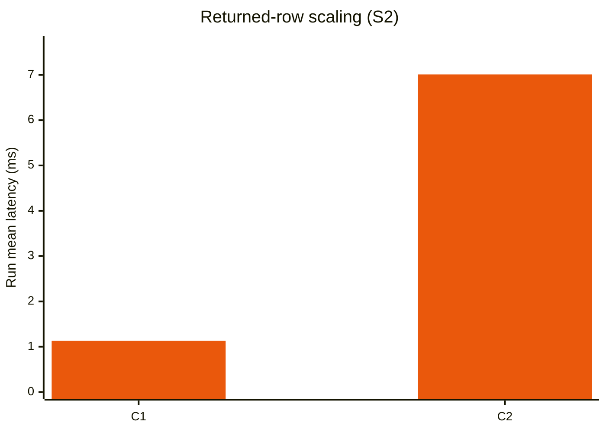

Oyster handlers: [Oyster empty handler](../../apps/extension/srv/BenchmarkService/OysterEmptyLargeRows/after-READ.js).

### Returned-row scaling (S3)

| Category | Workload / mode | Run mean latency (ms) |
| --- | --- | --- |
| C1 | oyster-idle; operation=read; table=LargeRows; rows=10; iterations=100; callbacks=1; access=service; hook=false; pageSize=1000; scanRows=10000; enrichment=batch; mixed=unavailable; readTable=unavailable; queryShape=page; offset=0; hookControl=false; actionContract=auto; scanCoordination=unavailable; wholeScanRows=unavailable; lookupPattern=unavailable; validationOutcome=unavailable; transport=http; phase=warm; load=vus:1; n=3 | 0.262 |
| C2 | oyster-idle; operation=read; table=LargeRows; rows=1000; iterations=100; callbacks=1; access=service; hook=false; pageSize=1000; scanRows=10000; enrichment=batch; mixed=unavailable; readTable=unavailable; queryShape=page; offset=0; hookControl=false; actionContract=auto; scanCoordination=unavailable; wholeScanRows=unavailable; lookupPattern=unavailable; validationOutcome=unavailable; transport=http; phase=warm; load=vus:1; n=3 | 1.498 |

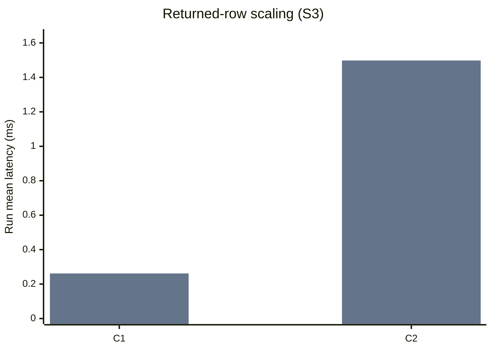


### Returned-row scaling (S4)

| Category | Workload / mode | Run mean latency (ms) |
| --- | --- | --- |
| C1 | native-empty; operation=read; table=LargeRows; rows=10; iterations=100; callbacks=1; access=service; hook=false; pageSize=1000; scanRows=10000; enrichment=batch; mixed=unavailable; readTable=unavailable; queryShape=page; offset=0; hookControl=false; actionContract=auto; scanCoordination=unavailable; wholeScanRows=unavailable; lookupPattern=unavailable; validationOutcome=unavailable; transport=http; phase=warm; load=vus:1; n=3 | 0.273 |
| C2 | native-empty; operation=read; table=LargeRows; rows=1000; iterations=100; callbacks=1; access=service; hook=false; pageSize=1000; scanRows=10000; enrichment=batch; mixed=unavailable; readTable=unavailable; queryShape=page; offset=0; hookControl=false; actionContract=auto; scanCoordination=unavailable; wholeScanRows=unavailable; lookupPattern=unavailable; validationOutcome=unavailable; transport=http; phase=warm; load=vus:1; n=3 | 1.53 |


### Returned-row scaling (S5)

| Category | Workload / mode | Run mean latency (ms) |
| --- | --- | --- |
| C1 | wasm-compute; operation=read; table=LargeRows; rows=10; iterations=100; callbacks=1; access=service; hook=false; pageSize=1000; scanRows=10000; enrichment=batch; mixed=unavailable; readTable=unavailable; queryShape=page; offset=0; hookControl=false; actionContract=auto; scanCoordination=unavailable; wholeScanRows=unavailable; lookupPattern=unavailable; validationOutcome=unavailable; transport=http; phase=warm; load=vus:1; n=3 | 1.318 |
| C2 | wasm-compute; operation=read; table=LargeRows; rows=1000; iterations=100; callbacks=1; access=service; hook=false; pageSize=1000; scanRows=10000; enrichment=batch; mixed=unavailable; readTable=unavailable; queryShape=page; offset=0; hookControl=false; actionContract=auto; scanCoordination=unavailable; wholeScanRows=unavailable; lookupPattern=unavailable; validationOutcome=unavailable; transport=http; phase=warm; load=vus:1; n=3 | 19.409 |

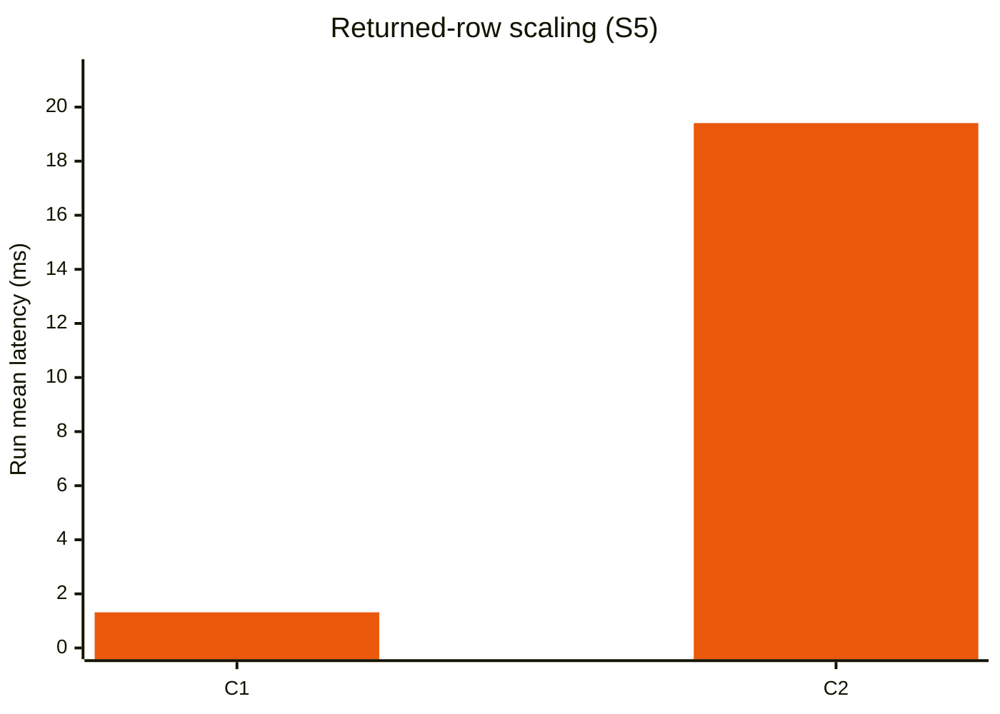

Oyster handlers: [Oyster calculation](../../apps/extension/srv/BenchmarkService/OysterCalculationLargeRows/after-READ.js).

### CPU iterations scaling (S6)

| Category | Workload / mode | Run mean latency (ms) |
| --- | --- | --- |
| C1 | native-compute; operation=action; table=SmallRows; rows=10; iterations=100; callbacks=1; access=service; hook=false; pageSize=1000; scanRows=10000; enrichment=batch; mixed=unavailable; readTable=unavailable; queryShape=page; offset=0; hookControl=false; actionContract=auto; scanCoordination=unavailable; wholeScanRows=unavailable; lookupPattern=unavailable; validationOutcome=unavailable; transport=http; phase=warm; load=vus:1; n=3 | 0.16 |
| C2 | native-compute; operation=action; table=SmallRows; rows=10; iterations=10000; callbacks=1; access=service; hook=false; pageSize=1000; scanRows=10000; enrichment=batch; mixed=unavailable; readTable=unavailable; queryShape=page; offset=0; hookControl=false; actionContract=auto; scanCoordination=unavailable; wholeScanRows=unavailable; lookupPattern=unavailable; validationOutcome=unavailable; transport=http; phase=warm; load=vus:1; n=3 | 0.17 |

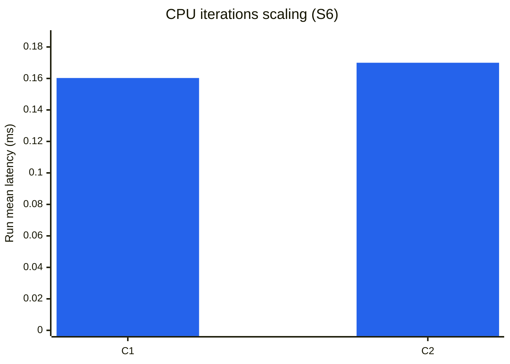


### CPU iterations scaling (S7)

| Category | Workload / mode | Run mean latency (ms) |
| --- | --- | --- |
| C1 | wasm-compute; operation=action; table=SmallRows; rows=10; iterations=100; callbacks=1; access=service; hook=false; pageSize=1000; scanRows=10000; enrichment=batch; mixed=unavailable; readTable=unavailable; queryShape=page; offset=0; hookControl=false; actionContract=auto; scanCoordination=unavailable; wholeScanRows=unavailable; lookupPattern=unavailable; validationOutcome=unavailable; transport=http; phase=warm; load=vus:1; n=3 | 1.016 |
| C2 | wasm-compute; operation=action; table=SmallRows; rows=10; iterations=10000; callbacks=1; access=service; hook=false; pageSize=1000; scanRows=10000; enrichment=batch; mixed=unavailable; readTable=unavailable; queryShape=page; offset=0; hookControl=false; actionContract=auto; scanCoordination=unavailable; wholeScanRows=unavailable; lookupPattern=unavailable; validationOutcome=unavailable; transport=http; phase=warm; load=vus:1; n=3 | 2.342 |

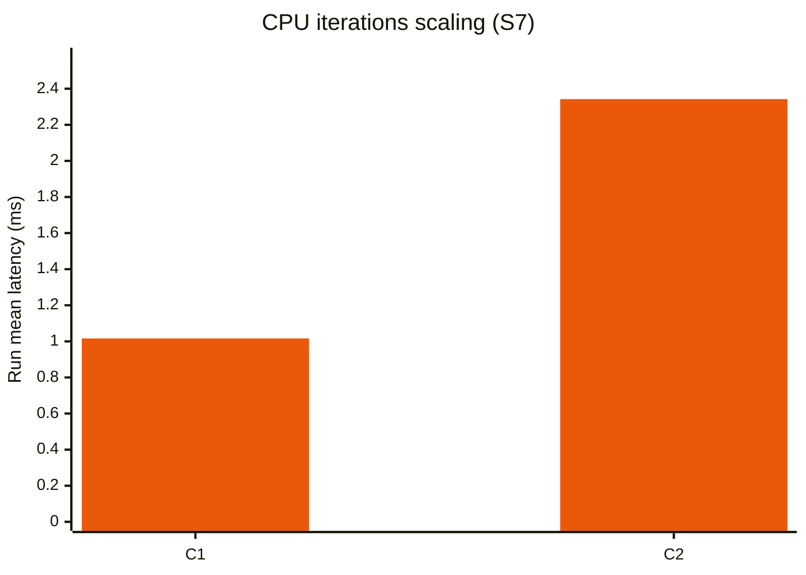

Oyster handlers: [Oyster calculation](../../apps/extension/srv/BenchmarkService/on-oysterCalculation.js).

### Scan row scaling (S8)

| Category | Workload / mode | Run mean latency (ms) |
| --- | --- | --- |
| C1 | native-compute; operation=scan; table=LargeRows; rows=10; iterations=100; callbacks=1; access=service; hook=false; pageSize=1000; scanRows=10000; enrichment=batch; mixed=unavailable; readTable=unavailable; queryShape=page; offset=0; hookControl=false; actionContract=auto; scanCoordination=unavailable; wholeScanRows=unavailable; lookupPattern=unavailable; validationOutcome=unavailable; transport=http; phase=warm; load=vus:1; n=3 | 6.309 |
| C2 | native-compute; operation=scan; table=LargeRows; rows=10; iterations=100; callbacks=1; access=service; hook=false; pageSize=1000; scanRows=50000; enrichment=batch; mixed=unavailable; readTable=unavailable; queryShape=page; offset=0; hookControl=false; actionContract=auto; scanCoordination=unavailable; wholeScanRows=unavailable; lookupPattern=unavailable; validationOutcome=unavailable; transport=http; phase=warm; load=vus:1; n=3 | 30.731 |

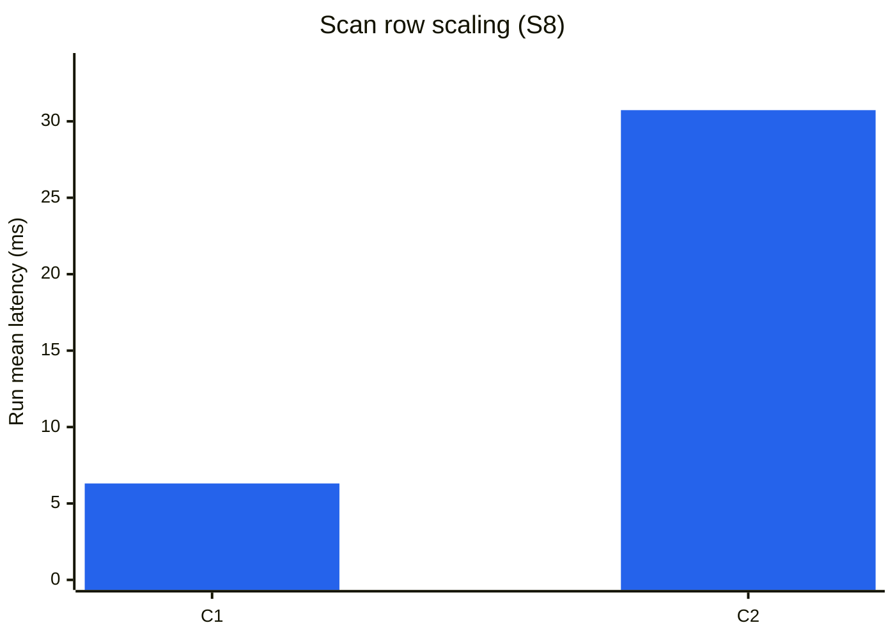


### Scan row scaling (S9)

| Category | Workload / mode | Run mean latency (ms) |
| --- | --- | --- |
| C1 | wasm-compute; operation=scan; table=LargeRows; rows=10; iterations=100; callbacks=1; access=service; hook=false; pageSize=1000; scanRows=10000; enrichment=batch; mixed=unavailable; readTable=unavailable; queryShape=page; offset=0; hookControl=false; actionContract=auto; scanCoordination=unavailable; wholeScanRows=unavailable; lookupPattern=unavailable; validationOutcome=unavailable; transport=http; phase=warm; load=vus:1; n=3 | 155.549 |
| C2 | wasm-compute; operation=scan; table=LargeRows; rows=10; iterations=100; callbacks=1; access=service; hook=false; pageSize=1000; scanRows=50000; enrichment=batch; mixed=unavailable; readTable=unavailable; queryShape=page; offset=0; hookControl=false; actionContract=auto; scanCoordination=unavailable; wholeScanRows=unavailable; lookupPattern=unavailable; validationOutcome=unavailable; transport=http; phase=warm; load=vus:1; n=3 | 774.148 |

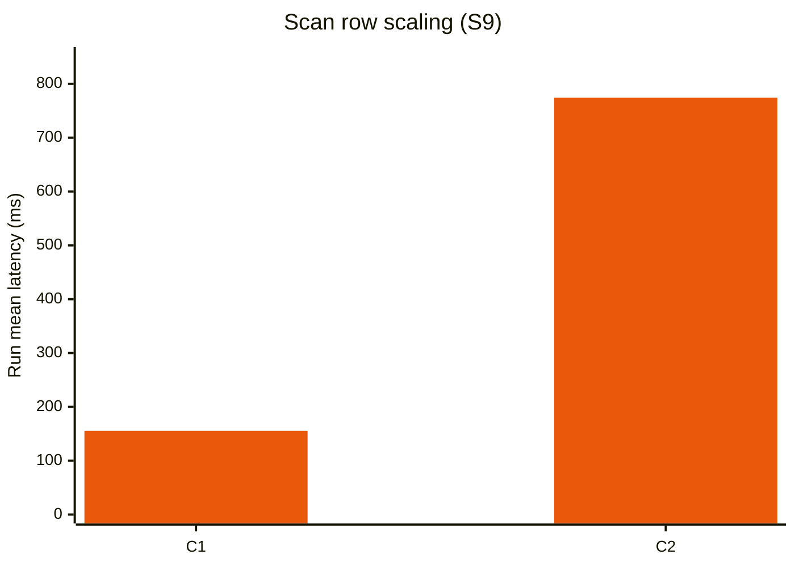

Oyster handlers: [Oyster calculation](../../apps/extension/srv/BenchmarkService/on-oysterScan.js).

### Callback fan-out (S10)

| Category | Workload / mode | Run mean latency (ms) |
| --- | --- | --- |
| C1 | wasm-compute-write; operation=action; table=SmallRows; rows=10; iterations=0; callbacks=1; access=service; hook=false; pageSize=1000; scanRows=10000; enrichment=batch; mixed=unavailable; readTable=unavailable; queryShape=page; offset=0; hookControl=false; actionContract=auto; scanCoordination=unavailable; wholeScanRows=unavailable; lookupPattern=unavailable; validationOutcome=unavailable; transport=http; phase=warm; load=vus:1; n=3 | 1.211 |
| C2 | wasm-compute-write; operation=action; table=SmallRows; rows=10; iterations=0; callbacks=10; access=service; hook=false; pageSize=1000; scanRows=10000; enrichment=batch; mixed=unavailable; readTable=unavailable; queryShape=page; offset=0; hookControl=false; actionContract=auto; scanCoordination=unavailable; wholeScanRows=unavailable; lookupPattern=unavailable; validationOutcome=unavailable; transport=http; phase=warm; load=vus:1; n=3 | 2.248 |

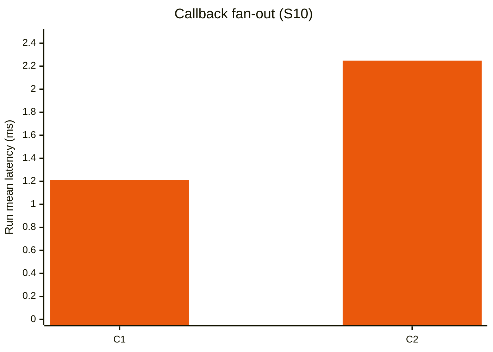

Oyster handlers: [Oyster CQL write](../../apps/extension/srv/BenchmarkService/on-oysterCqlWrite.js).

### Callback fan-out (S11)

| Category | Workload / mode | Run mean latency (ms) |
| --- | --- | --- |
| C1 | native-compute-read; operation=action; table=SmallRows; rows=10; iterations=0; callbacks=1; access=service; hook=false; pageSize=1000; scanRows=10000; enrichment=batch; mixed=unavailable; readTable=unavailable; queryShape=page; offset=0; hookControl=false; actionContract=auto; scanCoordination=unavailable; wholeScanRows=unavailable; lookupPattern=unavailable; validationOutcome=unavailable; transport=http; phase=warm; load=vus:1; n=3 | 0.24 |
| C2 | native-compute-read; operation=action; table=SmallRows; rows=10; iterations=0; callbacks=10; access=service; hook=false; pageSize=1000; scanRows=10000; enrichment=batch; mixed=unavailable; readTable=unavailable; queryShape=page; offset=0; hookControl=false; actionContract=auto; scanCoordination=unavailable; wholeScanRows=unavailable; lookupPattern=unavailable; validationOutcome=unavailable; transport=http; phase=warm; load=vus:1; n=3 | 0.826 |

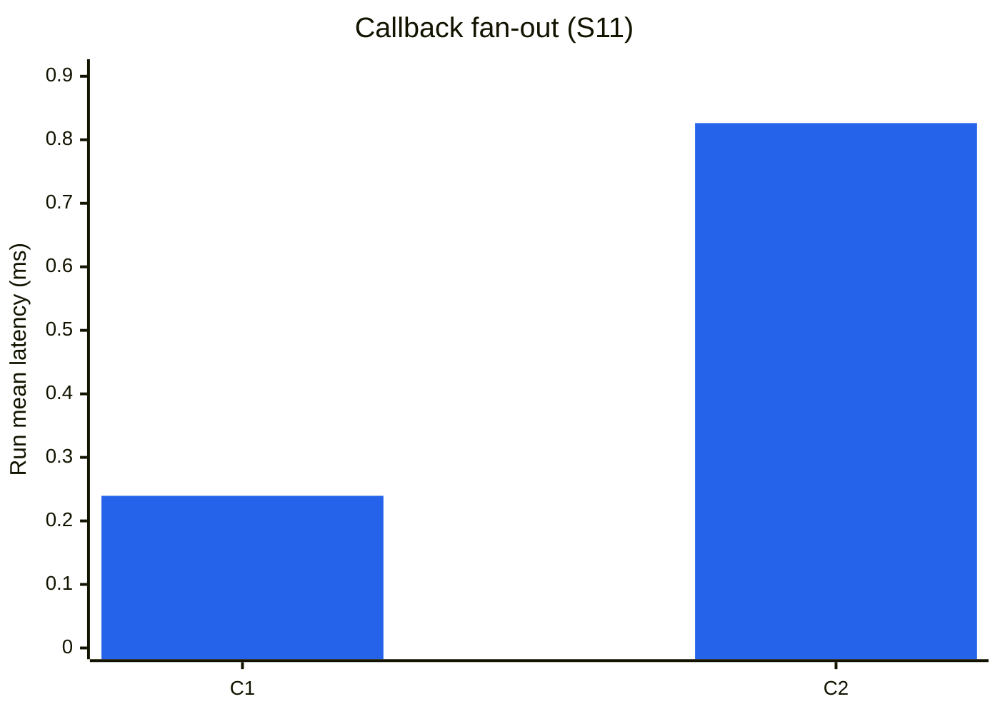


### Callback fan-out (S12)

| Category | Workload / mode | Run mean latency (ms) |
| --- | --- | --- |
| C1 | native-compute-write; operation=action; table=SmallRows; rows=10; iterations=0; callbacks=1; access=service; hook=false; pageSize=1000; scanRows=10000; enrichment=batch; mixed=unavailable; readTable=unavailable; queryShape=page; offset=0; hookControl=false; actionContract=auto; scanCoordination=unavailable; wholeScanRows=unavailable; lookupPattern=unavailable; validationOutcome=unavailable; transport=http; phase=warm; load=vus:1; n=3 | 0.277 |
| C2 | native-compute-write; operation=action; table=SmallRows; rows=10; iterations=0; callbacks=10; access=service; hook=false; pageSize=1000; scanRows=10000; enrichment=batch; mixed=unavailable; readTable=unavailable; queryShape=page; offset=0; hookControl=false; actionContract=auto; scanCoordination=unavailable; wholeScanRows=unavailable; lookupPattern=unavailable; validationOutcome=unavailable; transport=http; phase=warm; load=vus:1; n=3 | 0.836 |

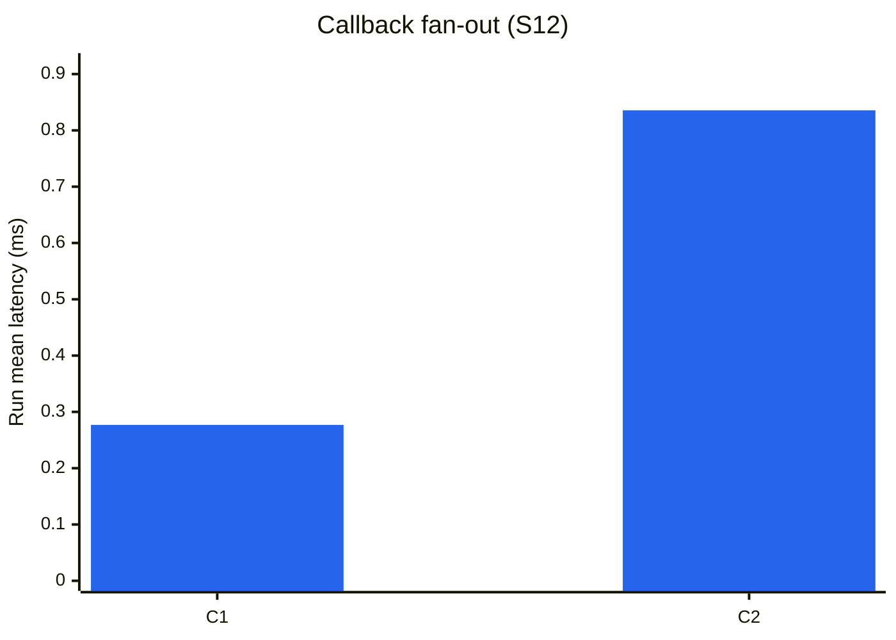


### Callback fan-out (S13)

| Category | Workload / mode | Run mean latency (ms) |
| --- | --- | --- |
| C1 | wasm-compute-read; operation=action; table=SmallRows; rows=10; iterations=0; callbacks=1; access=service; hook=false; pageSize=1000; scanRows=10000; enrichment=batch; mixed=unavailable; readTable=unavailable; queryShape=page; offset=0; hookControl=false; actionContract=auto; scanCoordination=unavailable; wholeScanRows=unavailable; lookupPattern=unavailable; validationOutcome=unavailable; transport=http; phase=warm; load=vus:1; n=3 | 1.205 |
| C2 | wasm-compute-read; operation=action; table=SmallRows; rows=10; iterations=0; callbacks=10; access=service; hook=false; pageSize=1000; scanRows=10000; enrichment=batch; mixed=unavailable; readTable=unavailable; queryShape=page; offset=0; hookControl=false; actionContract=auto; scanCoordination=unavailable; wholeScanRows=unavailable; lookupPattern=unavailable; validationOutcome=unavailable; transport=http; phase=warm; load=vus:1; n=3 | 2.543 |

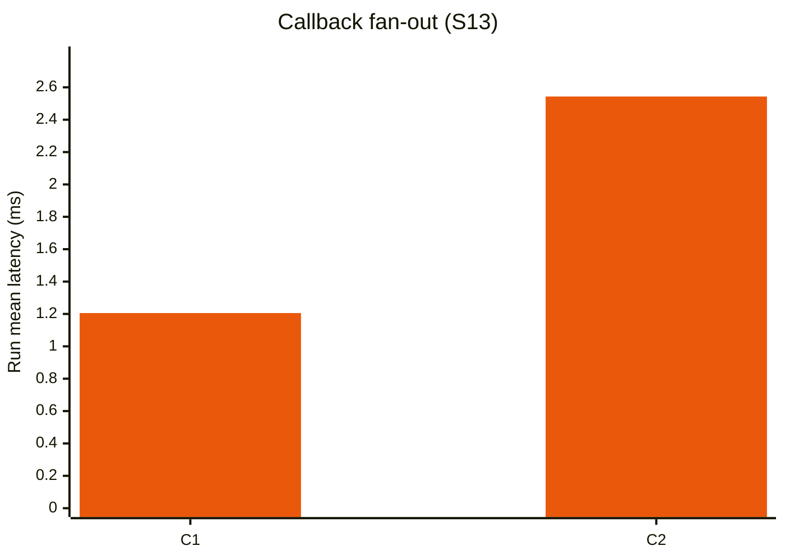

Oyster handlers: [Oyster CQL read](../../apps/extension/srv/BenchmarkService/on-oysterCqlRead.js).

### Load latency (S14)

| Category | Workload / mode | Mean run p95 latency (ms) |
| --- | --- | --- |
| C1 | wasm-compute-read; operation=action; table=SmallRows; rows=10; iterations=0; callbacks=1; access=service; hook=false; pageSize=1000; scanRows=10000; enrichment=batch; mixed=unavailable; readTable=unavailable; queryShape=page; offset=0; hookControl=false; actionContract=auto; scanCoordination=unavailable; wholeScanRows=unavailable; lookupPattern=unavailable; validationOutcome=unavailable; transport=http; phase=warm; load=vus:1; n=3 | 1.389 |
| C2 | wasm-compute-read; operation=action; table=SmallRows; rows=10; iterations=0; callbacks=1; access=service; hook=false; pageSize=1000; scanRows=10000; enrichment=batch; mixed=unavailable; readTable=unavailable; queryShape=page; offset=0; hookControl=false; actionContract=auto; scanCoordination=unavailable; wholeScanRows=unavailable; lookupPattern=unavailable; validationOutcome=unavailable; transport=http; phase=warm; load=vus:8; n=3 | 1.692 |
| C3 | wasm-compute-read; operation=action; table=SmallRows; rows=10; iterations=0; callbacks=1; access=service; hook=false; pageSize=1000; scanRows=10000; enrichment=batch; mixed=unavailable; readTable=unavailable; queryShape=page; offset=0; hookControl=false; actionContract=auto; scanCoordination=unavailable; wholeScanRows=unavailable; lookupPattern=unavailable; validationOutcome=unavailable; transport=http; phase=warm; load=vus:32; n=3 | 10.706 |

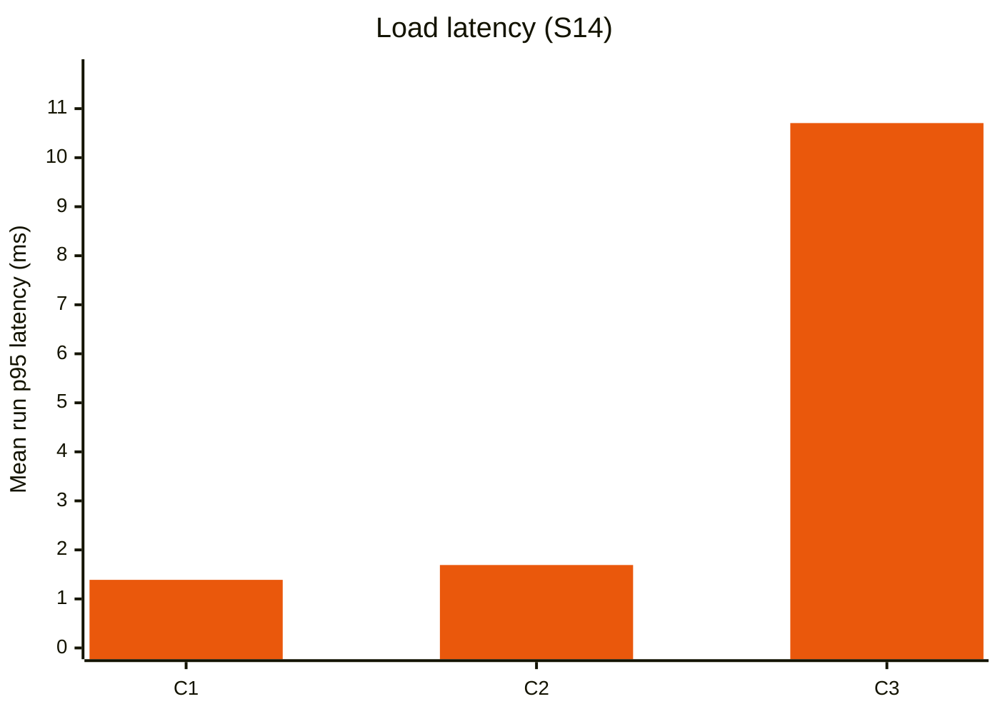

Oyster handlers: [Oyster CQL read](../../apps/extension/srv/BenchmarkService/on-oysterCqlRead.js).

### Successful throughput (S15)

| Category | Workload / mode | Successful throughput (requests/s) |
| --- | --- | --- |
| C1 | wasm-compute-read; operation=action; table=SmallRows; rows=10; iterations=0; callbacks=1; access=service; hook=false; pageSize=1000; scanRows=10000; enrichment=batch; mixed=unavailable; readTable=unavailable; queryShape=page; offset=0; hookControl=false; actionContract=auto; scanCoordination=unavailable; wholeScanRows=unavailable; lookupPattern=unavailable; validationOutcome=unavailable; transport=http; phase=warm; load=vus:1; n=3 | 818.665 |
| C2 | wasm-compute-read; operation=action; table=SmallRows; rows=10; iterations=0; callbacks=1; access=service; hook=false; pageSize=1000; scanRows=10000; enrichment=batch; mixed=unavailable; readTable=unavailable; queryShape=page; offset=0; hookControl=false; actionContract=auto; scanCoordination=unavailable; wholeScanRows=unavailable; lookupPattern=unavailable; validationOutcome=unavailable; transport=http; phase=warm; load=vus:8; n=3 | 5493.912 |
| C3 | wasm-compute-read; operation=action; table=SmallRows; rows=10; iterations=0; callbacks=1; access=service; hook=false; pageSize=1000; scanRows=10000; enrichment=batch; mixed=unavailable; readTable=unavailable; queryShape=page; offset=0; hookControl=false; actionContract=auto; scanCoordination=unavailable; wholeScanRows=unavailable; lookupPattern=unavailable; validationOutcome=unavailable; transport=http; phase=warm; load=vus:32; n=3 | 6182.302 |

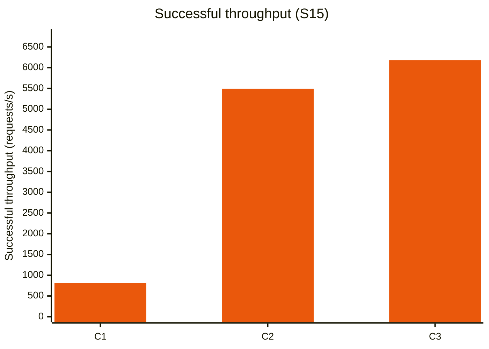

Oyster handlers: [Oyster CQL read](../../apps/extension/srv/BenchmarkService/on-oysterCqlRead.js).

### Unrelated-request probe (S16)

| Category | Workload / mode | Unrelated-request probe p95 (ms) |
| --- | --- | --- |
| C1 | wasm-compute-read; operation=action; table=SmallRows; rows=10; iterations=0; callbacks=1; access=service; hook=false; pageSize=1000; scanRows=10000; enrichment=batch; mixed=unavailable; readTable=unavailable; queryShape=page; offset=0; hookControl=false; actionContract=auto; scanCoordination=unavailable; wholeScanRows=unavailable; lookupPattern=unavailable; validationOutcome=unavailable; transport=http; phase=warm; load=vus:8; n=3 | 28.558 |
| C2 | wasm-compute-read; operation=action; table=SmallRows; rows=10; iterations=0; callbacks=1; access=service; hook=false; pageSize=1000; scanRows=10000; enrichment=batch; mixed=unavailable; readTable=unavailable; queryShape=page; offset=0; hookControl=false; actionContract=auto; scanCoordination=unavailable; wholeScanRows=unavailable; lookupPattern=unavailable; validationOutcome=unavailable; transport=http; phase=warm; load=vus:32; n=3 | 39.598 |

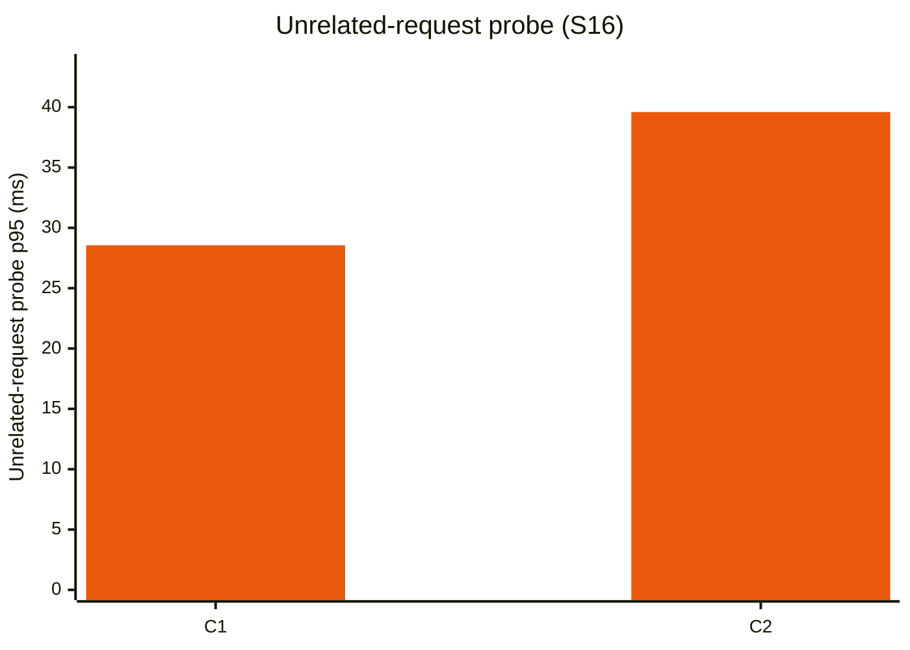

Oyster handlers: [Oyster CQL read](../../apps/extension/srv/BenchmarkService/on-oysterCqlRead.js).

### Load latency (S17)

| Category | Workload / mode | Mean run p95 latency (ms) |
| --- | --- | --- |
| C1 | wasm-compute-read; operation=read; table=SmallRows; rows=10; iterations=0; callbacks=1; access=service; hook=false; pageSize=1000; scanRows=10000; enrichment=batch; mixed=true; readTable=unavailable; queryShape=page; offset=0; hookControl=false; actionContract=auto; scanCoordination=unavailable; wholeScanRows=unavailable; lookupPattern=unavailable; validationOutcome=unavailable; transport=http; phase=warm; load=vus:1; n=3 | 1.76 |
| C2 | wasm-compute-read; operation=read; table=SmallRows; rows=10; iterations=0; callbacks=1; access=service; hook=false; pageSize=1000; scanRows=10000; enrichment=batch; mixed=true; readTable=unavailable; queryShape=page; offset=0; hookControl=false; actionContract=auto; scanCoordination=unavailable; wholeScanRows=unavailable; lookupPattern=unavailable; validationOutcome=unavailable; transport=http; phase=warm; load=vus:8; n=3 | 2.482 |
| C3 | wasm-compute-read; operation=read; table=SmallRows; rows=10; iterations=0; callbacks=1; access=service; hook=false; pageSize=1000; scanRows=10000; enrichment=batch; mixed=true; readTable=unavailable; queryShape=page; offset=0; hookControl=false; actionContract=auto; scanCoordination=unavailable; wholeScanRows=unavailable; lookupPattern=unavailable; validationOutcome=unavailable; transport=http; phase=warm; load=vus:32; n=3 | 12.077 |

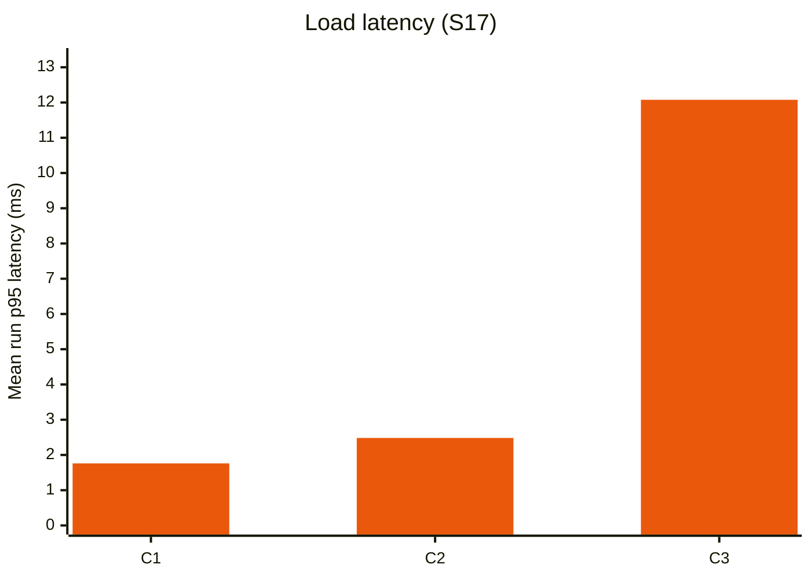

Oyster handlers: [Oyster CQL read: READ](../../apps/extension/srv/BenchmarkService/OysterCqlReadSmallRows/after-READ.js), [Oyster CQL read: INSERT](../../apps/extension/srv/BenchmarkService/OysterCqlReadWriteRows/before-CREATE.js), [Oyster CQL read: UPDATE](../../apps/extension/srv/BenchmarkService/OysterCqlReadWriteRows/before-UPDATE.js), [Oyster CQL read: action](../../apps/extension/srv/BenchmarkService/on-oysterCqlRead.js).

### Successful throughput (S18)

| Category | Workload / mode | Successful throughput (requests/s) |
| --- | --- | --- |
| C1 | wasm-compute-read; operation=read; table=SmallRows; rows=10; iterations=0; callbacks=1; access=service; hook=false; pageSize=1000; scanRows=10000; enrichment=batch; mixed=true; readTable=unavailable; queryShape=page; offset=0; hookControl=false; actionContract=auto; scanCoordination=unavailable; wholeScanRows=unavailable; lookupPattern=unavailable; validationOutcome=unavailable; transport=http; phase=warm; load=vus:1; n=3 | 699.48 |
| C2 | wasm-compute-read; operation=read; table=SmallRows; rows=10; iterations=0; callbacks=1; access=service; hook=false; pageSize=1000; scanRows=10000; enrichment=batch; mixed=true; readTable=unavailable; queryShape=page; offset=0; hookControl=false; actionContract=auto; scanCoordination=unavailable; wholeScanRows=unavailable; lookupPattern=unavailable; validationOutcome=unavailable; transport=http; phase=warm; load=vus:8; n=3 | 4484.344 |
| C3 | wasm-compute-read; operation=read; table=SmallRows; rows=10; iterations=0; callbacks=1; access=service; hook=false; pageSize=1000; scanRows=10000; enrichment=batch; mixed=true; readTable=unavailable; queryShape=page; offset=0; hookControl=false; actionContract=auto; scanCoordination=unavailable; wholeScanRows=unavailable; lookupPattern=unavailable; validationOutcome=unavailable; transport=http; phase=warm; load=vus:32; n=3 | 4753.307 |

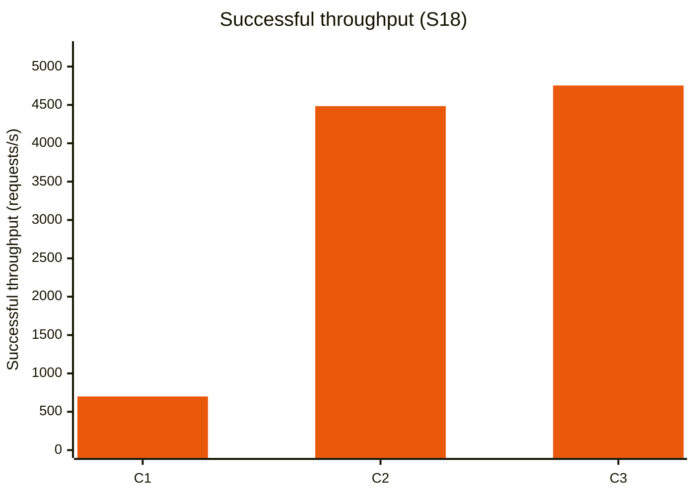

Oyster handlers: [Oyster CQL read: READ](../../apps/extension/srv/BenchmarkService/OysterCqlReadSmallRows/after-READ.js), [Oyster CQL read: INSERT](../../apps/extension/srv/BenchmarkService/OysterCqlReadWriteRows/before-CREATE.js), [Oyster CQL read: UPDATE](../../apps/extension/srv/BenchmarkService/OysterCqlReadWriteRows/before-UPDATE.js), [Oyster CQL read: action](../../apps/extension/srv/BenchmarkService/on-oysterCqlRead.js).

### Unrelated-request probe (S19)

| Category | Workload / mode | Unrelated-request probe p95 (ms) |
| --- | --- | --- |
| C1 | wasm-compute-read; operation=read; table=SmallRows; rows=10; iterations=0; callbacks=1; access=service; hook=false; pageSize=1000; scanRows=10000; enrichment=batch; mixed=true; readTable=unavailable; queryShape=page; offset=0; hookControl=false; actionContract=auto; scanCoordination=unavailable; wholeScanRows=unavailable; lookupPattern=unavailable; validationOutcome=unavailable; transport=http; phase=warm; load=vus:8; n=3 | 29.504 |
| C2 | wasm-compute-read; operation=read; table=SmallRows; rows=10; iterations=0; callbacks=1; access=service; hook=false; pageSize=1000; scanRows=10000; enrichment=batch; mixed=true; readTable=unavailable; queryShape=page; offset=0; hookControl=false; actionContract=auto; scanCoordination=unavailable; wholeScanRows=unavailable; lookupPattern=unavailable; validationOutcome=unavailable; transport=http; phase=warm; load=vus:32; n=3 | 36.256 |

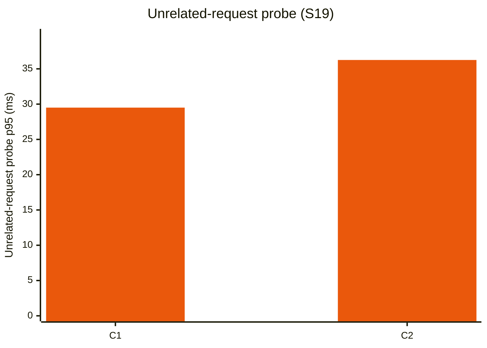

Oyster handlers: [Oyster CQL read: READ](../../apps/extension/srv/BenchmarkService/OysterCqlReadSmallRows/after-READ.js), [Oyster CQL read: INSERT](../../apps/extension/srv/BenchmarkService/OysterCqlReadWriteRows/before-CREATE.js), [Oyster CQL read: UPDATE](../../apps/extension/srv/BenchmarkService/OysterCqlReadWriteRows/before-UPDATE.js), [Oyster CQL read: action](../../apps/extension/srv/BenchmarkService/on-oysterCqlRead.js).

### Load latency (S20)

| Category | Workload / mode | Mean run p95 latency (ms) |
| --- | --- | --- |
| C1 | native-compute-read; operation=read; table=SmallRows; rows=10; iterations=0; callbacks=1; access=service; hook=false; pageSize=1000; scanRows=10000; enrichment=batch; mixed=true; readTable=unavailable; queryShape=page; offset=0; hookControl=false; actionContract=auto; scanCoordination=unavailable; wholeScanRows=unavailable; lookupPattern=unavailable; validationOutcome=unavailable; transport=http; phase=warm; load=vus:1; n=3 | 0.501 |
| C2 | native-compute-read; operation=read; table=SmallRows; rows=10; iterations=0; callbacks=1; access=service; hook=false; pageSize=1000; scanRows=10000; enrichment=batch; mixed=true; readTable=unavailable; queryShape=page; offset=0; hookControl=false; actionContract=auto; scanCoordination=unavailable; wholeScanRows=unavailable; lookupPattern=unavailable; validationOutcome=unavailable; transport=http; phase=warm; load=vus:8; n=3 | 1.3 |
| C3 | native-compute-read; operation=read; table=SmallRows; rows=10; iterations=0; callbacks=1; access=service; hook=false; pageSize=1000; scanRows=10000; enrichment=batch; mixed=true; readTable=unavailable; queryShape=page; offset=0; hookControl=false; actionContract=auto; scanCoordination=unavailable; wholeScanRows=unavailable; lookupPattern=unavailable; validationOutcome=unavailable; transport=http; phase=warm; load=vus:32; n=3 | 5.928 |

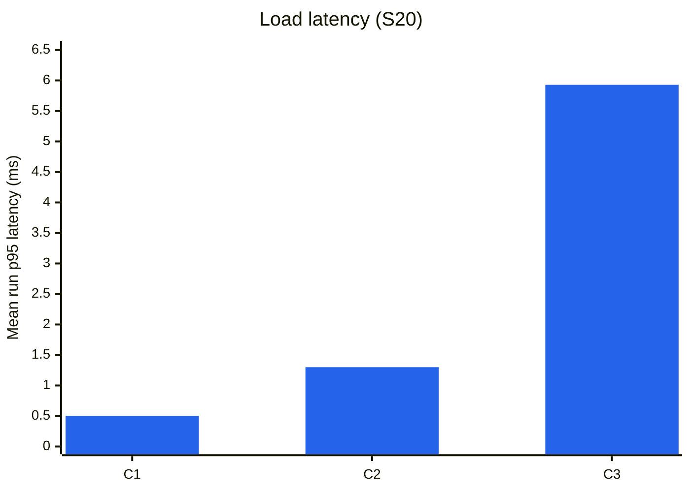


### Successful throughput (S21)

| Category | Workload / mode | Successful throughput (requests/s) |
| --- | --- | --- |
| C1 | native-compute-read; operation=read; table=SmallRows; rows=10; iterations=0; callbacks=1; access=service; hook=false; pageSize=1000; scanRows=10000; enrichment=batch; mixed=true; readTable=unavailable; queryShape=page; offset=0; hookControl=false; actionContract=auto; scanCoordination=unavailable; wholeScanRows=unavailable; lookupPattern=unavailable; validationOutcome=unavailable; transport=http; phase=warm; load=vus:1; n=3 | 2541.225 |
| C2 | native-compute-read; operation=read; table=SmallRows; rows=10; iterations=0; callbacks=1; access=service; hook=false; pageSize=1000; scanRows=10000; enrichment=batch; mixed=true; readTable=unavailable; queryShape=page; offset=0; hookControl=false; actionContract=auto; scanCoordination=unavailable; wholeScanRows=unavailable; lookupPattern=unavailable; validationOutcome=unavailable; transport=http; phase=warm; load=vus:8; n=3 | 9572.751 |
| C3 | native-compute-read; operation=read; table=SmallRows; rows=10; iterations=0; callbacks=1; access=service; hook=false; pageSize=1000; scanRows=10000; enrichment=batch; mixed=true; readTable=unavailable; queryShape=page; offset=0; hookControl=false; actionContract=auto; scanCoordination=unavailable; wholeScanRows=unavailable; lookupPattern=unavailable; validationOutcome=unavailable; transport=http; phase=warm; load=vus:32; n=3 | 9011.599 |

```mermaid
---
config:
  themeVariables:
    xyChart:
      plotColorPalette: "#2563eb"
  themeCSS: ".bar-plot-0 rect:nth-child(1) { fill: #2563eb; stroke: #2563eb; } .bar-plot-0 rect:nth-child(2) { fill: #2563eb; stroke: #2563eb; } .bar-plot-0 rect:nth-child(3) { fill: #2563eb; stroke: #2563eb; }"
---
xychart-beta
    title "Successful throughput (S21)"
    x-axis ["C1", "C2", "C3"]
    y-axis "Successful throughput (requests/s)" 0 --> 10530.026
    bar [2541.2246497660913, 9572.75054079782, 9011.59854890079]
```


### Unrelated-request probe (S22)

| Category | Workload / mode | Unrelated-request probe p95 (ms) |
| --- | --- | --- |
| C1 | native-compute-read; operation=read; table=SmallRows; rows=10; iterations=0; callbacks=1; access=service; hook=false; pageSize=1000; scanRows=10000; enrichment=batch; mixed=true; readTable=unavailable; queryShape=page; offset=0; hookControl=false; actionContract=auto; scanCoordination=unavailable; wholeScanRows=unavailable; lookupPattern=unavailable; validationOutcome=unavailable; transport=http; phase=warm; load=vus:8; n=3 | 29.271 |
| C2 | native-compute-read; operation=read; table=SmallRows; rows=10; iterations=0; callbacks=1; access=service; hook=false; pageSize=1000; scanRows=10000; enrichment=batch; mixed=true; readTable=unavailable; queryShape=page; offset=0; hookControl=false; actionContract=auto; scanCoordination=unavailable; wholeScanRows=unavailable; lookupPattern=unavailable; validationOutcome=unavailable; transport=http; phase=warm; load=vus:32; n=3 | 36.181 |

```mermaid
---
config:
  themeVariables:
    xyChart:
      plotColorPalette: "#2563eb"
  themeCSS: ".bar-plot-0 rect:nth-child(1) { fill: #2563eb; stroke: #2563eb; } .bar-plot-0 rect:nth-child(2) { fill: #2563eb; stroke: #2563eb; }"
---
xychart-beta
    title "Unrelated-request probe (S22)"
    x-axis ["C1", "C2"]
    y-axis "Unrelated-request probe p95 (ms)" 0 --> 39.79933
    bar [29.27104133333333, 36.18120866666667]
```


### Load latency (S23)

| Category | Workload / mode | Mean run p95 latency (ms) |
| --- | --- | --- |
| C1 | native-compute-read; operation=action; table=SmallRows; rows=10; iterations=0; callbacks=1; access=service; hook=false; pageSize=1000; scanRows=10000; enrichment=batch; mixed=unavailable; readTable=unavailable; queryShape=page; offset=0; hookControl=false; actionContract=auto; scanCoordination=unavailable; wholeScanRows=unavailable; lookupPattern=unavailable; validationOutcome=unavailable; transport=http; phase=warm; load=vus:1; n=3 | 0.294 |
| C2 | native-compute-read; operation=action; table=SmallRows; rows=10; iterations=0; callbacks=1; access=service; hook=false; pageSize=1000; scanRows=10000; enrichment=batch; mixed=unavailable; readTable=unavailable; queryShape=page; offset=0; hookControl=false; actionContract=auto; scanCoordination=unavailable; wholeScanRows=unavailable; lookupPattern=unavailable; validationOutcome=unavailable; transport=http; phase=warm; load=vus:8; n=3 | 0.446 |
| C3 | native-compute-read; operation=action; table=SmallRows; rows=10; iterations=0; callbacks=1; access=service; hook=false; pageSize=1000; scanRows=10000; enrichment=batch; mixed=unavailable; readTable=unavailable; queryShape=page; offset=0; hookControl=false; actionContract=auto; scanCoordination=unavailable; wholeScanRows=unavailable; lookupPattern=unavailable; validationOutcome=unavailable; transport=http; phase=warm; load=vus:32; n=3 | 2.937 |

```mermaid
---
config:
  themeVariables:
    xyChart:
      plotColorPalette: "#2563eb"
  themeCSS: ".bar-plot-0 rect:nth-child(1) { fill: #2563eb; stroke: #2563eb; } .bar-plot-0 rect:nth-child(2) { fill: #2563eb; stroke: #2563eb; } .bar-plot-0 rect:nth-child(3) { fill: #2563eb; stroke: #2563eb; }"
---
xychart-beta
    title "Load latency (S23)"
    x-axis ["C1", "C2", "C3"]
    y-axis "Mean run p95 latency (ms)" 0 --> 3.2312346
    bar [0.29418099999999997, 0.4456666666666667, 2.937486]
```


### Successful throughput (S24)

| Category | Workload / mode | Successful throughput (requests/s) |
| --- | --- | --- |
| C1 | native-compute-read; operation=action; table=SmallRows; rows=10; iterations=0; callbacks=1; access=service; hook=false; pageSize=1000; scanRows=10000; enrichment=batch; mixed=unavailable; readTable=unavailable; queryShape=page; offset=0; hookControl=false; actionContract=auto; scanCoordination=unavailable; wholeScanRows=unavailable; lookupPattern=unavailable; validationOutcome=unavailable; transport=http; phase=warm; load=vus:1; n=3 | 4025.139 |
| C2 | native-compute-read; operation=action; table=SmallRows; rows=10; iterations=0; callbacks=1; access=service; hook=false; pageSize=1000; scanRows=10000; enrichment=batch; mixed=unavailable; readTable=unavailable; queryShape=page; offset=0; hookControl=false; actionContract=auto; scanCoordination=unavailable; wholeScanRows=unavailable; lookupPattern=unavailable; validationOutcome=unavailable; transport=http; phase=warm; load=vus:8; n=3 | 23652.241 |
| C3 | native-compute-read; operation=action; table=SmallRows; rows=10; iterations=0; callbacks=1; access=service; hook=false; pageSize=1000; scanRows=10000; enrichment=batch; mixed=unavailable; readTable=unavailable; queryShape=page; offset=0; hookControl=false; actionContract=auto; scanCoordination=unavailable; wholeScanRows=unavailable; lookupPattern=unavailable; validationOutcome=unavailable; transport=http; phase=warm; load=vus:32; n=3 | 24542.529 |

```mermaid
---
config:
  themeVariables:
    xyChart:
      plotColorPalette: "#2563eb"
  themeCSS: ".bar-plot-0 rect:nth-child(1) { fill: #2563eb; stroke: #2563eb; } .bar-plot-0 rect:nth-child(2) { fill: #2563eb; stroke: #2563eb; } .bar-plot-0 rect:nth-child(3) { fill: #2563eb; stroke: #2563eb; }"
---
xychart-beta
    title "Successful throughput (S24)"
    x-axis ["C1", "C2", "C3"]
    y-axis "Successful throughput (requests/s)" 0 --> 26996.782
    bar [4025.138635835841, 23652.241274270327, 24542.529110558786]
```


### Unrelated-request probe (S25)

| Category | Workload / mode | Unrelated-request probe p95 (ms) |
| --- | --- | --- |
| C1 | native-compute-read; operation=action; table=SmallRows; rows=10; iterations=0; callbacks=1; access=service; hook=false; pageSize=1000; scanRows=10000; enrichment=batch; mixed=unavailable; readTable=unavailable; queryShape=page; offset=0; hookControl=false; actionContract=auto; scanCoordination=unavailable; wholeScanRows=unavailable; lookupPattern=unavailable; validationOutcome=unavailable; transport=http; phase=warm; load=vus:8; n=3 | 29.493 |
| C2 | native-compute-read; operation=action; table=SmallRows; rows=10; iterations=0; callbacks=1; access=service; hook=false; pageSize=1000; scanRows=10000; enrichment=batch; mixed=unavailable; readTable=unavailable; queryShape=page; offset=0; hookControl=false; actionContract=auto; scanCoordination=unavailable; wholeScanRows=unavailable; lookupPattern=unavailable; validationOutcome=unavailable; transport=http; phase=warm; load=vus:32; n=3 | 37.173 |

```mermaid
---
config:
  themeVariables:
    xyChart:
      plotColorPalette: "#2563eb"
  themeCSS: ".bar-plot-0 rect:nth-child(1) { fill: #2563eb; stroke: #2563eb; } .bar-plot-0 rect:nth-child(2) { fill: #2563eb; stroke: #2563eb; }"
---
xychart-beta
    title "Unrelated-request probe (S25)"
    x-axis ["C1", "C2"]
    y-axis "Unrelated-request probe p95 (ms)" 0 --> 40.89004
    bar [29.492833333333333, 37.172764]
```


Charts use a single basic Mermaid series with category mappings in the adjacent tables. Values are means of eligible independent run metrics. Missing or failed observations are omitted. No illustrative measurements are included. Scaling and fan-out conclusions require multiple values with every other workload dimension fixed; load sweeps also preserve the load kind. Missing sweeps leave those questions unanswered.

## Failures and limit probes

No failures or limit probes are recorded. This does not establish untested limits.

Failures, partial errors and dropped arrivals affect interpretation even when some requests succeed. Expected failures are not performance successes. A handler skipped after a failure cannot support a throughput improvement.

## Handler and correctness validation

| Manifest validation check | Recorded value |
| --- | --- |
| csvDeploymentVerified | true |

No explicit manifest-wide validation failure is recorded.

| Run | Correctness and rollback checks | Load probe |
| --- | --- | --- |
| create/WriteRows/wasm-compute-write/direct/service/rows10/cpu0/calls1/batch / rep 1 | {"preflight":{"passed":true,"status":201,"activation":{"passed":true,"handlerActive":true,"engine":"oyster"},"persistedValue":7,"persistedID":4360135,"auxiliaryValue":7,"rollback":{"passed":true,"rejectionStatus":409,"insertedRowAbsent":true,"auxiliaryUnchanged":true}},"postflight":{"passed":true,"status":201,"activation":{"passed":true,"handlerActive":true,"engine":"oyster"},"persistedValue":7,"persistedID":4360136,"auxiliaryValue":7},"passed":true} | {"attempts":0,"errors":0,"droppedIterations":0,"meanMs":null,"p50Ms":null,"p95Ms":null,"p99Ms":null} |
| create/WriteRows/wasm-compute-read/direct/service/rows10/cpu0/calls1/batch / rep 1 | {"preflight":{"passed":true,"status":201,"activation":{"passed":true,"handlerActive":true,"engine":"oyster"},"persistedValue":40,"persistedID":7560135,"rollback":{"passed":true,"rejectionStatus":409,"insertedRowAbsent":true,"auxiliaryUnchanged":true}},"postflight":{"passed":true,"status":201,"activation":{"passed":true,"handlerActive":true,"engine":"oyster"},"persistedValue":84,"persistedID":7560136},"passed":true} | {"attempts":0,"errors":0,"droppedIterations":0,"meanMs":null,"p50Ms":null,"p95Ms":null,"p99Ms":null} |
| create/WriteRows/oyster-idle/direct/service/rows10/cpu100/calls1/batch / rep 1 | {"preflight":{"passed":true,"status":201,"activation":{"passed":true,"handlerActive":true,"engine":"oyster"},"persistedValue":7,"persistedID":10760135,"rollback":{"passed":true,"rejectionStatus":409,"insertedRowAbsent":true,"auxiliaryUnchanged":true}},"postflight":{"passed":true,"status":201,"activation":{"passed":true,"handlerActive":true,"engine":"oyster"},"persistedValue":7,"persistedID":10760136},"passed":true} | {"attempts":0,"errors":0,"droppedIterations":0,"meanMs":null,"p50Ms":null,"p95Ms":null,"p99Ms":null} |
| action/SmallRows/native-validate/hook/service/rows10/cpu0/calls1/batch/decision-accepted / rep 1 | {"preflight":{"passed":true,"status":200,"validationOutcome":"accepted","amount":20,"activation":{"passed":true,"handlerActive":true,"engine":"oyster"},"rollback":{"passed":true,"rejectionStatus":409,"insertedRowAbsent":true,"auxiliaryUnchanged":true}},"postflight":{"passed":true,"status":200,"validationOutcome":"accepted","amount":20,"activation":{"passed":true,"handlerActive":true,"engine":"oyster"}},"passed":true} | {"attempts":0,"errors":0,"droppedIterations":0,"meanMs":null,"p50Ms":null,"p95Ms":null,"p99Ms":null} |
| create/WriteRows/native-compute-write/direct/service/rows10/cpu0/calls1/batch / rep 1 | {"preflight":{"passed":true,"status":201,"activation":{"passed":true,"handlerActive":true,"engine":"oyster"},"persistedValue":7,"persistedID":17160135,"auxiliaryValue":7,"rollback":{"passed":true,"rejectionStatus":409,"insertedRowAbsent":true,"auxiliaryUnchanged":true}},"postflight":{"passed":true,"status":201,"activation":{"passed":true,"handlerActive":true,"engine":"oyster"},"persistedValue":7,"persistedID":17160136,"auxiliaryValue":7},"passed":true} | {"attempts":0,"errors":0,"droppedIterations":0,"meanMs":null,"p50Ms":null,"p95Ms":null,"p99Ms":null} |
| action/SmallRows/native-compute-read/direct/service/rows10/cpu0/calls1/batch/lookup-batch / rep 1 | {"preflight":{"passed":true,"status":200,"checksum":495,"activation":{"passed":true,"handlerActive":true,"engine":"oyster"},"rollback":{"passed":true,"rejectionStatus":409,"insertedRowAbsent":true,"auxiliaryUnchanged":true}},"postflight":{"passed":true,"status":200,"checksum":561,"activation":{"passed":true,"handlerActive":true,"engine":"oyster"}},"passed":true} | {"attempts":0,"errors":0,"droppedIterations":0,"meanMs":null,"p50Ms":null,"p95Ms":null,"p99Ms":null} |
| action/SmallRows/native-validate-read/direct/service/rows10/cpu0/calls1/batch/decision-rejected / rep 1 | {"preflight":{"passed":true,"status":400,"validationOutcome":"rejected","activation":{"passed":true,"handlerActive":true,"engine":"oyster"},"rollback":{"passed":true,"rejectionStatus":409,"insertedRowAbsent":true,"auxiliaryUnchanged":true},"rejectionMessage":"Amount exceeds limit"},"postflight":{"passed":true,"status":400,"validationOutcome":"rejected","activation":{"passed":true,"handlerActive":true,"engine":"oyster"},"rejectionMessage":"Amount exceeds limit"},"measuredWritesUnchanged":true,"passed":true} | {"attempts":0,"errors":0,"droppedIterations":0,"meanMs":null,"p50Ms":null,"p95Ms":null,"p99Ms":null} |
| action/SmallRows/wasm-compute-read/direct/service/rows10/cpu0/calls1/batch / rep 1 | {"preflight":{"passed":true,"status":200,"checksum":40,"activation":{"passed":true,"handlerActive":true,"engine":"oyster"},"rollback":{"passed":true,"rejectionStatus":409,"insertedRowAbsent":true,"auxiliaryUnchanged":true}},"postflight":{"passed":true,"status":200,"checksum":84,"activation":{"passed":true,"handlerActive":true,"engine":"oyster"}},"passed":true} | {"attempts":11,"errors":0,"droppedIterations":0,"meanMs":3.718106090909099,"p50Ms":1.1976660000000265,"p95Ms":28.63024999999999,"p99Ms":28.63024999999999} |
| action/SmallRows/native-validate-read/direct/service/rows10/cpu0/calls1/batch/decision-accepted / rep 1 | {"preflight":{"passed":true,"status":200,"validationOutcome":"accepted","amount":20,"activation":{"passed":true,"handlerActive":true,"engine":"oyster"},"rollback":{"passed":true,"rejectionStatus":409,"insertedRowAbsent":true,"auxiliaryUnchanged":true}},"postflight":{"passed":true,"status":200,"validationOutcome":"accepted","amount":20,"activation":{"passed":true,"handlerActive":true,"engine":"oyster"}},"passed":true} | {"attempts":0,"errors":0,"droppedIterations":0,"meanMs":null,"p50Ms":null,"p95Ms":null,"p99Ms":null} |
| read/SmallRows/native-compute-write/direct/service/rows10/cpu0/calls1/batch/query-page-offset0 / rep 1 | {"preflight":{"passed":true,"status":200,"rows":10,"checksumsVerified":10,"queryShape":"page","offset":0,"referenceRowsVerified":10,"activation":{"passed":true,"handlerActive":true,"engine":"oyster"},"auxiliaryValue":0,"rollback":{"passed":true,"rejectionStatus":409,"insertedRowAbsent":true,"auxiliaryUnchanged":true}},"postflight":{"passed":true,"status":200,"rows":10,"checksumsVerified":10,"queryShape":"page","offset":0,"referenceRowsVerified":10,"activation":{"passed":true,"handlerActive":true,"engine":"oyster"},"auxiliaryValue":0},"passed":true} | {"attempts":0,"errors":0,"droppedIterations":0,"meanMs":null,"p50Ms":null,"p95Ms":null,"p99Ms":null} |
| create/WriteRows/native-validate/direct/service/rows10/cpu0/calls1/batch/decision-rejected / rep 1 | {"preflight":{"passed":true,"status":400,"validationOutcome":"rejected","activation":{"passed":true,"handlerActive":true,"engine":"oyster"},"writeUnchanged":true,"rollback":{"passed":true,"rejectionStatus":409,"insertedRowAbsent":true,"auxiliaryUnchanged":true},"rejectionMessage":"Amount exceeds limit"},"postflight":{"passed":true,"status":400,"validationOutcome":"rejected","activation":{"passed":true,"handlerActive":true,"engine":"oyster"},"writeUnchanged":true,"rejectionMessage":"Amount exceeds limit"},"measuredWritesUnchanged":true,"passed":true} | {"attempts":0,"errors":0,"droppedIterations":0,"meanMs":null,"p50Ms":null,"p95Ms":null,"p99Ms":null} |
| action/SmallRows/wasm-validate/direct/service/rows10/cpu0/calls1/batch/decision-rejected / rep 1 | {"preflight":{"passed":true,"status":400,"validationOutcome":"rejected","activation":{"passed":true,"handlerActive":true,"engine":"oyster"},"rollback":{"passed":true,"rejectionStatus":409,"insertedRowAbsent":true,"auxiliaryUnchanged":true},"rejectionMessage":"Amount exceeds limit"},"postflight":{"passed":true,"status":400,"validationOutcome":"rejected","activation":{"passed":true,"handlerActive":true,"engine":"oyster"},"rejectionMessage":"Amount exceeds limit"},"measuredWritesUnchanged":true,"passed":true} | {"attempts":0,"errors":0,"droppedIterations":0,"meanMs":null,"p50Ms":null,"p95Ms":null,"p99Ms":null} |
| read/SmallRows/oyster-idle/direct/service/rows10/cpu100/calls1/batch/query-page-offset0 / rep 1 | {"preflight":{"passed":true,"status":200,"rows":10,"checksumsVerified":0,"queryShape":"page","offset":0,"referenceRowsVerified":10,"activation":{"passed":true,"handlerActive":true,"engine":"oyster"},"rollback":{"passed":true,"rejectionStatus":409,"insertedRowAbsent":true,"auxiliaryUnchanged":true}},"postflight":{"passed":true,"status":200,"rows":10,"checksumsVerified":0,"queryShape":"page","offset":0,"referenceRowsVerified":10,"activation":{"passed":true,"handlerActive":true,"engine":"oyster"}},"passed":true} | {"attempts":0,"errors":0,"droppedIterations":0,"meanMs":null,"p50Ms":null,"p95Ms":null,"p99Ms":null} |
| update/WriteRows/wasm-validate/direct/service/rows10/cpu0/calls1/batch/decision-accepted / rep 1 | {"preflight":{"passed":true,"status":200,"validationOutcome":"accepted","amount":20,"activation":{"passed":true,"handlerActive":true,"engine":"oyster"},"persistedValue":7,"persistedID":3259136,"rollback":{"passed":true,"rejectionStatus":409,"insertedRowAbsent":true,"auxiliaryUnchanged":true}},"postflight":{"passed":true,"status":200,"validationOutcome":"accepted","amount":20,"activation":{"passed":true,"handlerActive":true,"engine":"oyster"},"persistedValue":7,"persistedID":3259137},"passed":true} | {"attempts":0,"errors":0,"droppedIterations":0,"meanMs":null,"p50Ms":null,"p95Ms":null,"p99Ms":null} |
| create/WriteRows/wasm-compute/direct/service/rows10/cpu100/calls1/batch / rep 1 | {"preflight":{"passed":true,"status":201,"activation":{"passed":true,"handlerActive":true,"engine":"oyster"},"persistedValue":2013694255,"persistedID":49160135,"rollback":{"passed":true,"rejectionStatus":409,"insertedRowAbsent":true,"auxiliaryUnchanged":true}},"postflight":{"passed":true,"status":201,"activation":{"passed":true,"handlerActive":true,"engine":"oyster"},"persistedValue":2013694255,"persistedID":49160136},"passed":true} | {"attempts":0,"errors":0,"droppedIterations":0,"meanMs":null,"p50Ms":null,"p95Ms":null,"p99Ms":null} |
| read/SmallRows/wasm-compute-read/direct/service/rows10/cpu0/calls1/batch/query-page-offset0 / rep 1 | {"preflight":{"passed":true,"status":200,"rows":10,"checksumsVerified":10,"queryShape":"page","offset":0,"referenceRowsVerified":10,"activation":{"passed":true,"handlerActive":true,"engine":"oyster"},"rollback":{"passed":true,"rejectionStatus":409,"insertedRowAbsent":true,"auxiliaryUnchanged":true},"mixedOperations":\[{"operation":"create","validation":{"passed":true,"status":201,"activation":{"passed":true,"handlerActive":true,"engine":"oyster"},"persistedValue":40,"persistedID":52360135}},{"operation":"update","validation":{"passed":true,"status":200,"activation":{"passed":true,"handlerActive":true,"engine":"oyster"},"persistedValue":40,"persistedID":3259136}},{"operation":"action","validation":{"passed":true,"status":200,"checksum":40,"activation":{"passed":true,"handlerActive":true,"engine":"oyster"}}}\]},"postflight":{"passed":true,"status":200,"rows":10,"checksumsVerified":10,"queryShape":"page","offset":0,"referenceRowsVerified":10,"activation":{"passed":true,"handlerActive":true,"engine":"oyster"},"mixedOperations":\[{"operation":"create","validation":{"passed":true,"status":201,"activation":{"passed":true,"handlerActive":true,"engine":"oyster"},"persistedValue":84,"persistedID":52360136}},{"operation":"update","validation":{"passed":true,"status":200,"activation":{"passed":true,"handlerActive":true,"engine":"oyster"},"persistedValue":84,"persistedID":3259137}},{"operation":"action","validation":{"passed":true,"status":200,"checksum":84,"activation":{"passed":true,"handlerActive":true,"engine":"oyster"}}}\]},"passed":true} | {"attempts":11,"errors":0,"droppedIterations":0,"meanMs":3.7097917272730103,"p50Ms":1.2008340000002136,"p95Ms":28.721542,"p99Ms":28.721542} |
| read/SmallRows/wasm-compute-write/direct/service/rows10/cpu0/calls1/batch/query-page-offset0 / rep 1 | {"preflight":{"passed":true,"status":200,"rows":10,"checksumsVerified":10,"queryShape":"page","offset":0,"referenceRowsVerified":10,"activation":{"passed":true,"handlerActive":true,"engine":"oyster"},"auxiliaryValue":0,"rollback":{"passed":true,"rejectionStatus":409,"insertedRowAbsent":true,"auxiliaryUnchanged":true}},"postflight":{"passed":true,"status":200,"rows":10,"checksumsVerified":10,"queryShape":"page","offset":0,"referenceRowsVerified":10,"activation":{"passed":true,"handlerActive":true,"engine":"oyster"},"auxiliaryValue":0},"passed":true} | {"attempts":0,"errors":0,"droppedIterations":0,"meanMs":null,"p50Ms":null,"p95Ms":null,"p99Ms":null} |
| update/WriteRows/wasm-compute-read/direct/service/rows10/cpu0/calls1/batch / rep 1 | {"preflight":{"passed":true,"status":200,"activation":{"passed":true,"handlerActive":true,"engine":"oyster"},"persistedValue":40,"persistedID":3259136,"rollback":{"passed":true,"rejectionStatus":409,"insertedRowAbsent":true,"auxiliaryUnchanged":true}},"postflight":{"passed":true,"status":200,"activation":{"passed":true,"handlerActive":true,"engine":"oyster"},"persistedValue":84,"persistedID":3259137},"passed":true} | {"attempts":0,"errors":0,"droppedIterations":0,"meanMs":null,"p50Ms":null,"p95Ms":null,"p99Ms":null} |
| read/SmallRows/wasm-empty/direct/service/rows10/cpu100/calls1/batch/query-page-offset0 / rep 1 | {"preflight":{"passed":true,"status":200,"rows":10,"checksumsVerified":0,"queryShape":"page","offset":0,"referenceRowsVerified":10,"activation":{"passed":true,"handlerActive":true,"engine":"oyster"},"rollback":{"passed":true,"rejectionStatus":409,"insertedRowAbsent":true,"auxiliaryUnchanged":true}},"postflight":{"passed":true,"status":200,"rows":10,"checksumsVerified":0,"queryShape":"page","offset":0,"referenceRowsVerified":10,"activation":{"passed":true,"handlerActive":true,"engine":"oyster"}},"passed":true} | {"attempts":0,"errors":0,"droppedIterations":0,"meanMs":null,"p50Ms":null,"p95Ms":null,"p99Ms":null} |
| action/SmallRows/wasm-compute-write/hook/service/rows10/cpu0/calls1/batch/contract-compute / rep 1 | {"preflight":{"passed":true,"status":200,"checksum":7,"activation":{"passed":true,"handlerActive":true,"engine":"oyster"},"auxiliaryValue":7,"rollback":{"passed":true,"rejectionStatus":409,"insertedRowAbsent":true,"auxiliaryUnchanged":true}},"postflight":{"passed":true,"status":200,"checksum":7,"activation":{"passed":true,"handlerActive":true,"engine":"oyster"},"auxiliaryValue":7},"passed":true} | {"attempts":0,"errors":0,"droppedIterations":0,"meanMs":null,"p50Ms":null,"p95Ms":null,"p99Ms":null} |
| action/SmallRows/native-compute/direct/service/rows10/cpu100/calls1/batch / rep 1 | {"preflight":{"passed":true,"status":200,"checksum":2013694255,"activation":{"passed":true,"handlerActive":true,"engine":"oyster"},"rollback":{"passed":true,"rejectionStatus":409,"insertedRowAbsent":true,"auxiliaryUnchanged":true}},"postflight":{"passed":true,"status":200,"checksum":2013694255,"activation":{"passed":true,"handlerActive":true,"engine":"oyster"}},"passed":true} | {"attempts":0,"errors":0,"droppedIterations":0,"meanMs":null,"p50Ms":null,"p95Ms":null,"p99Ms":null} |
| action/SmallRows/native-compute-read/direct/service/rows10/cpu0/calls1/batch/lookup-individual / rep 1 | {"preflight":{"passed":true,"status":200,"checksum":495,"activation":{"passed":true,"handlerActive":true,"engine":"oyster"},"rollback":{"passed":true,"rejectionStatus":409,"insertedRowAbsent":true,"auxiliaryUnchanged":true}},"postflight":{"passed":true,"status":200,"checksum":561,"activation":{"passed":true,"handlerActive":true,"engine":"oyster"}},"passed":true} | {"attempts":0,"errors":0,"droppedIterations":0,"meanMs":null,"p50Ms":null,"p95Ms":null,"p99Ms":null} |
| update/WriteRows/wasm-validate-read/direct/service/rows10/cpu0/calls1/batch/decision-accepted / rep 1 | {"preflight":{"passed":true,"status":200,"validationOutcome":"accepted","amount":20,"activation":{"passed":true,"handlerActive":true,"engine":"oyster"},"persistedValue":7,"persistedID":3259136,"rollback":{"passed":true,"rejectionStatus":409,"insertedRowAbsent":true,"auxiliaryUnchanged":true}},"postflight":{"passed":true,"status":200,"validationOutcome":"accepted","amount":20,"activation":{"passed":true,"handlerActive":true,"engine":"oyster"},"persistedValue":7,"persistedID":3259137},"passed":true} | {"attempts":0,"errors":0,"droppedIterations":0,"meanMs":null,"p50Ms":null,"p95Ms":null,"p99Ms":null} |
| create/WriteRows/native-validate/direct/service/rows10/cpu0/calls1/batch/decision-accepted / rep 1 | {"preflight":{"passed":true,"status":201,"validationOutcome":"accepted","amount":20,"activation":{"passed":true,"handlerActive":true,"engine":"oyster"},"persistedValue":7,"persistedID":77960135,"rollback":{"passed":true,"rejectionStatus":409,"insertedRowAbsent":true,"auxiliaryUnchanged":true}},"postflight":{"passed":true,"status":201,"validationOutcome":"accepted","amount":20,"activation":{"passed":true,"handlerActive":true,"engine":"oyster"},"persistedValue":7,"persistedID":77960136},"passed":true} | {"attempts":0,"errors":0,"droppedIterations":0,"meanMs":null,"p50Ms":null,"p95Ms":null,"p99Ms":null} |
| action/SmallRows/native-validate-read/hook/service/rows10/cpu0/calls1/batch/decision-accepted / rep 1 | {"preflight":{"passed":true,"status":200,"validationOutcome":"accepted","amount":20,"activation":{"passed":true,"handlerActive":true,"engine":"oyster"},"rollback":{"passed":true,"rejectionStatus":409,"insertedRowAbsent":true,"auxiliaryUnchanged":true}},"postflight":{"passed":true,"status":200,"validationOutcome":"accepted","amount":20,"activation":{"passed":true,"handlerActive":true,"engine":"oyster"}},"passed":true} | {"attempts":0,"errors":0,"droppedIterations":0,"meanMs":null,"p50Ms":null,"p95Ms":null,"p99Ms":null} |
| read/SmallRows/native-compute-read/direct/service/rows10/cpu0/calls1/batch/query-page-offset0 / rep 1 | {"preflight":{"passed":true,"status":200,"rows":10,"checksumsVerified":10,"queryShape":"page","offset":0,"referenceRowsVerified":10,"activation":{"passed":true,"handlerActive":true,"engine":"oyster"},"rollback":{"passed":true,"rejectionStatus":409,"insertedRowAbsent":true,"auxiliaryUnchanged":true},"mixedOperations":\[{"operation":"create","validation":{"passed":true,"status":201,"activation":{"passed":true,"handlerActive":true,"engine":"oyster"},"persistedValue":40,"persistedID":84360135}},{"operation":"update","validation":{"passed":true,"status":200,"activation":{"passed":true,"handlerActive":true,"engine":"oyster"},"persistedValue":40,"persistedID":3259136}},{"operation":"action","validation":{"passed":true,"status":200,"checksum":40,"activation":{"passed":true,"handlerActive":true,"engine":"oyster"}}}\]},"postflight":{"passed":true,"status":200,"rows":10,"checksumsVerified":10,"queryShape":"page","offset":0,"referenceRowsVerified":10,"activation":{"passed":true,"handlerActive":true,"engine":"oyster"},"mixedOperations":\[{"operation":"create","validation":{"passed":true,"status":201,"activation":{"passed":true,"handlerActive":true,"engine":"oyster"},"persistedValue":84,"persistedID":84360136}},{"operation":"update","validation":{"passed":true,"status":200,"activation":{"passed":true,"handlerActive":true,"engine":"oyster"},"persistedValue":84,"persistedID":3259137}},{"operation":"action","validation":{"passed":true,"status":200,"checksum":84,"activation":{"passed":true,"handlerActive":true,"engine":"oyster"}}}\]},"passed":true} | {"attempts":11,"errors":0,"droppedIterations":0,"meanMs":3.6181098181819404,"p50Ms":1.104207999999744,"p95Ms":28.918707999999995,"p99Ms":28.918707999999995} |
| create/WriteRows/native-empty/direct/service/rows10/cpu100/calls1/batch / rep 1 | {"preflight":{"passed":true,"status":201,"activation":{"passed":true,"handlerActive":true,"engine":"oyster"},"persistedValue":7,"persistedID":87560135,"rollback":{"passed":true,"rejectionStatus":409,"insertedRowAbsent":true,"auxiliaryUnchanged":true}},"postflight":{"passed":true,"status":201,"activation":{"passed":true,"handlerActive":true,"engine":"oyster"},"persistedValue":7,"persistedID":87560136},"passed":true} | {"attempts":0,"errors":0,"droppedIterations":0,"meanMs":null,"p50Ms":null,"p95Ms":null,"p99Ms":null} |
| action/SmallRows/wasm-validate/hook/service/rows10/cpu0/calls1/batch/decision-accepted / rep 1 | {"preflight":{"passed":true,"status":200,"validationOutcome":"accepted","amount":20,"activation":{"passed":true,"handlerActive":true,"engine":"oyster"},"rollback":{"passed":true,"rejectionStatus":409,"insertedRowAbsent":true,"auxiliaryUnchanged":true}},"postflight":{"passed":true,"status":200,"validationOutcome":"accepted","amount":20,"activation":{"passed":true,"handlerActive":true,"engine":"oyster"}},"passed":true} | {"attempts":0,"errors":0,"droppedIterations":0,"meanMs":null,"p50Ms":null,"p95Ms":null,"p99Ms":null} |
| action/SmallRows/wasm-compute/direct/service/rows10/cpu10000/calls1/batch / rep 1 | {"preflight":{"passed":true,"status":200,"checksum":505434215,"activation":{"passed":true,"handlerActive":true,"engine":"oyster"},"rollback":{"passed":true,"rejectionStatus":409,"insertedRowAbsent":true,"auxiliaryUnchanged":true}},"postflight":{"passed":true,"status":200,"checksum":505434215,"activation":{"passed":true,"handlerActive":true,"engine":"oyster"}},"passed":true} | {"attempts":0,"errors":0,"droppedIterations":0,"meanMs":null,"p50Ms":null,"p95Ms":null,"p99Ms":null} |
| action/SmallRows/wasm-compute-write/direct/service/rows10/cpu0/calls10/batch / rep 1 | {"preflight":{"passed":true,"status":200,"checksum":7,"activation":{"passed":true,"handlerActive":true,"engine":"oyster"},"auxiliaryValue":7,"rollback":{"passed":true,"rejectionStatus":409,"insertedRowAbsent":true,"auxiliaryUnchanged":true}},"postflight":{"passed":true,"status":200,"checksum":7,"activation":{"passed":true,"handlerActive":true,"engine":"oyster"},"auxiliaryValue":7},"passed":true} | {"attempts":0,"errors":0,"droppedIterations":0,"meanMs":null,"p50Ms":null,"p95Ms":null,"p99Ms":null} |
| update/WriteRows/wasm-validate-read/direct/service/rows10/cpu0/calls1/batch/decision-rejected / rep 1 | {"preflight":{"passed":true,"status":400,"validationOutcome":"rejected","activation":{"passed":true,"handlerActive":true,"engine":"oyster"},"writeUnchanged":true,"rollback":{"passed":true,"rejectionStatus":409,"insertedRowAbsent":true,"auxiliaryUnchanged":true},"rejectionMessage":"Amount exceeds limit"},"postflight":{"passed":true,"status":400,"validationOutcome":"rejected","activation":{"passed":true,"handlerActive":true,"engine":"oyster"},"writeUnchanged":true,"rejectionMessage":"Amount exceeds limit"},"measuredWritesUnchanged":true,"passed":true} | {"attempts":0,"errors":0,"droppedIterations":0,"meanMs":null,"p50Ms":null,"p95Ms":null,"p99Ms":null} |
| read/LargeRows/native-compute/direct/service/rows10/cpu100/calls1/batch/query-page-offset0 / rep 1 | {"preflight":{"passed":true,"status":200,"rows":10,"checksumsVerified":10,"queryShape":"page","offset":0,"referenceRowsVerified":10,"activation":{"passed":true,"handlerActive":true,"engine":"oyster"},"rollback":{"passed":true,"rejectionStatus":409,"insertedRowAbsent":true,"auxiliaryUnchanged":true}},"postflight":{"passed":true,"status":200,"rows":10,"checksumsVerified":10,"queryShape":"page","offset":0,"referenceRowsVerified":10,"activation":{"passed":true,"handlerActive":true,"engine":"oyster"}},"passed":true} | {"attempts":0,"errors":0,"droppedIterations":0,"meanMs":null,"p50Ms":null,"p95Ms":null,"p99Ms":null} |
| read/SmallRows/native-compute-read/direct/service/rows10/cpu0/calls1/batch/query-page-offset0 / rep 1 | {"preflight":{"passed":true,"status":200,"rows":10,"checksumsVerified":10,"queryShape":"page","offset":0,"referenceRowsVerified":10,"activation":{"passed":true,"handlerActive":true,"engine":"oyster"},"rollback":{"passed":true,"rejectionStatus":409,"insertedRowAbsent":true,"auxiliaryUnchanged":true}},"postflight":{"passed":true,"status":200,"rows":10,"checksumsVerified":10,"queryShape":"page","offset":0,"referenceRowsVerified":10,"activation":{"passed":true,"handlerActive":true,"engine":"oyster"}},"passed":true} | {"attempts":0,"errors":0,"droppedIterations":0,"meanMs":null,"p50Ms":null,"p95Ms":null,"p99Ms":null} |
| create/WriteRows/native-validate-read/direct/service/rows10/cpu0/calls1/batch/decision-accepted / rep 1 | {"preflight":{"passed":true,"status":201,"validationOutcome":"accepted","amount":20,"activation":{"passed":true,"handlerActive":true,"engine":"oyster"},"persistedValue":7,"persistedID":109960135,"rollback":{"passed":true,"rejectionStatus":409,"insertedRowAbsent":true,"auxiliaryUnchanged":true}},"postflight":{"passed":true,"status":201,"validationOutcome":"accepted","amount":20,"activation":{"passed":true,"handlerActive":true,"engine":"oyster"},"persistedValue":7,"persistedID":109960136},"passed":true} | {"attempts":0,"errors":0,"droppedIterations":0,"meanMs":null,"p50Ms":null,"p95Ms":null,"p99Ms":null} |
| action/SmallRows/wasm-compute-write/direct/service/rows10/cpu0/calls1/batch / rep 1 | {"preflight":{"passed":true,"status":200,"checksum":7,"activation":{"passed":true,"handlerActive":true,"engine":"oyster"},"auxiliaryValue":7,"rollback":{"passed":true,"rejectionStatus":409,"insertedRowAbsent":true,"auxiliaryUnchanged":true}},"postflight":{"passed":true,"status":200,"checksum":7,"activation":{"passed":true,"handlerActive":true,"engine":"oyster"},"auxiliaryValue":7},"passed":true} | {"attempts":0,"errors":0,"droppedIterations":0,"meanMs":null,"p50Ms":null,"p95Ms":null,"p99Ms":null} |
| action/SmallRows/wasm-compute-read/hook/service/rows10/cpu0/calls1/batch/contract-compute / rep 1 | {"preflight":{"passed":true,"status":200,"checksum":40,"activation":{"passed":true,"handlerActive":true,"engine":"oyster"},"rollback":{"passed":true,"rejectionStatus":409,"insertedRowAbsent":true,"auxiliaryUnchanged":true}},"postflight":{"passed":true,"status":200,"checksum":84,"activation":{"passed":true,"handlerActive":true,"engine":"oyster"}},"passed":true} | {"attempts":0,"errors":0,"droppedIterations":0,"meanMs":null,"p50Ms":null,"p95Ms":null,"p99Ms":null} |
| action/SmallRows/native-validate-read/hook/service/rows10/cpu0/calls1/batch/decision-rejected / rep 1 | {"preflight":{"passed":true,"status":400,"validationOutcome":"rejected","activation":{"passed":true,"handlerActive":true,"engine":"oyster"},"rollback":{"passed":true,"rejectionStatus":409,"insertedRowAbsent":true,"auxiliaryUnchanged":true},"rejectionMessage":"Amount exceeds limit"},"postflight":{"passed":true,"status":400,"validationOutcome":"rejected","activation":{"passed":true,"handlerActive":true,"engine":"oyster"},"rejectionMessage":"Amount exceeds limit"},"measuredWritesUnchanged":true,"passed":true} | {"attempts":0,"errors":0,"droppedIterations":0,"meanMs":null,"p50Ms":null,"p95Ms":null,"p99Ms":null} |
| create/WriteRows/native-validate-read/direct/service/rows10/cpu0/calls1/batch/decision-rejected / rep 1 | {"preflight":{"passed":true,"status":400,"validationOutcome":"rejected","activation":{"passed":true,"handlerActive":true,"engine":"oyster"},"writeUnchanged":true,"rollback":{"passed":true,"rejectionStatus":409,"insertedRowAbsent":true,"auxiliaryUnchanged":true},"rejectionMessage":"Amount exceeds limit"},"postflight":{"passed":true,"status":400,"validationOutcome":"rejected","activation":{"passed":true,"handlerActive":true,"engine":"oyster"},"writeUnchanged":true,"rejectionMessage":"Amount exceeds limit"},"measuredWritesUnchanged":true,"passed":true} | {"attempts":0,"errors":0,"droppedIterations":0,"meanMs":null,"p50Ms":null,"p95Ms":null,"p99Ms":null} |
| action/SmallRows/native-compute-read/direct/service/rows10/cpu0/calls1/batch / rep 1 | {"preflight":{"passed":true,"status":200,"checksum":40,"activation":{"passed":true,"handlerActive":true,"engine":"oyster"},"rollback":{"passed":true,"rejectionStatus":409,"insertedRowAbsent":true,"auxiliaryUnchanged":true}},"postflight":{"passed":true,"status":200,"checksum":84,"activation":{"passed":true,"handlerActive":true,"engine":"oyster"}},"passed":true} | {"attempts":11,"errors":0,"droppedIterations":0,"meanMs":3.7338750909088545,"p50Ms":1.1268749999999272,"p95Ms":29.451416999999992,"p99Ms":29.451416999999992} |
| update/WriteRows/wasm-validate/direct/service/rows10/cpu0/calls1/batch/decision-rejected / rep 1 | {"preflight":{"passed":true,"status":400,"validationOutcome":"rejected","activation":{"passed":true,"handlerActive":true,"engine":"oyster"},"writeUnchanged":true,"rollback":{"passed":true,"rejectionStatus":409,"insertedRowAbsent":true,"auxiliaryUnchanged":true},"rejectionMessage":"Amount exceeds limit"},"postflight":{"passed":true,"status":400,"validationOutcome":"rejected","activation":{"passed":true,"handlerActive":true,"engine":"oyster"},"writeUnchanged":true,"rejectionMessage":"Amount exceeds limit"},"measuredWritesUnchanged":true,"passed":true} | {"attempts":0,"errors":0,"droppedIterations":0,"meanMs":null,"p50Ms":null,"p95Ms":null,"p99Ms":null} |
| scan/LargeRows/native-compute/direct/service/rows10/cpu100/calls1/scan10000-page1000 / rep 1 | {"preflight":{"passed":true,"status":200,"checksum":935710557,"rows":10000,"activation":{"passed":true,"handlerActive":true,"engine":"oyster"},"rollback":{"passed":true,"rejectionStatus":409,"insertedRowAbsent":true,"auxiliaryUnchanged":true}},"postflight":{"passed":true,"status":200,"checksum":935710557,"rows":10000,"activation":{"passed":true,"handlerActive":true,"engine":"oyster"}},"passed":true} | {"attempts":0,"errors":0,"droppedIterations":0,"meanMs":null,"p50Ms":null,"p95Ms":null,"p99Ms":null} |
| action/SmallRows/wasm-validate/direct/service/rows10/cpu0/calls1/batch/decision-accepted / rep 1 | {"preflight":{"passed":true,"status":200,"validationOutcome":"accepted","amount":20,"activation":{"passed":true,"handlerActive":true,"engine":"oyster"},"rollback":{"passed":true,"rejectionStatus":409,"insertedRowAbsent":true,"auxiliaryUnchanged":true}},"postflight":{"passed":true,"status":200,"validationOutcome":"accepted","amount":20,"activation":{"passed":true,"handlerActive":true,"engine":"oyster"}},"passed":true} | {"attempts":0,"errors":0,"droppedIterations":0,"meanMs":null,"p50Ms":null,"p95Ms":null,"p99Ms":null} |
| read/LargeRows/wasm-empty/direct/service/rows10/cpu100/calls1/batch/query-page-offset0 / rep 1 | {"preflight":{"passed":true,"status":200,"rows":10,"checksumsVerified":0,"queryShape":"page","offset":0,"referenceRowsVerified":10,"activation":{"passed":true,"handlerActive":true,"engine":"oyster"},"rollback":{"passed":true,"rejectionStatus":409,"insertedRowAbsent":true,"auxiliaryUnchanged":true}},"postflight":{"passed":true,"status":200,"rows":10,"checksumsVerified":0,"queryShape":"page","offset":0,"referenceRowsVerified":10,"activation":{"passed":true,"handlerActive":true,"engine":"oyster"}},"passed":true} | {"attempts":0,"errors":0,"droppedIterations":0,"meanMs":null,"p50Ms":null,"p95Ms":null,"p99Ms":null} |
| action/SmallRows/native-compute-write/hook/service/rows10/cpu0/calls1/batch/contract-compute / rep 1 | {"preflight":{"passed":true,"status":200,"checksum":7,"activation":{"passed":true,"handlerActive":true,"engine":"oyster"},"auxiliaryValue":7,"rollback":{"passed":true,"rejectionStatus":409,"insertedRowAbsent":true,"auxiliaryUnchanged":true}},"postflight":{"passed":true,"status":200,"checksum":7,"activation":{"passed":true,"handlerActive":true,"engine":"oyster"},"auxiliaryValue":7},"passed":true} | {"attempts":0,"errors":0,"droppedIterations":0,"meanMs":null,"p50Ms":null,"p95Ms":null,"p99Ms":null} |
| create/WriteRows/wasm-empty/direct/service/rows10/cpu100/calls1/batch / rep 1 | {"preflight":{"passed":true,"status":201,"activation":{"passed":true,"handlerActive":true,"engine":"oyster"},"persistedValue":7,"persistedID":145160135,"rollback":{"passed":true,"rejectionStatus":409,"insertedRowAbsent":true,"auxiliaryUnchanged":true}},"postflight":{"passed":true,"status":201,"activation":{"passed":true,"handlerActive":true,"engine":"oyster"},"persistedValue":7,"persistedID":145160136},"passed":true} | {"attempts":0,"errors":0,"droppedIterations":0,"meanMs":null,"p50Ms":null,"p95Ms":null,"p99Ms":null} |
| action/SmallRows/wasm-validate-read/hook/service/rows10/cpu0/calls1/batch/decision-rejected / rep 1 | {"preflight":{"passed":true,"status":400,"validationOutcome":"rejected","activation":{"passed":true,"handlerActive":true,"engine":"oyster"},"rollback":{"passed":true,"rejectionStatus":409,"insertedRowAbsent":true,"auxiliaryUnchanged":true},"rejectionMessage":"Amount exceeds limit"},"postflight":{"passed":true,"status":400,"validationOutcome":"rejected","activation":{"passed":true,"handlerActive":true,"engine":"oyster"},"rejectionMessage":"Amount exceeds limit"},"measuredWritesUnchanged":true,"passed":true} | {"attempts":0,"errors":0,"droppedIterations":0,"meanMs":null,"p50Ms":null,"p95Ms":null,"p99Ms":null} |
| action/SmallRows/native-compute-read/hook/service/rows10/cpu0/calls1/batch/contract-compute / rep 1 | {"preflight":{"passed":true,"status":200,"checksum":40,"activation":{"passed":true,"handlerActive":true,"engine":"oyster"},"rollback":{"passed":true,"rejectionStatus":409,"insertedRowAbsent":true,"auxiliaryUnchanged":true}},"postflight":{"passed":true,"status":200,"checksum":84,"activation":{"passed":true,"handlerActive":true,"engine":"oyster"}},"passed":true} | {"attempts":0,"errors":0,"droppedIterations":0,"meanMs":null,"p50Ms":null,"p95Ms":null,"p99Ms":null} |
| action/SmallRows/wasm-compute/direct/service/rows10/cpu100/calls1/batch / rep 1 | {"preflight":{"passed":true,"status":200,"checksum":2013694255,"activation":{"passed":true,"handlerActive":true,"engine":"oyster"},"rollback":{"passed":true,"rejectionStatus":409,"insertedRowAbsent":true,"auxiliaryUnchanged":true}},"postflight":{"passed":true,"status":200,"checksum":2013694255,"activation":{"passed":true,"handlerActive":true,"engine":"oyster"}},"passed":true} | {"attempts":0,"errors":0,"droppedIterations":0,"meanMs":null,"p50Ms":null,"p95Ms":null,"p99Ms":null} |
| read/LargeRows/oyster-idle/direct/service/rows10/cpu100/calls1/batch/query-page-offset0 / rep 1 | {"preflight":{"passed":true,"status":200,"rows":10,"checksumsVerified":0,"queryShape":"page","offset":0,"referenceRowsVerified":10,"activation":{"passed":true,"handlerActive":true,"engine":"oyster"},"rollback":{"passed":true,"rejectionStatus":409,"insertedRowAbsent":true,"auxiliaryUnchanged":true}},"postflight":{"passed":true,"status":200,"rows":10,"checksumsVerified":0,"queryShape":"page","offset":0,"referenceRowsVerified":10,"activation":{"passed":true,"handlerActive":true,"engine":"oyster"}},"passed":true} | {"attempts":0,"errors":0,"droppedIterations":0,"meanMs":null,"p50Ms":null,"p95Ms":null,"p99Ms":null} |
| create/WriteRows/wasm-validate-read/direct/service/rows10/cpu0/calls1/batch/decision-accepted / rep 1 | {"preflight":{"passed":true,"status":201,"validationOutcome":"accepted","amount":20,"activation":{"passed":true,"handlerActive":true,"engine":"oyster"},"persistedValue":7,"persistedID":161160135,"rollback":{"passed":true,"rejectionStatus":409,"insertedRowAbsent":true,"auxiliaryUnchanged":true}},"postflight":{"passed":true,"status":201,"validationOutcome":"accepted","amount":20,"activation":{"passed":true,"handlerActive":true,"engine":"oyster"},"persistedValue":7,"persistedID":161160136},"passed":true} | {"attempts":0,"errors":0,"droppedIterations":0,"meanMs":null,"p50Ms":null,"p95Ms":null,"p99Ms":null} |
| action/SmallRows/native-compute-read/direct/db/rows10/cpu0/calls1/batch / rep 1 | {"preflight":{"passed":true,"status":200,"checksum":40,"activation":{"passed":true,"handlerActive":true,"engine":"oyster"},"rollback":{"passed":true,"rejectionStatus":409,"insertedRowAbsent":true,"auxiliaryUnchanged":true}},"postflight":{"passed":true,"status":200,"checksum":84,"activation":{"passed":true,"handlerActive":true,"engine":"oyster"}},"passed":true} | {"attempts":0,"errors":0,"droppedIterations":0,"meanMs":null,"p50Ms":null,"p95Ms":null,"p99Ms":null} |
| action/SmallRows/wasm-validate/hook/service/rows10/cpu0/calls1/batch/decision-rejected / rep 1 | {"preflight":{"passed":true,"status":400,"validationOutcome":"rejected","activation":{"passed":true,"handlerActive":true,"engine":"oyster"},"rollback":{"passed":true,"rejectionStatus":409,"insertedRowAbsent":true,"auxiliaryUnchanged":true},"rejectionMessage":"Amount exceeds limit"},"postflight":{"passed":true,"status":400,"validationOutcome":"rejected","activation":{"passed":true,"handlerActive":true,"engine":"oyster"},"rejectionMessage":"Amount exceeds limit"},"measuredWritesUnchanged":true,"passed":true} | {"attempts":0,"errors":0,"droppedIterations":0,"meanMs":null,"p50Ms":null,"p95Ms":null,"p99Ms":null} |
| update/WriteRows/native-compute-read/direct/service/rows10/cpu0/calls1/batch / rep 1 | {"preflight":{"passed":true,"status":200,"activation":{"passed":true,"handlerActive":true,"engine":"oyster"},"persistedValue":40,"persistedID":3259136,"rollback":{"passed":true,"rejectionStatus":409,"insertedRowAbsent":true,"auxiliaryUnchanged":true}},"postflight":{"passed":true,"status":200,"activation":{"passed":true,"handlerActive":true,"engine":"oyster"},"persistedValue":84,"persistedID":3259137},"passed":true} | {"attempts":0,"errors":0,"droppedIterations":0,"meanMs":null,"p50Ms":null,"p95Ms":null,"p99Ms":null} |
| action/SmallRows/wasm-compute-read/direct/service/rows10/cpu0/calls1/batch / rep 1 | {"preflight":{"passed":true,"status":200,"checksum":40,"activation":{"passed":true,"handlerActive":true,"engine":"oyster"},"rollback":{"passed":true,"rejectionStatus":409,"insertedRowAbsent":true,"auxiliaryUnchanged":true}},"postflight":{"passed":true,"status":200,"checksum":84,"activation":{"passed":true,"handlerActive":true,"engine":"oyster"}},"passed":true} | {"attempts":11,"errors":0,"droppedIterations":0,"meanMs":6.219147636363689,"p50Ms":2.5737500000013824,"p95Ms":41.56800000000001,"p99Ms":41.56800000000001} |
| action/SmallRows/native-compute/direct/service/rows10/cpu10000/calls1/batch / rep 1 | {"preflight":{"passed":true,"status":200,"checksum":505434215,"activation":{"passed":true,"handlerActive":true,"engine":"oyster"},"rollback":{"passed":true,"rejectionStatus":409,"insertedRowAbsent":true,"auxiliaryUnchanged":true}},"postflight":{"passed":true,"status":200,"checksum":505434215,"activation":{"passed":true,"handlerActive":true,"engine":"oyster"}},"passed":true} | {"attempts":0,"errors":0,"droppedIterations":0,"meanMs":null,"p50Ms":null,"p95Ms":null,"p99Ms":null} |
| update/WriteRows/native-compute/direct/service/rows10/cpu100/calls1/batch / rep 1 | {"preflight":{"passed":true,"status":200,"activation":{"passed":true,"handlerActive":true,"engine":"oyster"},"persistedValue":2013694255,"persistedID":3259136,"rollback":{"passed":true,"rejectionStatus":409,"insertedRowAbsent":true,"auxiliaryUnchanged":true}},"postflight":{"passed":true,"status":200,"activation":{"passed":true,"handlerActive":true,"engine":"oyster"},"persistedValue":2013694255,"persistedID":3259137},"passed":true} | {"attempts":0,"errors":0,"droppedIterations":0,"meanMs":null,"p50Ms":null,"p95Ms":null,"p99Ms":null} |
| read/LargeRows/native-compute/direct/service/rows1000/cpu100/calls1/batch/query-page-offset0 / rep 1 | {"preflight":{"passed":true,"status":200,"rows":1000,"checksumsVerified":1000,"queryShape":"page","offset":0,"referenceRowsVerified":1000,"activation":{"passed":true,"handlerActive":true,"engine":"oyster"},"rollback":{"passed":true,"rejectionStatus":409,"insertedRowAbsent":true,"auxiliaryUnchanged":true}},"postflight":{"passed":true,"status":200,"rows":1000,"checksumsVerified":1000,"queryShape":"page","offset":0,"referenceRowsVerified":1000,"activation":{"passed":true,"handlerActive":true,"engine":"oyster"}},"passed":true} | {"attempts":0,"errors":0,"droppedIterations":0,"meanMs":null,"p50Ms":null,"p95Ms":null,"p99Ms":null} |
| read/LargeRows/native-empty/direct/service/rows1000/cpu100/calls1/batch/query-page-offset0 / rep 1 | {"preflight":{"passed":true,"status":200,"rows":1000,"checksumsVerified":0,"queryShape":"page","offset":0,"referenceRowsVerified":1000,"activation":{"passed":true,"handlerActive":true,"engine":"oyster"},"rollback":{"passed":true,"rejectionStatus":409,"insertedRowAbsent":true,"auxiliaryUnchanged":true}},"postflight":{"passed":true,"status":200,"rows":1000,"checksumsVerified":0,"queryShape":"page","offset":0,"referenceRowsVerified":1000,"activation":{"passed":true,"handlerActive":true,"engine":"oyster"}},"passed":true} | {"attempts":0,"errors":0,"droppedIterations":0,"meanMs":null,"p50Ms":null,"p95Ms":null,"p99Ms":null} |
| read/SmallRows/native-empty/direct/service/rows10/cpu100/calls1/batch/query-page-offset0 / rep 1 | {"preflight":{"passed":true,"status":200,"rows":10,"checksumsVerified":0,"queryShape":"page","offset":0,"referenceRowsVerified":10,"activation":{"passed":true,"handlerActive":true,"engine":"oyster"},"rollback":{"passed":true,"rejectionStatus":409,"insertedRowAbsent":true,"auxiliaryUnchanged":true}},"postflight":{"passed":true,"status":200,"rows":10,"checksumsVerified":0,"queryShape":"page","offset":0,"referenceRowsVerified":10,"activation":{"passed":true,"handlerActive":true,"engine":"oyster"}},"passed":true} | {"attempts":0,"errors":0,"droppedIterations":0,"meanMs":null,"p50Ms":null,"p95Ms":null,"p99Ms":null} |
| action/SmallRows/wasm-validate-read/hook/service/rows10/cpu0/calls1/batch/decision-accepted / rep 1 | {"preflight":{"passed":true,"status":200,"validationOutcome":"accepted","amount":20,"activation":{"passed":true,"handlerActive":true,"engine":"oyster"},"rollback":{"passed":true,"rejectionStatus":409,"insertedRowAbsent":true,"auxiliaryUnchanged":true}},"postflight":{"passed":true,"status":200,"validationOutcome":"accepted","amount":20,"activation":{"passed":true,"handlerActive":true,"engine":"oyster"}},"passed":true} | {"attempts":0,"errors":0,"droppedIterations":0,"meanMs":null,"p50Ms":null,"p95Ms":null,"p99Ms":null} |
| action/SmallRows/native-compute-read/direct/service/rows10/cpu0/calls10/batch / rep 1 | {"preflight":{"passed":true,"status":200,"checksum":337,"activation":{"passed":true,"handlerActive":true,"engine":"oyster"},"rollback":{"passed":true,"rejectionStatus":409,"insertedRowAbsent":true,"auxiliaryUnchanged":true}},"postflight":{"passed":true,"status":200,"checksum":777,"activation":{"passed":true,"handlerActive":true,"engine":"oyster"}},"passed":true} | {"attempts":0,"errors":0,"droppedIterations":0,"meanMs":null,"p50Ms":null,"p95Ms":null,"p99Ms":null} |
| scan/LargeRows/native-compute/direct/service/rows10/cpu100/calls1/scan50000-page1000 / rep 1 | {"preflight":{"passed":true,"status":200,"checksum":395359707,"rows":50000,"activation":{"passed":true,"handlerActive":true,"engine":"oyster"},"rollback":{"passed":true,"rejectionStatus":409,"insertedRowAbsent":true,"auxiliaryUnchanged":true}},"postflight":{"passed":true,"status":200,"checksum":395359707,"rows":50000,"activation":{"passed":true,"handlerActive":true,"engine":"oyster"}},"passed":true} | {"attempts":0,"errors":0,"droppedIterations":0,"meanMs":null,"p50Ms":null,"p95Ms":null,"p99Ms":null} |
| action/SmallRows/oyster-idle/hook/service/rows10/cpu100/calls1/batch/hook-control/contract-compute / rep 1 | {"preflight":{"passed":true,"status":200,"checksum":7,"activation":{"passed":true,"handlerActive":true,"engine":"oyster"},"rollback":{"passed":true,"rejectionStatus":409,"insertedRowAbsent":true,"auxiliaryUnchanged":true}},"postflight":{"passed":true,"status":200,"checksum":7,"activation":{"passed":true,"handlerActive":true,"engine":"oyster"}},"passed":true} | {"attempts":0,"errors":0,"droppedIterations":0,"meanMs":null,"p50Ms":null,"p95Ms":null,"p99Ms":null} |
| action/SmallRows/wasm-validate-read/direct/service/rows10/cpu0/calls1/batch/decision-accepted / rep 1 | {"preflight":{"passed":true,"status":200,"validationOutcome":"accepted","amount":20,"activation":{"passed":true,"handlerActive":true,"engine":"oyster"},"rollback":{"passed":true,"rejectionStatus":409,"insertedRowAbsent":true,"auxiliaryUnchanged":true}},"postflight":{"passed":true,"status":200,"validationOutcome":"accepted","amount":20,"activation":{"passed":true,"handlerActive":true,"engine":"oyster"}},"passed":true} | {"attempts":0,"errors":0,"droppedIterations":0,"meanMs":null,"p50Ms":null,"p95Ms":null,"p99Ms":null} |
| update/WriteRows/native-empty/direct/service/rows10/cpu100/calls1/batch / rep 1 | {"preflight":{"passed":true,"status":200,"activation":{"passed":true,"handlerActive":true,"engine":"oyster"},"persistedValue":7,"persistedID":3259136,"rollback":{"passed":true,"rejectionStatus":409,"insertedRowAbsent":true,"auxiliaryUnchanged":true}},"postflight":{"passed":true,"status":200,"activation":{"passed":true,"handlerActive":true,"engine":"oyster"},"persistedValue":7,"persistedID":3259137},"passed":true} | {"attempts":0,"errors":0,"droppedIterations":0,"meanMs":null,"p50Ms":null,"p95Ms":null,"p99Ms":null} |
| update/WriteRows/native-validate/direct/service/rows10/cpu0/calls1/batch/decision-rejected / rep 1 | {"preflight":{"passed":true,"status":400,"validationOutcome":"rejected","activation":{"passed":true,"handlerActive":true,"engine":"oyster"},"writeUnchanged":true,"rollback":{"passed":true,"rejectionStatus":409,"insertedRowAbsent":true,"auxiliaryUnchanged":true},"rejectionMessage":"Amount exceeds limit"},"postflight":{"passed":true,"status":400,"validationOutcome":"rejected","activation":{"passed":true,"handlerActive":true,"engine":"oyster"},"writeUnchanged":true,"rejectionMessage":"Amount exceeds limit"},"measuredWritesUnchanged":true,"passed":true} | {"attempts":0,"errors":0,"droppedIterations":0,"meanMs":null,"p50Ms":null,"p95Ms":null,"p99Ms":null} |
| create/WriteRows/wasm-validate-read/direct/service/rows10/cpu0/calls1/batch/decision-rejected / rep 1 | {"preflight":{"passed":true,"status":400,"validationOutcome":"rejected","activation":{"passed":true,"handlerActive":true,"engine":"oyster"},"writeUnchanged":true,"rollback":{"passed":true,"rejectionStatus":409,"insertedRowAbsent":true,"auxiliaryUnchanged":true},"rejectionMessage":"Amount exceeds limit"},"postflight":{"passed":true,"status":400,"validationOutcome":"rejected","activation":{"passed":true,"handlerActive":true,"engine":"oyster"},"writeUnchanged":true,"rejectionMessage":"Amount exceeds limit"},"measuredWritesUnchanged":true,"passed":true} | {"attempts":0,"errors":0,"droppedIterations":0,"meanMs":null,"p50Ms":null,"p95Ms":null,"p99Ms":null} |
| scan/LargeRows/wasm-compute/direct/service/rows10/cpu100/calls1/scan10000-page1000 / rep 1 | {"preflight":{"passed":true,"status":200,"checksum":935710557,"rows":10000,"activation":{"passed":true,"handlerActive":true,"engine":"oyster"},"rollback":{"passed":true,"rejectionStatus":409,"insertedRowAbsent":true,"auxiliaryUnchanged":true}},"postflight":{"passed":true,"status":200,"checksum":935710557,"rows":10000,"activation":{"passed":true,"handlerActive":true,"engine":"oyster"}},"passed":true} | {"attempts":0,"errors":0,"droppedIterations":0,"meanMs":null,"p50Ms":null,"p95Ms":null,"p99Ms":null} |
| create/WriteRows/native-compute-read/direct/service/rows10/cpu0/calls1/batch / rep 1 | {"preflight":{"passed":true,"status":201,"activation":{"passed":true,"handlerActive":true,"engine":"oyster"},"persistedValue":40,"persistedID":221960135,"rollback":{"passed":true,"rejectionStatus":409,"insertedRowAbsent":true,"auxiliaryUnchanged":true}},"postflight":{"passed":true,"status":201,"activation":{"passed":true,"handlerActive":true,"engine":"oyster"},"persistedValue":84,"persistedID":221960136},"passed":true} | {"attempts":0,"errors":0,"droppedIterations":0,"meanMs":null,"p50Ms":null,"p95Ms":null,"p99Ms":null} |
| update/WriteRows/native-validate-read/direct/service/rows10/cpu0/calls1/batch/decision-rejected / rep 1 | {"preflight":{"passed":true,"status":400,"validationOutcome":"rejected","activation":{"passed":true,"handlerActive":true,"engine":"oyster"},"writeUnchanged":true,"rollback":{"passed":true,"rejectionStatus":409,"insertedRowAbsent":true,"auxiliaryUnchanged":true},"rejectionMessage":"Amount exceeds limit"},"postflight":{"passed":true,"status":400,"validationOutcome":"rejected","activation":{"passed":true,"handlerActive":true,"engine":"oyster"},"writeUnchanged":true,"rejectionMessage":"Amount exceeds limit"},"measuredWritesUnchanged":true,"passed":true} | {"attempts":0,"errors":0,"droppedIterations":0,"meanMs":null,"p50Ms":null,"p95Ms":null,"p99Ms":null} |
| action/SmallRows/wasm-compute-read/direct/service/rows10/cpu0/calls1/batch/lookup-individual / rep 1 | {"preflight":{"passed":true,"status":200,"checksum":495,"activation":{"passed":true,"handlerActive":true,"engine":"oyster"},"rollback":{"passed":true,"rejectionStatus":409,"insertedRowAbsent":true,"auxiliaryUnchanged":true}},"postflight":{"passed":true,"status":200,"checksum":561,"activation":{"passed":true,"handlerActive":true,"engine":"oyster"}},"passed":true} | {"attempts":0,"errors":0,"droppedIterations":0,"meanMs":null,"p50Ms":null,"p95Ms":null,"p99Ms":null} |
| create/WriteRows/wasm-validate/direct/service/rows10/cpu0/calls1/batch/decision-rejected / rep 1 | {"preflight":{"passed":true,"status":400,"validationOutcome":"rejected","activation":{"passed":true,"handlerActive":true,"engine":"oyster"},"writeUnchanged":true,"rollback":{"passed":true,"rejectionStatus":409,"insertedRowAbsent":true,"auxiliaryUnchanged":true},"rejectionMessage":"Amount exceeds limit"},"postflight":{"passed":true,"status":400,"validationOutcome":"rejected","activation":{"passed":true,"handlerActive":true,"engine":"oyster"},"writeUnchanged":true,"rejectionMessage":"Amount exceeds limit"},"measuredWritesUnchanged":true,"passed":true} | {"attempts":0,"errors":0,"droppedIterations":0,"meanMs":null,"p50Ms":null,"p95Ms":null,"p99Ms":null} |
| action/SmallRows/oyster-idle/direct/service/rows10/cpu100/calls1/batch/hook-control/contract-compute / rep 1 | {"preflight":{"passed":true,"status":200,"checksum":7,"activation":{"passed":true,"handlerActive":true,"engine":"oyster"},"rollback":{"passed":true,"rejectionStatus":409,"insertedRowAbsent":true,"auxiliaryUnchanged":true}},"postflight":{"passed":true,"status":200,"checksum":7,"activation":{"passed":true,"handlerActive":true,"engine":"oyster"}},"passed":true} | {"attempts":0,"errors":0,"droppedIterations":0,"meanMs":null,"p50Ms":null,"p95Ms":null,"p99Ms":null} |
| read/SmallRows/wasm-compute-read/direct/service/rows10/cpu0/calls1/batch/query-page-offset0 / rep 1 | {"preflight":{"passed":true,"status":200,"rows":10,"checksumsVerified":10,"queryShape":"page","offset":0,"referenceRowsVerified":10,"activation":{"passed":true,"handlerActive":true,"engine":"oyster"},"rollback":{"passed":true,"rejectionStatus":409,"insertedRowAbsent":true,"auxiliaryUnchanged":true},"mixedOperations":\[{"operation":"create","validation":{"passed":true,"status":201,"activation":{"passed":true,"handlerActive":true,"engine":"oyster"},"persistedValue":40,"persistedID":237960135}},{"operation":"update","validation":{"passed":true,"status":200,"activation":{"passed":true,"handlerActive":true,"engine":"oyster"},"persistedValue":40,"persistedID":3259136}},{"operation":"action","validation":{"passed":true,"status":200,"checksum":40,"activation":{"passed":true,"handlerActive":true,"engine":"oyster"}}}\]},"postflight":{"passed":true,"status":200,"rows":10,"checksumsVerified":10,"queryShape":"page","offset":0,"referenceRowsVerified":10,"activation":{"passed":true,"handlerActive":true,"engine":"oyster"},"mixedOperations":\[{"operation":"create","validation":{"passed":true,"status":201,"activation":{"passed":true,"handlerActive":true,"engine":"oyster"},"persistedValue":84,"persistedID":237960136}},{"operation":"update","validation":{"passed":true,"status":200,"activation":{"passed":true,"handlerActive":true,"engine":"oyster"},"persistedValue":84,"persistedID":3259137}},{"operation":"action","validation":{"passed":true,"status":200,"checksum":84,"activation":{"passed":true,"handlerActive":true,"engine":"oyster"}}}\]},"passed":true} | {"attempts":11,"errors":0,"droppedIterations":0,"meanMs":4.508117272727446,"p50Ms":1.5125000000000455,"p95Ms":33.980582999999996,"p99Ms":33.980582999999996} |
| action/SmallRows/native-compute-write/direct/service/rows10/cpu0/calls10/batch / rep 1 | {"preflight":{"passed":true,"status":200,"checksum":7,"activation":{"passed":true,"handlerActive":true,"engine":"oyster"},"auxiliaryValue":7,"rollback":{"passed":true,"rejectionStatus":409,"insertedRowAbsent":true,"auxiliaryUnchanged":true}},"postflight":{"passed":true,"status":200,"checksum":7,"activation":{"passed":true,"handlerActive":true,"engine":"oyster"},"auxiliaryValue":7},"passed":true} | {"attempts":0,"errors":0,"droppedIterations":0,"meanMs":null,"p50Ms":null,"p95Ms":null,"p99Ms":null} |
| action/SmallRows/native-compute-read/direct/service/rows10/cpu0/calls1/batch / rep 1 | {"preflight":{"passed":true,"status":200,"checksum":40,"activation":{"passed":true,"handlerActive":true,"engine":"oyster"},"rollback":{"passed":true,"rejectionStatus":409,"insertedRowAbsent":true,"auxiliaryUnchanged":true}},"postflight":{"passed":true,"status":200,"checksum":84,"activation":{"passed":true,"handlerActive":true,"engine":"oyster"}},"passed":true} | {"attempts":0,"errors":0,"droppedIterations":0,"meanMs":null,"p50Ms":null,"p95Ms":null,"p99Ms":null} |
| action/SmallRows/wasm-compute-read/direct/service/rows10/cpu0/calls10/batch / rep 1 | {"preflight":{"passed":true,"status":200,"checksum":337,"activation":{"passed":true,"handlerActive":true,"engine":"oyster"},"rollback":{"passed":true,"rejectionStatus":409,"insertedRowAbsent":true,"auxiliaryUnchanged":true}},"postflight":{"passed":true,"status":200,"checksum":777,"activation":{"passed":true,"handlerActive":true,"engine":"oyster"}},"passed":true} | {"attempts":0,"errors":0,"droppedIterations":0,"meanMs":null,"p50Ms":null,"p95Ms":null,"p99Ms":null} |
| action/SmallRows/wasm-empty/direct/service/rows10/cpu100/calls1/batch / rep 1 | {"preflight":{"passed":true,"status":204,"activation":{"passed":true,"handlerActive":true,"engine":"oyster"},"rollback":{"passed":true,"rejectionStatus":409,"insertedRowAbsent":true,"auxiliaryUnchanged":true}},"postflight":{"passed":true,"status":204,"activation":{"passed":true,"handlerActive":true,"engine":"oyster"}},"passed":true} | {"attempts":0,"errors":0,"droppedIterations":0,"meanMs":null,"p50Ms":null,"p95Ms":null,"p99Ms":null} |
| read/LargeRows/oyster-idle/direct/service/rows1000/cpu100/calls1/batch/query-page-offset0 / rep 1 | {"preflight":{"passed":true,"status":200,"rows":1000,"checksumsVerified":0,"queryShape":"page","offset":0,"referenceRowsVerified":1000,"activation":{"passed":true,"handlerActive":true,"engine":"oyster"},"rollback":{"passed":true,"rejectionStatus":409,"insertedRowAbsent":true,"auxiliaryUnchanged":true}},"postflight":{"passed":true,"status":200,"rows":1000,"checksumsVerified":0,"queryShape":"page","offset":0,"referenceRowsVerified":1000,"activation":{"passed":true,"handlerActive":true,"engine":"oyster"}},"passed":true} | {"attempts":0,"errors":0,"droppedIterations":0,"meanMs":null,"p50Ms":null,"p95Ms":null,"p99Ms":null} |
| read/SmallRows/native-compute-read/direct/service/rows10/cpu0/calls1/batch/query-page-offset0 / rep 1 | {"preflight":{"passed":true,"status":200,"rows":10,"checksumsVerified":10,"queryShape":"page","offset":0,"referenceRowsVerified":10,"activation":{"passed":true,"handlerActive":true,"engine":"oyster"},"rollback":{"passed":true,"rejectionStatus":409,"insertedRowAbsent":true,"auxiliaryUnchanged":true},"mixedOperations":\[{"operation":"create","validation":{"passed":true,"status":201,"activation":{"passed":true,"handlerActive":true,"engine":"oyster"},"persistedValue":40,"persistedID":257160135}},{"operation":"update","validation":{"passed":true,"status":200,"activation":{"passed":true,"handlerActive":true,"engine":"oyster"},"persistedValue":40,"persistedID":3259136}},{"operation":"action","validation":{"passed":true,"status":200,"checksum":40,"activation":{"passed":true,"handlerActive":true,"engine":"oyster"}}}\]},"postflight":{"passed":true,"status":200,"rows":10,"checksumsVerified":10,"queryShape":"page","offset":0,"referenceRowsVerified":10,"activation":{"passed":true,"handlerActive":true,"engine":"oyster"},"mixedOperations":\[{"operation":"create","validation":{"passed":true,"status":201,"activation":{"passed":true,"handlerActive":true,"engine":"oyster"},"persistedValue":84,"persistedID":257160136}},{"operation":"update","validation":{"passed":true,"status":200,"activation":{"passed":true,"handlerActive":true,"engine":"oyster"},"persistedValue":84,"persistedID":3259137}},{"operation":"action","validation":{"passed":true,"status":200,"checksum":84,"activation":{"passed":true,"handlerActive":true,"engine":"oyster"}}}\]},"passed":true} | {"attempts":0,"errors":0,"droppedIterations":0,"meanMs":null,"p50Ms":null,"p95Ms":null,"p99Ms":null} |
| action/SmallRows/native-empty/hook/service/rows10/cpu0/calls1/batch/contract-compute / rep 1 | {"preflight":{"passed":true,"status":200,"checksum":7,"activation":{"passed":true,"handlerActive":true,"engine":"oyster"},"rollback":{"passed":true,"rejectionStatus":409,"insertedRowAbsent":true,"auxiliaryUnchanged":true}},"postflight":{"passed":true,"status":200,"checksum":7,"activation":{"passed":true,"handlerActive":true,"engine":"oyster"}},"passed":true} | {"attempts":0,"errors":0,"droppedIterations":0,"meanMs":null,"p50Ms":null,"p95Ms":null,"p99Ms":null} |
| update/WriteRows/native-compute-write/direct/service/rows10/cpu0/calls1/batch / rep 1 | {"preflight":{"passed":true,"status":200,"activation":{"passed":true,"handlerActive":true,"engine":"oyster"},"persistedValue":7,"persistedID":3259136,"auxiliaryValue":7,"rollback":{"passed":true,"rejectionStatus":409,"insertedRowAbsent":true,"auxiliaryUnchanged":true}},"postflight":{"passed":true,"status":200,"activation":{"passed":true,"handlerActive":true,"engine":"oyster"},"persistedValue":7,"persistedID":3259137,"auxiliaryValue":7},"passed":true} | {"attempts":0,"errors":0,"droppedIterations":0,"meanMs":null,"p50Ms":null,"p95Ms":null,"p99Ms":null} |
| update/WriteRows/wasm-compute-write/direct/service/rows10/cpu0/calls1/batch / rep 1 | {"preflight":{"passed":true,"status":200,"activation":{"passed":true,"handlerActive":true,"engine":"oyster"},"persistedValue":7,"persistedID":3259136,"auxiliaryValue":7,"rollback":{"passed":true,"rejectionStatus":409,"insertedRowAbsent":true,"auxiliaryUnchanged":true}},"postflight":{"passed":true,"status":200,"activation":{"passed":true,"handlerActive":true,"engine":"oyster"},"persistedValue":7,"persistedID":3259137,"auxiliaryValue":7},"passed":true} | {"attempts":0,"errors":0,"droppedIterations":0,"meanMs":null,"p50Ms":null,"p95Ms":null,"p99Ms":null} |
| read/LargeRows/wasm-compute/direct/service/rows1000/cpu100/calls1/batch/query-page-offset0 / rep 1 | {"preflight":{"passed":true,"status":200,"rows":1000,"checksumsVerified":1000,"queryShape":"page","offset":0,"referenceRowsVerified":1000,"activation":{"passed":true,"handlerActive":true,"engine":"oyster"},"rollback":{"passed":true,"rejectionStatus":409,"insertedRowAbsent":true,"auxiliaryUnchanged":true}},"postflight":{"passed":true,"status":200,"rows":1000,"checksumsVerified":1000,"queryShape":"page","offset":0,"referenceRowsVerified":1000,"activation":{"passed":true,"handlerActive":true,"engine":"oyster"}},"passed":true} | {"attempts":0,"errors":0,"droppedIterations":0,"meanMs":null,"p50Ms":null,"p95Ms":null,"p99Ms":null} |
| action/SmallRows/wasm-compute-read/direct/service/rows10/cpu0/calls1/batch / rep 1 | {"preflight":{"passed":true,"status":200,"checksum":40,"activation":{"passed":true,"handlerActive":true,"engine":"oyster"},"rollback":{"passed":true,"rejectionStatus":409,"insertedRowAbsent":true,"auxiliaryUnchanged":true}},"postflight":{"passed":true,"status":200,"checksum":84,"activation":{"passed":true,"handlerActive":true,"engine":"oyster"}},"passed":true} | {"attempts":0,"errors":0,"droppedIterations":0,"meanMs":null,"p50Ms":null,"p95Ms":null,"p99Ms":null} |
| read/LargeRows/wasm-empty/direct/service/rows1000/cpu100/calls1/batch/query-page-offset0 / rep 1 | {"preflight":{"passed":true,"status":200,"rows":1000,"checksumsVerified":0,"queryShape":"page","offset":0,"referenceRowsVerified":1000,"activation":{"passed":true,"handlerActive":true,"engine":"oyster"},"rollback":{"passed":true,"rejectionStatus":409,"insertedRowAbsent":true,"auxiliaryUnchanged":true}},"postflight":{"passed":true,"status":200,"rows":1000,"checksumsVerified":0,"queryShape":"page","offset":0,"referenceRowsVerified":1000,"activation":{"passed":true,"handlerActive":true,"engine":"oyster"}},"passed":true} | {"attempts":0,"errors":0,"droppedIterations":0,"meanMs":null,"p50Ms":null,"p95Ms":null,"p99Ms":null} |
| action/SmallRows/wasm-empty/hook/service/rows10/cpu0/calls1/batch/contract-compute / rep 1 | {"preflight":{"passed":true,"status":200,"checksum":7,"activation":{"passed":true,"handlerActive":true,"engine":"oyster"},"rollback":{"passed":true,"rejectionStatus":409,"insertedRowAbsent":true,"auxiliaryUnchanged":true}},"postflight":{"passed":true,"status":200,"checksum":7,"activation":{"passed":true,"handlerActive":true,"engine":"oyster"}},"passed":true} | {"attempts":0,"errors":0,"droppedIterations":0,"meanMs":null,"p50Ms":null,"p95Ms":null,"p99Ms":null} |
| read/SmallRows/wasm-compute-read/direct/service/rows10/cpu0/calls1/batch/query-page-offset0 / rep 1 | {"preflight":{"passed":true,"status":200,"rows":10,"checksumsVerified":10,"queryShape":"page","offset":0,"referenceRowsVerified":10,"activation":{"passed":true,"handlerActive":true,"engine":"oyster"},"rollback":{"passed":true,"rejectionStatus":409,"insertedRowAbsent":true,"auxiliaryUnchanged":true},"mixedOperations":\[{"operation":"create","validation":{"passed":true,"status":201,"activation":{"passed":true,"handlerActive":true,"engine":"oyster"},"persistedValue":40,"persistedID":282760135}},{"operation":"update","validation":{"passed":true,"status":200,"activation":{"passed":true,"handlerActive":true,"engine":"oyster"},"persistedValue":40,"persistedID":3259136}},{"operation":"action","validation":{"passed":true,"status":200,"checksum":40,"activation":{"passed":true,"handlerActive":true,"engine":"oyster"}}}\]},"postflight":{"passed":true,"status":200,"rows":10,"checksumsVerified":10,"queryShape":"page","offset":0,"referenceRowsVerified":10,"activation":{"passed":true,"handlerActive":true,"engine":"oyster"},"mixedOperations":\[{"operation":"create","validation":{"passed":true,"status":201,"activation":{"passed":true,"handlerActive":true,"engine":"oyster"},"persistedValue":84,"persistedID":282760136}},{"operation":"update","validation":{"passed":true,"status":200,"activation":{"passed":true,"handlerActive":true,"engine":"oyster"},"persistedValue":84,"persistedID":3259137}},{"operation":"action","validation":{"passed":true,"status":200,"checksum":84,"activation":{"passed":true,"handlerActive":true,"engine":"oyster"}}}\]},"passed":true} | {"attempts":0,"errors":0,"droppedIterations":0,"meanMs":null,"p50Ms":null,"p95Ms":null,"p99Ms":null} |
| action/SmallRows/native-validate/direct/service/rows10/cpu0/calls1/batch/decision-rejected / rep 1 | {"preflight":{"passed":true,"status":400,"validationOutcome":"rejected","activation":{"passed":true,"handlerActive":true,"engine":"oyster"},"rollback":{"passed":true,"rejectionStatus":409,"insertedRowAbsent":true,"auxiliaryUnchanged":true},"rejectionMessage":"Amount exceeds limit"},"postflight":{"passed":true,"status":400,"validationOutcome":"rejected","activation":{"passed":true,"handlerActive":true,"engine":"oyster"},"rejectionMessage":"Amount exceeds limit"},"measuredWritesUnchanged":true,"passed":true} | {"attempts":0,"errors":0,"droppedIterations":0,"meanMs":null,"p50Ms":null,"p95Ms":null,"p99Ms":null} |
| update/WriteRows/wasm-compute/direct/service/rows10/cpu100/calls1/batch / rep 1 | {"preflight":{"passed":true,"status":200,"activation":{"passed":true,"handlerActive":true,"engine":"oyster"},"persistedValue":2013694255,"persistedID":3259136,"rollback":{"passed":true,"rejectionStatus":409,"insertedRowAbsent":true,"auxiliaryUnchanged":true}},"postflight":{"passed":true,"status":200,"activation":{"passed":true,"handlerActive":true,"engine":"oyster"},"persistedValue":2013694255,"persistedID":3259137},"passed":true} | {"attempts":0,"errors":0,"droppedIterations":0,"meanMs":null,"p50Ms":null,"p95Ms":null,"p99Ms":null} |
| read/SmallRows/wasm-compute-read/direct/service/rows10/cpu0/calls1/batch/query-page-offset0 / rep 1 | {"preflight":{"passed":true,"status":200,"rows":10,"checksumsVerified":10,"queryShape":"page","offset":0,"referenceRowsVerified":10,"activation":{"passed":true,"handlerActive":true,"engine":"oyster"},"rollback":{"passed":true,"rejectionStatus":409,"insertedRowAbsent":true,"auxiliaryUnchanged":true}},"postflight":{"passed":true,"status":200,"rows":10,"checksumsVerified":10,"queryShape":"page","offset":0,"referenceRowsVerified":10,"activation":{"passed":true,"handlerActive":true,"engine":"oyster"}},"passed":true} | {"attempts":0,"errors":0,"droppedIterations":0,"meanMs":null,"p50Ms":null,"p95Ms":null,"p99Ms":null} |
| scan/LargeRows/wasm-compute/direct/service/rows10/cpu100/calls1/scan50000-page1000 / rep 1 | {"preflight":{"passed":true,"status":200,"checksum":395359707,"rows":50000,"activation":{"passed":true,"handlerActive":true,"engine":"oyster"},"rollback":{"passed":true,"rejectionStatus":409,"insertedRowAbsent":true,"auxiliaryUnchanged":true}},"postflight":{"passed":true,"status":200,"checksum":395359707,"rows":50000,"activation":{"passed":true,"handlerActive":true,"engine":"oyster"}},"passed":true} | {"attempts":0,"errors":0,"droppedIterations":0,"meanMs":null,"p50Ms":null,"p95Ms":null,"p99Ms":null} |
| create/WriteRows/native-compute/direct/service/rows10/cpu100/calls1/batch / rep 1 | {"preflight":{"passed":true,"status":201,"activation":{"passed":true,"handlerActive":true,"engine":"oyster"},"persistedValue":2013694255,"persistedID":298760135,"rollback":{"passed":true,"rejectionStatus":409,"insertedRowAbsent":true,"auxiliaryUnchanged":true}},"postflight":{"passed":true,"status":201,"activation":{"passed":true,"handlerActive":true,"engine":"oyster"},"persistedValue":2013694255,"persistedID":298760136},"passed":true} | {"attempts":0,"errors":0,"droppedIterations":0,"meanMs":null,"p50Ms":null,"p95Ms":null,"p99Ms":null} |
| read/LargeRows/native-empty/direct/service/rows10/cpu100/calls1/batch/query-page-offset0 / rep 1 | {"preflight":{"passed":true,"status":200,"rows":10,"checksumsVerified":0,"queryShape":"page","offset":0,"referenceRowsVerified":10,"activation":{"passed":true,"handlerActive":true,"engine":"oyster"},"rollback":{"passed":true,"rejectionStatus":409,"insertedRowAbsent":true,"auxiliaryUnchanged":true}},"postflight":{"passed":true,"status":200,"rows":10,"checksumsVerified":0,"queryShape":"page","offset":0,"referenceRowsVerified":10,"activation":{"passed":true,"handlerActive":true,"engine":"oyster"}},"passed":true} | {"attempts":0,"errors":0,"droppedIterations":0,"meanMs":null,"p50Ms":null,"p95Ms":null,"p99Ms":null} |
| update/WriteRows/wasm-empty/direct/service/rows10/cpu100/calls1/batch / rep 1 | {"preflight":{"passed":true,"status":200,"activation":{"passed":true,"handlerActive":true,"engine":"oyster"},"persistedValue":7,"persistedID":3259136,"rollback":{"passed":true,"rejectionStatus":409,"insertedRowAbsent":true,"auxiliaryUnchanged":true}},"postflight":{"passed":true,"status":200,"activation":{"passed":true,"handlerActive":true,"engine":"oyster"},"persistedValue":7,"persistedID":3259137},"passed":true} | {"attempts":0,"errors":0,"droppedIterations":0,"meanMs":null,"p50Ms":null,"p95Ms":null,"p99Ms":null} |
| action/SmallRows/native-empty/direct/service/rows10/cpu100/calls1/batch / rep 1 | {"preflight":{"passed":true,"status":204,"activation":{"passed":true,"handlerActive":true,"engine":"oyster"},"rollback":{"passed":true,"rejectionStatus":409,"insertedRowAbsent":true,"auxiliaryUnchanged":true}},"postflight":{"passed":true,"status":204,"activation":{"passed":true,"handlerActive":true,"engine":"oyster"}},"passed":true} | {"attempts":0,"errors":0,"droppedIterations":0,"meanMs":null,"p50Ms":null,"p95Ms":null,"p99Ms":null} |
| action/SmallRows/native-validate/hook/service/rows10/cpu0/calls1/batch/decision-rejected / rep 1 | {"preflight":{"passed":true,"status":400,"validationOutcome":"rejected","activation":{"passed":true,"handlerActive":true,"engine":"oyster"},"rollback":{"passed":true,"rejectionStatus":409,"insertedRowAbsent":true,"auxiliaryUnchanged":true},"rejectionMessage":"Amount exceeds limit"},"postflight":{"passed":true,"status":400,"validationOutcome":"rejected","activation":{"passed":true,"handlerActive":true,"engine":"oyster"},"rejectionMessage":"Amount exceeds limit"},"measuredWritesUnchanged":true,"passed":true} | {"attempts":0,"errors":0,"droppedIterations":0,"meanMs":null,"p50Ms":null,"p95Ms":null,"p99Ms":null} |
| read/SmallRows/native-compute-read/direct/service/rows10/cpu0/calls1/batch/query-page-offset0 / rep 1 | {"preflight":{"passed":true,"status":200,"rows":10,"checksumsVerified":10,"queryShape":"page","offset":0,"referenceRowsVerified":10,"activation":{"passed":true,"handlerActive":true,"engine":"oyster"},"rollback":{"passed":true,"rejectionStatus":409,"insertedRowAbsent":true,"auxiliaryUnchanged":true},"mixedOperations":\[{"operation":"create","validation":{"passed":true,"status":201,"activation":{"passed":true,"handlerActive":true,"engine":"oyster"},"persistedValue":40,"persistedID":314760135}},{"operation":"update","validation":{"passed":true,"status":200,"activation":{"passed":true,"handlerActive":true,"engine":"oyster"},"persistedValue":40,"persistedID":3259136}},{"operation":"action","validation":{"passed":true,"status":200,"checksum":40,"activation":{"passed":true,"handlerActive":true,"engine":"oyster"}}}\]},"postflight":{"passed":true,"status":200,"rows":10,"checksumsVerified":10,"queryShape":"page","offset":0,"referenceRowsVerified":10,"activation":{"passed":true,"handlerActive":true,"engine":"oyster"},"mixedOperations":\[{"operation":"create","validation":{"passed":true,"status":201,"activation":{"passed":true,"handlerActive":true,"engine":"oyster"},"persistedValue":84,"persistedID":314760136}},{"operation":"update","validation":{"passed":true,"status":200,"activation":{"passed":true,"handlerActive":true,"engine":"oyster"},"persistedValue":84,"persistedID":3259137}},{"operation":"action","validation":{"passed":true,"status":200,"checksum":84,"activation":{"passed":true,"handlerActive":true,"engine":"oyster"}}}\]},"passed":true} | {"attempts":11,"errors":0,"droppedIterations":0,"meanMs":4.551151454545423,"p50Ms":1.2646660000000338,"p95Ms":37.793209000000004,"p99Ms":37.793209000000004} |
| update/WriteRows/native-validate-read/direct/service/rows10/cpu0/calls1/batch/decision-accepted / rep 1 | {"preflight":{"passed":true,"status":200,"validationOutcome":"accepted","amount":20,"activation":{"passed":true,"handlerActive":true,"engine":"oyster"},"persistedValue":7,"persistedID":3259136,"rollback":{"passed":true,"rejectionStatus":409,"insertedRowAbsent":true,"auxiliaryUnchanged":true}},"postflight":{"passed":true,"status":200,"validationOutcome":"accepted","amount":20,"activation":{"passed":true,"handlerActive":true,"engine":"oyster"},"persistedValue":7,"persistedID":3259137},"passed":true} | {"attempts":0,"errors":0,"droppedIterations":0,"meanMs":null,"p50Ms":null,"p95Ms":null,"p99Ms":null} |
| action/SmallRows/wasm-compute-read/direct/service/rows10/cpu0/calls1/batch/lookup-batch / rep 1 | {"preflight":{"passed":true,"status":200,"checksum":495,"activation":{"passed":true,"handlerActive":true,"engine":"oyster"},"rollback":{"passed":true,"rejectionStatus":409,"insertedRowAbsent":true,"auxiliaryUnchanged":true}},"postflight":{"passed":true,"status":200,"checksum":561,"activation":{"passed":true,"handlerActive":true,"engine":"oyster"}},"passed":true} | {"attempts":0,"errors":0,"droppedIterations":0,"meanMs":null,"p50Ms":null,"p95Ms":null,"p99Ms":null} |
| action/SmallRows/native-validate/direct/service/rows10/cpu0/calls1/batch/decision-accepted / rep 1 | {"preflight":{"passed":true,"status":200,"validationOutcome":"accepted","amount":20,"activation":{"passed":true,"handlerActive":true,"engine":"oyster"},"rollback":{"passed":true,"rejectionStatus":409,"insertedRowAbsent":true,"auxiliaryUnchanged":true}},"postflight":{"passed":true,"status":200,"validationOutcome":"accepted","amount":20,"activation":{"passed":true,"handlerActive":true,"engine":"oyster"}},"passed":true} | {"attempts":0,"errors":0,"droppedIterations":0,"meanMs":null,"p50Ms":null,"p95Ms":null,"p99Ms":null} |
| update/WriteRows/native-validate/direct/service/rows10/cpu0/calls1/batch/decision-accepted / rep 1 | {"preflight":{"passed":true,"status":200,"validationOutcome":"accepted","amount":20,"activation":{"passed":true,"handlerActive":true,"engine":"oyster"},"persistedValue":7,"persistedID":3259136,"rollback":{"passed":true,"rejectionStatus":409,"insertedRowAbsent":true,"auxiliaryUnchanged":true}},"postflight":{"passed":true,"status":200,"validationOutcome":"accepted","amount":20,"activation":{"passed":true,"handlerActive":true,"engine":"oyster"},"persistedValue":7,"persistedID":3259137},"passed":true} | {"attempts":0,"errors":0,"droppedIterations":0,"meanMs":null,"p50Ms":null,"p95Ms":null,"p99Ms":null} |
| action/SmallRows/wasm-validate-read/direct/service/rows10/cpu0/calls1/batch/decision-rejected / rep 1 | {"preflight":{"passed":true,"status":400,"validationOutcome":"rejected","activation":{"passed":true,"handlerActive":true,"engine":"oyster"},"rollback":{"passed":true,"rejectionStatus":409,"insertedRowAbsent":true,"auxiliaryUnchanged":true},"rejectionMessage":"Amount exceeds limit"},"postflight":{"passed":true,"status":400,"validationOutcome":"rejected","activation":{"passed":true,"handlerActive":true,"engine":"oyster"},"rejectionMessage":"Amount exceeds limit"},"measuredWritesUnchanged":true,"passed":true} | {"attempts":0,"errors":0,"droppedIterations":0,"meanMs":null,"p50Ms":null,"p95Ms":null,"p99Ms":null} |
| create/WriteRows/wasm-validate/direct/service/rows10/cpu0/calls1/batch/decision-accepted / rep 1 | {"preflight":{"passed":true,"status":201,"validationOutcome":"accepted","amount":20,"activation":{"passed":true,"handlerActive":true,"engine":"oyster"},"persistedValue":7,"persistedID":333960135,"rollback":{"passed":true,"rejectionStatus":409,"insertedRowAbsent":true,"auxiliaryUnchanged":true}},"postflight":{"passed":true,"status":201,"validationOutcome":"accepted","amount":20,"activation":{"passed":true,"handlerActive":true,"engine":"oyster"},"persistedValue":7,"persistedID":333960136},"passed":true} | {"attempts":0,"errors":0,"droppedIterations":0,"meanMs":null,"p50Ms":null,"p95Ms":null,"p99Ms":null} |
| action/SmallRows/native-compute-read/direct/service/rows10/cpu0/calls1/batch / rep 1 | {"preflight":{"passed":true,"status":200,"checksum":40,"activation":{"passed":true,"handlerActive":true,"engine":"oyster"},"rollback":{"passed":true,"rejectionStatus":409,"insertedRowAbsent":true,"auxiliaryUnchanged":true}},"postflight":{"passed":true,"status":200,"checksum":84,"activation":{"passed":true,"handlerActive":true,"engine":"oyster"}},"passed":true} | {"attempts":11,"errors":0,"droppedIterations":0,"meanMs":5.6414506363637456,"p50Ms":2.2518330000002607,"p95Ms":39.16341700000001,"p99Ms":39.16341700000001} |
| update/WriteRows/oyster-idle/direct/service/rows10/cpu100/calls1/batch / rep 1 | {"preflight":{"passed":true,"status":200,"activation":{"passed":true,"handlerActive":true,"engine":"oyster"},"persistedValue":7,"persistedID":3259136,"rollback":{"passed":true,"rejectionStatus":409,"insertedRowAbsent":true,"auxiliaryUnchanged":true}},"postflight":{"passed":true,"status":200,"activation":{"passed":true,"handlerActive":true,"engine":"oyster"},"persistedValue":7,"persistedID":3259137},"passed":true} | {"attempts":0,"errors":0,"droppedIterations":0,"meanMs":null,"p50Ms":null,"p95Ms":null,"p99Ms":null} |
| action/SmallRows/native-compute-write/direct/db/rows10/cpu0/calls1/batch / rep 1 | {"preflight":{"passed":true,"status":200,"checksum":7,"activation":{"passed":true,"handlerActive":true,"engine":"oyster"},"auxiliaryValue":7,"rollback":{"passed":true,"rejectionStatus":409,"insertedRowAbsent":true,"auxiliaryUnchanged":true}},"postflight":{"passed":true,"status":200,"checksum":7,"activation":{"passed":true,"handlerActive":true,"engine":"oyster"},"auxiliaryValue":7},"passed":true} | {"attempts":0,"errors":0,"droppedIterations":0,"meanMs":null,"p50Ms":null,"p95Ms":null,"p99Ms":null} |
| action/SmallRows/native-compute-write/direct/service/rows10/cpu0/calls1/batch / rep 1 | {"preflight":{"passed":true,"status":200,"checksum":7,"activation":{"passed":true,"handlerActive":true,"engine":"oyster"},"auxiliaryValue":7,"rollback":{"passed":true,"rejectionStatus":409,"insertedRowAbsent":true,"auxiliaryUnchanged":true}},"postflight":{"passed":true,"status":200,"checksum":7,"activation":{"passed":true,"handlerActive":true,"engine":"oyster"},"auxiliaryValue":7},"passed":true} | {"attempts":0,"errors":0,"droppedIterations":0,"meanMs":null,"p50Ms":null,"p95Ms":null,"p99Ms":null} |
| read/LargeRows/wasm-compute/direct/service/rows10/cpu100/calls1/batch/query-page-offset0 / rep 1 | {"preflight":{"passed":true,"status":200,"rows":10,"checksumsVerified":10,"queryShape":"page","offset":0,"referenceRowsVerified":10,"activation":{"passed":true,"handlerActive":true,"engine":"oyster"},"rollback":{"passed":true,"rejectionStatus":409,"insertedRowAbsent":true,"auxiliaryUnchanged":true}},"postflight":{"passed":true,"status":200,"rows":10,"checksumsVerified":10,"queryShape":"page","offset":0,"referenceRowsVerified":10,"activation":{"passed":true,"handlerActive":true,"engine":"oyster"}},"passed":true} | {"attempts":0,"errors":0,"droppedIterations":0,"meanMs":null,"p50Ms":null,"p95Ms":null,"p99Ms":null} |
| action/SmallRows/oyster-idle/direct/service/rows10/cpu100/calls1/batch / rep 1 | {"preflight":{"passed":true,"status":204,"activation":{"passed":true,"handlerActive":true,"engine":"oyster"},"rollback":{"passed":true,"rejectionStatus":409,"insertedRowAbsent":true,"auxiliaryUnchanged":true}},"postflight":{"passed":true,"status":204,"activation":{"passed":true,"handlerActive":true,"engine":"oyster"}},"passed":true} | {"attempts":0,"errors":0,"droppedIterations":0,"meanMs":null,"p50Ms":null,"p95Ms":null,"p99Ms":null} |
| action/SmallRows/native-compute-write/direct/service/rows10/cpu0/calls10/batch / rep 2 | {"preflight":{"passed":true,"status":200,"checksum":7,"activation":{"passed":true,"handlerActive":true,"engine":"oyster"},"auxiliaryValue":7,"rollback":{"passed":true,"rejectionStatus":409,"insertedRowAbsent":true,"auxiliaryUnchanged":true}},"postflight":{"passed":true,"status":200,"checksum":7,"activation":{"passed":true,"handlerActive":true,"engine":"oyster"},"auxiliaryValue":7},"passed":true} | {"attempts":0,"errors":0,"droppedIterations":0,"meanMs":null,"p50Ms":null,"p95Ms":null,"p99Ms":null} |
| create/WriteRows/native-validate-read/direct/service/rows10/cpu0/calls1/batch/decision-rejected / rep 2 | {"preflight":{"passed":true,"status":400,"validationOutcome":"rejected","activation":{"passed":true,"handlerActive":true,"engine":"oyster"},"writeUnchanged":true,"rollback":{"passed":true,"rejectionStatus":409,"insertedRowAbsent":true,"auxiliaryUnchanged":true},"rejectionMessage":"Amount exceeds limit"},"postflight":{"passed":true,"status":400,"validationOutcome":"rejected","activation":{"passed":true,"handlerActive":true,"engine":"oyster"},"writeUnchanged":true,"rejectionMessage":"Amount exceeds limit"},"measuredWritesUnchanged":true,"passed":true} | {"attempts":0,"errors":0,"droppedIterations":0,"meanMs":null,"p50Ms":null,"p95Ms":null,"p99Ms":null} |
| action/SmallRows/native-validate-read/hook/service/rows10/cpu0/calls1/batch/decision-accepted / rep 2 | {"preflight":{"passed":true,"status":200,"validationOutcome":"accepted","amount":20,"activation":{"passed":true,"handlerActive":true,"engine":"oyster"},"rollback":{"passed":true,"rejectionStatus":409,"insertedRowAbsent":true,"auxiliaryUnchanged":true}},"postflight":{"passed":true,"status":200,"validationOutcome":"accepted","amount":20,"activation":{"passed":true,"handlerActive":true,"engine":"oyster"}},"passed":true} | {"attempts":0,"errors":0,"droppedIterations":0,"meanMs":null,"p50Ms":null,"p95Ms":null,"p99Ms":null} |
| update/WriteRows/native-validate/direct/service/rows10/cpu0/calls1/batch/decision-accepted / rep 2 | {"preflight":{"passed":true,"status":200,"validationOutcome":"accepted","amount":20,"activation":{"passed":true,"handlerActive":true,"engine":"oyster"},"persistedValue":7,"persistedID":3259136,"rollback":{"passed":true,"rejectionStatus":409,"insertedRowAbsent":true,"auxiliaryUnchanged":true}},"postflight":{"passed":true,"status":200,"validationOutcome":"accepted","amount":20,"activation":{"passed":true,"handlerActive":true,"engine":"oyster"},"persistedValue":7,"persistedID":3259137},"passed":true} | {"attempts":0,"errors":0,"droppedIterations":0,"meanMs":null,"p50Ms":null,"p95Ms":null,"p99Ms":null} |
| update/WriteRows/oyster-idle/direct/service/rows10/cpu100/calls1/batch / rep 2 | {"preflight":{"passed":true,"status":200,"activation":{"passed":true,"handlerActive":true,"engine":"oyster"},"persistedValue":7,"persistedID":3259136,"rollback":{"passed":true,"rejectionStatus":409,"insertedRowAbsent":true,"auxiliaryUnchanged":true}},"postflight":{"passed":true,"status":200,"activation":{"passed":true,"handlerActive":true,"engine":"oyster"},"persistedValue":7,"persistedID":3259137},"passed":true} | {"attempts":0,"errors":0,"droppedIterations":0,"meanMs":null,"p50Ms":null,"p95Ms":null,"p99Ms":null} |
| update/WriteRows/wasm-compute-write/direct/service/rows10/cpu0/calls1/batch / rep 2 | {"preflight":{"passed":true,"status":200,"activation":{"passed":true,"handlerActive":true,"engine":"oyster"},"persistedValue":7,"persistedID":3259136,"auxiliaryValue":7,"rollback":{"passed":true,"rejectionStatus":409,"insertedRowAbsent":true,"auxiliaryUnchanged":true}},"postflight":{"passed":true,"status":200,"activation":{"passed":true,"handlerActive":true,"engine":"oyster"},"persistedValue":7,"persistedID":3259137,"auxiliaryValue":7},"passed":true} | {"attempts":0,"errors":0,"droppedIterations":0,"meanMs":null,"p50Ms":null,"p95Ms":null,"p99Ms":null} |
| read/SmallRows/wasm-empty/direct/service/rows10/cpu100/calls1/batch/query-page-offset0 / rep 2 | {"preflight":{"passed":true,"status":200,"rows":10,"checksumsVerified":0,"queryShape":"page","offset":0,"referenceRowsVerified":10,"activation":{"passed":true,"handlerActive":true,"engine":"oyster"},"rollback":{"passed":true,"rejectionStatus":409,"insertedRowAbsent":true,"auxiliaryUnchanged":true}},"postflight":{"passed":true,"status":200,"rows":10,"checksumsVerified":0,"queryShape":"page","offset":0,"referenceRowsVerified":10,"activation":{"passed":true,"handlerActive":true,"engine":"oyster"}},"passed":true} | {"attempts":0,"errors":0,"droppedIterations":0,"meanMs":null,"p50Ms":null,"p95Ms":null,"p99Ms":null} |
| action/SmallRows/wasm-validate/direct/service/rows10/cpu0/calls1/batch/decision-accepted / rep 2 | {"preflight":{"passed":true,"status":200,"validationOutcome":"accepted","amount":20,"activation":{"passed":true,"handlerActive":true,"engine":"oyster"},"rollback":{"passed":true,"rejectionStatus":409,"insertedRowAbsent":true,"auxiliaryUnchanged":true}},"postflight":{"passed":true,"status":200,"validationOutcome":"accepted","amount":20,"activation":{"passed":true,"handlerActive":true,"engine":"oyster"}},"passed":true} | {"attempts":0,"errors":0,"droppedIterations":0,"meanMs":null,"p50Ms":null,"p95Ms":null,"p99Ms":null} |
| read/SmallRows/native-compute-read/direct/service/rows10/cpu0/calls1/batch/query-page-offset0 / rep 2 | {"preflight":{"passed":true,"status":200,"rows":10,"checksumsVerified":10,"queryShape":"page","offset":0,"referenceRowsVerified":10,"activation":{"passed":true,"handlerActive":true,"engine":"oyster"},"rollback":{"passed":true,"rejectionStatus":409,"insertedRowAbsent":true,"auxiliaryUnchanged":true}},"postflight":{"passed":true,"status":200,"rows":10,"checksumsVerified":10,"queryShape":"page","offset":0,"referenceRowsVerified":10,"activation":{"passed":true,"handlerActive":true,"engine":"oyster"}},"passed":true} | {"attempts":0,"errors":0,"droppedIterations":0,"meanMs":null,"p50Ms":null,"p95Ms":null,"p99Ms":null} |
| action/SmallRows/wasm-validate-read/hook/service/rows10/cpu0/calls1/batch/decision-rejected / rep 2 | {"preflight":{"passed":true,"status":400,"validationOutcome":"rejected","activation":{"passed":true,"handlerActive":true,"engine":"oyster"},"rollback":{"passed":true,"rejectionStatus":409,"insertedRowAbsent":true,"auxiliaryUnchanged":true},"rejectionMessage":"Amount exceeds limit"},"postflight":{"passed":true,"status":400,"validationOutcome":"rejected","activation":{"passed":true,"handlerActive":true,"engine":"oyster"},"rejectionMessage":"Amount exceeds limit"},"measuredWritesUnchanged":true,"passed":true} | {"attempts":0,"errors":0,"droppedIterations":0,"meanMs":null,"p50Ms":null,"p95Ms":null,"p99Ms":null} |
| update/WriteRows/native-compute-write/direct/service/rows10/cpu0/calls1/batch / rep 2 | {"preflight":{"passed":true,"status":200,"activation":{"passed":true,"handlerActive":true,"engine":"oyster"},"persistedValue":7,"persistedID":3259136,"auxiliaryValue":7,"rollback":{"passed":true,"rejectionStatus":409,"insertedRowAbsent":true,"auxiliaryUnchanged":true}},"postflight":{"passed":true,"status":200,"activation":{"passed":true,"handlerActive":true,"engine":"oyster"},"persistedValue":7,"persistedID":3259137,"auxiliaryValue":7},"passed":true} | {"attempts":0,"errors":0,"droppedIterations":0,"meanMs":null,"p50Ms":null,"p95Ms":null,"p99Ms":null} |
| action/SmallRows/native-compute-read/direct/service/rows10/cpu0/calls1/batch / rep 2 | {"preflight":{"passed":true,"status":200,"checksum":40,"activation":{"passed":true,"handlerActive":true,"engine":"oyster"},"rollback":{"passed":true,"rejectionStatus":409,"insertedRowAbsent":true,"auxiliaryUnchanged":true}},"postflight":{"passed":true,"status":200,"checksum":84,"activation":{"passed":true,"handlerActive":true,"engine":"oyster"}},"passed":true} | {"attempts":11,"errors":0,"droppedIterations":0,"meanMs":5.404867454545336,"p50Ms":2.3400000000001455,"p95Ms":37.540875,"p99Ms":37.540875} |
| action/SmallRows/oyster-idle/direct/service/rows10/cpu100/calls1/batch/hook-control/contract-compute / rep 2 | {"preflight":{"passed":true,"status":200,"checksum":7,"activation":{"passed":true,"handlerActive":true,"engine":"oyster"},"rollback":{"passed":true,"rejectionStatus":409,"insertedRowAbsent":true,"auxiliaryUnchanged":true}},"postflight":{"passed":true,"status":200,"checksum":7,"activation":{"passed":true,"handlerActive":true,"engine":"oyster"}},"passed":true} | {"attempts":0,"errors":0,"droppedIterations":0,"meanMs":null,"p50Ms":null,"p95Ms":null,"p99Ms":null} |
| action/SmallRows/wasm-compute/direct/service/rows10/cpu10000/calls1/batch / rep 2 | {"preflight":{"passed":true,"status":200,"checksum":505434215,"activation":{"passed":true,"handlerActive":true,"engine":"oyster"},"rollback":{"passed":true,"rejectionStatus":409,"insertedRowAbsent":true,"auxiliaryUnchanged":true}},"postflight":{"passed":true,"status":200,"checksum":505434215,"activation":{"passed":true,"handlerActive":true,"engine":"oyster"}},"passed":true} | {"attempts":0,"errors":0,"droppedIterations":0,"meanMs":null,"p50Ms":null,"p95Ms":null,"p99Ms":null} |
| update/WriteRows/wasm-empty/direct/service/rows10/cpu100/calls1/batch / rep 2 | {"preflight":{"passed":true,"status":200,"activation":{"passed":true,"handlerActive":true,"engine":"oyster"},"persistedValue":7,"persistedID":3259136,"rollback":{"passed":true,"rejectionStatus":409,"insertedRowAbsent":true,"auxiliaryUnchanged":true}},"postflight":{"passed":true,"status":200,"activation":{"passed":true,"handlerActive":true,"engine":"oyster"},"persistedValue":7,"persistedID":3259137},"passed":true} | {"attempts":0,"errors":0,"droppedIterations":0,"meanMs":null,"p50Ms":null,"p95Ms":null,"p99Ms":null} |
| read/SmallRows/wasm-compute-read/direct/service/rows10/cpu0/calls1/batch/query-page-offset0 / rep 2 | {"preflight":{"passed":true,"status":200,"rows":10,"checksumsVerified":10,"queryShape":"page","offset":0,"referenceRowsVerified":10,"activation":{"passed":true,"handlerActive":true,"engine":"oyster"},"rollback":{"passed":true,"rejectionStatus":409,"insertedRowAbsent":true,"auxiliaryUnchanged":true}},"postflight":{"passed":true,"status":200,"rows":10,"checksumsVerified":10,"queryShape":"page","offset":0,"referenceRowsVerified":10,"activation":{"passed":true,"handlerActive":true,"engine":"oyster"}},"passed":true} | {"attempts":0,"errors":0,"droppedIterations":0,"meanMs":null,"p50Ms":null,"p95Ms":null,"p99Ms":null} |
| read/SmallRows/native-compute-write/direct/service/rows10/cpu0/calls1/batch/query-page-offset0 / rep 2 | {"preflight":{"passed":true,"status":200,"rows":10,"checksumsVerified":10,"queryShape":"page","offset":0,"referenceRowsVerified":10,"activation":{"passed":true,"handlerActive":true,"engine":"oyster"},"auxiliaryValue":0,"rollback":{"passed":true,"rejectionStatus":409,"insertedRowAbsent":true,"auxiliaryUnchanged":true}},"postflight":{"passed":true,"status":200,"rows":10,"checksumsVerified":10,"queryShape":"page","offset":0,"referenceRowsVerified":10,"activation":{"passed":true,"handlerActive":true,"engine":"oyster"},"auxiliaryValue":0},"passed":true} | {"attempts":0,"errors":0,"droppedIterations":0,"meanMs":null,"p50Ms":null,"p95Ms":null,"p99Ms":null} |
| create/WriteRows/wasm-validate/direct/service/rows10/cpu0/calls1/batch/decision-accepted / rep 2 | {"preflight":{"passed":true,"status":201,"validationOutcome":"accepted","amount":20,"activation":{"passed":true,"handlerActive":true,"engine":"oyster"},"persistedValue":7,"persistedID":410760135,"rollback":{"passed":true,"rejectionStatus":409,"insertedRowAbsent":true,"auxiliaryUnchanged":true}},"postflight":{"passed":true,"status":201,"validationOutcome":"accepted","amount":20,"activation":{"passed":true,"handlerActive":true,"engine":"oyster"},"persistedValue":7,"persistedID":410760136},"passed":true} | {"attempts":0,"errors":0,"droppedIterations":0,"meanMs":null,"p50Ms":null,"p95Ms":null,"p99Ms":null} |
| action/SmallRows/native-compute-read/direct/db/rows10/cpu0/calls1/batch / rep 2 | {"preflight":{"passed":true,"status":200,"checksum":40,"activation":{"passed":true,"handlerActive":true,"engine":"oyster"},"rollback":{"passed":true,"rejectionStatus":409,"insertedRowAbsent":true,"auxiliaryUnchanged":true}},"postflight":{"passed":true,"status":200,"checksum":84,"activation":{"passed":true,"handlerActive":true,"engine":"oyster"}},"passed":true} | {"attempts":0,"errors":0,"droppedIterations":0,"meanMs":null,"p50Ms":null,"p95Ms":null,"p99Ms":null} |
| action/SmallRows/wasm-compute-read/direct/service/rows10/cpu0/calls1/batch / rep 2 | {"preflight":{"passed":true,"status":200,"checksum":40,"activation":{"passed":true,"handlerActive":true,"engine":"oyster"},"rollback":{"passed":true,"rejectionStatus":409,"insertedRowAbsent":true,"auxiliaryUnchanged":true}},"postflight":{"passed":true,"status":200,"checksum":84,"activation":{"passed":true,"handlerActive":true,"engine":"oyster"}},"passed":true} | {"attempts":11,"errors":0,"droppedIterations":0,"meanMs":3.649795363636311,"p50Ms":1.1537920000000668,"p95Ms":28.856499999999997,"p99Ms":28.856499999999997} |
| action/SmallRows/native-validate/hook/service/rows10/cpu0/calls1/batch/decision-rejected / rep 2 | {"preflight":{"passed":true,"status":400,"validationOutcome":"rejected","activation":{"passed":true,"handlerActive":true,"engine":"oyster"},"rollback":{"passed":true,"rejectionStatus":409,"insertedRowAbsent":true,"auxiliaryUnchanged":true},"rejectionMessage":"Amount exceeds limit"},"postflight":{"passed":true,"status":400,"validationOutcome":"rejected","activation":{"passed":true,"handlerActive":true,"engine":"oyster"},"rejectionMessage":"Amount exceeds limit"},"measuredWritesUnchanged":true,"passed":true} | {"attempts":0,"errors":0,"droppedIterations":0,"meanMs":null,"p50Ms":null,"p95Ms":null,"p99Ms":null} |
| create/WriteRows/native-compute/direct/service/rows10/cpu100/calls1/batch / rep 2 | {"preflight":{"passed":true,"status":201,"activation":{"passed":true,"handlerActive":true,"engine":"oyster"},"persistedValue":2013694255,"persistedID":423560135,"rollback":{"passed":true,"rejectionStatus":409,"insertedRowAbsent":true,"auxiliaryUnchanged":true}},"postflight":{"passed":true,"status":201,"activation":{"passed":true,"handlerActive":true,"engine":"oyster"},"persistedValue":2013694255,"persistedID":423560136},"passed":true} | {"attempts":0,"errors":0,"droppedIterations":0,"meanMs":null,"p50Ms":null,"p95Ms":null,"p99Ms":null} |
| action/SmallRows/wasm-compute-read/direct/service/rows10/cpu0/calls1/batch/lookup-individual / rep 2 | {"preflight":{"passed":true,"status":200,"checksum":495,"activation":{"passed":true,"handlerActive":true,"engine":"oyster"},"rollback":{"passed":true,"rejectionStatus":409,"insertedRowAbsent":true,"auxiliaryUnchanged":true}},"postflight":{"passed":true,"status":200,"checksum":561,"activation":{"passed":true,"handlerActive":true,"engine":"oyster"}},"passed":true} | {"attempts":0,"errors":0,"droppedIterations":0,"meanMs":null,"p50Ms":null,"p95Ms":null,"p99Ms":null} |
| action/SmallRows/wasm-compute-write/direct/service/rows10/cpu0/calls1/batch / rep 2 | {"preflight":{"passed":true,"status":200,"checksum":7,"activation":{"passed":true,"handlerActive":true,"engine":"oyster"},"auxiliaryValue":7,"rollback":{"passed":true,"rejectionStatus":409,"insertedRowAbsent":true,"auxiliaryUnchanged":true}},"postflight":{"passed":true,"status":200,"checksum":7,"activation":{"passed":true,"handlerActive":true,"engine":"oyster"},"auxiliaryValue":7},"passed":true} | {"attempts":0,"errors":0,"droppedIterations":0,"meanMs":null,"p50Ms":null,"p95Ms":null,"p99Ms":null} |
| update/WriteRows/native-empty/direct/service/rows10/cpu100/calls1/batch / rep 2 | {"preflight":{"passed":true,"status":200,"activation":{"passed":true,"handlerActive":true,"engine":"oyster"},"persistedValue":7,"persistedID":3259136,"rollback":{"passed":true,"rejectionStatus":409,"insertedRowAbsent":true,"auxiliaryUnchanged":true}},"postflight":{"passed":true,"status":200,"activation":{"passed":true,"handlerActive":true,"engine":"oyster"},"persistedValue":7,"persistedID":3259137},"passed":true} | {"attempts":0,"errors":0,"droppedIterations":0,"meanMs":null,"p50Ms":null,"p95Ms":null,"p99Ms":null} |
| update/WriteRows/wasm-validate/direct/service/rows10/cpu0/calls1/batch/decision-rejected / rep 2 | {"preflight":{"passed":true,"status":400,"validationOutcome":"rejected","activation":{"passed":true,"handlerActive":true,"engine":"oyster"},"writeUnchanged":true,"rollback":{"passed":true,"rejectionStatus":409,"insertedRowAbsent":true,"auxiliaryUnchanged":true},"rejectionMessage":"Amount exceeds limit"},"postflight":{"passed":true,"status":400,"validationOutcome":"rejected","activation":{"passed":true,"handlerActive":true,"engine":"oyster"},"writeUnchanged":true,"rejectionMessage":"Amount exceeds limit"},"measuredWritesUnchanged":true,"passed":true} | {"attempts":0,"errors":0,"droppedIterations":0,"meanMs":null,"p50Ms":null,"p95Ms":null,"p99Ms":null} |
| create/WriteRows/oyster-idle/direct/service/rows10/cpu100/calls1/batch / rep 2 | {"preflight":{"passed":true,"status":201,"activation":{"passed":true,"handlerActive":true,"engine":"oyster"},"persistedValue":7,"persistedID":439560135,"rollback":{"passed":true,"rejectionStatus":409,"insertedRowAbsent":true,"auxiliaryUnchanged":true}},"postflight":{"passed":true,"status":201,"activation":{"passed":true,"handlerActive":true,"engine":"oyster"},"persistedValue":7,"persistedID":439560136},"passed":true} | {"attempts":0,"errors":0,"droppedIterations":0,"meanMs":null,"p50Ms":null,"p95Ms":null,"p99Ms":null} |
| action/SmallRows/wasm-compute-read/hook/service/rows10/cpu0/calls1/batch/contract-compute / rep 2 | {"preflight":{"passed":true,"status":200,"checksum":40,"activation":{"passed":true,"handlerActive":true,"engine":"oyster"},"rollback":{"passed":true,"rejectionStatus":409,"insertedRowAbsent":true,"auxiliaryUnchanged":true}},"postflight":{"passed":true,"status":200,"checksum":84,"activation":{"passed":true,"handlerActive":true,"engine":"oyster"}},"passed":true} | {"attempts":0,"errors":0,"droppedIterations":0,"meanMs":null,"p50Ms":null,"p95Ms":null,"p99Ms":null} |
| create/WriteRows/wasm-validate-read/direct/service/rows10/cpu0/calls1/batch/decision-rejected / rep 2 | {"preflight":{"passed":true,"status":400,"validationOutcome":"rejected","activation":{"passed":true,"handlerActive":true,"engine":"oyster"},"writeUnchanged":true,"rollback":{"passed":true,"rejectionStatus":409,"insertedRowAbsent":true,"auxiliaryUnchanged":true},"rejectionMessage":"Amount exceeds limit"},"postflight":{"passed":true,"status":400,"validationOutcome":"rejected","activation":{"passed":true,"handlerActive":true,"engine":"oyster"},"writeUnchanged":true,"rejectionMessage":"Amount exceeds limit"},"measuredWritesUnchanged":true,"passed":true} | {"attempts":0,"errors":0,"droppedIterations":0,"meanMs":null,"p50Ms":null,"p95Ms":null,"p99Ms":null} |
| action/SmallRows/wasm-validate-read/hook/service/rows10/cpu0/calls1/batch/decision-accepted / rep 2 | {"preflight":{"passed":true,"status":200,"validationOutcome":"accepted","amount":20,"activation":{"passed":true,"handlerActive":true,"engine":"oyster"},"rollback":{"passed":true,"rejectionStatus":409,"insertedRowAbsent":true,"auxiliaryUnchanged":true}},"postflight":{"passed":true,"status":200,"validationOutcome":"accepted","amount":20,"activation":{"passed":true,"handlerActive":true,"engine":"oyster"}},"passed":true} | {"attempts":0,"errors":0,"droppedIterations":0,"meanMs":null,"p50Ms":null,"p95Ms":null,"p99Ms":null} |
| update/WriteRows/native-compute-read/direct/service/rows10/cpu0/calls1/batch / rep 2 | {"preflight":{"passed":true,"status":200,"activation":{"passed":true,"handlerActive":true,"engine":"oyster"},"persistedValue":40,"persistedID":3259136,"rollback":{"passed":true,"rejectionStatus":409,"insertedRowAbsent":true,"auxiliaryUnchanged":true}},"postflight":{"passed":true,"status":200,"activation":{"passed":true,"handlerActive":true,"engine":"oyster"},"persistedValue":84,"persistedID":3259137},"passed":true} | {"attempts":0,"errors":0,"droppedIterations":0,"meanMs":null,"p50Ms":null,"p95Ms":null,"p99Ms":null} |
| action/SmallRows/wasm-compute-write/hook/service/rows10/cpu0/calls1/batch/contract-compute / rep 2 | {"preflight":{"passed":true,"status":200,"checksum":7,"activation":{"passed":true,"handlerActive":true,"engine":"oyster"},"auxiliaryValue":7,"rollback":{"passed":true,"rejectionStatus":409,"insertedRowAbsent":true,"auxiliaryUnchanged":true}},"postflight":{"passed":true,"status":200,"checksum":7,"activation":{"passed":true,"handlerActive":true,"engine":"oyster"},"auxiliaryValue":7},"passed":true} | {"attempts":0,"errors":0,"droppedIterations":0,"meanMs":null,"p50Ms":null,"p95Ms":null,"p99Ms":null} |
| action/SmallRows/wasm-validate/direct/service/rows10/cpu0/calls1/batch/decision-rejected / rep 2 | {"preflight":{"passed":true,"status":400,"validationOutcome":"rejected","activation":{"passed":true,"handlerActive":true,"engine":"oyster"},"rollback":{"passed":true,"rejectionStatus":409,"insertedRowAbsent":true,"auxiliaryUnchanged":true},"rejectionMessage":"Amount exceeds limit"},"postflight":{"passed":true,"status":400,"validationOutcome":"rejected","activation":{"passed":true,"handlerActive":true,"engine":"oyster"},"rejectionMessage":"Amount exceeds limit"},"measuredWritesUnchanged":true,"passed":true} | {"attempts":0,"errors":0,"droppedIterations":0,"meanMs":null,"p50Ms":null,"p95Ms":null,"p99Ms":null} |
| read/LargeRows/oyster-idle/direct/service/rows1000/cpu100/calls1/batch/query-page-offset0 / rep 2 | {"preflight":{"passed":true,"status":200,"rows":1000,"checksumsVerified":0,"queryShape":"page","offset":0,"referenceRowsVerified":1000,"activation":{"passed":true,"handlerActive":true,"engine":"oyster"},"rollback":{"passed":true,"rejectionStatus":409,"insertedRowAbsent":true,"auxiliaryUnchanged":true}},"postflight":{"passed":true,"status":200,"rows":1000,"checksumsVerified":0,"queryShape":"page","offset":0,"referenceRowsVerified":1000,"activation":{"passed":true,"handlerActive":true,"engine":"oyster"}},"passed":true} | {"attempts":0,"errors":0,"droppedIterations":0,"meanMs":null,"p50Ms":null,"p95Ms":null,"p99Ms":null} |
| action/SmallRows/wasm-compute-read/direct/service/rows10/cpu0/calls1/batch/lookup-batch / rep 2 | {"preflight":{"passed":true,"status":200,"checksum":495,"activation":{"passed":true,"handlerActive":true,"engine":"oyster"},"rollback":{"passed":true,"rejectionStatus":409,"insertedRowAbsent":true,"auxiliaryUnchanged":true}},"postflight":{"passed":true,"status":200,"checksum":561,"activation":{"passed":true,"handlerActive":true,"engine":"oyster"}},"passed":true} | {"attempts":0,"errors":0,"droppedIterations":0,"meanMs":null,"p50Ms":null,"p95Ms":null,"p99Ms":null} |
| action/SmallRows/wasm-validate/hook/service/rows10/cpu0/calls1/batch/decision-accepted / rep 2 | {"preflight":{"passed":true,"status":200,"validationOutcome":"accepted","amount":20,"activation":{"passed":true,"handlerActive":true,"engine":"oyster"},"rollback":{"passed":true,"rejectionStatus":409,"insertedRowAbsent":true,"auxiliaryUnchanged":true}},"postflight":{"passed":true,"status":200,"validationOutcome":"accepted","amount":20,"activation":{"passed":true,"handlerActive":true,"engine":"oyster"}},"passed":true} | {"attempts":0,"errors":0,"droppedIterations":0,"meanMs":null,"p50Ms":null,"p95Ms":null,"p99Ms":null} |
| read/SmallRows/wasm-compute-write/direct/service/rows10/cpu0/calls1/batch/query-page-offset0 / rep 2 | {"preflight":{"passed":true,"status":200,"rows":10,"checksumsVerified":10,"queryShape":"page","offset":0,"referenceRowsVerified":10,"activation":{"passed":true,"handlerActive":true,"engine":"oyster"},"auxiliaryValue":0,"rollback":{"passed":true,"rejectionStatus":409,"insertedRowAbsent":true,"auxiliaryUnchanged":true}},"postflight":{"passed":true,"status":200,"rows":10,"checksumsVerified":10,"queryShape":"page","offset":0,"referenceRowsVerified":10,"activation":{"passed":true,"handlerActive":true,"engine":"oyster"},"auxiliaryValue":0},"passed":true} | {"attempts":0,"errors":0,"droppedIterations":0,"meanMs":null,"p50Ms":null,"p95Ms":null,"p99Ms":null} |
| read/SmallRows/oyster-idle/direct/service/rows10/cpu100/calls1/batch/query-page-offset0 / rep 2 | {"preflight":{"passed":true,"status":200,"rows":10,"checksumsVerified":0,"queryShape":"page","offset":0,"referenceRowsVerified":10,"activation":{"passed":true,"handlerActive":true,"engine":"oyster"},"rollback":{"passed":true,"rejectionStatus":409,"insertedRowAbsent":true,"auxiliaryUnchanged":true}},"postflight":{"passed":true,"status":200,"rows":10,"checksumsVerified":0,"queryShape":"page","offset":0,"referenceRowsVerified":10,"activation":{"passed":true,"handlerActive":true,"engine":"oyster"}},"passed":true} | {"attempts":0,"errors":0,"droppedIterations":0,"meanMs":null,"p50Ms":null,"p95Ms":null,"p99Ms":null} |
| action/SmallRows/wasm-compute-read/direct/service/rows10/cpu0/calls10/batch / rep 2 | {"preflight":{"passed":true,"status":200,"checksum":337,"activation":{"passed":true,"handlerActive":true,"engine":"oyster"},"rollback":{"passed":true,"rejectionStatus":409,"insertedRowAbsent":true,"auxiliaryUnchanged":true}},"postflight":{"passed":true,"status":200,"checksum":777,"activation":{"passed":true,"handlerActive":true,"engine":"oyster"}},"passed":true} | {"attempts":0,"errors":0,"droppedIterations":0,"meanMs":null,"p50Ms":null,"p95Ms":null,"p99Ms":null} |
| action/SmallRows/native-compute-read/direct/service/rows10/cpu0/calls1/batch / rep 2 | {"preflight":{"passed":true,"status":200,"checksum":40,"activation":{"passed":true,"handlerActive":true,"engine":"oyster"},"rollback":{"passed":true,"rejectionStatus":409,"insertedRowAbsent":true,"auxiliaryUnchanged":true}},"postflight":{"passed":true,"status":200,"checksum":84,"activation":{"passed":true,"handlerActive":true,"engine":"oyster"}},"passed":true} | {"attempts":11,"errors":0,"droppedIterations":0,"meanMs":3.8329316363636394,"p50Ms":1.141208000000006,"p95Ms":30.349083000000007,"p99Ms":30.349083000000007} |
| create/WriteRows/wasm-compute/direct/service/rows10/cpu100/calls1/batch / rep 2 | {"preflight":{"passed":true,"status":201,"activation":{"passed":true,"handlerActive":true,"engine":"oyster"},"persistedValue":2013694255,"persistedID":484360135,"rollback":{"passed":true,"rejectionStatus":409,"insertedRowAbsent":true,"auxiliaryUnchanged":true}},"postflight":{"passed":true,"status":201,"activation":{"passed":true,"handlerActive":true,"engine":"oyster"},"persistedValue":2013694255,"persistedID":484360136},"passed":true} | {"attempts":0,"errors":0,"droppedIterations":0,"meanMs":null,"p50Ms":null,"p95Ms":null,"p99Ms":null} |
| update/WriteRows/native-validate-read/direct/service/rows10/cpu0/calls1/batch/decision-rejected / rep 2 | {"preflight":{"passed":true,"status":400,"validationOutcome":"rejected","activation":{"passed":true,"handlerActive":true,"engine":"oyster"},"writeUnchanged":true,"rollback":{"passed":true,"rejectionStatus":409,"insertedRowAbsent":true,"auxiliaryUnchanged":true},"rejectionMessage":"Amount exceeds limit"},"postflight":{"passed":true,"status":400,"validationOutcome":"rejected","activation":{"passed":true,"handlerActive":true,"engine":"oyster"},"writeUnchanged":true,"rejectionMessage":"Amount exceeds limit"},"measuredWritesUnchanged":true,"passed":true} | {"attempts":0,"errors":0,"droppedIterations":0,"meanMs":null,"p50Ms":null,"p95Ms":null,"p99Ms":null} |
| update/WriteRows/native-validate-read/direct/service/rows10/cpu0/calls1/batch/decision-accepted / rep 2 | {"preflight":{"passed":true,"status":200,"validationOutcome":"accepted","amount":20,"activation":{"passed":true,"handlerActive":true,"engine":"oyster"},"persistedValue":7,"persistedID":3259136,"rollback":{"passed":true,"rejectionStatus":409,"insertedRowAbsent":true,"auxiliaryUnchanged":true}},"postflight":{"passed":true,"status":200,"validationOutcome":"accepted","amount":20,"activation":{"passed":true,"handlerActive":true,"engine":"oyster"},"persistedValue":7,"persistedID":3259137},"passed":true} | {"attempts":0,"errors":0,"droppedIterations":0,"meanMs":null,"p50Ms":null,"p95Ms":null,"p99Ms":null} |
| action/SmallRows/native-validate/hook/service/rows10/cpu0/calls1/batch/decision-accepted / rep 2 | {"preflight":{"passed":true,"status":200,"validationOutcome":"accepted","amount":20,"activation":{"passed":true,"handlerActive":true,"engine":"oyster"},"rollback":{"passed":true,"rejectionStatus":409,"insertedRowAbsent":true,"auxiliaryUnchanged":true}},"postflight":{"passed":true,"status":200,"validationOutcome":"accepted","amount":20,"activation":{"passed":true,"handlerActive":true,"engine":"oyster"}},"passed":true} | {"attempts":0,"errors":0,"droppedIterations":0,"meanMs":null,"p50Ms":null,"p95Ms":null,"p99Ms":null} |
| read/SmallRows/wasm-compute-read/direct/service/rows10/cpu0/calls1/batch/query-page-offset0 / rep 2 | {"preflight":{"passed":true,"status":200,"rows":10,"checksumsVerified":10,"queryShape":"page","offset":0,"referenceRowsVerified":10,"activation":{"passed":true,"handlerActive":true,"engine":"oyster"},"rollback":{"passed":true,"rejectionStatus":409,"insertedRowAbsent":true,"auxiliaryUnchanged":true},"mixedOperations":\[{"operation":"create","validation":{"passed":true,"status":201,"activation":{"passed":true,"handlerActive":true,"engine":"oyster"},"persistedValue":40,"persistedID":497160135}},{"operation":"update","validation":{"passed":true,"status":200,"activation":{"passed":true,"handlerActive":true,"engine":"oyster"},"persistedValue":40,"persistedID":3259136}},{"operation":"action","validation":{"passed":true,"status":200,"checksum":40,"activation":{"passed":true,"handlerActive":true,"engine":"oyster"}}}\]},"postflight":{"passed":true,"status":200,"rows":10,"checksumsVerified":10,"queryShape":"page","offset":0,"referenceRowsVerified":10,"activation":{"passed":true,"handlerActive":true,"engine":"oyster"},"mixedOperations":\[{"operation":"create","validation":{"passed":true,"status":201,"activation":{"passed":true,"handlerActive":true,"engine":"oyster"},"persistedValue":84,"persistedID":497160136}},{"operation":"update","validation":{"passed":true,"status":200,"activation":{"passed":true,"handlerActive":true,"engine":"oyster"},"persistedValue":84,"persistedID":3259137}},{"operation":"action","validation":{"passed":true,"status":200,"checksum":84,"activation":{"passed":true,"handlerActive":true,"engine":"oyster"}}}\]},"passed":true} | {"attempts":0,"errors":0,"droppedIterations":0,"meanMs":null,"p50Ms":null,"p95Ms":null,"p99Ms":null} |
| read/LargeRows/native-empty/direct/service/rows10/cpu100/calls1/batch/query-page-offset0 / rep 2 | {"preflight":{"passed":true,"status":200,"rows":10,"checksumsVerified":0,"queryShape":"page","offset":0,"referenceRowsVerified":10,"activation":{"passed":true,"handlerActive":true,"engine":"oyster"},"rollback":{"passed":true,"rejectionStatus":409,"insertedRowAbsent":true,"auxiliaryUnchanged":true}},"postflight":{"passed":true,"status":200,"rows":10,"checksumsVerified":0,"queryShape":"page","offset":0,"referenceRowsVerified":10,"activation":{"passed":true,"handlerActive":true,"engine":"oyster"}},"passed":true} | {"attempts":0,"errors":0,"droppedIterations":0,"meanMs":null,"p50Ms":null,"p95Ms":null,"p99Ms":null} |
| create/WriteRows/native-validate-read/direct/service/rows10/cpu0/calls1/batch/decision-accepted / rep 2 | {"preflight":{"passed":true,"status":201,"validationOutcome":"accepted","amount":20,"activation":{"passed":true,"handlerActive":true,"engine":"oyster"},"persistedValue":7,"persistedID":503560135,"rollback":{"passed":true,"rejectionStatus":409,"insertedRowAbsent":true,"auxiliaryUnchanged":true}},"postflight":{"passed":true,"status":201,"validationOutcome":"accepted","amount":20,"activation":{"passed":true,"handlerActive":true,"engine":"oyster"},"persistedValue":7,"persistedID":503560136},"passed":true} | {"attempts":0,"errors":0,"droppedIterations":0,"meanMs":null,"p50Ms":null,"p95Ms":null,"p99Ms":null} |
| update/WriteRows/native-compute/direct/service/rows10/cpu100/calls1/batch / rep 2 | {"preflight":{"passed":true,"status":200,"activation":{"passed":true,"handlerActive":true,"engine":"oyster"},"persistedValue":2013694255,"persistedID":3259136,"rollback":{"passed":true,"rejectionStatus":409,"insertedRowAbsent":true,"auxiliaryUnchanged":true}},"postflight":{"passed":true,"status":200,"activation":{"passed":true,"handlerActive":true,"engine":"oyster"},"persistedValue":2013694255,"persistedID":3259137},"passed":true} | {"attempts":0,"errors":0,"droppedIterations":0,"meanMs":null,"p50Ms":null,"p95Ms":null,"p99Ms":null} |
| read/SmallRows/wasm-compute-read/direct/service/rows10/cpu0/calls1/batch/query-page-offset0 / rep 2 | {"preflight":{"passed":true,"status":200,"rows":10,"checksumsVerified":10,"queryShape":"page","offset":0,"referenceRowsVerified":10,"activation":{"passed":true,"handlerActive":true,"engine":"oyster"},"rollback":{"passed":true,"rejectionStatus":409,"insertedRowAbsent":true,"auxiliaryUnchanged":true},"mixedOperations":\[{"operation":"create","validation":{"passed":true,"status":201,"activation":{"passed":true,"handlerActive":true,"engine":"oyster"},"persistedValue":40,"persistedID":509960135}},{"operation":"update","validation":{"passed":true,"status":200,"activation":{"passed":true,"handlerActive":true,"engine":"oyster"},"persistedValue":40,"persistedID":3259136}},{"operation":"action","validation":{"passed":true,"status":200,"checksum":40,"activation":{"passed":true,"handlerActive":true,"engine":"oyster"}}}\]},"postflight":{"passed":true,"status":200,"rows":10,"checksumsVerified":10,"queryShape":"page","offset":0,"referenceRowsVerified":10,"activation":{"passed":true,"handlerActive":true,"engine":"oyster"},"mixedOperations":\[{"operation":"create","validation":{"passed":true,"status":201,"activation":{"passed":true,"handlerActive":true,"engine":"oyster"},"persistedValue":84,"persistedID":509960136}},{"operation":"update","validation":{"passed":true,"status":200,"activation":{"passed":true,"handlerActive":true,"engine":"oyster"},"persistedValue":84,"persistedID":3259137}},{"operation":"action","validation":{"passed":true,"status":200,"checksum":84,"activation":{"passed":true,"handlerActive":true,"engine":"oyster"}}}\]},"passed":true} | {"attempts":11,"errors":0,"droppedIterations":0,"meanMs":4.83913645454554,"p50Ms":1.3359580000001188,"p95Ms":30.540582999999998,"p99Ms":30.540582999999998} |
| update/WriteRows/wasm-validate-read/direct/service/rows10/cpu0/calls1/batch/decision-accepted / rep 2 | {"preflight":{"passed":true,"status":200,"validationOutcome":"accepted","amount":20,"activation":{"passed":true,"handlerActive":true,"engine":"oyster"},"persistedValue":7,"persistedID":3259136,"rollback":{"passed":true,"rejectionStatus":409,"insertedRowAbsent":true,"auxiliaryUnchanged":true}},"postflight":{"passed":true,"status":200,"validationOutcome":"accepted","amount":20,"activation":{"passed":true,"handlerActive":true,"engine":"oyster"},"persistedValue":7,"persistedID":3259137},"passed":true} | {"attempts":0,"errors":0,"droppedIterations":0,"meanMs":null,"p50Ms":null,"p95Ms":null,"p99Ms":null} |
| action/SmallRows/native-compute-read/direct/service/rows10/cpu0/calls1/batch / rep 2 | {"preflight":{"passed":true,"status":200,"checksum":40,"activation":{"passed":true,"handlerActive":true,"engine":"oyster"},"rollback":{"passed":true,"rejectionStatus":409,"insertedRowAbsent":true,"auxiliaryUnchanged":true}},"postflight":{"passed":true,"status":200,"checksum":84,"activation":{"passed":true,"handlerActive":true,"engine":"oyster"}},"passed":true} | {"attempts":0,"errors":0,"droppedIterations":0,"meanMs":null,"p50Ms":null,"p95Ms":null,"p99Ms":null} |
| action/SmallRows/wasm-empty/hook/service/rows10/cpu0/calls1/batch/contract-compute / rep 2 | {"preflight":{"passed":true,"status":200,"checksum":7,"activation":{"passed":true,"handlerActive":true,"engine":"oyster"},"rollback":{"passed":true,"rejectionStatus":409,"insertedRowAbsent":true,"auxiliaryUnchanged":true}},"postflight":{"passed":true,"status":200,"checksum":7,"activation":{"passed":true,"handlerActive":true,"engine":"oyster"}},"passed":true} | {"attempts":0,"errors":0,"droppedIterations":0,"meanMs":null,"p50Ms":null,"p95Ms":null,"p99Ms":null} |
| action/SmallRows/native-compute-write/direct/service/rows10/cpu0/calls1/batch / rep 2 | {"preflight":{"passed":true,"status":200,"checksum":7,"activation":{"passed":true,"handlerActive":true,"engine":"oyster"},"auxiliaryValue":7,"rollback":{"passed":true,"rejectionStatus":409,"insertedRowAbsent":true,"auxiliaryUnchanged":true}},"postflight":{"passed":true,"status":200,"checksum":7,"activation":{"passed":true,"handlerActive":true,"engine":"oyster"},"auxiliaryValue":7},"passed":true} | {"attempts":0,"errors":0,"droppedIterations":0,"meanMs":null,"p50Ms":null,"p95Ms":null,"p99Ms":null} |
| read/LargeRows/oyster-idle/direct/service/rows10/cpu100/calls1/batch/query-page-offset0 / rep 2 | {"preflight":{"passed":true,"status":200,"rows":10,"checksumsVerified":0,"queryShape":"page","offset":0,"referenceRowsVerified":10,"activation":{"passed":true,"handlerActive":true,"engine":"oyster"},"rollback":{"passed":true,"rejectionStatus":409,"insertedRowAbsent":true,"auxiliaryUnchanged":true}},"postflight":{"passed":true,"status":200,"rows":10,"checksumsVerified":0,"queryShape":"page","offset":0,"referenceRowsVerified":10,"activation":{"passed":true,"handlerActive":true,"engine":"oyster"}},"passed":true} | {"attempts":0,"errors":0,"droppedIterations":0,"meanMs":null,"p50Ms":null,"p95Ms":null,"p99Ms":null} |
| action/SmallRows/native-validate/direct/service/rows10/cpu0/calls1/batch/decision-accepted / rep 2 | {"preflight":{"passed":true,"status":200,"validationOutcome":"accepted","amount":20,"activation":{"passed":true,"handlerActive":true,"engine":"oyster"},"rollback":{"passed":true,"rejectionStatus":409,"insertedRowAbsent":true,"auxiliaryUnchanged":true}},"postflight":{"passed":true,"status":200,"validationOutcome":"accepted","amount":20,"activation":{"passed":true,"handlerActive":true,"engine":"oyster"}},"passed":true} | {"attempts":0,"errors":0,"droppedIterations":0,"meanMs":null,"p50Ms":null,"p95Ms":null,"p99Ms":null} |
| scan/LargeRows/wasm-compute/direct/service/rows10/cpu100/calls1/scan10000-page1000 / rep 2 | {"preflight":{"passed":true,"status":200,"checksum":935710557,"rows":10000,"activation":{"passed":true,"handlerActive":true,"engine":"oyster"},"rollback":{"passed":true,"rejectionStatus":409,"insertedRowAbsent":true,"auxiliaryUnchanged":true}},"postflight":{"passed":true,"status":200,"checksum":935710557,"rows":10000,"activation":{"passed":true,"handlerActive":true,"engine":"oyster"}},"passed":true} | {"attempts":0,"errors":0,"droppedIterations":0,"meanMs":null,"p50Ms":null,"p95Ms":null,"p99Ms":null} |
| read/LargeRows/native-empty/direct/service/rows1000/cpu100/calls1/batch/query-page-offset0 / rep 2 | {"preflight":{"passed":true,"status":200,"rows":1000,"checksumsVerified":0,"queryShape":"page","offset":0,"referenceRowsVerified":1000,"activation":{"passed":true,"handlerActive":true,"engine":"oyster"},"rollback":{"passed":true,"rejectionStatus":409,"insertedRowAbsent":true,"auxiliaryUnchanged":true}},"postflight":{"passed":true,"status":200,"rows":1000,"checksumsVerified":0,"queryShape":"page","offset":0,"referenceRowsVerified":1000,"activation":{"passed":true,"handlerActive":true,"engine":"oyster"}},"passed":true} | {"attempts":0,"errors":0,"droppedIterations":0,"meanMs":null,"p50Ms":null,"p95Ms":null,"p99Ms":null} |
| read/SmallRows/native-empty/direct/service/rows10/cpu100/calls1/batch/query-page-offset0 / rep 2 | {"preflight":{"passed":true,"status":200,"rows":10,"checksumsVerified":0,"queryShape":"page","offset":0,"referenceRowsVerified":10,"activation":{"passed":true,"handlerActive":true,"engine":"oyster"},"rollback":{"passed":true,"rejectionStatus":409,"insertedRowAbsent":true,"auxiliaryUnchanged":true}},"postflight":{"passed":true,"status":200,"rows":10,"checksumsVerified":0,"queryShape":"page","offset":0,"referenceRowsVerified":10,"activation":{"passed":true,"handlerActive":true,"engine":"oyster"}},"passed":true} | {"attempts":0,"errors":0,"droppedIterations":0,"meanMs":null,"p50Ms":null,"p95Ms":null,"p99Ms":null} |
| update/WriteRows/wasm-validate/direct/service/rows10/cpu0/calls1/batch/decision-accepted / rep 2 | {"preflight":{"passed":true,"status":200,"validationOutcome":"accepted","amount":20,"activation":{"passed":true,"handlerActive":true,"engine":"oyster"},"persistedValue":7,"persistedID":3259136,"rollback":{"passed":true,"rejectionStatus":409,"insertedRowAbsent":true,"auxiliaryUnchanged":true}},"postflight":{"passed":true,"status":200,"validationOutcome":"accepted","amount":20,"activation":{"passed":true,"handlerActive":true,"engine":"oyster"},"persistedValue":7,"persistedID":3259137},"passed":true} | {"attempts":0,"errors":0,"droppedIterations":0,"meanMs":null,"p50Ms":null,"p95Ms":null,"p99Ms":null} |
| create/WriteRows/wasm-compute-read/direct/service/rows10/cpu0/calls1/batch / rep 2 | {"preflight":{"passed":true,"status":201,"activation":{"passed":true,"handlerActive":true,"engine":"oyster"},"persistedValue":40,"persistedID":545160135,"rollback":{"passed":true,"rejectionStatus":409,"insertedRowAbsent":true,"auxiliaryUnchanged":true}},"postflight":{"passed":true,"status":201,"activation":{"passed":true,"handlerActive":true,"engine":"oyster"},"persistedValue":84,"persistedID":545160136},"passed":true} | {"attempts":0,"errors":0,"droppedIterations":0,"meanMs":null,"p50Ms":null,"p95Ms":null,"p99Ms":null} |
| action/SmallRows/wasm-validate-read/direct/service/rows10/cpu0/calls1/batch/decision-rejected / rep 2 | {"preflight":{"passed":true,"status":400,"validationOutcome":"rejected","activation":{"passed":true,"handlerActive":true,"engine":"oyster"},"rollback":{"passed":true,"rejectionStatus":409,"insertedRowAbsent":true,"auxiliaryUnchanged":true},"rejectionMessage":"Amount exceeds limit"},"postflight":{"passed":true,"status":400,"validationOutcome":"rejected","activation":{"passed":true,"handlerActive":true,"engine":"oyster"},"rejectionMessage":"Amount exceeds limit"},"measuredWritesUnchanged":true,"passed":true} | {"attempts":0,"errors":0,"droppedIterations":0,"meanMs":null,"p50Ms":null,"p95Ms":null,"p99Ms":null} |
| update/WriteRows/wasm-compute/direct/service/rows10/cpu100/calls1/batch / rep 2 | {"preflight":{"passed":true,"status":200,"activation":{"passed":true,"handlerActive":true,"engine":"oyster"},"persistedValue":2013694255,"persistedID":3259136,"rollback":{"passed":true,"rejectionStatus":409,"insertedRowAbsent":true,"auxiliaryUnchanged":true}},"postflight":{"passed":true,"status":200,"activation":{"passed":true,"handlerActive":true,"engine":"oyster"},"persistedValue":2013694255,"persistedID":3259137},"passed":true} | {"attempts":0,"errors":0,"droppedIterations":0,"meanMs":null,"p50Ms":null,"p95Ms":null,"p99Ms":null} |
| read/LargeRows/native-compute/direct/service/rows1000/cpu100/calls1/batch/query-page-offset0 / rep 2 | {"preflight":{"passed":true,"status":200,"rows":1000,"checksumsVerified":1000,"queryShape":"page","offset":0,"referenceRowsVerified":1000,"activation":{"passed":true,"handlerActive":true,"engine":"oyster"},"rollback":{"passed":true,"rejectionStatus":409,"insertedRowAbsent":true,"auxiliaryUnchanged":true}},"postflight":{"passed":true,"status":200,"rows":1000,"checksumsVerified":1000,"queryShape":"page","offset":0,"referenceRowsVerified":1000,"activation":{"passed":true,"handlerActive":true,"engine":"oyster"}},"passed":true} | {"attempts":0,"errors":0,"droppedIterations":0,"meanMs":null,"p50Ms":null,"p95Ms":null,"p99Ms":null} |
| create/WriteRows/native-validate/direct/service/rows10/cpu0/calls1/batch/decision-rejected / rep 2 | {"preflight":{"passed":true,"status":400,"validationOutcome":"rejected","activation":{"passed":true,"handlerActive":true,"engine":"oyster"},"writeUnchanged":true,"rollback":{"passed":true,"rejectionStatus":409,"insertedRowAbsent":true,"auxiliaryUnchanged":true},"rejectionMessage":"Amount exceeds limit"},"postflight":{"passed":true,"status":400,"validationOutcome":"rejected","activation":{"passed":true,"handlerActive":true,"engine":"oyster"},"writeUnchanged":true,"rejectionMessage":"Amount exceeds limit"},"measuredWritesUnchanged":true,"passed":true} | {"attempts":0,"errors":0,"droppedIterations":0,"meanMs":null,"p50Ms":null,"p95Ms":null,"p99Ms":null} |
| update/WriteRows/native-validate/direct/service/rows10/cpu0/calls1/batch/decision-rejected / rep 2 | {"preflight":{"passed":true,"status":400,"validationOutcome":"rejected","activation":{"passed":true,"handlerActive":true,"engine":"oyster"},"writeUnchanged":true,"rollback":{"passed":true,"rejectionStatus":409,"insertedRowAbsent":true,"auxiliaryUnchanged":true},"rejectionMessage":"Amount exceeds limit"},"postflight":{"passed":true,"status":400,"validationOutcome":"rejected","activation":{"passed":true,"handlerActive":true,"engine":"oyster"},"writeUnchanged":true,"rejectionMessage":"Amount exceeds limit"},"measuredWritesUnchanged":true,"passed":true} | {"attempts":0,"errors":0,"droppedIterations":0,"meanMs":null,"p50Ms":null,"p95Ms":null,"p99Ms":null} |
| action/SmallRows/oyster-idle/hook/service/rows10/cpu100/calls1/batch/hook-control/contract-compute / rep 2 | {"preflight":{"passed":true,"status":200,"checksum":7,"activation":{"passed":true,"handlerActive":true,"engine":"oyster"},"rollback":{"passed":true,"rejectionStatus":409,"insertedRowAbsent":true,"auxiliaryUnchanged":true}},"postflight":{"passed":true,"status":200,"checksum":7,"activation":{"passed":true,"handlerActive":true,"engine":"oyster"}},"passed":true} | {"attempts":0,"errors":0,"droppedIterations":0,"meanMs":null,"p50Ms":null,"p95Ms":null,"p99Ms":null} |
| action/SmallRows/wasm-compute-read/direct/service/rows10/cpu0/calls1/batch / rep 2 | {"preflight":{"passed":true,"status":200,"checksum":40,"activation":{"passed":true,"handlerActive":true,"engine":"oyster"},"rollback":{"passed":true,"rejectionStatus":409,"insertedRowAbsent":true,"auxiliaryUnchanged":true}},"postflight":{"passed":true,"status":200,"checksum":84,"activation":{"passed":true,"handlerActive":true,"engine":"oyster"}},"passed":true} | {"attempts":11,"errors":0,"droppedIterations":0,"meanMs":6.479621272727374,"p50Ms":2.119582999999693,"p95Ms":39.033208,"p99Ms":39.033208} |
| scan/LargeRows/wasm-compute/direct/service/rows10/cpu100/calls1/scan50000-page1000 / rep 2 | {"preflight":{"passed":true,"status":200,"checksum":395359707,"rows":50000,"activation":{"passed":true,"handlerActive":true,"engine":"oyster"},"rollback":{"passed":true,"rejectionStatus":409,"insertedRowAbsent":true,"auxiliaryUnchanged":true}},"postflight":{"passed":true,"status":200,"checksum":395359707,"rows":50000,"activation":{"passed":true,"handlerActive":true,"engine":"oyster"}},"passed":true} | {"attempts":0,"errors":0,"droppedIterations":0,"meanMs":null,"p50Ms":null,"p95Ms":null,"p99Ms":null} |
| action/SmallRows/wasm-validate-read/direct/service/rows10/cpu0/calls1/batch/decision-accepted / rep 2 | {"preflight":{"passed":true,"status":200,"validationOutcome":"accepted","amount":20,"activation":{"passed":true,"handlerActive":true,"engine":"oyster"},"rollback":{"passed":true,"rejectionStatus":409,"insertedRowAbsent":true,"auxiliaryUnchanged":true}},"postflight":{"passed":true,"status":200,"validationOutcome":"accepted","amount":20,"activation":{"passed":true,"handlerActive":true,"engine":"oyster"}},"passed":true} | {"attempts":0,"errors":0,"droppedIterations":0,"meanMs":null,"p50Ms":null,"p95Ms":null,"p99Ms":null} |
| update/WriteRows/wasm-validate-read/direct/service/rows10/cpu0/calls1/batch/decision-rejected / rep 2 | {"preflight":{"passed":true,"status":400,"validationOutcome":"rejected","activation":{"passed":true,"handlerActive":true,"engine":"oyster"},"writeUnchanged":true,"rollback":{"passed":true,"rejectionStatus":409,"insertedRowAbsent":true,"auxiliaryUnchanged":true},"rejectionMessage":"Amount exceeds limit"},"postflight":{"passed":true,"status":400,"validationOutcome":"rejected","activation":{"passed":true,"handlerActive":true,"engine":"oyster"},"writeUnchanged":true,"rejectionMessage":"Amount exceeds limit"},"measuredWritesUnchanged":true,"passed":true} | {"attempts":0,"errors":0,"droppedIterations":0,"meanMs":null,"p50Ms":null,"p95Ms":null,"p99Ms":null} |
| action/SmallRows/wasm-empty/direct/service/rows10/cpu100/calls1/batch / rep 2 | {"preflight":{"passed":true,"status":204,"activation":{"passed":true,"handlerActive":true,"engine":"oyster"},"rollback":{"passed":true,"rejectionStatus":409,"insertedRowAbsent":true,"auxiliaryUnchanged":true}},"postflight":{"passed":true,"status":204,"activation":{"passed":true,"handlerActive":true,"engine":"oyster"}},"passed":true} | {"attempts":0,"errors":0,"droppedIterations":0,"meanMs":null,"p50Ms":null,"p95Ms":null,"p99Ms":null} |
| read/LargeRows/wasm-compute/direct/service/rows1000/cpu100/calls1/batch/query-page-offset0 / rep 2 | {"preflight":{"passed":true,"status":200,"rows":1000,"checksumsVerified":1000,"queryShape":"page","offset":0,"referenceRowsVerified":1000,"activation":{"passed":true,"handlerActive":true,"engine":"oyster"},"rollback":{"passed":true,"rejectionStatus":409,"insertedRowAbsent":true,"auxiliaryUnchanged":true}},"postflight":{"passed":true,"status":200,"rows":1000,"checksumsVerified":1000,"queryShape":"page","offset":0,"referenceRowsVerified":1000,"activation":{"passed":true,"handlerActive":true,"engine":"oyster"}},"passed":true} | {"attempts":0,"errors":0,"droppedIterations":0,"meanMs":null,"p50Ms":null,"p95Ms":null,"p99Ms":null} |
| read/LargeRows/wasm-empty/direct/service/rows1000/cpu100/calls1/batch/query-page-offset0 / rep 2 | {"preflight":{"passed":true,"status":200,"rows":1000,"checksumsVerified":0,"queryShape":"page","offset":0,"referenceRowsVerified":1000,"activation":{"passed":true,"handlerActive":true,"engine":"oyster"},"rollback":{"passed":true,"rejectionStatus":409,"insertedRowAbsent":true,"auxiliaryUnchanged":true}},"postflight":{"passed":true,"status":200,"rows":1000,"checksumsVerified":0,"queryShape":"page","offset":0,"referenceRowsVerified":1000,"activation":{"passed":true,"handlerActive":true,"engine":"oyster"}},"passed":true} | {"attempts":0,"errors":0,"droppedIterations":0,"meanMs":null,"p50Ms":null,"p95Ms":null,"p99Ms":null} |
| read/LargeRows/wasm-compute/direct/service/rows10/cpu100/calls1/batch/query-page-offset0 / rep 2 | {"preflight":{"passed":true,"status":200,"rows":10,"checksumsVerified":10,"queryShape":"page","offset":0,"referenceRowsVerified":10,"activation":{"passed":true,"handlerActive":true,"engine":"oyster"},"rollback":{"passed":true,"rejectionStatus":409,"insertedRowAbsent":true,"auxiliaryUnchanged":true}},"postflight":{"passed":true,"status":200,"rows":10,"checksumsVerified":10,"queryShape":"page","offset":0,"referenceRowsVerified":10,"activation":{"passed":true,"handlerActive":true,"engine":"oyster"}},"passed":true} | {"attempts":0,"errors":0,"droppedIterations":0,"meanMs":null,"p50Ms":null,"p95Ms":null,"p99Ms":null} |
| create/WriteRows/wasm-compute-write/direct/service/rows10/cpu0/calls1/batch / rep 2 | {"preflight":{"passed":true,"status":201,"activation":{"passed":true,"handlerActive":true,"engine":"oyster"},"persistedValue":7,"persistedID":593160135,"auxiliaryValue":7,"rollback":{"passed":true,"rejectionStatus":409,"insertedRowAbsent":true,"auxiliaryUnchanged":true}},"postflight":{"passed":true,"status":201,"activation":{"passed":true,"handlerActive":true,"engine":"oyster"},"persistedValue":7,"persistedID":593160136,"auxiliaryValue":7},"passed":true} | {"attempts":0,"errors":0,"droppedIterations":0,"meanMs":null,"p50Ms":null,"p95Ms":null,"p99Ms":null} |
| action/SmallRows/native-compute-read/direct/service/rows10/cpu0/calls1/batch/lookup-batch / rep 2 | {"preflight":{"passed":true,"status":200,"checksum":495,"activation":{"passed":true,"handlerActive":true,"engine":"oyster"},"rollback":{"passed":true,"rejectionStatus":409,"insertedRowAbsent":true,"auxiliaryUnchanged":true}},"postflight":{"passed":true,"status":200,"checksum":561,"activation":{"passed":true,"handlerActive":true,"engine":"oyster"}},"passed":true} | {"attempts":0,"errors":0,"droppedIterations":0,"meanMs":null,"p50Ms":null,"p95Ms":null,"p99Ms":null} |
| action/SmallRows/wasm-validate/hook/service/rows10/cpu0/calls1/batch/decision-rejected / rep 2 | {"preflight":{"passed":true,"status":400,"validationOutcome":"rejected","activation":{"passed":true,"handlerActive":true,"engine":"oyster"},"rollback":{"passed":true,"rejectionStatus":409,"insertedRowAbsent":true,"auxiliaryUnchanged":true},"rejectionMessage":"Amount exceeds limit"},"postflight":{"passed":true,"status":400,"validationOutcome":"rejected","activation":{"passed":true,"handlerActive":true,"engine":"oyster"},"rejectionMessage":"Amount exceeds limit"},"measuredWritesUnchanged":true,"passed":true} | {"attempts":0,"errors":0,"droppedIterations":0,"meanMs":null,"p50Ms":null,"p95Ms":null,"p99Ms":null} |
| action/SmallRows/native-compute-write/direct/db/rows10/cpu0/calls1/batch / rep 2 | {"preflight":{"passed":true,"status":200,"checksum":7,"activation":{"passed":true,"handlerActive":true,"engine":"oyster"},"auxiliaryValue":7,"rollback":{"passed":true,"rejectionStatus":409,"insertedRowAbsent":true,"auxiliaryUnchanged":true}},"postflight":{"passed":true,"status":200,"checksum":7,"activation":{"passed":true,"handlerActive":true,"engine":"oyster"},"auxiliaryValue":7},"passed":true} | {"attempts":0,"errors":0,"droppedIterations":0,"meanMs":null,"p50Ms":null,"p95Ms":null,"p99Ms":null} |
| action/SmallRows/native-compute-read/direct/service/rows10/cpu0/calls10/batch / rep 2 | {"preflight":{"passed":true,"status":200,"checksum":337,"activation":{"passed":true,"handlerActive":true,"engine":"oyster"},"rollback":{"passed":true,"rejectionStatus":409,"insertedRowAbsent":true,"auxiliaryUnchanged":true}},"postflight":{"passed":true,"status":200,"checksum":777,"activation":{"passed":true,"handlerActive":true,"engine":"oyster"}},"passed":true} | {"attempts":0,"errors":0,"droppedIterations":0,"meanMs":null,"p50Ms":null,"p95Ms":null,"p99Ms":null} |
| action/SmallRows/wasm-compute-write/direct/service/rows10/cpu0/calls10/batch / rep 2 | {"preflight":{"passed":true,"status":200,"checksum":7,"activation":{"passed":true,"handlerActive":true,"engine":"oyster"},"auxiliaryValue":7,"rollback":{"passed":true,"rejectionStatus":409,"insertedRowAbsent":true,"auxiliaryUnchanged":true}},"postflight":{"passed":true,"status":200,"checksum":7,"activation":{"passed":true,"handlerActive":true,"engine":"oyster"},"auxiliaryValue":7},"passed":true} | {"attempts":0,"errors":0,"droppedIterations":0,"meanMs":null,"p50Ms":null,"p95Ms":null,"p99Ms":null} |
| read/SmallRows/native-compute-read/direct/service/rows10/cpu0/calls1/batch/query-page-offset0 / rep 2 | {"preflight":{"passed":true,"status":200,"rows":10,"checksumsVerified":10,"queryShape":"page","offset":0,"referenceRowsVerified":10,"activation":{"passed":true,"handlerActive":true,"engine":"oyster"},"rollback":{"passed":true,"rejectionStatus":409,"insertedRowAbsent":true,"auxiliaryUnchanged":true},"mixedOperations":\[{"operation":"create","validation":{"passed":true,"status":201,"activation":{"passed":true,"handlerActive":true,"engine":"oyster"},"persistedValue":40,"persistedID":612360135}},{"operation":"update","validation":{"passed":true,"status":200,"activation":{"passed":true,"handlerActive":true,"engine":"oyster"},"persistedValue":40,"persistedID":3259136}},{"operation":"action","validation":{"passed":true,"status":200,"checksum":40,"activation":{"passed":true,"handlerActive":true,"engine":"oyster"}}}\]},"postflight":{"passed":true,"status":200,"rows":10,"checksumsVerified":10,"queryShape":"page","offset":0,"referenceRowsVerified":10,"activation":{"passed":true,"handlerActive":true,"engine":"oyster"},"mixedOperations":\[{"operation":"create","validation":{"passed":true,"status":201,"activation":{"passed":true,"handlerActive":true,"engine":"oyster"},"persistedValue":84,"persistedID":612360136}},{"operation":"update","validation":{"passed":true,"status":200,"activation":{"passed":true,"handlerActive":true,"engine":"oyster"},"persistedValue":84,"persistedID":3259137}},{"operation":"action","validation":{"passed":true,"status":200,"checksum":84,"activation":{"passed":true,"handlerActive":true,"engine":"oyster"}}}\]},"passed":true} | {"attempts":11,"errors":0,"droppedIterations":0,"meanMs":4.347060454545583,"p50Ms":1.170165999999881,"p95Ms":35.756625,"p99Ms":35.756625} |
| action/SmallRows/native-compute-read/hook/service/rows10/cpu0/calls1/batch/contract-compute / rep 2 | {"preflight":{"passed":true,"status":200,"checksum":40,"activation":{"passed":true,"handlerActive":true,"engine":"oyster"},"rollback":{"passed":true,"rejectionStatus":409,"insertedRowAbsent":true,"auxiliaryUnchanged":true}},"postflight":{"passed":true,"status":200,"checksum":84,"activation":{"passed":true,"handlerActive":true,"engine":"oyster"}},"passed":true} | {"attempts":0,"errors":0,"droppedIterations":0,"meanMs":null,"p50Ms":null,"p95Ms":null,"p99Ms":null} |
| read/SmallRows/wasm-compute-read/direct/service/rows10/cpu0/calls1/batch/query-page-offset0 / rep 2 | {"preflight":{"passed":true,"status":200,"rows":10,"checksumsVerified":10,"queryShape":"page","offset":0,"referenceRowsVerified":10,"activation":{"passed":true,"handlerActive":true,"engine":"oyster"},"rollback":{"passed":true,"rejectionStatus":409,"insertedRowAbsent":true,"auxiliaryUnchanged":true},"mixedOperations":\[{"operation":"create","validation":{"passed":true,"status":201,"activation":{"passed":true,"handlerActive":true,"engine":"oyster"},"persistedValue":40,"persistedID":618760135}},{"operation":"update","validation":{"passed":true,"status":200,"activation":{"passed":true,"handlerActive":true,"engine":"oyster"},"persistedValue":40,"persistedID":3259136}},{"operation":"action","validation":{"passed":true,"status":200,"checksum":40,"activation":{"passed":true,"handlerActive":true,"engine":"oyster"}}}\]},"postflight":{"passed":true,"status":200,"rows":10,"checksumsVerified":10,"queryShape":"page","offset":0,"referenceRowsVerified":10,"activation":{"passed":true,"handlerActive":true,"engine":"oyster"},"mixedOperations":\[{"operation":"create","validation":{"passed":true,"status":201,"activation":{"passed":true,"handlerActive":true,"engine":"oyster"},"persistedValue":84,"persistedID":618760136}},{"operation":"update","validation":{"passed":true,"status":200,"activation":{"passed":true,"handlerActive":true,"engine":"oyster"},"persistedValue":84,"persistedID":3259137}},{"operation":"action","validation":{"passed":true,"status":200,"checksum":84,"activation":{"passed":true,"handlerActive":true,"engine":"oyster"}}}\]},"passed":true} | {"attempts":11,"errors":0,"droppedIterations":0,"meanMs":4.9437649090909614,"p50Ms":1.4607910000004267,"p95Ms":38.495292000000006,"p99Ms":38.495292000000006} |
| action/SmallRows/native-compute/direct/service/rows10/cpu100/calls1/batch / rep 2 | {"preflight":{"passed":true,"status":200,"checksum":2013694255,"activation":{"passed":true,"handlerActive":true,"engine":"oyster"},"rollback":{"passed":true,"rejectionStatus":409,"insertedRowAbsent":true,"auxiliaryUnchanged":true}},"postflight":{"passed":true,"status":200,"checksum":2013694255,"activation":{"passed":true,"handlerActive":true,"engine":"oyster"}},"passed":true} | {"attempts":0,"errors":0,"droppedIterations":0,"meanMs":null,"p50Ms":null,"p95Ms":null,"p99Ms":null} |
| create/WriteRows/wasm-validate/direct/service/rows10/cpu0/calls1/batch/decision-rejected / rep 2 | {"preflight":{"passed":true,"status":400,"validationOutcome":"rejected","activation":{"passed":true,"handlerActive":true,"engine":"oyster"},"writeUnchanged":true,"rollback":{"passed":true,"rejectionStatus":409,"insertedRowAbsent":true,"auxiliaryUnchanged":true},"rejectionMessage":"Amount exceeds limit"},"postflight":{"passed":true,"status":400,"validationOutcome":"rejected","activation":{"passed":true,"handlerActive":true,"engine":"oyster"},"writeUnchanged":true,"rejectionMessage":"Amount exceeds limit"},"measuredWritesUnchanged":true,"passed":true} | {"attempts":0,"errors":0,"droppedIterations":0,"meanMs":null,"p50Ms":null,"p95Ms":null,"p99Ms":null} |
| action/SmallRows/native-validate-read/direct/service/rows10/cpu0/calls1/batch/decision-rejected / rep 2 | {"preflight":{"passed":true,"status":400,"validationOutcome":"rejected","activation":{"passed":true,"handlerActive":true,"engine":"oyster"},"rollback":{"passed":true,"rejectionStatus":409,"insertedRowAbsent":true,"auxiliaryUnchanged":true},"rejectionMessage":"Amount exceeds limit"},"postflight":{"passed":true,"status":400,"validationOutcome":"rejected","activation":{"passed":true,"handlerActive":true,"engine":"oyster"},"rejectionMessage":"Amount exceeds limit"},"measuredWritesUnchanged":true,"passed":true} | {"attempts":0,"errors":0,"droppedIterations":0,"meanMs":null,"p50Ms":null,"p95Ms":null,"p99Ms":null} |
| update/WriteRows/wasm-compute-read/direct/service/rows10/cpu0/calls1/batch / rep 2 | {"preflight":{"passed":true,"status":200,"activation":{"passed":true,"handlerActive":true,"engine":"oyster"},"persistedValue":40,"persistedID":3259136,"rollback":{"passed":true,"rejectionStatus":409,"insertedRowAbsent":true,"auxiliaryUnchanged":true}},"postflight":{"passed":true,"status":200,"activation":{"passed":true,"handlerActive":true,"engine":"oyster"},"persistedValue":84,"persistedID":3259137},"passed":true} | {"attempts":0,"errors":0,"droppedIterations":0,"meanMs":null,"p50Ms":null,"p95Ms":null,"p99Ms":null} |
| read/LargeRows/wasm-empty/direct/service/rows10/cpu100/calls1/batch/query-page-offset0 / rep 2 | {"preflight":{"passed":true,"status":200,"rows":10,"checksumsVerified":0,"queryShape":"page","offset":0,"referenceRowsVerified":10,"activation":{"passed":true,"handlerActive":true,"engine":"oyster"},"rollback":{"passed":true,"rejectionStatus":409,"insertedRowAbsent":true,"auxiliaryUnchanged":true}},"postflight":{"passed":true,"status":200,"rows":10,"checksumsVerified":0,"queryShape":"page","offset":0,"referenceRowsVerified":10,"activation":{"passed":true,"handlerActive":true,"engine":"oyster"}},"passed":true} | {"attempts":0,"errors":0,"droppedIterations":0,"meanMs":null,"p50Ms":null,"p95Ms":null,"p99Ms":null} |
| read/SmallRows/native-compute-read/direct/service/rows10/cpu0/calls1/batch/query-page-offset0 / rep 2 | {"preflight":{"passed":true,"status":200,"rows":10,"checksumsVerified":10,"queryShape":"page","offset":0,"referenceRowsVerified":10,"activation":{"passed":true,"handlerActive":true,"engine":"oyster"},"rollback":{"passed":true,"rejectionStatus":409,"insertedRowAbsent":true,"auxiliaryUnchanged":true},"mixedOperations":\[{"operation":"create","validation":{"passed":true,"status":201,"activation":{"passed":true,"handlerActive":true,"engine":"oyster"},"persistedValue":40,"persistedID":637960135}},{"operation":"update","validation":{"passed":true,"status":200,"activation":{"passed":true,"handlerActive":true,"engine":"oyster"},"persistedValue":40,"persistedID":3259136}},{"operation":"action","validation":{"passed":true,"status":200,"checksum":40,"activation":{"passed":true,"handlerActive":true,"engine":"oyster"}}}\]},"postflight":{"passed":true,"status":200,"rows":10,"checksumsVerified":10,"queryShape":"page","offset":0,"referenceRowsVerified":10,"activation":{"passed":true,"handlerActive":true,"engine":"oyster"},"mixedOperations":\[{"operation":"create","validation":{"passed":true,"status":201,"activation":{"passed":true,"handlerActive":true,"engine":"oyster"},"persistedValue":84,"persistedID":637960136}},{"operation":"update","validation":{"passed":true,"status":200,"activation":{"passed":true,"handlerActive":true,"engine":"oyster"},"persistedValue":84,"persistedID":3259137}},{"operation":"action","validation":{"passed":true,"status":200,"checksum":84,"activation":{"passed":true,"handlerActive":true,"engine":"oyster"}}}\]},"passed":true} | {"attempts":0,"errors":0,"droppedIterations":0,"meanMs":null,"p50Ms":null,"p95Ms":null,"p99Ms":null} |
| action/SmallRows/native-validate-read/direct/service/rows10/cpu0/calls1/batch/decision-accepted / rep 2 | {"preflight":{"passed":true,"status":200,"validationOutcome":"accepted","amount":20,"activation":{"passed":true,"handlerActive":true,"engine":"oyster"},"rollback":{"passed":true,"rejectionStatus":409,"insertedRowAbsent":true,"auxiliaryUnchanged":true}},"postflight":{"passed":true,"status":200,"validationOutcome":"accepted","amount":20,"activation":{"passed":true,"handlerActive":true,"engine":"oyster"}},"passed":true} | {"attempts":0,"errors":0,"droppedIterations":0,"meanMs":null,"p50Ms":null,"p95Ms":null,"p99Ms":null} |
| scan/LargeRows/native-compute/direct/service/rows10/cpu100/calls1/scan50000-page1000 / rep 2 | {"preflight":{"passed":true,"status":200,"checksum":395359707,"rows":50000,"activation":{"passed":true,"handlerActive":true,"engine":"oyster"},"rollback":{"passed":true,"rejectionStatus":409,"insertedRowAbsent":true,"auxiliaryUnchanged":true}},"postflight":{"passed":true,"status":200,"checksum":395359707,"rows":50000,"activation":{"passed":true,"handlerActive":true,"engine":"oyster"}},"passed":true} | {"attempts":0,"errors":0,"droppedIterations":0,"meanMs":null,"p50Ms":null,"p95Ms":null,"p99Ms":null} |
| create/WriteRows/native-compute-read/direct/service/rows10/cpu0/calls1/batch / rep 2 | {"preflight":{"passed":true,"status":201,"activation":{"passed":true,"handlerActive":true,"engine":"oyster"},"persistedValue":40,"persistedID":647560135,"rollback":{"passed":true,"rejectionStatus":409,"insertedRowAbsent":true,"auxiliaryUnchanged":true}},"postflight":{"passed":true,"status":201,"activation":{"passed":true,"handlerActive":true,"engine":"oyster"},"persistedValue":84,"persistedID":647560136},"passed":true} | {"attempts":0,"errors":0,"droppedIterations":0,"meanMs":null,"p50Ms":null,"p95Ms":null,"p99Ms":null} |
| action/SmallRows/wasm-compute-read/direct/service/rows10/cpu0/calls1/batch / rep 2 | {"preflight":{"passed":true,"status":200,"checksum":40,"activation":{"passed":true,"handlerActive":true,"engine":"oyster"},"rollback":{"passed":true,"rejectionStatus":409,"insertedRowAbsent":true,"auxiliaryUnchanged":true}},"postflight":{"passed":true,"status":200,"checksum":84,"activation":{"passed":true,"handlerActive":true,"engine":"oyster"}},"passed":true} | {"attempts":0,"errors":0,"droppedIterations":0,"meanMs":null,"p50Ms":null,"p95Ms":null,"p99Ms":null} |
| action/SmallRows/native-validate/direct/service/rows10/cpu0/calls1/batch/decision-rejected / rep 2 | {"preflight":{"passed":true,"status":400,"validationOutcome":"rejected","activation":{"passed":true,"handlerActive":true,"engine":"oyster"},"rollback":{"passed":true,"rejectionStatus":409,"insertedRowAbsent":true,"auxiliaryUnchanged":true},"rejectionMessage":"Amount exceeds limit"},"postflight":{"passed":true,"status":400,"validationOutcome":"rejected","activation":{"passed":true,"handlerActive":true,"engine":"oyster"},"rejectionMessage":"Amount exceeds limit"},"measuredWritesUnchanged":true,"passed":true} | {"attempts":0,"errors":0,"droppedIterations":0,"meanMs":null,"p50Ms":null,"p95Ms":null,"p99Ms":null} |
| create/WriteRows/native-empty/direct/service/rows10/cpu100/calls1/batch / rep 2 | {"preflight":{"passed":true,"status":201,"activation":{"passed":true,"handlerActive":true,"engine":"oyster"},"persistedValue":7,"persistedID":657160135,"rollback":{"passed":true,"rejectionStatus":409,"insertedRowAbsent":true,"auxiliaryUnchanged":true}},"postflight":{"passed":true,"status":201,"activation":{"passed":true,"handlerActive":true,"engine":"oyster"},"persistedValue":7,"persistedID":657160136},"passed":true} | {"attempts":0,"errors":0,"droppedIterations":0,"meanMs":null,"p50Ms":null,"p95Ms":null,"p99Ms":null} |
| action/SmallRows/native-compute-write/hook/service/rows10/cpu0/calls1/batch/contract-compute / rep 2 | {"preflight":{"passed":true,"status":200,"checksum":7,"activation":{"passed":true,"handlerActive":true,"engine":"oyster"},"auxiliaryValue":7,"rollback":{"passed":true,"rejectionStatus":409,"insertedRowAbsent":true,"auxiliaryUnchanged":true}},"postflight":{"passed":true,"status":200,"checksum":7,"activation":{"passed":true,"handlerActive":true,"engine":"oyster"},"auxiliaryValue":7},"passed":true} | {"attempts":0,"errors":0,"droppedIterations":0,"meanMs":null,"p50Ms":null,"p95Ms":null,"p99Ms":null} |
| action/SmallRows/wasm-compute/direct/service/rows10/cpu100/calls1/batch / rep 2 | {"preflight":{"passed":true,"status":200,"checksum":2013694255,"activation":{"passed":true,"handlerActive":true,"engine":"oyster"},"rollback":{"passed":true,"rejectionStatus":409,"insertedRowAbsent":true,"auxiliaryUnchanged":true}},"postflight":{"passed":true,"status":200,"checksum":2013694255,"activation":{"passed":true,"handlerActive":true,"engine":"oyster"}},"passed":true} | {"attempts":0,"errors":0,"droppedIterations":0,"meanMs":null,"p50Ms":null,"p95Ms":null,"p99Ms":null} |
| action/SmallRows/native-compute-read/direct/service/rows10/cpu0/calls1/batch/lookup-individual / rep 2 | {"preflight":{"passed":true,"status":200,"checksum":495,"activation":{"passed":true,"handlerActive":true,"engine":"oyster"},"rollback":{"passed":true,"rejectionStatus":409,"insertedRowAbsent":true,"auxiliaryUnchanged":true}},"postflight":{"passed":true,"status":200,"checksum":561,"activation":{"passed":true,"handlerActive":true,"engine":"oyster"}},"passed":true} | {"attempts":0,"errors":0,"droppedIterations":0,"meanMs":null,"p50Ms":null,"p95Ms":null,"p99Ms":null} |
| action/SmallRows/native-validate-read/hook/service/rows10/cpu0/calls1/batch/decision-rejected / rep 2 | {"preflight":{"passed":true,"status":400,"validationOutcome":"rejected","activation":{"passed":true,"handlerActive":true,"engine":"oyster"},"rollback":{"passed":true,"rejectionStatus":409,"insertedRowAbsent":true,"auxiliaryUnchanged":true},"rejectionMessage":"Amount exceeds limit"},"postflight":{"passed":true,"status":400,"validationOutcome":"rejected","activation":{"passed":true,"handlerActive":true,"engine":"oyster"},"rejectionMessage":"Amount exceeds limit"},"measuredWritesUnchanged":true,"passed":true} | {"attempts":0,"errors":0,"droppedIterations":0,"meanMs":null,"p50Ms":null,"p95Ms":null,"p99Ms":null} |
| create/WriteRows/native-compute-write/direct/service/rows10/cpu0/calls1/batch / rep 2 | {"preflight":{"passed":true,"status":201,"activation":{"passed":true,"handlerActive":true,"engine":"oyster"},"persistedValue":7,"persistedID":673160135,"auxiliaryValue":7,"rollback":{"passed":true,"rejectionStatus":409,"insertedRowAbsent":true,"auxiliaryUnchanged":true}},"postflight":{"passed":true,"status":201,"activation":{"passed":true,"handlerActive":true,"engine":"oyster"},"persistedValue":7,"persistedID":673160136,"auxiliaryValue":7},"passed":true} | {"attempts":0,"errors":0,"droppedIterations":0,"meanMs":null,"p50Ms":null,"p95Ms":null,"p99Ms":null} |
| action/SmallRows/native-compute/direct/service/rows10/cpu10000/calls1/batch / rep 2 | {"preflight":{"passed":true,"status":200,"checksum":505434215,"activation":{"passed":true,"handlerActive":true,"engine":"oyster"},"rollback":{"passed":true,"rejectionStatus":409,"insertedRowAbsent":true,"auxiliaryUnchanged":true}},"postflight":{"passed":true,"status":200,"checksum":505434215,"activation":{"passed":true,"handlerActive":true,"engine":"oyster"}},"passed":true} | {"attempts":0,"errors":0,"droppedIterations":0,"meanMs":null,"p50Ms":null,"p95Ms":null,"p99Ms":null} |
| action/SmallRows/native-empty/hook/service/rows10/cpu0/calls1/batch/contract-compute / rep 2 | {"preflight":{"passed":true,"status":200,"checksum":7,"activation":{"passed":true,"handlerActive":true,"engine":"oyster"},"rollback":{"passed":true,"rejectionStatus":409,"insertedRowAbsent":true,"auxiliaryUnchanged":true}},"postflight":{"passed":true,"status":200,"checksum":7,"activation":{"passed":true,"handlerActive":true,"engine":"oyster"}},"passed":true} | {"attempts":0,"errors":0,"droppedIterations":0,"meanMs":null,"p50Ms":null,"p95Ms":null,"p99Ms":null} |
| action/SmallRows/native-empty/direct/service/rows10/cpu100/calls1/batch / rep 2 | {"preflight":{"passed":true,"status":204,"activation":{"passed":true,"handlerActive":true,"engine":"oyster"},"rollback":{"passed":true,"rejectionStatus":409,"insertedRowAbsent":true,"auxiliaryUnchanged":true}},"postflight":{"passed":true,"status":204,"activation":{"passed":true,"handlerActive":true,"engine":"oyster"}},"passed":true} | {"attempts":0,"errors":0,"droppedIterations":0,"meanMs":null,"p50Ms":null,"p95Ms":null,"p99Ms":null} |
| read/SmallRows/native-compute-read/direct/service/rows10/cpu0/calls1/batch/query-page-offset0 / rep 2 | {"preflight":{"passed":true,"status":200,"rows":10,"checksumsVerified":10,"queryShape":"page","offset":0,"referenceRowsVerified":10,"activation":{"passed":true,"handlerActive":true,"engine":"oyster"},"rollback":{"passed":true,"rejectionStatus":409,"insertedRowAbsent":true,"auxiliaryUnchanged":true},"mixedOperations":\[{"operation":"create","validation":{"passed":true,"status":201,"activation":{"passed":true,"handlerActive":true,"engine":"oyster"},"persistedValue":40,"persistedID":685960135}},{"operation":"update","validation":{"passed":true,"status":200,"activation":{"passed":true,"handlerActive":true,"engine":"oyster"},"persistedValue":40,"persistedID":3259136}},{"operation":"action","validation":{"passed":true,"status":200,"checksum":40,"activation":{"passed":true,"handlerActive":true,"engine":"oyster"}}}\]},"postflight":{"passed":true,"status":200,"rows":10,"checksumsVerified":10,"queryShape":"page","offset":0,"referenceRowsVerified":10,"activation":{"passed":true,"handlerActive":true,"engine":"oyster"},"mixedOperations":\[{"operation":"create","validation":{"passed":true,"status":201,"activation":{"passed":true,"handlerActive":true,"engine":"oyster"},"persistedValue":84,"persistedID":685960136}},{"operation":"update","validation":{"passed":true,"status":200,"activation":{"passed":true,"handlerActive":true,"engine":"oyster"},"persistedValue":84,"persistedID":3259137}},{"operation":"action","validation":{"passed":true,"status":200,"checksum":84,"activation":{"passed":true,"handlerActive":true,"engine":"oyster"}}}\]},"passed":true} | {"attempts":11,"errors":0,"droppedIterations":0,"meanMs":3.669985000000162,"p50Ms":1.124667000000045,"p95Ms":29.123874999999998,"p99Ms":29.123874999999998} |
| action/SmallRows/oyster-idle/direct/service/rows10/cpu100/calls1/batch / rep 2 | {"preflight":{"passed":true,"status":204,"activation":{"passed":true,"handlerActive":true,"engine":"oyster"},"rollback":{"passed":true,"rejectionStatus":409,"insertedRowAbsent":true,"auxiliaryUnchanged":true}},"postflight":{"passed":true,"status":204,"activation":{"passed":true,"handlerActive":true,"engine":"oyster"}},"passed":true} | {"attempts":0,"errors":0,"droppedIterations":0,"meanMs":null,"p50Ms":null,"p95Ms":null,"p99Ms":null} |
| create/WriteRows/native-validate/direct/service/rows10/cpu0/calls1/batch/decision-accepted / rep 2 | {"preflight":{"passed":true,"status":201,"validationOutcome":"accepted","amount":20,"activation":{"passed":true,"handlerActive":true,"engine":"oyster"},"persistedValue":7,"persistedID":692360135,"rollback":{"passed":true,"rejectionStatus":409,"insertedRowAbsent":true,"auxiliaryUnchanged":true}},"postflight":{"passed":true,"status":201,"validationOutcome":"accepted","amount":20,"activation":{"passed":true,"handlerActive":true,"engine":"oyster"},"persistedValue":7,"persistedID":692360136},"passed":true} | {"attempts":0,"errors":0,"droppedIterations":0,"meanMs":null,"p50Ms":null,"p95Ms":null,"p99Ms":null} |
| create/WriteRows/wasm-validate-read/direct/service/rows10/cpu0/calls1/batch/decision-accepted / rep 2 | {"preflight":{"passed":true,"status":201,"validationOutcome":"accepted","amount":20,"activation":{"passed":true,"handlerActive":true,"engine":"oyster"},"persistedValue":7,"persistedID":695560135,"rollback":{"passed":true,"rejectionStatus":409,"insertedRowAbsent":true,"auxiliaryUnchanged":true}},"postflight":{"passed":true,"status":201,"validationOutcome":"accepted","amount":20,"activation":{"passed":true,"handlerActive":true,"engine":"oyster"},"persistedValue":7,"persistedID":695560136},"passed":true} | {"attempts":0,"errors":0,"droppedIterations":0,"meanMs":null,"p50Ms":null,"p95Ms":null,"p99Ms":null} |
| scan/LargeRows/native-compute/direct/service/rows10/cpu100/calls1/scan10000-page1000 / rep 2 | {"preflight":{"passed":true,"status":200,"checksum":935710557,"rows":10000,"activation":{"passed":true,"handlerActive":true,"engine":"oyster"},"rollback":{"passed":true,"rejectionStatus":409,"insertedRowAbsent":true,"auxiliaryUnchanged":true}},"postflight":{"passed":true,"status":200,"checksum":935710557,"rows":10000,"activation":{"passed":true,"handlerActive":true,"engine":"oyster"}},"passed":true} | {"attempts":0,"errors":0,"droppedIterations":0,"meanMs":null,"p50Ms":null,"p95Ms":null,"p99Ms":null} |
| read/LargeRows/native-compute/direct/service/rows10/cpu100/calls1/batch/query-page-offset0 / rep 2 | {"preflight":{"passed":true,"status":200,"rows":10,"checksumsVerified":10,"queryShape":"page","offset":0,"referenceRowsVerified":10,"activation":{"passed":true,"handlerActive":true,"engine":"oyster"},"rollback":{"passed":true,"rejectionStatus":409,"insertedRowAbsent":true,"auxiliaryUnchanged":true}},"postflight":{"passed":true,"status":200,"rows":10,"checksumsVerified":10,"queryShape":"page","offset":0,"referenceRowsVerified":10,"activation":{"passed":true,"handlerActive":true,"engine":"oyster"}},"passed":true} | {"attempts":0,"errors":0,"droppedIterations":0,"meanMs":null,"p50Ms":null,"p95Ms":null,"p99Ms":null} |
| create/WriteRows/wasm-empty/direct/service/rows10/cpu100/calls1/batch / rep 2 | {"preflight":{"passed":true,"status":201,"activation":{"passed":true,"handlerActive":true,"engine":"oyster"},"persistedValue":7,"persistedID":705160135,"rollback":{"passed":true,"rejectionStatus":409,"insertedRowAbsent":true,"auxiliaryUnchanged":true}},"postflight":{"passed":true,"status":201,"activation":{"passed":true,"handlerActive":true,"engine":"oyster"},"persistedValue":7,"persistedID":705160136},"passed":true} | {"attempts":0,"errors":0,"droppedIterations":0,"meanMs":null,"p50Ms":null,"p95Ms":null,"p99Ms":null} |
| read/SmallRows/native-empty/direct/service/rows10/cpu100/calls1/batch/query-page-offset0 / rep 3 | {"preflight":{"passed":true,"status":200,"rows":10,"checksumsVerified":0,"queryShape":"page","offset":0,"referenceRowsVerified":10,"activation":{"passed":true,"handlerActive":true,"engine":"oyster"},"rollback":{"passed":true,"rejectionStatus":409,"insertedRowAbsent":true,"auxiliaryUnchanged":true}},"postflight":{"passed":true,"status":200,"rows":10,"checksumsVerified":0,"queryShape":"page","offset":0,"referenceRowsVerified":10,"activation":{"passed":true,"handlerActive":true,"engine":"oyster"}},"passed":true} | {"attempts":0,"errors":0,"droppedIterations":0,"meanMs":null,"p50Ms":null,"p95Ms":null,"p99Ms":null} |
| action/SmallRows/native-compute/direct/service/rows10/cpu10000/calls1/batch / rep 3 | {"preflight":{"passed":true,"status":200,"checksum":505434215,"activation":{"passed":true,"handlerActive":true,"engine":"oyster"},"rollback":{"passed":true,"rejectionStatus":409,"insertedRowAbsent":true,"auxiliaryUnchanged":true}},"postflight":{"passed":true,"status":200,"checksum":505434215,"activation":{"passed":true,"handlerActive":true,"engine":"oyster"}},"passed":true} | {"attempts":0,"errors":0,"droppedIterations":0,"meanMs":null,"p50Ms":null,"p95Ms":null,"p99Ms":null} |
| action/SmallRows/oyster-idle/direct/service/rows10/cpu100/calls1/batch / rep 3 | {"preflight":{"passed":true,"status":204,"activation":{"passed":true,"handlerActive":true,"engine":"oyster"},"rollback":{"passed":true,"rejectionStatus":409,"insertedRowAbsent":true,"auxiliaryUnchanged":true}},"postflight":{"passed":true,"status":204,"activation":{"passed":true,"handlerActive":true,"engine":"oyster"}},"passed":true} | {"attempts":0,"errors":0,"droppedIterations":0,"meanMs":null,"p50Ms":null,"p95Ms":null,"p99Ms":null} |
| create/WriteRows/wasm-compute-write/direct/service/rows10/cpu0/calls1/batch / rep 3 | {"preflight":{"passed":true,"status":201,"activation":{"passed":true,"handlerActive":true,"engine":"oyster"},"persistedValue":7,"persistedID":717960135,"auxiliaryValue":7,"rollback":{"passed":true,"rejectionStatus":409,"insertedRowAbsent":true,"auxiliaryUnchanged":true}},"postflight":{"passed":true,"status":201,"activation":{"passed":true,"handlerActive":true,"engine":"oyster"},"persistedValue":7,"persistedID":717960136,"auxiliaryValue":7},"passed":true} | {"attempts":0,"errors":0,"droppedIterations":0,"meanMs":null,"p50Ms":null,"p95Ms":null,"p99Ms":null} |
| create/WriteRows/native-compute-read/direct/service/rows10/cpu0/calls1/batch / rep 3 | {"preflight":{"passed":true,"status":201,"activation":{"passed":true,"handlerActive":true,"engine":"oyster"},"persistedValue":40,"persistedID":721160135,"rollback":{"passed":true,"rejectionStatus":409,"insertedRowAbsent":true,"auxiliaryUnchanged":true}},"postflight":{"passed":true,"status":201,"activation":{"passed":true,"handlerActive":true,"engine":"oyster"},"persistedValue":84,"persistedID":721160136},"passed":true} | {"attempts":0,"errors":0,"droppedIterations":0,"meanMs":null,"p50Ms":null,"p95Ms":null,"p99Ms":null} |
| read/SmallRows/native-compute-read/direct/service/rows10/cpu0/calls1/batch/query-page-offset0 / rep 3 | {"preflight":{"passed":true,"status":200,"rows":10,"checksumsVerified":10,"queryShape":"page","offset":0,"referenceRowsVerified":10,"activation":{"passed":true,"handlerActive":true,"engine":"oyster"},"rollback":{"passed":true,"rejectionStatus":409,"insertedRowAbsent":true,"auxiliaryUnchanged":true}},"postflight":{"passed":true,"status":200,"rows":10,"checksumsVerified":10,"queryShape":"page","offset":0,"referenceRowsVerified":10,"activation":{"passed":true,"handlerActive":true,"engine":"oyster"}},"passed":true} | {"attempts":0,"errors":0,"droppedIterations":0,"meanMs":null,"p50Ms":null,"p95Ms":null,"p99Ms":null} |
| create/WriteRows/wasm-compute/direct/service/rows10/cpu100/calls1/batch / rep 3 | {"preflight":{"passed":true,"status":201,"activation":{"passed":true,"handlerActive":true,"engine":"oyster"},"persistedValue":2013694255,"persistedID":727560135,"rollback":{"passed":true,"rejectionStatus":409,"insertedRowAbsent":true,"auxiliaryUnchanged":true}},"postflight":{"passed":true,"status":201,"activation":{"passed":true,"handlerActive":true,"engine":"oyster"},"persistedValue":2013694255,"persistedID":727560136},"passed":true} | {"attempts":0,"errors":0,"droppedIterations":0,"meanMs":null,"p50Ms":null,"p95Ms":null,"p99Ms":null} |
| read/SmallRows/wasm-empty/direct/service/rows10/cpu100/calls1/batch/query-page-offset0 / rep 3 | {"preflight":{"passed":true,"status":200,"rows":10,"checksumsVerified":0,"queryShape":"page","offset":0,"referenceRowsVerified":10,"activation":{"passed":true,"handlerActive":true,"engine":"oyster"},"rollback":{"passed":true,"rejectionStatus":409,"insertedRowAbsent":true,"auxiliaryUnchanged":true}},"postflight":{"passed":true,"status":200,"rows":10,"checksumsVerified":0,"queryShape":"page","offset":0,"referenceRowsVerified":10,"activation":{"passed":true,"handlerActive":true,"engine":"oyster"}},"passed":true} | {"attempts":0,"errors":0,"droppedIterations":0,"meanMs":null,"p50Ms":null,"p95Ms":null,"p99Ms":null} |
| create/WriteRows/native-compute/direct/service/rows10/cpu100/calls1/batch / rep 3 | {"preflight":{"passed":true,"status":201,"activation":{"passed":true,"handlerActive":true,"engine":"oyster"},"persistedValue":2013694255,"persistedID":733960135,"rollback":{"passed":true,"rejectionStatus":409,"insertedRowAbsent":true,"auxiliaryUnchanged":true}},"postflight":{"passed":true,"status":201,"activation":{"passed":true,"handlerActive":true,"engine":"oyster"},"persistedValue":2013694255,"persistedID":733960136},"passed":true} | {"attempts":0,"errors":0,"droppedIterations":0,"meanMs":null,"p50Ms":null,"p95Ms":null,"p99Ms":null} |
| read/SmallRows/wasm-compute-read/direct/service/rows10/cpu0/calls1/batch/query-page-offset0 / rep 3 | {"preflight":{"passed":true,"status":200,"rows":10,"checksumsVerified":10,"queryShape":"page","offset":0,"referenceRowsVerified":10,"activation":{"passed":true,"handlerActive":true,"engine":"oyster"},"rollback":{"passed":true,"rejectionStatus":409,"insertedRowAbsent":true,"auxiliaryUnchanged":true}},"postflight":{"passed":true,"status":200,"rows":10,"checksumsVerified":10,"queryShape":"page","offset":0,"referenceRowsVerified":10,"activation":{"passed":true,"handlerActive":true,"engine":"oyster"}},"passed":true} | {"attempts":0,"errors":0,"droppedIterations":0,"meanMs":null,"p50Ms":null,"p95Ms":null,"p99Ms":null} |
| create/WriteRows/wasm-empty/direct/service/rows10/cpu100/calls1/batch / rep 3 | {"preflight":{"passed":true,"status":201,"activation":{"passed":true,"handlerActive":true,"engine":"oyster"},"persistedValue":7,"persistedID":740360135,"rollback":{"passed":true,"rejectionStatus":409,"insertedRowAbsent":true,"auxiliaryUnchanged":true}},"postflight":{"passed":true,"status":201,"activation":{"passed":true,"handlerActive":true,"engine":"oyster"},"persistedValue":7,"persistedID":740360136},"passed":true} | {"attempts":0,"errors":0,"droppedIterations":0,"meanMs":null,"p50Ms":null,"p95Ms":null,"p99Ms":null} |
| create/WriteRows/wasm-validate-read/direct/service/rows10/cpu0/calls1/batch/decision-rejected / rep 3 | {"preflight":{"passed":true,"status":400,"validationOutcome":"rejected","activation":{"passed":true,"handlerActive":true,"engine":"oyster"},"writeUnchanged":true,"rollback":{"passed":true,"rejectionStatus":409,"insertedRowAbsent":true,"auxiliaryUnchanged":true},"rejectionMessage":"Amount exceeds limit"},"postflight":{"passed":true,"status":400,"validationOutcome":"rejected","activation":{"passed":true,"handlerActive":true,"engine":"oyster"},"writeUnchanged":true,"rejectionMessage":"Amount exceeds limit"},"measuredWritesUnchanged":true,"passed":true} | {"attempts":0,"errors":0,"droppedIterations":0,"meanMs":null,"p50Ms":null,"p95Ms":null,"p99Ms":null} |
| action/SmallRows/native-validate/hook/service/rows10/cpu0/calls1/batch/decision-accepted / rep 3 | {"preflight":{"passed":true,"status":200,"validationOutcome":"accepted","amount":20,"activation":{"passed":true,"handlerActive":true,"engine":"oyster"},"rollback":{"passed":true,"rejectionStatus":409,"insertedRowAbsent":true,"auxiliaryUnchanged":true}},"postflight":{"passed":true,"status":200,"validationOutcome":"accepted","amount":20,"activation":{"passed":true,"handlerActive":true,"engine":"oyster"}},"passed":true} | {"attempts":0,"errors":0,"droppedIterations":0,"meanMs":null,"p50Ms":null,"p95Ms":null,"p99Ms":null} |
| action/SmallRows/oyster-idle/direct/service/rows10/cpu100/calls1/batch/hook-control/contract-compute / rep 3 | {"preflight":{"passed":true,"status":200,"checksum":7,"activation":{"passed":true,"handlerActive":true,"engine":"oyster"},"rollback":{"passed":true,"rejectionStatus":409,"insertedRowAbsent":true,"auxiliaryUnchanged":true}},"postflight":{"passed":true,"status":200,"checksum":7,"activation":{"passed":true,"handlerActive":true,"engine":"oyster"}},"passed":true} | {"attempts":0,"errors":0,"droppedIterations":0,"meanMs":null,"p50Ms":null,"p95Ms":null,"p99Ms":null} |
| action/SmallRows/native-validate-read/direct/service/rows10/cpu0/calls1/batch/decision-rejected / rep 3 | {"preflight":{"passed":true,"status":400,"validationOutcome":"rejected","activation":{"passed":true,"handlerActive":true,"engine":"oyster"},"rollback":{"passed":true,"rejectionStatus":409,"insertedRowAbsent":true,"auxiliaryUnchanged":true},"rejectionMessage":"Amount exceeds limit"},"postflight":{"passed":true,"status":400,"validationOutcome":"rejected","activation":{"passed":true,"handlerActive":true,"engine":"oyster"},"rejectionMessage":"Amount exceeds limit"},"measuredWritesUnchanged":true,"passed":true} | {"attempts":0,"errors":0,"droppedIterations":0,"meanMs":null,"p50Ms":null,"p95Ms":null,"p99Ms":null} |
| update/WriteRows/native-validate-read/direct/service/rows10/cpu0/calls1/batch/decision-rejected / rep 3 | {"preflight":{"passed":true,"status":400,"validationOutcome":"rejected","activation":{"passed":true,"handlerActive":true,"engine":"oyster"},"writeUnchanged":true,"rollback":{"passed":true,"rejectionStatus":409,"insertedRowAbsent":true,"auxiliaryUnchanged":true},"rejectionMessage":"Amount exceeds limit"},"postflight":{"passed":true,"status":400,"validationOutcome":"rejected","activation":{"passed":true,"handlerActive":true,"engine":"oyster"},"writeUnchanged":true,"rejectionMessage":"Amount exceeds limit"},"measuredWritesUnchanged":true,"passed":true} | {"attempts":0,"errors":0,"droppedIterations":0,"meanMs":null,"p50Ms":null,"p95Ms":null,"p99Ms":null} |
| read/LargeRows/native-compute/direct/service/rows10/cpu100/calls1/batch/query-page-offset0 / rep 3 | {"preflight":{"passed":true,"status":200,"rows":10,"checksumsVerified":10,"queryShape":"page","offset":0,"referenceRowsVerified":10,"activation":{"passed":true,"handlerActive":true,"engine":"oyster"},"rollback":{"passed":true,"rejectionStatus":409,"insertedRowAbsent":true,"auxiliaryUnchanged":true}},"postflight":{"passed":true,"status":200,"rows":10,"checksumsVerified":10,"queryShape":"page","offset":0,"referenceRowsVerified":10,"activation":{"passed":true,"handlerActive":true,"engine":"oyster"}},"passed":true} | {"attempts":0,"errors":0,"droppedIterations":0,"meanMs":null,"p50Ms":null,"p95Ms":null,"p99Ms":null} |
| read/LargeRows/native-empty/direct/service/rows10/cpu100/calls1/batch/query-page-offset0 / rep 3 | {"preflight":{"passed":true,"status":200,"rows":10,"checksumsVerified":0,"queryShape":"page","offset":0,"referenceRowsVerified":10,"activation":{"passed":true,"handlerActive":true,"engine":"oyster"},"rollback":{"passed":true,"rejectionStatus":409,"insertedRowAbsent":true,"auxiliaryUnchanged":true}},"postflight":{"passed":true,"status":200,"rows":10,"checksumsVerified":0,"queryShape":"page","offset":0,"referenceRowsVerified":10,"activation":{"passed":true,"handlerActive":true,"engine":"oyster"}},"passed":true} | {"attempts":0,"errors":0,"droppedIterations":0,"meanMs":null,"p50Ms":null,"p95Ms":null,"p99Ms":null} |
| action/SmallRows/wasm-compute-write/direct/service/rows10/cpu0/calls10/batch / rep 3 | {"preflight":{"passed":true,"status":200,"checksum":7,"activation":{"passed":true,"handlerActive":true,"engine":"oyster"},"auxiliaryValue":7,"rollback":{"passed":true,"rejectionStatus":409,"insertedRowAbsent":true,"auxiliaryUnchanged":true}},"postflight":{"passed":true,"status":200,"checksum":7,"activation":{"passed":true,"handlerActive":true,"engine":"oyster"},"auxiliaryValue":7},"passed":true} | {"attempts":0,"errors":0,"droppedIterations":0,"meanMs":null,"p50Ms":null,"p95Ms":null,"p99Ms":null} |
| read/LargeRows/wasm-empty/direct/service/rows10/cpu100/calls1/batch/query-page-offset0 / rep 3 | {"preflight":{"passed":true,"status":200,"rows":10,"checksumsVerified":0,"queryShape":"page","offset":0,"referenceRowsVerified":10,"activation":{"passed":true,"handlerActive":true,"engine":"oyster"},"rollback":{"passed":true,"rejectionStatus":409,"insertedRowAbsent":true,"auxiliaryUnchanged":true}},"postflight":{"passed":true,"status":200,"rows":10,"checksumsVerified":0,"queryShape":"page","offset":0,"referenceRowsVerified":10,"activation":{"passed":true,"handlerActive":true,"engine":"oyster"}},"passed":true} | {"attempts":0,"errors":0,"droppedIterations":0,"meanMs":null,"p50Ms":null,"p95Ms":null,"p99Ms":null} |
| action/SmallRows/native-compute-read/direct/db/rows10/cpu0/calls1/batch / rep 3 | {"preflight":{"passed":true,"status":200,"checksum":40,"activation":{"passed":true,"handlerActive":true,"engine":"oyster"},"rollback":{"passed":true,"rejectionStatus":409,"insertedRowAbsent":true,"auxiliaryUnchanged":true}},"postflight":{"passed":true,"status":200,"checksum":84,"activation":{"passed":true,"handlerActive":true,"engine":"oyster"}},"passed":true} | {"attempts":0,"errors":0,"droppedIterations":0,"meanMs":null,"p50Ms":null,"p95Ms":null,"p99Ms":null} |
| action/SmallRows/native-validate/direct/service/rows10/cpu0/calls1/batch/decision-rejected / rep 3 | {"preflight":{"passed":true,"status":400,"validationOutcome":"rejected","activation":{"passed":true,"handlerActive":true,"engine":"oyster"},"rollback":{"passed":true,"rejectionStatus":409,"insertedRowAbsent":true,"auxiliaryUnchanged":true},"rejectionMessage":"Amount exceeds limit"},"postflight":{"passed":true,"status":400,"validationOutcome":"rejected","activation":{"passed":true,"handlerActive":true,"engine":"oyster"},"rejectionMessage":"Amount exceeds limit"},"measuredWritesUnchanged":true,"passed":true} | {"attempts":0,"errors":0,"droppedIterations":0,"meanMs":null,"p50Ms":null,"p95Ms":null,"p99Ms":null} |
| action/SmallRows/wasm-empty/direct/service/rows10/cpu100/calls1/batch / rep 3 | {"preflight":{"passed":true,"status":204,"activation":{"passed":true,"handlerActive":true,"engine":"oyster"},"rollback":{"passed":true,"rejectionStatus":409,"insertedRowAbsent":true,"auxiliaryUnchanged":true}},"postflight":{"passed":true,"status":204,"activation":{"passed":true,"handlerActive":true,"engine":"oyster"}},"passed":true} | {"attempts":0,"errors":0,"droppedIterations":0,"meanMs":null,"p50Ms":null,"p95Ms":null,"p99Ms":null} |
| update/WriteRows/wasm-validate-read/direct/service/rows10/cpu0/calls1/batch/decision-accepted / rep 3 | {"preflight":{"passed":true,"status":200,"validationOutcome":"accepted","amount":20,"activation":{"passed":true,"handlerActive":true,"engine":"oyster"},"persistedValue":7,"persistedID":3259136,"rollback":{"passed":true,"rejectionStatus":409,"insertedRowAbsent":true,"auxiliaryUnchanged":true}},"postflight":{"passed":true,"status":200,"validationOutcome":"accepted","amount":20,"activation":{"passed":true,"handlerActive":true,"engine":"oyster"},"persistedValue":7,"persistedID":3259137},"passed":true} | {"attempts":0,"errors":0,"droppedIterations":0,"meanMs":null,"p50Ms":null,"p95Ms":null,"p99Ms":null} |
| read/SmallRows/wasm-compute-write/direct/service/rows10/cpu0/calls1/batch/query-page-offset0 / rep 3 | {"preflight":{"passed":true,"status":200,"rows":10,"checksumsVerified":10,"queryShape":"page","offset":0,"referenceRowsVerified":10,"activation":{"passed":true,"handlerActive":true,"engine":"oyster"},"auxiliaryValue":0,"rollback":{"passed":true,"rejectionStatus":409,"insertedRowAbsent":true,"auxiliaryUnchanged":true}},"postflight":{"passed":true,"status":200,"rows":10,"checksumsVerified":10,"queryShape":"page","offset":0,"referenceRowsVerified":10,"activation":{"passed":true,"handlerActive":true,"engine":"oyster"},"auxiliaryValue":0},"passed":true} | {"attempts":0,"errors":0,"droppedIterations":0,"meanMs":null,"p50Ms":null,"p95Ms":null,"p99Ms":null} |
| action/SmallRows/native-compute/direct/service/rows10/cpu100/calls1/batch / rep 3 | {"preflight":{"passed":true,"status":200,"checksum":2013694255,"activation":{"passed":true,"handlerActive":true,"engine":"oyster"},"rollback":{"passed":true,"rejectionStatus":409,"insertedRowAbsent":true,"auxiliaryUnchanged":true}},"postflight":{"passed":true,"status":200,"checksum":2013694255,"activation":{"passed":true,"handlerActive":true,"engine":"oyster"}},"passed":true} | {"attempts":0,"errors":0,"droppedIterations":0,"meanMs":null,"p50Ms":null,"p95Ms":null,"p99Ms":null} |
| action/SmallRows/native-compute-read/direct/service/rows10/cpu0/calls1/batch/lookup-individual / rep 3 | {"preflight":{"passed":true,"status":200,"checksum":495,"activation":{"passed":true,"handlerActive":true,"engine":"oyster"},"rollback":{"passed":true,"rejectionStatus":409,"insertedRowAbsent":true,"auxiliaryUnchanged":true}},"postflight":{"passed":true,"status":200,"checksum":561,"activation":{"passed":true,"handlerActive":true,"engine":"oyster"}},"passed":true} | {"attempts":0,"errors":0,"droppedIterations":0,"meanMs":null,"p50Ms":null,"p95Ms":null,"p99Ms":null} |
| update/WriteRows/wasm-validate/direct/service/rows10/cpu0/calls1/batch/decision-accepted / rep 3 | {"preflight":{"passed":true,"status":200,"validationOutcome":"accepted","amount":20,"activation":{"passed":true,"handlerActive":true,"engine":"oyster"},"persistedValue":7,"persistedID":3259136,"rollback":{"passed":true,"rejectionStatus":409,"insertedRowAbsent":true,"auxiliaryUnchanged":true}},"postflight":{"passed":true,"status":200,"validationOutcome":"accepted","amount":20,"activation":{"passed":true,"handlerActive":true,"engine":"oyster"},"persistedValue":7,"persistedID":3259137},"passed":true} | {"attempts":0,"errors":0,"droppedIterations":0,"meanMs":null,"p50Ms":null,"p95Ms":null,"p99Ms":null} |
| read/SmallRows/native-compute-read/direct/service/rows10/cpu0/calls1/batch/query-page-offset0 / rep 3 | {"preflight":{"passed":true,"status":200,"rows":10,"checksumsVerified":10,"queryShape":"page","offset":0,"referenceRowsVerified":10,"activation":{"passed":true,"handlerActive":true,"engine":"oyster"},"rollback":{"passed":true,"rejectionStatus":409,"insertedRowAbsent":true,"auxiliaryUnchanged":true},"mixedOperations":\[{"operation":"create","validation":{"passed":true,"status":201,"activation":{"passed":true,"handlerActive":true,"engine":"oyster"},"persistedValue":40,"persistedID":797960135}},{"operation":"update","validation":{"passed":true,"status":200,"activation":{"passed":true,"handlerActive":true,"engine":"oyster"},"persistedValue":40,"persistedID":3259136}},{"operation":"action","validation":{"passed":true,"status":200,"checksum":40,"activation":{"passed":true,"handlerActive":true,"engine":"oyster"}}}\]},"postflight":{"passed":true,"status":200,"rows":10,"checksumsVerified":10,"queryShape":"page","offset":0,"referenceRowsVerified":10,"activation":{"passed":true,"handlerActive":true,"engine":"oyster"},"mixedOperations":\[{"operation":"create","validation":{"passed":true,"status":201,"activation":{"passed":true,"handlerActive":true,"engine":"oyster"},"persistedValue":84,"persistedID":797960136}},{"operation":"update","validation":{"passed":true,"status":200,"activation":{"passed":true,"handlerActive":true,"engine":"oyster"},"persistedValue":84,"persistedID":3259137}},{"operation":"action","validation":{"passed":true,"status":200,"checksum":84,"activation":{"passed":true,"handlerActive":true,"engine":"oyster"}}}\]},"passed":true} | {"attempts":11,"errors":0,"droppedIterations":0,"meanMs":4.337287818181702,"p50Ms":1.187249999999949,"p95Ms":34.993792,"p99Ms":34.993792} |
| action/SmallRows/wasm-compute-read/direct/service/rows10/cpu0/calls1/batch / rep 3 | {"preflight":{"passed":true,"status":200,"checksum":40,"activation":{"passed":true,"handlerActive":true,"engine":"oyster"},"rollback":{"passed":true,"rejectionStatus":409,"insertedRowAbsent":true,"auxiliaryUnchanged":true}},"postflight":{"passed":true,"status":200,"checksum":84,"activation":{"passed":true,"handlerActive":true,"engine":"oyster"}},"passed":true} | {"attempts":0,"errors":0,"droppedIterations":0,"meanMs":null,"p50Ms":null,"p95Ms":null,"p99Ms":null} |
| action/SmallRows/wasm-compute-write/direct/service/rows10/cpu0/calls1/batch / rep 3 | {"preflight":{"passed":true,"status":200,"checksum":7,"activation":{"passed":true,"handlerActive":true,"engine":"oyster"},"auxiliaryValue":7,"rollback":{"passed":true,"rejectionStatus":409,"insertedRowAbsent":true,"auxiliaryUnchanged":true}},"postflight":{"passed":true,"status":200,"checksum":7,"activation":{"passed":true,"handlerActive":true,"engine":"oyster"},"auxiliaryValue":7},"passed":true} | {"attempts":0,"errors":0,"droppedIterations":0,"meanMs":null,"p50Ms":null,"p95Ms":null,"p99Ms":null} |
| read/LargeRows/native-empty/direct/service/rows1000/cpu100/calls1/batch/query-page-offset0 / rep 3 | {"preflight":{"passed":true,"status":200,"rows":1000,"checksumsVerified":0,"queryShape":"page","offset":0,"referenceRowsVerified":1000,"activation":{"passed":true,"handlerActive":true,"engine":"oyster"},"rollback":{"passed":true,"rejectionStatus":409,"insertedRowAbsent":true,"auxiliaryUnchanged":true}},"postflight":{"passed":true,"status":200,"rows":1000,"checksumsVerified":0,"queryShape":"page","offset":0,"referenceRowsVerified":1000,"activation":{"passed":true,"handlerActive":true,"engine":"oyster"}},"passed":true} | {"attempts":0,"errors":0,"droppedIterations":0,"meanMs":null,"p50Ms":null,"p95Ms":null,"p99Ms":null} |
| update/WriteRows/wasm-empty/direct/service/rows10/cpu100/calls1/batch / rep 3 | {"preflight":{"passed":true,"status":200,"activation":{"passed":true,"handlerActive":true,"engine":"oyster"},"persistedValue":7,"persistedID":3259136,"rollback":{"passed":true,"rejectionStatus":409,"insertedRowAbsent":true,"auxiliaryUnchanged":true}},"postflight":{"passed":true,"status":200,"activation":{"passed":true,"handlerActive":true,"engine":"oyster"},"persistedValue":7,"persistedID":3259137},"passed":true} | {"attempts":0,"errors":0,"droppedIterations":0,"meanMs":null,"p50Ms":null,"p95Ms":null,"p99Ms":null} |
| action/SmallRows/wasm-validate-read/direct/service/rows10/cpu0/calls1/batch/decision-rejected / rep 3 | {"preflight":{"passed":true,"status":400,"validationOutcome":"rejected","activation":{"passed":true,"handlerActive":true,"engine":"oyster"},"rollback":{"passed":true,"rejectionStatus":409,"insertedRowAbsent":true,"auxiliaryUnchanged":true},"rejectionMessage":"Amount exceeds limit"},"postflight":{"passed":true,"status":400,"validationOutcome":"rejected","activation":{"passed":true,"handlerActive":true,"engine":"oyster"},"rejectionMessage":"Amount exceeds limit"},"measuredWritesUnchanged":true,"passed":true} | {"attempts":0,"errors":0,"droppedIterations":0,"meanMs":null,"p50Ms":null,"p95Ms":null,"p99Ms":null} |
| create/WriteRows/wasm-validate/direct/service/rows10/cpu0/calls1/batch/decision-accepted / rep 3 | {"preflight":{"passed":true,"status":201,"validationOutcome":"accepted","amount":20,"activation":{"passed":true,"handlerActive":true,"engine":"oyster"},"persistedValue":7,"persistedID":817160135,"rollback":{"passed":true,"rejectionStatus":409,"insertedRowAbsent":true,"auxiliaryUnchanged":true}},"postflight":{"passed":true,"status":201,"validationOutcome":"accepted","amount":20,"activation":{"passed":true,"handlerActive":true,"engine":"oyster"},"persistedValue":7,"persistedID":817160136},"passed":true} | {"attempts":0,"errors":0,"droppedIterations":0,"meanMs":null,"p50Ms":null,"p95Ms":null,"p99Ms":null} |
| update/WriteRows/native-validate/direct/service/rows10/cpu0/calls1/batch/decision-accepted / rep 3 | {"preflight":{"passed":true,"status":200,"validationOutcome":"accepted","amount":20,"activation":{"passed":true,"handlerActive":true,"engine":"oyster"},"persistedValue":7,"persistedID":3259136,"rollback":{"passed":true,"rejectionStatus":409,"insertedRowAbsent":true,"auxiliaryUnchanged":true}},"postflight":{"passed":true,"status":200,"validationOutcome":"accepted","amount":20,"activation":{"passed":true,"handlerActive":true,"engine":"oyster"},"persistedValue":7,"persistedID":3259137},"passed":true} | {"attempts":0,"errors":0,"droppedIterations":0,"meanMs":null,"p50Ms":null,"p95Ms":null,"p99Ms":null} |
| read/SmallRows/oyster-idle/direct/service/rows10/cpu100/calls1/batch/query-page-offset0 / rep 3 | {"preflight":{"passed":true,"status":200,"rows":10,"checksumsVerified":0,"queryShape":"page","offset":0,"referenceRowsVerified":10,"activation":{"passed":true,"handlerActive":true,"engine":"oyster"},"rollback":{"passed":true,"rejectionStatus":409,"insertedRowAbsent":true,"auxiliaryUnchanged":true}},"postflight":{"passed":true,"status":200,"rows":10,"checksumsVerified":0,"queryShape":"page","offset":0,"referenceRowsVerified":10,"activation":{"passed":true,"handlerActive":true,"engine":"oyster"}},"passed":true} | {"attempts":0,"errors":0,"droppedIterations":0,"meanMs":null,"p50Ms":null,"p95Ms":null,"p99Ms":null} |
| action/SmallRows/wasm-validate-read/direct/service/rows10/cpu0/calls1/batch/decision-accepted / rep 3 | {"preflight":{"passed":true,"status":200,"validationOutcome":"accepted","amount":20,"activation":{"passed":true,"handlerActive":true,"engine":"oyster"},"rollback":{"passed":true,"rejectionStatus":409,"insertedRowAbsent":true,"auxiliaryUnchanged":true}},"postflight":{"passed":true,"status":200,"validationOutcome":"accepted","amount":20,"activation":{"passed":true,"handlerActive":true,"engine":"oyster"}},"passed":true} | {"attempts":0,"errors":0,"droppedIterations":0,"meanMs":null,"p50Ms":null,"p95Ms":null,"p99Ms":null} |
| read/LargeRows/native-compute/direct/service/rows1000/cpu100/calls1/batch/query-page-offset0 / rep 3 | {"preflight":{"passed":true,"status":200,"rows":1000,"checksumsVerified":1000,"queryShape":"page","offset":0,"referenceRowsVerified":1000,"activation":{"passed":true,"handlerActive":true,"engine":"oyster"},"rollback":{"passed":true,"rejectionStatus":409,"insertedRowAbsent":true,"auxiliaryUnchanged":true}},"postflight":{"passed":true,"status":200,"rows":1000,"checksumsVerified":1000,"queryShape":"page","offset":0,"referenceRowsVerified":1000,"activation":{"passed":true,"handlerActive":true,"engine":"oyster"}},"passed":true} | {"attempts":0,"errors":0,"droppedIterations":0,"meanMs":null,"p50Ms":null,"p95Ms":null,"p99Ms":null} |
| action/SmallRows/wasm-compute-write/hook/service/rows10/cpu0/calls1/batch/contract-compute / rep 3 | {"preflight":{"passed":true,"status":200,"checksum":7,"activation":{"passed":true,"handlerActive":true,"engine":"oyster"},"auxiliaryValue":7,"rollback":{"passed":true,"rejectionStatus":409,"insertedRowAbsent":true,"auxiliaryUnchanged":true}},"postflight":{"passed":true,"status":200,"checksum":7,"activation":{"passed":true,"handlerActive":true,"engine":"oyster"},"auxiliaryValue":7},"passed":true} | {"attempts":0,"errors":0,"droppedIterations":0,"meanMs":null,"p50Ms":null,"p95Ms":null,"p99Ms":null} |
| action/SmallRows/native-empty/hook/service/rows10/cpu0/calls1/batch/contract-compute / rep 3 | {"preflight":{"passed":true,"status":200,"checksum":7,"activation":{"passed":true,"handlerActive":true,"engine":"oyster"},"rollback":{"passed":true,"rejectionStatus":409,"insertedRowAbsent":true,"auxiliaryUnchanged":true}},"postflight":{"passed":true,"status":200,"checksum":7,"activation":{"passed":true,"handlerActive":true,"engine":"oyster"}},"passed":true} | {"attempts":0,"errors":0,"droppedIterations":0,"meanMs":null,"p50Ms":null,"p95Ms":null,"p99Ms":null} |
| action/SmallRows/native-validate-read/hook/service/rows10/cpu0/calls1/batch/decision-accepted / rep 3 | {"preflight":{"passed":true,"status":200,"validationOutcome":"accepted","amount":20,"activation":{"passed":true,"handlerActive":true,"engine":"oyster"},"rollback":{"passed":true,"rejectionStatus":409,"insertedRowAbsent":true,"auxiliaryUnchanged":true}},"postflight":{"passed":true,"status":200,"validationOutcome":"accepted","amount":20,"activation":{"passed":true,"handlerActive":true,"engine":"oyster"}},"passed":true} | {"attempts":0,"errors":0,"droppedIterations":0,"meanMs":null,"p50Ms":null,"p95Ms":null,"p99Ms":null} |
| action/SmallRows/native-compute-read/direct/service/rows10/cpu0/calls1/batch / rep 3 | {"preflight":{"passed":true,"status":200,"checksum":40,"activation":{"passed":true,"handlerActive":true,"engine":"oyster"},"rollback":{"passed":true,"rejectionStatus":409,"insertedRowAbsent":true,"auxiliaryUnchanged":true}},"postflight":{"passed":true,"status":200,"checksum":84,"activation":{"passed":true,"handlerActive":true,"engine":"oyster"}},"passed":true} | {"attempts":0,"errors":0,"droppedIterations":0,"meanMs":null,"p50Ms":null,"p95Ms":null,"p99Ms":null} |
| action/SmallRows/wasm-compute-read/hook/service/rows10/cpu0/calls1/batch/contract-compute / rep 3 | {"preflight":{"passed":true,"status":200,"checksum":40,"activation":{"passed":true,"handlerActive":true,"engine":"oyster"},"rollback":{"passed":true,"rejectionStatus":409,"insertedRowAbsent":true,"auxiliaryUnchanged":true}},"postflight":{"passed":true,"status":200,"checksum":84,"activation":{"passed":true,"handlerActive":true,"engine":"oyster"}},"passed":true} | {"attempts":0,"errors":0,"droppedIterations":0,"meanMs":null,"p50Ms":null,"p95Ms":null,"p99Ms":null} |
| action/SmallRows/wasm-compute/direct/service/rows10/cpu100/calls1/batch / rep 3 | {"preflight":{"passed":true,"status":200,"checksum":2013694255,"activation":{"passed":true,"handlerActive":true,"engine":"oyster"},"rollback":{"passed":true,"rejectionStatus":409,"insertedRowAbsent":true,"auxiliaryUnchanged":true}},"postflight":{"passed":true,"status":200,"checksum":2013694255,"activation":{"passed":true,"handlerActive":true,"engine":"oyster"}},"passed":true} | {"attempts":0,"errors":0,"droppedIterations":0,"meanMs":null,"p50Ms":null,"p95Ms":null,"p99Ms":null} |
| read/SmallRows/wasm-compute-read/direct/service/rows10/cpu0/calls1/batch/query-page-offset0 / rep 3 | {"preflight":{"passed":true,"status":200,"rows":10,"checksumsVerified":10,"queryShape":"page","offset":0,"referenceRowsVerified":10,"activation":{"passed":true,"handlerActive":true,"engine":"oyster"},"rollback":{"passed":true,"rejectionStatus":409,"insertedRowAbsent":true,"auxiliaryUnchanged":true},"mixedOperations":\[{"operation":"create","validation":{"passed":true,"status":201,"activation":{"passed":true,"handlerActive":true,"engine":"oyster"},"persistedValue":40,"persistedID":852360135}},{"operation":"update","validation":{"passed":true,"status":200,"activation":{"passed":true,"handlerActive":true,"engine":"oyster"},"persistedValue":40,"persistedID":3259136}},{"operation":"action","validation":{"passed":true,"status":200,"checksum":40,"activation":{"passed":true,"handlerActive":true,"engine":"oyster"}}}\]},"postflight":{"passed":true,"status":200,"rows":10,"checksumsVerified":10,"queryShape":"page","offset":0,"referenceRowsVerified":10,"activation":{"passed":true,"handlerActive":true,"engine":"oyster"},"mixedOperations":\[{"operation":"create","validation":{"passed":true,"status":201,"activation":{"passed":true,"handlerActive":true,"engine":"oyster"},"persistedValue":84,"persistedID":852360136}},{"operation":"update","validation":{"passed":true,"status":200,"activation":{"passed":true,"handlerActive":true,"engine":"oyster"},"persistedValue":84,"persistedID":3259137}},{"operation":"action","validation":{"passed":true,"status":200,"checksum":84,"activation":{"passed":true,"handlerActive":true,"engine":"oyster"}}}\]},"passed":true} | {"attempts":11,"errors":0,"droppedIterations":0,"meanMs":4.672257545454536,"p50Ms":1.45404199999939,"p95Ms":36.291583,"p99Ms":36.291583} |
| action/SmallRows/native-compute-write/direct/service/rows10/cpu0/calls10/batch / rep 3 | {"preflight":{"passed":true,"status":200,"checksum":7,"activation":{"passed":true,"handlerActive":true,"engine":"oyster"},"auxiliaryValue":7,"rollback":{"passed":true,"rejectionStatus":409,"insertedRowAbsent":true,"auxiliaryUnchanged":true}},"postflight":{"passed":true,"status":200,"checksum":7,"activation":{"passed":true,"handlerActive":true,"engine":"oyster"},"auxiliaryValue":7},"passed":true} | {"attempts":0,"errors":0,"droppedIterations":0,"meanMs":null,"p50Ms":null,"p95Ms":null,"p99Ms":null} |
| update/WriteRows/wasm-validate-read/direct/service/rows10/cpu0/calls1/batch/decision-rejected / rep 3 | {"preflight":{"passed":true,"status":400,"validationOutcome":"rejected","activation":{"passed":true,"handlerActive":true,"engine":"oyster"},"writeUnchanged":true,"rollback":{"passed":true,"rejectionStatus":409,"insertedRowAbsent":true,"auxiliaryUnchanged":true},"rejectionMessage":"Amount exceeds limit"},"postflight":{"passed":true,"status":400,"validationOutcome":"rejected","activation":{"passed":true,"handlerActive":true,"engine":"oyster"},"writeUnchanged":true,"rejectionMessage":"Amount exceeds limit"},"measuredWritesUnchanged":true,"passed":true} | {"attempts":0,"errors":0,"droppedIterations":0,"meanMs":null,"p50Ms":null,"p95Ms":null,"p99Ms":null} |
| action/SmallRows/native-validate-read/hook/service/rows10/cpu0/calls1/batch/decision-rejected / rep 3 | {"preflight":{"passed":true,"status":400,"validationOutcome":"rejected","activation":{"passed":true,"handlerActive":true,"engine":"oyster"},"rollback":{"passed":true,"rejectionStatus":409,"insertedRowAbsent":true,"auxiliaryUnchanged":true},"rejectionMessage":"Amount exceeds limit"},"postflight":{"passed":true,"status":400,"validationOutcome":"rejected","activation":{"passed":true,"handlerActive":true,"engine":"oyster"},"rejectionMessage":"Amount exceeds limit"},"measuredWritesUnchanged":true,"passed":true} | {"attempts":0,"errors":0,"droppedIterations":0,"meanMs":null,"p50Ms":null,"p95Ms":null,"p99Ms":null} |
| action/SmallRows/wasm-validate-read/hook/service/rows10/cpu0/calls1/batch/decision-accepted / rep 3 | {"preflight":{"passed":true,"status":200,"validationOutcome":"accepted","amount":20,"activation":{"passed":true,"handlerActive":true,"engine":"oyster"},"rollback":{"passed":true,"rejectionStatus":409,"insertedRowAbsent":true,"auxiliaryUnchanged":true}},"postflight":{"passed":true,"status":200,"validationOutcome":"accepted","amount":20,"activation":{"passed":true,"handlerActive":true,"engine":"oyster"}},"passed":true} | {"attempts":0,"errors":0,"droppedIterations":0,"meanMs":null,"p50Ms":null,"p95Ms":null,"p99Ms":null} |
| create/WriteRows/native-validate/direct/service/rows10/cpu0/calls1/batch/decision-accepted / rep 3 | {"preflight":{"passed":true,"status":201,"validationOutcome":"accepted","amount":20,"activation":{"passed":true,"handlerActive":true,"engine":"oyster"},"persistedValue":7,"persistedID":868360135,"rollback":{"passed":true,"rejectionStatus":409,"insertedRowAbsent":true,"auxiliaryUnchanged":true}},"postflight":{"passed":true,"status":201,"validationOutcome":"accepted","amount":20,"activation":{"passed":true,"handlerActive":true,"engine":"oyster"},"persistedValue":7,"persistedID":868360136},"passed":true} | {"attempts":0,"errors":0,"droppedIterations":0,"meanMs":null,"p50Ms":null,"p95Ms":null,"p99Ms":null} |
| action/SmallRows/wasm-validate-read/hook/service/rows10/cpu0/calls1/batch/decision-rejected / rep 3 | {"preflight":{"passed":true,"status":400,"validationOutcome":"rejected","activation":{"passed":true,"handlerActive":true,"engine":"oyster"},"rollback":{"passed":true,"rejectionStatus":409,"insertedRowAbsent":true,"auxiliaryUnchanged":true},"rejectionMessage":"Amount exceeds limit"},"postflight":{"passed":true,"status":400,"validationOutcome":"rejected","activation":{"passed":true,"handlerActive":true,"engine":"oyster"},"rejectionMessage":"Amount exceeds limit"},"measuredWritesUnchanged":true,"passed":true} | {"attempts":0,"errors":0,"droppedIterations":0,"meanMs":null,"p50Ms":null,"p95Ms":null,"p99Ms":null} |
| create/WriteRows/native-validate/direct/service/rows10/cpu0/calls1/batch/decision-rejected / rep 3 | {"preflight":{"passed":true,"status":400,"validationOutcome":"rejected","activation":{"passed":true,"handlerActive":true,"engine":"oyster"},"writeUnchanged":true,"rollback":{"passed":true,"rejectionStatus":409,"insertedRowAbsent":true,"auxiliaryUnchanged":true},"rejectionMessage":"Amount exceeds limit"},"postflight":{"passed":true,"status":400,"validationOutcome":"rejected","activation":{"passed":true,"handlerActive":true,"engine":"oyster"},"writeUnchanged":true,"rejectionMessage":"Amount exceeds limit"},"measuredWritesUnchanged":true,"passed":true} | {"attempts":0,"errors":0,"droppedIterations":0,"meanMs":null,"p50Ms":null,"p95Ms":null,"p99Ms":null} |
| action/SmallRows/wasm-compute-read/direct/service/rows10/cpu0/calls10/batch / rep 3 | {"preflight":{"passed":true,"status":200,"checksum":337,"activation":{"passed":true,"handlerActive":true,"engine":"oyster"},"rollback":{"passed":true,"rejectionStatus":409,"insertedRowAbsent":true,"auxiliaryUnchanged":true}},"postflight":{"passed":true,"status":200,"checksum":777,"activation":{"passed":true,"handlerActive":true,"engine":"oyster"}},"passed":true} | {"attempts":0,"errors":0,"droppedIterations":0,"meanMs":null,"p50Ms":null,"p95Ms":null,"p99Ms":null} |
| read/LargeRows/wasm-empty/direct/service/rows1000/cpu100/calls1/batch/query-page-offset0 / rep 3 | {"preflight":{"passed":true,"status":200,"rows":1000,"checksumsVerified":0,"queryShape":"page","offset":0,"referenceRowsVerified":1000,"activation":{"passed":true,"handlerActive":true,"engine":"oyster"},"rollback":{"passed":true,"rejectionStatus":409,"insertedRowAbsent":true,"auxiliaryUnchanged":true}},"postflight":{"passed":true,"status":200,"rows":1000,"checksumsVerified":0,"queryShape":"page","offset":0,"referenceRowsVerified":1000,"activation":{"passed":true,"handlerActive":true,"engine":"oyster"}},"passed":true} | {"attempts":0,"errors":0,"droppedIterations":0,"meanMs":null,"p50Ms":null,"p95Ms":null,"p99Ms":null} |
| action/SmallRows/wasm-compute-read/direct/service/rows10/cpu0/calls1/batch / rep 3 | {"preflight":{"passed":true,"status":200,"checksum":40,"activation":{"passed":true,"handlerActive":true,"engine":"oyster"},"rollback":{"passed":true,"rejectionStatus":409,"insertedRowAbsent":true,"auxiliaryUnchanged":true}},"postflight":{"passed":true,"status":200,"checksum":84,"activation":{"passed":true,"handlerActive":true,"engine":"oyster"}},"passed":true} | {"attempts":11,"errors":0,"droppedIterations":0,"meanMs":6.3408142727275445,"p50Ms":3.464042000000518,"p95Ms":38.194125,"p99Ms":38.194125} |
| scan/LargeRows/native-compute/direct/service/rows10/cpu100/calls1/scan50000-page1000 / rep 3 | {"preflight":{"passed":true,"status":200,"checksum":395359707,"rows":50000,"activation":{"passed":true,"handlerActive":true,"engine":"oyster"},"rollback":{"passed":true,"rejectionStatus":409,"insertedRowAbsent":true,"auxiliaryUnchanged":true}},"postflight":{"passed":true,"status":200,"checksum":395359707,"rows":50000,"activation":{"passed":true,"handlerActive":true,"engine":"oyster"}},"passed":true} | {"attempts":0,"errors":0,"droppedIterations":0,"meanMs":null,"p50Ms":null,"p95Ms":null,"p99Ms":null} |
| action/SmallRows/native-compute-write/direct/service/rows10/cpu0/calls1/batch / rep 3 | {"preflight":{"passed":true,"status":200,"checksum":7,"activation":{"passed":true,"handlerActive":true,"engine":"oyster"},"auxiliaryValue":7,"rollback":{"passed":true,"rejectionStatus":409,"insertedRowAbsent":true,"auxiliaryUnchanged":true}},"postflight":{"passed":true,"status":200,"checksum":7,"activation":{"passed":true,"handlerActive":true,"engine":"oyster"},"auxiliaryValue":7},"passed":true} | {"attempts":0,"errors":0,"droppedIterations":0,"meanMs":null,"p50Ms":null,"p95Ms":null,"p99Ms":null} |
| create/WriteRows/native-validate-read/direct/service/rows10/cpu0/calls1/batch/decision-rejected / rep 3 | {"preflight":{"passed":true,"status":400,"validationOutcome":"rejected","activation":{"passed":true,"handlerActive":true,"engine":"oyster"},"writeUnchanged":true,"rollback":{"passed":true,"rejectionStatus":409,"insertedRowAbsent":true,"auxiliaryUnchanged":true},"rejectionMessage":"Amount exceeds limit"},"postflight":{"passed":true,"status":400,"validationOutcome":"rejected","activation":{"passed":true,"handlerActive":true,"engine":"oyster"},"writeUnchanged":true,"rejectionMessage":"Amount exceeds limit"},"measuredWritesUnchanged":true,"passed":true} | {"attempts":0,"errors":0,"droppedIterations":0,"meanMs":null,"p50Ms":null,"p95Ms":null,"p99Ms":null} |
| update/WriteRows/native-compute/direct/service/rows10/cpu100/calls1/batch / rep 3 | {"preflight":{"passed":true,"status":200,"activation":{"passed":true,"handlerActive":true,"engine":"oyster"},"persistedValue":2013694255,"persistedID":3259136,"rollback":{"passed":true,"rejectionStatus":409,"insertedRowAbsent":true,"auxiliaryUnchanged":true}},"postflight":{"passed":true,"status":200,"activation":{"passed":true,"handlerActive":true,"engine":"oyster"},"persistedValue":2013694255,"persistedID":3259137},"passed":true} | {"attempts":0,"errors":0,"droppedIterations":0,"meanMs":null,"p50Ms":null,"p95Ms":null,"p99Ms":null} |
| action/SmallRows/native-empty/direct/service/rows10/cpu100/calls1/batch / rep 3 | {"preflight":{"passed":true,"status":204,"activation":{"passed":true,"handlerActive":true,"engine":"oyster"},"rollback":{"passed":true,"rejectionStatus":409,"insertedRowAbsent":true,"auxiliaryUnchanged":true}},"postflight":{"passed":true,"status":204,"activation":{"passed":true,"handlerActive":true,"engine":"oyster"}},"passed":true} | {"attempts":0,"errors":0,"droppedIterations":0,"meanMs":null,"p50Ms":null,"p95Ms":null,"p99Ms":null} |
| update/WriteRows/native-validate-read/direct/service/rows10/cpu0/calls1/batch/decision-accepted / rep 3 | {"preflight":{"passed":true,"status":200,"validationOutcome":"accepted","amount":20,"activation":{"passed":true,"handlerActive":true,"engine":"oyster"},"persistedValue":7,"persistedID":3259136,"rollback":{"passed":true,"rejectionStatus":409,"insertedRowAbsent":true,"auxiliaryUnchanged":true}},"postflight":{"passed":true,"status":200,"validationOutcome":"accepted","amount":20,"activation":{"passed":true,"handlerActive":true,"engine":"oyster"},"persistedValue":7,"persistedID":3259137},"passed":true} | {"attempts":0,"errors":0,"droppedIterations":0,"meanMs":null,"p50Ms":null,"p95Ms":null,"p99Ms":null} |
| action/SmallRows/native-validate/hook/service/rows10/cpu0/calls1/batch/decision-rejected / rep 3 | {"preflight":{"passed":true,"status":400,"validationOutcome":"rejected","activation":{"passed":true,"handlerActive":true,"engine":"oyster"},"rollback":{"passed":true,"rejectionStatus":409,"insertedRowAbsent":true,"auxiliaryUnchanged":true},"rejectionMessage":"Amount exceeds limit"},"postflight":{"passed":true,"status":400,"validationOutcome":"rejected","activation":{"passed":true,"handlerActive":true,"engine":"oyster"},"rejectionMessage":"Amount exceeds limit"},"measuredWritesUnchanged":true,"passed":true} | {"attempts":0,"errors":0,"droppedIterations":0,"meanMs":null,"p50Ms":null,"p95Ms":null,"p99Ms":null} |
| read/SmallRows/wasm-compute-read/direct/service/rows10/cpu0/calls1/batch/query-page-offset0 / rep 3 | {"preflight":{"passed":true,"status":200,"rows":10,"checksumsVerified":10,"queryShape":"page","offset":0,"referenceRowsVerified":10,"activation":{"passed":true,"handlerActive":true,"engine":"oyster"},"rollback":{"passed":true,"rejectionStatus":409,"insertedRowAbsent":true,"auxiliaryUnchanged":true},"mixedOperations":\[{"operation":"create","validation":{"passed":true,"status":201,"activation":{"passed":true,"handlerActive":true,"engine":"oyster"},"persistedValue":40,"persistedID":909960135}},{"operation":"update","validation":{"passed":true,"status":200,"activation":{"passed":true,"handlerActive":true,"engine":"oyster"},"persistedValue":40,"persistedID":3259136}},{"operation":"action","validation":{"passed":true,"status":200,"checksum":40,"activation":{"passed":true,"handlerActive":true,"engine":"oyster"}}}\]},"postflight":{"passed":true,"status":200,"rows":10,"checksumsVerified":10,"queryShape":"page","offset":0,"referenceRowsVerified":10,"activation":{"passed":true,"handlerActive":true,"engine":"oyster"},"mixedOperations":\[{"operation":"create","validation":{"passed":true,"status":201,"activation":{"passed":true,"handlerActive":true,"engine":"oyster"},"persistedValue":84,"persistedID":909960136}},{"operation":"update","validation":{"passed":true,"status":200,"activation":{"passed":true,"handlerActive":true,"engine":"oyster"},"persistedValue":84,"persistedID":3259137}},{"operation":"action","validation":{"passed":true,"status":200,"checksum":84,"activation":{"passed":true,"handlerActive":true,"engine":"oyster"}}}\]},"passed":true} | {"attempts":11,"errors":0,"droppedIterations":0,"meanMs":4.179689363636433,"p50Ms":1.2991250000000036,"p95Ms":29.25070799999999,"p99Ms":29.25070799999999} |
| create/WriteRows/native-compute-write/direct/service/rows10/cpu0/calls1/batch / rep 3 | {"preflight":{"passed":true,"status":201,"activation":{"passed":true,"handlerActive":true,"engine":"oyster"},"persistedValue":7,"persistedID":913160135,"auxiliaryValue":7,"rollback":{"passed":true,"rejectionStatus":409,"insertedRowAbsent":true,"auxiliaryUnchanged":true}},"postflight":{"passed":true,"status":201,"activation":{"passed":true,"handlerActive":true,"engine":"oyster"},"persistedValue":7,"persistedID":913160136,"auxiliaryValue":7},"passed":true} | {"attempts":0,"errors":0,"droppedIterations":0,"meanMs":null,"p50Ms":null,"p95Ms":null,"p99Ms":null} |
| scan/LargeRows/native-compute/direct/service/rows10/cpu100/calls1/scan10000-page1000 / rep 3 | {"preflight":{"passed":true,"status":200,"checksum":935710557,"rows":10000,"activation":{"passed":true,"handlerActive":true,"engine":"oyster"},"rollback":{"passed":true,"rejectionStatus":409,"insertedRowAbsent":true,"auxiliaryUnchanged":true}},"postflight":{"passed":true,"status":200,"checksum":935710557,"rows":10000,"activation":{"passed":true,"handlerActive":true,"engine":"oyster"}},"passed":true} | {"attempts":0,"errors":0,"droppedIterations":0,"meanMs":null,"p50Ms":null,"p95Ms":null,"p99Ms":null} |
| update/WriteRows/native-compute-write/direct/service/rows10/cpu0/calls1/batch / rep 3 | {"preflight":{"passed":true,"status":200,"activation":{"passed":true,"handlerActive":true,"engine":"oyster"},"persistedValue":7,"persistedID":3259136,"auxiliaryValue":7,"rollback":{"passed":true,"rejectionStatus":409,"insertedRowAbsent":true,"auxiliaryUnchanged":true}},"postflight":{"passed":true,"status":200,"activation":{"passed":true,"handlerActive":true,"engine":"oyster"},"persistedValue":7,"persistedID":3259137,"auxiliaryValue":7},"passed":true} | {"attempts":0,"errors":0,"droppedIterations":0,"meanMs":null,"p50Ms":null,"p95Ms":null,"p99Ms":null} |
| action/SmallRows/wasm-compute-read/direct/service/rows10/cpu0/calls1/batch/lookup-individual / rep 3 | {"preflight":{"passed":true,"status":200,"checksum":495,"activation":{"passed":true,"handlerActive":true,"engine":"oyster"},"rollback":{"passed":true,"rejectionStatus":409,"insertedRowAbsent":true,"auxiliaryUnchanged":true}},"postflight":{"passed":true,"status":200,"checksum":561,"activation":{"passed":true,"handlerActive":true,"engine":"oyster"}},"passed":true} | {"attempts":0,"errors":0,"droppedIterations":0,"meanMs":null,"p50Ms":null,"p95Ms":null,"p99Ms":null} |
| action/SmallRows/native-compute-read/direct/service/rows10/cpu0/calls1/batch / rep 3 | {"preflight":{"passed":true,"status":200,"checksum":40,"activation":{"passed":true,"handlerActive":true,"engine":"oyster"},"rollback":{"passed":true,"rejectionStatus":409,"insertedRowAbsent":true,"auxiliaryUnchanged":true}},"postflight":{"passed":true,"status":200,"checksum":84,"activation":{"passed":true,"handlerActive":true,"engine":"oyster"}},"passed":true} | {"attempts":11,"errors":0,"droppedIterations":0,"meanMs":3.724045636363464,"p50Ms":1.1475000000000364,"p95Ms":28.677999999999997,"p99Ms":28.677999999999997} |
| action/SmallRows/wasm-validate/hook/service/rows10/cpu0/calls1/batch/decision-rejected / rep 3 | {"preflight":{"passed":true,"status":400,"validationOutcome":"rejected","activation":{"passed":true,"handlerActive":true,"engine":"oyster"},"rollback":{"passed":true,"rejectionStatus":409,"insertedRowAbsent":true,"auxiliaryUnchanged":true},"rejectionMessage":"Amount exceeds limit"},"postflight":{"passed":true,"status":400,"validationOutcome":"rejected","activation":{"passed":true,"handlerActive":true,"engine":"oyster"},"rejectionMessage":"Amount exceeds limit"},"measuredWritesUnchanged":true,"passed":true} | {"attempts":0,"errors":0,"droppedIterations":0,"meanMs":null,"p50Ms":null,"p95Ms":null,"p99Ms":null} |
| update/WriteRows/wasm-compute-read/direct/service/rows10/cpu0/calls1/batch / rep 3 | {"preflight":{"passed":true,"status":200,"activation":{"passed":true,"handlerActive":true,"engine":"oyster"},"persistedValue":40,"persistedID":3259136,"rollback":{"passed":true,"rejectionStatus":409,"insertedRowAbsent":true,"auxiliaryUnchanged":true}},"postflight":{"passed":true,"status":200,"activation":{"passed":true,"handlerActive":true,"engine":"oyster"},"persistedValue":84,"persistedID":3259137},"passed":true} | {"attempts":0,"errors":0,"droppedIterations":0,"meanMs":null,"p50Ms":null,"p95Ms":null,"p99Ms":null} |
| update/WriteRows/oyster-idle/direct/service/rows10/cpu100/calls1/batch / rep 3 | {"preflight":{"passed":true,"status":200,"activation":{"passed":true,"handlerActive":true,"engine":"oyster"},"persistedValue":7,"persistedID":3259136,"rollback":{"passed":true,"rejectionStatus":409,"insertedRowAbsent":true,"auxiliaryUnchanged":true}},"postflight":{"passed":true,"status":200,"activation":{"passed":true,"handlerActive":true,"engine":"oyster"},"persistedValue":7,"persistedID":3259137},"passed":true} | {"attempts":0,"errors":0,"droppedIterations":0,"meanMs":null,"p50Ms":null,"p95Ms":null,"p99Ms":null} |
| create/WriteRows/oyster-idle/direct/service/rows10/cpu100/calls1/batch / rep 3 | {"preflight":{"passed":true,"status":201,"activation":{"passed":true,"handlerActive":true,"engine":"oyster"},"persistedValue":7,"persistedID":938760135,"rollback":{"passed":true,"rejectionStatus":409,"insertedRowAbsent":true,"auxiliaryUnchanged":true}},"postflight":{"passed":true,"status":201,"activation":{"passed":true,"handlerActive":true,"engine":"oyster"},"persistedValue":7,"persistedID":938760136},"passed":true} | {"attempts":0,"errors":0,"droppedIterations":0,"meanMs":null,"p50Ms":null,"p95Ms":null,"p99Ms":null} |
| action/SmallRows/wasm-compute-read/direct/service/rows10/cpu0/calls1/batch/lookup-batch / rep 3 | {"preflight":{"passed":true,"status":200,"checksum":495,"activation":{"passed":true,"handlerActive":true,"engine":"oyster"},"rollback":{"passed":true,"rejectionStatus":409,"insertedRowAbsent":true,"auxiliaryUnchanged":true}},"postflight":{"passed":true,"status":200,"checksum":561,"activation":{"passed":true,"handlerActive":true,"engine":"oyster"}},"passed":true} | {"attempts":0,"errors":0,"droppedIterations":0,"meanMs":null,"p50Ms":null,"p95Ms":null,"p99Ms":null} |
| action/SmallRows/native-validate/direct/service/rows10/cpu0/calls1/batch/decision-accepted / rep 3 | {"preflight":{"passed":true,"status":200,"validationOutcome":"accepted","amount":20,"activation":{"passed":true,"handlerActive":true,"engine":"oyster"},"rollback":{"passed":true,"rejectionStatus":409,"insertedRowAbsent":true,"auxiliaryUnchanged":true}},"postflight":{"passed":true,"status":200,"validationOutcome":"accepted","amount":20,"activation":{"passed":true,"handlerActive":true,"engine":"oyster"}},"passed":true} | {"attempts":0,"errors":0,"droppedIterations":0,"meanMs":null,"p50Ms":null,"p95Ms":null,"p99Ms":null} |
| create/WriteRows/wasm-validate-read/direct/service/rows10/cpu0/calls1/batch/decision-accepted / rep 3 | {"preflight":{"passed":true,"status":201,"validationOutcome":"accepted","amount":20,"activation":{"passed":true,"handlerActive":true,"engine":"oyster"},"persistedValue":7,"persistedID":948360135,"rollback":{"passed":true,"rejectionStatus":409,"insertedRowAbsent":true,"auxiliaryUnchanged":true}},"postflight":{"passed":true,"status":201,"validationOutcome":"accepted","amount":20,"activation":{"passed":true,"handlerActive":true,"engine":"oyster"},"persistedValue":7,"persistedID":948360136},"passed":true} | {"attempts":0,"errors":0,"droppedIterations":0,"meanMs":null,"p50Ms":null,"p95Ms":null,"p99Ms":null} |
| action/SmallRows/wasm-compute-read/direct/service/rows10/cpu0/calls1/batch / rep 3 | {"preflight":{"passed":true,"status":200,"checksum":40,"activation":{"passed":true,"handlerActive":true,"engine":"oyster"},"rollback":{"passed":true,"rejectionStatus":409,"insertedRowAbsent":true,"auxiliaryUnchanged":true}},"postflight":{"passed":true,"status":200,"checksum":84,"activation":{"passed":true,"handlerActive":true,"engine":"oyster"}},"passed":true} | {"attempts":11,"errors":0,"droppedIterations":0,"meanMs":3.6621176363637136,"p50Ms":1.19275000000016,"p95Ms":28.185916000000006,"p99Ms":28.185916000000006} |
| create/WriteRows/wasm-validate/direct/service/rows10/cpu0/calls1/batch/decision-rejected / rep 3 | {"preflight":{"passed":true,"status":400,"validationOutcome":"rejected","activation":{"passed":true,"handlerActive":true,"engine":"oyster"},"writeUnchanged":true,"rollback":{"passed":true,"rejectionStatus":409,"insertedRowAbsent":true,"auxiliaryUnchanged":true},"rejectionMessage":"Amount exceeds limit"},"postflight":{"passed":true,"status":400,"validationOutcome":"rejected","activation":{"passed":true,"handlerActive":true,"engine":"oyster"},"writeUnchanged":true,"rejectionMessage":"Amount exceeds limit"},"measuredWritesUnchanged":true,"passed":true} | {"attempts":0,"errors":0,"droppedIterations":0,"meanMs":null,"p50Ms":null,"p95Ms":null,"p99Ms":null} |
| create/WriteRows/wasm-compute-read/direct/service/rows10/cpu0/calls1/batch / rep 3 | {"preflight":{"passed":true,"status":201,"activation":{"passed":true,"handlerActive":true,"engine":"oyster"},"persistedValue":40,"persistedID":957960135,"rollback":{"passed":true,"rejectionStatus":409,"insertedRowAbsent":true,"auxiliaryUnchanged":true}},"postflight":{"passed":true,"status":201,"activation":{"passed":true,"handlerActive":true,"engine":"oyster"},"persistedValue":84,"persistedID":957960136},"passed":true} | {"attempts":0,"errors":0,"droppedIterations":0,"meanMs":null,"p50Ms":null,"p95Ms":null,"p99Ms":null} |
| action/SmallRows/wasm-compute/direct/service/rows10/cpu10000/calls1/batch / rep 3 | {"preflight":{"passed":true,"status":200,"checksum":505434215,"activation":{"passed":true,"handlerActive":true,"engine":"oyster"},"rollback":{"passed":true,"rejectionStatus":409,"insertedRowAbsent":true,"auxiliaryUnchanged":true}},"postflight":{"passed":true,"status":200,"checksum":505434215,"activation":{"passed":true,"handlerActive":true,"engine":"oyster"}},"passed":true} | {"attempts":0,"errors":0,"droppedIterations":0,"meanMs":null,"p50Ms":null,"p95Ms":null,"p99Ms":null} |
| create/WriteRows/native-validate-read/direct/service/rows10/cpu0/calls1/batch/decision-accepted / rep 3 | {"preflight":{"passed":true,"status":201,"validationOutcome":"accepted","amount":20,"activation":{"passed":true,"handlerActive":true,"engine":"oyster"},"persistedValue":7,"persistedID":964360135,"rollback":{"passed":true,"rejectionStatus":409,"insertedRowAbsent":true,"auxiliaryUnchanged":true}},"postflight":{"passed":true,"status":201,"validationOutcome":"accepted","amount":20,"activation":{"passed":true,"handlerActive":true,"engine":"oyster"},"persistedValue":7,"persistedID":964360136},"passed":true} | {"attempts":0,"errors":0,"droppedIterations":0,"meanMs":null,"p50Ms":null,"p95Ms":null,"p99Ms":null} |
| update/WriteRows/native-validate/direct/service/rows10/cpu0/calls1/batch/decision-rejected / rep 3 | {"preflight":{"passed":true,"status":400,"validationOutcome":"rejected","activation":{"passed":true,"handlerActive":true,"engine":"oyster"},"writeUnchanged":true,"rollback":{"passed":true,"rejectionStatus":409,"insertedRowAbsent":true,"auxiliaryUnchanged":true},"rejectionMessage":"Amount exceeds limit"},"postflight":{"passed":true,"status":400,"validationOutcome":"rejected","activation":{"passed":true,"handlerActive":true,"engine":"oyster"},"writeUnchanged":true,"rejectionMessage":"Amount exceeds limit"},"measuredWritesUnchanged":true,"passed":true} | {"attempts":0,"errors":0,"droppedIterations":0,"meanMs":null,"p50Ms":null,"p95Ms":null,"p99Ms":null} |
| action/SmallRows/native-compute-read/hook/service/rows10/cpu0/calls1/batch/contract-compute / rep 3 | {"preflight":{"passed":true,"status":200,"checksum":40,"activation":{"passed":true,"handlerActive":true,"engine":"oyster"},"rollback":{"passed":true,"rejectionStatus":409,"insertedRowAbsent":true,"auxiliaryUnchanged":true}},"postflight":{"passed":true,"status":200,"checksum":84,"activation":{"passed":true,"handlerActive":true,"engine":"oyster"}},"passed":true} | {"attempts":0,"errors":0,"droppedIterations":0,"meanMs":null,"p50Ms":null,"p95Ms":null,"p99Ms":null} |
| action/SmallRows/wasm-validate/direct/service/rows10/cpu0/calls1/batch/decision-accepted / rep 3 | {"preflight":{"passed":true,"status":200,"validationOutcome":"accepted","amount":20,"activation":{"passed":true,"handlerActive":true,"engine":"oyster"},"rollback":{"passed":true,"rejectionStatus":409,"insertedRowAbsent":true,"auxiliaryUnchanged":true}},"postflight":{"passed":true,"status":200,"validationOutcome":"accepted","amount":20,"activation":{"passed":true,"handlerActive":true,"engine":"oyster"}},"passed":true} | {"attempts":0,"errors":0,"droppedIterations":0,"meanMs":null,"p50Ms":null,"p95Ms":null,"p99Ms":null} |
| action/SmallRows/native-compute-write/hook/service/rows10/cpu0/calls1/batch/contract-compute / rep 3 | {"preflight":{"passed":true,"status":200,"checksum":7,"activation":{"passed":true,"handlerActive":true,"engine":"oyster"},"auxiliaryValue":7,"rollback":{"passed":true,"rejectionStatus":409,"insertedRowAbsent":true,"auxiliaryUnchanged":true}},"postflight":{"passed":true,"status":200,"checksum":7,"activation":{"passed":true,"handlerActive":true,"engine":"oyster"},"auxiliaryValue":7},"passed":true} | {"attempts":0,"errors":0,"droppedIterations":0,"meanMs":null,"p50Ms":null,"p95Ms":null,"p99Ms":null} |
| action/SmallRows/wasm-validate/direct/service/rows10/cpu0/calls1/batch/decision-rejected / rep 3 | {"preflight":{"passed":true,"status":400,"validationOutcome":"rejected","activation":{"passed":true,"handlerActive":true,"engine":"oyster"},"rollback":{"passed":true,"rejectionStatus":409,"insertedRowAbsent":true,"auxiliaryUnchanged":true},"rejectionMessage":"Amount exceeds limit"},"postflight":{"passed":true,"status":400,"validationOutcome":"rejected","activation":{"passed":true,"handlerActive":true,"engine":"oyster"},"rejectionMessage":"Amount exceeds limit"},"measuredWritesUnchanged":true,"passed":true} | {"attempts":0,"errors":0,"droppedIterations":0,"meanMs":null,"p50Ms":null,"p95Ms":null,"p99Ms":null} |
| update/WriteRows/wasm-validate/direct/service/rows10/cpu0/calls1/batch/decision-rejected / rep 3 | {"preflight":{"passed":true,"status":400,"validationOutcome":"rejected","activation":{"passed":true,"handlerActive":true,"engine":"oyster"},"writeUnchanged":true,"rollback":{"passed":true,"rejectionStatus":409,"insertedRowAbsent":true,"auxiliaryUnchanged":true},"rejectionMessage":"Amount exceeds limit"},"postflight":{"passed":true,"status":400,"validationOutcome":"rejected","activation":{"passed":true,"handlerActive":true,"engine":"oyster"},"writeUnchanged":true,"rejectionMessage":"Amount exceeds limit"},"measuredWritesUnchanged":true,"passed":true} | {"attempts":0,"errors":0,"droppedIterations":0,"meanMs":null,"p50Ms":null,"p95Ms":null,"p99Ms":null} |
| read/SmallRows/native-compute-read/direct/service/rows10/cpu0/calls1/batch/query-page-offset0 / rep 3 | {"preflight":{"passed":true,"status":200,"rows":10,"checksumsVerified":10,"queryShape":"page","offset":0,"referenceRowsVerified":10,"activation":{"passed":true,"handlerActive":true,"engine":"oyster"},"rollback":{"passed":true,"rejectionStatus":409,"insertedRowAbsent":true,"auxiliaryUnchanged":true},"mixedOperations":\[{"operation":"create","validation":{"passed":true,"status":201,"activation":{"passed":true,"handlerActive":true,"engine":"oyster"},"persistedValue":40,"persistedID":986760135}},{"operation":"update","validation":{"passed":true,"status":200,"activation":{"passed":true,"handlerActive":true,"engine":"oyster"},"persistedValue":40,"persistedID":3259136}},{"operation":"action","validation":{"passed":true,"status":200,"checksum":40,"activation":{"passed":true,"handlerActive":true,"engine":"oyster"}}}\]},"postflight":{"passed":true,"status":200,"rows":10,"checksumsVerified":10,"queryShape":"page","offset":0,"referenceRowsVerified":10,"activation":{"passed":true,"handlerActive":true,"engine":"oyster"},"mixedOperations":\[{"operation":"create","validation":{"passed":true,"status":201,"activation":{"passed":true,"handlerActive":true,"engine":"oyster"},"persistedValue":84,"persistedID":986760136}},{"operation":"update","validation":{"passed":true,"status":200,"activation":{"passed":true,"handlerActive":true,"engine":"oyster"},"persistedValue":84,"persistedID":3259137}},{"operation":"action","validation":{"passed":true,"status":200,"checksum":84,"activation":{"passed":true,"handlerActive":true,"engine":"oyster"}}}\]},"passed":true} | {"attempts":0,"errors":0,"droppedIterations":0,"meanMs":null,"p50Ms":null,"p95Ms":null,"p99Ms":null} |
| create/WriteRows/native-empty/direct/service/rows10/cpu100/calls1/batch / rep 3 | {"preflight":{"passed":true,"status":201,"activation":{"passed":true,"handlerActive":true,"engine":"oyster"},"persistedValue":7,"persistedID":989960135,"rollback":{"passed":true,"rejectionStatus":409,"insertedRowAbsent":true,"auxiliaryUnchanged":true}},"postflight":{"passed":true,"status":201,"activation":{"passed":true,"handlerActive":true,"engine":"oyster"},"persistedValue":7,"persistedID":989960136},"passed":true} | {"attempts":0,"errors":0,"droppedIterations":0,"meanMs":null,"p50Ms":null,"p95Ms":null,"p99Ms":null} |
| read/LargeRows/wasm-compute/direct/service/rows1000/cpu100/calls1/batch/query-page-offset0 / rep 3 | {"preflight":{"passed":true,"status":200,"rows":1000,"checksumsVerified":1000,"queryShape":"page","offset":0,"referenceRowsVerified":1000,"activation":{"passed":true,"handlerActive":true,"engine":"oyster"},"rollback":{"passed":true,"rejectionStatus":409,"insertedRowAbsent":true,"auxiliaryUnchanged":true}},"postflight":{"passed":true,"status":200,"rows":1000,"checksumsVerified":1000,"queryShape":"page","offset":0,"referenceRowsVerified":1000,"activation":{"passed":true,"handlerActive":true,"engine":"oyster"}},"passed":true} | {"attempts":0,"errors":0,"droppedIterations":0,"meanMs":null,"p50Ms":null,"p95Ms":null,"p99Ms":null} |
| action/SmallRows/native-compute-write/direct/db/rows10/cpu0/calls1/batch / rep 3 | {"preflight":{"passed":true,"status":200,"checksum":7,"activation":{"passed":true,"handlerActive":true,"engine":"oyster"},"auxiliaryValue":7,"rollback":{"passed":true,"rejectionStatus":409,"insertedRowAbsent":true,"auxiliaryUnchanged":true}},"postflight":{"passed":true,"status":200,"checksum":7,"activation":{"passed":true,"handlerActive":true,"engine":"oyster"},"auxiliaryValue":7},"passed":true} | {"attempts":0,"errors":0,"droppedIterations":0,"meanMs":null,"p50Ms":null,"p95Ms":null,"p99Ms":null} |
| read/SmallRows/wasm-compute-read/direct/service/rows10/cpu0/calls1/batch/query-page-offset0 / rep 3 | {"preflight":{"passed":true,"status":200,"rows":10,"checksumsVerified":10,"queryShape":"page","offset":0,"referenceRowsVerified":10,"activation":{"passed":true,"handlerActive":true,"engine":"oyster"},"rollback":{"passed":true,"rejectionStatus":409,"insertedRowAbsent":true,"auxiliaryUnchanged":true},"mixedOperations":\[{"operation":"create","validation":{"passed":true,"status":201,"activation":{"passed":true,"handlerActive":true,"engine":"oyster"},"persistedValue":40,"persistedID":999560135}},{"operation":"update","validation":{"passed":true,"status":200,"activation":{"passed":true,"handlerActive":true,"engine":"oyster"},"persistedValue":40,"persistedID":3259136}},{"operation":"action","validation":{"passed":true,"status":200,"checksum":40,"activation":{"passed":true,"handlerActive":true,"engine":"oyster"}}}\]},"postflight":{"passed":true,"status":200,"rows":10,"checksumsVerified":10,"queryShape":"page","offset":0,"referenceRowsVerified":10,"activation":{"passed":true,"handlerActive":true,"engine":"oyster"},"mixedOperations":\[{"operation":"create","validation":{"passed":true,"status":201,"activation":{"passed":true,"handlerActive":true,"engine":"oyster"},"persistedValue":84,"persistedID":999560136}},{"operation":"update","validation":{"passed":true,"status":200,"activation":{"passed":true,"handlerActive":true,"engine":"oyster"},"persistedValue":84,"persistedID":3259137}},{"operation":"action","validation":{"passed":true,"status":200,"checksum":84,"activation":{"passed":true,"handlerActive":true,"engine":"oyster"}}}\]},"passed":true} | {"attempts":0,"errors":0,"droppedIterations":0,"meanMs":null,"p50Ms":null,"p95Ms":null,"p99Ms":null} |
| read/LargeRows/oyster-idle/direct/service/rows1000/cpu100/calls1/batch/query-page-offset0 / rep 3 | {"preflight":{"passed":true,"status":200,"rows":1000,"checksumsVerified":0,"queryShape":"page","offset":0,"referenceRowsVerified":1000,"activation":{"passed":true,"handlerActive":true,"engine":"oyster"},"rollback":{"passed":true,"rejectionStatus":409,"insertedRowAbsent":true,"auxiliaryUnchanged":true}},"postflight":{"passed":true,"status":200,"rows":1000,"checksumsVerified":0,"queryShape":"page","offset":0,"referenceRowsVerified":1000,"activation":{"passed":true,"handlerActive":true,"engine":"oyster"}},"passed":true} | {"attempts":0,"errors":0,"droppedIterations":0,"meanMs":null,"p50Ms":null,"p95Ms":null,"p99Ms":null} |
| update/WriteRows/wasm-compute-write/direct/service/rows10/cpu0/calls1/batch / rep 3 | {"preflight":{"passed":true,"status":200,"activation":{"passed":true,"handlerActive":true,"engine":"oyster"},"persistedValue":7,"persistedID":3259136,"auxiliaryValue":7,"rollback":{"passed":true,"rejectionStatus":409,"insertedRowAbsent":true,"auxiliaryUnchanged":true}},"postflight":{"passed":true,"status":200,"activation":{"passed":true,"handlerActive":true,"engine":"oyster"},"persistedValue":7,"persistedID":3259137,"auxiliaryValue":7},"passed":true} | {"attempts":0,"errors":0,"droppedIterations":0,"meanMs":null,"p50Ms":null,"p95Ms":null,"p99Ms":null} |
| action/SmallRows/native-compute-read/direct/service/rows10/cpu0/calls10/batch / rep 3 | {"preflight":{"passed":true,"status":200,"checksum":337,"activation":{"passed":true,"handlerActive":true,"engine":"oyster"},"rollback":{"passed":true,"rejectionStatus":409,"insertedRowAbsent":true,"auxiliaryUnchanged":true}},"postflight":{"passed":true,"status":200,"checksum":777,"activation":{"passed":true,"handlerActive":true,"engine":"oyster"}},"passed":true} | {"attempts":0,"errors":0,"droppedIterations":0,"meanMs":null,"p50Ms":null,"p95Ms":null,"p99Ms":null} |
| scan/LargeRows/wasm-compute/direct/service/rows10/cpu100/calls1/scan50000-page1000 / rep 3 | {"preflight":{"passed":true,"status":200,"checksum":395359707,"rows":50000,"activation":{"passed":true,"handlerActive":true,"engine":"oyster"},"rollback":{"passed":true,"rejectionStatus":409,"insertedRowAbsent":true,"auxiliaryUnchanged":true}},"postflight":{"passed":true,"status":200,"checksum":395359707,"rows":50000,"activation":{"passed":true,"handlerActive":true,"engine":"oyster"}},"passed":true} | {"attempts":0,"errors":0,"droppedIterations":0,"meanMs":null,"p50Ms":null,"p95Ms":null,"p99Ms":null} |
| read/LargeRows/oyster-idle/direct/service/rows10/cpu100/calls1/batch/query-page-offset0 / rep 3 | {"preflight":{"passed":true,"status":200,"rows":10,"checksumsVerified":0,"queryShape":"page","offset":0,"referenceRowsVerified":10,"activation":{"passed":true,"handlerActive":true,"engine":"oyster"},"rollback":{"passed":true,"rejectionStatus":409,"insertedRowAbsent":true,"auxiliaryUnchanged":true}},"postflight":{"passed":true,"status":200,"rows":10,"checksumsVerified":0,"queryShape":"page","offset":0,"referenceRowsVerified":10,"activation":{"passed":true,"handlerActive":true,"engine":"oyster"}},"passed":true} | {"attempts":0,"errors":0,"droppedIterations":0,"meanMs":null,"p50Ms":null,"p95Ms":null,"p99Ms":null} |
| read/SmallRows/native-compute-read/direct/service/rows10/cpu0/calls1/batch/query-page-offset0 / rep 3 | {"preflight":{"passed":true,"status":200,"rows":10,"checksumsVerified":10,"queryShape":"page","offset":0,"referenceRowsVerified":10,"activation":{"passed":true,"handlerActive":true,"engine":"oyster"},"rollback":{"passed":true,"rejectionStatus":409,"insertedRowAbsent":true,"auxiliaryUnchanged":true},"mixedOperations":\[{"operation":"create","validation":{"passed":true,"status":201,"activation":{"passed":true,"handlerActive":true,"engine":"oyster"},"persistedValue":40,"persistedID":1018760135}},{"operation":"update","validation":{"passed":true,"status":200,"activation":{"passed":true,"handlerActive":true,"engine":"oyster"},"persistedValue":40,"persistedID":3259136}},{"operation":"action","validation":{"passed":true,"status":200,"checksum":40,"activation":{"passed":true,"handlerActive":true,"engine":"oyster"}}}\]},"postflight":{"passed":true,"status":200,"rows":10,"checksumsVerified":10,"queryShape":"page","offset":0,"referenceRowsVerified":10,"activation":{"passed":true,"handlerActive":true,"engine":"oyster"},"mixedOperations":\[{"operation":"create","validation":{"passed":true,"status":201,"activation":{"passed":true,"handlerActive":true,"engine":"oyster"},"persistedValue":84,"persistedID":1018760136}},{"operation":"update","validation":{"passed":true,"status":200,"activation":{"passed":true,"handlerActive":true,"engine":"oyster"},"persistedValue":84,"persistedID":3259137}},{"operation":"action","validation":{"passed":true,"status":200,"checksum":84,"activation":{"passed":true,"handlerActive":true,"engine":"oyster"}}}\]},"passed":true} | {"attempts":11,"errors":0,"droppedIterations":0,"meanMs":3.7657349090909222,"p50Ms":1.179667000000336,"p95Ms":29.770540999999994,"p99Ms":29.770540999999994} |
| scan/LargeRows/wasm-compute/direct/service/rows10/cpu100/calls1/scan10000-page1000 / rep 3 | {"preflight":{"passed":true,"status":200,"checksum":935710557,"rows":10000,"activation":{"passed":true,"handlerActive":true,"engine":"oyster"},"rollback":{"passed":true,"rejectionStatus":409,"insertedRowAbsent":true,"auxiliaryUnchanged":true}},"postflight":{"passed":true,"status":200,"checksum":935710557,"rows":10000,"activation":{"passed":true,"handlerActive":true,"engine":"oyster"}},"passed":true} | {"attempts":0,"errors":0,"droppedIterations":0,"meanMs":null,"p50Ms":null,"p95Ms":null,"p99Ms":null} |
| action/SmallRows/wasm-validate/hook/service/rows10/cpu0/calls1/batch/decision-accepted / rep 3 | {"preflight":{"passed":true,"status":200,"validationOutcome":"accepted","amount":20,"activation":{"passed":true,"handlerActive":true,"engine":"oyster"},"rollback":{"passed":true,"rejectionStatus":409,"insertedRowAbsent":true,"auxiliaryUnchanged":true}},"postflight":{"passed":true,"status":200,"validationOutcome":"accepted","amount":20,"activation":{"passed":true,"handlerActive":true,"engine":"oyster"}},"passed":true} | {"attempts":0,"errors":0,"droppedIterations":0,"meanMs":null,"p50Ms":null,"p95Ms":null,"p99Ms":null} |
| action/SmallRows/native-validate-read/direct/service/rows10/cpu0/calls1/batch/decision-accepted / rep 3 | {"preflight":{"passed":true,"status":200,"validationOutcome":"accepted","amount":20,"activation":{"passed":true,"handlerActive":true,"engine":"oyster"},"rollback":{"passed":true,"rejectionStatus":409,"insertedRowAbsent":true,"auxiliaryUnchanged":true}},"postflight":{"passed":true,"status":200,"validationOutcome":"accepted","amount":20,"activation":{"passed":true,"handlerActive":true,"engine":"oyster"}},"passed":true} | {"attempts":0,"errors":0,"droppedIterations":0,"meanMs":null,"p50Ms":null,"p95Ms":null,"p99Ms":null} |
| update/WriteRows/wasm-compute/direct/service/rows10/cpu100/calls1/batch / rep 3 | {"preflight":{"passed":true,"status":200,"activation":{"passed":true,"handlerActive":true,"engine":"oyster"},"persistedValue":2013694255,"persistedID":3259136,"rollback":{"passed":true,"rejectionStatus":409,"insertedRowAbsent":true,"auxiliaryUnchanged":true}},"postflight":{"passed":true,"status":200,"activation":{"passed":true,"handlerActive":true,"engine":"oyster"},"persistedValue":2013694255,"persistedID":3259137},"passed":true} | {"attempts":0,"errors":0,"droppedIterations":0,"meanMs":null,"p50Ms":null,"p95Ms":null,"p99Ms":null} |
| read/SmallRows/native-compute-write/direct/service/rows10/cpu0/calls1/batch/query-page-offset0 / rep 3 | {"preflight":{"passed":true,"status":200,"rows":10,"checksumsVerified":10,"queryShape":"page","offset":0,"referenceRowsVerified":10,"activation":{"passed":true,"handlerActive":true,"engine":"oyster"},"auxiliaryValue":0,"rollback":{"passed":true,"rejectionStatus":409,"insertedRowAbsent":true,"auxiliaryUnchanged":true}},"postflight":{"passed":true,"status":200,"rows":10,"checksumsVerified":10,"queryShape":"page","offset":0,"referenceRowsVerified":10,"activation":{"passed":true,"handlerActive":true,"engine":"oyster"},"auxiliaryValue":0},"passed":true} | {"attempts":0,"errors":0,"droppedIterations":0,"meanMs":null,"p50Ms":null,"p95Ms":null,"p99Ms":null} |
| read/LargeRows/wasm-compute/direct/service/rows10/cpu100/calls1/batch/query-page-offset0 / rep 3 | {"preflight":{"passed":true,"status":200,"rows":10,"checksumsVerified":10,"queryShape":"page","offset":0,"referenceRowsVerified":10,"activation":{"passed":true,"handlerActive":true,"engine":"oyster"},"rollback":{"passed":true,"rejectionStatus":409,"insertedRowAbsent":true,"auxiliaryUnchanged":true}},"postflight":{"passed":true,"status":200,"rows":10,"checksumsVerified":10,"queryShape":"page","offset":0,"referenceRowsVerified":10,"activation":{"passed":true,"handlerActive":true,"engine":"oyster"}},"passed":true} | {"attempts":0,"errors":0,"droppedIterations":0,"meanMs":null,"p50Ms":null,"p95Ms":null,"p99Ms":null} |
| action/SmallRows/wasm-empty/hook/service/rows10/cpu0/calls1/batch/contract-compute / rep 3 | {"preflight":{"passed":true,"status":200,"checksum":7,"activation":{"passed":true,"handlerActive":true,"engine":"oyster"},"rollback":{"passed":true,"rejectionStatus":409,"insertedRowAbsent":true,"auxiliaryUnchanged":true}},"postflight":{"passed":true,"status":200,"checksum":7,"activation":{"passed":true,"handlerActive":true,"engine":"oyster"}},"passed":true} | {"attempts":0,"errors":0,"droppedIterations":0,"meanMs":null,"p50Ms":null,"p95Ms":null,"p99Ms":null} |
| action/SmallRows/native-compute-read/direct/service/rows10/cpu0/calls1/batch / rep 3 | {"preflight":{"passed":true,"status":200,"checksum":40,"activation":{"passed":true,"handlerActive":true,"engine":"oyster"},"rollback":{"passed":true,"rejectionStatus":409,"insertedRowAbsent":true,"auxiliaryUnchanged":true}},"postflight":{"passed":true,"status":200,"checksum":84,"activation":{"passed":true,"handlerActive":true,"engine":"oyster"}},"passed":true} | {"attempts":11,"errors":0,"droppedIterations":0,"meanMs":5.12995845454563,"p50Ms":2.2649999999998727,"p95Ms":34.81399999999999,"p99Ms":34.81399999999999} |
| action/SmallRows/native-compute-read/direct/service/rows10/cpu0/calls1/batch/lookup-batch / rep 3 | {"preflight":{"passed":true,"status":200,"checksum":495,"activation":{"passed":true,"handlerActive":true,"engine":"oyster"},"rollback":{"passed":true,"rejectionStatus":409,"insertedRowAbsent":true,"auxiliaryUnchanged":true}},"postflight":{"passed":true,"status":200,"checksum":561,"activation":{"passed":true,"handlerActive":true,"engine":"oyster"}},"passed":true} | {"attempts":0,"errors":0,"droppedIterations":0,"meanMs":null,"p50Ms":null,"p95Ms":null,"p99Ms":null} |
| update/WriteRows/native-empty/direct/service/rows10/cpu100/calls1/batch / rep 3 | {"preflight":{"passed":true,"status":200,"activation":{"passed":true,"handlerActive":true,"engine":"oyster"},"persistedValue":7,"persistedID":3259136,"rollback":{"passed":true,"rejectionStatus":409,"insertedRowAbsent":true,"auxiliaryUnchanged":true}},"postflight":{"passed":true,"status":200,"activation":{"passed":true,"handlerActive":true,"engine":"oyster"},"persistedValue":7,"persistedID":3259137},"passed":true} | {"attempts":0,"errors":0,"droppedIterations":0,"meanMs":null,"p50Ms":null,"p95Ms":null,"p99Ms":null} |
| action/SmallRows/oyster-idle/hook/service/rows10/cpu100/calls1/batch/hook-control/contract-compute / rep 3 | {"preflight":{"passed":true,"status":200,"checksum":7,"activation":{"passed":true,"handlerActive":true,"engine":"oyster"},"rollback":{"passed":true,"rejectionStatus":409,"insertedRowAbsent":true,"auxiliaryUnchanged":true}},"postflight":{"passed":true,"status":200,"checksum":7,"activation":{"passed":true,"handlerActive":true,"engine":"oyster"}},"passed":true} | {"attempts":0,"errors":0,"droppedIterations":0,"meanMs":null,"p50Ms":null,"p95Ms":null,"p99Ms":null} |
| update/WriteRows/native-compute-read/direct/service/rows10/cpu0/calls1/batch / rep 3 | {"preflight":{"passed":true,"status":200,"activation":{"passed":true,"handlerActive":true,"engine":"oyster"},"persistedValue":40,"persistedID":3259136,"rollback":{"passed":true,"rejectionStatus":409,"insertedRowAbsent":true,"auxiliaryUnchanged":true}},"postflight":{"passed":true,"status":200,"activation":{"passed":true,"handlerActive":true,"engine":"oyster"},"persistedValue":84,"persistedID":3259137},"passed":true} | {"attempts":0,"errors":0,"droppedIterations":0,"meanMs":null,"p50Ms":null,"p95Ms":null,"p99Ms":null} |
| scan/LargeRows/wasm-compute/direct/service/rows10/cpu100/calls1/scan50000-page1000 / rep 1 | {"passed":true,"handlerExecuted":true,"rows":1000000,"invocations":20,"everyChecksumVerified":true} | unavailable |
| scan/LargeRows/native-compute/direct/service/rows10/cpu100/calls1/scan50000-page1000 / rep 1 | {"passed":true,"handlerExecuted":true,"rows":1000000,"invocations":20,"everyChecksumVerified":true} | unavailable |
| scan/LargeRows/native-compute/direct/service/rows10/cpu100/calls1/scan50000-page1000 / rep 2 | {"passed":true,"handlerExecuted":true,"rows":1000000,"invocations":20,"everyChecksumVerified":true} | unavailable |
| scan/LargeRows/wasm-compute/direct/service/rows10/cpu100/calls1/scan50000-page1000 / rep 2 | {"passed":true,"handlerExecuted":true,"rows":1000000,"invocations":20,"everyChecksumVerified":true} | unavailable |
| scan/LargeRows/wasm-compute/direct/service/rows10/cpu100/calls1/scan50000-page1000 / rep 3 | {"passed":true,"handlerExecuted":true,"rows":1000000,"invocations":20,"everyChecksumVerified":true} | unavailable |
| scan/LargeRows/native-compute/direct/service/rows10/cpu100/calls1/scan50000-page1000 / rep 3 | {"passed":true,"handlerExecuted":true,"rows":1000000,"invocations":20,"everyChecksumVerified":true} | unavailable |

Validation and handler execution must be checked before interpreting timing. Skipped, blocked or explicitly invalid handler probes are excluded from findings and successful charts. Probe latency alone does not prove handler correctness. Query-count, result correctness, rollback and side-effect checks are established only by the recorded validation evidence.

## Reproduction metadata

| Run completion field | Recorded value |
| --- | --- |
| plannedRuns | 330 |
| passed | true |
| records | 336 |
| failedRecords | 0 |

| Field | Recorded value |
| --- | --- |
| id | java-2026-11-10T09-49-21-615Z |
| startedAt | 2026-11-10T09:49:21.616Z |
| finishedAt | 2026-11-10T11:04:26.508Z |
| settings.suite | long |
| settings.seed | 42 |
| settings.transport | http |
| settings.runtime | java |
| settings.warmup | 3 |
| settings.duration | 10 |
| settings.repetitions | 3 |
| environment.node | v24.15.0 |
| environment.platform | darwin |
| environment.arch | arm64 |
| environment.release | 27.2.0 |
| environment.cpus | \[{"model":"Apple M2 Pro","speedMHz":2400},{"model":"Apple M2 Pro","speedMHz":2400},{"model":"Apple M2 Pro","speedMHz":2400},{"model":"Apple M2 Pro","speedMHz":2400},{"model":"Apple M2 Pro","speedMHz":2400},{"model":"Apple M2 Pro","speedMHz":2400},{"model":"Apple M2 Pro","speedMHz":2400},{"model":"Apple M2 Pro","speedMHz":2400},{"model":"Apple M2 Pro","speedMHz":2400},{"model":"Apple M2 Pro","speedMHz":2400},{"model":"Apple M2 Pro","speedMHz":2400},{"model":"Apple M2 Pro","speedMHz":2400}\] |
| environment.totalMemoryMiB | 32768 |
| environment.sourceHashes.apps/baseline-plain/package.json | 6d4ba81f8e12b903193d0424686566fb5c402db29daf871deb2a5f1e843ca6fa |
| environment.sourceHashes.apps/baseline-plain/server.js | 5a099109169c2714e4771af498ce4f8b44565f3f9577189a766ff177ca8887b4 |
| environment.sourceHashes.apps/baseline-plain/srv/benchmark-service.cds | 5f27a952b9dae9c8249f870d37e4069726107f8f1bba18627a3e74b888ef6108 |
| environment.sourceHashes.apps/baseline-plain/srv/benchmark-service.js | 21207e328b3a27f519187e75cccff762d441d9e1bf40c0de2d8f744c7c0c39fb |
| environment.sourceHashes.apps/baseline-plain/srv/extension-service.cds | c38d34494c0b02602d81dcc1a01ae79ae7b7378a00b3f11710dd196608bab45c |
| environment.sourceHashes.apps/baseline-plain/srv/extension-service.js | b849b1a6ae8b7aca067b6dcb259826eba362d6405837f9f18146c660793bea27 |
| environment.sourceHashes.apps/extension/.base/index.csn | 0850cc28fd8b61e770063d66ec1cffd6645d7495f02c9f00e82d82efd516ff91 |
| environment.sourceHashes.apps/extension/.base/package.json | 693e394f176fc64bf8342db801eb99b74be237d02293370b31fe6776b753c98a |
| environment.sourceHashes.apps/extension/package.json | 90dde82aba0d1e9d3452b69cd60f48847ff2738f68f0ab0ac1e7e1455e21d20a |
| environment.sourceHashes.apps/extension/server.js | b2e95972762a170c27109eefad5c376d8de579fcac7ab04493e0bacf018cd29b |
| environment.sourceHashes.apps/extension/srv/BenchmarkExtensionService/on-oysterCalculation.js | b370fd3f835929fca9dfa3c8e097b1222e70dd3211d062bf776cde0f9aa8cf16 |
| environment.sourceHashes.apps/extension/srv/BenchmarkExtensionService/on-oysterCqlRead.js | 13693aacb722408ce29b807685367131cce34365453a6db98b9b0803a2580a5a |
| environment.sourceHashes.apps/extension/srv/BenchmarkExtensionService/on-oysterCqlWrite.js | 1f4819dd33e10e8a943aa0c661ff80a4ed09551ad8d23fef17dd87b76b74b4b9 |
| environment.sourceHashes.apps/extension/srv/BenchmarkExtensionService/on-oysterEmpty.js | d36c0ff185865d2eaee7eebcd10417f709ec50a2dd39abab4472cd166263f4be |
| environment.sourceHashes.apps/extension/srv/BenchmarkExtensionService/on-oysterValidation.js | 1e1b28b458e8619d90f74a67e55ef441dd5295fde42c54402fa378d0e3025e8d |
| environment.sourceHashes.apps/extension/srv/BenchmarkExtensionService/on-oysterValidationRead.js | 35f4d1c8b55693257b485360b97654287fa84de5d449004d030e5b12ab7b7190 |
| environment.sourceHashes.apps/extension/srv/BenchmarkService/OysterCalculationLargeRows/after-READ.js | 0f6fc64e6e972dad8ce950e1f65bbd7286e0671e594f74d6398da090ee2bd48a |
| environment.sourceHashes.apps/extension/srv/BenchmarkService/OysterCalculationSmallRows/after-READ.js | 0f6fc64e6e972dad8ce950e1f65bbd7286e0671e594f74d6398da090ee2bd48a |
| environment.sourceHashes.apps/extension/srv/BenchmarkService/OysterCalculationWriteRows/before-CREATE.js | 4272ddfb2361e75e6dc2b9023c0e11c621fe04bc19aa2492c6eecd7b2014ad14 |
| environment.sourceHashes.apps/extension/srv/BenchmarkService/OysterCalculationWriteRows/before-UPDATE.js | 4272ddfb2361e75e6dc2b9023c0e11c621fe04bc19aa2492c6eecd7b2014ad14 |
| environment.sourceHashes.apps/extension/srv/BenchmarkService/OysterCqlReadLargeRows/after-READ.js | 746ba43a2bea76b071b5a70aadabb278d81b937e19689383137b8397947d1fde |
| environment.sourceHashes.apps/extension/srv/BenchmarkService/OysterCqlReadSmallRows/after-READ.js | 746ba43a2bea76b071b5a70aadabb278d81b937e19689383137b8397947d1fde |
| environment.sourceHashes.apps/extension/srv/BenchmarkService/OysterCqlReadWriteRows/before-CREATE.js | 961b231726ac0bc2349730f5f78ced949ca34ef53244d85591c661f0b1ba3370 |
| environment.sourceHashes.apps/extension/srv/BenchmarkService/OysterCqlReadWriteRows/before-UPDATE.js | 961b231726ac0bc2349730f5f78ced949ca34ef53244d85591c661f0b1ba3370 |
| environment.sourceHashes.apps/extension/srv/BenchmarkService/OysterCqlWriteLargeRows/after-READ.js | 885179c00b59ea8986779bd52e50478522285c2039a145bf45199c5bed7a9613 |
| environment.sourceHashes.apps/extension/srv/BenchmarkService/OysterCqlWriteSmallRows/after-READ.js | 885179c00b59ea8986779bd52e50478522285c2039a145bf45199c5bed7a9613 |
| environment.sourceHashes.apps/extension/srv/BenchmarkService/OysterCqlWriteWriteRows/before-CREATE.js | bbb9e4d35dc174474087b770248bba3cbbf39b63ca82870bf1df1e17cf35c7fd |
| environment.sourceHashes.apps/extension/srv/BenchmarkService/OysterCqlWriteWriteRows/before-UPDATE.js | bbb9e4d35dc174474087b770248bba3cbbf39b63ca82870bf1df1e17cf35c7fd |
| environment.sourceHashes.apps/extension/srv/BenchmarkService/OysterEmptyLargeRows/after-READ.js | d7c0332f5c528370b3d8f7684de9a89a56eeeab1600fdad867e7ca954a0125c1 |
| environment.sourceHashes.apps/extension/srv/BenchmarkService/OysterEmptySmallRows/after-READ.js | d7c0332f5c528370b3d8f7684de9a89a56eeeab1600fdad867e7ca954a0125c1 |
| environment.sourceHashes.apps/extension/srv/BenchmarkService/OysterEmptyWriteRows/before-CREATE.js | 449444874806a0c2980be2d5e7a01eef196fbb78283f8996152bf9dec1deab55 |
| environment.sourceHashes.apps/extension/srv/BenchmarkService/OysterEmptyWriteRows/before-UPDATE.js | 449444874806a0c2980be2d5e7a01eef196fbb78283f8996152bf9dec1deab55 |
| environment.sourceHashes.apps/extension/srv/BenchmarkService/OysterValidationReadWriteRows/before-CREATE.js | 2c074e14d443068ecfc2095137d6e77e1f3d02e2b0452fe65dfeba86c4da5ad4 |
| environment.sourceHashes.apps/extension/srv/BenchmarkService/OysterValidationReadWriteRows/before-UPDATE.js | 32ef941620345d3a2df6af5362a737904c7e2f72103c597706e5060cf658d9ce |
| environment.sourceHashes.apps/extension/srv/BenchmarkService/OysterValidationWriteRows/before-CREATE.js | fe31122e71d9b4f1cb70b12ced6a60fb9fd518a9f58bc56a9e252595dfcba75b |
| environment.sourceHashes.apps/extension/srv/BenchmarkService/OysterValidationWriteRows/before-UPDATE.js | ed4e02269fee97bde5c5d07296901dc4ce8c985a4c633b2b86393498c7467f44 |
| environment.sourceHashes.apps/extension/srv/BenchmarkService/on-oysterCalculation.js | b370fd3f835929fca9dfa3c8e097b1222e70dd3211d062bf776cde0f9aa8cf16 |
| environment.sourceHashes.apps/extension/srv/BenchmarkService/on-oysterCqlRead.js | 13693aacb722408ce29b807685367131cce34365453a6db98b9b0803a2580a5a |
| environment.sourceHashes.apps/extension/srv/BenchmarkService/on-oysterCqlWrite.js | 1f4819dd33e10e8a943aa0c661ff80a4ed09551ad8d23fef17dd87b76b74b4b9 |
| environment.sourceHashes.apps/extension/srv/BenchmarkService/on-oysterLookupBatch.js | 112d6dca622ff27f31da02f2ba8094ab94d434a187e646fa977ebc61926d1622 |
| environment.sourceHashes.apps/extension/srv/BenchmarkService/on-oysterLookupIndividual.js | 12e264e0d4738422b1deb82a44c8bc6e67af88ad56589a95cbdb3c393f17aecd |
| environment.sourceHashes.apps/extension/srv/BenchmarkService/on-oysterNoop.js | 449444874806a0c2980be2d5e7a01eef196fbb78283f8996152bf9dec1deab55 |
| environment.sourceHashes.apps/extension/srv/BenchmarkService/on-oysterScan.js | a205177bde01770782f5dd1c6faff4f2b8f1a4f2c183ff0a5f9600d393475d2b |
| environment.sourceHashes.apps/extension/srv/BenchmarkService/on-oysterValidation.js | 1e1b28b458e8619d90f74a67e55ef441dd5295fde42c54402fa378d0e3025e8d |
| environment.sourceHashes.apps/extension/srv/BenchmarkService/on-oysterValidationRead.js | 35f4d1c8b55693257b485360b97654287fa84de5d449004d030e5b12ab7b7190 |
| environment.sourceHashes.apps/extension/srv/index.cds | 7d41a61b525cd420b48db3eb9191ade2d9d9bd115dc47f91079585de3caf9065 |
| environment.sourceHashes.apps/provider/.deploy/app-router/package-lock.json | 09b9d5877a67a65e48a260e0badf888427001535ed33672f23af752341443a7d |
| environment.sourceHashes.apps/provider/.deploy/app-router/package.json | a10eaf9801a39f73fd49dca03b09fc3f2e8e0c7231e179050700cb70b3360e05 |
| environment.sourceHashes.apps/provider/.deploy/app-router/xs-app.json | 1d978404fc52b1b1808f8167c02c967b84101edf65d3d4787f47dc0acd96113b |
| environment.sourceHashes.apps/provider/db/evidence.cds | 74250e0e0133bfa6cd2f35f7d646f6975c003a51dc8cd823bc6c52b2442943bb |
| environment.sourceHashes.apps/provider/db/schema.cds | 8be719b3a99c4027b48e5e1d0818a2bde4257826457c84490e321934e58137f1 |
| environment.sourceHashes.apps/provider/mtx/sidecar/package-lock.json | 2b00b740b8e4c88e728d84cd15b32f3b9cb0d2522d3506f5ae8aeb9b47665a6d |
| environment.sourceHashes.apps/provider/mtx/sidecar/package.json | d13cc691acb1006dd57b15795dbb4ac4a28114a2db078e530126c3c7346e18a8 |
| environment.sourceHashes.apps/provider/package-lock.json | 9029a0c720449418d55be2a06689c668d5310c836639494c297b49982641616d |
| environment.sourceHashes.apps/provider/package.json | 43f8b2274788ef48e575da96ae99e2d6b47610ec68414e149d72562d8324f2d2 |
| environment.sourceHashes.apps/provider/srv/admin-service.cds | e796e04966f1363ad7b594fae1916de46d0bfe370b0ffdcc3c018596a55dc7bc |
| environment.sourceHashes.apps/provider/srv/admin-service.js | e461f34d1a8227af3cd1e4d59fdb22023d522292b408a0e47a3a66b8e8d1e942 |
| environment.sourceHashes.apps/provider/srv/benchmark-service.cds | 8bac71a3758925f387950cbb1e3411700b62c2fe17cd9543f8749502bc6e76cf |
| environment.sourceHashes.apps/provider/srv/benchmark-service.js | 4b0c68b66f7786c115e822e0987d8c0124a0b49b3f79d98ddf088b4048c23fd9 |
| environment.sourceHashes.apps/provider/srv/evidence-service.cds | 2d66a2a58798591628220690fa8715651a43213ab35da97b7dcf40adbaf85d07 |
| environment.sourceHashes.apps/provider/srv/evidence-service.js | 70b51010752b69d916dbc52e6455270afb64af1290a2757868a1c76d81af5275 |
| environment.sourceHashes.apps/provider/srv/extension-service.cds | 3ff599db92e66eda03fa42a2a1a53b09483019c68dc1e3f5521d7afacf88af8e |
| environment.sourceHashes.apps/provider/srv/extension-service.js | 549bb1dcdb7bad38c57b358b50b56ab113ec5880867c8f64fbcadb10ab411119 |
| environment.sourceHashes.apps/provider/srv/lib/cloud-control.js | 9152539da27d60f0d1a15f37ac4dda07fd66860d788b3e64c7c4a3f7d6ea9210 |
| environment.sourceHashes.apps/provider/srv/lib/diagnostics.js | 64705192a43c77a717d1f2c246695646b0fd1490d02ad76cc3db769f383d2ab2 |
| environment.sourceHashes.apps/provider/srv/lib/fixture-data.js | 08df4c42bc5db53c0811ece57140022093f1e7d98e6a4e883d07f52a08e4e67e |
| environment.sourceHashes.apps/provider/srv/lib/fixture-reference.js | 64947e38d5cca1a9d9ae9b6f119a55919ad79114cff2aabf779ef99926bae490 |
| environment.sourceHashes.apps/provider/srv/lib/provider-state.js | cc12c1076627965db384258e1fc7c4406047fb0ba0c97fe7c061493f0b86ff09 |
| environment.sourceHashes.apps/provider/srv/lib/resources.js | cc5af7fd7786f791ed5ea2ffac6ba20bd13aa7eb0cf2f6619e7fc5d142ae308d |
| environment.sourceHashes.apps/provider/srv/lib/validation.js | 21a780d4a04b7dcc75c52d0b90296116c943eb169ca9991941210bc96cf9a66a |
| environment.sourceHashes.apps/provider/srv/lib/workload.js | 799dfd8f304679e66b22db6c7a59a54e7df327808f6d481282870222f48dc87b |
| environment.sourceHashes.apps/provider-java/.cdsrc.json | 372c8d9829ef7a9d96272cd7a0474c2f8f596f5711fdb90de074eab89d3e8539 |
| environment.sourceHashes.apps/provider-java/db/schema.cds | 2da6c6dccd0d164f10d1307827973c0d6bd0992e0cd43d235caae116ca4ac600 |
| environment.sourceHashes.apps/provider-java/mtx/sidecar/package.json | 484f9b29986635414653c681d66d7edb06281568e578d71732cd253d7cfa3fda |
| environment.sourceHashes.apps/provider-java/package.json | 19aef843010cba8630338e498399bd4aba846dd86a4a1af6f4ce40f6a23974aa |
| environment.sourceHashes.apps/provider-java/pom.xml | d43270a1907b9467a0d51b58848f91faab770f1be5429c7e55e11e3de94a1890 |
| environment.sourceHashes.apps/provider-java/srv/pom.xml | 332598d08c96c1f731aae779e4b7f03b30fb4ef425b057e9a4f7d2e8090fa7a8 |
| environment.sourceHashes.apps/provider-java/srv/services.cds | 30d61ff52cb6ec79695ed5a4b0a129458ebc8f37a7374f981417acbae94adf76 |
| environment.sourceHashes.apps/provider-java/srv/src/main/java/org/capire/benchmark/Application.java | 654226fa1dc0902b6a2a7cdbe0614f13e00da7a156fa5ff6e6b8d3a8debee37f |
| environment.sourceHashes.apps/provider-java/srv/src/main/java/org/capire/benchmark/BenchmarkControl.java | 0116e395c402edf72010712fc1a13ade8959b9fe3d4be5e1c11d6f3dfe6ac8fd |
| environment.sourceHashes.apps/provider-java/srv/src/main/java/org/capire/benchmark/BenchmarkHandler.java | 7fe0d8ee338d2eff7c5412546f095a6dd0a9e40a18fcdee6421ecb212cd81f36 |
| environment.sourceHashes.apps/provider-java/srv/src/main/java/org/capire/benchmark/ExtensionHandler.java | 22d881b1d534f8203872d8ef65dd925d0333720c41c8fc2c2a191a0c074f4c64 |
| environment.sourceHashes.apps/provider-java/srv/src/main/java/org/capire/benchmark/Workload.java | e661158fd7eefd12818c8fc959f47601ae926e2198ec4fbe7e69c7b79d880e42 |
| environment.sourceHashes.apps/provider-java/srv/src/main/resources/application.yaml | b808eac568932c94c30b4b14369c44dbf0809f2d28fde7a85c8065fc3f329902 |
| environment.sourceHashes.apps/provider-java/srv/src/test/java/org/capire/benchmark/NativeHandlersTest.java | 476452aa82772fc28c07d7cfa934ebbce3d21eddf6f565b737f6853177631ab8 |
| environment.sourceHashes.apps/provider-java/srv/src/test/java/org/capire/benchmark/WorkloadTest.java | 4005c99a8edea60565c68270034569cb9775e5ef280520820f51da66712e37e0 |
| environment.sourceHashes.apps/runner/build.js | 3375141e87a2a2da374eb134973414ad11b3ea4427fbdf963ee7975a74991eb6 |
| environment.sourceHashes.apps/runner/package-lock.json | 04e92d2c974c782b257dabb03db9acbea0479a606be443ed97cf77db93559b23 |
| environment.sourceHashes.apps/runner/package.json | 5f899ffdece4da9b9b1c65ec125da1596eec92197d2851ccdf8ff1892a60004e |
| environment.sourceHashes.apps/runner/shared-evidence.js | e8cf4bfedee8278649d9b5cba9a74bcb7626c0751267df56fe1558449f37d894 |
| environment.sourceHashes.apps/runner/shared.js | f15710d122611a69622619aa4482c280e3e454fe185e9834e0b6a96ce3d83aba |
| environment.sourceHashes.apps/runner/stage.js | 22f9b6fc6dc7b525959e85afb13cb72aba1056d1f9a7e6f67147e4ceb882a487 |
| environment.sourceHashes.apps/runner/task.js | 32f873a159cdf014fa01f53de67058fb8ac5b80b189911aaf3988cd2e5f0d02c |
| environment.sourceHashes.bench/cloud/auth.js | 47c1d85d6dae69082f1981660ed40e9af87e114df935be7e374fc9fc0610a3ea |
| environment.sourceHashes.bench/cloud/evidence.js | 4b6b3862920c73ce0518367acc6ffa805d9c4bc59585dbee0b08c1dd81bddf9b |
| environment.sourceHashes.bench/cloud/export.js | d0b4993287d3a8023f8431ebe3ea9558a32bc9314c0a05d6b831405ab0350b7c |
| environment.sourceHashes.bench/cloud/fixture.js | f27b46882ed45dd0e22e719fafb88f40fd578e8c78ff3b1a2fa564aad229487f |
| environment.sourceHashes.bench/cloud/login-service.js | b89dcfb1346fbfa0a8ae155170d0c72a69a9df152151159c7275ba72975bb6b6 |
| environment.sourceHashes.bench/cloud/run.js | cb88c0c41585e3d67e81510d42ac63aa5d9ffef0974571aee24b7a52ccd1ff5f |
| environment.sourceHashes.bench/cloud/shared.js | bcafb795cbb7ba5d8348f9948d9a17d3fb04d3343740fb0a751e41054c0457d6 |
| environment.sourceHashes.bench/evidence-format.js | 0d0a376e4624bea0dbdda3380df07dc3fcc21912a0807918d94e18b88ad8a1eb |
| environment.sourceHashes.bench/fixture.js | 0c30e7a1d1ff2b365e0018b9a8eacaa8c0755bbd7dd7c308f21cd2ac664d4dfa |
| environment.sourceHashes.bench/java.js | c880aabb443df651341bc3cc0f547e06899ae17bd681ce548284305dfcd87b86 |
| environment.sourceHashes.bench/load-worker.js | 7383f54a1695b0281e235ecc976429b4faad0a3e30014c9529322926c2bc4736 |
| environment.sourceHashes.bench/load.js | 7fd7b3db6fa15e649c542cf84888f6e655d869f858dff099fa330310fe5e0e58 |
| environment.sourceHashes.bench/overview-input.js | a3dfeea5c7f1e6bce10600438a3b87db3061801c7b3e232aa15f86252bd85406 |
| environment.sourceHashes.bench/overview-view.js | a7a5abb10468fc1bf8962e8de02bbdd2c94532040b97d2ab1cb0685e0780b8c5 |
| environment.sourceHashes.bench/overview.js | 86891fb70755f1be787293b0914540b582591812eda377b57430c9081df908c5 |
| environment.sourceHashes.bench/process.js | c5549a05750e9e06753fbee7ea5825ac96ebe2edfe936d617c009bef919e6837 |
| environment.sourceHashes.bench/report-view.js | a11267091b6668b2a9f91faee86d0ac08b9469bd697d87dd614379462cd83d3d |
| environment.sourceHashes.bench/report.js | ca959a9b041348aaad3b3216f8236ed6c3a3c0e0e31e2ae4d54ad7365d41fe01 |
| environment.sourceHashes.bench/reports.js | 85bcce9b8c7a63982ccdcc5c51e0b1fb7148ea246eddc748aba8c4efc894bca4 |
| environment.sourceHashes.bench/requests.js | fa4eab2fc7457551d0e434c79216a1f771a3602529ac93992f28a5e8c33ef72a |
| environment.sourceHashes.bench/resources.js | d3ecfe04ef2fc7b0d41626377486b1f313fd12e171a1b6d98be125aa75cede2e |
| environment.sourceHashes.bench/run.js | c371b1e49956e56e70732526470457671a8bd40318fb2116941b28fff8b9cd0b |
| environment.sourceHashes.bench/scenarios.js | b33f714b6a8a59ad03c8cdf58e7538d3c8fd0a94e655ee55d39f018365d6df8b |
| environment.sourceHashes.bench/server.js | e2b85f4d365e15e55e4b60f9155cfbb3d763668130efa491bc4a16bb61f9c80e |
| environment.sourceHashes.bench/verify.js | d9693e4c6df4c70e6afbf60cd6b878105d168d7c2ab3f2cf0f45af3ab272b97c |
| environment.sourceHashes.bench/whole-scan.js | bdddce1d8821b2ebcbd81b8b71cf796c6332d6c4ac738e80501eeca6ccb89901 |
| environment.sourceHashes.mta.shared.yaml | 24f6538c213402b2a233276583c3f97ae68f49dfa191f39ed32ca71e1fa75fcc |
| environment.sourceHashes.mta.yaml | 636977a09aa296be6ca2394ae9d7b2595b5d04538a12ce20306ae576c3382488 |
| environment.sourceHashes.package-lock.json | b6f7242a17ccb2ad2e36eb8a6c49d602be413f38c13d201e49a294f63f7052d9 |
| environment.sourceHashes.package.json | 07f84b56e516114a86d6aba82b8ddd6f497ff6dde88edbca24be71b57753c8b7 |
| environment.sourceHashes.xs-security.json | 0de0a2acda1d4725f5d3f6bcb62efc40b3ec8f3a11329e7f2e286c55c347437c |
| environment.dependencyTreeExitCode | 0 |
| environment.dependencies.@cap-js/sqlite | 3.1.2 |
| environment.dependencies.@sap/cds-dk | 10.2.1 |
| environment.dependencies.@sap/cds-mtxs | 4.2.1 |
| environment.dependencies.@sap/cds-oyster | 0.5.6 |
| environment.dependencies.@sap/cds | 10.2.2 |
| environment.dependencies.autocannon | 8.0.0 |
| environment.dependencies.baseline-plain | 1.0.0 |
| environment.dependencies.oyster-benchmark-app | 1.0.0 |
| environment.dependencies.oyster-benchmark-extension | 1.0.0 |
| environment.dependencies.oyster-benchmark-runner | 1.0.0 |
| environment.dependencies.provider-java-cds | 1.0.0 |
| environment.runtimes.java.tenant | benchmark-java |
| environment.runtimes.java.hostRuntime | java |
| environment.runtimes.java.plugins | \["com.sap.cds:cds-feature-code-extensions"\] |
| environment.runtimes.java.engine | oyster |
| environment.runtimes.java.annotations | \[{"name":"BenchmarkService.OysterCqlWriteWriteRows","phase":"before","event":"CREATE"},{"name":"BenchmarkService.OysterCqlWriteWriteRows","phase":"before","event":"UPDATE"},{"name":"BenchmarkService.OysterCqlWriteSmallRows","phase":"after","event":"READ"},{"name":"BenchmarkService.OysterValidationReadWriteRows","phase":"before","event":"CREATE"},{"name":"BenchmarkService.OysterValidationReadWriteRows","phase":"before","event":"UPDATE"},{"name":"BenchmarkService.OysterCqlReadLargeRows","phase":"after","event":"READ"},{"name":"BenchmarkService.OysterEmptyWriteRows","phase":"before","event":"CREATE"},{"name":"BenchmarkService.OysterEmptyWriteRows","phase":"before","event":"UPDATE"},{"name":"BenchmarkService.OysterCqlReadWriteRows","phase":"before","event":"CREATE"},{"name":"BenchmarkService.OysterCqlReadWriteRows","phase":"before","event":"UPDATE"},{"name":"BenchmarkService.OysterCalculationSmallRows","phase":"after","event":"READ"},{"name":"BenchmarkService.OysterEmptyLargeRows","phase":"after","event":"READ"},{"name":"BenchmarkService.OysterCqlReadSmallRows","phase":"after","event":"READ"},{"name":"BenchmarkService.OysterCalculationWriteRows","phase":"before","event":"CREATE"},{"name":"BenchmarkService.OysterCalculationWriteRows","phase":"before","event":"UPDATE"},{"name":"BenchmarkService.OysterEmptySmallRows","phase":"after","event":"READ"},{"name":"BenchmarkService.OysterCalculationLargeRows","phase":"after","event":"READ"},{"name":"BenchmarkService.OysterValidationWriteRows","phase":"before","event":"CREATE"},{"name":"BenchmarkService.OysterValidationWriteRows","phase":"before","event":"UPDATE"},{"name":"BenchmarkService.OysterCqlWriteLargeRows","phase":"after","event":"READ"},{"name":"BenchmarkExtensionService.oysterCqlWrite","phase":"on","event":"oysterCqlWrite"},{"name":"BenchmarkService.oysterCqlWrite","phase":"on","event":"oysterCqlWrite"},{"name":"BenchmarkService.oysterScan","phase":"on","event":"oysterScan"},{"name":"BenchmarkExtensionService.oysterEmpty","phase":"on","event":"oysterEmpty"},{"name":"BenchmarkService.oysterValidationRead","phase":"on","event":"oysterValidationRead"},{"name":"BenchmarkService.oysterCqlRead","phase":"on","event":"oysterCqlRead"},{"name":"BenchmarkService.oysterNoop","phase":"on","event":"oysterNoop"},{"name":"BenchmarkService.oysterValidation","phase":"on","event":"oysterValidation"},{"name":"BenchmarkExtensionService.oysterCqlRead","phase":"on","event":"oysterCqlRead"},{"name":"BenchmarkExtensionService.oysterValidation","phase":"on","event":"oysterValidation"},{"name":"BenchmarkService.oysterCalculation","phase":"on","event":"oysterCalculation"},{"name":"BenchmarkService.oysterLookupBatch","phase":"on","event":"oysterLookupBatch"},{"name":"BenchmarkExtensionService.oysterCalculation","phase":"on","event":"oysterCalculation"},{"name":"BenchmarkExtensionService.oysterValidationRead","phase":"on","event":"oysterValidationRead"},{"name":"BenchmarkService.oysterLookupIndividual","phase":"on","event":"oysterLookupIndividual"}\] |
| environment.runtimes.java.limits.maxMemory | 4194304 |
| environment.runtimes.java.limits.maxCallbackCalls | 100 |
| environment.runtimes.java.limits.maxTime | 3000 |
| environment.runtimes.java.limits.maxDepth | 10 |
| environment.runtimes.java.versions.capJava | 5.2.0 |
| environment.runtimes.java.versions.oysterFramework | 0.5.5 |
| environment.runtimes.java.versions.sqlite | 3.53.2.1 |
| environment.runtimes.java.versions.oysterRuntime | 2.1.0 |
| environment.runtimes.java.versions.java | 21.0.13.0.3 |
| environment.runtimes.java.versions.codeExtensions | 5.2.0 |
| fixture.deployedAt | 2026-11-10T09:49:32.502Z |
| fixture.source | CDS model and retained CSV files; cds deploy --to sqlite |
| fixture.hashes.apps/provider/db/data/perf-SmallRows.csv | 4a7bdbd4851607a2fa22524bd4db8d8361813a5c8a5b47826d71a4c532ca8a9a |
| fixture.hashes.apps/provider/db/data/perf-LargeRows.csv | ceefad384cc700ed3366cde6f4d8e88c26afb94daca938567b3ad2ac6225392c |
| fixture.hashes.apps/provider/db/data/perf-WriteRows.csv | 8a1ab271811071eb83fa6ac075be2c625aa90a900a4d884485252f88c048a4a1 |
| fixture.hashes.apps/provider/db/data/perf-LookupRows.csv | 8b46fe21f92b833d7bab5eb7486aa5df87708fdb55167f0825039b76cc7a917f |
| fixture.hashes.apps/provider/db/data/perf-SideEffectRows.csv | bf09dc0f2814be9b863c388ecd6709ecf2d891773c1db87bcdbb6bca2826bb14 |
| fixture.tables.SmallRows.count | 1000 |
| fixture.tables.SmallRows.uniqueKeys | 1000 |
| fixture.tables.SmallRows.minID | 123201 |
| fixture.tables.SmallRows.maxID | 124200 |
| fixture.tables.SmallRows.minValue | 0 |
| fixture.tables.SmallRows.maxValue | 100 |
| fixture.tables.SmallRows.minTextBytes | 11 |
| fixture.tables.SmallRows.maxTextBytes | 11 |
| fixture.tables.LargeRows.count | 1000000 |
| fixture.tables.LargeRows.uniqueKeys | 1000000 |
| fixture.tables.LargeRows.minID | 4888521 |
| fixture.tables.LargeRows.maxID | 5888520 |
| fixture.tables.LargeRows.minValue | 0 |
| fixture.tables.LargeRows.maxValue | 100 |
| fixture.tables.LargeRows.minTextBytes | 12 |
| fixture.tables.LargeRows.maxTextBytes | 12 |
| fixture.tables.WriteRows.count | 1000 |
| fixture.tables.WriteRows.uniqueKeys | 1000 |
| fixture.tables.WriteRows.minID | 3259136 |
| fixture.tables.WriteRows.maxID | 3260135 |
| fixture.tables.WriteRows.minValue | 0 |
| fixture.tables.WriteRows.maxValue | 100 |
| fixture.tables.WriteRows.minTextBytes | 12 |
| fixture.tables.WriteRows.maxTextBytes | 12 |
| fixture.tables.LookupRows.count | 1000 |
| fixture.tables.LookupRows.uniqueKeys | 1000 |
| fixture.tables.LookupRows.minID | 3868513 |
| fixture.tables.LookupRows.maxID | 3869512 |
| fixture.tables.LookupRows.minValue | 0 |
| fixture.tables.LookupRows.maxValue | 100 |
| fixture.tables.LookupRows.minTextBytes | 12 |
| fixture.tables.LookupRows.maxTextBytes | 12 |
| fixture.tables.SideEffectRows.count | 1000 |
| fixture.tables.SideEffectRows.uniqueKeys | 1000 |
| fixture.tables.SideEffectRows.minID | 1380586 |
| fixture.tables.SideEffectRows.maxID | 1381585 |
| fixture.tables.SideEffectRows.minValue | 0 |
| fixture.tables.SideEffectRows.maxValue | 100 |
| fixture.tables.SideEffectRows.minTextBytes | 12 |
| fixture.tables.SideEffectRows.maxTextBytes | 12 |

The manifest records actual versions, configuration, hardware, source revision, fixture hashes and timing settings when provided. Measurements cover the client request through transaction completion; handler-only diagnostics have a different boundary. Warm-up and process startup are outside warm timing. Renderer version and renderer validation are established only if recorded in the manifest.

## Execution paths

These diagrams describe the intended fixture paths and timing boundaries; validation establishes which paths executed in each run.

### Native workload

```mermaid
sequenceDiagram
    participant Client
    participant CAP
    participant Native as Native handler
    participant DB as Database
    Client->>CAP: HTTP or service request
    CAP->>Native: Invoke workload handler
    Native->>Native: Deterministic computation
    opt Auxiliary service read or write
        Native->>CAP: srv.run query in request context
        CAP->>DB: Execute query
        DB-->>CAP: Query result
        CAP-->>Native: Query result
    end
    Native-->>CAP: Handler completes
    CAP->>DB: Complete request transaction
    DB-->>CAP: Completion
    CAP-->>Client: Request result
```

### Oyster and srvQuery callback

```mermaid
sequenceDiagram
    participant Client
    participant CAP
    participant Host as Oyster host
    participant WASM as WASM sandbox
    participant DB as Database
    Client->>CAP: HTTP or service request
    CAP->>Host: Invoke deployed handler
    Host->>WASM: Serialize request and execute handler
    WASM->>WASM: Deterministic computation
    opt Auxiliary read or write
        WASM->>Host: srvQuery callback with serialized CQL
        Host->>Host: Validate query and restore CAP context
        Host->>CAP: srv.run query in request context
        CAP->>DB: Execute query
        DB-->>CAP: Query result
        CAP-->>Host: Query result
        Host-->>WASM: Serialized callback result
    end
    WASM-->>Host: Serialized handler result
    Host-->>CAP: Handler completes
    CAP->>DB: Complete request transaction
    DB-->>CAP: Completion
    CAP-->>Client: Request result
```

### Declared extension point

```mermaid
sequenceDiagram
    participant Client
    participant App as Application handler
    participant Hook as Extension service hook
    participant Handler as Native or Oyster implementation
    Client->>App: Trigger operation
    App->>Hook: Await declared hook with fixed parameters
    alt Hook implementation present
        Hook->>Handler: Invoke implementation in request context
        Handler-->>Hook: Implementation completes
    else No hook implementation
        Hook->>Hook: Unimplemented hook control
    end
    Hook-->>App: Hook completes
    App-->>Client: Operation and transaction complete
```

## Evidence

[Manifest](manifest.json), [Results CSV](results.csv).

No raw run files are recorded.

## Interpretation of benchmark findings

| Benchmark comparison | Observed result |
| --- | --- |
| CAP custom logic with and without DB | Native empty-handler controls: F2: Native handler overhead, -0.004 ms (-1.287%), n=3; F3: Native handler overhead, 0.003 ms (2.429%), n=3; F4: Native handler overhead, -0.004 ms (-2.76%), n=3; F5: Native handler overhead, 0.011 ms (4.181%), n=3; F6: Native handler overhead, 0.009 ms (2.365%), n=3; F7: Native handler overhead, 0.031 ms (2.045%), n=3 Native incremental service IO: Unanswered: no eligible matched controls. Native CPU controls: F67: Native CPU handler overhead, -0.013 ms (-4.519%), n=3; F68: Native CPU handler overhead, -0.006 ms (-2.204%), n=3; F69: Native CPU handler overhead, -0.026 ms (-5.825%), n=3; F70: Native CPU handler overhead, 0.194 ms (12.859%), n=3 Primary DB-backed operations are identified in the matched workload; auxiliary IO increments include service dispatch, query execution and transaction work. The computation execution-location rows compare native and WASM logic without auxiliary IO. |
| Execution in Oyster | F14: Sandbox path versus native handler, 0.743 ms (268.208%), n=3; F15: Sandbox path versus native handler, 0.858 ms (319.967%), n=3; F16: Sandbox path versus native handler, 0.778 ms (444.637%), n=3; F17: Sandbox path versus native handler, 0.774 ms (578.188%), n=3; F18: Sandbox path versus native handler, 0.859 ms (316.768%), n=3; F19: Sandbox path versus native handler, 0.844 ms (215.864%), n=3; F20: Sandbox path versus native handler, 5.479 ms (359.596%), n=3; F21: Execution-location penalty for CPU work, 0.843 ms (319.336%), n=3; F22: Execution-location penalty for CPU work, 0.856 ms (537.243%), n=3; F23: Execution-location penalty for CPU work, 2.172 ms (1278.412%), n=3; F24: Execution-location penalty for CPU work, 1.051 ms (394.397%), n=3; F25: Execution-location penalty for CPU work, 149.241 ms (2372.848%), n=3; F26: Execution-location penalty for CPU work, 0.867 ms (233.559%), n=3; F27: Execution-location penalty for CPU work, 17.685 ms (1026.563%), n=3; F28: Execution-location penalty for CPU work, 743.416 ms (2421.191%), n=3; F29: Execution-location penalty for CPU work, 745.632 ms (2370.071%), n=3 The empty-handler comparison covers the sandbox execution path; the computation comparison covers equivalent loop parameters in native and WASM handlers. |
| Net Oyster overhead | F8: Total empty sandbox path, 0.738 ms (263.14%), n=3; F9: Total empty sandbox path, 0.862 ms (321.667%), n=3; F10: Total empty sandbox path, 0.77 ms (558.798%), n=3; F11: Total empty sandbox path, 0.87 ms (333.929%), n=3; F12: Total empty sandbox path, 0.853 ms (221.125%), n=3; F13: Total empty sandbox path, 5.511 ms (368.202%), n=3; F30: CPU plus auxiliary read path, 0.978 ms (265.101%), n=3; F31: CPU plus auxiliary read path, 1.23 ms (391.686%), n=3; F32: CPU plus auxiliary read path, 0.986 ms (266.29%), n=3; F33: CPU plus auxiliary read path, 1.031 ms (231.907%), n=3; F34: CPU plus auxiliary read path, 0.954 ms (313.222%), n=3; F35: CPU plus auxiliary read path, 1.805 ms (218.694%), n=3; F36: CPU plus auxiliary read path, 1.717 ms (207.746%), n=3; F37: CPU plus auxiliary read path, 0.966 ms (407.929%), n=3; F38: CPU plus auxiliary read path, 1.029 ms (269.922%), n=3; F39: CPU plus auxiliary write path, 1.13 ms (323.323%), n=3; F40: CPU plus auxiliary write path, 1.155 ms (250.453%), n=3; F41: CPU plus auxiliary write path, 1.12 ms (257.015%), n=3; F42: CPU plus auxiliary write path, 0.792 ms (242.288%), n=3; F43: CPU plus auxiliary write path, 1.413 ms (169.309%), n=3; F44: CPU plus auxiliary write path, 0.934 ms (341.334%), n=3; F66: Unimplemented hook routing, 0.024 ms (14.422%), n=3 Each delta uses the stated baseline and complete request boundary. Empty-sandbox, IO-path and hook-routing deltas are separate empirical comparisons and cannot be added as isolated component costs. |
| Callbacks versus native CQL | Unanswered: no eligible matched controls. Callback-attribution percentages use native incremental IO as their denominator. The four-mode difference-of-differences is an empirical path comparison; query construction, validation, serialization, service/DB execution and interactions may contribute. Native service versus database controls: F71: Native service versus database read, 0.037 ms (18.023%), n=3; F72: Native service versus database write, 0.055 ms (24.663%), n=3 |
| Large-result loops | S1: native-compute, rows 10 to 1000, Run mean latency (ms) 0.266 to 1.723; S2: wasm-empty, rows 10 to 1000, Run mean latency (ms) 1.131 to 7.009; S3: oyster-idle, rows 10 to 1000, Run mean latency (ms) 0.262 to 1.498; S4: native-empty, rows 10 to 1000, Run mean latency (ms) 0.273 to 1.53; S5: wasm-compute, rows 10 to 1000, Run mean latency (ms) 1.318 to 19.409; S6: native-compute, iterations 100 to 10000, Run mean latency (ms) 0.16 to 0.17; S7: wasm-compute, iterations 100 to 10000, Run mean latency (ms) 1.016 to 2.342; S8: native-compute, scanRows 10000 to 50000, Run mean latency (ms) 6.309 to 30.731; S9: wasm-compute, scanRows 10000 to 50000, Run mean latency (ms) 155.549 to 774.148 See the identified scaling tables for all intermediate values, repetition counts and the fixed workload. Returned-row, scan-row and computation-iteration sweeps answer different loop questions; a missing dimension remains unanswered. |
| Heavy-load behavior | S14: wasm-compute-read, load 1 to 32, Mean run p95 latency (ms) 1.389 to 10.706; S15: wasm-compute-read, load 1 to 32, Successful throughput (requests/s) 818.665 to 6182.302; S16: wasm-compute-read, load 8 to 32, Unrelated-request probe p95 (ms) 28.558 to 39.598; S17: wasm-compute-read, load 1 to 32, Mean run p95 latency (ms) 1.76 to 12.077; S18: wasm-compute-read, load 1 to 32, Successful throughput (requests/s) 699.48 to 4753.307; S19: wasm-compute-read, load 8 to 32, Unrelated-request probe p95 (ms) 29.504 to 36.256; S20: native-compute-read, load 1 to 32, Mean run p95 latency (ms) 0.501 to 5.928; S21: native-compute-read, load 1 to 32, Successful throughput (requests/s) 2541.225 to 9011.599; S22: native-compute-read, load 8 to 32, Unrelated-request probe p95 (ms) 29.271 to 36.181; S23: native-compute-read, load 1 to 32, Mean run p95 latency (ms) 0.294 to 2.937; S24: native-compute-read, load 1 to 32, Successful throughput (requests/s) 4025.139 to 24542.529; S25: native-compute-read, load 8 to 32, Unrelated-request probe p95 (ms) 29.493 to 37.173 Capacity is unanswered: no matched scheduled-arrival sweep. Generator saturation is unverified because scheduled-arrival client CPU evidence is missing. 0 warm load runs record errors or dropped starts; consult the failure table. CPU isolation is unverified. |

Conclusions apply only to the measured fixture, settings and host. A single matched repetition does not establish stable overhead or capacity.

## Named use-case comparisons

**Blue: native. Orange: Oyster. Gray: no-handler controls.** These vertical charts retain the individual READ, INSERT, UPDATE, action and extension-point comparisons.

### INSERT with database queries

```mermaid
---
config:
  xyChart:
    width: 1400
    height: 480
    xAxis:
      labelFontSize: 13
  themeVariables:
    xyChart:
      plotColorPalette: "#64748b"
  themeCSS: ".bar-plot-0 rect:nth-child(1) { fill: #2563eb; stroke: #2563eb; } .bar-plot-0 rect:nth-child(2) { fill: #ea580c; stroke: #ea580c; } .bar-plot-0 rect:nth-child(3) { fill: #2563eb; stroke: #2563eb; } .bar-plot-0 rect:nth-child(4) { fill: #ea580c; stroke: #ea580c; }"
---
xychart-beta
    title "INSERT with database queries"
    x-axis ["Native CQL read (0.371 ms)", "Oyster CQL read (1.348 ms)", "Native CQL write (0.351 ms)", "Oyster CQL write (1.481 ms)"]
    y-axis "Mean request time (ms)" 0 --> 1.6294257
    bar [0.37050033752560513, 1.3483200411717349, 0.351150832830368, 1.4812960694216841]
```

Inserts one row. It also performs 1 auxiliary CQL read per request. Compares execution in the application with execution in Oyster. The CQL update variant uses 1 auxiliary statements per request. Oyster minus its matched control, [CQL read](../../apps/extension/srv/BenchmarkService/OysterCqlReadWriteRows/before-CREATE.js): **+0.978 ms**; [CQL update](../../apps/extension/srv/BenchmarkService/OysterCqlWriteWriteRows/before-CREATE.js): **+1.13 ms**.

### INSERT without callbacks

```mermaid
---
config:
  xyChart:
    width: 1400
    height: 480
    xAxis:
      labelFontSize: 13
  themeVariables:
    xyChart:
      plotColorPalette: "#64748b"
  themeCSS: ".bar-plot-0 rect:nth-child(1) { fill: #2563eb; stroke: #2563eb; } .bar-plot-0 rect:nth-child(2) { fill: #ea580c; stroke: #ea580c; } .bar-plot-0 rect:nth-child(3) { fill: #2563eb; stroke: #2563eb; } .bar-plot-0 rect:nth-child(4) { fill: #ea580c; stroke: #ea580c; }"
---
xychart-beta
    title "INSERT without callbacks"
    x-axis ["Native empty handler (0.277 ms)", "Oyster empty handler (1.02 ms)", "Native calculation (0.264 ms)", "Oyster calculation (1.108 ms)"]
    y-axis "Mean request time (ms)" 0 --> 1.2184046
    bar [0.27700333237952557, 1.0197188804493382, 0.26428226632335255, 1.1076405450346047]
```

Inserts one row. The same calculation runs 100 iterations per request. Compares execution in the application with execution in Oyster. Empty handlers skip the calculation; no-handler controls perform only the ordinary request. Oyster minus its matched control, [empty handler](../../apps/extension/srv/BenchmarkService/OysterEmptyWriteRows/before-CREATE.js): **+0.743 ms**; [calculation](../../apps/extension/srv/BenchmarkService/OysterCalculationWriteRows/before-CREATE.js): **+0.843 ms**.

### INSERT: rejected business constraint without callbacks

```mermaid
---
config:
  xyChart:
    width: 1400
    height: 480
    xAxis:
      labelFontSize: 13
  themeVariables:
    xyChart:
      plotColorPalette: "#64748b"
  themeCSS: ".bar-plot-0 rect:nth-child(1) { fill: #2563eb; stroke: #2563eb; } .bar-plot-0 rect:nth-child(2) { fill: #ea580c; stroke: #ea580c; }"
---
xychart-beta
    title "INSERT: rejected business constraint without callbacks"
    x-axis ["Native constraint (0.409 ms)", "Oyster constraint (1.429 ms)"]
    y-axis "Mean request time (ms)" 0 --> 1.5714523
    bar [0.40891637363703176, 1.4285929688926622]
```

Inserts one row. Checks quantity × unitPrice against a fixed limit of 1,000. Measures rejected requests, without a synthetic calculation loop. Oyster minus its matched control, [calculation](../../apps/extension/srv/BenchmarkService/OysterValidationWriteRows/before-CREATE.js): **+1.02 ms**.

### INSERT: rejected business constraint with database queries

```mermaid
---
config:
  xyChart:
    width: 1400
    height: 480
    xAxis:
      labelFontSize: 13
  themeVariables:
    xyChart:
      plotColorPalette: "#64748b"
  themeCSS: ".bar-plot-0 rect:nth-child(1) { fill: #2563eb; stroke: #2563eb; } .bar-plot-0 rect:nth-child(2) { fill: #ea580c; stroke: #ea580c; }"
---
xychart-beta
    title "INSERT: rejected business constraint with database queries"
    x-axis ["Native constraint + lookup (0.552 ms)", "Oyster constraint + lookup (1.692 ms)"]
    y-axis "Mean request time (ms)" 0 --> 1.8614136
    bar [0.5515225664772406, 1.692194198799139]
```

Inserts one row. Checks quantity × unitPrice against a limit retrieved by one database query. Measures rejected requests, without a synthetic calculation loop. Oyster minus its matched control, [CQL read](../../apps/extension/srv/BenchmarkService/OysterValidationReadWriteRows/before-CREATE.js): **+1.141 ms**.

### INSERT: accepted business constraint without callbacks

```mermaid
---
config:
  xyChart:
    width: 1400
    height: 480
    xAxis:
      labelFontSize: 13
  themeVariables:
    xyChart:
      plotColorPalette: "#64748b"
  themeCSS: ".bar-plot-0 rect:nth-child(1) { fill: #2563eb; stroke: #2563eb; } .bar-plot-0 rect:nth-child(2) { fill: #ea580c; stroke: #ea580c; }"
---
xychart-beta
    title "INSERT: accepted business constraint without callbacks"
    x-axis ["Native constraint (0.276 ms)", "Oyster constraint (1.14 ms)"]
    y-axis "Mean request time (ms)" 0 --> 1.2539589
    bar [0.276096629872224, 1.1399626721790872]
```

Inserts one row. Checks quantity × unitPrice against a fixed limit of 1,000. Measures accepted requests, without a synthetic calculation loop. Oyster minus its matched control, [calculation](../../apps/extension/srv/BenchmarkService/OysterValidationWriteRows/before-CREATE.js): **+0.864 ms**.

### INSERT: accepted business constraint with database queries

```mermaid
---
config:
  xyChart:
    width: 1400
    height: 480
    xAxis:
      labelFontSize: 13
  themeVariables:
    xyChart:
      plotColorPalette: "#64748b"
  themeCSS: ".bar-plot-0 rect:nth-child(1) { fill: #2563eb; stroke: #2563eb; } .bar-plot-0 rect:nth-child(2) { fill: #ea580c; stroke: #ea580c; }"
---
xychart-beta
    title "INSERT: accepted business constraint with database queries"
    x-axis ["Native constraint + lookup (0.363 ms)", "Oyster constraint + lookup (1.372 ms)"]
    y-axis "Mean request time (ms)" 0 --> 1.5097469
    bar [0.3626544386727875, 1.372497205680973]
```

Inserts one row. Checks quantity × unitPrice against a limit retrieved by one database query. Measures accepted requests, without a synthetic calculation loop. Oyster minus its matched control, [CQL read](../../apps/extension/srv/BenchmarkService/OysterValidationReadWriteRows/before-CREATE.js): **+1.01 ms**.

### UPDATE: accepted business constraint without callbacks

```mermaid
---
config:
  xyChart:
    width: 1400
    height: 480
    xAxis:
      labelFontSize: 13
  themeVariables:
    xyChart:
      plotColorPalette: "#64748b"
  themeCSS: ".bar-plot-0 rect:nth-child(1) { fill: #2563eb; stroke: #2563eb; } .bar-plot-0 rect:nth-child(2) { fill: #ea580c; stroke: #ea580c; }"
---
xychart-beta
    title "UPDATE: accepted business constraint without callbacks"
    x-axis ["Native constraint (0.394 ms)", "Oyster constraint (1.271 ms)"]
    y-axis "Mean request time (ms)" 0 --> 1.3979043
    bar [0.39421036822260097, 1.2708220675963193]
```

Updates one existing row. Checks quantity × unitPrice against a fixed limit of 1,000. Measures accepted requests, without a synthetic calculation loop. Oyster minus its matched control, [calculation](../../apps/extension/srv/BenchmarkService/OysterValidationWriteRows/before-UPDATE.js): **+0.877 ms**.

### UPDATE: accepted business constraint with database queries

```mermaid
---
config:
  xyChart:
    width: 1400
    height: 480
    xAxis:
      labelFontSize: 13
  themeVariables:
    xyChart:
      plotColorPalette: "#64748b"
  themeCSS: ".bar-plot-0 rect:nth-child(1) { fill: #2563eb; stroke: #2563eb; } .bar-plot-0 rect:nth-child(2) { fill: #ea580c; stroke: #ea580c; }"
---
xychart-beta
    title "UPDATE: accepted business constraint with database queries"
    x-axis ["Native constraint + lookup (0.436 ms)", "Oyster constraint + lookup (1.472 ms)"]
    y-axis "Mean request time (ms)" 0 --> 1.6187011
    bar [0.43616831162634767, 1.471546443171259]
```

Updates one existing row. Checks quantity × unitPrice against a limit retrieved by one database query. Measures accepted requests, without a synthetic calculation loop. Oyster minus its matched control, [CQL read](../../apps/extension/srv/BenchmarkService/OysterValidationReadWriteRows/before-UPDATE.js): **+1.035 ms**.

### UPDATE with database queries

```mermaid
---
config:
  xyChart:
    width: 1400
    height: 480
    xAxis:
      labelFontSize: 13
  themeVariables:
    xyChart:
      plotColorPalette: "#64748b"
  themeCSS: ".bar-plot-0 rect:nth-child(1) { fill: #2563eb; stroke: #2563eb; } .bar-plot-0 rect:nth-child(2) { fill: #ea580c; stroke: #ea580c; } .bar-plot-0 rect:nth-child(3) { fill: #2563eb; stroke: #2563eb; } .bar-plot-0 rect:nth-child(4) { fill: #ea580c; stroke: #ea580c; }"
---
xychart-beta
    title "UPDATE with database queries"
    x-axis ["Native CQL read (0.445 ms)", "Oyster CQL read (1.476 ms)", "Native CQL write (0.436 ms)", "Oyster CQL write (1.556 ms)"]
    y-axis "Mean request time (ms)" 0 --> 1.7119303
    bar [0.444725920266087, 1.4758603775735635, 0.4362732683592876, 1.556300311303881]
```

Updates one existing row. It also performs 1 auxiliary CQL read per request. Compares execution in the application with execution in Oyster. The CQL update variant uses 1 auxiliary statements per request. Oyster minus its matched control, [CQL read](../../apps/extension/srv/BenchmarkService/OysterCqlReadWriteRows/before-UPDATE.js): **+1.031 ms**; [CQL update](../../apps/extension/srv/BenchmarkService/OysterCqlWriteWriteRows/before-UPDATE.js): **+1.12 ms**.

### UPDATE: rejected business constraint without callbacks

```mermaid
---
config:
  xyChart:
    width: 1400
    height: 480
    xAxis:
      labelFontSize: 13
  themeVariables:
    xyChart:
      plotColorPalette: "#64748b"
  themeCSS: ".bar-plot-0 rect:nth-child(1) { fill: #2563eb; stroke: #2563eb; } .bar-plot-0 rect:nth-child(2) { fill: #ea580c; stroke: #ea580c; }"
---
xychart-beta
    title "UPDATE: rejected business constraint without callbacks"
    x-axis ["Native constraint (0.425 ms)", "Oyster constraint (1.511 ms)"]
    y-axis "Mean request time (ms)" 0 --> 1.6618093
    bar [0.4247693000973642, 1.5107357713041347]
```

Updates one existing row. Checks quantity × unitPrice against a fixed limit of 1,000. Measures rejected requests, without a synthetic calculation loop. Oyster minus its matched control, [calculation](../../apps/extension/srv/BenchmarkService/OysterValidationWriteRows/before-UPDATE.js): **+1.086 ms**.

### UPDATE: rejected business constraint with database queries

```mermaid
---
config:
  xyChart:
    width: 1400
    height: 480
    xAxis:
      labelFontSize: 13
  themeVariables:
    xyChart:
      plotColorPalette: "#64748b"
  themeCSS: ".bar-plot-0 rect:nth-child(1) { fill: #2563eb; stroke: #2563eb; } .bar-plot-0 rect:nth-child(2) { fill: #ea580c; stroke: #ea580c; }"
---
xychart-beta
    title "UPDATE: rejected business constraint with database queries"
    x-axis ["Native constraint + lookup (0.53 ms)", "Oyster constraint + lookup (1.855 ms)"]
    y-axis "Mean request time (ms)" 0 --> 2.0402344
    bar [0.529839358918787, 1.854758556880393]
```

Updates one existing row. Checks quantity × unitPrice against a limit retrieved by one database query. Measures rejected requests, without a synthetic calculation loop. Oyster minus its matched control, [CQL read](../../apps/extension/srv/BenchmarkService/OysterValidationReadWriteRows/before-UPDATE.js): **+1.325 ms**.

### UPDATE without callbacks

```mermaid
---
config:
  xyChart:
    width: 1400
    height: 480
    xAxis:
      labelFontSize: 13
  themeVariables:
    xyChart:
      plotColorPalette: "#64748b"
  themeCSS: ".bar-plot-0 rect:nth-child(1) { fill: #2563eb; stroke: #2563eb; } .bar-plot-0 rect:nth-child(2) { fill: #ea580c; stroke: #ea580c; } .bar-plot-0 rect:nth-child(3) { fill: #2563eb; stroke: #2563eb; } .bar-plot-0 rect:nth-child(4) { fill: #ea580c; stroke: #ea580c; }"
---
xychart-beta
    title "UPDATE without callbacks"
    x-axis ["Native empty handler (0.397 ms)", "Oyster empty handler (1.241 ms)", "Native calculation (0.371 ms)", "Oyster calculation (1.238 ms)"]
    y-axis "Mean request time (ms)" 0 --> 1.3649839
    bar [0.3967486150706643, 1.2408944765734589, 0.3708117685874093, 1.237783731294021]
```

Updates one existing row. The same calculation runs 100 iterations per request. Compares execution in the application with execution in Oyster. Empty handlers skip the calculation; no-handler controls perform only the ordinary request. Oyster minus its matched control, [empty handler](../../apps/extension/srv/BenchmarkService/OysterEmptyWriteRows/before-UPDATE.js): **+0.844 ms**; [calculation](../../apps/extension/srv/BenchmarkService/OysterCalculationWriteRows/before-UPDATE.js): **+0.867 ms**.

### READ 10 rows from million-row table without callbacks

```mermaid
---
config:
  xyChart:
    width: 1400
    height: 480
    xAxis:
      labelFontSize: 13
  themeVariables:
    xyChart:
      plotColorPalette: "#64748b"
  themeCSS: ".bar-plot-0 rect:nth-child(1) { fill: #2563eb; stroke: #2563eb; } .bar-plot-0 rect:nth-child(2) { fill: #ea580c; stroke: #ea580c; } .bar-plot-0 rect:nth-child(3) { fill: #2563eb; stroke: #2563eb; } .bar-plot-0 rect:nth-child(4) { fill: #ea580c; stroke: #ea580c; }"
---
xychart-beta
    title "READ 10 rows from million-row table without callbacks"
    x-axis ["Native empty handler (0.273 ms)", "Oyster empty handler (1.131 ms)", "Native calculation (0.266 ms)", "Oyster calculation (1.318 ms)"]
    y-axis "Mean request time (ms)" 0 --> 1.449315
    bar [0.27259003600433873, 1.1312011282183463, 0.26643962847086894, 1.317559124296174]
```

Reads 10 rows from the million-row table. Reads an ordered page. The same calculation runs 100 iterations for every returned row. Compares execution in the application with execution in Oyster. Empty handlers skip the calculation; no-handler controls perform only the ordinary request. Oyster minus its matched control, [empty handler](../../apps/extension/srv/BenchmarkService/OysterEmptyLargeRows/after-READ.js): **+0.859 ms**; [calculation](../../apps/extension/srv/BenchmarkService/OysterCalculationLargeRows/after-READ.js): **+1.051 ms**.

### READ 1,000 rows from million-row table without callbacks

```mermaid
---
config:
  xyChart:
    width: 1400
    height: 480
    xAxis:
      labelFontSize: 13
  themeVariables:
    xyChart:
      plotColorPalette: "#64748b"
  themeCSS: ".bar-plot-0 rect:nth-child(1) { fill: #2563eb; stroke: #2563eb; } .bar-plot-0 rect:nth-child(2) { fill: #ea580c; stroke: #ea580c; } .bar-plot-0 rect:nth-child(3) { fill: #2563eb; stroke: #2563eb; } .bar-plot-0 rect:nth-child(4) { fill: #ea580c; stroke: #ea580c; }"
---
xychart-beta
    title "READ 1,000 rows from million-row table without callbacks"
    x-axis ["Native empty handler (1.53 ms)", "Oyster empty handler (7.009 ms)", "Native calculation (1.723 ms)", "Oyster calculation (19.409 ms)"]
    y-axis "Mean request time (ms)" 0 --> 21.349565
    bar [1.5295584418063541, 7.008594196837438, 1.7232210746442072, 19.408695046165963]
```

Reads 1,000 rows from the million-row table. Reads an ordered page. The same calculation runs 100 iterations for every returned row. Compares execution in the application with execution in Oyster. Empty handlers skip the calculation; no-handler controls perform only the ordinary request. Oyster minus its matched control, [empty handler](../../apps/extension/srv/BenchmarkService/OysterEmptyLargeRows/after-READ.js): **+5.479 ms**; [calculation](../../apps/extension/srv/BenchmarkService/OysterCalculationLargeRows/after-READ.js): **+17.685 ms**.

### READ 10 rows from 1,000-row table with database queries

```mermaid
---
config:
  xyChart:
    width: 1400
    height: 480
    xAxis:
      labelFontSize: 13
  themeVariables:
    xyChart:
      plotColorPalette: "#64748b"
  themeCSS: ".bar-plot-0 rect:nth-child(1) { fill: #2563eb; stroke: #2563eb; } .bar-plot-0 rect:nth-child(2) { fill: #ea580c; stroke: #ea580c; } .bar-plot-0 rect:nth-child(3) { fill: #2563eb; stroke: #2563eb; } .bar-plot-0 rect:nth-child(4) { fill: #ea580c; stroke: #ea580c; }"
---
xychart-beta
    title "READ 10 rows from 1,000-row table with database queries"
    x-axis ["Native CQL read (0.371 ms)", "Oyster CQL read (1.357 ms)", "Native CQL write (0.461 ms)", "Oyster CQL write (1.616 ms)"]
    y-axis "Mean request time (ms)" 0 --> 1.7772272
    bar [0.3710468253868551, 1.3574915064907354, 0.4610162189895704, 1.6156610720524782]
```

Reads 10 rows from the 1,000-row table. Reads an ordered page. It also performs 1 auxiliary CQL read per request. Compares execution in the application with execution in Oyster. The CQL update variant uses 2 auxiliary statements per request. Oyster minus its matched control, [CQL read](../../apps/extension/srv/BenchmarkService/OysterCqlReadSmallRows/after-READ.js): **+0.986 ms**; [CQL update](../../apps/extension/srv/BenchmarkService/OysterCqlWriteSmallRows/after-READ.js): **+1.155 ms**.

### READ 10 rows from 1,000-row table without callbacks

```mermaid
---
config:
  xyChart:
    width: 1400
    height: 480
    xAxis:
      labelFontSize: 13
  themeVariables:
    xyChart:
      plotColorPalette: "#64748b"
  themeCSS: ".bar-plot-0 rect:nth-child(1) { fill: #2563eb; stroke: #2563eb; } .bar-plot-0 rect:nth-child(2) { fill: #ea580c; stroke: #ea580c; }"
---
xychart-beta
    title "READ 10 rows from 1,000-row table without callbacks"
    x-axis ["Native empty handler (0.273 ms)", "Oyster empty handler (1.131 ms)"]
    y-axis "Mean request time (ms)" 0 --> 1.2439679
    bar [0.27279961033504013, 1.1308798700765592]
```

Reads 10 rows from the 1,000-row table. Reads an ordered page. The handler does nothing. Compares an application handler with an Oyster handler. Empty handlers skip the calculation; no-handler controls perform only the ordinary request. Oyster minus its matched control, [empty handler](../../apps/extension/srv/BenchmarkService/OysterEmptySmallRows/after-READ.js): **+0.858 ms**.

### Action: rejected business constraint without callbacks

```mermaid
---
config:
  xyChart:
    width: 1400
    height: 480
    xAxis:
      labelFontSize: 13
  themeVariables:
    xyChart:
      plotColorPalette: "#64748b"
  themeCSS: ".bar-plot-0 rect:nth-child(1) { fill: #2563eb; stroke: #2563eb; } .bar-plot-0 rect:nth-child(2) { fill: #ea580c; stroke: #ea580c; }"
---
xychart-beta
    title "Action: rejected business constraint without callbacks"
    x-axis ["Native constraint (0.462 ms)", "Oyster constraint (1.389 ms)"]
    y-axis "Mean request time (ms)" 0 --> 1.5275738
    bar [0.4623919864334462, 1.3887034974134493]
```

Calls an action and waits for it to finish. Checks quantity × unitPrice against a fixed limit of 1,000. Measures rejected requests, without a synthetic calculation loop. Oyster minus its matched control, [calculation](../../apps/extension/srv/BenchmarkService/on-oysterValidation.js): **+0.926 ms**.

### Action: rejected business constraint with database queries

```mermaid
---
config:
  xyChart:
    width: 1400
    height: 480
    xAxis:
      labelFontSize: 13
  themeVariables:
    xyChart:
      plotColorPalette: "#64748b"
  themeCSS: ".bar-plot-0 rect:nth-child(1) { fill: #2563eb; stroke: #2563eb; } .bar-plot-0 rect:nth-child(2) { fill: #ea580c; stroke: #ea580c; }"
---
xychart-beta
    title "Action: rejected business constraint with database queries"
    x-axis ["Native constraint + lookup (0.653 ms)", "Oyster constraint + lookup (1.678 ms)"]
    y-axis "Mean request time (ms)" 0 --> 1.8462757
    bar [0.653070590756439, 1.6784324261551085]
```

Calls an action and waits for it to finish. Checks quantity × unitPrice against a limit retrieved by one database query. Measures rejected requests, without a synthetic calculation loop. Oyster minus its matched control, [CQL read](../../apps/extension/srv/BenchmarkService/on-oysterValidationRead.js): **+1.025 ms**.

### Action: accepted business constraint without callbacks

```mermaid
---
config:
  xyChart:
    width: 1400
    height: 480
    xAxis:
      labelFontSize: 13
  themeVariables:
    xyChart:
      plotColorPalette: "#64748b"
  themeCSS: ".bar-plot-0 rect:nth-child(1) { fill: #2563eb; stroke: #2563eb; } .bar-plot-0 rect:nth-child(2) { fill: #ea580c; stroke: #ea580c; }"
---
xychart-beta
    title "Action: accepted business constraint without callbacks"
    x-axis ["Native constraint (0.168 ms)", "Oyster constraint (0.915 ms)"]
    y-axis "Mean request time (ms)" 0 --> 1.0067017
    bar [0.16831821627506813, 0.9151833534099204]
```

Calls an action and waits for it to finish. Checks quantity × unitPrice against a fixed limit of 1,000. Measures accepted requests, without a synthetic calculation loop. Oyster minus its matched control, [calculation](../../apps/extension/srv/BenchmarkService/on-oysterValidation.js): **+0.747 ms**.

### Action: accepted business constraint with database queries

```mermaid
---
config:
  xyChart:
    width: 1400
    height: 480
    xAxis:
      labelFontSize: 13
  themeVariables:
    xyChart:
      plotColorPalette: "#64748b"
  themeCSS: ".bar-plot-0 rect:nth-child(1) { fill: #2563eb; stroke: #2563eb; } .bar-plot-0 rect:nth-child(2) { fill: #ea580c; stroke: #ea580c; }"
---
xychart-beta
    title "Action: accepted business constraint with database queries"
    x-axis ["Native constraint + lookup (0.22 ms)", "Oyster constraint + lookup (1.2 ms)"]
    y-axis "Mean request time (ms)" 0 --> 1.3199954
    bar [0.220159279318346, 1.199995789823161]
```

Calls an action and waits for it to finish. Checks quantity × unitPrice against a limit retrieved by one database query. Measures accepted requests, without a synthetic calculation loop. Oyster minus its matched control, [CQL read](../../apps/extension/srv/BenchmarkService/on-oysterValidationRead.js): **+0.98 ms**.

### Action without callbacks

```mermaid
---
config:
  xyChart:
    width: 1400
    height: 480
    xAxis:
      labelFontSize: 13
  themeVariables:
    xyChart:
      plotColorPalette: "#64748b"
  themeCSS: ".bar-plot-0 rect:nth-child(1) { fill: #2563eb; stroke: #2563eb; } .bar-plot-0 rect:nth-child(2) { fill: #ea580c; stroke: #ea580c; } .bar-plot-0 rect:nth-child(3) { fill: #2563eb; stroke: #2563eb; } .bar-plot-0 rect:nth-child(4) { fill: #ea580c; stroke: #ea580c; }"
---
xychart-beta
    title "Action without callbacks"
    x-axis ["Native empty handler (0.134 ms)", "Oyster empty handler (0.908 ms)", "Native calculation (0.16 ms)", "Oyster calculation (1.016 ms)"]
    y-axis "Mean request time (ms)" 0 --> 1.1177232
    bar [0.13431700422786913, 0.9082124901068784, 0.16028742876084665, 1.0161119583903495]
```

Calls an action and waits for it to finish. The same calculation runs 100 iterations per request. Compares execution in the application with execution in Oyster. Empty handlers skip the calculation; no-handler controls perform only the ordinary request. Oyster minus its matched control, [empty handler](../../apps/extension/srv/BenchmarkService/on-oysterNoop.js): **+0.774 ms**; [calculation](../../apps/extension/srv/BenchmarkService/on-oysterCalculation.js): **+0.856 ms**.

### Action without callbacks

```mermaid
---
config:
  xyChart:
    width: 1400
    height: 480
    xAxis:
      labelFontSize: 13
  themeVariables:
    xyChart:
      plotColorPalette: "#64748b"
  themeCSS: ".bar-plot-0 rect:nth-child(1) { fill: #2563eb; stroke: #2563eb; } .bar-plot-0 rect:nth-child(2) { fill: #ea580c; stroke: #ea580c; }"
---
xychart-beta
    title "Action without callbacks"
    x-axis ["Native calculation (0.17 ms)", "Oyster calculation (2.342 ms)"]
    y-axis "Mean request time (ms)" 0 --> 2.5766397
    bar [0.16998244279333416, 2.342399747801894]
```

Calls an action and waits for it to finish. The same calculation runs 10,000 iterations per request. Compares execution in the application with execution in Oyster. Empty handlers skip the calculation; no-handler controls perform only the ordinary request. Oyster minus its matched control, [calculation](../../apps/extension/srv/BenchmarkService/on-oysterCalculation.js): **+2.172 ms**.

### Action with database queries

```mermaid
---
config:
  xyChart:
    width: 1400
    height: 480
    xAxis:
      labelFontSize: 13
  themeVariables:
    xyChart:
      plotColorPalette: "#64748b"
  themeCSS: ".bar-plot-0 rect:nth-child(1) { fill: #2563eb; stroke: #2563eb; } .bar-plot-0 rect:nth-child(2) { fill: #ea580c; stroke: #ea580c; } .bar-plot-0 rect:nth-child(3) { fill: #2563eb; stroke: #2563eb; } .bar-plot-0 rect:nth-child(4) { fill: #ea580c; stroke: #ea580c; }"
---
xychart-beta
    title "Action with database queries"
    x-axis ["Native CQL read (0.24 ms)", "Oyster CQL read (1.205 ms)", "Native CQL write (0.277 ms)", "Oyster CQL write (1.211 ms)"]
    y-axis "Mean request time (ms)" 0 --> 1.3324851
    bar [0.2395175873527191, 1.2054771987167874, 0.27693373410370153, 1.2113500604260468]
```

Calls an action and waits for it to finish. It also performs 1 auxiliary CQL read per request. Compares execution in the application with execution in Oyster. The CQL update variant uses 1 auxiliary statements per request. Oyster minus its matched control, [CQL read](../../apps/extension/srv/BenchmarkService/on-oysterCqlRead.js): **+0.966 ms**; [CQL update](../../apps/extension/srv/BenchmarkService/on-oysterCqlWrite.js): **+0.934 ms**.

### READ loop over 10,000 rows with paged queries

```mermaid
---
config:
  xyChart:
    width: 1400
    height: 480
    xAxis:
      labelFontSize: 13
  themeVariables:
    xyChart:
      plotColorPalette: "#64748b"
  themeCSS: ".bar-plot-0 rect:nth-child(1) { fill: #2563eb; stroke: #2563eb; } .bar-plot-0 rect:nth-child(2) { fill: #ea580c; stroke: #ea580c; }"
---
xychart-beta
    title "READ loop over 10,000 rows with paged queries"
    x-axis ["Native calculation (6.309 ms)", "Oyster calculation (155.549 ms)"]
    y-axis "Mean request time (ms)" 0 --> 171.1042
    bar [6.308634798569599, 155.54927322395835]
```

Reads pages of 1,000 rows and performs 100 calculation iterations per row. Native queries run through the service; Oyster uses one callback per page. Oyster minus its matched control, [calculation](../../apps/extension/srv/BenchmarkService/on-oysterScan.js): **+149.241 ms**.

### READ loop over 50,000 rows with paged queries

```mermaid
---
config:
  xyChart:
    width: 1400
    height: 480
    xAxis:
      labelFontSize: 13
  themeVariables:
    xyChart:
      plotColorPalette: "#64748b"
  themeCSS: ".bar-plot-0 rect:nth-child(1) { fill: #2563eb; stroke: #2563eb; } .bar-plot-0 rect:nth-child(2) { fill: #ea580c; stroke: #ea580c; }"
---
xychart-beta
    title "READ loop over 50,000 rows with paged queries"
    x-axis ["Native calculation (30.731 ms)", "Oyster calculation (774.148 ms)"]
    y-axis "Mean request time (ms)" 0 --> 851.56248
    bar [30.731300205371923, 774.1477113782049]
```

Reads pages of 1,000 rows and performs 100 calculation iterations per row. Native queries run through the service; Oyster uses one callback per page. Oyster minus its matched control, [calculation](../../apps/extension/srv/BenchmarkService/on-oysterScan.js): **+743.416 ms**.

### Action through an extension point: accepted business constraint without callbacks

```mermaid
---
config:
  xyChart:
    width: 1400
    height: 480
    xAxis:
      labelFontSize: 13
  themeVariables:
    xyChart:
      plotColorPalette: "#64748b"
  themeCSS: ".bar-plot-0 rect:nth-child(1) { fill: #2563eb; stroke: #2563eb; } .bar-plot-0 rect:nth-child(2) { fill: #ea580c; stroke: #ea580c; }"
---
xychart-beta
    title "Action through an extension point: accepted business constraint without callbacks"
    x-axis ["Native constraint (0.162 ms)", "Oyster constraint (0.905 ms)"]
    y-axis "Mean request time (ms)" 0 --> 0.99502045
    bar [0.1624238311108744, 0.9045640421932443]
```

Calls an action and waits for it to finish. Checks quantity × unitPrice against a fixed limit of 1,000. Measures accepted requests through a predefined extension point, without a synthetic calculation loop. Oyster minus its matched control, [calculation](../../apps/extension/srv/BenchmarkExtensionService/on-oysterValidation.js): **+0.742 ms**.

### Action through an extension point: accepted business constraint with database queries

```mermaid
---
config:
  xyChart:
    width: 1400
    height: 480
    xAxis:
      labelFontSize: 13
  themeVariables:
    xyChart:
      plotColorPalette: "#64748b"
  themeCSS: ".bar-plot-0 rect:nth-child(1) { fill: #2563eb; stroke: #2563eb; } .bar-plot-0 rect:nth-child(2) { fill: #ea580c; stroke: #ea580c; }"
---
xychart-beta
    title "Action through an extension point: accepted business constraint with database queries"
    x-axis ["Native constraint + lookup (0.291 ms)", "Oyster constraint + lookup (1.184 ms)"]
    y-axis "Mean request time (ms)" 0 --> 1.3028435
    bar [0.2910571643517974, 1.1844031949982436]
```

Calls an action and waits for it to finish. Checks quantity × unitPrice against a limit retrieved by one database query. Measures accepted requests through a predefined extension point, without a synthetic calculation loop. Oyster minus its matched control, [CQL read](../../apps/extension/srv/BenchmarkExtensionService/on-oysterValidationRead.js): **+0.893 ms**.

### Action through an extension point without callbacks

```mermaid
---
config:
  xyChart:
    width: 1400
    height: 480
    xAxis:
      labelFontSize: 13
  themeVariables:
    xyChart:
      plotColorPalette: "#64748b"
  themeCSS: ".bar-plot-0 rect:nth-child(1) { fill: #2563eb; stroke: #2563eb; } .bar-plot-0 rect:nth-child(2) { fill: #ea580c; stroke: #ea580c; }"
---
xychart-beta
    title "Action through an extension point without callbacks"
    x-axis ["Native empty handler (0.175 ms)", "Oyster empty handler (0.953 ms)"]
    y-axis "Mean request time (ms)" 0 --> 1.0485591
    bar [0.17517034482411584, 0.9532355407352355]
```

Calls an action and waits for it to finish. The handler does nothing. Compares an application handler with an Oyster handler. Empty handlers skip the calculation; no-handler controls perform only the ordinary request. Oyster minus its matched control, [empty handler](../../apps/extension/srv/BenchmarkExtensionService/on-oysterEmpty.js): **+0.778 ms**.

### Action through an extension point with database queries

```mermaid
---
config:
  xyChart:
    width: 1400
    height: 480
    xAxis:
      labelFontSize: 13
  themeVariables:
    xyChart:
      plotColorPalette: "#64748b"
  themeCSS: ".bar-plot-0 rect:nth-child(1) { fill: #2563eb; stroke: #2563eb; } .bar-plot-0 rect:nth-child(2) { fill: #ea580c; stroke: #ea580c; } .bar-plot-0 rect:nth-child(3) { fill: #2563eb; stroke: #2563eb; } .bar-plot-0 rect:nth-child(4) { fill: #ea580c; stroke: #ea580c; }"
---
xychart-beta
    title "Action through an extension point with database queries"
    x-axis ["Native CQL read (0.306 ms)", "Oyster CQL read (1.261 ms)", "Native CQL write (0.328 ms)", "Oyster CQL write (1.12 ms)"]
    y-axis "Mean request time (ms)" 0 --> 1.3869676
    bar [0.30643425077258235, 1.2608796302301193, 0.3276966741800191, 1.119543332898407]
```

Calls an action and waits for it to finish. It also performs 1 auxiliary CQL read per request. The application invokes the handler through a declared extension point. Compares execution in the application with execution in Oyster. The CQL update variant uses 1 auxiliary statements per request. Oyster minus its matched control, [CQL read](../../apps/extension/srv/BenchmarkExtensionService/on-oysterCqlRead.js): **+0.954 ms**; [CQL update](../../apps/extension/srv/BenchmarkExtensionService/on-oysterCqlWrite.js): **+0.792 ms**.

### Action through an extension point: rejected business constraint without callbacks

```mermaid
---
config:
  xyChart:
    width: 1400
    height: 480
    xAxis:
      labelFontSize: 13
  themeVariables:
    xyChart:
      plotColorPalette: "#64748b"
  themeCSS: ".bar-plot-0 rect:nth-child(1) { fill: #2563eb; stroke: #2563eb; } .bar-plot-0 rect:nth-child(2) { fill: #ea580c; stroke: #ea580c; }"
---
xychart-beta
    title "Action through an extension point: rejected business constraint without callbacks"
    x-axis ["Native constraint (0.446 ms)", "Oyster constraint (1.384 ms)"]
    y-axis "Mean request time (ms)" 0 --> 1.5227619
    bar [0.4458928171348158, 1.3843289765478735]
```

Calls an action and waits for it to finish. Checks quantity × unitPrice against a fixed limit of 1,000. Measures rejected requests through a predefined extension point, without a synthetic calculation loop. Oyster minus its matched control, [calculation](../../apps/extension/srv/BenchmarkExtensionService/on-oysterValidation.js): **+0.938 ms**.

### Action through an extension point: rejected business constraint with database queries

```mermaid
---
config:
  xyChart:
    width: 1400
    height: 480
    xAxis:
      labelFontSize: 13
  themeVariables:
    xyChart:
      plotColorPalette: "#64748b"
  themeCSS: ".bar-plot-0 rect:nth-child(1) { fill: #2563eb; stroke: #2563eb; } .bar-plot-0 rect:nth-child(2) { fill: #ea580c; stroke: #ea580c; }"
---
xychart-beta
    title "Action through an extension point: rejected business constraint with database queries"
    x-axis ["Native constraint + lookup (0.727 ms)", "Oyster constraint + lookup (1.729 ms)"]
    y-axis "Mean request time (ms)" 0 --> 1.9021183
    bar [0.7265693787425969, 1.7291984596099947]
```

Calls an action and waits for it to finish. Checks quantity × unitPrice against a limit retrieved by one database query. Measures rejected requests through a predefined extension point, without a synthetic calculation loop. Oyster minus its matched control, [CQL read](../../apps/extension/srv/BenchmarkExtensionService/on-oysterValidationRead.js): **+1.003 ms**.
