# Oyster performance report: java-2026-11-10T09-38-24-937Z

100 measured runs are recorded. Tables retain all observations; findings and charts exclude failed, skipped, blocked and limit-probe runs.

## Findings

| Question | Comparison | Matched workload | Pairs | Mean delta (ms) | Mean paired delta (%) | Delta SD (ms) | Evidence row | Oyster handlers |
| --- | --- | --- | --- | --- | --- | --- | --- | --- |
| Native handler overhead | native-empty minus oyster-idle | operation=create; table=WriteRows; rows=10; iterations=100; callbacks=1; access=service; hook=false; pageSize=1000; scanRows=10000; enrichment=batch; mixed=unavailable; readTable=unavailable; queryShape=page; offset=0; hookControl=false; actionContract=auto; scanCoordination=unavailable; wholeScanRows=unavailable; lookupPattern=unavailable; validationOutcome=unavailable; transport=http; phase=warm; load=vus:1 | 1 | -0.000329 | -0.137 | unavailable | F2 | unavailable |
| Native handler overhead | native-empty minus oyster-idle | operation=read; table=SmallRows; rows=10; iterations=100; callbacks=1; access=service; hook=false; pageSize=1000; scanRows=10000; enrichment=batch; mixed=unavailable; readTable=unavailable; queryShape=page; offset=0; hookControl=false; actionContract=auto; scanCoordination=unavailable; wholeScanRows=unavailable; lookupPattern=unavailable; validationOutcome=unavailable; transport=http; phase=warm; load=vus:1 | 1 | -0.142 | -33.27 | unavailable | F3 | unavailable |
| Native handler overhead | native-empty minus oyster-idle | operation=read; table=LargeRows; rows=1000; iterations=100; callbacks=1; access=service; hook=false; pageSize=1000; scanRows=10000; enrichment=batch; mixed=unavailable; readTable=unavailable; queryShape=page; offset=0; hookControl=false; actionContract=auto; scanCoordination=unavailable; wholeScanRows=unavailable; lookupPattern=unavailable; validationOutcome=unavailable; transport=http; phase=warm; load=vus:1 | 1 | 0.027 | 1.873 | unavailable | F4 | unavailable |
| Native handler overhead | native-empty minus oyster-idle | operation=read; table=LargeRows; rows=10; iterations=100; callbacks=1; access=service; hook=false; pageSize=1000; scanRows=10000; enrichment=batch; mixed=unavailable; readTable=unavailable; queryShape=page; offset=0; hookControl=false; actionContract=auto; scanCoordination=unavailable; wholeScanRows=unavailable; lookupPattern=unavailable; validationOutcome=unavailable; transport=http; phase=warm; load=vus:1 | 1 | -0.005 | -1.908 | unavailable | F5 | unavailable |
| Native handler overhead | native-empty minus oyster-idle | operation=action; table=SmallRows; rows=10; iterations=100; callbacks=1; access=service; hook=false; pageSize=1000; scanRows=10000; enrichment=batch; mixed=unavailable; readTable=unavailable; queryShape=page; offset=0; hookControl=false; actionContract=auto; scanCoordination=unavailable; wholeScanRows=unavailable; lookupPattern=unavailable; validationOutcome=unavailable; transport=http; phase=warm; load=vus:1 | 1 | 0.003 | 2.573 | unavailable | F6 | unavailable |
| Native handler overhead | native-empty minus oyster-idle | operation=update; table=WriteRows; rows=10; iterations=100; callbacks=1; access=service; hook=false; pageSize=1000; scanRows=10000; enrichment=batch; mixed=unavailable; readTable=unavailable; queryShape=page; offset=0; hookControl=false; actionContract=auto; scanCoordination=unavailable; wholeScanRows=unavailable; lookupPattern=unavailable; validationOutcome=unavailable; transport=http; phase=warm; load=vus:1 | 1 | -0.076 | -13.564 | unavailable | F7 | unavailable |
| Total empty sandbox path | wasm-empty minus oyster-idle | operation=create; table=WriteRows; rows=10; iterations=100; callbacks=1; access=service; hook=false; pageSize=1000; scanRows=10000; enrichment=batch; mixed=unavailable; readTable=unavailable; queryShape=page; offset=0; hookControl=false; actionContract=auto; scanCoordination=unavailable; wholeScanRows=unavailable; lookupPattern=unavailable; validationOutcome=unavailable; transport=http; phase=warm; load=vus:1 | 1 | 1.572 | 651.65 | unavailable | F8 | [wasm-empty](../../apps/extension/srv/BenchmarkService/OysterEmptyWriteRows/before-CREATE.js) |
| Total empty sandbox path | wasm-empty minus oyster-idle | operation=read; table=SmallRows; rows=10; iterations=100; callbacks=1; access=service; hook=false; pageSize=1000; scanRows=10000; enrichment=batch; mixed=unavailable; readTable=unavailable; queryShape=page; offset=0; hookControl=false; actionContract=auto; scanCoordination=unavailable; wholeScanRows=unavailable; lookupPattern=unavailable; validationOutcome=unavailable; transport=http; phase=warm; load=vus:1 | 1 | 0.823 | 193.04 | unavailable | F9 | [wasm-empty](../../apps/extension/srv/BenchmarkService/OysterEmptySmallRows/after-READ.js) |
| Total empty sandbox path | wasm-empty minus oyster-idle | operation=read; table=LargeRows; rows=1000; iterations=100; callbacks=1; access=service; hook=false; pageSize=1000; scanRows=10000; enrichment=batch; mixed=unavailable; readTable=unavailable; queryShape=page; offset=0; hookControl=false; actionContract=auto; scanCoordination=unavailable; wholeScanRows=unavailable; lookupPattern=unavailable; validationOutcome=unavailable; transport=http; phase=warm; load=vus:1 | 1 | 6.17 | 430.425 | unavailable | F10 | [wasm-empty](../../apps/extension/srv/BenchmarkService/OysterEmptyLargeRows/after-READ.js) |
| Total empty sandbox path | wasm-empty minus oyster-idle | operation=read; table=LargeRows; rows=10; iterations=100; callbacks=1; access=service; hook=false; pageSize=1000; scanRows=10000; enrichment=batch; mixed=unavailable; readTable=unavailable; queryShape=page; offset=0; hookControl=false; actionContract=auto; scanCoordination=unavailable; wholeScanRows=unavailable; lookupPattern=unavailable; validationOutcome=unavailable; transport=http; phase=warm; load=vus:1 | 1 | 0.819 | 317.876 | unavailable | F11 | [wasm-empty](../../apps/extension/srv/BenchmarkService/OysterEmptyLargeRows/after-READ.js) |
| Total empty sandbox path | wasm-empty minus oyster-idle | operation=action; table=SmallRows; rows=10; iterations=100; callbacks=1; access=service; hook=false; pageSize=1000; scanRows=10000; enrichment=batch; mixed=unavailable; readTable=unavailable; queryShape=page; offset=0; hookControl=false; actionContract=auto; scanCoordination=unavailable; wholeScanRows=unavailable; lookupPattern=unavailable; validationOutcome=unavailable; transport=http; phase=warm; load=vus:1 | 1 | 0.853 | 652.596 | unavailable | F12 | [wasm-empty](../../apps/extension/srv/BenchmarkService/on-oysterNoop.js) |
| Total empty sandbox path | wasm-empty minus oyster-idle | operation=update; table=WriteRows; rows=10; iterations=100; callbacks=1; access=service; hook=false; pageSize=1000; scanRows=10000; enrichment=batch; mixed=unavailable; readTable=unavailable; queryShape=page; offset=0; hookControl=false; actionContract=auto; scanCoordination=unavailable; wholeScanRows=unavailable; lookupPattern=unavailable; validationOutcome=unavailable; transport=http; phase=warm; load=vus:1 | 1 | 0.672 | 119.949 | unavailable | F13 | [wasm-empty](../../apps/extension/srv/BenchmarkService/OysterEmptyWriteRows/before-UPDATE.js) |
| Sandbox path versus native handler | wasm-empty minus native-empty | operation=create; table=WriteRows; rows=10; iterations=100; callbacks=1; access=service; hook=false; pageSize=1000; scanRows=10000; enrichment=batch; mixed=unavailable; readTable=unavailable; queryShape=page; offset=0; hookControl=false; actionContract=auto; scanCoordination=unavailable; wholeScanRows=unavailable; lookupPattern=unavailable; validationOutcome=unavailable; transport=http; phase=warm; load=vus:1 | 1 | 1.572 | 652.678 | unavailable | F14 | [wasm-empty](../../apps/extension/srv/BenchmarkService/OysterEmptyWriteRows/before-CREATE.js) |
| Sandbox path versus native handler | wasm-empty minus native-empty | operation=read; table=SmallRows; rows=10; iterations=100; callbacks=1; access=service; hook=false; pageSize=1000; scanRows=10000; enrichment=batch; mixed=unavailable; readTable=unavailable; queryShape=page; offset=0; hookControl=false; actionContract=auto; scanCoordination=unavailable; wholeScanRows=unavailable; lookupPattern=unavailable; validationOutcome=unavailable; transport=http; phase=warm; load=vus:1 | 1 | 0.965 | 339.139 | unavailable | F15 | [wasm-empty](../../apps/extension/srv/BenchmarkService/OysterEmptySmallRows/after-READ.js) |
| Sandbox path versus native handler | wasm-empty minus native-empty | operation=read; table=LargeRows; rows=1000; iterations=100; callbacks=1; access=service; hook=false; pageSize=1000; scanRows=10000; enrichment=batch; mixed=unavailable; readTable=unavailable; queryShape=page; offset=0; hookControl=false; actionContract=auto; scanCoordination=unavailable; wholeScanRows=unavailable; lookupPattern=unavailable; validationOutcome=unavailable; transport=http; phase=warm; load=vus:1 | 1 | 6.143 | 420.671 | unavailable | F16 | [wasm-empty](../../apps/extension/srv/BenchmarkService/OysterEmptyLargeRows/after-READ.js) |
| Sandbox path versus native handler | wasm-empty minus native-empty | operation=read; table=LargeRows; rows=10; iterations=100; callbacks=1; access=service; hook=false; pageSize=1000; scanRows=10000; enrichment=batch; mixed=unavailable; readTable=unavailable; queryShape=page; offset=0; hookControl=false; actionContract=auto; scanCoordination=unavailable; wholeScanRows=unavailable; lookupPattern=unavailable; validationOutcome=unavailable; transport=http; phase=warm; load=vus:1 | 1 | 0.824 | 326.004 | unavailable | F17 | [wasm-empty](../../apps/extension/srv/BenchmarkService/OysterEmptyLargeRows/after-READ.js) |
| Sandbox path versus native handler | wasm-empty minus native-empty | operation=action; table=SmallRows; rows=10; iterations=100; callbacks=1; access=service; hook=false; pageSize=1000; scanRows=10000; enrichment=batch; mixed=unavailable; readTable=unavailable; queryShape=page; offset=0; hookControl=false; actionContract=auto; scanCoordination=unavailable; wholeScanRows=unavailable; lookupPattern=unavailable; validationOutcome=unavailable; transport=http; phase=warm; load=vus:1 | 1 | 0.849 | 633.716 | unavailable | F18 | [wasm-empty](../../apps/extension/srv/BenchmarkService/on-oysterNoop.js) |
| Sandbox path versus native handler | wasm-empty minus native-empty | operation=update; table=WriteRows; rows=10; iterations=100; callbacks=1; access=service; hook=false; pageSize=1000; scanRows=10000; enrichment=batch; mixed=unavailable; readTable=unavailable; queryShape=page; offset=0; hookControl=false; actionContract=auto; scanCoordination=unavailable; wholeScanRows=unavailable; lookupPattern=unavailable; validationOutcome=unavailable; transport=http; phase=warm; load=vus:1 | 1 | 0.748 | 154.465 | unavailable | F19 | [wasm-empty](../../apps/extension/srv/BenchmarkService/OysterEmptyWriteRows/before-UPDATE.js) |
| Sandbox path versus native handler | wasm-empty minus native-empty | operation=action; table=SmallRows; rows=10; iterations=0; callbacks=1; access=service; hook=true; pageSize=1000; scanRows=10000; enrichment=batch; mixed=unavailable; readTable=unavailable; queryShape=page; offset=0; hookControl=false; actionContract=compute; scanCoordination=unavailable; wholeScanRows=unavailable; lookupPattern=unavailable; validationOutcome=unavailable; transport=http; phase=warm; load=vus:1 | 1 | 0.74 | 427.825 | unavailable | F20 | [wasm-empty](../../apps/extension/srv/BenchmarkExtensionService/on-oysterEmpty.js) |
| Execution-location penalty for CPU work | wasm-compute minus native-compute | operation=create; table=WriteRows; rows=10; iterations=100; callbacks=1; access=service; hook=false; pageSize=1000; scanRows=10000; enrichment=batch; mixed=unavailable; readTable=unavailable; queryShape=page; offset=0; hookControl=false; actionContract=auto; scanCoordination=unavailable; wholeScanRows=unavailable; lookupPattern=unavailable; validationOutcome=unavailable; transport=http; phase=warm; load=vus:1 | 1 | 0.787 | 277.322 | unavailable | F21 | [wasm-compute](../../apps/extension/srv/BenchmarkService/OysterCalculationWriteRows/before-CREATE.js) |
| Execution-location penalty for CPU work | wasm-compute minus native-compute | operation=read; table=LargeRows; rows=1000; iterations=100; callbacks=1; access=service; hook=false; pageSize=1000; scanRows=10000; enrichment=batch; mixed=unavailable; readTable=unavailable; queryShape=page; offset=0; hookControl=false; actionContract=auto; scanCoordination=unavailable; wholeScanRows=unavailable; lookupPattern=unavailable; validationOutcome=unavailable; transport=http; phase=warm; load=vus:1 | 1 | 17.353 | 974.557 | unavailable | F22 | [wasm-compute](../../apps/extension/srv/BenchmarkService/OysterCalculationLargeRows/after-READ.js) |
| Execution-location penalty for CPU work | wasm-compute minus native-compute | operation=read; table=LargeRows; rows=10; iterations=100; callbacks=1; access=service; hook=false; pageSize=1000; scanRows=10000; enrichment=batch; mixed=unavailable; readTable=unavailable; queryShape=page; offset=0; hookControl=false; actionContract=auto; scanCoordination=unavailable; wholeScanRows=unavailable; lookupPattern=unavailable; validationOutcome=unavailable; transport=http; phase=warm; load=vus:1 | 1 | 1.091 | 388.829 | unavailable | F23 | [wasm-compute](../../apps/extension/srv/BenchmarkService/OysterCalculationLargeRows/after-READ.js) |
| Execution-location penalty for CPU work | wasm-compute minus native-compute | operation=action; table=SmallRows; rows=10; iterations=100; callbacks=1; access=service; hook=false; pageSize=1000; scanRows=10000; enrichment=batch; mixed=unavailable; readTable=unavailable; queryShape=page; offset=0; hookControl=false; actionContract=auto; scanCoordination=unavailable; wholeScanRows=unavailable; lookupPattern=unavailable; validationOutcome=unavailable; transport=http; phase=warm; load=vus:1 | 1 | 0.754 | 496.876 | unavailable | F24 | [wasm-compute](../../apps/extension/srv/BenchmarkService/on-oysterCalculation.js) |
| Execution-location penalty for CPU work | wasm-compute minus native-compute | operation=scan; table=LargeRows; rows=10; iterations=100; callbacks=1; access=service; hook=false; pageSize=1000; scanRows=10000; enrichment=batch; mixed=unavailable; readTable=unavailable; queryShape=page; offset=0; hookControl=false; actionContract=auto; scanCoordination=unavailable; wholeScanRows=unavailable; lookupPattern=unavailable; validationOutcome=unavailable; transport=http; phase=warm; load=vus:1 | 1 | 146.754 | 2289.527 | unavailable | F25 | [wasm-compute](../../apps/extension/srv/BenchmarkService/on-oysterScan.js) |
| Execution-location penalty for CPU work | wasm-compute minus native-compute | operation=update; table=WriteRows; rows=10; iterations=100; callbacks=1; access=service; hook=false; pageSize=1000; scanRows=10000; enrichment=batch; mixed=unavailable; readTable=unavailable; queryShape=page; offset=0; hookControl=false; actionContract=auto; scanCoordination=unavailable; wholeScanRows=unavailable; lookupPattern=unavailable; validationOutcome=unavailable; transport=http; phase=warm; load=vus:1 | 1 | 1.061 | 298.218 | unavailable | F26 | [wasm-compute](../../apps/extension/srv/BenchmarkService/OysterCalculationWriteRows/before-UPDATE.js) |
| CPU plus auxiliary read path | wasm-compute-read minus native-compute-read | operation=action; table=SmallRows; rows=10; iterations=0; callbacks=10; access=service; hook=false; pageSize=1000; scanRows=10000; enrichment=batch; mixed=unavailable; readTable=unavailable; queryShape=page; offset=0; hookControl=false; actionContract=auto; scanCoordination=unavailable; wholeScanRows=unavailable; lookupPattern=unavailable; validationOutcome=unavailable; transport=http; phase=warm; load=vus:1 | 1 | 1.629 | 201.041 | unavailable | F27 | [wasm-compute-read](../../apps/extension/srv/BenchmarkService/on-oysterCqlRead.js) |
| CPU plus auxiliary read path | wasm-compute-read minus native-compute-read | operation=read; table=SmallRows; rows=10; iterations=0; callbacks=1; access=service; hook=false; pageSize=1000; scanRows=10000; enrichment=batch; mixed=unavailable; readTable=unavailable; queryShape=page; offset=0; hookControl=false; actionContract=auto; scanCoordination=unavailable; wholeScanRows=unavailable; lookupPattern=unavailable; validationOutcome=unavailable; transport=http; phase=warm; load=vus:1 | 1 | 1.394 | 375.721 | unavailable | F28 | [wasm-compute-read](../../apps/extension/srv/BenchmarkService/OysterCqlReadSmallRows/after-READ.js) |
| CPU plus auxiliary read path | wasm-compute-read minus native-compute-read | operation=create; table=WriteRows; rows=10; iterations=0; callbacks=1; access=service; hook=false; pageSize=1000; scanRows=10000; enrichment=batch; mixed=unavailable; readTable=unavailable; queryShape=page; offset=0; hookControl=false; actionContract=auto; scanCoordination=unavailable; wholeScanRows=unavailable; lookupPattern=unavailable; validationOutcome=unavailable; transport=http; phase=warm; load=vus:1 | 1 | 1.025 | 278.523 | unavailable | F29 | [wasm-compute-read](../../apps/extension/srv/BenchmarkService/OysterCqlReadWriteRows/before-CREATE.js) |
| CPU plus auxiliary read path | wasm-compute-read minus native-compute-read | operation=action; table=SmallRows; rows=10; iterations=0; callbacks=1; access=service; hook=false; pageSize=1000; scanRows=10000; enrichment=batch; mixed=unavailable; readTable=unavailable; queryShape=page; offset=0; hookControl=false; actionContract=auto; scanCoordination=unavailable; wholeScanRows=unavailable; lookupPattern=unavailable; validationOutcome=unavailable; transport=http; phase=warm; load=vus:1 | 1 | 0.953 | 426.822 | unavailable | F30 | [wasm-compute-read](../../apps/extension/srv/BenchmarkService/on-oysterCqlRead.js) |
| CPU plus auxiliary read path | wasm-compute-read minus native-compute-read | operation=action; table=SmallRows; rows=10; iterations=0; callbacks=1; access=service; hook=false; pageSize=1000; scanRows=10000; enrichment=batch; mixed=unavailable; readTable=unavailable; queryShape=page; offset=0; hookControl=false; actionContract=auto; scanCoordination=unavailable; wholeScanRows=unavailable; lookupPattern=individual; validationOutcome=unavailable; transport=http; phase=warm; load=vus:1 | 1 | 2.179 | 261.185 | unavailable | F31 | [wasm-compute-read](../../apps/extension/srv/BenchmarkService/on-oysterLookupIndividual.js) |
| CPU plus auxiliary read path | wasm-compute-read minus native-compute-read | operation=action; table=SmallRows; rows=10; iterations=0; callbacks=1; access=service; hook=true; pageSize=1000; scanRows=10000; enrichment=batch; mixed=unavailable; readTable=unavailable; queryShape=page; offset=0; hookControl=false; actionContract=compute; scanCoordination=unavailable; wholeScanRows=unavailable; lookupPattern=unavailable; validationOutcome=unavailable; transport=http; phase=warm; load=vus:1 | 1 | 0.97 | 335.454 | unavailable | F32 | [wasm-compute-read](../../apps/extension/srv/BenchmarkExtensionService/on-oysterCqlRead.js) |
| CPU plus auxiliary read path | wasm-compute-read minus native-compute-read | operation=update; table=WriteRows; rows=10; iterations=0; callbacks=1; access=service; hook=false; pageSize=1000; scanRows=10000; enrichment=batch; mixed=unavailable; readTable=unavailable; queryShape=page; offset=0; hookControl=false; actionContract=auto; scanCoordination=unavailable; wholeScanRows=unavailable; lookupPattern=unavailable; validationOutcome=unavailable; transport=http; phase=warm; load=vus:1 | 1 | 1.287 | 289.84 | unavailable | F33 | [wasm-compute-read](../../apps/extension/srv/BenchmarkService/OysterCqlReadWriteRows/before-UPDATE.js) |
| CPU plus auxiliary read path | wasm-compute-read minus native-compute-read | operation=action; table=SmallRows; rows=10; iterations=0; callbacks=1; access=service; hook=false; pageSize=1000; scanRows=10000; enrichment=batch; mixed=unavailable; readTable=unavailable; queryShape=page; offset=0; hookControl=false; actionContract=auto; scanCoordination=unavailable; wholeScanRows=unavailable; lookupPattern=batch; validationOutcome=unavailable; transport=http; phase=warm; load=vus:1 | 1 | 1.308 | 437.032 | unavailable | F34 | [wasm-compute-read](../../apps/extension/srv/BenchmarkService/on-oysterLookupBatch.js) |
| CPU plus auxiliary write path | wasm-compute-write minus native-compute-write | operation=action; table=SmallRows; rows=10; iterations=0; callbacks=10; access=service; hook=false; pageSize=1000; scanRows=10000; enrichment=batch; mixed=unavailable; readTable=unavailable; queryShape=page; offset=0; hookControl=false; actionContract=auto; scanCoordination=unavailable; wholeScanRows=unavailable; lookupPattern=unavailable; validationOutcome=unavailable; transport=http; phase=warm; load=vus:1 | 1 | 1.277 | 137.037 | unavailable | F35 | [wasm-compute-write](../../apps/extension/srv/BenchmarkService/on-oysterCqlWrite.js) |
| CPU plus auxiliary write path | wasm-compute-write minus native-compute-write | operation=read; table=SmallRows; rows=10; iterations=0; callbacks=1; access=service; hook=false; pageSize=1000; scanRows=10000; enrichment=batch; mixed=unavailable; readTable=unavailable; queryShape=page; offset=0; hookControl=false; actionContract=auto; scanCoordination=unavailable; wholeScanRows=unavailable; lookupPattern=unavailable; validationOutcome=unavailable; transport=http; phase=warm; load=vus:1 | 1 | 1.069 | 221.915 | unavailable | F36 | [wasm-compute-write](../../apps/extension/srv/BenchmarkService/OysterCqlWriteSmallRows/after-READ.js) |
| CPU plus auxiliary write path | wasm-compute-write minus native-compute-write | operation=create; table=WriteRows; rows=10; iterations=0; callbacks=1; access=service; hook=false; pageSize=1000; scanRows=10000; enrichment=batch; mixed=unavailable; readTable=unavailable; queryShape=page; offset=0; hookControl=false; actionContract=auto; scanCoordination=unavailable; wholeScanRows=unavailable; lookupPattern=unavailable; validationOutcome=unavailable; transport=http; phase=warm; load=vus:1 | 1 | 1.004 | 302.838 | unavailable | F37 | [wasm-compute-write](../../apps/extension/srv/BenchmarkService/OysterCqlWriteWriteRows/before-CREATE.js) |
| CPU plus auxiliary write path | wasm-compute-write minus native-compute-write | operation=action; table=SmallRows; rows=10; iterations=0; callbacks=1; access=service; hook=false; pageSize=1000; scanRows=10000; enrichment=batch; mixed=unavailable; readTable=unavailable; queryShape=page; offset=0; hookControl=false; actionContract=auto; scanCoordination=unavailable; wholeScanRows=unavailable; lookupPattern=unavailable; validationOutcome=unavailable; transport=http; phase=warm; load=vus:1 | 1 | 1.106 | 400.048 | unavailable | F38 | [wasm-compute-write](../../apps/extension/srv/BenchmarkService/on-oysterCqlWrite.js) |
| CPU plus auxiliary write path | wasm-compute-write minus native-compute-write | operation=action; table=SmallRows; rows=10; iterations=0; callbacks=1; access=service; hook=true; pageSize=1000; scanRows=10000; enrichment=batch; mixed=unavailable; readTable=unavailable; queryShape=page; offset=0; hookControl=false; actionContract=compute; scanCoordination=unavailable; wholeScanRows=unavailable; lookupPattern=unavailable; validationOutcome=unavailable; transport=http; phase=warm; load=vus:1 | 1 | 0.819 | 256.251 | unavailable | F39 | [wasm-compute-write](../../apps/extension/srv/BenchmarkExtensionService/on-oysterCqlWrite.js) |
| CPU plus auxiliary write path | wasm-compute-write minus native-compute-write | operation=update; table=WriteRows; rows=10; iterations=0; callbacks=1; access=service; hook=false; pageSize=1000; scanRows=10000; enrichment=batch; mixed=unavailable; readTable=unavailable; queryShape=page; offset=0; hookControl=false; actionContract=auto; scanCoordination=unavailable; wholeScanRows=unavailable; lookupPattern=unavailable; validationOutcome=unavailable; transport=http; phase=warm; load=vus:1 | 1 | 0.866 | 198.797 | unavailable | F40 | [wasm-compute-write](../../apps/extension/srv/BenchmarkService/OysterCqlWriteWriteRows/before-UPDATE.js) |
| Native auxiliary read increment | native-compute-read minus native-compute | Unanswered: no eligible matched warm low-load repetition tuples | 0 | unavailable | unavailable | unavailable | unavailable | unavailable |
| Native auxiliary write increment | native-compute-write minus native-compute | Unanswered: no eligible matched warm low-load repetition tuples | 0 | unavailable | unavailable | unavailable | unavailable | unavailable |
| Business constraint | wasm-validate minus native-validate | operation=update; table=WriteRows; rows=10; iterations=0; callbacks=1; access=service; hook=false; pageSize=1000; scanRows=10000; enrichment=batch; mixed=unavailable; readTable=unavailable; queryShape=page; offset=0; hookControl=false; actionContract=auto; scanCoordination=unavailable; wholeScanRows=unavailable; lookupPattern=unavailable; validationOutcome=accepted; transport=http; phase=warm; load=vus:1 | 1 | 0.947 | 256.702 | unavailable | F46 | [wasm-validate](../../apps/extension/srv/BenchmarkService/OysterValidationWriteRows/before-UPDATE.js) |
| Business constraint | wasm-validate minus native-validate | operation=action; table=SmallRows; rows=10; iterations=0; callbacks=1; access=service; hook=true; pageSize=1000; scanRows=10000; enrichment=batch; mixed=unavailable; readTable=unavailable; queryShape=page; offset=0; hookControl=false; actionContract=auto; scanCoordination=unavailable; wholeScanRows=unavailable; lookupPattern=unavailable; validationOutcome=rejected; transport=http; phase=warm; load=vus:1 | 1 | 0.912 | 214.823 | unavailable | F47 | [wasm-validate](../../apps/extension/srv/BenchmarkExtensionService/on-oysterValidation.js) |
| Business constraint | wasm-validate minus native-validate | operation=create; table=WriteRows; rows=10; iterations=0; callbacks=1; access=service; hook=false; pageSize=1000; scanRows=10000; enrichment=batch; mixed=unavailable; readTable=unavailable; queryShape=page; offset=0; hookControl=false; actionContract=auto; scanCoordination=unavailable; wholeScanRows=unavailable; lookupPattern=unavailable; validationOutcome=accepted; transport=http; phase=warm; load=vus:1 | 1 | 0.944 | 381.066 | unavailable | F48 | [wasm-validate](../../apps/extension/srv/BenchmarkService/OysterValidationWriteRows/before-CREATE.js) |
| Business constraint | wasm-validate minus native-validate | operation=action; table=SmallRows; rows=10; iterations=0; callbacks=1; access=service; hook=false; pageSize=1000; scanRows=10000; enrichment=batch; mixed=unavailable; readTable=unavailable; queryShape=page; offset=0; hookControl=false; actionContract=auto; scanCoordination=unavailable; wholeScanRows=unavailable; lookupPattern=unavailable; validationOutcome=accepted; transport=http; phase=warm; load=vus:1 | 1 | 0.89 | 558.577 | unavailable | F49 | [wasm-validate](../../apps/extension/srv/BenchmarkService/on-oysterValidation.js) |
| Business constraint | wasm-validate minus native-validate | operation=update; table=WriteRows; rows=10; iterations=0; callbacks=1; access=service; hook=false; pageSize=1000; scanRows=10000; enrichment=batch; mixed=unavailable; readTable=unavailable; queryShape=page; offset=0; hookControl=false; actionContract=auto; scanCoordination=unavailable; wholeScanRows=unavailable; lookupPattern=unavailable; validationOutcome=rejected; transport=http; phase=warm; load=vus:1 | 1 | 1.11 | 280.033 | unavailable | F50 | [wasm-validate](../../apps/extension/srv/BenchmarkService/OysterValidationWriteRows/before-UPDATE.js) |
| Business constraint | wasm-validate minus native-validate | operation=action; table=SmallRows; rows=10; iterations=0; callbacks=1; access=service; hook=true; pageSize=1000; scanRows=10000; enrichment=batch; mixed=unavailable; readTable=unavailable; queryShape=page; offset=0; hookControl=false; actionContract=auto; scanCoordination=unavailable; wholeScanRows=unavailable; lookupPattern=unavailable; validationOutcome=accepted; transport=http; phase=warm; load=vus:1 | 1 | 0.764 | 458.681 | unavailable | F51 | [wasm-validate](../../apps/extension/srv/BenchmarkExtensionService/on-oysterValidation.js) |
| Business constraint | wasm-validate minus native-validate | operation=action; table=SmallRows; rows=10; iterations=0; callbacks=1; access=service; hook=false; pageSize=1000; scanRows=10000; enrichment=batch; mixed=unavailable; readTable=unavailable; queryShape=page; offset=0; hookControl=false; actionContract=auto; scanCoordination=unavailable; wholeScanRows=unavailable; lookupPattern=unavailable; validationOutcome=rejected; transport=http; phase=warm; load=vus:1 | 1 | 0.948 | 226.701 | unavailable | F52 | [wasm-validate](../../apps/extension/srv/BenchmarkService/on-oysterValidation.js) |
| Business constraint | wasm-validate minus native-validate | operation=create; table=WriteRows; rows=10; iterations=0; callbacks=1; access=service; hook=false; pageSize=1000; scanRows=10000; enrichment=batch; mixed=unavailable; readTable=unavailable; queryShape=page; offset=0; hookControl=false; actionContract=auto; scanCoordination=unavailable; wholeScanRows=unavailable; lookupPattern=unavailable; validationOutcome=rejected; transport=http; phase=warm; load=vus:1 | 1 | 0.899 | 223.998 | unavailable | F53 | [wasm-validate](../../apps/extension/srv/BenchmarkService/OysterValidationWriteRows/before-CREATE.js) |
| Business constraint with one lookup | wasm-validate-read minus native-validate-read | operation=update; table=WriteRows; rows=10; iterations=0; callbacks=1; access=service; hook=false; pageSize=1000; scanRows=10000; enrichment=batch; mixed=unavailable; readTable=unavailable; queryShape=page; offset=0; hookControl=false; actionContract=auto; scanCoordination=unavailable; wholeScanRows=unavailable; lookupPattern=unavailable; validationOutcome=accepted; transport=http; phase=warm; load=vus:1 | 1 | 1.435 | 338.689 | unavailable | F54 | [wasm-validate-read](../../apps/extension/srv/BenchmarkService/OysterValidationReadWriteRows/before-UPDATE.js) |
| Business constraint with one lookup | wasm-validate-read minus native-validate-read | operation=action; table=SmallRows; rows=10; iterations=0; callbacks=1; access=service; hook=true; pageSize=1000; scanRows=10000; enrichment=batch; mixed=unavailable; readTable=unavailable; queryShape=page; offset=0; hookControl=false; actionContract=auto; scanCoordination=unavailable; wholeScanRows=unavailable; lookupPattern=unavailable; validationOutcome=rejected; transport=http; phase=warm; load=vus:1 | 1 | 1.041 | 151.074 | unavailable | F55 | [wasm-validate-read](../../apps/extension/srv/BenchmarkExtensionService/on-oysterValidationRead.js) |
| Business constraint with one lookup | wasm-validate-read minus native-validate-read | operation=create; table=WriteRows; rows=10; iterations=0; callbacks=1; access=service; hook=false; pageSize=1000; scanRows=10000; enrichment=batch; mixed=unavailable; readTable=unavailable; queryShape=page; offset=0; hookControl=false; actionContract=auto; scanCoordination=unavailable; wholeScanRows=unavailable; lookupPattern=unavailable; validationOutcome=accepted; transport=http; phase=warm; load=vus:1 | 1 | 0.865 | 226.108 | unavailable | F56 | [wasm-validate-read](../../apps/extension/srv/BenchmarkService/OysterValidationReadWriteRows/before-CREATE.js) |
| Business constraint with one lookup | wasm-validate-read minus native-validate-read | operation=action; table=SmallRows; rows=10; iterations=0; callbacks=1; access=service; hook=false; pageSize=1000; scanRows=10000; enrichment=batch; mixed=unavailable; readTable=unavailable; queryShape=page; offset=0; hookControl=false; actionContract=auto; scanCoordination=unavailable; wholeScanRows=unavailable; lookupPattern=unavailable; validationOutcome=accepted; transport=http; phase=warm; load=vus:1 | 1 | 0.913 | 371.506 | unavailable | F57 | [wasm-validate-read](../../apps/extension/srv/BenchmarkService/on-oysterValidationRead.js) |
| Business constraint with one lookup | wasm-validate-read minus native-validate-read | operation=update; table=WriteRows; rows=10; iterations=0; callbacks=1; access=service; hook=false; pageSize=1000; scanRows=10000; enrichment=batch; mixed=unavailable; readTable=unavailable; queryShape=page; offset=0; hookControl=false; actionContract=auto; scanCoordination=unavailable; wholeScanRows=unavailable; lookupPattern=unavailable; validationOutcome=rejected; transport=http; phase=warm; load=vus:1 | 1 | 1.446 | 289.415 | unavailable | F58 | [wasm-validate-read](../../apps/extension/srv/BenchmarkService/OysterValidationReadWriteRows/before-UPDATE.js) |
| Business constraint with one lookup | wasm-validate-read minus native-validate-read | operation=action; table=SmallRows; rows=10; iterations=0; callbacks=1; access=service; hook=true; pageSize=1000; scanRows=10000; enrichment=batch; mixed=unavailable; readTable=unavailable; queryShape=page; offset=0; hookControl=false; actionContract=auto; scanCoordination=unavailable; wholeScanRows=unavailable; lookupPattern=unavailable; validationOutcome=accepted; transport=http; phase=warm; load=vus:1 | 1 | 0.889 | 323.405 | unavailable | F59 | [wasm-validate-read](../../apps/extension/srv/BenchmarkExtensionService/on-oysterValidationRead.js) |
| Business constraint with one lookup | wasm-validate-read minus native-validate-read | operation=action; table=SmallRows; rows=10; iterations=0; callbacks=1; access=service; hook=false; pageSize=1000; scanRows=10000; enrichment=batch; mixed=unavailable; readTable=unavailable; queryShape=page; offset=0; hookControl=false; actionContract=auto; scanCoordination=unavailable; wholeScanRows=unavailable; lookupPattern=unavailable; validationOutcome=rejected; transport=http; phase=warm; load=vus:1 | 1 | 1.018 | 154.489 | unavailable | F60 | [wasm-validate-read](../../apps/extension/srv/BenchmarkService/on-oysterValidationRead.js) |
| Business constraint with one lookup | wasm-validate-read minus native-validate-read | operation=create; table=WriteRows; rows=10; iterations=0; callbacks=1; access=service; hook=false; pageSize=1000; scanRows=10000; enrichment=batch; mixed=unavailable; readTable=unavailable; queryShape=page; offset=0; hookControl=false; actionContract=auto; scanCoordination=unavailable; wholeScanRows=unavailable; lookupPattern=unavailable; validationOutcome=rejected; transport=http; phase=warm; load=vus:1 | 1 | 1.315 | 247.315 | unavailable | F61 | [wasm-validate-read](../../apps/extension/srv/BenchmarkService/OysterValidationReadWriteRows/before-CREATE.js) |
| Unimplemented hook routing | oyster-idle hook=true minus oyster-idle hook=false | operation=action; table=SmallRows; rows=10; iterations=100; callbacks=1; access=service; pageSize=1000; scanRows=10000; enrichment=batch; mixed=unavailable; readTable=unavailable; queryShape=page; offset=0; hookControl=true; actionContract=compute; scanCoordination=unavailable; wholeScanRows=unavailable; lookupPattern=unavailable; validationOutcome=unavailable; transport=http; phase=warm; load=vus:1 | 1 | 0.03 | 18.756 | unavailable | F62 | unavailable |
| Native CPU handler overhead | native-compute minus native-empty | operation=create; table=WriteRows; rows=10; iterations=100; callbacks=1; access=service; hook=false; pageSize=1000; scanRows=10000; enrichment=batch; mixed=unavailable; readTable=unavailable; queryShape=page; offset=0; hookControl=false; actionContract=auto; scanCoordination=unavailable; wholeScanRows=unavailable; lookupPattern=unavailable; validationOutcome=unavailable; transport=http; phase=warm; load=vus:1 | 1 | 0.043 | 17.758 | unavailable | F63 | unavailable |
| Native CPU handler overhead | native-compute minus native-empty | operation=read; table=LargeRows; rows=1000; iterations=100; callbacks=1; access=service; hook=false; pageSize=1000; scanRows=10000; enrichment=batch; mixed=unavailable; readTable=unavailable; queryShape=page; offset=0; hookControl=false; actionContract=auto; scanCoordination=unavailable; wholeScanRows=unavailable; lookupPattern=unavailable; validationOutcome=unavailable; transport=http; phase=warm; load=vus:1 | 1 | 0.32 | 21.933 | unavailable | F64 | unavailable |
| Native CPU handler overhead | native-compute minus native-empty | operation=read; table=LargeRows; rows=10; iterations=100; callbacks=1; access=service; hook=false; pageSize=1000; scanRows=10000; enrichment=batch; mixed=unavailable; readTable=unavailable; queryShape=page; offset=0; hookControl=false; actionContract=auto; scanCoordination=unavailable; wholeScanRows=unavailable; lookupPattern=unavailable; validationOutcome=unavailable; transport=http; phase=warm; load=vus:1 | 1 | 0.028 | 10.948 | unavailable | F65 | unavailable |
| Native CPU handler overhead | native-compute minus native-empty | operation=update; table=WriteRows; rows=10; iterations=100; callbacks=1; access=service; hook=false; pageSize=1000; scanRows=10000; enrichment=batch; mixed=unavailable; readTable=unavailable; queryShape=page; offset=0; hookControl=false; actionContract=auto; scanCoordination=unavailable; wholeScanRows=unavailable; lookupPattern=unavailable; validationOutcome=unavailable; transport=http; phase=warm; load=vus:1 | 1 | -0.128 | -26.454 | unavailable | F66 | unavailable |
| Native service versus database read | native-compute-read access=service minus access=db | operation=action; table=SmallRows; rows=10; iterations=0; callbacks=1; hook=false; pageSize=1000; scanRows=10000; enrichment=batch; mixed=unavailable; readTable=unavailable; queryShape=page; offset=0; hookControl=false; actionContract=auto; scanCoordination=unavailable; wholeScanRows=unavailable; lookupPattern=unavailable; validationOutcome=unavailable; transport=http; phase=warm; load=vus:1 | 1 | 0.011 | 5.277 | unavailable | F67 | unavailable |
| Native service versus database write | native-compute-write access=service minus access=db | operation=action; table=SmallRows; rows=10; iterations=0; callbacks=1; hook=false; pageSize=1000; scanRows=10000; enrichment=batch; mixed=unavailable; readTable=unavailable; queryShape=page; offset=0; hookControl=false; actionContract=auto; scanCoordination=unavailable; wholeScanRows=unavailable; lookupPattern=unavailable; validationOutcome=unavailable; transport=http; phase=warm; load=vus:1 | 1 | 0.044 | 18.982 | unavailable | F68 | unavailable |
| Oyster versus direct database read | wasm-compute-read access=service minus native-compute-read access=db | operation=action; table=SmallRows; rows=10; iterations=0; callbacks=1; hook=false; pageSize=1000; scanRows=10000; enrichment=batch; mixed=unavailable; readTable=unavailable; queryShape=page; offset=0; hookControl=false; actionContract=auto; scanCoordination=unavailable; wholeScanRows=unavailable; lookupPattern=unavailable; validationOutcome=unavailable; transport=http; phase=warm; load=vus:1 | 1 | 0.964 | 454.623 | unavailable | F72 | [wasm-compute-read](../../apps/extension/srv/BenchmarkService/on-oysterCqlRead.js) |
| Oyster versus direct database write | wasm-compute-write access=service minus native-compute-write access=db | operation=action; table=SmallRows; rows=10; iterations=0; callbacks=1; hook=false; pageSize=1000; scanRows=10000; enrichment=batch; mixed=unavailable; readTable=unavailable; queryShape=page; offset=0; hookControl=false; actionContract=auto; scanCoordination=unavailable; wholeScanRows=unavailable; lookupPattern=unavailable; validationOutcome=unavailable; transport=http; phase=warm; load=vus:1 | 1 | 1.15 | 494.965 | unavailable | F73 | [wasm-compute-write](../../apps/extension/srv/BenchmarkService/on-oysterCqlWrite.js) |

Pairs use run means from the same independent repetition, operation, table, returned rows, computation iterations, nominal callback loop count, data-access path, hook, page size, scan rows, enrichment, mixed flag, read table, query shape, offset, hook control, transport, phase and load. Scenario IDs, modes and expectedCallbacks metadata are excluded from the workload match. Only warm serial or one-user load results support the overhead table. A missing or duplicated repetition pair is excluded. Positive delta means a slower target. Percentages are the arithmetic mean of paired relative deltas; a zero baseline leaves its percentage unavailable. SD uses independent repetition deltas and is unavailable for a single pair.

Unimplemented hook routing compares oyster-idle hook=true with oyster-idle hook=false only when both declare hookControl=true. Only this pairing omits hook from matching; its controls must preserve identical external requests, response shape and application work. The fixture validation establishes those contracts. These differences describe complete execution paths. Percentiles are per-run observations; differences between percentiles do not isolate component distributions.

## Callback attribution

| Question | Comparison | Matched workload | Pairs | Mean delta (ms) | Mean percentage of native incremental IO (%) | Delta SD (ms) | Evidence row | Oyster handlers |
| --- | --- | --- | --- | --- | --- | --- | --- | --- |
| Auxiliary read | (wasm-compute-read minus wasm-compute) minus (native-compute-read minus native-compute) | Unanswered: no eligible matched warm low-load repetition tuples | 0 | unavailable | unavailable | unavailable | unavailable | unavailable |
| Auxiliary write | (wasm-compute-write minus wasm-compute) minus (native-compute-write minus native-compute) | Unanswered: no eligible matched warm low-load repetition tuples | 0 | unavailable | unavailable | unavailable | unavailable | unavailable |

Within each independent repetition, auxiliary read/write attribution is (WASM computation plus IO minus WASM computation) minus (native computation plus IO minus native computation). All four eligible modes must match every workload dimension, transport, phase and load exactly. The nominal callback loop count stays fixed; expectedCallbacks records actual callback expectations and can differ between computation and IO modes. Percentages are the mean of repetition-level deltas divided by the native incremental IO cost in the same repetition; a zero denominator is unavailable. This is an empirical path comparison, including query construction, validation, serialization, service/DB execution and their interactions. It does not establish an isolated additive callback cost.

## Callback attribution against direct database queries

| Question | Comparison | Matched workload | Pairs | Mean delta (ms) | Mean percentage of native direct-query increment (%) | Delta SD (ms) | Evidence row | Oyster handlers |
| --- | --- | --- | --- | --- | --- | --- | --- | --- |
| Direct database read | Oyster CQL increment minus native direct database increment | Unanswered: no eligible matched warm low-load repetition tuples | 0 | unavailable | unavailable | unavailable | unavailable | unavailable |
| Direct database write | Oyster CQL increment minus native direct database increment | Unanswered: no eligible matched warm low-load repetition tuples | 0 | unavailable | unavailable | unavailable | unavailable | unavailable |

This comparison subtracts calculation-only time on each path, then compares Oyster service-scoped CQL with native direct database CQL. All four observations must belong to the same independent repetition and match the remaining workload fields. The supporting attribution is retained in this detailed report.

## Per-run latency and throughput

| Run | Mode | Samples | Successes | Accepted requests | Expected rejections | Errors | Dropped starts | p50 (ms) | p95 (ms) | p99 (ms) | Mean (ms) | Successful requests/s | Offered requests/s | Completed requests/s | Elapsed (s) | Sample cap reached | Expected callbacks |
| --- | --- | --- | --- | --- | --- | --- | --- | --- | --- | --- | --- | --- | --- | --- | --- | --- | --- |
| action/SmallRows/native-compute/direct/service/rows10/cpu100/calls1/batch / rep 1 | native-compute | 24616 | 24616 | 24616 | 0 | 0 | unavailable | 0.149 | 0.167 | 0.188 | 0.152 | 6137.043 | unavailable | 6137.043 | 4.011 | false | 0 |
| action/SmallRows/wasm-compute/direct/service/rows10/cpu100/calls1/batch / rep 1 | [wasm-compute](../../apps/extension/srv/BenchmarkService/on-oysterCalculation.js) | 4358 | 4358 | 4358 | 0 | 0 | unavailable | 0.894 | 0.961 | 1.025 | 0.906 | 1086.231 | unavailable | 1086.231 | 4.012 | false | 0 |
| action/SmallRows/native-compute-read/direct/db/rows10/cpu0/calls1/batch / rep 1 | native-compute-read | 17881 | 17881 | 17881 | 0 | 0 | unavailable | 0.205 | 0.257 | 0.305 | 0.212 | 4457.543 | unavailable | 4457.543 | 4.011 | false | 0 |
| action/SmallRows/native-compute-read/direct/service/rows10/cpu0/calls1/batch/lookup-batch / rep 1 | native-compute-read | 12861 | 12861 | 12861 | 0 | 0 | unavailable | 0.292 | 0.336 | 0.399 | 0.299 | 3206.476 | unavailable | 3206.476 | 4.011 | false | 0 |
| action/SmallRows/wasm-compute-read/direct/service/rows10/cpu0/calls1/batch/lookup-batch / rep 1 | [wasm-compute-read](../../apps/extension/srv/BenchmarkService/on-oysterLookupBatch.js) | 2454 | 2454 | 2454 | 0 | 0 | unavailable | 1.536 | 1.878 | 2.2 | 1.608 | 611.636 | unavailable | 611.636 | 4.012 | false | 1 |
| action/SmallRows/native-compute-read/direct/service/rows10/cpu0/calls1/batch/lookup-individual / rep 1 | native-compute-read | 4713 | 4713 | 4713 | 0 | 0 | unavailable | 0.813 | 0.951 | 1.066 | 0.834 | 1175.005 | unavailable | 1175.005 | 4.011 | false | 0 |
| action/SmallRows/wasm-compute-read/direct/service/rows10/cpu0/calls1/batch/lookup-individual / rep 1 | [wasm-compute-read](../../apps/extension/srv/BenchmarkService/on-oysterLookupIndividual.js) | 1311 | 1311 | 1311 | 0 | 0 | unavailable | 2.799 | 3.69 | 8.975 | 3.013 | 326.765 | unavailable | 326.765 | 4.012 | false | 10 |
| action/SmallRows/native-compute-read/direct/service/rows10/cpu0/calls1/batch / rep 1 | native-compute-read | 17059 | 17059 | 17059 | 0 | 0 | unavailable | 0.214 | 0.257 | 0.336 | 0.223 | 4253.562 | unavailable | 4253.562 | 4.011 | false | 0 |
| action/SmallRows/wasm-compute-read/direct/service/rows10/cpu0/calls1/batch / rep 1 | [wasm-compute-read](../../apps/extension/srv/BenchmarkService/on-oysterCqlRead.js) | 3357 | 3357 | 3357 | 0 | 0 | unavailable | 1.149 | 1.328 | 1.548 | 1.176 | 836.829 | unavailable | 836.829 | 4.012 | false | 1 |
| action/SmallRows/native-compute-read/direct/service/rows10/cpu0/calls1/batch / rep 1 | native-compute-read | 95710 | 95710 | 95710 | 0 | 0 | unavailable | 0.302 | 0.438 | 0.601 | 0.324 | 23792.334 | unavailable | 23792.334 | 4.023 | false | 0 |
| action/SmallRows/wasm-compute-read/direct/service/rows10/cpu0/calls1/batch / rep 1 | [wasm-compute-read](../../apps/extension/srv/BenchmarkService/on-oysterCqlRead.js) | 20525 | 20525 | 20525 | 0 | 0 | unavailable | 1.441 | 1.941 | 3.483 | 1.54 | 5098.755 | unavailable | 5098.755 | 4.025 | false | 1 |
| action/SmallRows/native-compute-read/direct/service/rows10/cpu0/calls1/batch / rep 1 | native-compute-read | 95373 | 95373 | 95373 | 0 | 0 | unavailable | 1.273 | 2.92 | 4.215 | 1.332 | 23701.625 | unavailable | 23701.625 | 4.024 | false | 0 |
| action/SmallRows/wasm-compute-read/direct/service/rows10/cpu0/calls1/batch / rep 1 | [wasm-compute-read](../../apps/extension/srv/BenchmarkService/on-oysterCqlRead.js) | 16862 | 16862 | 16862 | 0 | 0 | unavailable | 5.168 | 20.257 | 50.822 | 7.572 | 4178.015 | unavailable | 4178.015 | 4.036 | false | 1 |
| action/SmallRows/native-compute-read/hook/service/rows10/cpu0/calls1/batch/contract-compute / rep 1 | native-compute-read | 13333 | 13333 | 13333 | 0 | 0 | unavailable | 0.283 | 0.321 | 0.37 | 0.289 | 3323.873 | unavailable | 3323.873 | 4.011 | false | 0 |
| action/SmallRows/wasm-compute-read/hook/service/rows10/cpu0/calls1/batch/contract-compute / rep 1 | [wasm-compute-read](../../apps/extension/srv/BenchmarkExtensionService/on-oysterCqlRead.js) | 3129 | 3129 | 3129 | 0 | 0 | unavailable | 1.23 | 1.466 | 1.691 | 1.259 | 779.942 | unavailable | 779.942 | 4.012 | false | 1 |
| action/SmallRows/native-compute-read/direct/service/rows10/cpu0/calls10/batch / rep 1 | native-compute-read | 4856 | 4856 | 4856 | 0 | 0 | unavailable | 0.782 | 0.955 | 1.113 | 0.81 | 1210.496 | unavailable | 1210.496 | 4.012 | false | 0 |
| action/SmallRows/wasm-compute-read/direct/service/rows10/cpu0/calls10/batch / rep 1 | [wasm-compute-read](../../apps/extension/srv/BenchmarkService/on-oysterCqlRead.js) | 1627 | 1627 | 1627 | 0 | 0 | unavailable | 2.396 | 2.644 | 3.113 | 2.439 | 405.325 | unavailable | 405.325 | 4.014 | false | 10 |
| action/SmallRows/native-compute-write/direct/db/rows10/cpu0/calls1/batch / rep 1 | native-compute-write | 16380 | 16380 | 16380 | 0 | 0 | unavailable | 0.221 | 0.29 | 0.354 | 0.232 | 4084.399 | unavailable | 4084.399 | 4.01 | false | 0 |
| action/SmallRows/native-compute-write/direct/service/rows10/cpu0/calls1/batch / rep 1 | native-compute-write | 13889 | 13889 | 13889 | 0 | 0 | unavailable | 0.274 | 0.325 | 0.382 | 0.277 | 3462.48 | unavailable | 3462.48 | 4.011 | false | 0 |
| action/SmallRows/wasm-compute-write/direct/service/rows10/cpu0/calls1/batch / rep 1 | [wasm-compute-write](../../apps/extension/srv/BenchmarkService/on-oysterCqlWrite.js) | 2846 | 2846 | 2846 | 0 | 0 | unavailable | 1.347 | 1.485 | 2.571 | 1.383 | 708.904 | unavailable | 708.904 | 4.015 | false | 1 |
| action/SmallRows/native-compute-write/hook/service/rows10/cpu0/calls1/batch/contract-compute / rep 1 | native-compute-write | 12077 | 12077 | 12077 | 0 | 0 | unavailable | 0.314 | 0.356 | 0.409 | 0.32 | 3010.51 | unavailable | 3010.51 | 4.012 | false | 0 |
| action/SmallRows/wasm-compute-write/hook/service/rows10/cpu0/calls1/batch/contract-compute / rep 1 | [wasm-compute-write](../../apps/extension/srv/BenchmarkExtensionService/on-oysterCqlWrite.js) | 3464 | 3464 | 3464 | 0 | 0 | unavailable | 1.124 | 1.259 | 1.415 | 1.139 | 863.643 | unavailable | 863.643 | 4.011 | false | 1 |
| action/SmallRows/native-compute-write/direct/service/rows10/cpu0/calls10/batch / rep 1 | native-compute-write | 4210 | 4210 | 4210 | 0 | 0 | unavailable | 0.893 | 1.154 | 1.726 | 0.932 | 1049.348 | unavailable | 1049.348 | 4.012 | false | 0 |
| action/SmallRows/wasm-compute-write/direct/service/rows10/cpu0/calls10/batch / rep 1 | [wasm-compute-write](../../apps/extension/srv/BenchmarkService/on-oysterCqlWrite.js) | 1795 | 1795 | 1795 | 0 | 0 | unavailable | 2.185 | 2.328 | 2.511 | 2.21 | 447.506 | unavailable | 447.506 | 4.011 | false | 10 |
| action/SmallRows/native-empty/hook/service/rows10/cpu0/calls1/batch/contract-compute / rep 1 | native-empty | 21760 | 21760 | 21760 | 0 | 0 | unavailable | 0.169 | 0.191 | 0.22 | 0.173 | 5425.776 | unavailable | 5425.776 | 4.01 | false | 0 |
| action/SmallRows/wasm-empty/hook/service/rows10/cpu0/calls1/batch/contract-compute / rep 1 | [wasm-empty](../../apps/extension/srv/BenchmarkExtensionService/on-oysterEmpty.js) | 4315 | 4315 | 4315 | 0 | 0 | unavailable | 0.87 | 1.102 | 1.339 | 0.912 | 1075.663 | unavailable | 1075.663 | 4.011 | false | 0 |
| action/SmallRows/native-empty/direct/service/rows10/cpu100/calls1/batch / rep 1 | native-empty | 27686 | 27686 | 27686 | 0 | 0 | unavailable | 0.13 | 0.155 | 0.192 | 0.134 | 6902.986 | unavailable | 6902.986 | 4.011 | false | 0 |
| action/SmallRows/wasm-empty/direct/service/rows10/cpu100/calls1/batch / rep 1 | [wasm-empty](../../apps/extension/srv/BenchmarkService/on-oysterNoop.js) | 4001 | 4001 | 4001 | 0 | 0 | unavailable | 1 | 1.1 | 1.174 | 0.983 | 997.324 | unavailable | 997.324 | 4.012 | false | 0 |
| action/SmallRows/oyster-idle/direct/service/rows10/cpu100/calls1/batch / rep 1 | oyster-idle | 28443 | 28443 | 28443 | 0 | 0 | unavailable | 0.128 | 0.146 | 0.169 | 0.131 | 7090.372 | unavailable | 7090.372 | 4.011 | false | 0 |
| action/SmallRows/oyster-idle/direct/service/rows10/cpu100/calls1/batch/hook-control/contract-compute / rep 1 | oyster-idle | 23340 | 23340 | 23340 | 0 | 0 | unavailable | 0.158 | 0.176 | 0.201 | 0.161 | 5818.724 | unavailable | 5818.724 | 4.011 | false | 0 |
| action/SmallRows/oyster-idle/hook/service/rows10/cpu100/calls1/batch/hook-control/contract-compute / rep 1 | oyster-idle | 19798 | 19798 | 19798 | 0 | 0 | unavailable | 0.183 | 0.214 | 0.325 | 0.191 | 4935.486 | unavailable | 4935.486 | 4.011 | false | 0 |
| action/SmallRows/native-validate/direct/service/rows10/cpu0/calls1/batch/decision-accepted / rep 1 | native-validate | 23565 | 23565 | 23565 | 0 | 0 | unavailable | 0.155 | 0.181 | 0.22 | 0.159 | 5874.083 | unavailable | 5874.083 | 4.012 | false | 0 |
| action/SmallRows/wasm-validate/direct/service/rows10/cpu0/calls1/batch/decision-accepted / rep 1 | [wasm-validate](../../apps/extension/srv/BenchmarkService/on-oysterValidation.js) | 3748 | 3748 | 3748 | 0 | 0 | unavailable | 0.967 | 1.264 | 3.264 | 1.049 | 934.257 | unavailable | 934.257 | 4.012 | false | 0 |
| action/SmallRows/native-validate/direct/service/rows10/cpu0/calls1/batch/decision-rejected / rep 1 | native-validate | 8897 | 8897 | 0 | 8897 | 0 | unavailable | 0.408 | 0.464 | 0.559 | 0.418 | 2214.342 | unavailable | 2214.342 | 4.018 | false | 0 |
| action/SmallRows/wasm-validate/direct/service/rows10/cpu0/calls1/batch/decision-rejected / rep 1 | [wasm-validate](../../apps/extension/srv/BenchmarkService/on-oysterValidation.js) | 2845 | 2845 | 0 | 2845 | 0 | unavailable | 1.335 | 1.543 | 1.77 | 1.366 | 708.052 | unavailable | 708.052 | 4.018 | false | 0 |
| action/SmallRows/native-validate/hook/service/rows10/cpu0/calls1/batch/decision-accepted / rep 1 | native-validate | 22540 | 22540 | 22540 | 0 | 0 | unavailable | 0.162 | 0.196 | 0.235 | 0.167 | 5618.179 | unavailable | 5618.179 | 4.012 | false | 0 |
| action/SmallRows/wasm-validate/hook/service/rows10/cpu0/calls1/batch/decision-accepted / rep 1 | [wasm-validate](../../apps/extension/srv/BenchmarkExtensionService/on-oysterValidation.js) | 4236 | 4236 | 4236 | 0 | 0 | unavailable | 0.893 | 1.097 | 1.41 | 0.93 | 1056.079 | unavailable | 1056.079 | 4.011 | false | 0 |
| action/SmallRows/native-validate/hook/service/rows10/cpu0/calls1/batch/decision-rejected / rep 1 | native-validate | 8783 | 8783 | 0 | 8783 | 0 | unavailable | 0.413 | 0.462 | 0.609 | 0.425 | 2186.282 | unavailable | 2186.282 | 4.017 | false | 0 |
| action/SmallRows/wasm-validate/hook/service/rows10/cpu0/calls1/batch/decision-rejected / rep 1 | [wasm-validate](../../apps/extension/srv/BenchmarkExtensionService/on-oysterValidation.js) | 2910 | 2910 | 0 | 2910 | 0 | unavailable | 1.299 | 1.548 | 1.746 | 1.337 | 724.286 | unavailable | 724.286 | 4.018 | false | 0 |
| action/SmallRows/native-validate-read/direct/service/rows10/cpu0/calls1/batch/decision-accepted / rep 1 | native-validate-read | 15461 | 15461 | 15461 | 0 | 0 | unavailable | 0.225 | 0.326 | 0.465 | 0.246 | 3854.372 | unavailable | 3854.372 | 4.011 | false | 0 |
| action/SmallRows/wasm-validate-read/direct/service/rows10/cpu0/calls1/batch/decision-accepted / rep 1 | [wasm-validate-read](../../apps/extension/srv/BenchmarkService/on-oysterValidationRead.js) | 3405 | 3405 | 3405 | 0 | 0 | unavailable | 1.127 | 1.364 | 1.541 | 1.159 | 848.912 | unavailable | 848.912 | 4.011 | false | 1 |
| action/SmallRows/native-validate-read/direct/service/rows10/cpu0/calls1/batch/decision-rejected / rep 1 | native-validate-read | 5776 | 5776 | 0 | 5776 | 0 | unavailable | 0.628 | 0.793 | 1.052 | 0.659 | 1437.588 | unavailable | 1437.588 | 4.018 | false | 0 |
| action/SmallRows/wasm-validate-read/direct/service/rows10/cpu0/calls1/batch/decision-rejected / rep 1 | [wasm-validate-read](../../apps/extension/srv/BenchmarkService/on-oysterValidationRead.js) | 2319 | 2319 | 0 | 2319 | 0 | unavailable | 1.65 | 1.939 | 2.395 | 1.678 | 577.091 | unavailable | 577.091 | 4.018 | false | 1 |
| action/SmallRows/native-validate-read/hook/service/rows10/cpu0/calls1/batch/decision-accepted / rep 1 | native-validate-read | 13995 | 13995 | 13995 | 0 | 0 | unavailable | 0.269 | 0.321 | 0.381 | 0.275 | 3489.29 | unavailable | 3489.29 | 4.011 | false | 0 |
| action/SmallRows/wasm-validate-read/hook/service/rows10/cpu0/calls1/batch/decision-accepted / rep 1 | [wasm-validate-read](../../apps/extension/srv/BenchmarkExtensionService/on-oysterValidationRead.js) | 3389 | 3389 | 3389 | 0 | 0 | unavailable | 1.137 | 1.31 | 1.496 | 1.165 | 844.827 | unavailable | 844.827 | 4.011 | false | 1 |
| action/SmallRows/native-validate-read/hook/service/rows10/cpu0/calls1/batch/decision-rejected / rep 1 | native-validate-read | 5513 | 5513 | 0 | 5513 | 0 | unavailable | 0.663 | 0.833 | 1.018 | 0.689 | 1372.198 | unavailable | 1372.198 | 4.018 | false | 0 |
| action/SmallRows/wasm-validate-read/hook/service/rows10/cpu0/calls1/batch/decision-rejected / rep 1 | [wasm-validate-read](../../apps/extension/srv/BenchmarkExtensionService/on-oysterValidationRead.js) | 2244 | 2244 | 0 | 2244 | 0 | unavailable | 1.693 | 2.107 | 2.394 | 1.729 | 558.176 | unavailable | 558.176 | 4.02 | false | 1 |
| create/WriteRows/native-compute/direct/service/rows10/cpu100/calls1/batch / rep 1 | native-compute | 13541 | 13541 | 13541 | 0 | 0 | unavailable | 0.271 | 0.355 | 0.422 | 0.284 | 3374.699 | unavailable | 3374.699 | 4.013 | false | 0 |
| create/WriteRows/wasm-compute/direct/service/rows10/cpu100/calls1/batch / rep 1 | [wasm-compute](../../apps/extension/srv/BenchmarkService/OysterCalculationWriteRows/before-CREATE.js) | 3688 | 3688 | 3688 | 0 | 0 | unavailable | 1.01 | 1.276 | 1.728 | 1.07 | 919.185 | unavailable | 919.185 | 4.012 | false | 0 |
| create/WriteRows/native-compute-read/direct/service/rows10/cpu0/calls1/batch / rep 1 | native-compute-read | 10533 | 10533 | 10533 | 0 | 0 | unavailable | 0.349 | 0.462 | 0.593 | 0.368 | 2625.977 | unavailable | 2625.977 | 4.011 | false | 0 |
| create/WriteRows/wasm-compute-read/direct/service/rows10/cpu0/calls1/batch / rep 1 | [wasm-compute-read](../../apps/extension/srv/BenchmarkService/OysterCqlReadWriteRows/before-CREATE.js) | 2831 | 2831 | 2831 | 0 | 0 | unavailable | 1.273 | 1.954 | 2.52 | 1.392 | 705.871 | unavailable | 705.871 | 4.011 | false | 1 |
| create/WriteRows/native-compute-write/direct/service/rows10/cpu0/calls1/batch / rep 1 | native-compute-write | 11700 | 11700 | 11700 | 0 | 0 | unavailable | 0.321 | 0.375 | 0.452 | 0.332 | 2916.833 | unavailable | 2916.833 | 4.011 | false | 0 |
| create/WriteRows/wasm-compute-write/direct/service/rows10/cpu0/calls1/batch / rep 1 | [wasm-compute-write](../../apps/extension/srv/BenchmarkService/OysterCqlWriteWriteRows/before-CREATE.js) | 2952 | 2952 | 2952 | 0 | 0 | unavailable | 1.224 | 1.681 | 2.84 | 1.336 | 735.641 | unavailable | 735.641 | 4.013 | false | 1 |
| create/WriteRows/native-empty/direct/service/rows10/cpu100/calls1/batch / rep 1 | native-empty | 15922 | 15922 | 15922 | 0 | 0 | unavailable | 0.23 | 0.289 | 0.34 | 0.241 | 3969.77 | unavailable | 3969.77 | 4.011 | false | 0 |
| create/WriteRows/wasm-empty/direct/service/rows10/cpu100/calls1/batch / rep 1 | [wasm-empty](../../apps/extension/srv/BenchmarkService/OysterEmptyWriteRows/before-CREATE.js) | 2167 | 2167 | 2167 | 0 | 0 | unavailable | 1.72 | 2.436 | 3.877 | 1.813 | 540.178 | unavailable | 540.178 | 4.012 | false | 0 |
| create/WriteRows/oyster-idle/direct/service/rows10/cpu100/calls1/batch / rep 1 | oyster-idle | 15857 | 15857 | 15857 | 0 | 0 | unavailable | 0.225 | 0.309 | 0.394 | 0.241 | 3952.829 | unavailable | 3952.829 | 4.012 | false | 0 |
| create/WriteRows/native-validate/direct/service/rows10/cpu0/calls1/batch/decision-accepted / rep 1 | native-validate | 15467 | 15467 | 15467 | 0 | 0 | unavailable | 0.229 | 0.329 | 0.407 | 0.248 | 3856.493 | unavailable | 3856.493 | 4.011 | false | 0 |
| create/WriteRows/wasm-validate/direct/service/rows10/cpu0/calls1/batch/decision-accepted / rep 1 | [wasm-validate](../../apps/extension/srv/BenchmarkService/OysterValidationWriteRows/before-CREATE.js) | 3305 | 3305 | 3305 | 0 | 0 | unavailable | 1.175 | 1.369 | 1.528 | 1.191 | 823.613 | unavailable | 823.613 | 4.013 | false | 0 |
| create/WriteRows/native-validate/direct/service/rows10/cpu0/calls1/batch/decision-rejected / rep 1 | native-validate | 9227 | 9227 | 0 | 9227 | 0 | unavailable | 0.39 | 0.452 | 0.585 | 0.401 | 2296.705 | unavailable | 2296.705 | 4.017 | false | 0 |
| create/WriteRows/wasm-validate/direct/service/rows10/cpu0/calls1/batch/decision-rejected / rep 1 | [wasm-validate](../../apps/extension/srv/BenchmarkService/OysterValidationWriteRows/before-CREATE.js) | 2994 | 2994 | 0 | 2994 | 0 | unavailable | 1.273 | 1.397 | 1.53 | 1.3 | 745.288 | unavailable | 745.288 | 4.017 | false | 0 |
| create/WriteRows/native-validate-read/direct/service/rows10/cpu0/calls1/batch/decision-accepted / rep 1 | native-validate-read | 10105 | 10105 | 10105 | 0 | 0 | unavailable | 0.362 | 0.48 | 0.659 | 0.383 | 2519.497 | unavailable | 2519.497 | 4.011 | false | 0 |
| create/WriteRows/wasm-validate-read/direct/service/rows10/cpu0/calls1/batch/decision-accepted / rep 1 | [wasm-validate-read](../../apps/extension/srv/BenchmarkService/OysterValidationReadWriteRows/before-CREATE.js) | 3165 | 3165 | 3165 | 0 | 0 | unavailable | 1.226 | 1.425 | 1.652 | 1.248 | 788.755 | unavailable | 788.755 | 4.013 | false | 1 |
| create/WriteRows/native-validate-read/direct/service/rows10/cpu0/calls1/batch/decision-rejected / rep 1 | native-validate-read | 7050 | 7050 | 0 | 7050 | 0 | unavailable | 0.467 | 0.756 | 0.979 | 0.532 | 1754.221 | unavailable | 1754.221 | 4.019 | false | 0 |
| create/WriteRows/wasm-validate-read/direct/service/rows10/cpu0/calls1/batch/decision-rejected / rep 1 | [wasm-validate-read](../../apps/extension/srv/BenchmarkService/OysterValidationReadWriteRows/before-CREATE.js) | 2103 | 2103 | 0 | 2103 | 0 | unavailable | 1.808 | 2.163 | 2.667 | 1.847 | 523.319 | unavailable | 523.319 | 4.019 | false | 1 |
| read/LargeRows/native-compute/direct/service/rows10/cpu100/calls1/batch/query-page-offset0 / rep 1 | native-compute | 13751 | 13751 | 13751 | 0 | 0 | unavailable | 0.272 | 0.339 | 0.408 | 0.281 | 3428.48 | unavailable | 3428.48 | 4.011 | false | 0 |
| read/LargeRows/wasm-compute/direct/service/rows10/cpu100/calls1/batch/query-page-offset0 / rep 1 | [wasm-compute](../../apps/extension/srv/BenchmarkService/OysterCalculationLargeRows/after-READ.js) | 2878 | 2878 | 2878 | 0 | 0 | unavailable | 1.35 | 1.579 | 1.694 | 1.371 | 717.246 | unavailable | 717.246 | 4.013 | false | 0 |
| read/LargeRows/native-compute/direct/service/rows1000/cpu100/calls1/batch/query-page-offset0 / rep 1 | native-compute | 2226 | 2226 | 2226 | 0 | 0 | unavailable | 1.726 | 1.88 | 4.386 | 1.781 | 553.506 | unavailable | 553.506 | 4.022 | false | 0 |
| read/LargeRows/wasm-compute/direct/service/rows1000/cpu100/calls1/batch/query-page-offset0 / rep 1 | [wasm-compute](../../apps/extension/srv/BenchmarkService/OysterCalculationLargeRows/after-READ.js) | 208 | 208 | 208 | 0 | 0 | unavailable | 19.089 | 19.411 | 19.729 | 19.133 | 51.802 | unavailable | 51.802 | 4.015 | false | 0 |
| read/SmallRows/native-compute-read/direct/service/rows10/cpu0/calls1/batch/query-page-offset0 / rep 1 | native-compute-read | 10487 | 10487 | 10487 | 0 | 0 | unavailable | 0.35 | 0.435 | 0.637 | 0.371 | 2614.415 | unavailable | 2614.415 | 4.011 | false | 0 |
| read/SmallRows/wasm-compute-read/direct/service/rows10/cpu0/calls1/batch/query-page-offset0 / rep 1 | [wasm-compute-read](../../apps/extension/srv/BenchmarkService/OysterCqlReadSmallRows/after-READ.js) | 2230 | 2230 | 2230 | 0 | 0 | unavailable | 1.46 | 3.066 | 5.425 | 1.766 | 555.621 | unavailable | 555.621 | 4.014 | false | 1 |
| read/SmallRows/native-compute-write/direct/service/rows10/cpu0/calls1/batch/query-page-offset0 / rep 1 | native-compute-write | 8113 | 8113 | 8113 | 0 | 0 | unavailable | 0.463 | 0.57 | 0.702 | 0.482 | 2022.519 | unavailable | 2022.519 | 4.011 | false | 0 |
| read/SmallRows/wasm-compute-write/direct/service/rows10/cpu0/calls1/batch/query-page-offset0 / rep 1 | [wasm-compute-write](../../apps/extension/srv/BenchmarkService/OysterCqlWriteSmallRows/after-READ.js) | 2551 | 2551 | 2551 | 0 | 0 | unavailable | 1.528 | 1.709 | 1.853 | 1.551 | 635.844 | unavailable | 635.844 | 4.012 | false | 2 |
| read/LargeRows/native-empty/direct/service/rows10/cpu100/calls1/batch/query-page-offset0 / rep 1 | native-empty | 15204 | 15204 | 15204 | 0 | 0 | unavailable | 0.243 | 0.311 | 0.361 | 0.253 | 3790.093 | unavailable | 3790.093 | 4.012 | false | 0 |
| read/LargeRows/wasm-empty/direct/service/rows10/cpu100/calls1/batch/query-page-offset0 / rep 1 | [wasm-empty](../../apps/extension/srv/BenchmarkService/OysterEmptyLargeRows/after-READ.js) | 3672 | 3672 | 3672 | 0 | 0 | unavailable | 1.055 | 1.203 | 1.339 | 1.077 | 915.268 | unavailable | 915.268 | 4.012 | false | 0 |
| read/LargeRows/native-empty/direct/service/rows1000/cpu100/calls1/batch/query-page-offset0 / rep 1 | native-empty | 2715 | 2715 | 2715 | 0 | 0 | unavailable | 1.45 | 1.519 | 1.594 | 1.46 | 676.759 | unavailable | 676.759 | 4.012 | false | 0 |
| read/LargeRows/wasm-empty/direct/service/rows1000/cpu100/calls1/batch/query-page-offset0 / rep 1 | [wasm-empty](../../apps/extension/srv/BenchmarkService/OysterEmptyLargeRows/after-READ.js) | 522 | 522 | 522 | 0 | 0 | unavailable | 7.547 | 8.022 | 9.203 | 7.603 | 130.061 | unavailable | 130.061 | 4.013 | false | 0 |
| read/SmallRows/native-empty/direct/service/rows10/cpu100/calls1/batch/query-page-offset0 / rep 1 | native-empty | 13524 | 13524 | 13524 | 0 | 0 | unavailable | 0.27 | 0.366 | 0.519 | 0.284 | 3371.478 | unavailable | 3371.478 | 4.011 | false | 0 |
| read/SmallRows/wasm-empty/direct/service/rows10/cpu100/calls1/batch/query-page-offset0 / rep 1 | [wasm-empty](../../apps/extension/srv/BenchmarkService/OysterEmptySmallRows/after-READ.js) | 3152 | 3152 | 3152 | 0 | 0 | unavailable | 1.229 | 1.424 | 1.639 | 1.249 | 785.719 | unavailable | 785.719 | 4.012 | false | 0 |
| read/LargeRows/oyster-idle/direct/service/rows10/cpu100/calls1/batch/query-page-offset0 / rep 1 | oyster-idle | 14904 | 14904 | 14904 | 0 | 0 | unavailable | 0.243 | 0.334 | 0.406 | 0.258 | 3715.833 | unavailable | 3715.833 | 4.011 | false | 0 |
| read/LargeRows/oyster-idle/direct/service/rows1000/cpu100/calls1/batch/query-page-offset0 / rep 1 | oyster-idle | 2765 | 2765 | 2765 | 0 | 0 | unavailable | 1.419 | 1.484 | 1.561 | 1.433 | 689.287 | unavailable | 689.287 | 4.011 | false | 0 |
| read/SmallRows/oyster-idle/direct/service/rows10/cpu100/calls1/batch/query-page-offset0 / rep 1 | oyster-idle | 9076 | 9076 | 9076 | 0 | 0 | unavailable | 0.4 | 0.594 | 0.791 | 0.426 | 2262.169 | unavailable | 2262.169 | 4.012 | false | 0 |
| scan/LargeRows/native-compute/direct/service/rows10/cpu100/calls1/scan10000-page1000 / rep 1 | native-compute | 622 | 622 | 622 | 0 | 0 | unavailable | 6.387 | 6.595 | 7.359 | 6.41 | 154.963 | unavailable | 154.963 | 4.014 | false | 0 |
| scan/LargeRows/wasm-compute/direct/service/rows10/cpu100/calls1/scan10000-page1000 / rep 1 | [wasm-compute](../../apps/extension/srv/BenchmarkService/on-oysterScan.js) | 26 | 26 | 26 | 0 | 0 | unavailable | 152.756 | 155.148 | 159.293 | 153.164 | 6.478 | unavailable | 6.478 | 4.013 | false | 10 |
| update/WriteRows/native-compute/direct/service/rows10/cpu100/calls1/batch / rep 1 | native-compute | 10896 | 10896 | 10896 | 0 | 0 | unavailable | 0.348 | 0.4 | 0.457 | 0.356 | 2716.545 | unavailable | 2716.545 | 4.011 | false | 0 |
| update/WriteRows/wasm-compute/direct/service/rows10/cpu100/calls1/batch / rep 1 | [wasm-compute](../../apps/extension/srv/BenchmarkService/OysterCalculationWriteRows/before-UPDATE.js) | 2777 | 2777 | 2777 | 0 | 0 | unavailable | 1.419 | 1.678 | 1.839 | 1.417 | 692.195 | unavailable | 692.195 | 4.012 | false | 0 |
| update/WriteRows/native-compute-read/direct/service/rows10/cpu0/calls1/batch / rep 1 | native-compute-read | 8760 | 8760 | 8760 | 0 | 0 | unavailable | 0.432 | 0.514 | 0.623 | 0.444 | 2183.875 | unavailable | 2183.875 | 4.011 | false | 0 |
| update/WriteRows/wasm-compute-read/direct/service/rows10/cpu0/calls1/batch / rep 1 | [wasm-compute-read](../../apps/extension/srv/BenchmarkService/OysterCqlReadWriteRows/before-UPDATE.js) | 2273 | 2273 | 2273 | 0 | 0 | unavailable | 1.681 | 2.051 | 2.673 | 1.731 | 566.439 | unavailable | 566.439 | 4.013 | false | 1 |
| update/WriteRows/native-compute-write/direct/service/rows10/cpu0/calls1/batch / rep 1 | native-compute-write | 8937 | 8937 | 8937 | 0 | 0 | unavailable | 0.423 | 0.503 | 0.578 | 0.436 | 2228.131 | unavailable | 2228.131 | 4.011 | false | 0 |
| update/WriteRows/wasm-compute-write/direct/service/rows10/cpu0/calls1/batch / rep 1 | [wasm-compute-write](../../apps/extension/srv/BenchmarkService/OysterCqlWriteWriteRows/before-UPDATE.js) | 3037 | 3037 | 3037 | 0 | 0 | unavailable | 1.286 | 1.392 | 1.503 | 1.302 | 756.864 | unavailable | 756.864 | 4.013 | false | 1 |
| update/WriteRows/native-empty/direct/service/rows10/cpu100/calls1/batch / rep 1 | native-empty | 7965 | 7965 | 7965 | 0 | 0 | unavailable | 0.367 | 0.865 | 1.729 | 0.484 | 1978.047 | unavailable | 1978.047 | 4.027 | false | 0 |
| update/WriteRows/wasm-empty/direct/service/rows10/cpu100/calls1/batch / rep 1 | [wasm-empty](../../apps/extension/srv/BenchmarkService/OysterEmptyWriteRows/before-UPDATE.js) | 3205 | 3205 | 3205 | 0 | 0 | unavailable | 1.164 | 1.566 | 1.827 | 1.231 | 798.55 | unavailable | 798.55 | 4.014 | false | 0 |
| update/WriteRows/oyster-idle/direct/service/rows10/cpu100/calls1/batch / rep 1 | oyster-idle | 6859 | 6859 | 6859 | 0 | 0 | unavailable | 0.44 | 0.733 | 2.495 | 0.56 | 1709.445 | unavailable | 1709.445 | 4.012 | false | 0 |
| update/WriteRows/native-validate/direct/service/rows10/cpu0/calls1/batch/decision-accepted / rep 1 | native-validate | 10488 | 10488 | 10488 | 0 | 0 | unavailable | 0.354 | 0.442 | 0.526 | 0.369 | 2614.779 | unavailable | 2614.779 | 4.011 | false | 0 |
| update/WriteRows/wasm-validate/direct/service/rows10/cpu0/calls1/batch/decision-accepted / rep 1 | [wasm-validate](../../apps/extension/srv/BenchmarkService/OysterValidationWriteRows/before-UPDATE.js) | 2997 | 2997 | 2997 | 0 | 0 | unavailable | 1.279 | 1.6 | 2.027 | 1.316 | 746.781 | unavailable | 746.781 | 4.013 | false | 0 |
| update/WriteRows/native-validate/direct/service/rows10/cpu0/calls1/batch/decision-rejected / rep 1 | native-validate | 9354 | 9354 | 0 | 9354 | 0 | unavailable | 0.382 | 0.424 | 0.622 | 0.396 | 2328.49 | unavailable | 2328.49 | 4.017 | false | 0 |
| update/WriteRows/wasm-validate/direct/service/rows10/cpu0/calls1/batch/decision-rejected / rep 1 | [wasm-validate](../../apps/extension/srv/BenchmarkService/OysterValidationWriteRows/before-UPDATE.js) | 2584 | 2584 | 0 | 2584 | 0 | unavailable | 1.466 | 1.74 | 2.128 | 1.506 | 643.041 | unavailable | 643.041 | 4.018 | false | 0 |
| update/WriteRows/native-validate-read/direct/service/rows10/cpu0/calls1/batch/decision-accepted / rep 1 | native-validate-read | 9194 | 9194 | 9194 | 0 | 0 | unavailable | 0.416 | 0.468 | 0.523 | 0.424 | 2292.386 | unavailable | 2292.386 | 4.011 | false | 0 |
| update/WriteRows/wasm-validate-read/direct/service/rows10/cpu0/calls1/batch/decision-accepted / rep 1 | [wasm-validate-read](../../apps/extension/srv/BenchmarkService/OysterValidationReadWriteRows/before-UPDATE.js) | 2119 | 2119 | 2119 | 0 | 0 | unavailable | 1.821 | 2.219 | 2.797 | 1.859 | 528.157 | unavailable | 528.157 | 4.012 | false | 1 |
| update/WriteRows/native-validate-read/direct/service/rows10/cpu0/calls1/batch/decision-rejected / rep 1 | native-validate-read | 7503 | 7503 | 0 | 7503 | 0 | unavailable | 0.463 | 0.672 | 0.887 | 0.499 | 1867.516 | unavailable | 1867.516 | 4.018 | false | 0 |
| update/WriteRows/wasm-validate-read/direct/service/rows10/cpu0/calls1/batch/decision-rejected / rep 1 | [wasm-validate-read](../../apps/extension/srv/BenchmarkService/OysterValidationReadWriteRows/before-UPDATE.js) | 1992 | 1992 | 0 | 1992 | 0 | unavailable | 1.918 | 2.27 | 2.584 | 1.945 | 495.791 | unavailable | 495.791 | 4.018 | false | 1 |

Every workload dimension appears in the table. The static endpoint protocol records warmed measurements. Historical cold timings and limit probes, when present, remain separate; a fresh server process does not establish a cold operating-system cache. Unavailable metrics are never replaced with zero. Display values round to three decimals, retaining three significant digits for smaller nonzero values; JSON and CSV preserve the recorded precision.

## Independent repetition variability

| Mode | Workload | Mean n | Mean of run means (ms) | SD of run means (ms) | Min run mean (ms) | Max run mean (ms) | p95 n | Mean run p95 (ms) | SD run p95 (ms) | Throughput n | Mean successful requests/s | SD successful requests/s |
| --- | --- | --- | --- | --- | --- | --- | --- | --- | --- | --- | --- | --- |
| native-compute | operation=action; table=SmallRows; rows=10; iterations=100; callbacks=1; access=service; hook=false; pageSize=1000; scanRows=10000; enrichment=batch; mixed=unavailable; readTable=unavailable; queryShape=page; offset=0; hookControl=false; actionContract=auto; scanCoordination=unavailable; wholeScanRows=unavailable; lookupPattern=unavailable; validationOutcome=unavailable; transport=http; phase=warm; load=vus:1 | 1 | 0.152 | unavailable | 0.152 | 0.152 | 1 | 0.167 | unavailable | 1 | 6137.043 | unavailable |
| [wasm-compute](../../apps/extension/srv/BenchmarkService/on-oysterCalculation.js) | operation=action; table=SmallRows; rows=10; iterations=100; callbacks=1; access=service; hook=false; pageSize=1000; scanRows=10000; enrichment=batch; mixed=unavailable; readTable=unavailable; queryShape=page; offset=0; hookControl=false; actionContract=auto; scanCoordination=unavailable; wholeScanRows=unavailable; lookupPattern=unavailable; validationOutcome=unavailable; transport=http; phase=warm; load=vus:1 | 1 | 0.906 | unavailable | 0.906 | 0.906 | 1 | 0.961 | unavailable | 1 | 1086.231 | unavailable |
| native-compute-read | operation=action; table=SmallRows; rows=10; iterations=0; callbacks=1; access=db; hook=false; pageSize=1000; scanRows=10000; enrichment=batch; mixed=unavailable; readTable=unavailable; queryShape=page; offset=0; hookControl=false; actionContract=auto; scanCoordination=unavailable; wholeScanRows=unavailable; lookupPattern=unavailable; validationOutcome=unavailable; transport=http; phase=warm; load=vus:1 | 1 | 0.212 | unavailable | 0.212 | 0.212 | 1 | 0.257 | unavailable | 1 | 4457.543 | unavailable |
| native-compute-read | operation=action; table=SmallRows; rows=10; iterations=0; callbacks=1; access=service; hook=false; pageSize=1000; scanRows=10000; enrichment=batch; mixed=unavailable; readTable=unavailable; queryShape=page; offset=0; hookControl=false; actionContract=auto; scanCoordination=unavailable; wholeScanRows=unavailable; lookupPattern=batch; validationOutcome=unavailable; transport=http; phase=warm; load=vus:1 | 1 | 0.299 | unavailable | 0.299 | 0.299 | 1 | 0.336 | unavailable | 1 | 3206.476 | unavailable |
| [wasm-compute-read](../../apps/extension/srv/BenchmarkService/on-oysterLookupBatch.js) | operation=action; table=SmallRows; rows=10; iterations=0; callbacks=1; access=service; hook=false; pageSize=1000; scanRows=10000; enrichment=batch; mixed=unavailable; readTable=unavailable; queryShape=page; offset=0; hookControl=false; actionContract=auto; scanCoordination=unavailable; wholeScanRows=unavailable; lookupPattern=batch; validationOutcome=unavailable; transport=http; phase=warm; load=vus:1 | 1 | 1.608 | unavailable | 1.608 | 1.608 | 1 | 1.878 | unavailable | 1 | 611.636 | unavailable |
| native-compute-read | operation=action; table=SmallRows; rows=10; iterations=0; callbacks=1; access=service; hook=false; pageSize=1000; scanRows=10000; enrichment=batch; mixed=unavailable; readTable=unavailable; queryShape=page; offset=0; hookControl=false; actionContract=auto; scanCoordination=unavailable; wholeScanRows=unavailable; lookupPattern=individual; validationOutcome=unavailable; transport=http; phase=warm; load=vus:1 | 1 | 0.834 | unavailable | 0.834 | 0.834 | 1 | 0.951 | unavailable | 1 | 1175.005 | unavailable |
| [wasm-compute-read](../../apps/extension/srv/BenchmarkService/on-oysterLookupIndividual.js) | operation=action; table=SmallRows; rows=10; iterations=0; callbacks=1; access=service; hook=false; pageSize=1000; scanRows=10000; enrichment=batch; mixed=unavailable; readTable=unavailable; queryShape=page; offset=0; hookControl=false; actionContract=auto; scanCoordination=unavailable; wholeScanRows=unavailable; lookupPattern=individual; validationOutcome=unavailable; transport=http; phase=warm; load=vus:1 | 1 | 3.013 | unavailable | 3.013 | 3.013 | 1 | 3.69 | unavailable | 1 | 326.765 | unavailable |
| native-compute-read | operation=action; table=SmallRows; rows=10; iterations=0; callbacks=1; access=service; hook=false; pageSize=1000; scanRows=10000; enrichment=batch; mixed=unavailable; readTable=unavailable; queryShape=page; offset=0; hookControl=false; actionContract=auto; scanCoordination=unavailable; wholeScanRows=unavailable; lookupPattern=unavailable; validationOutcome=unavailable; transport=http; phase=warm; load=vus:1 | 1 | 0.223 | unavailable | 0.223 | 0.223 | 1 | 0.257 | unavailable | 1 | 4253.562 | unavailable |
| [wasm-compute-read](../../apps/extension/srv/BenchmarkService/on-oysterCqlRead.js) | operation=action; table=SmallRows; rows=10; iterations=0; callbacks=1; access=service; hook=false; pageSize=1000; scanRows=10000; enrichment=batch; mixed=unavailable; readTable=unavailable; queryShape=page; offset=0; hookControl=false; actionContract=auto; scanCoordination=unavailable; wholeScanRows=unavailable; lookupPattern=unavailable; validationOutcome=unavailable; transport=http; phase=warm; load=vus:1 | 1 | 1.176 | unavailable | 1.176 | 1.176 | 1 | 1.328 | unavailable | 1 | 836.829 | unavailable |
| native-compute-read | operation=action; table=SmallRows; rows=10; iterations=0; callbacks=1; access=service; hook=false; pageSize=1000; scanRows=10000; enrichment=batch; mixed=unavailable; readTable=unavailable; queryShape=page; offset=0; hookControl=false; actionContract=auto; scanCoordination=unavailable; wholeScanRows=unavailable; lookupPattern=unavailable; validationOutcome=unavailable; transport=http; phase=warm; load=vus:8 | 1 | 0.324 | unavailable | 0.324 | 0.324 | 1 | 0.438 | unavailable | 1 | 23792.334 | unavailable |
| [wasm-compute-read](../../apps/extension/srv/BenchmarkService/on-oysterCqlRead.js) | operation=action; table=SmallRows; rows=10; iterations=0; callbacks=1; access=service; hook=false; pageSize=1000; scanRows=10000; enrichment=batch; mixed=unavailable; readTable=unavailable; queryShape=page; offset=0; hookControl=false; actionContract=auto; scanCoordination=unavailable; wholeScanRows=unavailable; lookupPattern=unavailable; validationOutcome=unavailable; transport=http; phase=warm; load=vus:8 | 1 | 1.54 | unavailable | 1.54 | 1.54 | 1 | 1.941 | unavailable | 1 | 5098.755 | unavailable |
| native-compute-read | operation=action; table=SmallRows; rows=10; iterations=0; callbacks=1; access=service; hook=false; pageSize=1000; scanRows=10000; enrichment=batch; mixed=unavailable; readTable=unavailable; queryShape=page; offset=0; hookControl=false; actionContract=auto; scanCoordination=unavailable; wholeScanRows=unavailable; lookupPattern=unavailable; validationOutcome=unavailable; transport=http; phase=warm; load=vus:32 | 1 | 1.332 | unavailable | 1.332 | 1.332 | 1 | 2.92 | unavailable | 1 | 23701.625 | unavailable |
| [wasm-compute-read](../../apps/extension/srv/BenchmarkService/on-oysterCqlRead.js) | operation=action; table=SmallRows; rows=10; iterations=0; callbacks=1; access=service; hook=false; pageSize=1000; scanRows=10000; enrichment=batch; mixed=unavailable; readTable=unavailable; queryShape=page; offset=0; hookControl=false; actionContract=auto; scanCoordination=unavailable; wholeScanRows=unavailable; lookupPattern=unavailable; validationOutcome=unavailable; transport=http; phase=warm; load=vus:32 | 1 | 7.572 | unavailable | 7.572 | 7.572 | 1 | 20.257 | unavailable | 1 | 4178.015 | unavailable |
| native-compute-read | operation=action; table=SmallRows; rows=10; iterations=0; callbacks=1; access=service; hook=true; pageSize=1000; scanRows=10000; enrichment=batch; mixed=unavailable; readTable=unavailable; queryShape=page; offset=0; hookControl=false; actionContract=compute; scanCoordination=unavailable; wholeScanRows=unavailable; lookupPattern=unavailable; validationOutcome=unavailable; transport=http; phase=warm; load=vus:1 | 1 | 0.289 | unavailable | 0.289 | 0.289 | 1 | 0.321 | unavailable | 1 | 3323.873 | unavailable |
| [wasm-compute-read](../../apps/extension/srv/BenchmarkExtensionService/on-oysterCqlRead.js) | operation=action; table=SmallRows; rows=10; iterations=0; callbacks=1; access=service; hook=true; pageSize=1000; scanRows=10000; enrichment=batch; mixed=unavailable; readTable=unavailable; queryShape=page; offset=0; hookControl=false; actionContract=compute; scanCoordination=unavailable; wholeScanRows=unavailable; lookupPattern=unavailable; validationOutcome=unavailable; transport=http; phase=warm; load=vus:1 | 1 | 1.259 | unavailable | 1.259 | 1.259 | 1 | 1.466 | unavailable | 1 | 779.942 | unavailable |
| native-compute-read | operation=action; table=SmallRows; rows=10; iterations=0; callbacks=10; access=service; hook=false; pageSize=1000; scanRows=10000; enrichment=batch; mixed=unavailable; readTable=unavailable; queryShape=page; offset=0; hookControl=false; actionContract=auto; scanCoordination=unavailable; wholeScanRows=unavailable; lookupPattern=unavailable; validationOutcome=unavailable; transport=http; phase=warm; load=vus:1 | 1 | 0.81 | unavailable | 0.81 | 0.81 | 1 | 0.955 | unavailable | 1 | 1210.496 | unavailable |
| [wasm-compute-read](../../apps/extension/srv/BenchmarkService/on-oysterCqlRead.js) | operation=action; table=SmallRows; rows=10; iterations=0; callbacks=10; access=service; hook=false; pageSize=1000; scanRows=10000; enrichment=batch; mixed=unavailable; readTable=unavailable; queryShape=page; offset=0; hookControl=false; actionContract=auto; scanCoordination=unavailable; wholeScanRows=unavailable; lookupPattern=unavailable; validationOutcome=unavailable; transport=http; phase=warm; load=vus:1 | 1 | 2.439 | unavailable | 2.439 | 2.439 | 1 | 2.644 | unavailable | 1 | 405.325 | unavailable |
| native-compute-write | operation=action; table=SmallRows; rows=10; iterations=0; callbacks=1; access=db; hook=false; pageSize=1000; scanRows=10000; enrichment=batch; mixed=unavailable; readTable=unavailable; queryShape=page; offset=0; hookControl=false; actionContract=auto; scanCoordination=unavailable; wholeScanRows=unavailable; lookupPattern=unavailable; validationOutcome=unavailable; transport=http; phase=warm; load=vus:1 | 1 | 0.232 | unavailable | 0.232 | 0.232 | 1 | 0.29 | unavailable | 1 | 4084.399 | unavailable |
| native-compute-write | operation=action; table=SmallRows; rows=10; iterations=0; callbacks=1; access=service; hook=false; pageSize=1000; scanRows=10000; enrichment=batch; mixed=unavailable; readTable=unavailable; queryShape=page; offset=0; hookControl=false; actionContract=auto; scanCoordination=unavailable; wholeScanRows=unavailable; lookupPattern=unavailable; validationOutcome=unavailable; transport=http; phase=warm; load=vus:1 | 1 | 0.277 | unavailable | 0.277 | 0.277 | 1 | 0.325 | unavailable | 1 | 3462.48 | unavailable |
| [wasm-compute-write](../../apps/extension/srv/BenchmarkService/on-oysterCqlWrite.js) | operation=action; table=SmallRows; rows=10; iterations=0; callbacks=1; access=service; hook=false; pageSize=1000; scanRows=10000; enrichment=batch; mixed=unavailable; readTable=unavailable; queryShape=page; offset=0; hookControl=false; actionContract=auto; scanCoordination=unavailable; wholeScanRows=unavailable; lookupPattern=unavailable; validationOutcome=unavailable; transport=http; phase=warm; load=vus:1 | 1 | 1.383 | unavailable | 1.383 | 1.383 | 1 | 1.485 | unavailable | 1 | 708.904 | unavailable |
| native-compute-write | operation=action; table=SmallRows; rows=10; iterations=0; callbacks=1; access=service; hook=true; pageSize=1000; scanRows=10000; enrichment=batch; mixed=unavailable; readTable=unavailable; queryShape=page; offset=0; hookControl=false; actionContract=compute; scanCoordination=unavailable; wholeScanRows=unavailable; lookupPattern=unavailable; validationOutcome=unavailable; transport=http; phase=warm; load=vus:1 | 1 | 0.32 | unavailable | 0.32 | 0.32 | 1 | 0.356 | unavailable | 1 | 3010.51 | unavailable |
| [wasm-compute-write](../../apps/extension/srv/BenchmarkExtensionService/on-oysterCqlWrite.js) | operation=action; table=SmallRows; rows=10; iterations=0; callbacks=1; access=service; hook=true; pageSize=1000; scanRows=10000; enrichment=batch; mixed=unavailable; readTable=unavailable; queryShape=page; offset=0; hookControl=false; actionContract=compute; scanCoordination=unavailable; wholeScanRows=unavailable; lookupPattern=unavailable; validationOutcome=unavailable; transport=http; phase=warm; load=vus:1 | 1 | 1.139 | unavailable | 1.139 | 1.139 | 1 | 1.259 | unavailable | 1 | 863.643 | unavailable |
| native-compute-write | operation=action; table=SmallRows; rows=10; iterations=0; callbacks=10; access=service; hook=false; pageSize=1000; scanRows=10000; enrichment=batch; mixed=unavailable; readTable=unavailable; queryShape=page; offset=0; hookControl=false; actionContract=auto; scanCoordination=unavailable; wholeScanRows=unavailable; lookupPattern=unavailable; validationOutcome=unavailable; transport=http; phase=warm; load=vus:1 | 1 | 0.932 | unavailable | 0.932 | 0.932 | 1 | 1.154 | unavailable | 1 | 1049.348 | unavailable |
| [wasm-compute-write](../../apps/extension/srv/BenchmarkService/on-oysterCqlWrite.js) | operation=action; table=SmallRows; rows=10; iterations=0; callbacks=10; access=service; hook=false; pageSize=1000; scanRows=10000; enrichment=batch; mixed=unavailable; readTable=unavailable; queryShape=page; offset=0; hookControl=false; actionContract=auto; scanCoordination=unavailable; wholeScanRows=unavailable; lookupPattern=unavailable; validationOutcome=unavailable; transport=http; phase=warm; load=vus:1 | 1 | 2.21 | unavailable | 2.21 | 2.21 | 1 | 2.328 | unavailable | 1 | 447.506 | unavailable |
| native-empty | operation=action; table=SmallRows; rows=10; iterations=0; callbacks=1; access=service; hook=true; pageSize=1000; scanRows=10000; enrichment=batch; mixed=unavailable; readTable=unavailable; queryShape=page; offset=0; hookControl=false; actionContract=compute; scanCoordination=unavailable; wholeScanRows=unavailable; lookupPattern=unavailable; validationOutcome=unavailable; transport=http; phase=warm; load=vus:1 | 1 | 0.173 | unavailable | 0.173 | 0.173 | 1 | 0.191 | unavailable | 1 | 5425.776 | unavailable |
| [wasm-empty](../../apps/extension/srv/BenchmarkExtensionService/on-oysterEmpty.js) | operation=action; table=SmallRows; rows=10; iterations=0; callbacks=1; access=service; hook=true; pageSize=1000; scanRows=10000; enrichment=batch; mixed=unavailable; readTable=unavailable; queryShape=page; offset=0; hookControl=false; actionContract=compute; scanCoordination=unavailable; wholeScanRows=unavailable; lookupPattern=unavailable; validationOutcome=unavailable; transport=http; phase=warm; load=vus:1 | 1 | 0.912 | unavailable | 0.912 | 0.912 | 1 | 1.102 | unavailable | 1 | 1075.663 | unavailable |
| native-empty | operation=action; table=SmallRows; rows=10; iterations=100; callbacks=1; access=service; hook=false; pageSize=1000; scanRows=10000; enrichment=batch; mixed=unavailable; readTable=unavailable; queryShape=page; offset=0; hookControl=false; actionContract=auto; scanCoordination=unavailable; wholeScanRows=unavailable; lookupPattern=unavailable; validationOutcome=unavailable; transport=http; phase=warm; load=vus:1 | 1 | 0.134 | unavailable | 0.134 | 0.134 | 1 | 0.155 | unavailable | 1 | 6902.986 | unavailable |
| [wasm-empty](../../apps/extension/srv/BenchmarkService/on-oysterNoop.js) | operation=action; table=SmallRows; rows=10; iterations=100; callbacks=1; access=service; hook=false; pageSize=1000; scanRows=10000; enrichment=batch; mixed=unavailable; readTable=unavailable; queryShape=page; offset=0; hookControl=false; actionContract=auto; scanCoordination=unavailable; wholeScanRows=unavailable; lookupPattern=unavailable; validationOutcome=unavailable; transport=http; phase=warm; load=vus:1 | 1 | 0.983 | unavailable | 0.983 | 0.983 | 1 | 1.1 | unavailable | 1 | 997.324 | unavailable |
| oyster-idle | operation=action; table=SmallRows; rows=10; iterations=100; callbacks=1; access=service; hook=false; pageSize=1000; scanRows=10000; enrichment=batch; mixed=unavailable; readTable=unavailable; queryShape=page; offset=0; hookControl=false; actionContract=auto; scanCoordination=unavailable; wholeScanRows=unavailable; lookupPattern=unavailable; validationOutcome=unavailable; transport=http; phase=warm; load=vus:1 | 1 | 0.131 | unavailable | 0.131 | 0.131 | 1 | 0.146 | unavailable | 1 | 7090.372 | unavailable |
| oyster-idle | operation=action; table=SmallRows; rows=10; iterations=100; callbacks=1; access=service; hook=false; pageSize=1000; scanRows=10000; enrichment=batch; mixed=unavailable; readTable=unavailable; queryShape=page; offset=0; hookControl=true; actionContract=compute; scanCoordination=unavailable; wholeScanRows=unavailable; lookupPattern=unavailable; validationOutcome=unavailable; transport=http; phase=warm; load=vus:1 | 1 | 0.161 | unavailable | 0.161 | 0.161 | 1 | 0.176 | unavailable | 1 | 5818.724 | unavailable |
| oyster-idle | operation=action; table=SmallRows; rows=10; iterations=100; callbacks=1; access=service; hook=true; pageSize=1000; scanRows=10000; enrichment=batch; mixed=unavailable; readTable=unavailable; queryShape=page; offset=0; hookControl=true; actionContract=compute; scanCoordination=unavailable; wholeScanRows=unavailable; lookupPattern=unavailable; validationOutcome=unavailable; transport=http; phase=warm; load=vus:1 | 1 | 0.191 | unavailable | 0.191 | 0.191 | 1 | 0.214 | unavailable | 1 | 4935.486 | unavailable |
| native-validate | operation=action; table=SmallRows; rows=10; iterations=0; callbacks=1; access=service; hook=false; pageSize=1000; scanRows=10000; enrichment=batch; mixed=unavailable; readTable=unavailable; queryShape=page; offset=0; hookControl=false; actionContract=auto; scanCoordination=unavailable; wholeScanRows=unavailable; lookupPattern=unavailable; validationOutcome=accepted; transport=http; phase=warm; load=vus:1 | 1 | 0.159 | unavailable | 0.159 | 0.159 | 1 | 0.181 | unavailable | 1 | 5874.083 | unavailable |
| [wasm-validate](../../apps/extension/srv/BenchmarkService/on-oysterValidation.js) | operation=action; table=SmallRows; rows=10; iterations=0; callbacks=1; access=service; hook=false; pageSize=1000; scanRows=10000; enrichment=batch; mixed=unavailable; readTable=unavailable; queryShape=page; offset=0; hookControl=false; actionContract=auto; scanCoordination=unavailable; wholeScanRows=unavailable; lookupPattern=unavailable; validationOutcome=accepted; transport=http; phase=warm; load=vus:1 | 1 | 1.049 | unavailable | 1.049 | 1.049 | 1 | 1.264 | unavailable | 1 | 934.257 | unavailable |
| native-validate | operation=action; table=SmallRows; rows=10; iterations=0; callbacks=1; access=service; hook=false; pageSize=1000; scanRows=10000; enrichment=batch; mixed=unavailable; readTable=unavailable; queryShape=page; offset=0; hookControl=false; actionContract=auto; scanCoordination=unavailable; wholeScanRows=unavailable; lookupPattern=unavailable; validationOutcome=rejected; transport=http; phase=warm; load=vus:1 | 1 | 0.418 | unavailable | 0.418 | 0.418 | 1 | 0.464 | unavailable | 1 | 2214.342 | unavailable |
| [wasm-validate](../../apps/extension/srv/BenchmarkService/on-oysterValidation.js) | operation=action; table=SmallRows; rows=10; iterations=0; callbacks=1; access=service; hook=false; pageSize=1000; scanRows=10000; enrichment=batch; mixed=unavailable; readTable=unavailable; queryShape=page; offset=0; hookControl=false; actionContract=auto; scanCoordination=unavailable; wholeScanRows=unavailable; lookupPattern=unavailable; validationOutcome=rejected; transport=http; phase=warm; load=vus:1 | 1 | 1.366 | unavailable | 1.366 | 1.366 | 1 | 1.543 | unavailable | 1 | 708.052 | unavailable |
| native-validate | operation=action; table=SmallRows; rows=10; iterations=0; callbacks=1; access=service; hook=true; pageSize=1000; scanRows=10000; enrichment=batch; mixed=unavailable; readTable=unavailable; queryShape=page; offset=0; hookControl=false; actionContract=auto; scanCoordination=unavailable; wholeScanRows=unavailable; lookupPattern=unavailable; validationOutcome=accepted; transport=http; phase=warm; load=vus:1 | 1 | 0.167 | unavailable | 0.167 | 0.167 | 1 | 0.196 | unavailable | 1 | 5618.179 | unavailable |
| [wasm-validate](../../apps/extension/srv/BenchmarkExtensionService/on-oysterValidation.js) | operation=action; table=SmallRows; rows=10; iterations=0; callbacks=1; access=service; hook=true; pageSize=1000; scanRows=10000; enrichment=batch; mixed=unavailable; readTable=unavailable; queryShape=page; offset=0; hookControl=false; actionContract=auto; scanCoordination=unavailable; wholeScanRows=unavailable; lookupPattern=unavailable; validationOutcome=accepted; transport=http; phase=warm; load=vus:1 | 1 | 0.93 | unavailable | 0.93 | 0.93 | 1 | 1.097 | unavailable | 1 | 1056.079 | unavailable |
| native-validate | operation=action; table=SmallRows; rows=10; iterations=0; callbacks=1; access=service; hook=true; pageSize=1000; scanRows=10000; enrichment=batch; mixed=unavailable; readTable=unavailable; queryShape=page; offset=0; hookControl=false; actionContract=auto; scanCoordination=unavailable; wholeScanRows=unavailable; lookupPattern=unavailable; validationOutcome=rejected; transport=http; phase=warm; load=vus:1 | 1 | 0.425 | unavailable | 0.425 | 0.425 | 1 | 0.462 | unavailable | 1 | 2186.282 | unavailable |
| [wasm-validate](../../apps/extension/srv/BenchmarkExtensionService/on-oysterValidation.js) | operation=action; table=SmallRows; rows=10; iterations=0; callbacks=1; access=service; hook=true; pageSize=1000; scanRows=10000; enrichment=batch; mixed=unavailable; readTable=unavailable; queryShape=page; offset=0; hookControl=false; actionContract=auto; scanCoordination=unavailable; wholeScanRows=unavailable; lookupPattern=unavailable; validationOutcome=rejected; transport=http; phase=warm; load=vus:1 | 1 | 1.337 | unavailable | 1.337 | 1.337 | 1 | 1.548 | unavailable | 1 | 724.286 | unavailable |
| native-validate-read | operation=action; table=SmallRows; rows=10; iterations=0; callbacks=1; access=service; hook=false; pageSize=1000; scanRows=10000; enrichment=batch; mixed=unavailable; readTable=unavailable; queryShape=page; offset=0; hookControl=false; actionContract=auto; scanCoordination=unavailable; wholeScanRows=unavailable; lookupPattern=unavailable; validationOutcome=accepted; transport=http; phase=warm; load=vus:1 | 1 | 0.246 | unavailable | 0.246 | 0.246 | 1 | 0.326 | unavailable | 1 | 3854.372 | unavailable |
| [wasm-validate-read](../../apps/extension/srv/BenchmarkService/on-oysterValidationRead.js) | operation=action; table=SmallRows; rows=10; iterations=0; callbacks=1; access=service; hook=false; pageSize=1000; scanRows=10000; enrichment=batch; mixed=unavailable; readTable=unavailable; queryShape=page; offset=0; hookControl=false; actionContract=auto; scanCoordination=unavailable; wholeScanRows=unavailable; lookupPattern=unavailable; validationOutcome=accepted; transport=http; phase=warm; load=vus:1 | 1 | 1.159 | unavailable | 1.159 | 1.159 | 1 | 1.364 | unavailable | 1 | 848.912 | unavailable |
| native-validate-read | operation=action; table=SmallRows; rows=10; iterations=0; callbacks=1; access=service; hook=false; pageSize=1000; scanRows=10000; enrichment=batch; mixed=unavailable; readTable=unavailable; queryShape=page; offset=0; hookControl=false; actionContract=auto; scanCoordination=unavailable; wholeScanRows=unavailable; lookupPattern=unavailable; validationOutcome=rejected; transport=http; phase=warm; load=vus:1 | 1 | 0.659 | unavailable | 0.659 | 0.659 | 1 | 0.793 | unavailable | 1 | 1437.588 | unavailable |
| [wasm-validate-read](../../apps/extension/srv/BenchmarkService/on-oysterValidationRead.js) | operation=action; table=SmallRows; rows=10; iterations=0; callbacks=1; access=service; hook=false; pageSize=1000; scanRows=10000; enrichment=batch; mixed=unavailable; readTable=unavailable; queryShape=page; offset=0; hookControl=false; actionContract=auto; scanCoordination=unavailable; wholeScanRows=unavailable; lookupPattern=unavailable; validationOutcome=rejected; transport=http; phase=warm; load=vus:1 | 1 | 1.678 | unavailable | 1.678 | 1.678 | 1 | 1.939 | unavailable | 1 | 577.091 | unavailable |
| native-validate-read | operation=action; table=SmallRows; rows=10; iterations=0; callbacks=1; access=service; hook=true; pageSize=1000; scanRows=10000; enrichment=batch; mixed=unavailable; readTable=unavailable; queryShape=page; offset=0; hookControl=false; actionContract=auto; scanCoordination=unavailable; wholeScanRows=unavailable; lookupPattern=unavailable; validationOutcome=accepted; transport=http; phase=warm; load=vus:1 | 1 | 0.275 | unavailable | 0.275 | 0.275 | 1 | 0.321 | unavailable | 1 | 3489.29 | unavailable |
| [wasm-validate-read](../../apps/extension/srv/BenchmarkExtensionService/on-oysterValidationRead.js) | operation=action; table=SmallRows; rows=10; iterations=0; callbacks=1; access=service; hook=true; pageSize=1000; scanRows=10000; enrichment=batch; mixed=unavailable; readTable=unavailable; queryShape=page; offset=0; hookControl=false; actionContract=auto; scanCoordination=unavailable; wholeScanRows=unavailable; lookupPattern=unavailable; validationOutcome=accepted; transport=http; phase=warm; load=vus:1 | 1 | 1.165 | unavailable | 1.165 | 1.165 | 1 | 1.31 | unavailable | 1 | 844.827 | unavailable |
| native-validate-read | operation=action; table=SmallRows; rows=10; iterations=0; callbacks=1; access=service; hook=true; pageSize=1000; scanRows=10000; enrichment=batch; mixed=unavailable; readTable=unavailable; queryShape=page; offset=0; hookControl=false; actionContract=auto; scanCoordination=unavailable; wholeScanRows=unavailable; lookupPattern=unavailable; validationOutcome=rejected; transport=http; phase=warm; load=vus:1 | 1 | 0.689 | unavailable | 0.689 | 0.689 | 1 | 0.833 | unavailable | 1 | 1372.198 | unavailable |
| [wasm-validate-read](../../apps/extension/srv/BenchmarkExtensionService/on-oysterValidationRead.js) | operation=action; table=SmallRows; rows=10; iterations=0; callbacks=1; access=service; hook=true; pageSize=1000; scanRows=10000; enrichment=batch; mixed=unavailable; readTable=unavailable; queryShape=page; offset=0; hookControl=false; actionContract=auto; scanCoordination=unavailable; wholeScanRows=unavailable; lookupPattern=unavailable; validationOutcome=rejected; transport=http; phase=warm; load=vus:1 | 1 | 1.729 | unavailable | 1.729 | 1.729 | 1 | 2.107 | unavailable | 1 | 558.176 | unavailable |
| native-compute | operation=create; table=WriteRows; rows=10; iterations=100; callbacks=1; access=service; hook=false; pageSize=1000; scanRows=10000; enrichment=batch; mixed=unavailable; readTable=unavailable; queryShape=page; offset=0; hookControl=false; actionContract=auto; scanCoordination=unavailable; wholeScanRows=unavailable; lookupPattern=unavailable; validationOutcome=unavailable; transport=http; phase=warm; load=vus:1 | 1 | 0.284 | unavailable | 0.284 | 0.284 | 1 | 0.355 | unavailable | 1 | 3374.699 | unavailable |
| [wasm-compute](../../apps/extension/srv/BenchmarkService/OysterCalculationWriteRows/before-CREATE.js) | operation=create; table=WriteRows; rows=10; iterations=100; callbacks=1; access=service; hook=false; pageSize=1000; scanRows=10000; enrichment=batch; mixed=unavailable; readTable=unavailable; queryShape=page; offset=0; hookControl=false; actionContract=auto; scanCoordination=unavailable; wholeScanRows=unavailable; lookupPattern=unavailable; validationOutcome=unavailable; transport=http; phase=warm; load=vus:1 | 1 | 1.07 | unavailable | 1.07 | 1.07 | 1 | 1.276 | unavailable | 1 | 919.185 | unavailable |
| native-compute-read | operation=create; table=WriteRows; rows=10; iterations=0; callbacks=1; access=service; hook=false; pageSize=1000; scanRows=10000; enrichment=batch; mixed=unavailable; readTable=unavailable; queryShape=page; offset=0; hookControl=false; actionContract=auto; scanCoordination=unavailable; wholeScanRows=unavailable; lookupPattern=unavailable; validationOutcome=unavailable; transport=http; phase=warm; load=vus:1 | 1 | 0.368 | unavailable | 0.368 | 0.368 | 1 | 0.462 | unavailable | 1 | 2625.977 | unavailable |
| [wasm-compute-read](../../apps/extension/srv/BenchmarkService/OysterCqlReadWriteRows/before-CREATE.js) | operation=create; table=WriteRows; rows=10; iterations=0; callbacks=1; access=service; hook=false; pageSize=1000; scanRows=10000; enrichment=batch; mixed=unavailable; readTable=unavailable; queryShape=page; offset=0; hookControl=false; actionContract=auto; scanCoordination=unavailable; wholeScanRows=unavailable; lookupPattern=unavailable; validationOutcome=unavailable; transport=http; phase=warm; load=vus:1 | 1 | 1.392 | unavailable | 1.392 | 1.392 | 1 | 1.954 | unavailable | 1 | 705.871 | unavailable |
| native-compute-write | operation=create; table=WriteRows; rows=10; iterations=0; callbacks=1; access=service; hook=false; pageSize=1000; scanRows=10000; enrichment=batch; mixed=unavailable; readTable=unavailable; queryShape=page; offset=0; hookControl=false; actionContract=auto; scanCoordination=unavailable; wholeScanRows=unavailable; lookupPattern=unavailable; validationOutcome=unavailable; transport=http; phase=warm; load=vus:1 | 1 | 0.332 | unavailable | 0.332 | 0.332 | 1 | 0.375 | unavailable | 1 | 2916.833 | unavailable |
| [wasm-compute-write](../../apps/extension/srv/BenchmarkService/OysterCqlWriteWriteRows/before-CREATE.js) | operation=create; table=WriteRows; rows=10; iterations=0; callbacks=1; access=service; hook=false; pageSize=1000; scanRows=10000; enrichment=batch; mixed=unavailable; readTable=unavailable; queryShape=page; offset=0; hookControl=false; actionContract=auto; scanCoordination=unavailable; wholeScanRows=unavailable; lookupPattern=unavailable; validationOutcome=unavailable; transport=http; phase=warm; load=vus:1 | 1 | 1.336 | unavailable | 1.336 | 1.336 | 1 | 1.681 | unavailable | 1 | 735.641 | unavailable |
| native-empty | operation=create; table=WriteRows; rows=10; iterations=100; callbacks=1; access=service; hook=false; pageSize=1000; scanRows=10000; enrichment=batch; mixed=unavailable; readTable=unavailable; queryShape=page; offset=0; hookControl=false; actionContract=auto; scanCoordination=unavailable; wholeScanRows=unavailable; lookupPattern=unavailable; validationOutcome=unavailable; transport=http; phase=warm; load=vus:1 | 1 | 0.241 | unavailable | 0.241 | 0.241 | 1 | 0.289 | unavailable | 1 | 3969.77 | unavailable |
| [wasm-empty](../../apps/extension/srv/BenchmarkService/OysterEmptyWriteRows/before-CREATE.js) | operation=create; table=WriteRows; rows=10; iterations=100; callbacks=1; access=service; hook=false; pageSize=1000; scanRows=10000; enrichment=batch; mixed=unavailable; readTable=unavailable; queryShape=page; offset=0; hookControl=false; actionContract=auto; scanCoordination=unavailable; wholeScanRows=unavailable; lookupPattern=unavailable; validationOutcome=unavailable; transport=http; phase=warm; load=vus:1 | 1 | 1.813 | unavailable | 1.813 | 1.813 | 1 | 2.436 | unavailable | 1 | 540.178 | unavailable |
| oyster-idle | operation=create; table=WriteRows; rows=10; iterations=100; callbacks=1; access=service; hook=false; pageSize=1000; scanRows=10000; enrichment=batch; mixed=unavailable; readTable=unavailable; queryShape=page; offset=0; hookControl=false; actionContract=auto; scanCoordination=unavailable; wholeScanRows=unavailable; lookupPattern=unavailable; validationOutcome=unavailable; transport=http; phase=warm; load=vus:1 | 1 | 0.241 | unavailable | 0.241 | 0.241 | 1 | 0.309 | unavailable | 1 | 3952.829 | unavailable |
| native-validate | operation=create; table=WriteRows; rows=10; iterations=0; callbacks=1; access=service; hook=false; pageSize=1000; scanRows=10000; enrichment=batch; mixed=unavailable; readTable=unavailable; queryShape=page; offset=0; hookControl=false; actionContract=auto; scanCoordination=unavailable; wholeScanRows=unavailable; lookupPattern=unavailable; validationOutcome=accepted; transport=http; phase=warm; load=vus:1 | 1 | 0.248 | unavailable | 0.248 | 0.248 | 1 | 0.329 | unavailable | 1 | 3856.493 | unavailable |
| [wasm-validate](../../apps/extension/srv/BenchmarkService/OysterValidationWriteRows/before-CREATE.js) | operation=create; table=WriteRows; rows=10; iterations=0; callbacks=1; access=service; hook=false; pageSize=1000; scanRows=10000; enrichment=batch; mixed=unavailable; readTable=unavailable; queryShape=page; offset=0; hookControl=false; actionContract=auto; scanCoordination=unavailable; wholeScanRows=unavailable; lookupPattern=unavailable; validationOutcome=accepted; transport=http; phase=warm; load=vus:1 | 1 | 1.191 | unavailable | 1.191 | 1.191 | 1 | 1.369 | unavailable | 1 | 823.613 | unavailable |
| native-validate | operation=create; table=WriteRows; rows=10; iterations=0; callbacks=1; access=service; hook=false; pageSize=1000; scanRows=10000; enrichment=batch; mixed=unavailable; readTable=unavailable; queryShape=page; offset=0; hookControl=false; actionContract=auto; scanCoordination=unavailable; wholeScanRows=unavailable; lookupPattern=unavailable; validationOutcome=rejected; transport=http; phase=warm; load=vus:1 | 1 | 0.401 | unavailable | 0.401 | 0.401 | 1 | 0.452 | unavailable | 1 | 2296.705 | unavailable |
| [wasm-validate](../../apps/extension/srv/BenchmarkService/OysterValidationWriteRows/before-CREATE.js) | operation=create; table=WriteRows; rows=10; iterations=0; callbacks=1; access=service; hook=false; pageSize=1000; scanRows=10000; enrichment=batch; mixed=unavailable; readTable=unavailable; queryShape=page; offset=0; hookControl=false; actionContract=auto; scanCoordination=unavailable; wholeScanRows=unavailable; lookupPattern=unavailable; validationOutcome=rejected; transport=http; phase=warm; load=vus:1 | 1 | 1.3 | unavailable | 1.3 | 1.3 | 1 | 1.397 | unavailable | 1 | 745.288 | unavailable |
| native-validate-read | operation=create; table=WriteRows; rows=10; iterations=0; callbacks=1; access=service; hook=false; pageSize=1000; scanRows=10000; enrichment=batch; mixed=unavailable; readTable=unavailable; queryShape=page; offset=0; hookControl=false; actionContract=auto; scanCoordination=unavailable; wholeScanRows=unavailable; lookupPattern=unavailable; validationOutcome=accepted; transport=http; phase=warm; load=vus:1 | 1 | 0.383 | unavailable | 0.383 | 0.383 | 1 | 0.48 | unavailable | 1 | 2519.497 | unavailable |
| [wasm-validate-read](../../apps/extension/srv/BenchmarkService/OysterValidationReadWriteRows/before-CREATE.js) | operation=create; table=WriteRows; rows=10; iterations=0; callbacks=1; access=service; hook=false; pageSize=1000; scanRows=10000; enrichment=batch; mixed=unavailable; readTable=unavailable; queryShape=page; offset=0; hookControl=false; actionContract=auto; scanCoordination=unavailable; wholeScanRows=unavailable; lookupPattern=unavailable; validationOutcome=accepted; transport=http; phase=warm; load=vus:1 | 1 | 1.248 | unavailable | 1.248 | 1.248 | 1 | 1.425 | unavailable | 1 | 788.755 | unavailable |
| native-validate-read | operation=create; table=WriteRows; rows=10; iterations=0; callbacks=1; access=service; hook=false; pageSize=1000; scanRows=10000; enrichment=batch; mixed=unavailable; readTable=unavailable; queryShape=page; offset=0; hookControl=false; actionContract=auto; scanCoordination=unavailable; wholeScanRows=unavailable; lookupPattern=unavailable; validationOutcome=rejected; transport=http; phase=warm; load=vus:1 | 1 | 0.532 | unavailable | 0.532 | 0.532 | 1 | 0.756 | unavailable | 1 | 1754.221 | unavailable |
| [wasm-validate-read](../../apps/extension/srv/BenchmarkService/OysterValidationReadWriteRows/before-CREATE.js) | operation=create; table=WriteRows; rows=10; iterations=0; callbacks=1; access=service; hook=false; pageSize=1000; scanRows=10000; enrichment=batch; mixed=unavailable; readTable=unavailable; queryShape=page; offset=0; hookControl=false; actionContract=auto; scanCoordination=unavailable; wholeScanRows=unavailable; lookupPattern=unavailable; validationOutcome=rejected; transport=http; phase=warm; load=vus:1 | 1 | 1.847 | unavailable | 1.847 | 1.847 | 1 | 2.163 | unavailable | 1 | 523.319 | unavailable |
| native-compute | operation=read; table=LargeRows; rows=10; iterations=100; callbacks=1; access=service; hook=false; pageSize=1000; scanRows=10000; enrichment=batch; mixed=unavailable; readTable=unavailable; queryShape=page; offset=0; hookControl=false; actionContract=auto; scanCoordination=unavailable; wholeScanRows=unavailable; lookupPattern=unavailable; validationOutcome=unavailable; transport=http; phase=warm; load=vus:1 | 1 | 0.281 | unavailable | 0.281 | 0.281 | 1 | 0.339 | unavailable | 1 | 3428.48 | unavailable |
| [wasm-compute](../../apps/extension/srv/BenchmarkService/OysterCalculationLargeRows/after-READ.js) | operation=read; table=LargeRows; rows=10; iterations=100; callbacks=1; access=service; hook=false; pageSize=1000; scanRows=10000; enrichment=batch; mixed=unavailable; readTable=unavailable; queryShape=page; offset=0; hookControl=false; actionContract=auto; scanCoordination=unavailable; wholeScanRows=unavailable; lookupPattern=unavailable; validationOutcome=unavailable; transport=http; phase=warm; load=vus:1 | 1 | 1.371 | unavailable | 1.371 | 1.371 | 1 | 1.579 | unavailable | 1 | 717.246 | unavailable |
| native-compute | operation=read; table=LargeRows; rows=1000; iterations=100; callbacks=1; access=service; hook=false; pageSize=1000; scanRows=10000; enrichment=batch; mixed=unavailable; readTable=unavailable; queryShape=page; offset=0; hookControl=false; actionContract=auto; scanCoordination=unavailable; wholeScanRows=unavailable; lookupPattern=unavailable; validationOutcome=unavailable; transport=http; phase=warm; load=vus:1 | 1 | 1.781 | unavailable | 1.781 | 1.781 | 1 | 1.88 | unavailable | 1 | 553.506 | unavailable |
| [wasm-compute](../../apps/extension/srv/BenchmarkService/OysterCalculationLargeRows/after-READ.js) | operation=read; table=LargeRows; rows=1000; iterations=100; callbacks=1; access=service; hook=false; pageSize=1000; scanRows=10000; enrichment=batch; mixed=unavailable; readTable=unavailable; queryShape=page; offset=0; hookControl=false; actionContract=auto; scanCoordination=unavailable; wholeScanRows=unavailable; lookupPattern=unavailable; validationOutcome=unavailable; transport=http; phase=warm; load=vus:1 | 1 | 19.133 | unavailable | 19.133 | 19.133 | 1 | 19.411 | unavailable | 1 | 51.802 | unavailable |
| native-compute-read | operation=read; table=SmallRows; rows=10; iterations=0; callbacks=1; access=service; hook=false; pageSize=1000; scanRows=10000; enrichment=batch; mixed=unavailable; readTable=unavailable; queryShape=page; offset=0; hookControl=false; actionContract=auto; scanCoordination=unavailable; wholeScanRows=unavailable; lookupPattern=unavailable; validationOutcome=unavailable; transport=http; phase=warm; load=vus:1 | 1 | 0.371 | unavailable | 0.371 | 0.371 | 1 | 0.435 | unavailable | 1 | 2614.415 | unavailable |
| [wasm-compute-read](../../apps/extension/srv/BenchmarkService/OysterCqlReadSmallRows/after-READ.js) | operation=read; table=SmallRows; rows=10; iterations=0; callbacks=1; access=service; hook=false; pageSize=1000; scanRows=10000; enrichment=batch; mixed=unavailable; readTable=unavailable; queryShape=page; offset=0; hookControl=false; actionContract=auto; scanCoordination=unavailable; wholeScanRows=unavailable; lookupPattern=unavailable; validationOutcome=unavailable; transport=http; phase=warm; load=vus:1 | 1 | 1.766 | unavailable | 1.766 | 1.766 | 1 | 3.066 | unavailable | 1 | 555.621 | unavailable |
| native-compute-write | operation=read; table=SmallRows; rows=10; iterations=0; callbacks=1; access=service; hook=false; pageSize=1000; scanRows=10000; enrichment=batch; mixed=unavailable; readTable=unavailable; queryShape=page; offset=0; hookControl=false; actionContract=auto; scanCoordination=unavailable; wholeScanRows=unavailable; lookupPattern=unavailable; validationOutcome=unavailable; transport=http; phase=warm; load=vus:1 | 1 | 0.482 | unavailable | 0.482 | 0.482 | 1 | 0.57 | unavailable | 1 | 2022.519 | unavailable |
| [wasm-compute-write](../../apps/extension/srv/BenchmarkService/OysterCqlWriteSmallRows/after-READ.js) | operation=read; table=SmallRows; rows=10; iterations=0; callbacks=1; access=service; hook=false; pageSize=1000; scanRows=10000; enrichment=batch; mixed=unavailable; readTable=unavailable; queryShape=page; offset=0; hookControl=false; actionContract=auto; scanCoordination=unavailable; wholeScanRows=unavailable; lookupPattern=unavailable; validationOutcome=unavailable; transport=http; phase=warm; load=vus:1 | 1 | 1.551 | unavailable | 1.551 | 1.551 | 1 | 1.709 | unavailable | 1 | 635.844 | unavailable |
| native-empty | operation=read; table=LargeRows; rows=10; iterations=100; callbacks=1; access=service; hook=false; pageSize=1000; scanRows=10000; enrichment=batch; mixed=unavailable; readTable=unavailable; queryShape=page; offset=0; hookControl=false; actionContract=auto; scanCoordination=unavailable; wholeScanRows=unavailable; lookupPattern=unavailable; validationOutcome=unavailable; transport=http; phase=warm; load=vus:1 | 1 | 0.253 | unavailable | 0.253 | 0.253 | 1 | 0.311 | unavailable | 1 | 3790.093 | unavailable |
| [wasm-empty](../../apps/extension/srv/BenchmarkService/OysterEmptyLargeRows/after-READ.js) | operation=read; table=LargeRows; rows=10; iterations=100; callbacks=1; access=service; hook=false; pageSize=1000; scanRows=10000; enrichment=batch; mixed=unavailable; readTable=unavailable; queryShape=page; offset=0; hookControl=false; actionContract=auto; scanCoordination=unavailable; wholeScanRows=unavailable; lookupPattern=unavailable; validationOutcome=unavailable; transport=http; phase=warm; load=vus:1 | 1 | 1.077 | unavailable | 1.077 | 1.077 | 1 | 1.203 | unavailable | 1 | 915.268 | unavailable |
| native-empty | operation=read; table=LargeRows; rows=1000; iterations=100; callbacks=1; access=service; hook=false; pageSize=1000; scanRows=10000; enrichment=batch; mixed=unavailable; readTable=unavailable; queryShape=page; offset=0; hookControl=false; actionContract=auto; scanCoordination=unavailable; wholeScanRows=unavailable; lookupPattern=unavailable; validationOutcome=unavailable; transport=http; phase=warm; load=vus:1 | 1 | 1.46 | unavailable | 1.46 | 1.46 | 1 | 1.519 | unavailable | 1 | 676.759 | unavailable |
| [wasm-empty](../../apps/extension/srv/BenchmarkService/OysterEmptyLargeRows/after-READ.js) | operation=read; table=LargeRows; rows=1000; iterations=100; callbacks=1; access=service; hook=false; pageSize=1000; scanRows=10000; enrichment=batch; mixed=unavailable; readTable=unavailable; queryShape=page; offset=0; hookControl=false; actionContract=auto; scanCoordination=unavailable; wholeScanRows=unavailable; lookupPattern=unavailable; validationOutcome=unavailable; transport=http; phase=warm; load=vus:1 | 1 | 7.603 | unavailable | 7.603 | 7.603 | 1 | 8.022 | unavailable | 1 | 130.061 | unavailable |
| native-empty | operation=read; table=SmallRows; rows=10; iterations=100; callbacks=1; access=service; hook=false; pageSize=1000; scanRows=10000; enrichment=batch; mixed=unavailable; readTable=unavailable; queryShape=page; offset=0; hookControl=false; actionContract=auto; scanCoordination=unavailable; wholeScanRows=unavailable; lookupPattern=unavailable; validationOutcome=unavailable; transport=http; phase=warm; load=vus:1 | 1 | 0.284 | unavailable | 0.284 | 0.284 | 1 | 0.366 | unavailable | 1 | 3371.478 | unavailable |
| [wasm-empty](../../apps/extension/srv/BenchmarkService/OysterEmptySmallRows/after-READ.js) | operation=read; table=SmallRows; rows=10; iterations=100; callbacks=1; access=service; hook=false; pageSize=1000; scanRows=10000; enrichment=batch; mixed=unavailable; readTable=unavailable; queryShape=page; offset=0; hookControl=false; actionContract=auto; scanCoordination=unavailable; wholeScanRows=unavailable; lookupPattern=unavailable; validationOutcome=unavailable; transport=http; phase=warm; load=vus:1 | 1 | 1.249 | unavailable | 1.249 | 1.249 | 1 | 1.424 | unavailable | 1 | 785.719 | unavailable |
| oyster-idle | operation=read; table=LargeRows; rows=10; iterations=100; callbacks=1; access=service; hook=false; pageSize=1000; scanRows=10000; enrichment=batch; mixed=unavailable; readTable=unavailable; queryShape=page; offset=0; hookControl=false; actionContract=auto; scanCoordination=unavailable; wholeScanRows=unavailable; lookupPattern=unavailable; validationOutcome=unavailable; transport=http; phase=warm; load=vus:1 | 1 | 0.258 | unavailable | 0.258 | 0.258 | 1 | 0.334 | unavailable | 1 | 3715.833 | unavailable |
| oyster-idle | operation=read; table=LargeRows; rows=1000; iterations=100; callbacks=1; access=service; hook=false; pageSize=1000; scanRows=10000; enrichment=batch; mixed=unavailable; readTable=unavailable; queryShape=page; offset=0; hookControl=false; actionContract=auto; scanCoordination=unavailable; wholeScanRows=unavailable; lookupPattern=unavailable; validationOutcome=unavailable; transport=http; phase=warm; load=vus:1 | 1 | 1.433 | unavailable | 1.433 | 1.433 | 1 | 1.484 | unavailable | 1 | 689.287 | unavailable |
| oyster-idle | operation=read; table=SmallRows; rows=10; iterations=100; callbacks=1; access=service; hook=false; pageSize=1000; scanRows=10000; enrichment=batch; mixed=unavailable; readTable=unavailable; queryShape=page; offset=0; hookControl=false; actionContract=auto; scanCoordination=unavailable; wholeScanRows=unavailable; lookupPattern=unavailable; validationOutcome=unavailable; transport=http; phase=warm; load=vus:1 | 1 | 0.426 | unavailable | 0.426 | 0.426 | 1 | 0.594 | unavailable | 1 | 2262.169 | unavailable |
| native-compute | operation=scan; table=LargeRows; rows=10; iterations=100; callbacks=1; access=service; hook=false; pageSize=1000; scanRows=10000; enrichment=batch; mixed=unavailable; readTable=unavailable; queryShape=page; offset=0; hookControl=false; actionContract=auto; scanCoordination=unavailable; wholeScanRows=unavailable; lookupPattern=unavailable; validationOutcome=unavailable; transport=http; phase=warm; load=vus:1 | 1 | 6.41 | unavailable | 6.41 | 6.41 | 1 | 6.595 | unavailable | 1 | 154.963 | unavailable |
| [wasm-compute](../../apps/extension/srv/BenchmarkService/on-oysterScan.js) | operation=scan; table=LargeRows; rows=10; iterations=100; callbacks=1; access=service; hook=false; pageSize=1000; scanRows=10000; enrichment=batch; mixed=unavailable; readTable=unavailable; queryShape=page; offset=0; hookControl=false; actionContract=auto; scanCoordination=unavailable; wholeScanRows=unavailable; lookupPattern=unavailable; validationOutcome=unavailable; transport=http; phase=warm; load=vus:1 | 1 | 153.164 | unavailable | 153.164 | 153.164 | 1 | 155.148 | unavailable | 1 | 6.478 | unavailable |
| native-compute | operation=update; table=WriteRows; rows=10; iterations=100; callbacks=1; access=service; hook=false; pageSize=1000; scanRows=10000; enrichment=batch; mixed=unavailable; readTable=unavailable; queryShape=page; offset=0; hookControl=false; actionContract=auto; scanCoordination=unavailable; wholeScanRows=unavailable; lookupPattern=unavailable; validationOutcome=unavailable; transport=http; phase=warm; load=vus:1 | 1 | 0.356 | unavailable | 0.356 | 0.356 | 1 | 0.4 | unavailable | 1 | 2716.545 | unavailable |
| [wasm-compute](../../apps/extension/srv/BenchmarkService/OysterCalculationWriteRows/before-UPDATE.js) | operation=update; table=WriteRows; rows=10; iterations=100; callbacks=1; access=service; hook=false; pageSize=1000; scanRows=10000; enrichment=batch; mixed=unavailable; readTable=unavailable; queryShape=page; offset=0; hookControl=false; actionContract=auto; scanCoordination=unavailable; wholeScanRows=unavailable; lookupPattern=unavailable; validationOutcome=unavailable; transport=http; phase=warm; load=vus:1 | 1 | 1.417 | unavailable | 1.417 | 1.417 | 1 | 1.678 | unavailable | 1 | 692.195 | unavailable |
| native-compute-read | operation=update; table=WriteRows; rows=10; iterations=0; callbacks=1; access=service; hook=false; pageSize=1000; scanRows=10000; enrichment=batch; mixed=unavailable; readTable=unavailable; queryShape=page; offset=0; hookControl=false; actionContract=auto; scanCoordination=unavailable; wholeScanRows=unavailable; lookupPattern=unavailable; validationOutcome=unavailable; transport=http; phase=warm; load=vus:1 | 1 | 0.444 | unavailable | 0.444 | 0.444 | 1 | 0.514 | unavailable | 1 | 2183.875 | unavailable |
| [wasm-compute-read](../../apps/extension/srv/BenchmarkService/OysterCqlReadWriteRows/before-UPDATE.js) | operation=update; table=WriteRows; rows=10; iterations=0; callbacks=1; access=service; hook=false; pageSize=1000; scanRows=10000; enrichment=batch; mixed=unavailable; readTable=unavailable; queryShape=page; offset=0; hookControl=false; actionContract=auto; scanCoordination=unavailable; wholeScanRows=unavailable; lookupPattern=unavailable; validationOutcome=unavailable; transport=http; phase=warm; load=vus:1 | 1 | 1.731 | unavailable | 1.731 | 1.731 | 1 | 2.051 | unavailable | 1 | 566.439 | unavailable |
| native-compute-write | operation=update; table=WriteRows; rows=10; iterations=0; callbacks=1; access=service; hook=false; pageSize=1000; scanRows=10000; enrichment=batch; mixed=unavailable; readTable=unavailable; queryShape=page; offset=0; hookControl=false; actionContract=auto; scanCoordination=unavailable; wholeScanRows=unavailable; lookupPattern=unavailable; validationOutcome=unavailable; transport=http; phase=warm; load=vus:1 | 1 | 0.436 | unavailable | 0.436 | 0.436 | 1 | 0.503 | unavailable | 1 | 2228.131 | unavailable |
| [wasm-compute-write](../../apps/extension/srv/BenchmarkService/OysterCqlWriteWriteRows/before-UPDATE.js) | operation=update; table=WriteRows; rows=10; iterations=0; callbacks=1; access=service; hook=false; pageSize=1000; scanRows=10000; enrichment=batch; mixed=unavailable; readTable=unavailable; queryShape=page; offset=0; hookControl=false; actionContract=auto; scanCoordination=unavailable; wholeScanRows=unavailable; lookupPattern=unavailable; validationOutcome=unavailable; transport=http; phase=warm; load=vus:1 | 1 | 1.302 | unavailable | 1.302 | 1.302 | 1 | 1.392 | unavailable | 1 | 756.864 | unavailable |
| native-empty | operation=update; table=WriteRows; rows=10; iterations=100; callbacks=1; access=service; hook=false; pageSize=1000; scanRows=10000; enrichment=batch; mixed=unavailable; readTable=unavailable; queryShape=page; offset=0; hookControl=false; actionContract=auto; scanCoordination=unavailable; wholeScanRows=unavailable; lookupPattern=unavailable; validationOutcome=unavailable; transport=http; phase=warm; load=vus:1 | 1 | 0.484 | unavailable | 0.484 | 0.484 | 1 | 0.865 | unavailable | 1 | 1978.047 | unavailable |
| [wasm-empty](../../apps/extension/srv/BenchmarkService/OysterEmptyWriteRows/before-UPDATE.js) | operation=update; table=WriteRows; rows=10; iterations=100; callbacks=1; access=service; hook=false; pageSize=1000; scanRows=10000; enrichment=batch; mixed=unavailable; readTable=unavailable; queryShape=page; offset=0; hookControl=false; actionContract=auto; scanCoordination=unavailable; wholeScanRows=unavailable; lookupPattern=unavailable; validationOutcome=unavailable; transport=http; phase=warm; load=vus:1 | 1 | 1.231 | unavailable | 1.231 | 1.231 | 1 | 1.566 | unavailable | 1 | 798.55 | unavailable |
| oyster-idle | operation=update; table=WriteRows; rows=10; iterations=100; callbacks=1; access=service; hook=false; pageSize=1000; scanRows=10000; enrichment=batch; mixed=unavailable; readTable=unavailable; queryShape=page; offset=0; hookControl=false; actionContract=auto; scanCoordination=unavailable; wholeScanRows=unavailable; lookupPattern=unavailable; validationOutcome=unavailable; transport=http; phase=warm; load=vus:1 | 1 | 0.56 | unavailable | 0.56 | 0.56 | 1 | 0.733 | unavailable | 1 | 1709.445 | unavailable |
| native-validate | operation=update; table=WriteRows; rows=10; iterations=0; callbacks=1; access=service; hook=false; pageSize=1000; scanRows=10000; enrichment=batch; mixed=unavailable; readTable=unavailable; queryShape=page; offset=0; hookControl=false; actionContract=auto; scanCoordination=unavailable; wholeScanRows=unavailable; lookupPattern=unavailable; validationOutcome=accepted; transport=http; phase=warm; load=vus:1 | 1 | 0.369 | unavailable | 0.369 | 0.369 | 1 | 0.442 | unavailable | 1 | 2614.779 | unavailable |
| [wasm-validate](../../apps/extension/srv/BenchmarkService/OysterValidationWriteRows/before-UPDATE.js) | operation=update; table=WriteRows; rows=10; iterations=0; callbacks=1; access=service; hook=false; pageSize=1000; scanRows=10000; enrichment=batch; mixed=unavailable; readTable=unavailable; queryShape=page; offset=0; hookControl=false; actionContract=auto; scanCoordination=unavailable; wholeScanRows=unavailable; lookupPattern=unavailable; validationOutcome=accepted; transport=http; phase=warm; load=vus:1 | 1 | 1.316 | unavailable | 1.316 | 1.316 | 1 | 1.6 | unavailable | 1 | 746.781 | unavailable |
| native-validate | operation=update; table=WriteRows; rows=10; iterations=0; callbacks=1; access=service; hook=false; pageSize=1000; scanRows=10000; enrichment=batch; mixed=unavailable; readTable=unavailable; queryShape=page; offset=0; hookControl=false; actionContract=auto; scanCoordination=unavailable; wholeScanRows=unavailable; lookupPattern=unavailable; validationOutcome=rejected; transport=http; phase=warm; load=vus:1 | 1 | 0.396 | unavailable | 0.396 | 0.396 | 1 | 0.424 | unavailable | 1 | 2328.49 | unavailable |
| [wasm-validate](../../apps/extension/srv/BenchmarkService/OysterValidationWriteRows/before-UPDATE.js) | operation=update; table=WriteRows; rows=10; iterations=0; callbacks=1; access=service; hook=false; pageSize=1000; scanRows=10000; enrichment=batch; mixed=unavailable; readTable=unavailable; queryShape=page; offset=0; hookControl=false; actionContract=auto; scanCoordination=unavailable; wholeScanRows=unavailable; lookupPattern=unavailable; validationOutcome=rejected; transport=http; phase=warm; load=vus:1 | 1 | 1.506 | unavailable | 1.506 | 1.506 | 1 | 1.74 | unavailable | 1 | 643.041 | unavailable |
| native-validate-read | operation=update; table=WriteRows; rows=10; iterations=0; callbacks=1; access=service; hook=false; pageSize=1000; scanRows=10000; enrichment=batch; mixed=unavailable; readTable=unavailable; queryShape=page; offset=0; hookControl=false; actionContract=auto; scanCoordination=unavailable; wholeScanRows=unavailable; lookupPattern=unavailable; validationOutcome=accepted; transport=http; phase=warm; load=vus:1 | 1 | 0.424 | unavailable | 0.424 | 0.424 | 1 | 0.468 | unavailable | 1 | 2292.386 | unavailable |
| [wasm-validate-read](../../apps/extension/srv/BenchmarkService/OysterValidationReadWriteRows/before-UPDATE.js) | operation=update; table=WriteRows; rows=10; iterations=0; callbacks=1; access=service; hook=false; pageSize=1000; scanRows=10000; enrichment=batch; mixed=unavailable; readTable=unavailable; queryShape=page; offset=0; hookControl=false; actionContract=auto; scanCoordination=unavailable; wholeScanRows=unavailable; lookupPattern=unavailable; validationOutcome=accepted; transport=http; phase=warm; load=vus:1 | 1 | 1.859 | unavailable | 1.859 | 1.859 | 1 | 2.219 | unavailable | 1 | 528.157 | unavailable |
| native-validate-read | operation=update; table=WriteRows; rows=10; iterations=0; callbacks=1; access=service; hook=false; pageSize=1000; scanRows=10000; enrichment=batch; mixed=unavailable; readTable=unavailable; queryShape=page; offset=0; hookControl=false; actionContract=auto; scanCoordination=unavailable; wholeScanRows=unavailable; lookupPattern=unavailable; validationOutcome=rejected; transport=http; phase=warm; load=vus:1 | 1 | 0.499 | unavailable | 0.499 | 0.499 | 1 | 0.672 | unavailable | 1 | 1867.516 | unavailable |
| [wasm-validate-read](../../apps/extension/srv/BenchmarkService/OysterValidationReadWriteRows/before-UPDATE.js) | operation=update; table=WriteRows; rows=10; iterations=0; callbacks=1; access=service; hook=false; pageSize=1000; scanRows=10000; enrichment=batch; mixed=unavailable; readTable=unavailable; queryShape=page; offset=0; hookControl=false; actionContract=auto; scanCoordination=unavailable; wholeScanRows=unavailable; lookupPattern=unavailable; validationOutcome=rejected; transport=http; phase=warm; load=vus:1 | 1 | 1.945 | unavailable | 1.945 | 1.945 | 1 | 2.27 | unavailable | 1 | 495.791 | unavailable |

Each n counts eligible independent repetitions for that metric. Missing metrics reduce n. Duplicate repetition IDs within a mode and workload are excluded from variability and charts. Run percentiles are summarized across repetitions and are never pooled into a request-level percentile or treated as independent experiments.

## Per-run resources


| Run | Mode | Server CPU (%) | Peak RSS (MiB) | Event-loop p99 (ms) | GC count | GC time (ms) | Client CPU (%) | Peak JVM heap (MiB) |
| --- | --- | --- | --- | --- | --- | --- | --- | --- |
| action/SmallRows/native-compute/direct/service/rows10/cpu100/calls1/batch / rep 1 | native-compute | 74.26 | unavailable | unavailable | 6 | 7 | 31.144 | 664.994 |
| action/SmallRows/wasm-compute/direct/service/rows10/cpu100/calls1/batch / rep 1 | [wasm-compute](../../apps/extension/srv/BenchmarkService/on-oysterCalculation.js) | 93.58 | unavailable | unavailable | 2 | 4 | 9.756 | 687.492 |
| action/SmallRows/native-compute-read/direct/db/rows10/cpu0/calls1/batch / rep 1 | native-compute-read | 80.056 | unavailable | unavailable | 7 | 7 | 26.034 | 645.701 |
| action/SmallRows/native-compute-read/direct/service/rows10/cpu0/calls1/batch/lookup-batch / rep 1 | native-compute-read | 76.155 | unavailable | unavailable | 7 | 9 | 21.707 | 685.409 |
| action/SmallRows/wasm-compute-read/direct/service/rows10/cpu0/calls1/batch/lookup-batch / rep 1 | [wasm-compute-read](../../apps/extension/srv/BenchmarkService/on-oysterLookupBatch.js) | 96.33 | unavailable | unavailable | 2 | 10 | 8.537 | 624.204 |
| action/SmallRows/native-compute-read/direct/service/rows10/cpu0/calls1/batch/lookup-individual / rep 1 | native-compute-read | 91.554 | unavailable | unavailable | 8 | 18 | 10.976 | 664.177 |
| action/SmallRows/wasm-compute-read/direct/service/rows10/cpu0/calls1/batch/lookup-individual / rep 1 | [wasm-compute-read](../../apps/extension/srv/BenchmarkService/on-oysterLookupIndividual.js) | 97.883 | unavailable | unavailable | 3 | 13 | 8.029 | 640.532 |
| action/SmallRows/native-compute-read/direct/service/rows10/cpu0/calls1/batch / rep 1 | native-compute-read | 81.335 | unavailable | unavailable | 7 | 9 | 24.39 | 636.959 |
| action/SmallRows/wasm-compute-read/direct/service/rows10/cpu0/calls1/batch / rep 1 | [wasm-compute-read](../../apps/extension/srv/BenchmarkService/on-oysterCqlRead.js) | 95.105 | unavailable | unavailable | 2 | 5 | 9.268 | 671.976 |
| action/SmallRows/native-compute-read/direct/service/rows10/cpu0/calls1/batch / rep 1 | native-compute-read | 542.553 | unavailable | unavailable | 64 | 43 | 99.036 | 410.468 |
| action/SmallRows/wasm-compute-read/direct/service/rows10/cpu0/calls1/batch / rep 1 | [wasm-compute-read](../../apps/extension/srv/BenchmarkService/on-oysterCqlRead.js) | 721.453 | unavailable | unavailable | 14 | 64 | 44.31 | 661.732 |
| action/SmallRows/native-compute-read/direct/service/rows10/cpu0/calls1/batch / rep 1 | native-compute-read | 607.773 | unavailable | unavailable | 40 | 37 | 99.517 | 665.558 |
| action/SmallRows/wasm-compute-read/direct/service/rows10/cpu0/calls1/batch / rep 1 | [wasm-compute-read](../../apps/extension/srv/BenchmarkService/on-oysterCqlRead.js) | 699.906 | unavailable | unavailable | 16 | 62 | 39.614 | 387.484 |
| action/SmallRows/native-compute-read/hook/service/rows10/cpu0/calls1/batch/contract-compute / rep 1 | native-compute-read | 77.289 | unavailable | unavailable | 7 | 10 | 21.951 | 623.227 |
| action/SmallRows/wasm-compute-read/hook/service/rows10/cpu0/calls1/batch/contract-compute / rep 1 | [wasm-compute-read](../../apps/extension/srv/BenchmarkExtensionService/on-oysterCqlRead.js) | 95.677 | unavailable | unavailable | 2 | 8 | 9.512 | 638.388 |
| action/SmallRows/native-compute-read/direct/service/rows10/cpu0/calls10/batch / rep 1 | native-compute-read | 89.37 | unavailable | unavailable | 9 | 10 | 10.976 | 645.368 |
| action/SmallRows/wasm-compute-read/direct/service/rows10/cpu0/calls10/batch / rep 1 | [wasm-compute-read](../../apps/extension/srv/BenchmarkService/on-oysterCqlRead.js) | 98.146 | unavailable | unavailable | 4 | 9 | 6.829 | 651.994 |
| action/SmallRows/native-compute-write/direct/db/rows10/cpu0/calls1/batch / rep 1 | native-compute-write | 81.702 | unavailable | unavailable | 6 | 9 | 24.331 | 680.153 |
| action/SmallRows/native-compute-write/direct/service/rows10/cpu0/calls1/batch / rep 1 | native-compute-write | 77.677 | unavailable | unavailable | 5 | 10 | 23.114 | 684.503 |
| action/SmallRows/wasm-compute-write/direct/service/rows10/cpu0/calls1/batch / rep 1 | [wasm-compute-write](../../apps/extension/srv/BenchmarkService/on-oysterCqlWrite.js) | 96.396 | unavailable | unavailable | 1 | 1 | 9.976 | 645.93 |
| action/SmallRows/native-compute-write/hook/service/rows10/cpu0/calls1/batch/contract-compute / rep 1 | native-compute-write | 79.44 | unavailable | unavailable | 6 | 7 | 20.681 | 644.463 |
| action/SmallRows/wasm-compute-write/hook/service/rows10/cpu0/calls1/batch/contract-compute / rep 1 | [wasm-compute-write](../../apps/extension/srv/BenchmarkExtensionService/on-oysterCqlWrite.js) | 95.983 | unavailable | unavailable | 2 | 6 | 9.512 | 682.892 |
| action/SmallRows/native-compute-write/direct/service/rows10/cpu0/calls10/batch / rep 1 | native-compute-write | 122.459 | unavailable | unavailable | 26 | 23 | 11.436 | 213.31 |
| action/SmallRows/wasm-compute-write/direct/service/rows10/cpu0/calls10/batch / rep 1 | [wasm-compute-write](../../apps/extension/srv/BenchmarkService/on-oysterCqlWrite.js) | 97.721 | unavailable | unavailable | 4 | 6 | 6.829 | 685.541 |
| action/SmallRows/native-empty/hook/service/rows10/cpu0/calls1/batch/contract-compute / rep 1 | native-empty | 79.649 | unavailable | unavailable | 7 | 20 | 28.537 | 658.672 |
| action/SmallRows/wasm-empty/hook/service/rows10/cpu0/calls1/batch/contract-compute / rep 1 | [wasm-empty](../../apps/extension/srv/BenchmarkExtensionService/on-oysterEmpty.js) | 93.791 | unavailable | unavailable | 2 | 6 | 10.462 | 680.243 |
| action/SmallRows/native-empty/direct/service/rows10/cpu100/calls1/batch / rep 1 | native-empty | 71.082 | unavailable | unavailable | 5 | 4 | 33.333 | 644.938 |
| action/SmallRows/wasm-empty/direct/service/rows10/cpu100/calls1/batch / rep 1 | [wasm-empty](../../apps/extension/srv/BenchmarkService/on-oysterNoop.js) | 94.503 | unavailable | unavailable | 2 | 6 | 10.706 | 670.674 |
| action/SmallRows/oyster-idle/direct/service/rows10/cpu100/calls1/batch / rep 1 | oyster-idle | 71.4 | unavailable | unavailable | 6 | 7 | 33.577 | 660.663 |
| action/SmallRows/oyster-idle/direct/service/rows10/cpu100/calls1/batch/hook-control/contract-compute / rep 1 | oyster-idle | 76.432 | unavailable | unavailable | 7 | 13 | 30.414 | 501.018 |
| action/SmallRows/oyster-idle/hook/service/rows10/cpu100/calls1/batch/hook-control/contract-compute / rep 1 | oyster-idle | 78.225 | unavailable | unavailable | 7 | 7 | 27.251 | 653.66 |
| action/SmallRows/native-validate/direct/service/rows10/cpu0/calls1/batch/decision-accepted / rep 1 | native-validate | 75.842 | unavailable | unavailable | 7 | 9 | 30.414 | 685.675 |
| action/SmallRows/wasm-validate/direct/service/rows10/cpu0/calls1/batch/decision-accepted / rep 1 | [wasm-validate](../../apps/extension/srv/BenchmarkService/on-oysterValidation.js) | 93.86 | unavailable | unavailable | 2 | 7 | 10.244 | 670.931 |
| action/SmallRows/native-validate/direct/service/rows10/cpu0/calls1/batch/decision-rejected / rep 1 | native-validate | 38.623 | unavailable | unavailable | 3 | 5 | 47.445 | 686.122 |
| action/SmallRows/wasm-validate/direct/service/rows10/cpu0/calls1/batch/decision-rejected / rep 1 | [wasm-validate](../../apps/extension/srv/BenchmarkService/on-oysterValidation.js) | 69.737 | unavailable | unavailable | 1 | 2 | 20.681 | 658.238 |
| action/SmallRows/native-validate/hook/service/rows10/cpu0/calls1/batch/decision-accepted / rep 1 | native-validate | 75.703 | unavailable | unavailable | 6 | 7 | 30.414 | 568.907 |
| action/SmallRows/wasm-validate/hook/service/rows10/cpu0/calls1/batch/decision-accepted / rep 1 | [wasm-validate](../../apps/extension/srv/BenchmarkExtensionService/on-oysterValidation.js) | 95.702 | unavailable | unavailable | 2 | 12 | 10.244 | 647.694 |
| action/SmallRows/native-validate/hook/service/rows10/cpu0/calls1/batch/decision-rejected / rep 1 | native-validate | 38.336 | unavailable | unavailable | 3 | 5 | 45.985 | 658.447 |
| action/SmallRows/wasm-validate/hook/service/rows10/cpu0/calls1/batch/decision-rejected / rep 1 | [wasm-validate](../../apps/extension/srv/BenchmarkExtensionService/on-oysterValidation.js) | 69.514 | unavailable | unavailable | 1 | 2 | 20.438 | 683.453 |
| action/SmallRows/native-validate-read/direct/service/rows10/cpu0/calls1/batch/decision-accepted / rep 1 | native-validate-read | 80.643 | unavailable | unavailable | 10 | 10 | 24.818 | 423.073 |
| action/SmallRows/wasm-validate-read/direct/service/rows10/cpu0/calls1/batch/decision-accepted / rep 1 | [wasm-validate-read](../../apps/extension/srv/BenchmarkService/on-oysterValidationRead.js) | 94.721 | unavailable | unavailable | 2 | 3 | 9.024 | 626.698 |
| action/SmallRows/native-validate-read/direct/service/rows10/cpu0/calls1/batch/decision-rejected / rep 1 | native-validate-read | 37.263 | unavailable | unavailable | 3 | 5 | 34.55 | 648.526 |
| action/SmallRows/wasm-validate-read/direct/service/rows10/cpu0/calls1/batch/decision-rejected / rep 1 | [wasm-validate-read](../../apps/extension/srv/BenchmarkService/on-oysterValidationRead.js) | 73.334 | unavailable | unavailable | 1 | 2 | 18.78 | 661.873 |
| action/SmallRows/native-validate-read/hook/service/rows10/cpu0/calls1/batch/decision-accepted / rep 1 | native-validate-read | 75.827 | unavailable | unavailable | 7 | 9 | 22.683 | 585.665 |
| action/SmallRows/wasm-validate-read/hook/service/rows10/cpu0/calls1/batch/decision-accepted / rep 1 | [wasm-validate-read](../../apps/extension/srv/BenchmarkExtensionService/on-oysterValidationRead.js) | 97.46 | unavailable | unavailable | 3 | 11 | 9.489 | 681.704 |
| action/SmallRows/native-validate-read/hook/service/rows10/cpu0/calls1/batch/decision-rejected / rep 1 | native-validate-read | 53.216 | unavailable | unavailable | 5 | 5 | 35.28 | 411.047 |
| action/SmallRows/wasm-validate-read/hook/service/rows10/cpu0/calls1/batch/decision-rejected / rep 1 | [wasm-validate-read](../../apps/extension/srv/BenchmarkExtensionService/on-oysterValidationRead.js) | 90.297 | unavailable | unavailable | 2 | 2 | 20.195 | 406.668 |
| create/WriteRows/native-compute/direct/service/rows10/cpu100/calls1/batch / rep 1 | native-compute | 70.655 | unavailable | unavailable | 7 | 6 | 22.628 | 398.503 |
| create/WriteRows/wasm-compute/direct/service/rows10/cpu100/calls1/batch / rep 1 | [wasm-compute](../../apps/extension/srv/BenchmarkService/OysterCalculationWriteRows/before-CREATE.js) | 94.862 | unavailable | unavailable | 20 | 25 | 9.512 | 96.085 |
| create/WriteRows/native-compute-read/direct/service/rows10/cpu0/calls1/batch / rep 1 | native-compute-read | 76.282 | unavailable | unavailable | 5 | 6 | 18.248 | 668.62 |
| create/WriteRows/wasm-compute-read/direct/service/rows10/cpu0/calls1/batch / rep 1 | [wasm-compute-read](../../apps/extension/srv/BenchmarkService/OysterCqlReadWriteRows/before-CREATE.js) | 96.547 | unavailable | unavailable | 20 | 21 | 9.268 | 98.891 |
| create/WriteRows/native-compute-write/direct/service/rows10/cpu0/calls1/batch / rep 1 | native-compute-write | 80.309 | unavailable | unavailable | 6 | 24 | 18.78 | 680.079 |
| create/WriteRows/wasm-compute-write/direct/service/rows10/cpu0/calls1/batch / rep 1 | [wasm-compute-write](../../apps/extension/srv/BenchmarkService/OysterCqlWriteWriteRows/before-CREATE.js) | 95.633 | unavailable | unavailable | 20 | 27 | 9.512 | 104.746 |
| create/WriteRows/native-empty/direct/service/rows10/cpu100/calls1/batch / rep 1 | native-empty | 75.302 | unavailable | unavailable | 6 | 7 | 21.951 | 653.029 |
| create/WriteRows/wasm-empty/direct/service/rows10/cpu100/calls1/batch / rep 1 | [wasm-empty](../../apps/extension/srv/BenchmarkService/OysterEmptyWriteRows/before-CREATE.js) | 189.526 | unavailable | unavailable | 13 | 22 | 9.976 | 96.828 |
| create/WriteRows/oyster-idle/direct/service/rows10/cpu100/calls1/batch / rep 1 | oyster-idle | 78.717 | unavailable | unavailable | 18 | 14 | 22.871 | 201.419 |
| create/WriteRows/native-validate/direct/service/rows10/cpu0/calls1/batch/decision-accepted / rep 1 | native-validate | 75.564 | unavailable | unavailable | 5 | 7 | 22.683 | 606.026 |
| create/WriteRows/wasm-validate/direct/service/rows10/cpu0/calls1/batch/decision-accepted / rep 1 | [wasm-validate](../../apps/extension/srv/BenchmarkService/OysterValidationWriteRows/before-CREATE.js) | 95.062 | unavailable | unavailable | 18 | 19 | 9.709 | 109.373 |
| create/WriteRows/native-validate/direct/service/rows10/cpu0/calls1/batch/decision-rejected / rep 1 | native-validate | 34.749 | unavailable | unavailable | 2 | 5 | 48.905 | 643.746 |
| create/WriteRows/wasm-validate/direct/service/rows10/cpu0/calls1/batch/decision-rejected / rep 1 | [wasm-validate](../../apps/extension/srv/BenchmarkService/OysterValidationWriteRows/before-CREATE.js) | 71.953 | unavailable | unavailable | 2 | 5 | 20 | 678.477 |
| create/WriteRows/native-validate-read/direct/service/rows10/cpu0/calls1/batch/decision-accepted / rep 1 | native-validate-read | 78.662 | unavailable | unavailable | 8 | 9 | 18.049 | 422.882 |
| create/WriteRows/wasm-validate-read/direct/service/rows10/cpu0/calls1/batch/decision-accepted / rep 1 | [wasm-validate-read](../../apps/extension/srv/BenchmarkService/OysterValidationReadWriteRows/before-CREATE.js) | 93.835 | unavailable | unavailable | 3 | 7 | 8.78 | 675.115 |
| create/WriteRows/native-validate-read/direct/service/rows10/cpu0/calls1/batch/decision-rejected / rep 1 | native-validate-read | 43.968 | unavailable | unavailable | 3 | 8 | 41.119 | 661.608 |
| create/WriteRows/wasm-validate-read/direct/service/rows10/cpu0/calls1/batch/decision-rejected / rep 1 | [wasm-validate-read](../../apps/extension/srv/BenchmarkService/OysterValidationReadWriteRows/before-CREATE.js) | 74.224 | unavailable | unavailable | 2 | 6 | 19.175 | 669.488 |
| read/LargeRows/native-compute/direct/service/rows10/cpu100/calls1/batch/query-page-offset0 / rep 1 | native-compute | 75.437 | unavailable | unavailable | 6 | 7 | 22.195 | 660.892 |
| read/LargeRows/wasm-compute/direct/service/rows10/cpu100/calls1/batch/query-page-offset0 / rep 1 | [wasm-compute](../../apps/extension/srv/BenchmarkService/OysterCalculationLargeRows/after-READ.js) | 95.051 | unavailable | unavailable | 2 | 3 | 9.246 | 640.574 |
| read/LargeRows/native-compute/direct/service/rows1000/cpu100/calls1/batch/query-page-offset0 / rep 1 | native-compute | 101.066 | unavailable | unavailable | 5 | 14 | 16.748 | 652.202 |
| read/LargeRows/wasm-compute/direct/service/rows1000/cpu100/calls1/batch/query-page-offset0 / rep 1 | [wasm-compute](../../apps/extension/srv/BenchmarkService/OysterCalculationLargeRows/after-READ.js) | 97.889 | unavailable | unavailable | 1 | 1 | 4.878 | 666.278 |
| read/SmallRows/native-compute-read/direct/service/rows10/cpu0/calls1/batch/query-page-offset0 / rep 1 | native-compute-read | 80.903 | unavailable | unavailable | 7 | 12 | 17.805 | 660.604 |
| read/SmallRows/wasm-compute-read/direct/service/rows10/cpu0/calls1/batch/query-page-offset0 / rep 1 | [wasm-compute-read](../../apps/extension/srv/BenchmarkService/OysterCqlReadSmallRows/after-READ.js) | 100.047 | unavailable | unavailable | 18 | 26 | 9.732 | 415.368 |
| read/SmallRows/native-compute-write/direct/service/rows10/cpu0/calls1/batch/query-page-offset0 / rep 1 | native-compute-write | 84.015 | unavailable | unavailable | 7 | 7 | 15.085 | 669.636 |
| read/SmallRows/wasm-compute-write/direct/service/rows10/cpu0/calls1/batch/query-page-offset0 / rep 1 | [wasm-compute-write](../../apps/extension/srv/BenchmarkService/OysterCqlWriteSmallRows/after-READ.js) | 99.695 | unavailable | unavailable | 3 | 7 | 8.293 | 652.68 |
| read/LargeRows/native-empty/direct/service/rows10/cpu100/calls1/batch/query-page-offset0 / rep 1 | native-empty | 78.746 | unavailable | unavailable | 7 | 7 | 23.114 | 672.44 |
| read/LargeRows/wasm-empty/direct/service/rows10/cpu100/calls1/batch/query-page-offset0 / rep 1 | [wasm-empty](../../apps/extension/srv/BenchmarkService/OysterEmptyLargeRows/after-READ.js) | 94.568 | unavailable | unavailable | 3 | 5 | 9.024 | 664.747 |
| read/LargeRows/native-empty/direct/service/rows1000/cpu100/calls1/batch/query-page-offset0 / rep 1 | native-empty | 92.948 | unavailable | unavailable | 5 | 7 | 17.073 | 681.467 |
| read/LargeRows/wasm-empty/direct/service/rows1000/cpu100/calls1/batch/query-page-offset0 / rep 1 | [wasm-empty](../../apps/extension/srv/BenchmarkService/OysterEmptyLargeRows/after-READ.js) | 97.688 | unavailable | unavailable | 4 | 6 | 8.273 | 660.855 |
| read/SmallRows/native-empty/direct/service/rows10/cpu100/calls1/batch/query-page-offset0 / rep 1 | native-empty | 77.03 | unavailable | unavailable | 28 | 27 | 22.871 | 173.677 |
| read/SmallRows/wasm-empty/direct/service/rows10/cpu100/calls1/batch/query-page-offset0 / rep 1 | [wasm-empty](../../apps/extension/srv/BenchmarkService/OysterEmptySmallRows/after-READ.js) | 94.353 | unavailable | unavailable | 2 | 7 | 9.976 | 684.45 |
| read/LargeRows/oyster-idle/direct/service/rows10/cpu100/calls1/batch/query-page-offset0 / rep 1 | oyster-idle | 79.064 | unavailable | unavailable | 7 | 8 | 22.683 | 617.307 |
| read/LargeRows/oyster-idle/direct/service/rows1000/cpu100/calls1/batch/query-page-offset0 / rep 1 | oyster-idle | 95.044 | unavailable | unavailable | 6 | 16 | 17.317 | 667.602 |
| read/SmallRows/oyster-idle/direct/service/rows10/cpu100/calls1/batch/query-page-offset0 / rep 1 | oyster-idle | 180.176 | unavailable | unavailable | 26 | 26 | 18.491 | 184.627 |
| scan/LargeRows/native-compute/direct/service/rows10/cpu100/calls1/scan10000-page1000 / rep 1 | native-compute | 97.344 | unavailable | unavailable | 6 | 8 | 4.878 | 657.446 |
| scan/LargeRows/wasm-compute/direct/service/rows10/cpu100/calls1/scan10000-page1000 / rep 1 | [wasm-compute](../../apps/extension/srv/BenchmarkService/on-oysterScan.js) | 101.155 | unavailable | unavailable | 1 | 2 | 3.406 | 673.994 |
| update/WriteRows/native-compute/direct/service/rows10/cpu100/calls1/batch / rep 1 | native-compute | 80.087 | unavailable | unavailable | 6 | 10 | 18.78 | 558.965 |
| update/WriteRows/wasm-compute/direct/service/rows10/cpu100/calls1/batch / rep 1 | [wasm-compute](../../apps/extension/srv/BenchmarkService/OysterCalculationWriteRows/before-UPDATE.js) | 96.062 | unavailable | unavailable | 3 | 14 | 9.976 | 635.934 |
| update/WriteRows/native-compute-read/direct/service/rows10/cpu0/calls1/batch / rep 1 | native-compute-read | 82.455 | unavailable | unavailable | 7 | 8 | 16.585 | 653.325 |
| update/WriteRows/wasm-compute-read/direct/service/rows10/cpu0/calls1/batch / rep 1 | [wasm-compute-read](../../apps/extension/srv/BenchmarkService/OysterCqlReadWriteRows/before-UPDATE.js) | 95.887 | unavailable | unavailable | 3 | 7 | 9.732 | 681.206 |
| update/WriteRows/native-compute-write/direct/service/rows10/cpu0/calls1/batch / rep 1 | native-compute-write | 83.275 | unavailable | unavailable | 7 | 9 | 16.341 | 669.029 |
| update/WriteRows/wasm-compute-write/direct/service/rows10/cpu0/calls1/batch / rep 1 | [wasm-compute-write](../../apps/extension/srv/BenchmarkService/OysterCqlWriteWriteRows/before-UPDATE.js) | 94.7 | unavailable | unavailable | 4 | 7 | 8.537 | 682.14 |
| update/WriteRows/native-empty/direct/service/rows10/cpu100/calls1/batch / rep 1 | native-empty | 74.97 | unavailable | unavailable | 5 | 6 | 18.644 | 684.577 |
| update/WriteRows/wasm-empty/direct/service/rows10/cpu100/calls1/batch / rep 1 | [wasm-empty](../../apps/extension/srv/BenchmarkService/OysterEmptyWriteRows/before-UPDATE.js) | 94.647 | unavailable | unavailable | 4 | 7 | 9.512 | 676.663 |
| update/WriteRows/oyster-idle/direct/service/rows10/cpu100/calls1/batch / rep 1 | oyster-idle | 69.739 | unavailable | unavailable | 4 | 5 | 17.918 | 673.337 |
| update/WriteRows/native-validate/direct/service/rows10/cpu0/calls1/batch/decision-accepted / rep 1 | native-validate | 80.684 | unavailable | unavailable | 7 | 14 | 18.735 | 668.578 |
| update/WriteRows/wasm-validate/direct/service/rows10/cpu0/calls1/batch/decision-accepted / rep 1 | [wasm-validate](../../apps/extension/srv/BenchmarkService/OysterValidationWriteRows/before-UPDATE.js) | 94.35 | unavailable | unavailable | 3 | 6 | 9.489 | 651.713 |
| update/WriteRows/native-validate/direct/service/rows10/cpu0/calls1/batch/decision-rejected / rep 1 | native-validate | 34.448 | unavailable | unavailable | 3 | 4 | 49.148 | 683.206 |
| update/WriteRows/wasm-validate/direct/service/rows10/cpu0/calls1/batch/decision-rejected / rep 1 | [wasm-validate](../../apps/extension/srv/BenchmarkService/OysterValidationWriteRows/before-UPDATE.js) | 82.55 | unavailable | unavailable | 2 | 6 | 19.708 | 644.204 |
| update/WriteRows/native-validate-read/direct/service/rows10/cpu0/calls1/batch/decision-accepted / rep 1 | native-validate-read | 82.752 | unavailable | unavailable | 7 | 12 | 16.098 | 646.464 |
| update/WriteRows/wasm-validate-read/direct/service/rows10/cpu0/calls1/batch/decision-accepted / rep 1 | [wasm-validate-read](../../apps/extension/srv/BenchmarkService/OysterValidationReadWriteRows/before-UPDATE.js) | 152.612 | unavailable | unavailable | 9 | 9 | 9.246 | 213.003 |
| update/WriteRows/native-validate-read/direct/service/rows10/cpu0/calls1/batch/decision-rejected / rep 1 | native-validate-read | 41.792 | unavailable | unavailable | 3 | 4 | 41.849 | 649.62 |
| update/WriteRows/wasm-validate-read/direct/service/rows10/cpu0/calls1/batch/decision-rejected / rep 1 | [wasm-validate-read](../../apps/extension/srv/BenchmarkService/OysterValidationReadWriteRows/before-UPDATE.js) | 75.525 | unavailable | unavailable | 2 | 3 | 19.66 | 649.579 |

JVM heap is sampled every 200 ms during measurement. Process CPU uses JVM counters; 100% equals one core. GC count and time use JVM collector counters. JVM RSS and Node.js event-loop delay are unavailable. Heap is not resident memory. The MTX sidecar runs outside the measured provider process.


Client CPU is necessary to assess generator saturation. Unavailable client CPU or missing scheduled-arrival sweeps leave the capacity question unanswered. SQLite write serialization and client/server competition on the same host can affect results.

## Measured charts


### Returned-row scaling (S1)

| Category | Workload / mode | Run mean latency (ms) |
| --- | --- | --- |
| C1 | native-compute; operation=read; table=LargeRows; rows=10; iterations=100; callbacks=1; access=service; hook=false; pageSize=1000; scanRows=10000; enrichment=batch; mixed=unavailable; readTable=unavailable; queryShape=page; offset=0; hookControl=false; actionContract=auto; scanCoordination=unavailable; wholeScanRows=unavailable; lookupPattern=unavailable; validationOutcome=unavailable; transport=http; phase=warm; load=vus:1; n=1 | 0.281 |
| C2 | native-compute; operation=read; table=LargeRows; rows=1000; iterations=100; callbacks=1; access=service; hook=false; pageSize=1000; scanRows=10000; enrichment=batch; mixed=unavailable; readTable=unavailable; queryShape=page; offset=0; hookControl=false; actionContract=auto; scanCoordination=unavailable; wholeScanRows=unavailable; lookupPattern=unavailable; validationOutcome=unavailable; transport=http; phase=warm; load=vus:1; n=1 | 1.781 |

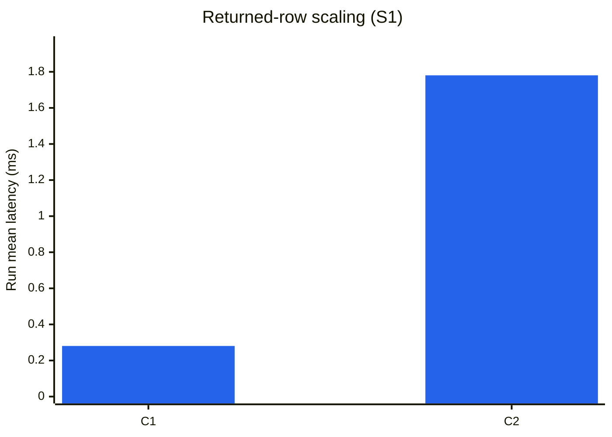


### Returned-row scaling (S2)

| Category | Workload / mode | Run mean latency (ms) |
| --- | --- | --- |
| C1 | oyster-idle; operation=read; table=LargeRows; rows=10; iterations=100; callbacks=1; access=service; hook=false; pageSize=1000; scanRows=10000; enrichment=batch; mixed=unavailable; readTable=unavailable; queryShape=page; offset=0; hookControl=false; actionContract=auto; scanCoordination=unavailable; wholeScanRows=unavailable; lookupPattern=unavailable; validationOutcome=unavailable; transport=http; phase=warm; load=vus:1; n=1 | 0.258 |
| C2 | oyster-idle; operation=read; table=LargeRows; rows=1000; iterations=100; callbacks=1; access=service; hook=false; pageSize=1000; scanRows=10000; enrichment=batch; mixed=unavailable; readTable=unavailable; queryShape=page; offset=0; hookControl=false; actionContract=auto; scanCoordination=unavailable; wholeScanRows=unavailable; lookupPattern=unavailable; validationOutcome=unavailable; transport=http; phase=warm; load=vus:1; n=1 | 1.433 |


### Returned-row scaling (S3)

| Category | Workload / mode | Run mean latency (ms) |
| --- | --- | --- |
| C1 | native-empty; operation=read; table=LargeRows; rows=10; iterations=100; callbacks=1; access=service; hook=false; pageSize=1000; scanRows=10000; enrichment=batch; mixed=unavailable; readTable=unavailable; queryShape=page; offset=0; hookControl=false; actionContract=auto; scanCoordination=unavailable; wholeScanRows=unavailable; lookupPattern=unavailable; validationOutcome=unavailable; transport=http; phase=warm; load=vus:1; n=1 | 0.253 |
| C2 | native-empty; operation=read; table=LargeRows; rows=1000; iterations=100; callbacks=1; access=service; hook=false; pageSize=1000; scanRows=10000; enrichment=batch; mixed=unavailable; readTable=unavailable; queryShape=page; offset=0; hookControl=false; actionContract=auto; scanCoordination=unavailable; wholeScanRows=unavailable; lookupPattern=unavailable; validationOutcome=unavailable; transport=http; phase=warm; load=vus:1; n=1 | 1.46 |


### Returned-row scaling (S4)

| Category | Workload / mode | Run mean latency (ms) |
| --- | --- | --- |
| C1 | wasm-empty; operation=read; table=LargeRows; rows=10; iterations=100; callbacks=1; access=service; hook=false; pageSize=1000; scanRows=10000; enrichment=batch; mixed=unavailable; readTable=unavailable; queryShape=page; offset=0; hookControl=false; actionContract=auto; scanCoordination=unavailable; wholeScanRows=unavailable; lookupPattern=unavailable; validationOutcome=unavailable; transport=http; phase=warm; load=vus:1; n=1 | 1.077 |
| C2 | wasm-empty; operation=read; table=LargeRows; rows=1000; iterations=100; callbacks=1; access=service; hook=false; pageSize=1000; scanRows=10000; enrichment=batch; mixed=unavailable; readTable=unavailable; queryShape=page; offset=0; hookControl=false; actionContract=auto; scanCoordination=unavailable; wholeScanRows=unavailable; lookupPattern=unavailable; validationOutcome=unavailable; transport=http; phase=warm; load=vus:1; n=1 | 7.603 |

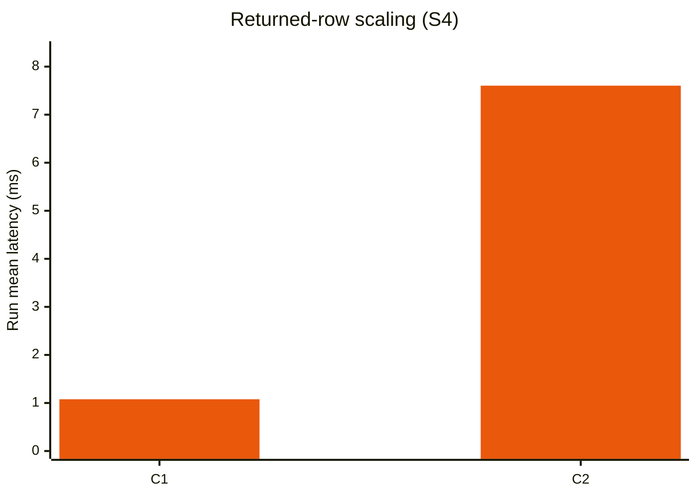

Oyster handlers: [Oyster empty handler](../../apps/extension/srv/BenchmarkService/OysterEmptyLargeRows/after-READ.js).

### Returned-row scaling (S5)

| Category | Workload / mode | Run mean latency (ms) |
| --- | --- | --- |
| C1 | wasm-compute; operation=read; table=LargeRows; rows=10; iterations=100; callbacks=1; access=service; hook=false; pageSize=1000; scanRows=10000; enrichment=batch; mixed=unavailable; readTable=unavailable; queryShape=page; offset=0; hookControl=false; actionContract=auto; scanCoordination=unavailable; wholeScanRows=unavailable; lookupPattern=unavailable; validationOutcome=unavailable; transport=http; phase=warm; load=vus:1; n=1 | 1.371 |
| C2 | wasm-compute; operation=read; table=LargeRows; rows=1000; iterations=100; callbacks=1; access=service; hook=false; pageSize=1000; scanRows=10000; enrichment=batch; mixed=unavailable; readTable=unavailable; queryShape=page; offset=0; hookControl=false; actionContract=auto; scanCoordination=unavailable; wholeScanRows=unavailable; lookupPattern=unavailable; validationOutcome=unavailable; transport=http; phase=warm; load=vus:1; n=1 | 19.133 |

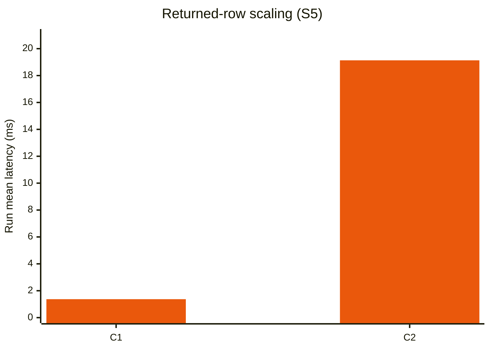

Oyster handlers: [Oyster calculation](../../apps/extension/srv/BenchmarkService/OysterCalculationLargeRows/after-READ.js).

### Callback fan-out (S6)

| Category | Workload / mode | Run mean latency (ms) |
| --- | --- | --- |
| C1 | native-compute-write; operation=action; table=SmallRows; rows=10; iterations=0; callbacks=1; access=service; hook=false; pageSize=1000; scanRows=10000; enrichment=batch; mixed=unavailable; readTable=unavailable; queryShape=page; offset=0; hookControl=false; actionContract=auto; scanCoordination=unavailable; wholeScanRows=unavailable; lookupPattern=unavailable; validationOutcome=unavailable; transport=http; phase=warm; load=vus:1; n=1 | 0.277 |
| C2 | native-compute-write; operation=action; table=SmallRows; rows=10; iterations=0; callbacks=10; access=service; hook=false; pageSize=1000; scanRows=10000; enrichment=batch; mixed=unavailable; readTable=unavailable; queryShape=page; offset=0; hookControl=false; actionContract=auto; scanCoordination=unavailable; wholeScanRows=unavailable; lookupPattern=unavailable; validationOutcome=unavailable; transport=http; phase=warm; load=vus:1; n=1 | 0.932 |

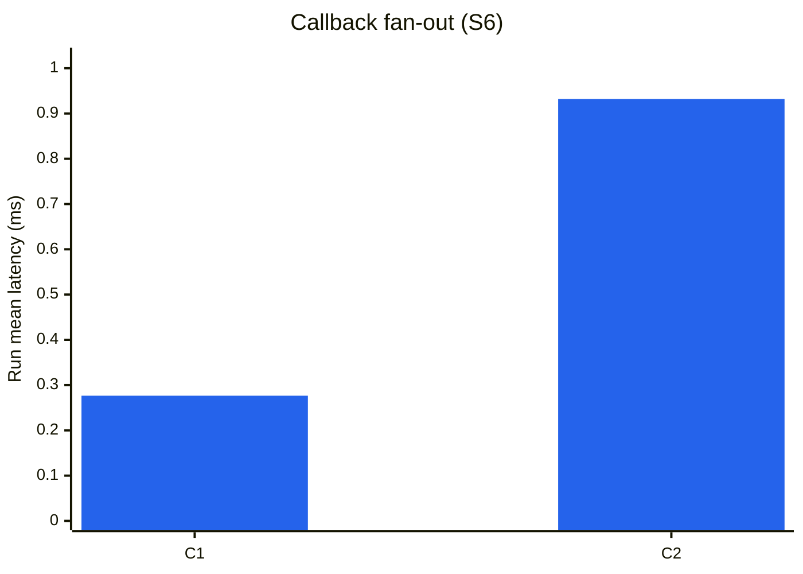


### Callback fan-out (S7)

| Category | Workload / mode | Run mean latency (ms) |
| --- | --- | --- |
| C1 | native-compute-read; operation=action; table=SmallRows; rows=10; iterations=0; callbacks=1; access=service; hook=false; pageSize=1000; scanRows=10000; enrichment=batch; mixed=unavailable; readTable=unavailable; queryShape=page; offset=0; hookControl=false; actionContract=auto; scanCoordination=unavailable; wholeScanRows=unavailable; lookupPattern=unavailable; validationOutcome=unavailable; transport=http; phase=warm; load=vus:1; n=1 | 0.223 |
| C2 | native-compute-read; operation=action; table=SmallRows; rows=10; iterations=0; callbacks=10; access=service; hook=false; pageSize=1000; scanRows=10000; enrichment=batch; mixed=unavailable; readTable=unavailable; queryShape=page; offset=0; hookControl=false; actionContract=auto; scanCoordination=unavailable; wholeScanRows=unavailable; lookupPattern=unavailable; validationOutcome=unavailable; transport=http; phase=warm; load=vus:1; n=1 | 0.81 |

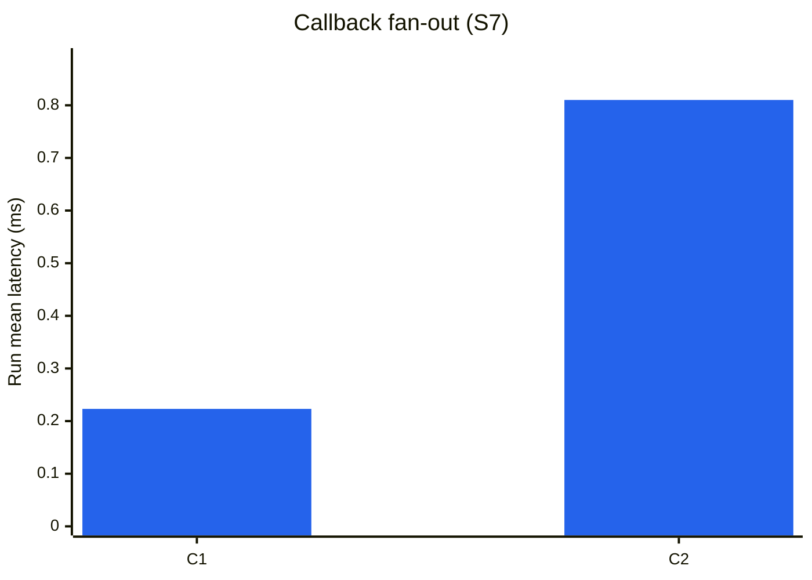


### Callback fan-out (S8)

| Category | Workload / mode | Run mean latency (ms) |
| --- | --- | --- |
| C1 | wasm-compute-read; operation=action; table=SmallRows; rows=10; iterations=0; callbacks=1; access=service; hook=false; pageSize=1000; scanRows=10000; enrichment=batch; mixed=unavailable; readTable=unavailable; queryShape=page; offset=0; hookControl=false; actionContract=auto; scanCoordination=unavailable; wholeScanRows=unavailable; lookupPattern=unavailable; validationOutcome=unavailable; transport=http; phase=warm; load=vus:1; n=1 | 1.176 |
| C2 | wasm-compute-read; operation=action; table=SmallRows; rows=10; iterations=0; callbacks=10; access=service; hook=false; pageSize=1000; scanRows=10000; enrichment=batch; mixed=unavailable; readTable=unavailable; queryShape=page; offset=0; hookControl=false; actionContract=auto; scanCoordination=unavailable; wholeScanRows=unavailable; lookupPattern=unavailable; validationOutcome=unavailable; transport=http; phase=warm; load=vus:1; n=1 | 2.439 |

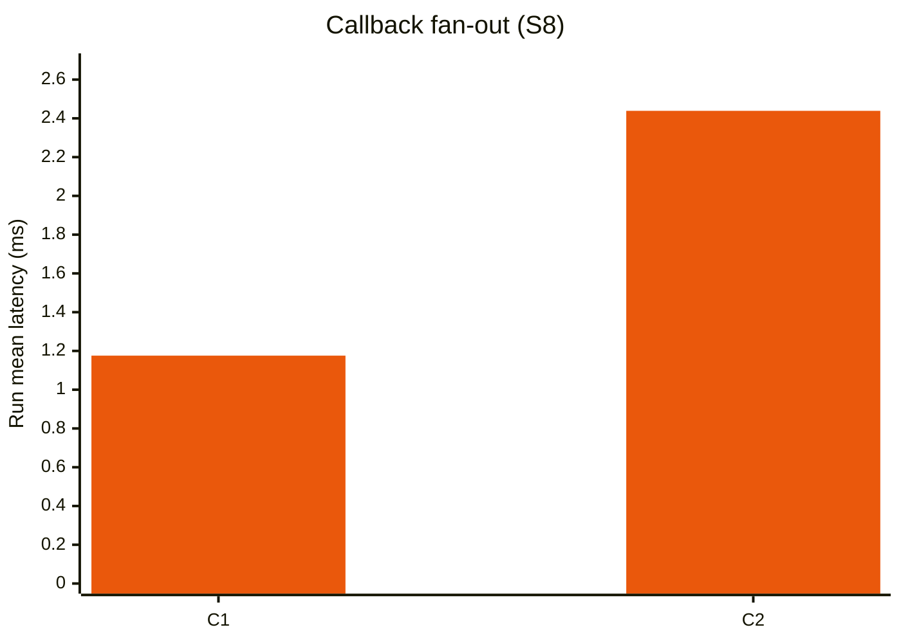

Oyster handlers: [Oyster CQL read](../../apps/extension/srv/BenchmarkService/on-oysterCqlRead.js).

### Callback fan-out (S9)

| Category | Workload / mode | Run mean latency (ms) |
| --- | --- | --- |
| C1 | wasm-compute-write; operation=action; table=SmallRows; rows=10; iterations=0; callbacks=1; access=service; hook=false; pageSize=1000; scanRows=10000; enrichment=batch; mixed=unavailable; readTable=unavailable; queryShape=page; offset=0; hookControl=false; actionContract=auto; scanCoordination=unavailable; wholeScanRows=unavailable; lookupPattern=unavailable; validationOutcome=unavailable; transport=http; phase=warm; load=vus:1; n=1 | 1.383 |
| C2 | wasm-compute-write; operation=action; table=SmallRows; rows=10; iterations=0; callbacks=10; access=service; hook=false; pageSize=1000; scanRows=10000; enrichment=batch; mixed=unavailable; readTable=unavailable; queryShape=page; offset=0; hookControl=false; actionContract=auto; scanCoordination=unavailable; wholeScanRows=unavailable; lookupPattern=unavailable; validationOutcome=unavailable; transport=http; phase=warm; load=vus:1; n=1 | 2.21 |

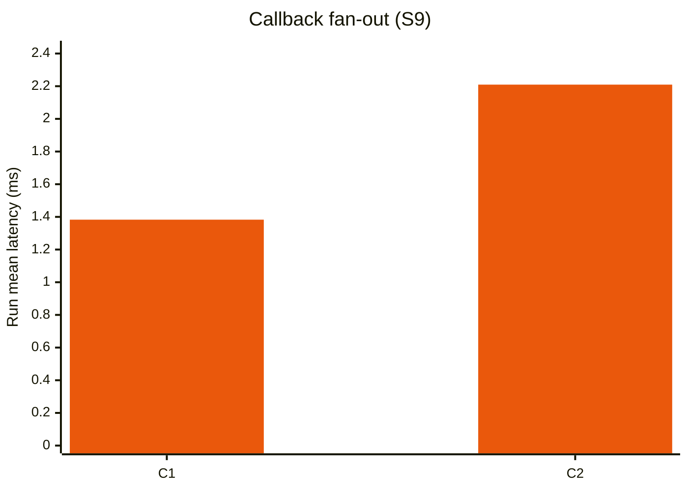

Oyster handlers: [Oyster CQL write](../../apps/extension/srv/BenchmarkService/on-oysterCqlWrite.js).

### Load latency (S10)

| Category | Workload / mode | Mean run p95 latency (ms) |
| --- | --- | --- |
| C1 | native-compute-read; operation=action; table=SmallRows; rows=10; iterations=0; callbacks=1; access=service; hook=false; pageSize=1000; scanRows=10000; enrichment=batch; mixed=unavailable; readTable=unavailable; queryShape=page; offset=0; hookControl=false; actionContract=auto; scanCoordination=unavailable; wholeScanRows=unavailable; lookupPattern=unavailable; validationOutcome=unavailable; transport=http; phase=warm; load=vus:1; n=1 | 0.257 |
| C2 | native-compute-read; operation=action; table=SmallRows; rows=10; iterations=0; callbacks=1; access=service; hook=false; pageSize=1000; scanRows=10000; enrichment=batch; mixed=unavailable; readTable=unavailable; queryShape=page; offset=0; hookControl=false; actionContract=auto; scanCoordination=unavailable; wholeScanRows=unavailable; lookupPattern=unavailable; validationOutcome=unavailable; transport=http; phase=warm; load=vus:8; n=1 | 0.438 |
| C3 | native-compute-read; operation=action; table=SmallRows; rows=10; iterations=0; callbacks=1; access=service; hook=false; pageSize=1000; scanRows=10000; enrichment=batch; mixed=unavailable; readTable=unavailable; queryShape=page; offset=0; hookControl=false; actionContract=auto; scanCoordination=unavailable; wholeScanRows=unavailable; lookupPattern=unavailable; validationOutcome=unavailable; transport=http; phase=warm; load=vus:32; n=1 | 2.92 |

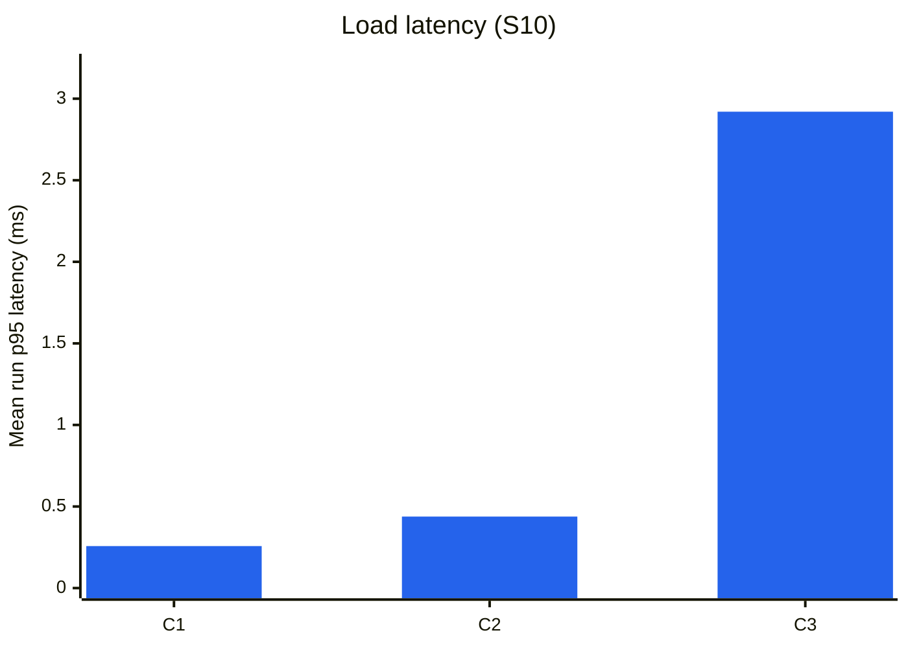


### Successful throughput (S11)

| Category | Workload / mode | Successful throughput (requests/s) |
| --- | --- | --- |
| C1 | native-compute-read; operation=action; table=SmallRows; rows=10; iterations=0; callbacks=1; access=service; hook=false; pageSize=1000; scanRows=10000; enrichment=batch; mixed=unavailable; readTable=unavailable; queryShape=page; offset=0; hookControl=false; actionContract=auto; scanCoordination=unavailable; wholeScanRows=unavailable; lookupPattern=unavailable; validationOutcome=unavailable; transport=http; phase=warm; load=vus:1; n=1 | 4253.562 |
| C2 | native-compute-read; operation=action; table=SmallRows; rows=10; iterations=0; callbacks=1; access=service; hook=false; pageSize=1000; scanRows=10000; enrichment=batch; mixed=unavailable; readTable=unavailable; queryShape=page; offset=0; hookControl=false; actionContract=auto; scanCoordination=unavailable; wholeScanRows=unavailable; lookupPattern=unavailable; validationOutcome=unavailable; transport=http; phase=warm; load=vus:8; n=1 | 23792.334 |
| C3 | native-compute-read; operation=action; table=SmallRows; rows=10; iterations=0; callbacks=1; access=service; hook=false; pageSize=1000; scanRows=10000; enrichment=batch; mixed=unavailable; readTable=unavailable; queryShape=page; offset=0; hookControl=false; actionContract=auto; scanCoordination=unavailable; wholeScanRows=unavailable; lookupPattern=unavailable; validationOutcome=unavailable; transport=http; phase=warm; load=vus:32; n=1 | 23701.625 |

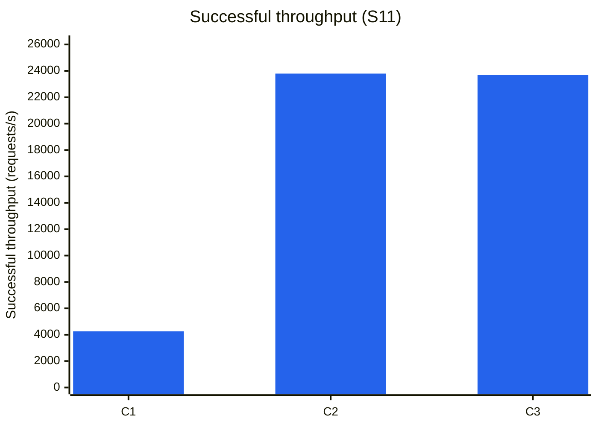


### Unrelated-request probe (S12)

| Category | Workload / mode | Unrelated-request probe p95 (ms) |
| --- | --- | --- |
| C1 | native-compute-read; operation=action; table=SmallRows; rows=10; iterations=0; callbacks=1; access=service; hook=false; pageSize=1000; scanRows=10000; enrichment=batch; mixed=unavailable; readTable=unavailable; queryShape=page; offset=0; hookControl=false; actionContract=auto; scanCoordination=unavailable; wholeScanRows=unavailable; lookupPattern=unavailable; validationOutcome=unavailable; transport=http; phase=warm; load=vus:8; n=1 | 29.17 |
| C2 | native-compute-read; operation=action; table=SmallRows; rows=10; iterations=0; callbacks=1; access=service; hook=false; pageSize=1000; scanRows=10000; enrichment=batch; mixed=unavailable; readTable=unavailable; queryShape=page; offset=0; hookControl=false; actionContract=auto; scanCoordination=unavailable; wholeScanRows=unavailable; lookupPattern=unavailable; validationOutcome=unavailable; transport=http; phase=warm; load=vus:32; n=1 | 37.682 |

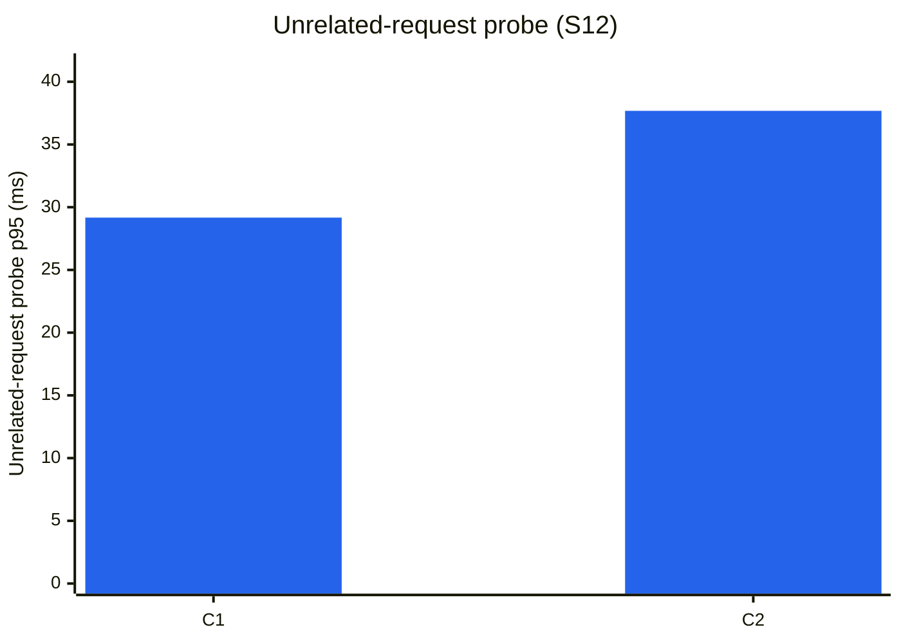


### Load latency (S13)

| Category | Workload / mode | Mean run p95 latency (ms) |
| --- | --- | --- |
| C1 | wasm-compute-read; operation=action; table=SmallRows; rows=10; iterations=0; callbacks=1; access=service; hook=false; pageSize=1000; scanRows=10000; enrichment=batch; mixed=unavailable; readTable=unavailable; queryShape=page; offset=0; hookControl=false; actionContract=auto; scanCoordination=unavailable; wholeScanRows=unavailable; lookupPattern=unavailable; validationOutcome=unavailable; transport=http; phase=warm; load=vus:1; n=1 | 1.328 |
| C2 | wasm-compute-read; operation=action; table=SmallRows; rows=10; iterations=0; callbacks=1; access=service; hook=false; pageSize=1000; scanRows=10000; enrichment=batch; mixed=unavailable; readTable=unavailable; queryShape=page; offset=0; hookControl=false; actionContract=auto; scanCoordination=unavailable; wholeScanRows=unavailable; lookupPattern=unavailable; validationOutcome=unavailable; transport=http; phase=warm; load=vus:8; n=1 | 1.941 |
| C3 | wasm-compute-read; operation=action; table=SmallRows; rows=10; iterations=0; callbacks=1; access=service; hook=false; pageSize=1000; scanRows=10000; enrichment=batch; mixed=unavailable; readTable=unavailable; queryShape=page; offset=0; hookControl=false; actionContract=auto; scanCoordination=unavailable; wholeScanRows=unavailable; lookupPattern=unavailable; validationOutcome=unavailable; transport=http; phase=warm; load=vus:32; n=1 | 20.257 |

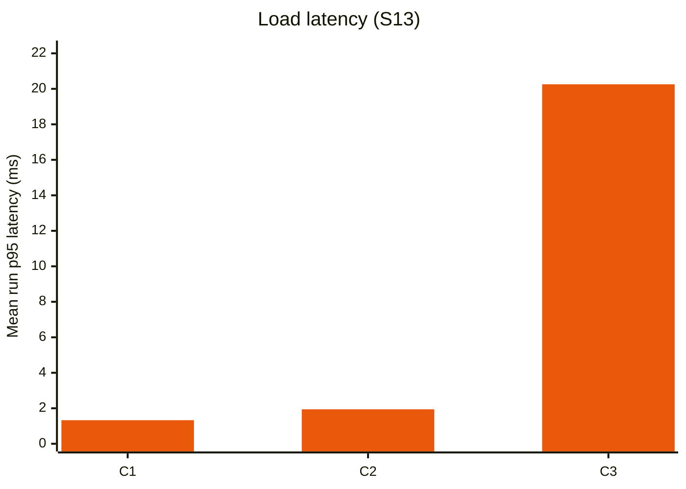

Oyster handlers: [Oyster CQL read](../../apps/extension/srv/BenchmarkService/on-oysterCqlRead.js).

### Successful throughput (S14)

| Category | Workload / mode | Successful throughput (requests/s) |
| --- | --- | --- |
| C1 | wasm-compute-read; operation=action; table=SmallRows; rows=10; iterations=0; callbacks=1; access=service; hook=false; pageSize=1000; scanRows=10000; enrichment=batch; mixed=unavailable; readTable=unavailable; queryShape=page; offset=0; hookControl=false; actionContract=auto; scanCoordination=unavailable; wholeScanRows=unavailable; lookupPattern=unavailable; validationOutcome=unavailable; transport=http; phase=warm; load=vus:1; n=1 | 836.829 |
| C2 | wasm-compute-read; operation=action; table=SmallRows; rows=10; iterations=0; callbacks=1; access=service; hook=false; pageSize=1000; scanRows=10000; enrichment=batch; mixed=unavailable; readTable=unavailable; queryShape=page; offset=0; hookControl=false; actionContract=auto; scanCoordination=unavailable; wholeScanRows=unavailable; lookupPattern=unavailable; validationOutcome=unavailable; transport=http; phase=warm; load=vus:8; n=1 | 5098.755 |
| C3 | wasm-compute-read; operation=action; table=SmallRows; rows=10; iterations=0; callbacks=1; access=service; hook=false; pageSize=1000; scanRows=10000; enrichment=batch; mixed=unavailable; readTable=unavailable; queryShape=page; offset=0; hookControl=false; actionContract=auto; scanCoordination=unavailable; wholeScanRows=unavailable; lookupPattern=unavailable; validationOutcome=unavailable; transport=http; phase=warm; load=vus:32; n=1 | 4178.015 |

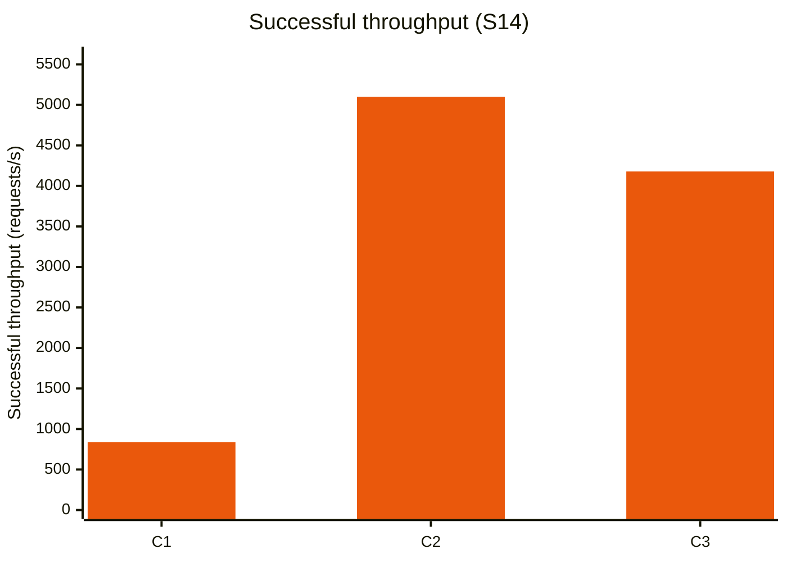

Oyster handlers: [Oyster CQL read](../../apps/extension/srv/BenchmarkService/on-oysterCqlRead.js).

### Unrelated-request probe (S15)

| Category | Workload / mode | Unrelated-request probe p95 (ms) |
| --- | --- | --- |
| C1 | wasm-compute-read; operation=action; table=SmallRows; rows=10; iterations=0; callbacks=1; access=service; hook=false; pageSize=1000; scanRows=10000; enrichment=batch; mixed=unavailable; readTable=unavailable; queryShape=page; offset=0; hookControl=false; actionContract=auto; scanCoordination=unavailable; wholeScanRows=unavailable; lookupPattern=unavailable; validationOutcome=unavailable; transport=http; phase=warm; load=vus:8; n=1 | 32.516 |
| C2 | wasm-compute-read; operation=action; table=SmallRows; rows=10; iterations=0; callbacks=1; access=service; hook=false; pageSize=1000; scanRows=10000; enrichment=batch; mixed=unavailable; readTable=unavailable; queryShape=page; offset=0; hookControl=false; actionContract=auto; scanCoordination=unavailable; wholeScanRows=unavailable; lookupPattern=unavailable; validationOutcome=unavailable; transport=http; phase=warm; load=vus:32; n=1 | 37.231 |

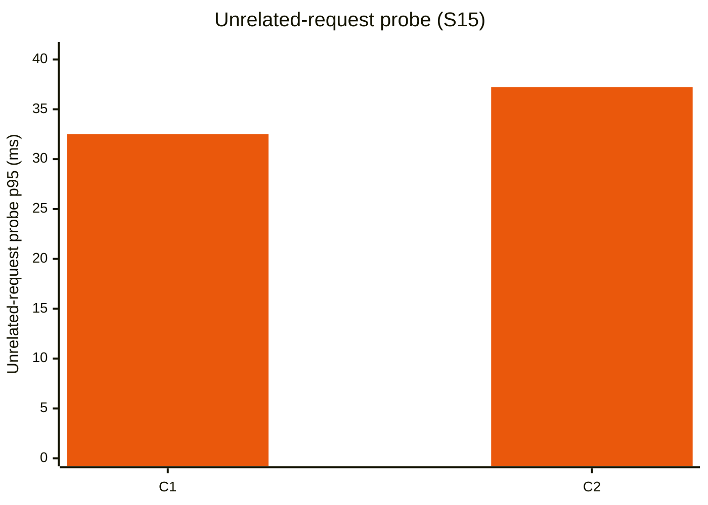

Oyster handlers: [Oyster CQL read](../../apps/extension/srv/BenchmarkService/on-oysterCqlRead.js).

Charts use a single basic Mermaid series with category mappings in the adjacent tables. Values are means of eligible independent run metrics. Missing or failed observations are omitted. No illustrative measurements are included. Scaling and fan-out conclusions require multiple values with every other workload dimension fixed; load sweeps also preserve the load kind. Missing sweeps leave those questions unanswered.

## Failures and limit probes

No failures or limit probes are recorded. This does not establish untested limits.

Failures, partial errors and dropped arrivals affect interpretation even when some requests succeed. Expected failures are not performance successes. A handler skipped after a failure cannot support a throughput improvement.

## Handler and correctness validation

| Manifest validation check | Recorded value |
| --- | --- |
| csvDeploymentVerified | true |

No explicit manifest-wide validation failure is recorded.

| Run | Correctness and rollback checks | Load probe |
| --- | --- | --- |
| create/WriteRows/wasm-empty/direct/service/rows10/cpu100/calls1/batch / rep 1 | {"preflight":{"passed":true,"status":201,"activation":{"passed":true,"handlerActive":true,"engine":"oyster"},"persistedValue":7,"persistedID":4360135,"rollback":{"passed":true,"rejectionStatus":409,"insertedRowAbsent":true,"auxiliaryUnchanged":true}},"postflight":{"passed":true,"status":201,"activation":{"passed":true,"handlerActive":true,"engine":"oyster"},"persistedValue":7,"persistedID":4360136},"passed":true} | {"attempts":0,"errors":0,"droppedIterations":0,"meanMs":null,"p50Ms":null,"p95Ms":null,"p99Ms":null} |
| read/SmallRows/oyster-idle/direct/service/rows10/cpu100/calls1/batch/query-page-offset0 / rep 1 | {"preflight":{"passed":true,"status":200,"rows":10,"checksumsVerified":0,"queryShape":"page","offset":0,"referenceRowsVerified":10,"activation":{"passed":true,"handlerActive":true,"engine":"oyster"},"rollback":{"passed":true,"rejectionStatus":409,"insertedRowAbsent":true,"auxiliaryUnchanged":true}},"postflight":{"passed":true,"status":200,"rows":10,"checksumsVerified":0,"queryShape":"page","offset":0,"referenceRowsVerified":10,"activation":{"passed":true,"handlerActive":true,"engine":"oyster"}},"passed":true} | {"attempts":0,"errors":0,"droppedIterations":0,"meanMs":null,"p50Ms":null,"p95Ms":null,"p99Ms":null} |
| update/WriteRows/wasm-validate-read/direct/service/rows10/cpu0/calls1/batch/decision-accepted / rep 1 | {"preflight":{"passed":true,"status":200,"validationOutcome":"accepted","amount":20,"activation":{"passed":true,"handlerActive":true,"engine":"oyster"},"persistedValue":7,"persistedID":3259136,"rollback":{"passed":true,"rejectionStatus":409,"insertedRowAbsent":true,"auxiliaryUnchanged":true}},"postflight":{"passed":true,"status":200,"validationOutcome":"accepted","amount":20,"activation":{"passed":true,"handlerActive":true,"engine":"oyster"},"persistedValue":7,"persistedID":3259137},"passed":true} | {"attempts":0,"errors":0,"droppedIterations":0,"meanMs":null,"p50Ms":null,"p95Ms":null,"p99Ms":null} |
| action/SmallRows/native-compute-write/direct/service/rows10/cpu0/calls10/batch / rep 1 | {"preflight":{"passed":true,"status":200,"checksum":7,"activation":{"passed":true,"handlerActive":true,"engine":"oyster"},"auxiliaryValue":7,"rollback":{"passed":true,"rejectionStatus":409,"insertedRowAbsent":true,"auxiliaryUnchanged":true}},"postflight":{"passed":true,"status":200,"checksum":7,"activation":{"passed":true,"handlerActive":true,"engine":"oyster"},"auxiliaryValue":7},"passed":true} | {"attempts":0,"errors":0,"droppedIterations":0,"meanMs":null,"p50Ms":null,"p95Ms":null,"p99Ms":null} |
| create/WriteRows/oyster-idle/direct/service/rows10/cpu100/calls1/batch / rep 1 | {"preflight":{"passed":true,"status":201,"activation":{"passed":true,"handlerActive":true,"engine":"oyster"},"persistedValue":7,"persistedID":17160135,"rollback":{"passed":true,"rejectionStatus":409,"insertedRowAbsent":true,"auxiliaryUnchanged":true}},"postflight":{"passed":true,"status":201,"activation":{"passed":true,"handlerActive":true,"engine":"oyster"},"persistedValue":7,"persistedID":17160136},"passed":true} | {"attempts":0,"errors":0,"droppedIterations":0,"meanMs":null,"p50Ms":null,"p95Ms":null,"p99Ms":null} |
| action/SmallRows/native-compute-read/direct/service/rows10/cpu0/calls1/batch / rep 1 | {"preflight":{"passed":true,"status":200,"checksum":40,"activation":{"passed":true,"handlerActive":true,"engine":"oyster"},"rollback":{"passed":true,"rejectionStatus":409,"insertedRowAbsent":true,"auxiliaryUnchanged":true}},"postflight":{"passed":true,"status":200,"checksum":84,"activation":{"passed":true,"handlerActive":true,"engine":"oyster"}},"passed":true} | {"attempts":5,"errors":0,"droppedIterations":0,"meanMs":7.014907999999911,"p50Ms":1.4655829999996968,"p95Ms":29.170457999999996,"p99Ms":29.170457999999996} |
| create/WriteRows/native-compute/direct/service/rows10/cpu100/calls1/batch / rep 1 | {"preflight":{"passed":true,"status":201,"activation":{"passed":true,"handlerActive":true,"engine":"oyster"},"persistedValue":2013694255,"persistedID":23560135,"rollback":{"passed":true,"rejectionStatus":409,"insertedRowAbsent":true,"auxiliaryUnchanged":true}},"postflight":{"passed":true,"status":201,"activation":{"passed":true,"handlerActive":true,"engine":"oyster"},"persistedValue":2013694255,"persistedID":23560136},"passed":true} | {"attempts":0,"errors":0,"droppedIterations":0,"meanMs":null,"p50Ms":null,"p95Ms":null,"p99Ms":null} |
| action/SmallRows/wasm-validate-read/hook/service/rows10/cpu0/calls1/batch/decision-rejected / rep 1 | {"preflight":{"passed":true,"status":400,"validationOutcome":"rejected","activation":{"passed":true,"handlerActive":true,"engine":"oyster"},"rollback":{"passed":true,"rejectionStatus":409,"insertedRowAbsent":true,"auxiliaryUnchanged":true},"rejectionMessage":"Amount exceeds limit"},"postflight":{"passed":true,"status":400,"validationOutcome":"rejected","activation":{"passed":true,"handlerActive":true,"engine":"oyster"},"rejectionMessage":"Amount exceeds limit"},"measuredWritesUnchanged":true,"passed":true} | {"attempts":0,"errors":0,"droppedIterations":0,"meanMs":null,"p50Ms":null,"p95Ms":null,"p99Ms":null} |
| create/WriteRows/native-validate-read/direct/service/rows10/cpu0/calls1/batch/decision-accepted / rep 1 | {"preflight":{"passed":true,"status":201,"validationOutcome":"accepted","amount":20,"activation":{"passed":true,"handlerActive":true,"engine":"oyster"},"persistedValue":7,"persistedID":29960135,"rollback":{"passed":true,"rejectionStatus":409,"insertedRowAbsent":true,"auxiliaryUnchanged":true}},"postflight":{"passed":true,"status":201,"validationOutcome":"accepted","amount":20,"activation":{"passed":true,"handlerActive":true,"engine":"oyster"},"persistedValue":7,"persistedID":29960136},"passed":true} | {"attempts":0,"errors":0,"droppedIterations":0,"meanMs":null,"p50Ms":null,"p95Ms":null,"p99Ms":null} |
| action/SmallRows/native-validate-read/hook/service/rows10/cpu0/calls1/batch/decision-rejected / rep 1 | {"preflight":{"passed":true,"status":400,"validationOutcome":"rejected","activation":{"passed":true,"handlerActive":true,"engine":"oyster"},"rollback":{"passed":true,"rejectionStatus":409,"insertedRowAbsent":true,"auxiliaryUnchanged":true},"rejectionMessage":"Amount exceeds limit"},"postflight":{"passed":true,"status":400,"validationOutcome":"rejected","activation":{"passed":true,"handlerActive":true,"engine":"oyster"},"rejectionMessage":"Amount exceeds limit"},"measuredWritesUnchanged":true,"passed":true} | {"attempts":0,"errors":0,"droppedIterations":0,"meanMs":null,"p50Ms":null,"p95Ms":null,"p99Ms":null} |
| action/SmallRows/native-validate-read/direct/service/rows10/cpu0/calls1/batch/decision-accepted / rep 1 | {"preflight":{"passed":true,"status":200,"validationOutcome":"accepted","amount":20,"activation":{"passed":true,"handlerActive":true,"engine":"oyster"},"rollback":{"passed":true,"rejectionStatus":409,"insertedRowAbsent":true,"auxiliaryUnchanged":true}},"postflight":{"passed":true,"status":200,"validationOutcome":"accepted","amount":20,"activation":{"passed":true,"handlerActive":true,"engine":"oyster"}},"passed":true} | {"attempts":0,"errors":0,"droppedIterations":0,"meanMs":null,"p50Ms":null,"p95Ms":null,"p99Ms":null} |
| read/SmallRows/wasm-compute-read/direct/service/rows10/cpu0/calls1/batch/query-page-offset0 / rep 1 | {"preflight":{"passed":true,"status":200,"rows":10,"checksumsVerified":10,"queryShape":"page","offset":0,"referenceRowsVerified":10,"activation":{"passed":true,"handlerActive":true,"engine":"oyster"},"rollback":{"passed":true,"rejectionStatus":409,"insertedRowAbsent":true,"auxiliaryUnchanged":true}},"postflight":{"passed":true,"status":200,"rows":10,"checksumsVerified":10,"queryShape":"page","offset":0,"referenceRowsVerified":10,"activation":{"passed":true,"handlerActive":true,"engine":"oyster"}},"passed":true} | {"attempts":0,"errors":0,"droppedIterations":0,"meanMs":null,"p50Ms":null,"p95Ms":null,"p99Ms":null} |
| create/WriteRows/wasm-compute-read/direct/service/rows10/cpu0/calls1/batch / rep 1 | {"preflight":{"passed":true,"status":201,"activation":{"passed":true,"handlerActive":true,"engine":"oyster"},"persistedValue":40,"persistedID":42760135,"rollback":{"passed":true,"rejectionStatus":409,"insertedRowAbsent":true,"auxiliaryUnchanged":true}},"postflight":{"passed":true,"status":201,"activation":{"passed":true,"handlerActive":true,"engine":"oyster"},"persistedValue":84,"persistedID":42760136},"passed":true} | {"attempts":0,"errors":0,"droppedIterations":0,"meanMs":null,"p50Ms":null,"p95Ms":null,"p99Ms":null} |
| create/WriteRows/wasm-compute/direct/service/rows10/cpu100/calls1/batch / rep 1 | {"preflight":{"passed":true,"status":201,"activation":{"passed":true,"handlerActive":true,"engine":"oyster"},"persistedValue":2013694255,"persistedID":45960135,"rollback":{"passed":true,"rejectionStatus":409,"insertedRowAbsent":true,"auxiliaryUnchanged":true}},"postflight":{"passed":true,"status":201,"activation":{"passed":true,"handlerActive":true,"engine":"oyster"},"persistedValue":2013694255,"persistedID":45960136},"passed":true} | {"attempts":0,"errors":0,"droppedIterations":0,"meanMs":null,"p50Ms":null,"p95Ms":null,"p99Ms":null} |
| create/WriteRows/wasm-compute-write/direct/service/rows10/cpu0/calls1/batch / rep 1 | {"preflight":{"passed":true,"status":201,"activation":{"passed":true,"handlerActive":true,"engine":"oyster"},"persistedValue":7,"persistedID":49160135,"auxiliaryValue":7,"rollback":{"passed":true,"rejectionStatus":409,"insertedRowAbsent":true,"auxiliaryUnchanged":true}},"postflight":{"passed":true,"status":201,"activation":{"passed":true,"handlerActive":true,"engine":"oyster"},"persistedValue":7,"persistedID":49160136,"auxiliaryValue":7},"passed":true} | {"attempts":0,"errors":0,"droppedIterations":0,"meanMs":null,"p50Ms":null,"p95Ms":null,"p99Ms":null} |
| create/WriteRows/wasm-validate/direct/service/rows10/cpu0/calls1/batch/decision-accepted / rep 1 | {"preflight":{"passed":true,"status":201,"validationOutcome":"accepted","amount":20,"activation":{"passed":true,"handlerActive":true,"engine":"oyster"},"persistedValue":7,"persistedID":52360135,"rollback":{"passed":true,"rejectionStatus":409,"insertedRowAbsent":true,"auxiliaryUnchanged":true}},"postflight":{"passed":true,"status":201,"validationOutcome":"accepted","amount":20,"activation":{"passed":true,"handlerActive":true,"engine":"oyster"},"persistedValue":7,"persistedID":52360136},"passed":true} | {"attempts":0,"errors":0,"droppedIterations":0,"meanMs":null,"p50Ms":null,"p95Ms":null,"p99Ms":null} |
| read/SmallRows/native-empty/direct/service/rows10/cpu100/calls1/batch/query-page-offset0 / rep 1 | {"preflight":{"passed":true,"status":200,"rows":10,"checksumsVerified":0,"queryShape":"page","offset":0,"referenceRowsVerified":10,"activation":{"passed":true,"handlerActive":true,"engine":"oyster"},"rollback":{"passed":true,"rejectionStatus":409,"insertedRowAbsent":true,"auxiliaryUnchanged":true}},"postflight":{"passed":true,"status":200,"rows":10,"checksumsVerified":0,"queryShape":"page","offset":0,"referenceRowsVerified":10,"activation":{"passed":true,"handlerActive":true,"engine":"oyster"}},"passed":true} | {"attempts":0,"errors":0,"droppedIterations":0,"meanMs":null,"p50Ms":null,"p95Ms":null,"p99Ms":null} |
| action/SmallRows/wasm-compute-read/direct/service/rows10/cpu0/calls1/batch / rep 1 | {"preflight":{"passed":true,"status":200,"checksum":40,"activation":{"passed":true,"handlerActive":true,"engine":"oyster"},"rollback":{"passed":true,"rejectionStatus":409,"insertedRowAbsent":true,"auxiliaryUnchanged":true}},"postflight":{"passed":true,"status":200,"checksum":84,"activation":{"passed":true,"handlerActive":true,"engine":"oyster"}},"passed":true} | {"attempts":5,"errors":0,"droppedIterations":0,"meanMs":12.25082500000002,"p50Ms":6.094166999999743,"p95Ms":37.231291,"p99Ms":37.231291} |
| read/LargeRows/native-compute/direct/service/rows1000/cpu100/calls1/batch/query-page-offset0 / rep 1 | {"preflight":{"passed":true,"status":200,"rows":1000,"checksumsVerified":1000,"queryShape":"page","offset":0,"referenceRowsVerified":1000,"activation":{"passed":true,"handlerActive":true,"engine":"oyster"},"rollback":{"passed":true,"rejectionStatus":409,"insertedRowAbsent":true,"auxiliaryUnchanged":true}},"postflight":{"passed":true,"status":200,"rows":1000,"checksumsVerified":1000,"queryShape":"page","offset":0,"referenceRowsVerified":1000,"activation":{"passed":true,"handlerActive":true,"engine":"oyster"}},"passed":true} | {"attempts":0,"errors":0,"droppedIterations":0,"meanMs":null,"p50Ms":null,"p95Ms":null,"p99Ms":null} |
| update/WriteRows/wasm-validate/direct/service/rows10/cpu0/calls1/batch/decision-rejected / rep 1 | {"preflight":{"passed":true,"status":400,"validationOutcome":"rejected","activation":{"passed":true,"handlerActive":true,"engine":"oyster"},"writeUnchanged":true,"rollback":{"passed":true,"rejectionStatus":409,"insertedRowAbsent":true,"auxiliaryUnchanged":true},"rejectionMessage":"Amount exceeds limit"},"postflight":{"passed":true,"status":400,"validationOutcome":"rejected","activation":{"passed":true,"handlerActive":true,"engine":"oyster"},"writeUnchanged":true,"rejectionMessage":"Amount exceeds limit"},"measuredWritesUnchanged":true,"passed":true} | {"attempts":0,"errors":0,"droppedIterations":0,"meanMs":null,"p50Ms":null,"p95Ms":null,"p99Ms":null} |
| read/SmallRows/wasm-compute-write/direct/service/rows10/cpu0/calls1/batch/query-page-offset0 / rep 1 | {"preflight":{"passed":true,"status":200,"rows":10,"checksumsVerified":10,"queryShape":"page","offset":0,"referenceRowsVerified":10,"activation":{"passed":true,"handlerActive":true,"engine":"oyster"},"auxiliaryValue":0,"rollback":{"passed":true,"rejectionStatus":409,"insertedRowAbsent":true,"auxiliaryUnchanged":true}},"postflight":{"passed":true,"status":200,"rows":10,"checksumsVerified":10,"queryShape":"page","offset":0,"referenceRowsVerified":10,"activation":{"passed":true,"handlerActive":true,"engine":"oyster"},"auxiliaryValue":0},"passed":true} | {"attempts":0,"errors":0,"droppedIterations":0,"meanMs":null,"p50Ms":null,"p95Ms":null,"p99Ms":null} |
| update/WriteRows/native-validate/direct/service/rows10/cpu0/calls1/batch/decision-accepted / rep 1 | {"preflight":{"passed":true,"status":200,"validationOutcome":"accepted","amount":20,"activation":{"passed":true,"handlerActive":true,"engine":"oyster"},"persistedValue":7,"persistedID":3259136,"rollback":{"passed":true,"rejectionStatus":409,"insertedRowAbsent":true,"auxiliaryUnchanged":true}},"postflight":{"passed":true,"status":200,"validationOutcome":"accepted","amount":20,"activation":{"passed":true,"handlerActive":true,"engine":"oyster"},"persistedValue":7,"persistedID":3259137},"passed":true} | {"attempts":0,"errors":0,"droppedIterations":0,"meanMs":null,"p50Ms":null,"p95Ms":null,"p99Ms":null} |
| create/WriteRows/native-compute-read/direct/service/rows10/cpu0/calls1/batch / rep 1 | {"preflight":{"passed":true,"status":201,"activation":{"passed":true,"handlerActive":true,"engine":"oyster"},"persistedValue":40,"persistedID":74760135,"rollback":{"passed":true,"rejectionStatus":409,"insertedRowAbsent":true,"auxiliaryUnchanged":true}},"postflight":{"passed":true,"status":201,"activation":{"passed":true,"handlerActive":true,"engine":"oyster"},"persistedValue":84,"persistedID":74760136},"passed":true} | {"attempts":0,"errors":0,"droppedIterations":0,"meanMs":null,"p50Ms":null,"p95Ms":null,"p99Ms":null} |
| read/LargeRows/native-compute/direct/service/rows10/cpu100/calls1/batch/query-page-offset0 / rep 1 | {"preflight":{"passed":true,"status":200,"rows":10,"checksumsVerified":10,"queryShape":"page","offset":0,"referenceRowsVerified":10,"activation":{"passed":true,"handlerActive":true,"engine":"oyster"},"rollback":{"passed":true,"rejectionStatus":409,"insertedRowAbsent":true,"auxiliaryUnchanged":true}},"postflight":{"passed":true,"status":200,"rows":10,"checksumsVerified":10,"queryShape":"page","offset":0,"referenceRowsVerified":10,"activation":{"passed":true,"handlerActive":true,"engine":"oyster"}},"passed":true} | {"attempts":0,"errors":0,"droppedIterations":0,"meanMs":null,"p50Ms":null,"p95Ms":null,"p99Ms":null} |
| action/SmallRows/native-validate/hook/service/rows10/cpu0/calls1/batch/decision-accepted / rep 1 | {"preflight":{"passed":true,"status":200,"validationOutcome":"accepted","amount":20,"activation":{"passed":true,"handlerActive":true,"engine":"oyster"},"rollback":{"passed":true,"rejectionStatus":409,"insertedRowAbsent":true,"auxiliaryUnchanged":true}},"postflight":{"passed":true,"status":200,"validationOutcome":"accepted","amount":20,"activation":{"passed":true,"handlerActive":true,"engine":"oyster"}},"passed":true} | {"attempts":0,"errors":0,"droppedIterations":0,"meanMs":null,"p50Ms":null,"p95Ms":null,"p99Ms":null} |
| action/SmallRows/native-empty/direct/service/rows10/cpu100/calls1/batch / rep 1 | {"preflight":{"passed":true,"status":204,"activation":{"passed":true,"handlerActive":true,"engine":"oyster"},"rollback":{"passed":true,"rejectionStatus":409,"insertedRowAbsent":true,"auxiliaryUnchanged":true}},"postflight":{"passed":true,"status":204,"activation":{"passed":true,"handlerActive":true,"engine":"oyster"}},"passed":true} | {"attempts":0,"errors":0,"droppedIterations":0,"meanMs":null,"p50Ms":null,"p95Ms":null,"p99Ms":null} |
| action/SmallRows/native-compute-read/direct/service/rows10/cpu0/calls1/batch / rep 1 | {"preflight":{"passed":true,"status":200,"checksum":40,"activation":{"passed":true,"handlerActive":true,"engine":"oyster"},"rollback":{"passed":true,"rejectionStatus":409,"insertedRowAbsent":true,"auxiliaryUnchanged":true}},"postflight":{"passed":true,"status":200,"checksum":84,"activation":{"passed":true,"handlerActive":true,"engine":"oyster"}},"passed":true} | {"attempts":0,"errors":0,"droppedIterations":0,"meanMs":null,"p50Ms":null,"p95Ms":null,"p99Ms":null} |
| action/SmallRows/native-compute/direct/service/rows10/cpu100/calls1/batch / rep 1 | {"preflight":{"passed":true,"status":200,"checksum":2013694255,"activation":{"passed":true,"handlerActive":true,"engine":"oyster"},"rollback":{"passed":true,"rejectionStatus":409,"insertedRowAbsent":true,"auxiliaryUnchanged":true}},"postflight":{"passed":true,"status":200,"checksum":2013694255,"activation":{"passed":true,"handlerActive":true,"engine":"oyster"}},"passed":true} | {"attempts":0,"errors":0,"droppedIterations":0,"meanMs":null,"p50Ms":null,"p95Ms":null,"p99Ms":null} |
| create/WriteRows/native-empty/direct/service/rows10/cpu100/calls1/batch / rep 1 | {"preflight":{"passed":true,"status":201,"activation":{"passed":true,"handlerActive":true,"engine":"oyster"},"persistedValue":7,"persistedID":93960135,"rollback":{"passed":true,"rejectionStatus":409,"insertedRowAbsent":true,"auxiliaryUnchanged":true}},"postflight":{"passed":true,"status":201,"activation":{"passed":true,"handlerActive":true,"engine":"oyster"},"persistedValue":7,"persistedID":93960136},"passed":true} | {"attempts":0,"errors":0,"droppedIterations":0,"meanMs":null,"p50Ms":null,"p95Ms":null,"p99Ms":null} |
| read/LargeRows/oyster-idle/direct/service/rows10/cpu100/calls1/batch/query-page-offset0 / rep 1 | {"preflight":{"passed":true,"status":200,"rows":10,"checksumsVerified":0,"queryShape":"page","offset":0,"referenceRowsVerified":10,"activation":{"passed":true,"handlerActive":true,"engine":"oyster"},"rollback":{"passed":true,"rejectionStatus":409,"insertedRowAbsent":true,"auxiliaryUnchanged":true}},"postflight":{"passed":true,"status":200,"rows":10,"checksumsVerified":0,"queryShape":"page","offset":0,"referenceRowsVerified":10,"activation":{"passed":true,"handlerActive":true,"engine":"oyster"}},"passed":true} | {"attempts":0,"errors":0,"droppedIterations":0,"meanMs":null,"p50Ms":null,"p95Ms":null,"p99Ms":null} |
| scan/LargeRows/native-compute/direct/service/rows10/cpu100/calls1/scan10000-page1000 / rep 1 | {"preflight":{"passed":true,"status":200,"checksum":935710557,"rows":10000,"activation":{"passed":true,"handlerActive":true,"engine":"oyster"},"rollback":{"passed":true,"rejectionStatus":409,"insertedRowAbsent":true,"auxiliaryUnchanged":true}},"postflight":{"passed":true,"status":200,"checksum":935710557,"rows":10000,"activation":{"passed":true,"handlerActive":true,"engine":"oyster"}},"passed":true} | {"attempts":0,"errors":0,"droppedIterations":0,"meanMs":null,"p50Ms":null,"p95Ms":null,"p99Ms":null} |
| update/WriteRows/wasm-validate-read/direct/service/rows10/cpu0/calls1/batch/decision-rejected / rep 1 | {"preflight":{"passed":true,"status":400,"validationOutcome":"rejected","activation":{"passed":true,"handlerActive":true,"engine":"oyster"},"writeUnchanged":true,"rollback":{"passed":true,"rejectionStatus":409,"insertedRowAbsent":true,"auxiliaryUnchanged":true},"rejectionMessage":"Amount exceeds limit"},"postflight":{"passed":true,"status":400,"validationOutcome":"rejected","activation":{"passed":true,"handlerActive":true,"engine":"oyster"},"writeUnchanged":true,"rejectionMessage":"Amount exceeds limit"},"measuredWritesUnchanged":true,"passed":true} | {"attempts":0,"errors":0,"droppedIterations":0,"meanMs":null,"p50Ms":null,"p95Ms":null,"p99Ms":null} |
| action/SmallRows/native-validate-read/hook/service/rows10/cpu0/calls1/batch/decision-accepted / rep 1 | {"preflight":{"passed":true,"status":200,"validationOutcome":"accepted","amount":20,"activation":{"passed":true,"handlerActive":true,"engine":"oyster"},"rollback":{"passed":true,"rejectionStatus":409,"insertedRowAbsent":true,"auxiliaryUnchanged":true}},"postflight":{"passed":true,"status":200,"validationOutcome":"accepted","amount":20,"activation":{"passed":true,"handlerActive":true,"engine":"oyster"}},"passed":true} | {"attempts":0,"errors":0,"droppedIterations":0,"meanMs":null,"p50Ms":null,"p95Ms":null,"p99Ms":null} |
| action/SmallRows/wasm-validate-read/direct/service/rows10/cpu0/calls1/batch/decision-rejected / rep 1 | {"preflight":{"passed":true,"status":400,"validationOutcome":"rejected","activation":{"passed":true,"handlerActive":true,"engine":"oyster"},"rollback":{"passed":true,"rejectionStatus":409,"insertedRowAbsent":true,"auxiliaryUnchanged":true},"rejectionMessage":"Amount exceeds limit"},"postflight":{"passed":true,"status":400,"validationOutcome":"rejected","activation":{"passed":true,"handlerActive":true,"engine":"oyster"},"rejectionMessage":"Amount exceeds limit"},"measuredWritesUnchanged":true,"passed":true} | {"attempts":0,"errors":0,"droppedIterations":0,"meanMs":null,"p50Ms":null,"p95Ms":null,"p99Ms":null} |
| create/WriteRows/native-validate/direct/service/rows10/cpu0/calls1/batch/decision-accepted / rep 1 | {"preflight":{"passed":true,"status":201,"validationOutcome":"accepted","amount":20,"activation":{"passed":true,"handlerActive":true,"engine":"oyster"},"persistedValue":7,"persistedID":113160135,"rollback":{"passed":true,"rejectionStatus":409,"insertedRowAbsent":true,"auxiliaryUnchanged":true}},"postflight":{"passed":true,"status":201,"validationOutcome":"accepted","amount":20,"activation":{"passed":true,"handlerActive":true,"engine":"oyster"},"persistedValue":7,"persistedID":113160136},"passed":true} | {"attempts":0,"errors":0,"droppedIterations":0,"meanMs":null,"p50Ms":null,"p95Ms":null,"p99Ms":null} |
| action/SmallRows/wasm-validate/direct/service/rows10/cpu0/calls1/batch/decision-rejected / rep 1 | {"preflight":{"passed":true,"status":400,"validationOutcome":"rejected","activation":{"passed":true,"handlerActive":true,"engine":"oyster"},"rollback":{"passed":true,"rejectionStatus":409,"insertedRowAbsent":true,"auxiliaryUnchanged":true},"rejectionMessage":"Amount exceeds limit"},"postflight":{"passed":true,"status":400,"validationOutcome":"rejected","activation":{"passed":true,"handlerActive":true,"engine":"oyster"},"rejectionMessage":"Amount exceeds limit"},"measuredWritesUnchanged":true,"passed":true} | {"attempts":0,"errors":0,"droppedIterations":0,"meanMs":null,"p50Ms":null,"p95Ms":null,"p99Ms":null} |
| update/WriteRows/native-validate-read/direct/service/rows10/cpu0/calls1/batch/decision-accepted / rep 1 | {"preflight":{"passed":true,"status":200,"validationOutcome":"accepted","amount":20,"activation":{"passed":true,"handlerActive":true,"engine":"oyster"},"persistedValue":7,"persistedID":3259136,"rollback":{"passed":true,"rejectionStatus":409,"insertedRowAbsent":true,"auxiliaryUnchanged":true}},"postflight":{"passed":true,"status":200,"validationOutcome":"accepted","amount":20,"activation":{"passed":true,"handlerActive":true,"engine":"oyster"},"persistedValue":7,"persistedID":3259137},"passed":true} | {"attempts":0,"errors":0,"droppedIterations":0,"meanMs":null,"p50Ms":null,"p95Ms":null,"p99Ms":null} |
| action/SmallRows/native-validate/hook/service/rows10/cpu0/calls1/batch/decision-rejected / rep 1 | {"preflight":{"passed":true,"status":400,"validationOutcome":"rejected","activation":{"passed":true,"handlerActive":true,"engine":"oyster"},"rollback":{"passed":true,"rejectionStatus":409,"insertedRowAbsent":true,"auxiliaryUnchanged":true},"rejectionMessage":"Amount exceeds limit"},"postflight":{"passed":true,"status":400,"validationOutcome":"rejected","activation":{"passed":true,"handlerActive":true,"engine":"oyster"},"rejectionMessage":"Amount exceeds limit"},"measuredWritesUnchanged":true,"passed":true} | {"attempts":0,"errors":0,"droppedIterations":0,"meanMs":null,"p50Ms":null,"p95Ms":null,"p99Ms":null} |
| action/SmallRows/wasm-validate-read/direct/service/rows10/cpu0/calls1/batch/decision-accepted / rep 1 | {"preflight":{"passed":true,"status":200,"validationOutcome":"accepted","amount":20,"activation":{"passed":true,"handlerActive":true,"engine":"oyster"},"rollback":{"passed":true,"rejectionStatus":409,"insertedRowAbsent":true,"auxiliaryUnchanged":true}},"postflight":{"passed":true,"status":200,"validationOutcome":"accepted","amount":20,"activation":{"passed":true,"handlerActive":true,"engine":"oyster"}},"passed":true} | {"attempts":0,"errors":0,"droppedIterations":0,"meanMs":null,"p50Ms":null,"p95Ms":null,"p99Ms":null} |
| update/WriteRows/native-compute/direct/service/rows10/cpu100/calls1/batch / rep 1 | {"preflight":{"passed":true,"status":200,"activation":{"passed":true,"handlerActive":true,"engine":"oyster"},"persistedValue":2013694255,"persistedID":3259136,"rollback":{"passed":true,"rejectionStatus":409,"insertedRowAbsent":true,"auxiliaryUnchanged":true}},"postflight":{"passed":true,"status":200,"activation":{"passed":true,"handlerActive":true,"engine":"oyster"},"persistedValue":2013694255,"persistedID":3259137},"passed":true} | {"attempts":0,"errors":0,"droppedIterations":0,"meanMs":null,"p50Ms":null,"p95Ms":null,"p99Ms":null} |
| update/WriteRows/wasm-validate/direct/service/rows10/cpu0/calls1/batch/decision-accepted / rep 1 | {"preflight":{"passed":true,"status":200,"validationOutcome":"accepted","amount":20,"activation":{"passed":true,"handlerActive":true,"engine":"oyster"},"persistedValue":7,"persistedID":3259136,"rollback":{"passed":true,"rejectionStatus":409,"insertedRowAbsent":true,"auxiliaryUnchanged":true}},"postflight":{"passed":true,"status":200,"validationOutcome":"accepted","amount":20,"activation":{"passed":true,"handlerActive":true,"engine":"oyster"},"persistedValue":7,"persistedID":3259137},"passed":true} | {"attempts":0,"errors":0,"droppedIterations":0,"meanMs":null,"p50Ms":null,"p95Ms":null,"p99Ms":null} |
| action/SmallRows/wasm-compute-read/direct/service/rows10/cpu0/calls1/batch / rep 1 | {"preflight":{"passed":true,"status":200,"checksum":40,"activation":{"passed":true,"handlerActive":true,"engine":"oyster"},"rollback":{"passed":true,"rejectionStatus":409,"insertedRowAbsent":true,"auxiliaryUnchanged":true}},"postflight":{"passed":true,"status":200,"checksum":84,"activation":{"passed":true,"handlerActive":true,"engine":"oyster"}},"passed":true} | {"attempts":0,"errors":0,"droppedIterations":0,"meanMs":null,"p50Ms":null,"p95Ms":null,"p99Ms":null} |
| action/SmallRows/native-compute-read/direct/service/rows10/cpu0/calls1/batch/lookup-individual / rep 1 | {"preflight":{"passed":true,"status":200,"checksum":495,"activation":{"passed":true,"handlerActive":true,"engine":"oyster"},"rollback":{"passed":true,"rejectionStatus":409,"insertedRowAbsent":true,"auxiliaryUnchanged":true}},"postflight":{"passed":true,"status":200,"checksum":561,"activation":{"passed":true,"handlerActive":true,"engine":"oyster"}},"passed":true} | {"attempts":0,"errors":0,"droppedIterations":0,"meanMs":null,"p50Ms":null,"p95Ms":null,"p99Ms":null} |
| read/LargeRows/native-empty/direct/service/rows10/cpu100/calls1/batch/query-page-offset0 / rep 1 | {"preflight":{"passed":true,"status":200,"rows":10,"checksumsVerified":0,"queryShape":"page","offset":0,"referenceRowsVerified":10,"activation":{"passed":true,"handlerActive":true,"engine":"oyster"},"rollback":{"passed":true,"rejectionStatus":409,"insertedRowAbsent":true,"auxiliaryUnchanged":true}},"postflight":{"passed":true,"status":200,"rows":10,"checksumsVerified":0,"queryShape":"page","offset":0,"referenceRowsVerified":10,"activation":{"passed":true,"handlerActive":true,"engine":"oyster"}},"passed":true} | {"attempts":0,"errors":0,"droppedIterations":0,"meanMs":null,"p50Ms":null,"p95Ms":null,"p99Ms":null} |
| action/SmallRows/native-compute-write/hook/service/rows10/cpu0/calls1/batch/contract-compute / rep 1 | {"preflight":{"passed":true,"status":200,"checksum":7,"activation":{"passed":true,"handlerActive":true,"engine":"oyster"},"auxiliaryValue":7,"rollback":{"passed":true,"rejectionStatus":409,"insertedRowAbsent":true,"auxiliaryUnchanged":true}},"postflight":{"passed":true,"status":200,"checksum":7,"activation":{"passed":true,"handlerActive":true,"engine":"oyster"},"auxiliaryValue":7},"passed":true} | {"attempts":0,"errors":0,"droppedIterations":0,"meanMs":null,"p50Ms":null,"p95Ms":null,"p99Ms":null} |
| read/LargeRows/wasm-empty/direct/service/rows10/cpu100/calls1/batch/query-page-offset0 / rep 1 | {"preflight":{"passed":true,"status":200,"rows":10,"checksumsVerified":0,"queryShape":"page","offset":0,"referenceRowsVerified":10,"activation":{"passed":true,"handlerActive":true,"engine":"oyster"},"rollback":{"passed":true,"rejectionStatus":409,"insertedRowAbsent":true,"auxiliaryUnchanged":true}},"postflight":{"passed":true,"status":200,"rows":10,"checksumsVerified":0,"queryShape":"page","offset":0,"referenceRowsVerified":10,"activation":{"passed":true,"handlerActive":true,"engine":"oyster"}},"passed":true} | {"attempts":0,"errors":0,"droppedIterations":0,"meanMs":null,"p50Ms":null,"p95Ms":null,"p99Ms":null} |
| action/SmallRows/oyster-idle/direct/service/rows10/cpu100/calls1/batch/hook-control/contract-compute / rep 1 | {"preflight":{"passed":true,"status":200,"checksum":7,"activation":{"passed":true,"handlerActive":true,"engine":"oyster"},"rollback":{"passed":true,"rejectionStatus":409,"insertedRowAbsent":true,"auxiliaryUnchanged":true}},"postflight":{"passed":true,"status":200,"checksum":7,"activation":{"passed":true,"handlerActive":true,"engine":"oyster"}},"passed":true} | {"attempts":0,"errors":0,"droppedIterations":0,"meanMs":null,"p50Ms":null,"p95Ms":null,"p99Ms":null} |
| update/WriteRows/native-compute-write/direct/service/rows10/cpu0/calls1/batch / rep 1 | {"preflight":{"passed":true,"status":200,"activation":{"passed":true,"handlerActive":true,"engine":"oyster"},"persistedValue":7,"persistedID":3259136,"auxiliaryValue":7,"rollback":{"passed":true,"rejectionStatus":409,"insertedRowAbsent":true,"auxiliaryUnchanged":true}},"postflight":{"passed":true,"status":200,"activation":{"passed":true,"handlerActive":true,"engine":"oyster"},"persistedValue":7,"persistedID":3259137,"auxiliaryValue":7},"passed":true} | {"attempts":0,"errors":0,"droppedIterations":0,"meanMs":null,"p50Ms":null,"p95Ms":null,"p99Ms":null} |
| read/LargeRows/wasm-compute/direct/service/rows1000/cpu100/calls1/batch/query-page-offset0 / rep 1 | {"preflight":{"passed":true,"status":200,"rows":1000,"checksumsVerified":1000,"queryShape":"page","offset":0,"referenceRowsVerified":1000,"activation":{"passed":true,"handlerActive":true,"engine":"oyster"},"rollback":{"passed":true,"rejectionStatus":409,"insertedRowAbsent":true,"auxiliaryUnchanged":true}},"postflight":{"passed":true,"status":200,"rows":1000,"checksumsVerified":1000,"queryShape":"page","offset":0,"referenceRowsVerified":1000,"activation":{"passed":true,"handlerActive":true,"engine":"oyster"}},"passed":true} | {"attempts":0,"errors":0,"droppedIterations":0,"meanMs":null,"p50Ms":null,"p95Ms":null,"p99Ms":null} |
| update/WriteRows/native-compute-read/direct/service/rows10/cpu0/calls1/batch / rep 1 | {"preflight":{"passed":true,"status":200,"activation":{"passed":true,"handlerActive":true,"engine":"oyster"},"persistedValue":40,"persistedID":3259136,"rollback":{"passed":true,"rejectionStatus":409,"insertedRowAbsent":true,"auxiliaryUnchanged":true}},"postflight":{"passed":true,"status":200,"activation":{"passed":true,"handlerActive":true,"engine":"oyster"},"persistedValue":84,"persistedID":3259137},"passed":true} | {"attempts":0,"errors":0,"droppedIterations":0,"meanMs":null,"p50Ms":null,"p95Ms":null,"p99Ms":null} |
| update/WriteRows/oyster-idle/direct/service/rows10/cpu100/calls1/batch / rep 1 | {"preflight":{"passed":true,"status":200,"activation":{"passed":true,"handlerActive":true,"engine":"oyster"},"persistedValue":7,"persistedID":3259136,"rollback":{"passed":true,"rejectionStatus":409,"insertedRowAbsent":true,"auxiliaryUnchanged":true}},"postflight":{"passed":true,"status":200,"activation":{"passed":true,"handlerActive":true,"engine":"oyster"},"persistedValue":7,"persistedID":3259137},"passed":true} | {"attempts":0,"errors":0,"droppedIterations":0,"meanMs":null,"p50Ms":null,"p95Ms":null,"p99Ms":null} |
| action/SmallRows/native-compute-read/direct/service/rows10/cpu0/calls10/batch / rep 1 | {"preflight":{"passed":true,"status":200,"checksum":337,"activation":{"passed":true,"handlerActive":true,"engine":"oyster"},"rollback":{"passed":true,"rejectionStatus":409,"insertedRowAbsent":true,"auxiliaryUnchanged":true}},"postflight":{"passed":true,"status":200,"checksum":777,"activation":{"passed":true,"handlerActive":true,"engine":"oyster"}},"passed":true} | {"attempts":0,"errors":0,"droppedIterations":0,"meanMs":null,"p50Ms":null,"p95Ms":null,"p99Ms":null} |
| read/SmallRows/native-compute-write/direct/service/rows10/cpu0/calls1/batch/query-page-offset0 / rep 1 | {"preflight":{"passed":true,"status":200,"rows":10,"checksumsVerified":10,"queryShape":"page","offset":0,"referenceRowsVerified":10,"activation":{"passed":true,"handlerActive":true,"engine":"oyster"},"auxiliaryValue":0,"rollback":{"passed":true,"rejectionStatus":409,"insertedRowAbsent":true,"auxiliaryUnchanged":true}},"postflight":{"passed":true,"status":200,"rows":10,"checksumsVerified":10,"queryShape":"page","offset":0,"referenceRowsVerified":10,"activation":{"passed":true,"handlerActive":true,"engine":"oyster"},"auxiliaryValue":0},"passed":true} | {"attempts":0,"errors":0,"droppedIterations":0,"meanMs":null,"p50Ms":null,"p95Ms":null,"p99Ms":null} |
| update/WriteRows/native-validate-read/direct/service/rows10/cpu0/calls1/batch/decision-rejected / rep 1 | {"preflight":{"passed":true,"status":400,"validationOutcome":"rejected","activation":{"passed":true,"handlerActive":true,"engine":"oyster"},"writeUnchanged":true,"rollback":{"passed":true,"rejectionStatus":409,"insertedRowAbsent":true,"auxiliaryUnchanged":true},"rejectionMessage":"Amount exceeds limit"},"postflight":{"passed":true,"status":400,"validationOutcome":"rejected","activation":{"passed":true,"handlerActive":true,"engine":"oyster"},"writeUnchanged":true,"rejectionMessage":"Amount exceeds limit"},"measuredWritesUnchanged":true,"passed":true} | {"attempts":0,"errors":0,"droppedIterations":0,"meanMs":null,"p50Ms":null,"p95Ms":null,"p99Ms":null} |
| action/SmallRows/oyster-idle/hook/service/rows10/cpu100/calls1/batch/hook-control/contract-compute / rep 1 | {"preflight":{"passed":true,"status":200,"checksum":7,"activation":{"passed":true,"handlerActive":true,"engine":"oyster"},"rollback":{"passed":true,"rejectionStatus":409,"insertedRowAbsent":true,"auxiliaryUnchanged":true}},"postflight":{"passed":true,"status":200,"checksum":7,"activation":{"passed":true,"handlerActive":true,"engine":"oyster"}},"passed":true} | {"attempts":0,"errors":0,"droppedIterations":0,"meanMs":null,"p50Ms":null,"p95Ms":null,"p99Ms":null} |
| action/SmallRows/native-compute-read/direct/db/rows10/cpu0/calls1/batch / rep 1 | {"preflight":{"passed":true,"status":200,"checksum":40,"activation":{"passed":true,"handlerActive":true,"engine":"oyster"},"rollback":{"passed":true,"rejectionStatus":409,"insertedRowAbsent":true,"auxiliaryUnchanged":true}},"postflight":{"passed":true,"status":200,"checksum":84,"activation":{"passed":true,"handlerActive":true,"engine":"oyster"}},"passed":true} | {"attempts":0,"errors":0,"droppedIterations":0,"meanMs":null,"p50Ms":null,"p95Ms":null,"p99Ms":null} |
| action/SmallRows/wasm-compute-write/direct/service/rows10/cpu0/calls1/batch / rep 1 | {"preflight":{"passed":true,"status":200,"checksum":7,"activation":{"passed":true,"handlerActive":true,"engine":"oyster"},"auxiliaryValue":7,"rollback":{"passed":true,"rejectionStatus":409,"insertedRowAbsent":true,"auxiliaryUnchanged":true}},"postflight":{"passed":true,"status":200,"checksum":7,"activation":{"passed":true,"handlerActive":true,"engine":"oyster"},"auxiliaryValue":7},"passed":true} | {"attempts":0,"errors":0,"droppedIterations":0,"meanMs":null,"p50Ms":null,"p95Ms":null,"p99Ms":null} |
| action/SmallRows/wasm-empty/direct/service/rows10/cpu100/calls1/batch / rep 1 | {"preflight":{"passed":true,"status":204,"activation":{"passed":true,"handlerActive":true,"engine":"oyster"},"rollback":{"passed":true,"rejectionStatus":409,"insertedRowAbsent":true,"auxiliaryUnchanged":true}},"postflight":{"passed":true,"status":204,"activation":{"passed":true,"handlerActive":true,"engine":"oyster"}},"passed":true} | {"attempts":0,"errors":0,"droppedIterations":0,"meanMs":null,"p50Ms":null,"p95Ms":null,"p99Ms":null} |
| action/SmallRows/wasm-validate/direct/service/rows10/cpu0/calls1/batch/decision-accepted / rep 1 | {"preflight":{"passed":true,"status":200,"validationOutcome":"accepted","amount":20,"activation":{"passed":true,"handlerActive":true,"engine":"oyster"},"rollback":{"passed":true,"rejectionStatus":409,"insertedRowAbsent":true,"auxiliaryUnchanged":true}},"postflight":{"passed":true,"status":200,"validationOutcome":"accepted","amount":20,"activation":{"passed":true,"handlerActive":true,"engine":"oyster"}},"passed":true} | {"attempts":0,"errors":0,"droppedIterations":0,"meanMs":null,"p50Ms":null,"p95Ms":null,"p99Ms":null} |
| update/WriteRows/wasm-compute/direct/service/rows10/cpu100/calls1/batch / rep 1 | {"preflight":{"passed":true,"status":200,"activation":{"passed":true,"handlerActive":true,"engine":"oyster"},"persistedValue":2013694255,"persistedID":3259136,"rollback":{"passed":true,"rejectionStatus":409,"insertedRowAbsent":true,"auxiliaryUnchanged":true}},"postflight":{"passed":true,"status":200,"activation":{"passed":true,"handlerActive":true,"engine":"oyster"},"persistedValue":2013694255,"persistedID":3259137},"passed":true} | {"attempts":0,"errors":0,"droppedIterations":0,"meanMs":null,"p50Ms":null,"p95Ms":null,"p99Ms":null} |
| action/SmallRows/wasm-compute-read/direct/service/rows10/cpu0/calls1/batch/lookup-batch / rep 1 | {"preflight":{"passed":true,"status":200,"checksum":495,"activation":{"passed":true,"handlerActive":true,"engine":"oyster"},"rollback":{"passed":true,"rejectionStatus":409,"insertedRowAbsent":true,"auxiliaryUnchanged":true}},"postflight":{"passed":true,"status":200,"checksum":561,"activation":{"passed":true,"handlerActive":true,"engine":"oyster"}},"passed":true} | {"attempts":0,"errors":0,"droppedIterations":0,"meanMs":null,"p50Ms":null,"p95Ms":null,"p99Ms":null} |
| action/SmallRows/wasm-compute-read/direct/service/rows10/cpu0/calls1/batch/lookup-individual / rep 1 | {"preflight":{"passed":true,"status":200,"checksum":495,"activation":{"passed":true,"handlerActive":true,"engine":"oyster"},"rollback":{"passed":true,"rejectionStatus":409,"insertedRowAbsent":true,"auxiliaryUnchanged":true}},"postflight":{"passed":true,"status":200,"checksum":561,"activation":{"passed":true,"handlerActive":true,"engine":"oyster"}},"passed":true} | {"attempts":0,"errors":0,"droppedIterations":0,"meanMs":null,"p50Ms":null,"p95Ms":null,"p99Ms":null} |
| read/SmallRows/native-compute-read/direct/service/rows10/cpu0/calls1/batch/query-page-offset0 / rep 1 | {"preflight":{"passed":true,"status":200,"rows":10,"checksumsVerified":10,"queryShape":"page","offset":0,"referenceRowsVerified":10,"activation":{"passed":true,"handlerActive":true,"engine":"oyster"},"rollback":{"passed":true,"rejectionStatus":409,"insertedRowAbsent":true,"auxiliaryUnchanged":true}},"postflight":{"passed":true,"status":200,"rows":10,"checksumsVerified":10,"queryShape":"page","offset":0,"referenceRowsVerified":10,"activation":{"passed":true,"handlerActive":true,"engine":"oyster"}},"passed":true} | {"attempts":0,"errors":0,"droppedIterations":0,"meanMs":null,"p50Ms":null,"p95Ms":null,"p99Ms":null} |
| read/LargeRows/wasm-empty/direct/service/rows1000/cpu100/calls1/batch/query-page-offset0 / rep 1 | {"preflight":{"passed":true,"status":200,"rows":1000,"checksumsVerified":0,"queryShape":"page","offset":0,"referenceRowsVerified":1000,"activation":{"passed":true,"handlerActive":true,"engine":"oyster"},"rollback":{"passed":true,"rejectionStatus":409,"insertedRowAbsent":true,"auxiliaryUnchanged":true}},"postflight":{"passed":true,"status":200,"rows":1000,"checksumsVerified":0,"queryShape":"page","offset":0,"referenceRowsVerified":1000,"activation":{"passed":true,"handlerActive":true,"engine":"oyster"}},"passed":true} | {"attempts":0,"errors":0,"droppedIterations":0,"meanMs":null,"p50Ms":null,"p95Ms":null,"p99Ms":null} |
| action/SmallRows/oyster-idle/direct/service/rows10/cpu100/calls1/batch / rep 1 | {"preflight":{"passed":true,"status":204,"activation":{"passed":true,"handlerActive":true,"engine":"oyster"},"rollback":{"passed":true,"rejectionStatus":409,"insertedRowAbsent":true,"auxiliaryUnchanged":true}},"postflight":{"passed":true,"status":204,"activation":{"passed":true,"handlerActive":true,"engine":"oyster"}},"passed":true} | {"attempts":0,"errors":0,"droppedIterations":0,"meanMs":null,"p50Ms":null,"p95Ms":null,"p99Ms":null} |
| read/LargeRows/wasm-compute/direct/service/rows10/cpu100/calls1/batch/query-page-offset0 / rep 1 | {"preflight":{"passed":true,"status":200,"rows":10,"checksumsVerified":10,"queryShape":"page","offset":0,"referenceRowsVerified":10,"activation":{"passed":true,"handlerActive":true,"engine":"oyster"},"rollback":{"passed":true,"rejectionStatus":409,"insertedRowAbsent":true,"auxiliaryUnchanged":true}},"postflight":{"passed":true,"status":200,"rows":10,"checksumsVerified":10,"queryShape":"page","offset":0,"referenceRowsVerified":10,"activation":{"passed":true,"handlerActive":true,"engine":"oyster"}},"passed":true} | {"attempts":0,"errors":0,"droppedIterations":0,"meanMs":null,"p50Ms":null,"p95Ms":null,"p99Ms":null} |
| update/WriteRows/wasm-compute-read/direct/service/rows10/cpu0/calls1/batch / rep 1 | {"preflight":{"passed":true,"status":200,"activation":{"passed":true,"handlerActive":true,"engine":"oyster"},"persistedValue":40,"persistedID":3259136,"rollback":{"passed":true,"rejectionStatus":409,"insertedRowAbsent":true,"auxiliaryUnchanged":true}},"postflight":{"passed":true,"status":200,"activation":{"passed":true,"handlerActive":true,"engine":"oyster"},"persistedValue":84,"persistedID":3259137},"passed":true} | {"attempts":0,"errors":0,"droppedIterations":0,"meanMs":null,"p50Ms":null,"p95Ms":null,"p99Ms":null} |
| create/WriteRows/wasm-validate-read/direct/service/rows10/cpu0/calls1/batch/decision-rejected / rep 1 | {"preflight":{"passed":true,"status":400,"validationOutcome":"rejected","activation":{"passed":true,"handlerActive":true,"engine":"oyster"},"writeUnchanged":true,"rollback":{"passed":true,"rejectionStatus":409,"insertedRowAbsent":true,"auxiliaryUnchanged":true},"rejectionMessage":"Amount exceeds limit"},"postflight":{"passed":true,"status":400,"validationOutcome":"rejected","activation":{"passed":true,"handlerActive":true,"engine":"oyster"},"writeUnchanged":true,"rejectionMessage":"Amount exceeds limit"},"measuredWritesUnchanged":true,"passed":true} | {"attempts":0,"errors":0,"droppedIterations":0,"meanMs":null,"p50Ms":null,"p95Ms":null,"p99Ms":null} |
| create/WriteRows/native-validate-read/direct/service/rows10/cpu0/calls1/batch/decision-rejected / rep 1 | {"preflight":{"passed":true,"status":400,"validationOutcome":"rejected","activation":{"passed":true,"handlerActive":true,"engine":"oyster"},"writeUnchanged":true,"rollback":{"passed":true,"rejectionStatus":409,"insertedRowAbsent":true,"auxiliaryUnchanged":true},"rejectionMessage":"Amount exceeds limit"},"postflight":{"passed":true,"status":400,"validationOutcome":"rejected","activation":{"passed":true,"handlerActive":true,"engine":"oyster"},"writeUnchanged":true,"rejectionMessage":"Amount exceeds limit"},"measuredWritesUnchanged":true,"passed":true} | {"attempts":0,"errors":0,"droppedIterations":0,"meanMs":null,"p50Ms":null,"p95Ms":null,"p99Ms":null} |
| action/SmallRows/wasm-validate-read/hook/service/rows10/cpu0/calls1/batch/decision-accepted / rep 1 | {"preflight":{"passed":true,"status":200,"validationOutcome":"accepted","amount":20,"activation":{"passed":true,"handlerActive":true,"engine":"oyster"},"rollback":{"passed":true,"rejectionStatus":409,"insertedRowAbsent":true,"auxiliaryUnchanged":true}},"postflight":{"passed":true,"status":200,"validationOutcome":"accepted","amount":20,"activation":{"passed":true,"handlerActive":true,"engine":"oyster"}},"passed":true} | {"attempts":0,"errors":0,"droppedIterations":0,"meanMs":null,"p50Ms":null,"p95Ms":null,"p99Ms":null} |
| action/SmallRows/wasm-compute-read/hook/service/rows10/cpu0/calls1/batch/contract-compute / rep 1 | {"preflight":{"passed":true,"status":200,"checksum":40,"activation":{"passed":true,"handlerActive":true,"engine":"oyster"},"rollback":{"passed":true,"rejectionStatus":409,"insertedRowAbsent":true,"auxiliaryUnchanged":true}},"postflight":{"passed":true,"status":200,"checksum":84,"activation":{"passed":true,"handlerActive":true,"engine":"oyster"}},"passed":true} | {"attempts":0,"errors":0,"droppedIterations":0,"meanMs":null,"p50Ms":null,"p95Ms":null,"p99Ms":null} |
| action/SmallRows/native-empty/hook/service/rows10/cpu0/calls1/batch/contract-compute / rep 1 | {"preflight":{"passed":true,"status":200,"checksum":7,"activation":{"passed":true,"handlerActive":true,"engine":"oyster"},"rollback":{"passed":true,"rejectionStatus":409,"insertedRowAbsent":true,"auxiliaryUnchanged":true}},"postflight":{"passed":true,"status":200,"checksum":7,"activation":{"passed":true,"handlerActive":true,"engine":"oyster"}},"passed":true} | {"attempts":0,"errors":0,"droppedIterations":0,"meanMs":null,"p50Ms":null,"p95Ms":null,"p99Ms":null} |
| create/WriteRows/wasm-validate-read/direct/service/rows10/cpu0/calls1/batch/decision-accepted / rep 1 | {"preflight":{"passed":true,"status":201,"validationOutcome":"accepted","amount":20,"activation":{"passed":true,"handlerActive":true,"engine":"oyster"},"persistedValue":7,"persistedID":234760135,"rollback":{"passed":true,"rejectionStatus":409,"insertedRowAbsent":true,"auxiliaryUnchanged":true}},"postflight":{"passed":true,"status":201,"validationOutcome":"accepted","amount":20,"activation":{"passed":true,"handlerActive":true,"engine":"oyster"},"persistedValue":7,"persistedID":234760136},"passed":true} | {"attempts":0,"errors":0,"droppedIterations":0,"meanMs":null,"p50Ms":null,"p95Ms":null,"p99Ms":null} |
| action/SmallRows/wasm-validate/hook/service/rows10/cpu0/calls1/batch/decision-rejected / rep 1 | {"preflight":{"passed":true,"status":400,"validationOutcome":"rejected","activation":{"passed":true,"handlerActive":true,"engine":"oyster"},"rollback":{"passed":true,"rejectionStatus":409,"insertedRowAbsent":true,"auxiliaryUnchanged":true},"rejectionMessage":"Amount exceeds limit"},"postflight":{"passed":true,"status":400,"validationOutcome":"rejected","activation":{"passed":true,"handlerActive":true,"engine":"oyster"},"rejectionMessage":"Amount exceeds limit"},"measuredWritesUnchanged":true,"passed":true} | {"attempts":0,"errors":0,"droppedIterations":0,"meanMs":null,"p50Ms":null,"p95Ms":null,"p99Ms":null} |
| create/WriteRows/native-validate/direct/service/rows10/cpu0/calls1/batch/decision-rejected / rep 1 | {"preflight":{"passed":true,"status":400,"validationOutcome":"rejected","activation":{"passed":true,"handlerActive":true,"engine":"oyster"},"writeUnchanged":true,"rollback":{"passed":true,"rejectionStatus":409,"insertedRowAbsent":true,"auxiliaryUnchanged":true},"rejectionMessage":"Amount exceeds limit"},"postflight":{"passed":true,"status":400,"validationOutcome":"rejected","activation":{"passed":true,"handlerActive":true,"engine":"oyster"},"writeUnchanged":true,"rejectionMessage":"Amount exceeds limit"},"measuredWritesUnchanged":true,"passed":true} | {"attempts":0,"errors":0,"droppedIterations":0,"meanMs":null,"p50Ms":null,"p95Ms":null,"p99Ms":null} |
| action/SmallRows/wasm-compute-read/direct/service/rows10/cpu0/calls10/batch / rep 1 | {"preflight":{"passed":true,"status":200,"checksum":337,"activation":{"passed":true,"handlerActive":true,"engine":"oyster"},"rollback":{"passed":true,"rejectionStatus":409,"insertedRowAbsent":true,"auxiliaryUnchanged":true}},"postflight":{"passed":true,"status":200,"checksum":777,"activation":{"passed":true,"handlerActive":true,"engine":"oyster"}},"passed":true} | {"attempts":0,"errors":0,"droppedIterations":0,"meanMs":null,"p50Ms":null,"p95Ms":null,"p99Ms":null} |
| read/SmallRows/wasm-empty/direct/service/rows10/cpu100/calls1/batch/query-page-offset0 / rep 1 | {"preflight":{"passed":true,"status":200,"rows":10,"checksumsVerified":0,"queryShape":"page","offset":0,"referenceRowsVerified":10,"activation":{"passed":true,"handlerActive":true,"engine":"oyster"},"rollback":{"passed":true,"rejectionStatus":409,"insertedRowAbsent":true,"auxiliaryUnchanged":true}},"postflight":{"passed":true,"status":200,"rows":10,"checksumsVerified":0,"queryShape":"page","offset":0,"referenceRowsVerified":10,"activation":{"passed":true,"handlerActive":true,"engine":"oyster"}},"passed":true} | {"attempts":0,"errors":0,"droppedIterations":0,"meanMs":null,"p50Ms":null,"p95Ms":null,"p99Ms":null} |
| action/SmallRows/native-compute-write/direct/service/rows10/cpu0/calls1/batch / rep 1 | {"preflight":{"passed":true,"status":200,"checksum":7,"activation":{"passed":true,"handlerActive":true,"engine":"oyster"},"auxiliaryValue":7,"rollback":{"passed":true,"rejectionStatus":409,"insertedRowAbsent":true,"auxiliaryUnchanged":true}},"postflight":{"passed":true,"status":200,"checksum":7,"activation":{"passed":true,"handlerActive":true,"engine":"oyster"},"auxiliaryValue":7},"passed":true} | {"attempts":0,"errors":0,"droppedIterations":0,"meanMs":null,"p50Ms":null,"p95Ms":null,"p99Ms":null} |
| action/SmallRows/native-validate-read/direct/service/rows10/cpu0/calls1/batch/decision-rejected / rep 1 | {"preflight":{"passed":true,"status":400,"validationOutcome":"rejected","activation":{"passed":true,"handlerActive":true,"engine":"oyster"},"rollback":{"passed":true,"rejectionStatus":409,"insertedRowAbsent":true,"auxiliaryUnchanged":true},"rejectionMessage":"Amount exceeds limit"},"postflight":{"passed":true,"status":400,"validationOutcome":"rejected","activation":{"passed":true,"handlerActive":true,"engine":"oyster"},"rejectionMessage":"Amount exceeds limit"},"measuredWritesUnchanged":true,"passed":true} | {"attempts":0,"errors":0,"droppedIterations":0,"meanMs":null,"p50Ms":null,"p95Ms":null,"p99Ms":null} |
| update/WriteRows/native-empty/direct/service/rows10/cpu100/calls1/batch / rep 1 | {"preflight":{"passed":true,"status":200,"activation":{"passed":true,"handlerActive":true,"engine":"oyster"},"persistedValue":7,"persistedID":3259136,"rollback":{"passed":true,"rejectionStatus":409,"insertedRowAbsent":true,"auxiliaryUnchanged":true}},"postflight":{"passed":true,"status":200,"activation":{"passed":true,"handlerActive":true,"engine":"oyster"},"persistedValue":7,"persistedID":3259137},"passed":true} | {"attempts":0,"errors":0,"droppedIterations":0,"meanMs":null,"p50Ms":null,"p95Ms":null,"p99Ms":null} |
| action/SmallRows/wasm-compute-read/direct/service/rows10/cpu0/calls1/batch / rep 1 | {"preflight":{"passed":true,"status":200,"checksum":40,"activation":{"passed":true,"handlerActive":true,"engine":"oyster"},"rollback":{"passed":true,"rejectionStatus":409,"insertedRowAbsent":true,"auxiliaryUnchanged":true}},"postflight":{"passed":true,"status":200,"checksum":84,"activation":{"passed":true,"handlerActive":true,"engine":"oyster"}},"passed":true} | {"attempts":5,"errors":0,"droppedIterations":0,"meanMs":7.6462337999999646,"p50Ms":1.3844589999998789,"p95Ms":32.51554200000001,"p99Ms":32.51554200000001} |
| action/SmallRows/wasm-validate/hook/service/rows10/cpu0/calls1/batch/decision-accepted / rep 1 | {"preflight":{"passed":true,"status":200,"validationOutcome":"accepted","amount":20,"activation":{"passed":true,"handlerActive":true,"engine":"oyster"},"rollback":{"passed":true,"rejectionStatus":409,"insertedRowAbsent":true,"auxiliaryUnchanged":true}},"postflight":{"passed":true,"status":200,"validationOutcome":"accepted","amount":20,"activation":{"passed":true,"handlerActive":true,"engine":"oyster"}},"passed":true} | {"attempts":0,"errors":0,"droppedIterations":0,"meanMs":null,"p50Ms":null,"p95Ms":null,"p99Ms":null} |
| create/WriteRows/native-compute-write/direct/service/rows10/cpu0/calls1/batch / rep 1 | {"preflight":{"passed":true,"status":201,"activation":{"passed":true,"handlerActive":true,"engine":"oyster"},"persistedValue":7,"persistedID":266760135,"auxiliaryValue":7,"rollback":{"passed":true,"rejectionStatus":409,"insertedRowAbsent":true,"auxiliaryUnchanged":true}},"postflight":{"passed":true,"status":201,"activation":{"passed":true,"handlerActive":true,"engine":"oyster"},"persistedValue":7,"persistedID":266760136,"auxiliaryValue":7},"passed":true} | {"attempts":0,"errors":0,"droppedIterations":0,"meanMs":null,"p50Ms":null,"p95Ms":null,"p99Ms":null} |
| action/SmallRows/native-compute-write/direct/db/rows10/cpu0/calls1/batch / rep 1 | {"preflight":{"passed":true,"status":200,"checksum":7,"activation":{"passed":true,"handlerActive":true,"engine":"oyster"},"auxiliaryValue":7,"rollback":{"passed":true,"rejectionStatus":409,"insertedRowAbsent":true,"auxiliaryUnchanged":true}},"postflight":{"passed":true,"status":200,"checksum":7,"activation":{"passed":true,"handlerActive":true,"engine":"oyster"},"auxiliaryValue":7},"passed":true} | {"attempts":0,"errors":0,"droppedIterations":0,"meanMs":null,"p50Ms":null,"p95Ms":null,"p99Ms":null} |
| update/WriteRows/wasm-empty/direct/service/rows10/cpu100/calls1/batch / rep 1 | {"preflight":{"passed":true,"status":200,"activation":{"passed":true,"handlerActive":true,"engine":"oyster"},"persistedValue":7,"persistedID":3259136,"rollback":{"passed":true,"rejectionStatus":409,"insertedRowAbsent":true,"auxiliaryUnchanged":true}},"postflight":{"passed":true,"status":200,"activation":{"passed":true,"handlerActive":true,"engine":"oyster"},"persistedValue":7,"persistedID":3259137},"passed":true} | {"attempts":0,"errors":0,"droppedIterations":0,"meanMs":null,"p50Ms":null,"p95Ms":null,"p99Ms":null} |
| action/SmallRows/native-compute-read/direct/service/rows10/cpu0/calls1/batch / rep 1 | {"preflight":{"passed":true,"status":200,"checksum":40,"activation":{"passed":true,"handlerActive":true,"engine":"oyster"},"rollback":{"passed":true,"rejectionStatus":409,"insertedRowAbsent":true,"auxiliaryUnchanged":true}},"postflight":{"passed":true,"status":200,"checksum":84,"activation":{"passed":true,"handlerActive":true,"engine":"oyster"}},"passed":true} | {"attempts":5,"errors":0,"droppedIterations":0,"meanMs":9.480441599999802,"p50Ms":2.8127499999998236,"p95Ms":37.68225000000001,"p99Ms":37.68225000000001} |
| read/LargeRows/native-empty/direct/service/rows1000/cpu100/calls1/batch/query-page-offset0 / rep 1 | {"preflight":{"passed":true,"status":200,"rows":1000,"checksumsVerified":0,"queryShape":"page","offset":0,"referenceRowsVerified":1000,"activation":{"passed":true,"handlerActive":true,"engine":"oyster"},"rollback":{"passed":true,"rejectionStatus":409,"insertedRowAbsent":true,"auxiliaryUnchanged":true}},"postflight":{"passed":true,"status":200,"rows":1000,"checksumsVerified":0,"queryShape":"page","offset":0,"referenceRowsVerified":1000,"activation":{"passed":true,"handlerActive":true,"engine":"oyster"}},"passed":true} | {"attempts":0,"errors":0,"droppedIterations":0,"meanMs":null,"p50Ms":null,"p95Ms":null,"p99Ms":null} |
| action/SmallRows/native-compute-read/direct/service/rows10/cpu0/calls1/batch/lookup-batch / rep 1 | {"preflight":{"passed":true,"status":200,"checksum":495,"activation":{"passed":true,"handlerActive":true,"engine":"oyster"},"rollback":{"passed":true,"rejectionStatus":409,"insertedRowAbsent":true,"auxiliaryUnchanged":true}},"postflight":{"passed":true,"status":200,"checksum":561,"activation":{"passed":true,"handlerActive":true,"engine":"oyster"}},"passed":true} | {"attempts":0,"errors":0,"droppedIterations":0,"meanMs":null,"p50Ms":null,"p95Ms":null,"p99Ms":null} |
| action/SmallRows/wasm-compute-write/direct/service/rows10/cpu0/calls10/batch / rep 1 | {"preflight":{"passed":true,"status":200,"checksum":7,"activation":{"passed":true,"handlerActive":true,"engine":"oyster"},"auxiliaryValue":7,"rollback":{"passed":true,"rejectionStatus":409,"insertedRowAbsent":true,"auxiliaryUnchanged":true}},"postflight":{"passed":true,"status":200,"checksum":7,"activation":{"passed":true,"handlerActive":true,"engine":"oyster"},"auxiliaryValue":7},"passed":true} | {"attempts":0,"errors":0,"droppedIterations":0,"meanMs":null,"p50Ms":null,"p95Ms":null,"p99Ms":null} |
| scan/LargeRows/wasm-compute/direct/service/rows10/cpu100/calls1/scan10000-page1000 / rep 1 | {"preflight":{"passed":true,"status":200,"checksum":935710557,"rows":10000,"activation":{"passed":true,"handlerActive":true,"engine":"oyster"},"rollback":{"passed":true,"rejectionStatus":409,"insertedRowAbsent":true,"auxiliaryUnchanged":true}},"postflight":{"passed":true,"status":200,"checksum":935710557,"rows":10000,"activation":{"passed":true,"handlerActive":true,"engine":"oyster"}},"passed":true} | {"attempts":0,"errors":0,"droppedIterations":0,"meanMs":null,"p50Ms":null,"p95Ms":null,"p99Ms":null} |
| action/SmallRows/native-validate/direct/service/rows10/cpu0/calls1/batch/decision-accepted / rep 1 | {"preflight":{"passed":true,"status":200,"validationOutcome":"accepted","amount":20,"activation":{"passed":true,"handlerActive":true,"engine":"oyster"},"rollback":{"passed":true,"rejectionStatus":409,"insertedRowAbsent":true,"auxiliaryUnchanged":true}},"postflight":{"passed":true,"status":200,"validationOutcome":"accepted","amount":20,"activation":{"passed":true,"handlerActive":true,"engine":"oyster"}},"passed":true} | {"attempts":0,"errors":0,"droppedIterations":0,"meanMs":null,"p50Ms":null,"p95Ms":null,"p99Ms":null} |
| update/WriteRows/wasm-compute-write/direct/service/rows10/cpu0/calls1/batch / rep 1 | {"preflight":{"passed":true,"status":200,"activation":{"passed":true,"handlerActive":true,"engine":"oyster"},"persistedValue":7,"persistedID":3259136,"auxiliaryValue":7,"rollback":{"passed":true,"rejectionStatus":409,"insertedRowAbsent":true,"auxiliaryUnchanged":true}},"postflight":{"passed":true,"status":200,"activation":{"passed":true,"handlerActive":true,"engine":"oyster"},"persistedValue":7,"persistedID":3259137,"auxiliaryValue":7},"passed":true} | {"attempts":0,"errors":0,"droppedIterations":0,"meanMs":null,"p50Ms":null,"p95Ms":null,"p99Ms":null} |
| action/SmallRows/native-validate/direct/service/rows10/cpu0/calls1/batch/decision-rejected / rep 1 | {"preflight":{"passed":true,"status":400,"validationOutcome":"rejected","activation":{"passed":true,"handlerActive":true,"engine":"oyster"},"rollback":{"passed":true,"rejectionStatus":409,"insertedRowAbsent":true,"auxiliaryUnchanged":true},"rejectionMessage":"Amount exceeds limit"},"postflight":{"passed":true,"status":400,"validationOutcome":"rejected","activation":{"passed":true,"handlerActive":true,"engine":"oyster"},"rejectionMessage":"Amount exceeds limit"},"measuredWritesUnchanged":true,"passed":true} | {"attempts":0,"errors":0,"droppedIterations":0,"meanMs":null,"p50Ms":null,"p95Ms":null,"p99Ms":null} |
| create/WriteRows/wasm-validate/direct/service/rows10/cpu0/calls1/batch/decision-rejected / rep 1 | {"preflight":{"passed":true,"status":400,"validationOutcome":"rejected","activation":{"passed":true,"handlerActive":true,"engine":"oyster"},"writeUnchanged":true,"rollback":{"passed":true,"rejectionStatus":409,"insertedRowAbsent":true,"auxiliaryUnchanged":true},"rejectionMessage":"Amount exceeds limit"},"postflight":{"passed":true,"status":400,"validationOutcome":"rejected","activation":{"passed":true,"handlerActive":true,"engine":"oyster"},"writeUnchanged":true,"rejectionMessage":"Amount exceeds limit"},"measuredWritesUnchanged":true,"passed":true} | {"attempts":0,"errors":0,"droppedIterations":0,"meanMs":null,"p50Ms":null,"p95Ms":null,"p99Ms":null} |
| action/SmallRows/wasm-compute-write/hook/service/rows10/cpu0/calls1/batch/contract-compute / rep 1 | {"preflight":{"passed":true,"status":200,"checksum":7,"activation":{"passed":true,"handlerActive":true,"engine":"oyster"},"auxiliaryValue":7,"rollback":{"passed":true,"rejectionStatus":409,"insertedRowAbsent":true,"auxiliaryUnchanged":true}},"postflight":{"passed":true,"status":200,"checksum":7,"activation":{"passed":true,"handlerActive":true,"engine":"oyster"},"auxiliaryValue":7},"passed":true} | {"attempts":0,"errors":0,"droppedIterations":0,"meanMs":null,"p50Ms":null,"p95Ms":null,"p99Ms":null} |
| read/LargeRows/oyster-idle/direct/service/rows1000/cpu100/calls1/batch/query-page-offset0 / rep 1 | {"preflight":{"passed":true,"status":200,"rows":1000,"checksumsVerified":0,"queryShape":"page","offset":0,"referenceRowsVerified":1000,"activation":{"passed":true,"handlerActive":true,"engine":"oyster"},"rollback":{"passed":true,"rejectionStatus":409,"insertedRowAbsent":true,"auxiliaryUnchanged":true}},"postflight":{"passed":true,"status":200,"rows":1000,"checksumsVerified":0,"queryShape":"page","offset":0,"referenceRowsVerified":1000,"activation":{"passed":true,"handlerActive":true,"engine":"oyster"}},"passed":true} | {"attempts":0,"errors":0,"droppedIterations":0,"meanMs":null,"p50Ms":null,"p95Ms":null,"p99Ms":null} |
| action/SmallRows/native-compute-read/hook/service/rows10/cpu0/calls1/batch/contract-compute / rep 1 | {"preflight":{"passed":true,"status":200,"checksum":40,"activation":{"passed":true,"handlerActive":true,"engine":"oyster"},"rollback":{"passed":true,"rejectionStatus":409,"insertedRowAbsent":true,"auxiliaryUnchanged":true}},"postflight":{"passed":true,"status":200,"checksum":84,"activation":{"passed":true,"handlerActive":true,"engine":"oyster"}},"passed":true} | {"attempts":0,"errors":0,"droppedIterations":0,"meanMs":null,"p50Ms":null,"p95Ms":null,"p99Ms":null} |
| update/WriteRows/native-validate/direct/service/rows10/cpu0/calls1/batch/decision-rejected / rep 1 | {"preflight":{"passed":true,"status":400,"validationOutcome":"rejected","activation":{"passed":true,"handlerActive":true,"engine":"oyster"},"writeUnchanged":true,"rollback":{"passed":true,"rejectionStatus":409,"insertedRowAbsent":true,"auxiliaryUnchanged":true},"rejectionMessage":"Amount exceeds limit"},"postflight":{"passed":true,"status":400,"validationOutcome":"rejected","activation":{"passed":true,"handlerActive":true,"engine":"oyster"},"writeUnchanged":true,"rejectionMessage":"Amount exceeds limit"},"measuredWritesUnchanged":true,"passed":true} | {"attempts":0,"errors":0,"droppedIterations":0,"meanMs":null,"p50Ms":null,"p95Ms":null,"p99Ms":null} |
| action/SmallRows/wasm-compute/direct/service/rows10/cpu100/calls1/batch / rep 1 | {"preflight":{"passed":true,"status":200,"checksum":2013694255,"activation":{"passed":true,"handlerActive":true,"engine":"oyster"},"rollback":{"passed":true,"rejectionStatus":409,"insertedRowAbsent":true,"auxiliaryUnchanged":true}},"postflight":{"passed":true,"status":200,"checksum":2013694255,"activation":{"passed":true,"handlerActive":true,"engine":"oyster"}},"passed":true} | {"attempts":0,"errors":0,"droppedIterations":0,"meanMs":null,"p50Ms":null,"p95Ms":null,"p99Ms":null} |
| action/SmallRows/wasm-empty/hook/service/rows10/cpu0/calls1/batch/contract-compute / rep 1 | {"preflight":{"passed":true,"status":200,"checksum":7,"activation":{"passed":true,"handlerActive":true,"engine":"oyster"},"rollback":{"passed":true,"rejectionStatus":409,"insertedRowAbsent":true,"auxiliaryUnchanged":true}},"postflight":{"passed":true,"status":200,"checksum":7,"activation":{"passed":true,"handlerActive":true,"engine":"oyster"}},"passed":true} | {"attempts":0,"errors":0,"droppedIterations":0,"meanMs":null,"p50Ms":null,"p95Ms":null,"p99Ms":null} |

Validation and handler execution must be checked before interpreting timing. Skipped, blocked or explicitly invalid handler probes are excluded from findings and successful charts. Probe latency alone does not prove handler correctness. Query-count, result correctness, rollback and side-effect checks are established only by the recorded validation evidence.

## Reproduction metadata

| Run completion field | Recorded value |
| --- | --- |
| plannedRuns | 100 |
| passed | true |
| records | 100 |
| failedRecords | 0 |

| Field | Recorded value |
| --- | --- |
| id | java-2026-11-10T09-38-24-937Z |
| startedAt | 2026-11-10T09:38:24.939Z |
| finishedAt | 2026-11-10T09:49:21.300Z |
| settings.suite | short |
| settings.seed | 42 |
| settings.transport | http |
| settings.runtime | java |
| settings.warmup | 2 |
| settings.duration | 4 |
| settings.repetitions | 1 |
| environment.node | v24.15.0 |
| environment.platform | darwin |
| environment.arch | arm64 |
| environment.release | 27.2.0 |
| environment.cpus | \[{"model":"Apple M2 Pro","speedMHz":2400},{"model":"Apple M2 Pro","speedMHz":2400},{"model":"Apple M2 Pro","speedMHz":2400},{"model":"Apple M2 Pro","speedMHz":2400},{"model":"Apple M2 Pro","speedMHz":2400},{"model":"Apple M2 Pro","speedMHz":2400},{"model":"Apple M2 Pro","speedMHz":2400},{"model":"Apple M2 Pro","speedMHz":2400},{"model":"Apple M2 Pro","speedMHz":2400},{"model":"Apple M2 Pro","speedMHz":2400},{"model":"Apple M2 Pro","speedMHz":2400},{"model":"Apple M2 Pro","speedMHz":2400}\] |
| environment.totalMemoryMiB | 32768 |
| environment.sourceHashes.apps/baseline-plain/package.json | 6d4ba81f8e12b903193d0424686566fb5c402db29daf871deb2a5f1e843ca6fa |
| environment.sourceHashes.apps/baseline-plain/server.js | 5a099109169c2714e4771af498ce4f8b44565f3f9577189a766ff177ca8887b4 |
| environment.sourceHashes.apps/baseline-plain/srv/benchmark-service.cds | 5f27a952b9dae9c8249f870d37e4069726107f8f1bba18627a3e74b888ef6108 |
| environment.sourceHashes.apps/baseline-plain/srv/benchmark-service.js | 21207e328b3a27f519187e75cccff762d441d9e1bf40c0de2d8f744c7c0c39fb |
| environment.sourceHashes.apps/baseline-plain/srv/extension-service.cds | c38d34494c0b02602d81dcc1a01ae79ae7b7378a00b3f11710dd196608bab45c |
| environment.sourceHashes.apps/baseline-plain/srv/extension-service.js | b849b1a6ae8b7aca067b6dcb259826eba362d6405837f9f18146c660793bea27 |
| environment.sourceHashes.apps/extension/.base/index.csn | 0850cc28fd8b61e770063d66ec1cffd6645d7495f02c9f00e82d82efd516ff91 |
| environment.sourceHashes.apps/extension/.base/package.json | 693e394f176fc64bf8342db801eb99b74be237d02293370b31fe6776b753c98a |
| environment.sourceHashes.apps/extension/package.json | 90dde82aba0d1e9d3452b69cd60f48847ff2738f68f0ab0ac1e7e1455e21d20a |
| environment.sourceHashes.apps/extension/server.js | b2e95972762a170c27109eefad5c376d8de579fcac7ab04493e0bacf018cd29b |
| environment.sourceHashes.apps/extension/srv/BenchmarkExtensionService/on-oysterCalculation.js | b370fd3f835929fca9dfa3c8e097b1222e70dd3211d062bf776cde0f9aa8cf16 |
| environment.sourceHashes.apps/extension/srv/BenchmarkExtensionService/on-oysterCqlRead.js | 13693aacb722408ce29b807685367131cce34365453a6db98b9b0803a2580a5a |
| environment.sourceHashes.apps/extension/srv/BenchmarkExtensionService/on-oysterCqlWrite.js | 1f4819dd33e10e8a943aa0c661ff80a4ed09551ad8d23fef17dd87b76b74b4b9 |
| environment.sourceHashes.apps/extension/srv/BenchmarkExtensionService/on-oysterEmpty.js | d36c0ff185865d2eaee7eebcd10417f709ec50a2dd39abab4472cd166263f4be |
| environment.sourceHashes.apps/extension/srv/BenchmarkExtensionService/on-oysterValidation.js | 1e1b28b458e8619d90f74a67e55ef441dd5295fde42c54402fa378d0e3025e8d |
| environment.sourceHashes.apps/extension/srv/BenchmarkExtensionService/on-oysterValidationRead.js | 35f4d1c8b55693257b485360b97654287fa84de5d449004d030e5b12ab7b7190 |
| environment.sourceHashes.apps/extension/srv/BenchmarkService/OysterCalculationLargeRows/after-READ.js | 0f6fc64e6e972dad8ce950e1f65bbd7286e0671e594f74d6398da090ee2bd48a |
| environment.sourceHashes.apps/extension/srv/BenchmarkService/OysterCalculationSmallRows/after-READ.js | 0f6fc64e6e972dad8ce950e1f65bbd7286e0671e594f74d6398da090ee2bd48a |
| environment.sourceHashes.apps/extension/srv/BenchmarkService/OysterCalculationWriteRows/before-CREATE.js | 4272ddfb2361e75e6dc2b9023c0e11c621fe04bc19aa2492c6eecd7b2014ad14 |
| environment.sourceHashes.apps/extension/srv/BenchmarkService/OysterCalculationWriteRows/before-UPDATE.js | 4272ddfb2361e75e6dc2b9023c0e11c621fe04bc19aa2492c6eecd7b2014ad14 |
| environment.sourceHashes.apps/extension/srv/BenchmarkService/OysterCqlReadLargeRows/after-READ.js | 746ba43a2bea76b071b5a70aadabb278d81b937e19689383137b8397947d1fde |
| environment.sourceHashes.apps/extension/srv/BenchmarkService/OysterCqlReadSmallRows/after-READ.js | 746ba43a2bea76b071b5a70aadabb278d81b937e19689383137b8397947d1fde |
| environment.sourceHashes.apps/extension/srv/BenchmarkService/OysterCqlReadWriteRows/before-CREATE.js | 961b231726ac0bc2349730f5f78ced949ca34ef53244d85591c661f0b1ba3370 |
| environment.sourceHashes.apps/extension/srv/BenchmarkService/OysterCqlReadWriteRows/before-UPDATE.js | 961b231726ac0bc2349730f5f78ced949ca34ef53244d85591c661f0b1ba3370 |
| environment.sourceHashes.apps/extension/srv/BenchmarkService/OysterCqlWriteLargeRows/after-READ.js | 885179c00b59ea8986779bd52e50478522285c2039a145bf45199c5bed7a9613 |
| environment.sourceHashes.apps/extension/srv/BenchmarkService/OysterCqlWriteSmallRows/after-READ.js | 885179c00b59ea8986779bd52e50478522285c2039a145bf45199c5bed7a9613 |
| environment.sourceHashes.apps/extension/srv/BenchmarkService/OysterCqlWriteWriteRows/before-CREATE.js | bbb9e4d35dc174474087b770248bba3cbbf39b63ca82870bf1df1e17cf35c7fd |
| environment.sourceHashes.apps/extension/srv/BenchmarkService/OysterCqlWriteWriteRows/before-UPDATE.js | bbb9e4d35dc174474087b770248bba3cbbf39b63ca82870bf1df1e17cf35c7fd |
| environment.sourceHashes.apps/extension/srv/BenchmarkService/OysterEmptyLargeRows/after-READ.js | d7c0332f5c528370b3d8f7684de9a89a56eeeab1600fdad867e7ca954a0125c1 |
| environment.sourceHashes.apps/extension/srv/BenchmarkService/OysterEmptySmallRows/after-READ.js | d7c0332f5c528370b3d8f7684de9a89a56eeeab1600fdad867e7ca954a0125c1 |
| environment.sourceHashes.apps/extension/srv/BenchmarkService/OysterEmptyWriteRows/before-CREATE.js | 449444874806a0c2980be2d5e7a01eef196fbb78283f8996152bf9dec1deab55 |
| environment.sourceHashes.apps/extension/srv/BenchmarkService/OysterEmptyWriteRows/before-UPDATE.js | 449444874806a0c2980be2d5e7a01eef196fbb78283f8996152bf9dec1deab55 |
| environment.sourceHashes.apps/extension/srv/BenchmarkService/OysterValidationReadWriteRows/before-CREATE.js | 2c074e14d443068ecfc2095137d6e77e1f3d02e2b0452fe65dfeba86c4da5ad4 |
| environment.sourceHashes.apps/extension/srv/BenchmarkService/OysterValidationReadWriteRows/before-UPDATE.js | 32ef941620345d3a2df6af5362a737904c7e2f72103c597706e5060cf658d9ce |
| environment.sourceHashes.apps/extension/srv/BenchmarkService/OysterValidationWriteRows/before-CREATE.js | fe31122e71d9b4f1cb70b12ced6a60fb9fd518a9f58bc56a9e252595dfcba75b |
| environment.sourceHashes.apps/extension/srv/BenchmarkService/OysterValidationWriteRows/before-UPDATE.js | ed4e02269fee97bde5c5d07296901dc4ce8c985a4c633b2b86393498c7467f44 |
| environment.sourceHashes.apps/extension/srv/BenchmarkService/on-oysterCalculation.js | b370fd3f835929fca9dfa3c8e097b1222e70dd3211d062bf776cde0f9aa8cf16 |
| environment.sourceHashes.apps/extension/srv/BenchmarkService/on-oysterCqlRead.js | 13693aacb722408ce29b807685367131cce34365453a6db98b9b0803a2580a5a |
| environment.sourceHashes.apps/extension/srv/BenchmarkService/on-oysterCqlWrite.js | 1f4819dd33e10e8a943aa0c661ff80a4ed09551ad8d23fef17dd87b76b74b4b9 |
| environment.sourceHashes.apps/extension/srv/BenchmarkService/on-oysterLookupBatch.js | 112d6dca622ff27f31da02f2ba8094ab94d434a187e646fa977ebc61926d1622 |
| environment.sourceHashes.apps/extension/srv/BenchmarkService/on-oysterLookupIndividual.js | 12e264e0d4738422b1deb82a44c8bc6e67af88ad56589a95cbdb3c393f17aecd |
| environment.sourceHashes.apps/extension/srv/BenchmarkService/on-oysterNoop.js | 449444874806a0c2980be2d5e7a01eef196fbb78283f8996152bf9dec1deab55 |
| environment.sourceHashes.apps/extension/srv/BenchmarkService/on-oysterScan.js | a205177bde01770782f5dd1c6faff4f2b8f1a4f2c183ff0a5f9600d393475d2b |
| environment.sourceHashes.apps/extension/srv/BenchmarkService/on-oysterValidation.js | 1e1b28b458e8619d90f74a67e55ef441dd5295fde42c54402fa378d0e3025e8d |
| environment.sourceHashes.apps/extension/srv/BenchmarkService/on-oysterValidationRead.js | 35f4d1c8b55693257b485360b97654287fa84de5d449004d030e5b12ab7b7190 |
| environment.sourceHashes.apps/extension/srv/index.cds | 7d41a61b525cd420b48db3eb9191ade2d9d9bd115dc47f91079585de3caf9065 |
| environment.sourceHashes.apps/provider/.deploy/app-router/package-lock.json | 09b9d5877a67a65e48a260e0badf888427001535ed33672f23af752341443a7d |
| environment.sourceHashes.apps/provider/.deploy/app-router/package.json | a10eaf9801a39f73fd49dca03b09fc3f2e8e0c7231e179050700cb70b3360e05 |
| environment.sourceHashes.apps/provider/.deploy/app-router/xs-app.json | 1d978404fc52b1b1808f8167c02c967b84101edf65d3d4787f47dc0acd96113b |
| environment.sourceHashes.apps/provider/db/evidence.cds | 74250e0e0133bfa6cd2f35f7d646f6975c003a51dc8cd823bc6c52b2442943bb |
| environment.sourceHashes.apps/provider/db/schema.cds | 8be719b3a99c4027b48e5e1d0818a2bde4257826457c84490e321934e58137f1 |
| environment.sourceHashes.apps/provider/mtx/sidecar/package-lock.json | 2b00b740b8e4c88e728d84cd15b32f3b9cb0d2522d3506f5ae8aeb9b47665a6d |
| environment.sourceHashes.apps/provider/mtx/sidecar/package.json | d13cc691acb1006dd57b15795dbb4ac4a28114a2db078e530126c3c7346e18a8 |
| environment.sourceHashes.apps/provider/package-lock.json | 9029a0c720449418d55be2a06689c668d5310c836639494c297b49982641616d |
| environment.sourceHashes.apps/provider/package.json | 43f8b2274788ef48e575da96ae99e2d6b47610ec68414e149d72562d8324f2d2 |
| environment.sourceHashes.apps/provider/srv/admin-service.cds | e796e04966f1363ad7b594fae1916de46d0bfe370b0ffdcc3c018596a55dc7bc |
| environment.sourceHashes.apps/provider/srv/admin-service.js | e461f34d1a8227af3cd1e4d59fdb22023d522292b408a0e47a3a66b8e8d1e942 |
| environment.sourceHashes.apps/provider/srv/benchmark-service.cds | 8bac71a3758925f387950cbb1e3411700b62c2fe17cd9543f8749502bc6e76cf |
| environment.sourceHashes.apps/provider/srv/benchmark-service.js | 4b0c68b66f7786c115e822e0987d8c0124a0b49b3f79d98ddf088b4048c23fd9 |
| environment.sourceHashes.apps/provider/srv/evidence-service.cds | 2d66a2a58798591628220690fa8715651a43213ab35da97b7dcf40adbaf85d07 |
| environment.sourceHashes.apps/provider/srv/evidence-service.js | 70b51010752b69d916dbc52e6455270afb64af1290a2757868a1c76d81af5275 |
| environment.sourceHashes.apps/provider/srv/extension-service.cds | 3ff599db92e66eda03fa42a2a1a53b09483019c68dc1e3f5521d7afacf88af8e |
| environment.sourceHashes.apps/provider/srv/extension-service.js | 549bb1dcdb7bad38c57b358b50b56ab113ec5880867c8f64fbcadb10ab411119 |
| environment.sourceHashes.apps/provider/srv/lib/cloud-control.js | 9152539da27d60f0d1a15f37ac4dda07fd66860d788b3e64c7c4a3f7d6ea9210 |
| environment.sourceHashes.apps/provider/srv/lib/diagnostics.js | 64705192a43c77a717d1f2c246695646b0fd1490d02ad76cc3db769f383d2ab2 |
| environment.sourceHashes.apps/provider/srv/lib/fixture-data.js | 08df4c42bc5db53c0811ece57140022093f1e7d98e6a4e883d07f52a08e4e67e |
| environment.sourceHashes.apps/provider/srv/lib/fixture-reference.js | 64947e38d5cca1a9d9ae9b6f119a55919ad79114cff2aabf779ef99926bae490 |
| environment.sourceHashes.apps/provider/srv/lib/provider-state.js | cc12c1076627965db384258e1fc7c4406047fb0ba0c97fe7c061493f0b86ff09 |
| environment.sourceHashes.apps/provider/srv/lib/resources.js | cc5af7fd7786f791ed5ea2ffac6ba20bd13aa7eb0cf2f6619e7fc5d142ae308d |
| environment.sourceHashes.apps/provider/srv/lib/validation.js | 21a780d4a04b7dcc75c52d0b90296116c943eb169ca9991941210bc96cf9a66a |
| environment.sourceHashes.apps/provider/srv/lib/workload.js | 799dfd8f304679e66b22db6c7a59a54e7df327808f6d481282870222f48dc87b |
| environment.sourceHashes.apps/provider-java/.cdsrc.json | 372c8d9829ef7a9d96272cd7a0474c2f8f596f5711fdb90de074eab89d3e8539 |
| environment.sourceHashes.apps/provider-java/db/schema.cds | 2da6c6dccd0d164f10d1307827973c0d6bd0992e0cd43d235caae116ca4ac600 |
| environment.sourceHashes.apps/provider-java/mtx/sidecar/package.json | 484f9b29986635414653c681d66d7edb06281568e578d71732cd253d7cfa3fda |
| environment.sourceHashes.apps/provider-java/package.json | 19aef843010cba8630338e498399bd4aba846dd86a4a1af6f4ce40f6a23974aa |
| environment.sourceHashes.apps/provider-java/pom.xml | d43270a1907b9467a0d51b58848f91faab770f1be5429c7e55e11e3de94a1890 |
| environment.sourceHashes.apps/provider-java/srv/pom.xml | 332598d08c96c1f731aae779e4b7f03b30fb4ef425b057e9a4f7d2e8090fa7a8 |
| environment.sourceHashes.apps/provider-java/srv/services.cds | 30d61ff52cb6ec79695ed5a4b0a129458ebc8f37a7374f981417acbae94adf76 |
| environment.sourceHashes.apps/provider-java/srv/src/main/java/org/capire/benchmark/Application.java | 654226fa1dc0902b6a2a7cdbe0614f13e00da7a156fa5ff6e6b8d3a8debee37f |
| environment.sourceHashes.apps/provider-java/srv/src/main/java/org/capire/benchmark/BenchmarkControl.java | 0116e395c402edf72010712fc1a13ade8959b9fe3d4be5e1c11d6f3dfe6ac8fd |
| environment.sourceHashes.apps/provider-java/srv/src/main/java/org/capire/benchmark/BenchmarkHandler.java | 7fe0d8ee338d2eff7c5412546f095a6dd0a9e40a18fcdee6421ecb212cd81f36 |
| environment.sourceHashes.apps/provider-java/srv/src/main/java/org/capire/benchmark/ExtensionHandler.java | 22d881b1d534f8203872d8ef65dd925d0333720c41c8fc2c2a191a0c074f4c64 |
| environment.sourceHashes.apps/provider-java/srv/src/main/java/org/capire/benchmark/Workload.java | e661158fd7eefd12818c8fc959f47601ae926e2198ec4fbe7e69c7b79d880e42 |
| environment.sourceHashes.apps/provider-java/srv/src/main/resources/application.yaml | b808eac568932c94c30b4b14369c44dbf0809f2d28fde7a85c8065fc3f329902 |
| environment.sourceHashes.apps/provider-java/srv/src/test/java/org/capire/benchmark/NativeHandlersTest.java | 476452aa82772fc28c07d7cfa934ebbce3d21eddf6f565b737f6853177631ab8 |
| environment.sourceHashes.apps/provider-java/srv/src/test/java/org/capire/benchmark/WorkloadTest.java | 4005c99a8edea60565c68270034569cb9775e5ef280520820f51da66712e37e0 |
| environment.sourceHashes.apps/runner/build.js | 3375141e87a2a2da374eb134973414ad11b3ea4427fbdf963ee7975a74991eb6 |
| environment.sourceHashes.apps/runner/package-lock.json | 04e92d2c974c782b257dabb03db9acbea0479a606be443ed97cf77db93559b23 |
| environment.sourceHashes.apps/runner/package.json | 5f899ffdece4da9b9b1c65ec125da1596eec92197d2851ccdf8ff1892a60004e |
| environment.sourceHashes.apps/runner/shared-evidence.js | e8cf4bfedee8278649d9b5cba9a74bcb7626c0751267df56fe1558449f37d894 |
| environment.sourceHashes.apps/runner/shared.js | f15710d122611a69622619aa4482c280e3e454fe185e9834e0b6a96ce3d83aba |
| environment.sourceHashes.apps/runner/stage.js | 22f9b6fc6dc7b525959e85afb13cb72aba1056d1f9a7e6f67147e4ceb882a487 |
| environment.sourceHashes.apps/runner/task.js | 32f873a159cdf014fa01f53de67058fb8ac5b80b189911aaf3988cd2e5f0d02c |
| environment.sourceHashes.bench/cloud/auth.js | 47c1d85d6dae69082f1981660ed40e9af87e114df935be7e374fc9fc0610a3ea |
| environment.sourceHashes.bench/cloud/evidence.js | 4b6b3862920c73ce0518367acc6ffa805d9c4bc59585dbee0b08c1dd81bddf9b |
| environment.sourceHashes.bench/cloud/export.js | d0b4993287d3a8023f8431ebe3ea9558a32bc9314c0a05d6b831405ab0350b7c |
| environment.sourceHashes.bench/cloud/fixture.js | f27b46882ed45dd0e22e719fafb88f40fd578e8c78ff3b1a2fa564aad229487f |
| environment.sourceHashes.bench/cloud/login-service.js | b89dcfb1346fbfa0a8ae155170d0c72a69a9df152151159c7275ba72975bb6b6 |
| environment.sourceHashes.bench/cloud/run.js | cb88c0c41585e3d67e81510d42ac63aa5d9ffef0974571aee24b7a52ccd1ff5f |
| environment.sourceHashes.bench/cloud/shared.js | bcafb795cbb7ba5d8348f9948d9a17d3fb04d3343740fb0a751e41054c0457d6 |
| environment.sourceHashes.bench/evidence-format.js | 0d0a376e4624bea0dbdda3380df07dc3fcc21912a0807918d94e18b88ad8a1eb |
| environment.sourceHashes.bench/fixture.js | 0c30e7a1d1ff2b365e0018b9a8eacaa8c0755bbd7dd7c308f21cd2ac664d4dfa |
| environment.sourceHashes.bench/java.js | c880aabb443df651341bc3cc0f547e06899ae17bd681ce548284305dfcd87b86 |
| environment.sourceHashes.bench/load-worker.js | 7383f54a1695b0281e235ecc976429b4faad0a3e30014c9529322926c2bc4736 |
| environment.sourceHashes.bench/load.js | 7fd7b3db6fa15e649c542cf84888f6e655d869f858dff099fa330310fe5e0e58 |
| environment.sourceHashes.bench/overview-input.js | a3dfeea5c7f1e6bce10600438a3b87db3061801c7b3e232aa15f86252bd85406 |
| environment.sourceHashes.bench/overview-view.js | a7a5abb10468fc1bf8962e8de02bbdd2c94532040b97d2ab1cb0685e0780b8c5 |
| environment.sourceHashes.bench/overview.js | 86891fb70755f1be787293b0914540b582591812eda377b57430c9081df908c5 |
| environment.sourceHashes.bench/process.js | c5549a05750e9e06753fbee7ea5825ac96ebe2edfe936d617c009bef919e6837 |
| environment.sourceHashes.bench/report-view.js | a11267091b6668b2a9f91faee86d0ac08b9469bd697d87dd614379462cd83d3d |
| environment.sourceHashes.bench/report.js | ca959a9b041348aaad3b3216f8236ed6c3a3c0e0e31e2ae4d54ad7365d41fe01 |
| environment.sourceHashes.bench/reports.js | 85bcce9b8c7a63982ccdcc5c51e0b1fb7148ea246eddc748aba8c4efc894bca4 |
| environment.sourceHashes.bench/requests.js | fa4eab2fc7457551d0e434c79216a1f771a3602529ac93992f28a5e8c33ef72a |
| environment.sourceHashes.bench/resources.js | d3ecfe04ef2fc7b0d41626377486b1f313fd12e171a1b6d98be125aa75cede2e |
| environment.sourceHashes.bench/run.js | c371b1e49956e56e70732526470457671a8bd40318fb2116941b28fff8b9cd0b |
| environment.sourceHashes.bench/scenarios.js | b33f714b6a8a59ad03c8cdf58e7538d3c8fd0a94e655ee55d39f018365d6df8b |
| environment.sourceHashes.bench/server.js | e2b85f4d365e15e55e4b60f9155cfbb3d763668130efa491bc4a16bb61f9c80e |
| environment.sourceHashes.bench/verify.js | d9693e4c6df4c70e6afbf60cd6b878105d168d7c2ab3f2cf0f45af3ab272b97c |
| environment.sourceHashes.bench/whole-scan.js | bdddce1d8821b2ebcbd81b8b71cf796c6332d6c4ac738e80501eeca6ccb89901 |
| environment.sourceHashes.mta.shared.yaml | 24f6538c213402b2a233276583c3f97ae68f49dfa191f39ed32ca71e1fa75fcc |
| environment.sourceHashes.mta.yaml | 636977a09aa296be6ca2394ae9d7b2595b5d04538a12ce20306ae576c3382488 |
| environment.sourceHashes.package-lock.json | b6f7242a17ccb2ad2e36eb8a6c49d602be413f38c13d201e49a294f63f7052d9 |
| environment.sourceHashes.package.json | 07f84b56e516114a86d6aba82b8ddd6f497ff6dde88edbca24be71b57753c8b7 |
| environment.sourceHashes.xs-security.json | 0de0a2acda1d4725f5d3f6bcb62efc40b3ec8f3a11329e7f2e286c55c347437c |
| environment.dependencyTreeExitCode | 0 |
| environment.dependencies.@cap-js/sqlite | 3.1.2 |
| environment.dependencies.@sap/cds-dk | 10.2.1 |
| environment.dependencies.@sap/cds-mtxs | 4.2.1 |
| environment.dependencies.@sap/cds-oyster | 0.5.6 |
| environment.dependencies.@sap/cds | 10.2.2 |
| environment.dependencies.autocannon | 8.0.0 |
| environment.dependencies.baseline-plain | 1.0.0 |
| environment.dependencies.oyster-benchmark-app | 1.0.0 |
| environment.dependencies.oyster-benchmark-extension | 1.0.0 |
| environment.dependencies.oyster-benchmark-runner | 1.0.0 |
| environment.dependencies.provider-java-cds | 1.0.0 |
| environment.runtimes.java.tenant | benchmark-java |
| environment.runtimes.java.hostRuntime | java |
| environment.runtimes.java.plugins | \["com.sap.cds:cds-feature-code-extensions"\] |
| environment.runtimes.java.engine | oyster |
| environment.runtimes.java.annotations | \[{"name":"BenchmarkService.OysterCqlWriteWriteRows","phase":"before","event":"CREATE"},{"name":"BenchmarkService.OysterCqlWriteWriteRows","phase":"before","event":"UPDATE"},{"name":"BenchmarkService.OysterCqlWriteSmallRows","phase":"after","event":"READ"},{"name":"BenchmarkService.OysterValidationReadWriteRows","phase":"before","event":"CREATE"},{"name":"BenchmarkService.OysterValidationReadWriteRows","phase":"before","event":"UPDATE"},{"name":"BenchmarkService.OysterCqlReadLargeRows","phase":"after","event":"READ"},{"name":"BenchmarkService.OysterEmptyWriteRows","phase":"before","event":"CREATE"},{"name":"BenchmarkService.OysterEmptyWriteRows","phase":"before","event":"UPDATE"},{"name":"BenchmarkService.OysterCqlReadWriteRows","phase":"before","event":"CREATE"},{"name":"BenchmarkService.OysterCqlReadWriteRows","phase":"before","event":"UPDATE"},{"name":"BenchmarkService.OysterCalculationSmallRows","phase":"after","event":"READ"},{"name":"BenchmarkService.OysterEmptyLargeRows","phase":"after","event":"READ"},{"name":"BenchmarkService.OysterCqlReadSmallRows","phase":"after","event":"READ"},{"name":"BenchmarkService.OysterCalculationWriteRows","phase":"before","event":"CREATE"},{"name":"BenchmarkService.OysterCalculationWriteRows","phase":"before","event":"UPDATE"},{"name":"BenchmarkService.OysterEmptySmallRows","phase":"after","event":"READ"},{"name":"BenchmarkService.OysterCalculationLargeRows","phase":"after","event":"READ"},{"name":"BenchmarkService.OysterValidationWriteRows","phase":"before","event":"CREATE"},{"name":"BenchmarkService.OysterValidationWriteRows","phase":"before","event":"UPDATE"},{"name":"BenchmarkService.OysterCqlWriteLargeRows","phase":"after","event":"READ"},{"name":"BenchmarkExtensionService.oysterCqlWrite","phase":"on","event":"oysterCqlWrite"},{"name":"BenchmarkService.oysterCqlWrite","phase":"on","event":"oysterCqlWrite"},{"name":"BenchmarkService.oysterScan","phase":"on","event":"oysterScan"},{"name":"BenchmarkExtensionService.oysterEmpty","phase":"on","event":"oysterEmpty"},{"name":"BenchmarkService.oysterValidationRead","phase":"on","event":"oysterValidationRead"},{"name":"BenchmarkService.oysterCqlRead","phase":"on","event":"oysterCqlRead"},{"name":"BenchmarkService.oysterNoop","phase":"on","event":"oysterNoop"},{"name":"BenchmarkService.oysterValidation","phase":"on","event":"oysterValidation"},{"name":"BenchmarkExtensionService.oysterCqlRead","phase":"on","event":"oysterCqlRead"},{"name":"BenchmarkExtensionService.oysterValidation","phase":"on","event":"oysterValidation"},{"name":"BenchmarkService.oysterCalculation","phase":"on","event":"oysterCalculation"},{"name":"BenchmarkService.oysterLookupBatch","phase":"on","event":"oysterLookupBatch"},{"name":"BenchmarkExtensionService.oysterCalculation","phase":"on","event":"oysterCalculation"},{"name":"BenchmarkExtensionService.oysterValidationRead","phase":"on","event":"oysterValidationRead"},{"name":"BenchmarkService.oysterLookupIndividual","phase":"on","event":"oysterLookupIndividual"}\] |
| environment.runtimes.java.limits.maxDepth | 10 |
| environment.runtimes.java.limits.maxMemory | 4194304 |
| environment.runtimes.java.limits.maxCallbackCalls | 100 |
| environment.runtimes.java.limits.maxTime | 3000 |
| environment.runtimes.java.versions.oysterRuntime | 2.1.0 |
| environment.runtimes.java.versions.java | 21.0.13.0.3 |
| environment.runtimes.java.versions.codeExtensions | 5.2.0 |
| environment.runtimes.java.versions.capJava | 5.2.0 |
| environment.runtimes.java.versions.oysterFramework | 0.5.5 |
| environment.runtimes.java.versions.sqlite | 3.53.2.1 |
| fixture.deployedAt | 2026-11-10T09:38:41.080Z |
| fixture.source | CDS model and retained CSV files; cds deploy --to sqlite |
| fixture.hashes.apps/provider/db/data/perf-SmallRows.csv | 4a7bdbd4851607a2fa22524bd4db8d8361813a5c8a5b47826d71a4c532ca8a9a |
| fixture.hashes.apps/provider/db/data/perf-LargeRows.csv | ceefad384cc700ed3366cde6f4d8e88c26afb94daca938567b3ad2ac6225392c |
| fixture.hashes.apps/provider/db/data/perf-WriteRows.csv | 8a1ab271811071eb83fa6ac075be2c625aa90a900a4d884485252f88c048a4a1 |
| fixture.hashes.apps/provider/db/data/perf-LookupRows.csv | 8b46fe21f92b833d7bab5eb7486aa5df87708fdb55167f0825039b76cc7a917f |
| fixture.hashes.apps/provider/db/data/perf-SideEffectRows.csv | bf09dc0f2814be9b863c388ecd6709ecf2d891773c1db87bcdbb6bca2826bb14 |
| fixture.tables.SmallRows.count | 1000 |
| fixture.tables.SmallRows.uniqueKeys | 1000 |
| fixture.tables.SmallRows.minID | 123201 |
| fixture.tables.SmallRows.maxID | 124200 |
| fixture.tables.SmallRows.minValue | 0 |
| fixture.tables.SmallRows.maxValue | 100 |
| fixture.tables.SmallRows.minTextBytes | 11 |
| fixture.tables.SmallRows.maxTextBytes | 11 |
| fixture.tables.LargeRows.count | 1000000 |
| fixture.tables.LargeRows.uniqueKeys | 1000000 |
| fixture.tables.LargeRows.minID | 4888521 |
| fixture.tables.LargeRows.maxID | 5888520 |
| fixture.tables.LargeRows.minValue | 0 |
| fixture.tables.LargeRows.maxValue | 100 |
| fixture.tables.LargeRows.minTextBytes | 12 |
| fixture.tables.LargeRows.maxTextBytes | 12 |
| fixture.tables.WriteRows.count | 1000 |
| fixture.tables.WriteRows.uniqueKeys | 1000 |
| fixture.tables.WriteRows.minID | 3259136 |
| fixture.tables.WriteRows.maxID | 3260135 |
| fixture.tables.WriteRows.minValue | 0 |
| fixture.tables.WriteRows.maxValue | 100 |
| fixture.tables.WriteRows.minTextBytes | 12 |
| fixture.tables.WriteRows.maxTextBytes | 12 |
| fixture.tables.LookupRows.count | 1000 |
| fixture.tables.LookupRows.uniqueKeys | 1000 |
| fixture.tables.LookupRows.minID | 3868513 |
| fixture.tables.LookupRows.maxID | 3869512 |
| fixture.tables.LookupRows.minValue | 0 |
| fixture.tables.LookupRows.maxValue | 100 |
| fixture.tables.LookupRows.minTextBytes | 12 |
| fixture.tables.LookupRows.maxTextBytes | 12 |
| fixture.tables.SideEffectRows.count | 1000 |
| fixture.tables.SideEffectRows.uniqueKeys | 1000 |
| fixture.tables.SideEffectRows.minID | 1380586 |
| fixture.tables.SideEffectRows.maxID | 1381585 |
| fixture.tables.SideEffectRows.minValue | 0 |
| fixture.tables.SideEffectRows.maxValue | 100 |
| fixture.tables.SideEffectRows.minTextBytes | 12 |
| fixture.tables.SideEffectRows.maxTextBytes | 12 |

The manifest records actual versions, configuration, hardware, source revision, fixture hashes and timing settings when provided. Measurements cover the client request through transaction completion; handler-only diagnostics have a different boundary. Warm-up and process startup are outside warm timing. Renderer version and renderer validation are established only if recorded in the manifest.

## Execution paths

These diagrams describe the intended fixture paths and timing boundaries; validation establishes which paths executed in each run.

### Native workload

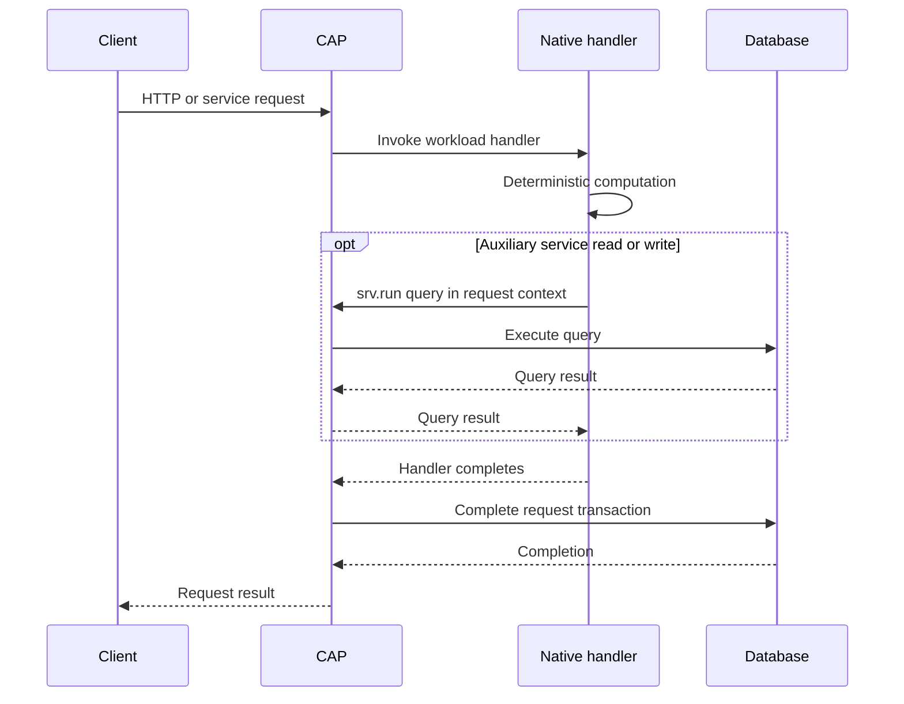

### Oyster and srvQuery callback

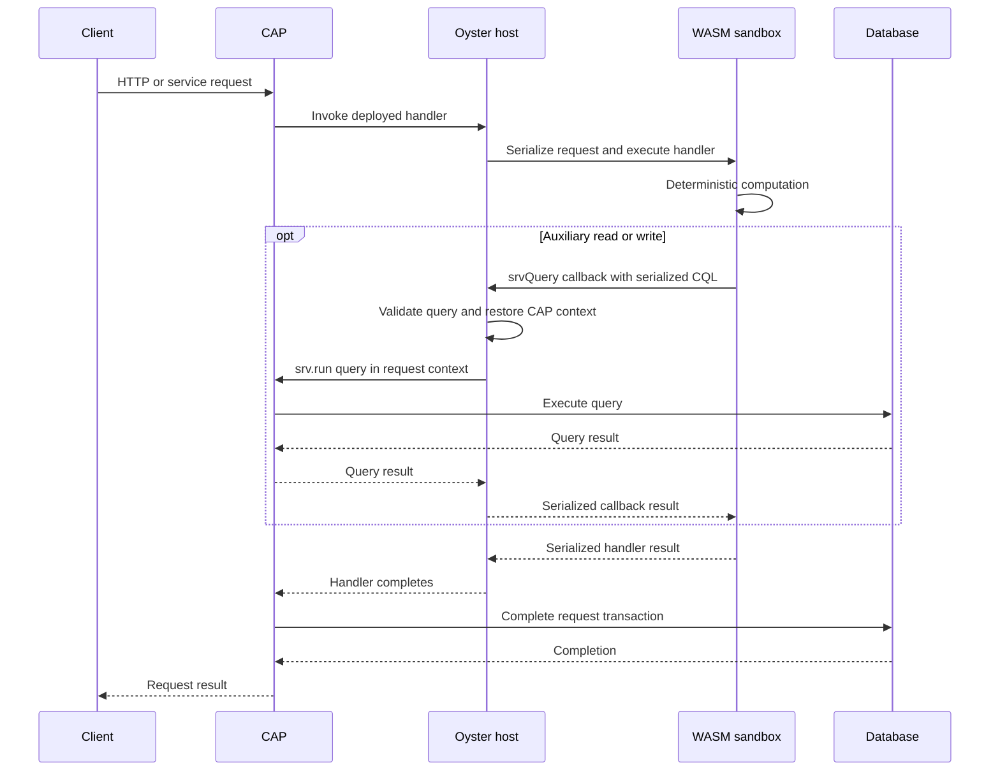

### Declared extension point

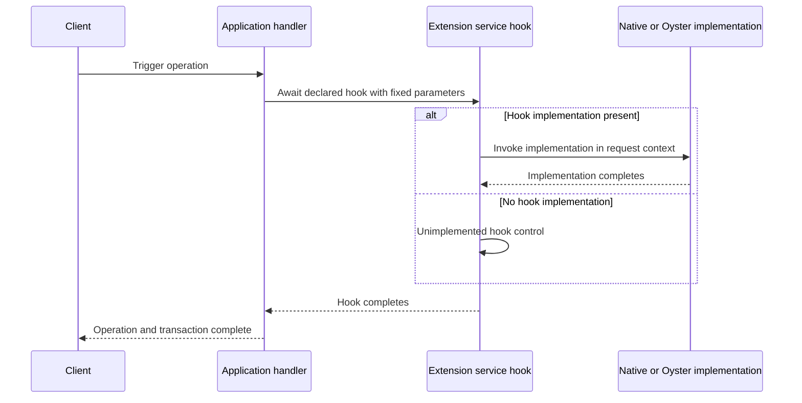

## Evidence

[Manifest](manifest.json), [Results CSV](results.csv).

No raw run files are recorded.

## Interpretation of benchmark findings

| Benchmark comparison | Observed result |
| --- | --- |
| CAP custom logic with and without DB | Native empty-handler controls: F2: Native handler overhead, -0.000329 ms (-0.137%), n=1; F3: Native handler overhead, -0.142 ms (-33.27%), n=1; F4: Native handler overhead, 0.027 ms (1.873%), n=1; F5: Native handler overhead, -0.005 ms (-1.908%), n=1; F6: Native handler overhead, 0.003 ms (2.573%), n=1; F7: Native handler overhead, -0.076 ms (-13.564%), n=1 Native incremental service IO: Unanswered: no eligible matched controls. Native CPU controls: F63: Native CPU handler overhead, 0.043 ms (17.758%), n=1; F64: Native CPU handler overhead, 0.32 ms (21.933%), n=1; F65: Native CPU handler overhead, 0.028 ms (10.948%), n=1; F66: Native CPU handler overhead, -0.128 ms (-26.454%), n=1 Primary DB-backed operations are identified in the matched workload; auxiliary IO increments include service dispatch, query execution and transaction work. The computation execution-location rows compare native and WASM logic without auxiliary IO. |
| Execution in Oyster | F14: Sandbox path versus native handler, 1.572 ms (652.678%), n=1; F15: Sandbox path versus native handler, 0.965 ms (339.139%), n=1; F16: Sandbox path versus native handler, 6.143 ms (420.671%), n=1; F17: Sandbox path versus native handler, 0.824 ms (326.004%), n=1; F18: Sandbox path versus native handler, 0.849 ms (633.716%), n=1; F19: Sandbox path versus native handler, 0.748 ms (154.465%), n=1; F20: Sandbox path versus native handler, 0.74 ms (427.825%), n=1; F21: Execution-location penalty for CPU work, 0.787 ms (277.322%), n=1; F22: Execution-location penalty for CPU work, 17.353 ms (974.557%), n=1; F23: Execution-location penalty for CPU work, 1.091 ms (388.829%), n=1; F24: Execution-location penalty for CPU work, 0.754 ms (496.876%), n=1; F25: Execution-location penalty for CPU work, 146.754 ms (2289.527%), n=1; F26: Execution-location penalty for CPU work, 1.061 ms (298.218%), n=1 The empty-handler comparison covers the sandbox execution path; the computation comparison covers equivalent loop parameters in native and WASM handlers. |
| Net Oyster overhead | F8: Total empty sandbox path, 1.572 ms (651.65%), n=1; F9: Total empty sandbox path, 0.823 ms (193.04%), n=1; F10: Total empty sandbox path, 6.17 ms (430.425%), n=1; F11: Total empty sandbox path, 0.819 ms (317.876%), n=1; F12: Total empty sandbox path, 0.853 ms (652.596%), n=1; F13: Total empty sandbox path, 0.672 ms (119.949%), n=1; F27: CPU plus auxiliary read path, 1.629 ms (201.041%), n=1; F28: CPU plus auxiliary read path, 1.394 ms (375.721%), n=1; F29: CPU plus auxiliary read path, 1.025 ms (278.523%), n=1; F30: CPU plus auxiliary read path, 0.953 ms (426.822%), n=1; F31: CPU plus auxiliary read path, 2.179 ms (261.185%), n=1; F32: CPU plus auxiliary read path, 0.97 ms (335.454%), n=1; F33: CPU plus auxiliary read path, 1.287 ms (289.84%), n=1; F34: CPU plus auxiliary read path, 1.308 ms (437.032%), n=1; F35: CPU plus auxiliary write path, 1.277 ms (137.037%), n=1; F36: CPU plus auxiliary write path, 1.069 ms (221.915%), n=1; F37: CPU plus auxiliary write path, 1.004 ms (302.838%), n=1; F38: CPU plus auxiliary write path, 1.106 ms (400.048%), n=1; F39: CPU plus auxiliary write path, 0.819 ms (256.251%), n=1; F40: CPU plus auxiliary write path, 0.866 ms (198.797%), n=1; F62: Unimplemented hook routing, 0.03 ms (18.756%), n=1 Each delta uses the stated baseline and complete request boundary. Empty-sandbox, IO-path and hook-routing deltas are separate empirical comparisons and cannot be added as isolated component costs. |
| Callbacks versus native CQL | Unanswered: no eligible matched controls. Callback-attribution percentages use native incremental IO as their denominator. The four-mode difference-of-differences is an empirical path comparison; query construction, validation, serialization, service/DB execution and interactions may contribute. Native service versus database controls: F67: Native service versus database read, 0.011 ms (5.277%), n=1; F68: Native service versus database write, 0.044 ms (18.982%), n=1 |
| Large-result loops | S1: native-compute, rows 10 to 1000, Run mean latency (ms) 0.281 to 1.781; S2: oyster-idle, rows 10 to 1000, Run mean latency (ms) 0.258 to 1.433; S3: native-empty, rows 10 to 1000, Run mean latency (ms) 0.253 to 1.46; S4: wasm-empty, rows 10 to 1000, Run mean latency (ms) 1.077 to 7.603; S5: wasm-compute, rows 10 to 1000, Run mean latency (ms) 1.371 to 19.133 See the identified scaling tables for all intermediate values, repetition counts and the fixed workload. Returned-row, scan-row and computation-iteration sweeps answer different loop questions; a missing dimension remains unanswered. |
| Heavy-load behavior | S10: native-compute-read, load 1 to 32, Mean run p95 latency (ms) 0.257 to 2.92; S11: native-compute-read, load 1 to 32, Successful throughput (requests/s) 4253.562 to 23701.625; S12: native-compute-read, load 8 to 32, Unrelated-request probe p95 (ms) 29.17 to 37.682; S13: wasm-compute-read, load 1 to 32, Mean run p95 latency (ms) 1.328 to 20.257; S14: wasm-compute-read, load 1 to 32, Successful throughput (requests/s) 836.829 to 4178.015; S15: wasm-compute-read, load 8 to 32, Unrelated-request probe p95 (ms) 32.516 to 37.231 Capacity is unanswered: no matched scheduled-arrival sweep. Generator saturation is unverified because scheduled-arrival client CPU evidence is missing. 0 warm load runs record errors or dropped starts; consult the failure table. CPU isolation is unverified. |

Conclusions apply only to the measured fixture, settings and host. A single matched repetition does not establish stable overhead or capacity.

## Named use-case comparisons

**Blue: native. Orange: Oyster. Gray: no-handler controls.** These vertical charts retain the individual READ, INSERT, UPDATE, action and extension-point comparisons.

### INSERT without callbacks

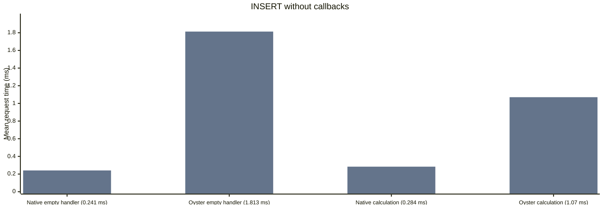

Inserts one row. The same calculation runs 100 iterations per request. Compares execution in the application with execution in Oyster. Empty handlers skip the calculation; no-handler controls perform only the ordinary request. Oyster minus its matched control, [empty handler](../../apps/extension/srv/BenchmarkService/OysterEmptyWriteRows/before-CREATE.js): **+1.572 ms**; [calculation](../../apps/extension/srv/BenchmarkService/OysterCalculationWriteRows/before-CREATE.js): **+0.787 ms**.

### INSERT: accepted business constraint without callbacks

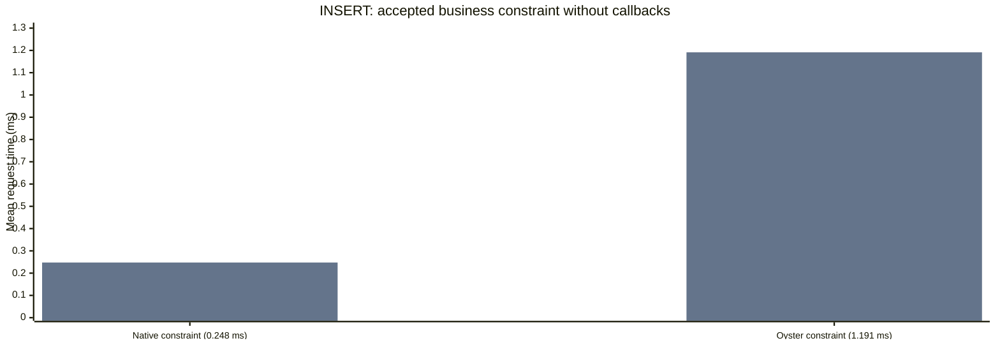

Inserts one row. Checks quantity × unitPrice against a fixed limit of 1,000. Measures accepted requests, without a synthetic calculation loop. Oyster minus its matched control, [calculation](../../apps/extension/srv/BenchmarkService/OysterValidationWriteRows/before-CREATE.js): **+0.944 ms**.

### INSERT: accepted business constraint with database queries

```mermaid
---
config:
  xyChart:
    width: 1400
    height: 480
    xAxis:
      labelFontSize: 13
  themeVariables:
    xyChart:
      plotColorPalette: "#64748b"
  themeCSS: ".bar-plot-0 rect:nth-child(1) { fill: #2563eb; stroke: #2563eb; } .bar-plot-0 rect:nth-child(2) { fill: #ea580c; stroke: #ea580c; }"
---
xychart-beta
    title "INSERT: accepted business constraint with database queries"
    x-axis ["Native constraint + lookup (0.383 ms)", "Oyster constraint + lookup (1.248 ms)"]
    y-axis "Mean request time (ms)" 0 --> 1.372792
    bar [0.38269359109352025, 1.2479926941548156]
```

Inserts one row. Checks quantity × unitPrice against a limit retrieved by one database query. Measures accepted requests, without a synthetic calculation loop. Oyster minus its matched control, [CQL read](../../apps/extension/srv/BenchmarkService/OysterValidationReadWriteRows/before-CREATE.js): **+0.865 ms**.

### INSERT with database queries

```mermaid
---
config:
  xyChart:
    width: 1400
    height: 480
    xAxis:
      labelFontSize: 13
  themeVariables:
    xyChart:
      plotColorPalette: "#64748b"
  themeCSS: ".bar-plot-0 rect:nth-child(1) { fill: #2563eb; stroke: #2563eb; } .bar-plot-0 rect:nth-child(2) { fill: #ea580c; stroke: #ea580c; } .bar-plot-0 rect:nth-child(3) { fill: #2563eb; stroke: #2563eb; } .bar-plot-0 rect:nth-child(4) { fill: #ea580c; stroke: #ea580c; }"
---
xychart-beta
    title "INSERT with database queries"
    x-axis ["Native CQL read (0.368 ms)", "Oyster CQL read (1.392 ms)", "Native CQL write (0.332 ms)", "Oyster CQL write (1.336 ms)"]
    y-axis "Mean request time (ms)" 0 --> 1.531613
    bar [0.3678440072154191, 1.3923754648534101, 0.33161169632478726, 1.3358586626016238]
```

Inserts one row. It also performs 1 auxiliary CQL read per request. Compares execution in the application with execution in Oyster. The CQL update variant uses 1 auxiliary statements per request. Oyster minus its matched control, [CQL read](../../apps/extension/srv/BenchmarkService/OysterCqlReadWriteRows/before-CREATE.js): **+1.025 ms**; [CQL update](../../apps/extension/srv/BenchmarkService/OysterCqlWriteWriteRows/before-CREATE.js): **+1.004 ms**.

### INSERT: rejected business constraint without callbacks

```mermaid
---
config:
  xyChart:
    width: 1400
    height: 480
    xAxis:
      labelFontSize: 13
  themeVariables:
    xyChart:
      plotColorPalette: "#64748b"
  themeCSS: ".bar-plot-0 rect:nth-child(1) { fill: #2563eb; stroke: #2563eb; } .bar-plot-0 rect:nth-child(2) { fill: #ea580c; stroke: #ea580c; }"
---
xychart-beta
    title "INSERT: rejected business constraint without callbacks"
    x-axis ["Native constraint (0.401 ms)", "Oyster constraint (1.3 ms)"]
    y-axis "Mean request time (ms)" 0 --> 1.4303147
    bar [0.40132556995773355, 1.300286115564463]
```

Inserts one row. Checks quantity × unitPrice against a fixed limit of 1,000. Measures rejected requests, without a synthetic calculation loop. Oyster minus its matched control, [calculation](../../apps/extension/srv/BenchmarkService/OysterValidationWriteRows/before-CREATE.js): **+0.899 ms**.

### INSERT: rejected business constraint with database queries

```mermaid
---
config:
  xyChart:
    width: 1400
    height: 480
    xAxis:
      labelFontSize: 13
  themeVariables:
    xyChart:
      plotColorPalette: "#64748b"
  themeCSS: ".bar-plot-0 rect:nth-child(1) { fill: #2563eb; stroke: #2563eb; } .bar-plot-0 rect:nth-child(2) { fill: #ea580c; stroke: #ea580c; }"
---
xychart-beta
    title "INSERT: rejected business constraint with database queries"
    x-axis ["Native constraint + lookup (0.532 ms)", "Oyster constraint + lookup (1.847 ms)"]
    y-axis "Mean request time (ms)" 0 --> 2.0319945
    bar [0.5318715981560281, 1.8472677465525442]
```

Inserts one row. Checks quantity × unitPrice against a limit retrieved by one database query. Measures rejected requests, without a synthetic calculation loop. Oyster minus its matched control, [CQL read](../../apps/extension/srv/BenchmarkService/OysterValidationReadWriteRows/before-CREATE.js): **+1.315 ms**.

### UPDATE: accepted business constraint without callbacks

```mermaid
---
config:
  xyChart:
    width: 1400
    height: 480
    xAxis:
      labelFontSize: 13
  themeVariables:
    xyChart:
      plotColorPalette: "#64748b"
  themeCSS: ".bar-plot-0 rect:nth-child(1) { fill: #2563eb; stroke: #2563eb; } .bar-plot-0 rect:nth-child(2) { fill: #ea580c; stroke: #ea580c; }"
---
xychart-beta
    title "UPDATE: accepted business constraint without callbacks"
    x-axis ["Native constraint (0.369 ms)", "Oyster constraint (1.316 ms)"]
    y-axis "Mean request time (ms)" 0 --> 1.4481198
    bar [0.36906830091533105, 1.3164725408742084]
```

Updates one existing row. Checks quantity × unitPrice against a fixed limit of 1,000. Measures accepted requests, without a synthetic calculation loop. Oyster minus its matched control, [calculation](../../apps/extension/srv/BenchmarkService/OysterValidationWriteRows/before-UPDATE.js): **+0.947 ms**.

### UPDATE: accepted business constraint with database queries

```mermaid
---
config:
  xyChart:
    width: 1400
    height: 480
    xAxis:
      labelFontSize: 13
  themeVariables:
    xyChart:
      plotColorPalette: "#64748b"
  themeCSS: ".bar-plot-0 rect:nth-child(1) { fill: #2563eb; stroke: #2563eb; } .bar-plot-0 rect:nth-child(2) { fill: #ea580c; stroke: #ea580c; }"
---
xychart-beta
    title "UPDATE: accepted business constraint with database queries"
    x-axis ["Native constraint + lookup (0.424 ms)", "Oyster constraint + lookup (1.859 ms)"]
    y-axis "Mean request time (ms)" 0 --> 2.0452702
    bar [0.4238392207961725, 1.8593365247758433]
```

Updates one existing row. Checks quantity × unitPrice against a limit retrieved by one database query. Measures accepted requests, without a synthetic calculation loop. Oyster minus its matched control, [CQL read](../../apps/extension/srv/BenchmarkService/OysterValidationReadWriteRows/before-UPDATE.js): **+1.435 ms**.

### UPDATE: rejected business constraint without callbacks

```mermaid
---
config:
  xyChart:
    width: 1400
    height: 480
    xAxis:
      labelFontSize: 13
  themeVariables:
    xyChart:
      plotColorPalette: "#64748b"
  themeCSS: ".bar-plot-0 rect:nth-child(1) { fill: #2563eb; stroke: #2563eb; } .bar-plot-0 rect:nth-child(2) { fill: #ea580c; stroke: #ea580c; }"
---
xychart-beta
    title "UPDATE: rejected business constraint without callbacks"
    x-axis ["Native constraint (0.396 ms)", "Oyster constraint (1.506 ms)"]
    y-axis "Mean request time (ms)" 0 --> 1.6570713
    bar [0.3963945731237987, 1.5064284899380793]
```

Updates one existing row. Checks quantity × unitPrice against a fixed limit of 1,000. Measures rejected requests, without a synthetic calculation loop. Oyster minus its matched control, [calculation](../../apps/extension/srv/BenchmarkService/OysterValidationWriteRows/before-UPDATE.js): **+1.11 ms**.

### UPDATE: rejected business constraint with database queries

```mermaid
---
config:
  xyChart:
    width: 1400
    height: 480
    xAxis:
      labelFontSize: 13
  themeVariables:
    xyChart:
      plotColorPalette: "#64748b"
  themeCSS: ".bar-plot-0 rect:nth-child(1) { fill: #2563eb; stroke: #2563eb; } .bar-plot-0 rect:nth-child(2) { fill: #ea580c; stroke: #ea580c; }"
---
xychart-beta
    title "UPDATE: rejected business constraint with database queries"
    x-axis ["Native constraint + lookup (0.499 ms)", "Oyster constraint + lookup (1.945 ms)"]
    y-axis "Mean request time (ms)" 0 --> 2.1395298
    bar [0.49947415793682615, 1.9450271310240959]
```

Updates one existing row. Checks quantity × unitPrice against a limit retrieved by one database query. Measures rejected requests, without a synthetic calculation loop. Oyster minus its matched control, [CQL read](../../apps/extension/srv/BenchmarkService/OysterValidationReadWriteRows/before-UPDATE.js): **+1.446 ms**.

### UPDATE without callbacks

```mermaid
---
config:
  xyChart:
    width: 1400
    height: 480
    xAxis:
      labelFontSize: 13
  themeVariables:
    xyChart:
      plotColorPalette: "#64748b"
  themeCSS: ".bar-plot-0 rect:nth-child(1) { fill: #2563eb; stroke: #2563eb; } .bar-plot-0 rect:nth-child(2) { fill: #ea580c; stroke: #ea580c; } .bar-plot-0 rect:nth-child(3) { fill: #2563eb; stroke: #2563eb; } .bar-plot-0 rect:nth-child(4) { fill: #ea580c; stroke: #ea580c; }"
---
xychart-beta
    title "UPDATE without callbacks"
    x-axis ["Native empty handler (0.484 ms)", "Oyster empty handler (1.231 ms)", "Native calculation (0.356 ms)", "Oyster calculation (1.417 ms)"]
    y-axis "Mean request time (ms)" 0 --> 1.5590858
    bar [0.4839460553672318, 1.23147245054602, 0.3559234423641695, 1.4173507367662972]
```

Updates one existing row. The same calculation runs 100 iterations per request. Compares execution in the application with execution in Oyster. Empty handlers skip the calculation; no-handler controls perform only the ordinary request. Oyster minus its matched control, [empty handler](../../apps/extension/srv/BenchmarkService/OysterEmptyWriteRows/before-UPDATE.js): **+0.748 ms**; [calculation](../../apps/extension/srv/BenchmarkService/OysterCalculationWriteRows/before-UPDATE.js): **+1.061 ms**.

### UPDATE with database queries

```mermaid
---
config:
  xyChart:
    width: 1400
    height: 480
    xAxis:
      labelFontSize: 13
  themeVariables:
    xyChart:
      plotColorPalette: "#64748b"
  themeCSS: ".bar-plot-0 rect:nth-child(1) { fill: #2563eb; stroke: #2563eb; } .bar-plot-0 rect:nth-child(2) { fill: #ea580c; stroke: #ea580c; } .bar-plot-0 rect:nth-child(3) { fill: #2563eb; stroke: #2563eb; } .bar-plot-0 rect:nth-child(4) { fill: #ea580c; stroke: #ea580c; }"
---
xychart-beta
    title "UPDATE with database queries"
    x-axis ["Native CQL read (0.444 ms)", "Oyster CQL read (1.731 ms)", "Native CQL write (0.436 ms)", "Oyster CQL write (1.302 ms)"]
    y-axis "Mean request time (ms)" 0 --> 1.9043996
    bar [0.44409798721461274, 1.7312723629564468, 0.43572074454514775, 1.3019221033915054]
```

Updates one existing row. It also performs 1 auxiliary CQL read per request. Compares execution in the application with execution in Oyster. The CQL update variant uses 1 auxiliary statements per request. Oyster minus its matched control, [CQL read](../../apps/extension/srv/BenchmarkService/OysterCqlReadWriteRows/before-UPDATE.js): **+1.287 ms**; [CQL update](../../apps/extension/srv/BenchmarkService/OysterCqlWriteWriteRows/before-UPDATE.js): **+0.866 ms**.

### READ 10 rows from million-row table without callbacks

```mermaid
---
config:
  xyChart:
    width: 1400
    height: 480
    xAxis:
      labelFontSize: 13
  themeVariables:
    xyChart:
      plotColorPalette: "#64748b"
  themeCSS: ".bar-plot-0 rect:nth-child(1) { fill: #2563eb; stroke: #2563eb; } .bar-plot-0 rect:nth-child(2) { fill: #ea580c; stroke: #ea580c; } .bar-plot-0 rect:nth-child(3) { fill: #2563eb; stroke: #2563eb; } .bar-plot-0 rect:nth-child(4) { fill: #ea580c; stroke: #ea580c; }"
---
xychart-beta
    title "READ 10 rows from million-row table without callbacks"
    x-axis ["Native empty handler (0.253 ms)", "Oyster empty handler (1.077 ms)", "Native calculation (0.281 ms)", "Oyster calculation (1.371 ms)"]
    y-axis "Mean request time (ms)" 0 --> 1.5086483
    bar [0.2528818845698499, 1.0772877475490175, 0.2805681634790191, 1.371498433634467]
```

Reads 10 rows from the million-row table. Reads an ordered page. The same calculation runs 100 iterations for every returned row. Compares execution in the application with execution in Oyster. Empty handlers skip the calculation; no-handler controls perform only the ordinary request. Oyster minus its matched control, [empty handler](../../apps/extension/srv/BenchmarkService/OysterEmptyLargeRows/after-READ.js): **+0.824 ms**; [calculation](../../apps/extension/srv/BenchmarkService/OysterCalculationLargeRows/after-READ.js): **+1.091 ms**.

### READ 1,000 rows from million-row table without callbacks

```mermaid
---
config:
  xyChart:
    width: 1400
    height: 480
    xAxis:
      labelFontSize: 13
  themeVariables:
    xyChart:
      plotColorPalette: "#64748b"
  themeCSS: ".bar-plot-0 rect:nth-child(1) { fill: #2563eb; stroke: #2563eb; } .bar-plot-0 rect:nth-child(2) { fill: #ea580c; stroke: #ea580c; } .bar-plot-0 rect:nth-child(3) { fill: #2563eb; stroke: #2563eb; } .bar-plot-0 rect:nth-child(4) { fill: #ea580c; stroke: #ea580c; }"
---
xychart-beta
    title "READ 1,000 rows from million-row table without callbacks"
    x-axis ["Native empty handler (1.46 ms)", "Oyster empty handler (7.603 ms)", "Native calculation (1.781 ms)", "Oyster calculation (19.133 ms)"]
    y-axis "Mean request time (ms)" 0 --> 21.046727
    bar [1.4603001499079165, 7.603359662835252, 1.7805842169811283, 19.133388038461533]
```

Reads 1,000 rows from the million-row table. Reads an ordered page. The same calculation runs 100 iterations for every returned row. Compares execution in the application with execution in Oyster. Empty handlers skip the calculation; no-handler controls perform only the ordinary request. Oyster minus its matched control, [empty handler](../../apps/extension/srv/BenchmarkService/OysterEmptyLargeRows/after-READ.js): **+6.143 ms**; [calculation](../../apps/extension/srv/BenchmarkService/OysterCalculationLargeRows/after-READ.js): **+17.353 ms**.

### READ 10 rows from 1,000-row table without callbacks

```mermaid
---
config:
  xyChart:
    width: 1400
    height: 480
    xAxis:
      labelFontSize: 13
  themeVariables:
    xyChart:
      plotColorPalette: "#64748b"
  themeCSS: ".bar-plot-0 rect:nth-child(1) { fill: #2563eb; stroke: #2563eb; } .bar-plot-0 rect:nth-child(2) { fill: #ea580c; stroke: #ea580c; }"
---
xychart-beta
    title "READ 10 rows from 1,000-row table without callbacks"
    x-axis ["Native empty handler (0.284 ms)", "Oyster empty handler (1.249 ms)"]
    y-axis "Mean request time (ms)" 0 --> 1.3742784
    bar [0.284498258133689, 1.2493440060279177]
```

Reads 10 rows from the 1,000-row table. Reads an ordered page. The handler does nothing. Compares an application handler with an Oyster handler. Empty handlers skip the calculation; no-handler controls perform only the ordinary request. Oyster minus its matched control, [empty handler](../../apps/extension/srv/BenchmarkService/OysterEmptySmallRows/after-READ.js): **+0.965 ms**.

### READ 10 rows from 1,000-row table with database queries

```mermaid
---
config:
  xyChart:
    width: 1400
    height: 480
    xAxis:
      labelFontSize: 13
  themeVariables:
    xyChart:
      plotColorPalette: "#64748b"
  themeCSS: ".bar-plot-0 rect:nth-child(1) { fill: #2563eb; stroke: #2563eb; } .bar-plot-0 rect:nth-child(2) { fill: #ea580c; stroke: #ea580c; } .bar-plot-0 rect:nth-child(3) { fill: #2563eb; stroke: #2563eb; } .bar-plot-0 rect:nth-child(4) { fill: #ea580c; stroke: #ea580c; }"
---
xychart-beta
    title "READ 10 rows from 1,000-row table with database queries"
    x-axis ["Native CQL read (0.371 ms)", "Oyster CQL read (1.766 ms)", "Native CQL write (0.482 ms)", "Oyster CQL write (1.551 ms)"]
    y-axis "Mean request time (ms)" 0 --> 1.9421248
    bar [0.37113509135119743, 1.765567998654711, 0.4819216937014676, 1.5513780729125832]
```

Reads 10 rows from the 1,000-row table. Reads an ordered page. It also performs 1 auxiliary CQL read per request. Compares execution in the application with execution in Oyster. The CQL update variant uses 2 auxiliary statements per request. Oyster minus its matched control, [CQL read](../../apps/extension/srv/BenchmarkService/OysterCqlReadSmallRows/after-READ.js): **+1.394 ms**; [CQL update](../../apps/extension/srv/BenchmarkService/OysterCqlWriteSmallRows/after-READ.js): **+1.069 ms**.

### Action: accepted business constraint without callbacks

```mermaid
---
config:
  xyChart:
    width: 1400
    height: 480
    xAxis:
      labelFontSize: 13
  themeVariables:
    xyChart:
      plotColorPalette: "#64748b"
  themeCSS: ".bar-plot-0 rect:nth-child(1) { fill: #2563eb; stroke: #2563eb; } .bar-plot-0 rect:nth-child(2) { fill: #ea580c; stroke: #ea580c; }"
---
xychart-beta
    title "Action: accepted business constraint without callbacks"
    x-axis ["Native constraint (0.159 ms)", "Oyster constraint (1.049 ms)"]
    y-axis "Mean request time (ms)" 0 --> 1.153852
    bar [0.15927624854657338, 1.0489563583244395]
```

Calls an action and waits for it to finish. Checks quantity × unitPrice against a fixed limit of 1,000. Measures accepted requests, without a synthetic calculation loop. Oyster minus its matched control, [calculation](../../apps/extension/srv/BenchmarkService/on-oysterValidation.js): **+0.89 ms**.

### Action: accepted business constraint with database queries

```mermaid
---
config:
  xyChart:
    width: 1400
    height: 480
    xAxis:
      labelFontSize: 13
  themeVariables:
    xyChart:
      plotColorPalette: "#64748b"
  themeCSS: ".bar-plot-0 rect:nth-child(1) { fill: #2563eb; stroke: #2563eb; } .bar-plot-0 rect:nth-child(2) { fill: #ea580c; stroke: #ea580c; }"
---
xychart-beta
    title "Action: accepted business constraint with database queries"
    x-axis ["Native constraint + lookup (0.246 ms)", "Oyster constraint + lookup (1.159 ms)"]
    y-axis "Mean request time (ms)" 0 --> 1.275171
    bar [0.24586024435676893, 1.1592463491923641]
```

Calls an action and waits for it to finish. Checks quantity × unitPrice against a limit retrieved by one database query. Measures accepted requests, without a synthetic calculation loop. Oyster minus its matched control, [CQL read](../../apps/extension/srv/BenchmarkService/on-oysterValidationRead.js): **+0.913 ms**.

### Action without callbacks

```mermaid
---
config:
  xyChart:
    width: 1400
    height: 480
    xAxis:
      labelFontSize: 13
  themeVariables:
    xyChart:
      plotColorPalette: "#64748b"
  themeCSS: ".bar-plot-0 rect:nth-child(1) { fill: #2563eb; stroke: #2563eb; } .bar-plot-0 rect:nth-child(2) { fill: #ea580c; stroke: #ea580c; } .bar-plot-0 rect:nth-child(3) { fill: #2563eb; stroke: #2563eb; } .bar-plot-0 rect:nth-child(4) { fill: #ea580c; stroke: #ea580c; }"
---
xychart-beta
    title "Action without callbacks"
    x-axis ["Native empty handler (0.134 ms)", "Oyster empty handler (0.983 ms)", "Native calculation (0.152 ms)", "Oyster calculation (0.906 ms)"]
    y-axis "Mean request time (ms)" 0 --> 1.0818256
    bar [0.1340406701582025, 0.983477801049739, 0.15177724423139377, 0.9059216149609907]
```

Calls an action and waits for it to finish. The same calculation runs 100 iterations per request. Compares execution in the application with execution in Oyster. Empty handlers skip the calculation; no-handler controls perform only the ordinary request. Oyster minus its matched control, [empty handler](../../apps/extension/srv/BenchmarkService/on-oysterNoop.js): **+0.849 ms**; [calculation](../../apps/extension/srv/BenchmarkService/on-oysterCalculation.js): **+0.754 ms**.

### Action with database queries

```mermaid
---
config:
  xyChart:
    width: 1400
    height: 480
    xAxis:
      labelFontSize: 13
  themeVariables:
    xyChart:
      plotColorPalette: "#64748b"
  themeCSS: ".bar-plot-0 rect:nth-child(1) { fill: #2563eb; stroke: #2563eb; } .bar-plot-0 rect:nth-child(2) { fill: #ea580c; stroke: #ea580c; } .bar-plot-0 rect:nth-child(3) { fill: #2563eb; stroke: #2563eb; } .bar-plot-0 rect:nth-child(4) { fill: #ea580c; stroke: #ea580c; }"
---
xychart-beta
    title "Action with database queries"
    x-axis ["Native CQL read (0.223 ms)", "Oyster CQL read (1.176 ms)", "Native CQL write (0.277 ms)", "Oyster CQL write (1.383 ms)"]
    y-axis "Mean request time (ms)" 0 --> 1.5211971
    bar [0.22317618266017836, 1.1757414182305654, 0.2765548801209587, 1.3829064778636688]
```

Calls an action and waits for it to finish. It also performs 1 auxiliary CQL read per request. Compares execution in the application with execution in Oyster. The CQL update variant uses 1 auxiliary statements per request. Oyster minus its matched control, [CQL read](../../apps/extension/srv/BenchmarkService/on-oysterCqlRead.js): **+0.953 ms**; [CQL update](../../apps/extension/srv/BenchmarkService/on-oysterCqlWrite.js): **+1.106 ms**.

### Action: rejected business constraint without callbacks

```mermaid
---
config:
  xyChart:
    width: 1400
    height: 480
    xAxis:
      labelFontSize: 13
  themeVariables:
    xyChart:
      plotColorPalette: "#64748b"
  themeCSS: ".bar-plot-0 rect:nth-child(1) { fill: #2563eb; stroke: #2563eb; } .bar-plot-0 rect:nth-child(2) { fill: #ea580c; stroke: #ea580c; }"
---
xychart-beta
    title "Action: rejected business constraint without callbacks"
    x-axis ["Native constraint (0.418 ms)", "Oyster constraint (1.366 ms)"]
    y-axis "Mean request time (ms)" 0 --> 1.5026567
    bar [0.41813486163875446, 1.366051533919156]
```

Calls an action and waits for it to finish. Checks quantity × unitPrice against a fixed limit of 1,000. Measures rejected requests, without a synthetic calculation loop. Oyster minus its matched control, [calculation](../../apps/extension/srv/BenchmarkService/on-oysterValidation.js): **+0.948 ms**.

### Action: rejected business constraint with database queries

```mermaid
---
config:
  xyChart:
    width: 1400
    height: 480
    xAxis:
      labelFontSize: 13
  themeVariables:
    xyChart:
      plotColorPalette: "#64748b"
  themeCSS: ".bar-plot-0 rect:nth-child(1) { fill: #2563eb; stroke: #2563eb; } .bar-plot-0 rect:nth-child(2) { fill: #ea580c; stroke: #ea580c; }"
---
xychart-beta
    title "Action: rejected business constraint with database queries"
    x-axis ["Native constraint + lookup (0.659 ms)", "Oyster constraint + lookup (1.678 ms)"]
    y-axis "Mean request time (ms)" 0 --> 1.8455405
    bar [0.6592673658241032, 1.6777641151358327]
```

Calls an action and waits for it to finish. Checks quantity × unitPrice against a limit retrieved by one database query. Measures rejected requests, without a synthetic calculation loop. Oyster minus its matched control, [CQL read](../../apps/extension/srv/BenchmarkService/on-oysterValidationRead.js): **+1.018 ms**.

### READ loop over 10,000 rows with paged queries

```mermaid
---
config:
  xyChart:
    width: 1400
    height: 480
    xAxis:
      labelFontSize: 13
  themeVariables:
    xyChart:
      plotColorPalette: "#64748b"
  themeCSS: ".bar-plot-0 rect:nth-child(1) { fill: #2563eb; stroke: #2563eb; } .bar-plot-0 rect:nth-child(2) { fill: #ea580c; stroke: #ea580c; }"
---
xychart-beta
    title "READ loop over 10,000 rows with paged queries"
    x-axis ["Native calculation (6.41 ms)", "Oyster calculation (153.164 ms)"]
    y-axis "Mean request time (ms)" 0 --> 168.47994
    bar [6.409786316720258, 153.16358492307694]
```

Reads pages of 1,000 rows and performs 100 calculation iterations per row. Native queries run through the service; Oyster uses one callback per page. Oyster minus its matched control, [calculation](../../apps/extension/srv/BenchmarkService/on-oysterScan.js): **+146.754 ms**.

### Action through an extension point: rejected business constraint without callbacks

```mermaid
---
config:
  xyChart:
    width: 1400
    height: 480
    xAxis:
      labelFontSize: 13
  themeVariables:
    xyChart:
      plotColorPalette: "#64748b"
  themeCSS: ".bar-plot-0 rect:nth-child(1) { fill: #2563eb; stroke: #2563eb; } .bar-plot-0 rect:nth-child(2) { fill: #ea580c; stroke: #ea580c; }"
---
xychart-beta
    title "Action through an extension point: rejected business constraint without callbacks"
    x-axis ["Native constraint (0.425 ms)", "Oyster constraint (1.337 ms)"]
    y-axis "Mean request time (ms)" 0 --> 1.4702938
    bar [0.4245651674826374, 1.336630728178696]
```

Calls an action and waits for it to finish. Checks quantity × unitPrice against a fixed limit of 1,000. Measures rejected requests through a predefined extension point, without a synthetic calculation loop. Oyster minus its matched control, [calculation](../../apps/extension/srv/BenchmarkExtensionService/on-oysterValidation.js): **+0.912 ms**.

### Action through an extension point: rejected business constraint with database queries

```mermaid
---
config:
  xyChart:
    width: 1400
    height: 480
    xAxis:
      labelFontSize: 13
  themeVariables:
    xyChart:
      plotColorPalette: "#64748b"
  themeCSS: ".bar-plot-0 rect:nth-child(1) { fill: #2563eb; stroke: #2563eb; } .bar-plot-0 rect:nth-child(2) { fill: #ea580c; stroke: #ea580c; }"
---
xychart-beta
    title "Action through an extension point: rejected business constraint with database queries"
    x-axis ["Native constraint + lookup (0.689 ms)", "Oyster constraint + lookup (1.729 ms)"]
    y-axis "Mean request time (ms)" 0 --> 1.9024156
    bar [0.6888277962996558, 1.729468703654193]
```

Calls an action and waits for it to finish. Checks quantity × unitPrice against a limit retrieved by one database query. Measures rejected requests through a predefined extension point, without a synthetic calculation loop. Oyster minus its matched control, [CQL read](../../apps/extension/srv/BenchmarkExtensionService/on-oysterValidationRead.js): **+1.041 ms**.

### Action through an extension point: accepted business constraint without callbacks

```mermaid
---
config:
  xyChart:
    width: 1400
    height: 480
    xAxis:
      labelFontSize: 13
  themeVariables:
    xyChart:
      plotColorPalette: "#64748b"
  themeCSS: ".bar-plot-0 rect:nth-child(1) { fill: #2563eb; stroke: #2563eb; } .bar-plot-0 rect:nth-child(2) { fill: #ea580c; stroke: #ea580c; }"
---
xychart-beta
    title "Action through an extension point: accepted business constraint without callbacks"
    x-axis ["Native constraint (0.167 ms)", "Oyster constraint (0.93 ms)"]
    y-axis "Mean request time (ms)" 0 --> 1.0234684
    bar [0.16653981264418827, 0.9304258635505209]
```

Calls an action and waits for it to finish. Checks quantity × unitPrice against a fixed limit of 1,000. Measures accepted requests through a predefined extension point, without a synthetic calculation loop. Oyster minus its matched control, [calculation](../../apps/extension/srv/BenchmarkExtensionService/on-oysterValidation.js): **+0.764 ms**.

### Action through an extension point: accepted business constraint with database queries

```mermaid
---
config:
  xyChart:
    width: 1400
    height: 480
    xAxis:
      labelFontSize: 13
  themeVariables:
    xyChart:
      plotColorPalette: "#64748b"
  themeCSS: ".bar-plot-0 rect:nth-child(1) { fill: #2563eb; stroke: #2563eb; } .bar-plot-0 rect:nth-child(2) { fill: #ea580c; stroke: #ea580c; }"
---
xychart-beta
    title "Action through an extension point: accepted business constraint with database queries"
    x-axis ["Native constraint + lookup (0.275 ms)", "Oyster constraint + lookup (1.165 ms)"]
    y-axis "Mean request time (ms)" 0 --> 1.2809558
    bar [0.2750332877456214, 1.1645052738270896]
```

Calls an action and waits for it to finish. Checks quantity × unitPrice against a limit retrieved by one database query. Measures accepted requests through a predefined extension point, without a synthetic calculation loop. Oyster minus its matched control, [CQL read](../../apps/extension/srv/BenchmarkExtensionService/on-oysterValidationRead.js): **+0.889 ms**.

### Action through an extension point without callbacks

```mermaid
---
config:
  xyChart:
    width: 1400
    height: 480
    xAxis:
      labelFontSize: 13
  themeVariables:
    xyChart:
      plotColorPalette: "#64748b"
  themeCSS: ".bar-plot-0 rect:nth-child(1) { fill: #2563eb; stroke: #2563eb; } .bar-plot-0 rect:nth-child(2) { fill: #ea580c; stroke: #ea580c; }"
---
xychart-beta
    title "Action through an extension point without callbacks"
    x-axis ["Native empty handler (0.173 ms)", "Oyster empty handler (0.912 ms)"]
    y-axis "Mean request time (ms)" 0 --> 1.0036867
    bar [0.17286851539522097, 0.9124424396292007]
```

Calls an action and waits for it to finish. The handler does nothing. Compares an application handler with an Oyster handler. Empty handlers skip the calculation; no-handler controls perform only the ordinary request. Oyster minus its matched control, [empty handler](../../apps/extension/srv/BenchmarkExtensionService/on-oysterEmpty.js): **+0.74 ms**.

### Action through an extension point with database queries

```mermaid
---
config:
  xyChart:
    width: 1400
    height: 480
    xAxis:
      labelFontSize: 13
  themeVariables:
    xyChart:
      plotColorPalette: "#64748b"
  themeCSS: ".bar-plot-0 rect:nth-child(1) { fill: #2563eb; stroke: #2563eb; } .bar-plot-0 rect:nth-child(2) { fill: #ea580c; stroke: #ea580c; } .bar-plot-0 rect:nth-child(3) { fill: #2563eb; stroke: #2563eb; } .bar-plot-0 rect:nth-child(4) { fill: #ea580c; stroke: #ea580c; }"
---
xychart-beta
    title "Action through an extension point with database queries"
    x-axis ["Native CQL read (0.289 ms)", "Oyster CQL read (1.259 ms)", "Native CQL write (0.32 ms)", "Oyster CQL write (1.139 ms)"]
    y-axis "Mean request time (ms)" 0 --> 1.3853799
    bar [0.2892234645616144, 1.2594362476829668, 0.31977158690071994, 1.1391900857390311]
```

Calls an action and waits for it to finish. It also performs 1 auxiliary CQL read per request. The application invokes the handler through a declared extension point. Compares execution in the application with execution in Oyster. The CQL update variant uses 1 auxiliary statements per request. Oyster minus its matched control, [CQL read](../../apps/extension/srv/BenchmarkExtensionService/on-oysterCqlRead.js): **+0.97 ms**; [CQL update](../../apps/extension/srv/BenchmarkExtensionService/on-oysterCqlWrite.js): **+0.819 ms**.
