# Oyster performance report: bench-2026-11-06T14-21-27-043Z

369 measured runs are recorded. Tables retain all observations; findings and charts exclude failed, skipped, blocked and limit-probe runs.

## Findings

| Question | Comparison | Matched workload | Pairs | Mean delta (ms) | Mean paired delta (%) | Delta SD (ms) | Evidence row | Oyster handlers |
| --- | --- | --- | --- | --- | --- | --- | --- | --- |
| Installed plugin overhead | oyster-idle minus cap-baseline | operation=action; table=SmallRows; rows=10; iterations=100; callbacks=1; access=service; hook=false; pageSize=1000; scanRows=10000; enrichment=batch; mixed=unavailable; readTable=unavailable; queryShape=page; offset=0; hookControl=false; actionContract=auto; scanCoordination=unavailable; wholeScanRows=unavailable; lookupPattern=unavailable; validationOutcome=unavailable; transport=http; phase=warm; load=vus:1 | 3 | -0.008 | -4.043 | 0.018 | F1 | unavailable |
| Installed plugin overhead | oyster-idle minus cap-baseline | operation=read; table=SmallRows; rows=10; iterations=100; callbacks=1; access=service; hook=false; pageSize=1000; scanRows=10000; enrichment=batch; mixed=unavailable; readTable=unavailable; queryShape=page; offset=0; hookControl=false; actionContract=auto; scanCoordination=unavailable; wholeScanRows=unavailable; lookupPattern=unavailable; validationOutcome=unavailable; transport=http; phase=warm; load=vus:1 | 3 | 0.029 | 8.489 | 0.026 | F2 | unavailable |
| Installed plugin overhead | oyster-idle minus cap-baseline | operation=create; table=WriteRows; rows=10; iterations=100; callbacks=1; access=service; hook=false; pageSize=1000; scanRows=10000; enrichment=batch; mixed=unavailable; readTable=unavailable; queryShape=page; offset=0; hookControl=false; actionContract=auto; scanCoordination=unavailable; wholeScanRows=unavailable; lookupPattern=unavailable; validationOutcome=unavailable; transport=http; phase=warm; load=vus:1 | 3 | 0.014 | 2.708 | 0.019 | F3 | unavailable |
| Installed plugin overhead | oyster-idle minus cap-baseline | operation=read; table=LargeRows; rows=1000; iterations=100; callbacks=1; access=service; hook=false; pageSize=1000; scanRows=10000; enrichment=batch; mixed=unavailable; readTable=unavailable; queryShape=page; offset=0; hookControl=false; actionContract=auto; scanCoordination=unavailable; wholeScanRows=unavailable; lookupPattern=unavailable; validationOutcome=unavailable; transport=http; phase=warm; load=vus:1 | 3 | 0.05 | 2.846 | 0.047 | F4 | unavailable |
| Installed plugin overhead | oyster-idle minus cap-baseline | operation=update; table=WriteRows; rows=10; iterations=100; callbacks=1; access=service; hook=false; pageSize=1000; scanRows=10000; enrichment=batch; mixed=unavailable; readTable=unavailable; queryShape=page; offset=0; hookControl=false; actionContract=auto; scanCoordination=unavailable; wholeScanRows=unavailable; lookupPattern=unavailable; validationOutcome=unavailable; transport=http; phase=warm; load=vus:1 | 3 | 0.019 | 3.818 | 0.005 | F5 | unavailable |
| Installed plugin overhead | oyster-idle minus cap-baseline | operation=read; table=LargeRows; rows=10; iterations=100; callbacks=1; access=service; hook=false; pageSize=1000; scanRows=10000; enrichment=batch; mixed=unavailable; readTable=unavailable; queryShape=page; offset=0; hookControl=false; actionContract=auto; scanCoordination=unavailable; wholeScanRows=unavailable; lookupPattern=unavailable; validationOutcome=unavailable; transport=http; phase=warm; load=vus:1 | 3 | 0.055 | 16.085 | 0.008 | F6 | unavailable |
| Native handler overhead | native-empty minus oyster-idle | operation=action; table=SmallRows; rows=10; iterations=100; callbacks=1; access=service; hook=false; pageSize=1000; scanRows=10000; enrichment=batch; mixed=unavailable; readTable=unavailable; queryShape=page; offset=0; hookControl=false; actionContract=auto; scanCoordination=unavailable; wholeScanRows=unavailable; lookupPattern=unavailable; validationOutcome=unavailable; transport=http; phase=warm; load=vus:1 | 3 | 0.003 | 1.793 | 0.004 | F7 | unavailable |
| Native handler overhead | native-empty minus oyster-idle | operation=read; table=SmallRows; rows=10; iterations=100; callbacks=1; access=service; hook=false; pageSize=1000; scanRows=10000; enrichment=batch; mixed=unavailable; readTable=unavailable; queryShape=page; offset=0; hookControl=false; actionContract=auto; scanCoordination=unavailable; wholeScanRows=unavailable; lookupPattern=unavailable; validationOutcome=unavailable; transport=http; phase=warm; load=vus:1 | 3 | 0.0000994 | 0.017 | 0.004 | F8 | unavailable |
| Native handler overhead | native-empty minus oyster-idle | operation=create; table=WriteRows; rows=10; iterations=100; callbacks=1; access=service; hook=false; pageSize=1000; scanRows=10000; enrichment=batch; mixed=unavailable; readTable=unavailable; queryShape=page; offset=0; hookControl=false; actionContract=auto; scanCoordination=unavailable; wholeScanRows=unavailable; lookupPattern=unavailable; validationOutcome=unavailable; transport=http; phase=warm; load=vus:1 | 3 | 0.011 | 2.174 | 0.02 | F9 | unavailable |
| Native handler overhead | native-empty minus oyster-idle | operation=read; table=LargeRows; rows=1000; iterations=100; callbacks=1; access=service; hook=false; pageSize=1000; scanRows=10000; enrichment=batch; mixed=unavailable; readTable=unavailable; queryShape=page; offset=0; hookControl=false; actionContract=auto; scanCoordination=unavailable; wholeScanRows=unavailable; lookupPattern=unavailable; validationOutcome=unavailable; transport=http; phase=warm; load=vus:1 | 3 | -0.000395 | 0.002 | 0.029 | F10 | unavailable |
| Native handler overhead | native-empty minus oyster-idle | operation=update; table=WriteRows; rows=10; iterations=100; callbacks=1; access=service; hook=false; pageSize=1000; scanRows=10000; enrichment=batch; mixed=unavailable; readTable=unavailable; queryShape=page; offset=0; hookControl=false; actionContract=auto; scanCoordination=unavailable; wholeScanRows=unavailable; lookupPattern=unavailable; validationOutcome=unavailable; transport=http; phase=warm; load=vus:1 | 3 | 0.005 | 1.022 | 0.017 | F11 | unavailable |
| Native handler overhead | native-empty minus oyster-idle | operation=read; table=LargeRows; rows=10; iterations=100; callbacks=1; access=service; hook=false; pageSize=1000; scanRows=10000; enrichment=batch; mixed=unavailable; readTable=unavailable; queryShape=page; offset=0; hookControl=false; actionContract=auto; scanCoordination=unavailable; wholeScanRows=unavailable; lookupPattern=unavailable; validationOutcome=unavailable; transport=http; phase=warm; load=vus:1 | 3 | -0.011 | -2.812 | 0.005 | F12 | unavailable |
| Total empty sandbox path | wasm-empty minus oyster-idle | operation=action; table=SmallRows; rows=10; iterations=100; callbacks=1; access=service; hook=false; pageSize=1000; scanRows=10000; enrichment=batch; mixed=unavailable; readTable=unavailable; queryShape=page; offset=0; hookControl=false; actionContract=auto; scanCoordination=unavailable; wholeScanRows=unavailable; lookupPattern=unavailable; validationOutcome=unavailable; transport=http; phase=warm; load=vus:1 | 3 | 0.682 | 413.489 | 0.006 | F13 | [wasm-empty](../../apps/extension/srv/BenchmarkService/on-oysterNoop.js) |
| Total empty sandbox path | wasm-empty minus oyster-idle | operation=read; table=SmallRows; rows=10; iterations=100; callbacks=1; access=service; hook=false; pageSize=1000; scanRows=10000; enrichment=batch; mixed=unavailable; readTable=unavailable; queryShape=page; offset=0; hookControl=false; actionContract=auto; scanCoordination=unavailable; wholeScanRows=unavailable; lookupPattern=unavailable; validationOutcome=unavailable; transport=http; phase=warm; load=vus:1 | 3 | 0.764 | 200.317 | 0.028 | F14 | [wasm-empty](../../apps/extension/srv/BenchmarkService/OysterEmptySmallRows/after-READ.js) |
| Total empty sandbox path | wasm-empty minus oyster-idle | operation=create; table=WriteRows; rows=10; iterations=100; callbacks=1; access=service; hook=false; pageSize=1000; scanRows=10000; enrichment=batch; mixed=unavailable; readTable=unavailable; queryShape=page; offset=0; hookControl=false; actionContract=auto; scanCoordination=unavailable; wholeScanRows=unavailable; lookupPattern=unavailable; validationOutcome=unavailable; transport=http; phase=warm; load=vus:1 | 3 | 0.783 | 144.782 | 0.126 | F15 | [wasm-empty](../../apps/extension/srv/BenchmarkService/OysterEmptyWriteRows/before-CREATE.js) |
| Total empty sandbox path | wasm-empty minus oyster-idle | operation=read; table=LargeRows; rows=1000; iterations=100; callbacks=1; access=service; hook=false; pageSize=1000; scanRows=10000; enrichment=batch; mixed=unavailable; readTable=unavailable; queryShape=page; offset=0; hookControl=false; actionContract=auto; scanCoordination=unavailable; wholeScanRows=unavailable; lookupPattern=unavailable; validationOutcome=unavailable; transport=http; phase=warm; load=vus:1 | 3 | 4.675 | 257.211 | 0.041 | F16 | [wasm-empty](../../apps/extension/srv/BenchmarkService/OysterEmptyLargeRows/after-READ.js) |
| Total empty sandbox path | wasm-empty minus oyster-idle | operation=update; table=WriteRows; rows=10; iterations=100; callbacks=1; access=service; hook=false; pageSize=1000; scanRows=10000; enrichment=batch; mixed=unavailable; readTable=unavailable; queryShape=page; offset=0; hookControl=false; actionContract=auto; scanCoordination=unavailable; wholeScanRows=unavailable; lookupPattern=unavailable; validationOutcome=unavailable; transport=http; phase=warm; load=vus:1 | 3 | 0.755 | 148.166 | 0.103 | F17 | [wasm-empty](../../apps/extension/srv/BenchmarkService/OysterEmptyWriteRows/before-UPDATE.js) |
| Total empty sandbox path | wasm-empty minus oyster-idle | operation=read; table=LargeRows; rows=10; iterations=100; callbacks=1; access=service; hook=false; pageSize=1000; scanRows=10000; enrichment=batch; mixed=unavailable; readTable=unavailable; queryShape=page; offset=0; hookControl=false; actionContract=auto; scanCoordination=unavailable; wholeScanRows=unavailable; lookupPattern=unavailable; validationOutcome=unavailable; transport=http; phase=warm; load=vus:1 | 3 | 0.732 | 184.656 | 0.018 | F18 | [wasm-empty](../../apps/extension/srv/BenchmarkService/OysterEmptyLargeRows/after-READ.js) |
| Sandbox path versus native handler | wasm-empty minus native-empty | operation=action; table=SmallRows; rows=10; iterations=100; callbacks=1; access=service; hook=false; pageSize=1000; scanRows=10000; enrichment=batch; mixed=unavailable; readTable=unavailable; queryShape=page; offset=0; hookControl=false; actionContract=auto; scanCoordination=unavailable; wholeScanRows=unavailable; lookupPattern=unavailable; validationOutcome=unavailable; transport=http; phase=warm; load=vus:1 | 3 | 0.679 | 404.589 | 0.003 | F19 | [wasm-empty](../../apps/extension/srv/BenchmarkService/on-oysterNoop.js) |
| Sandbox path versus native handler | wasm-empty minus native-empty | operation=read; table=SmallRows; rows=10; iterations=100; callbacks=1; access=service; hook=false; pageSize=1000; scanRows=10000; enrichment=batch; mixed=unavailable; readTable=unavailable; queryShape=page; offset=0; hookControl=false; actionContract=auto; scanCoordination=unavailable; wholeScanRows=unavailable; lookupPattern=unavailable; validationOutcome=unavailable; transport=http; phase=warm; load=vus:1 | 3 | 0.764 | 200.364 | 0.032 | F20 | [wasm-empty](../../apps/extension/srv/BenchmarkService/OysterEmptySmallRows/after-READ.js) |
| Sandbox path versus native handler | wasm-empty minus native-empty | operation=create; table=WriteRows; rows=10; iterations=100; callbacks=1; access=service; hook=false; pageSize=1000; scanRows=10000; enrichment=batch; mixed=unavailable; readTable=unavailable; queryShape=page; offset=0; hookControl=false; actionContract=auto; scanCoordination=unavailable; wholeScanRows=unavailable; lookupPattern=unavailable; validationOutcome=unavailable; transport=http; phase=warm; load=vus:1 | 3 | 0.772 | 140.085 | 0.14 | F21 | [wasm-empty](../../apps/extension/srv/BenchmarkService/OysterEmptyWriteRows/before-CREATE.js) |
| Sandbox path versus native handler | wasm-empty minus native-empty | operation=read; table=LargeRows; rows=1000; iterations=100; callbacks=1; access=service; hook=false; pageSize=1000; scanRows=10000; enrichment=batch; mixed=unavailable; readTable=unavailable; queryShape=page; offset=0; hookControl=false; actionContract=auto; scanCoordination=unavailable; wholeScanRows=unavailable; lookupPattern=unavailable; validationOutcome=unavailable; transport=http; phase=warm; load=vus:1 | 3 | 4.676 | 257.181 | 0.016 | F22 | [wasm-empty](../../apps/extension/srv/BenchmarkService/OysterEmptyLargeRows/after-READ.js) |
| Sandbox path versus native handler | wasm-empty minus native-empty | operation=update; table=WriteRows; rows=10; iterations=100; callbacks=1; access=service; hook=false; pageSize=1000; scanRows=10000; enrichment=batch; mixed=unavailable; readTable=unavailable; queryShape=page; offset=0; hookControl=false; actionContract=auto; scanCoordination=unavailable; wholeScanRows=unavailable; lookupPattern=unavailable; validationOutcome=unavailable; transport=http; phase=warm; load=vus:1 | 3 | 0.749 | 145.817 | 0.104 | F23 | [wasm-empty](../../apps/extension/srv/BenchmarkService/OysterEmptyWriteRows/before-UPDATE.js) |
| Sandbox path versus native handler | wasm-empty minus native-empty | operation=read; table=LargeRows; rows=10; iterations=100; callbacks=1; access=service; hook=false; pageSize=1000; scanRows=10000; enrichment=batch; mixed=unavailable; readTable=unavailable; queryShape=page; offset=0; hookControl=false; actionContract=auto; scanCoordination=unavailable; wholeScanRows=unavailable; lookupPattern=unavailable; validationOutcome=unavailable; transport=http; phase=warm; load=vus:1 | 3 | 0.743 | 192.849 | 0.013 | F24 | [wasm-empty](../../apps/extension/srv/BenchmarkService/OysterEmptyLargeRows/after-READ.js) |
| Sandbox path versus native handler | wasm-empty minus native-empty | operation=action; table=SmallRows; rows=10; iterations=0; callbacks=1; access=service; hook=true; pageSize=1000; scanRows=10000; enrichment=batch; mixed=unavailable; readTable=unavailable; queryShape=page; offset=0; hookControl=false; actionContract=compute; scanCoordination=unavailable; wholeScanRows=unavailable; lookupPattern=unavailable; validationOutcome=unavailable; transport=http; phase=warm; load=vus:1 | 3 | 0.676 | 366.577 | 0.038 | F25 | [wasm-empty](../../apps/extension/srv/BenchmarkExtensionService/on-oysterEmpty.js) |
| Execution-location penalty for CPU work | wasm-compute minus native-compute | operation=action; table=SmallRows; rows=10; iterations=100; callbacks=1; access=service; hook=false; pageSize=1000; scanRows=10000; enrichment=batch; mixed=unavailable; readTable=unavailable; queryShape=page; offset=0; hookControl=false; actionContract=auto; scanCoordination=unavailable; wholeScanRows=unavailable; lookupPattern=unavailable; validationOutcome=unavailable; transport=http; phase=warm; load=vus:1 | 3 | 0.747 | 444.052 | 0.031 | F26 | [wasm-compute](../../apps/extension/srv/BenchmarkService/on-oysterCalculation.js) |
| Execution-location penalty for CPU work | wasm-compute minus native-compute | operation=create; table=WriteRows; rows=10; iterations=100; callbacks=1; access=service; hook=false; pageSize=1000; scanRows=10000; enrichment=batch; mixed=unavailable; readTable=unavailable; queryShape=page; offset=0; hookControl=false; actionContract=auto; scanCoordination=unavailable; wholeScanRows=unavailable; lookupPattern=unavailable; validationOutcome=unavailable; transport=http; phase=warm; load=vus:1 | 3 | 0.748 | 136.396 | 0.017 | F27 | [wasm-compute](../../apps/extension/srv/BenchmarkService/OysterCalculationWriteRows/before-CREATE.js) |
| Execution-location penalty for CPU work | wasm-compute minus native-compute | operation=read; table=LargeRows; rows=1000; iterations=100; callbacks=1; access=service; hook=false; pageSize=1000; scanRows=10000; enrichment=batch; mixed=unavailable; readTable=unavailable; queryShape=page; offset=0; hookControl=false; actionContract=auto; scanCoordination=unavailable; wholeScanRows=unavailable; lookupPattern=unavailable; validationOutcome=unavailable; transport=http; phase=warm; load=vus:1 | 3 | 17.268 | 844.023 | 1.129 | F28 | [wasm-compute](../../apps/extension/srv/BenchmarkService/OysterCalculationLargeRows/after-READ.js) |
| Execution-location penalty for CPU work | wasm-compute minus native-compute | operation=update; table=WriteRows; rows=10; iterations=100; callbacks=1; access=service; hook=false; pageSize=1000; scanRows=10000; enrichment=batch; mixed=unavailable; readTable=unavailable; queryShape=page; offset=0; hookControl=false; actionContract=auto; scanCoordination=unavailable; wholeScanRows=unavailable; lookupPattern=unavailable; validationOutcome=unavailable; transport=http; phase=warm; load=vus:1 | 3 | 0.75 | 146.849 | 0.011 | F29 | [wasm-compute](../../apps/extension/srv/BenchmarkService/OysterCalculationWriteRows/before-UPDATE.js) |
| Execution-location penalty for CPU work | wasm-compute minus native-compute | operation=read; table=LargeRows; rows=10; iterations=100; callbacks=1; access=service; hook=false; pageSize=1000; scanRows=10000; enrichment=batch; mixed=unavailable; readTable=unavailable; queryShape=page; offset=0; hookControl=false; actionContract=auto; scanCoordination=unavailable; wholeScanRows=unavailable; lookupPattern=unavailable; validationOutcome=unavailable; transport=http; phase=warm; load=vus:1 | 3 | 0.917 | 237.734 | 0.023 | F30 | [wasm-compute](../../apps/extension/srv/BenchmarkService/OysterCalculationLargeRows/after-READ.js) |
| Execution-location penalty for CPU work | wasm-compute minus native-compute | operation=action; table=SmallRows; rows=10; iterations=10000; callbacks=1; access=service; hook=false; pageSize=1000; scanRows=10000; enrichment=batch; mixed=unavailable; readTable=unavailable; queryShape=page; offset=0; hookControl=false; actionContract=auto; scanCoordination=unavailable; wholeScanRows=unavailable; lookupPattern=unavailable; validationOutcome=unavailable; transport=http; phase=warm; load=vus:1 | 3 | 2.096 | 1116.828 | 0.056 | F31 | [wasm-compute](../../apps/extension/srv/BenchmarkService/on-oysterCalculation.js) |
| Execution-location penalty for CPU work | wasm-compute minus native-compute | operation=scan; table=LargeRows; rows=10; iterations=100; callbacks=1; access=service; hook=false; pageSize=1000; scanRows=10000; enrichment=batch; mixed=unavailable; readTable=unavailable; queryShape=page; offset=0; hookControl=false; actionContract=auto; scanCoordination=unavailable; wholeScanRows=unavailable; lookupPattern=unavailable; validationOutcome=unavailable; transport=http; phase=warm; load=vus:1 | 3 | 143.507 | 1316.565 | 0.605 | F32 | [wasm-compute](../../apps/extension/srv/BenchmarkService/on-oysterScan.js) |
| Execution-location penalty for CPU work | wasm-compute minus native-compute | operation=scan; table=LargeRows; rows=10; iterations=100; callbacks=1; access=service; hook=false; pageSize=1000; scanRows=50000; enrichment=batch; mixed=unavailable; readTable=unavailable; queryShape=page; offset=0; hookControl=false; actionContract=auto; scanCoordination=unavailable; wholeScanRows=unavailable; lookupPattern=unavailable; validationOutcome=unavailable; transport=http; phase=warm; load=vus:1 | 3 | 712.697 | 1324.81 | 3.454 | F33 | [wasm-compute](../../apps/extension/srv/BenchmarkService/on-oysterScan.js) |
| Execution-location penalty for CPU work | wasm-compute minus native-compute | operation=scan; table=LargeRows; rows=10; iterations=100; callbacks=1; access=service; hook=false; pageSize=1000; scanRows=50000; enrichment=batch; mixed=unavailable; readTable=unavailable; queryShape=page; offset=0; hookControl=false; actionContract=auto; scanCoordination=external; wholeScanRows=1000000; lookupPattern=unavailable; validationOutcome=unavailable; transport=http; phase=warm; load=vus:1 | 3 | 710.375 | 1259.048 | 0.572 | F34 | [wasm-compute](../../apps/extension/srv/BenchmarkService/on-oysterScan.js) |
| CPU plus auxiliary read path | wasm-compute-read minus native-compute-read | operation=action; table=SmallRows; rows=10; iterations=0; callbacks=10; access=service; hook=false; pageSize=1000; scanRows=10000; enrichment=batch; mixed=unavailable; readTable=unavailable; queryShape=page; offset=0; hookControl=false; actionContract=auto; scanCoordination=unavailable; wholeScanRows=unavailable; lookupPattern=unavailable; validationOutcome=unavailable; transport=http; phase=warm; load=vus:1 | 3 | 1.535 | 165.873 | 0.043 | F35 | [wasm-compute-read](../../apps/extension/srv/BenchmarkService/on-oysterCqlRead.js) |
| CPU plus auxiliary read path | wasm-compute-read minus native-compute-read | operation=action; table=SmallRows; rows=10; iterations=0; callbacks=1; access=service; hook=true; pageSize=1000; scanRows=10000; enrichment=batch; mixed=unavailable; readTable=unavailable; queryShape=page; offset=0; hookControl=false; actionContract=compute; scanCoordination=unavailable; wholeScanRows=unavailable; lookupPattern=unavailable; validationOutcome=unavailable; transport=http; phase=warm; load=vus:1 | 3 | 0.786 | 229.812 | 0.019 | F36 | [wasm-compute-read](../../apps/extension/srv/BenchmarkExtensionService/on-oysterCqlRead.js) |
| CPU plus auxiliary read path | wasm-compute-read minus native-compute-read | operation=update; table=WriteRows; rows=10; iterations=0; callbacks=1; access=service; hook=false; pageSize=1000; scanRows=10000; enrichment=batch; mixed=unavailable; readTable=unavailable; queryShape=page; offset=0; hookControl=false; actionContract=auto; scanCoordination=unavailable; wholeScanRows=unavailable; lookupPattern=unavailable; validationOutcome=unavailable; transport=http; phase=warm; load=vus:1 | 3 | 0.81 | 128.021 | 0.043 | F37 | [wasm-compute-read](../../apps/extension/srv/BenchmarkService/OysterCqlReadWriteRows/before-UPDATE.js) |
| CPU plus auxiliary read path | wasm-compute-read minus native-compute-read | operation=read; table=SmallRows; rows=10; iterations=0; callbacks=1; access=service; hook=false; pageSize=1000; scanRows=10000; enrichment=batch; mixed=unavailable; readTable=unavailable; queryShape=page; offset=0; hookControl=false; actionContract=auto; scanCoordination=unavailable; wholeScanRows=unavailable; lookupPattern=unavailable; validationOutcome=unavailable; transport=http; phase=warm; load=vus:1 | 3 | 0.909 | 198.684 | 0.007 | F38 | [wasm-compute-read](../../apps/extension/srv/BenchmarkService/OysterCqlReadSmallRows/after-READ.js) |
| CPU plus auxiliary read path | wasm-compute-read minus native-compute-read | operation=action; table=SmallRows; rows=10; iterations=0; callbacks=1; access=service; hook=false; pageSize=1000; scanRows=10000; enrichment=batch; mixed=unavailable; readTable=unavailable; queryShape=page; offset=0; hookControl=false; actionContract=auto; scanCoordination=unavailable; wholeScanRows=unavailable; lookupPattern=batch; validationOutcome=unavailable; transport=http; phase=warm; load=vus:1 | 3 | 1.113 | 297.958 | 0.131 | F39 | [wasm-compute-read](../../apps/extension/srv/BenchmarkService/on-oysterLookupBatch.js) |
| CPU plus auxiliary read path | wasm-compute-read minus native-compute-read | operation=read; table=SmallRows; rows=10; iterations=0; callbacks=1; access=service; hook=false; pageSize=1000; scanRows=10000; enrichment=batch; mixed=true; readTable=unavailable; queryShape=page; offset=0; hookControl=false; actionContract=auto; scanCoordination=unavailable; wholeScanRows=unavailable; lookupPattern=unavailable; validationOutcome=unavailable; transport=http; phase=warm; load=vus:1 | 3 | 0.895 | 166.309 | 0.036 | F40 | [wasm-compute-read: READ](../../apps/extension/srv/BenchmarkService/OysterCqlReadSmallRows/after-READ.js), [wasm-compute-read: INSERT](../../apps/extension/srv/BenchmarkService/OysterCqlReadWriteRows/before-CREATE.js), [wasm-compute-read: UPDATE](../../apps/extension/srv/BenchmarkService/OysterCqlReadWriteRows/before-UPDATE.js), [wasm-compute-read: action](../../apps/extension/srv/BenchmarkService/on-oysterCqlRead.js) |
| CPU plus auxiliary read path | wasm-compute-read minus native-compute-read | operation=create; table=WriteRows; rows=10; iterations=0; callbacks=1; access=service; hook=false; pageSize=1000; scanRows=10000; enrichment=batch; mixed=unavailable; readTable=unavailable; queryShape=page; offset=0; hookControl=false; actionContract=auto; scanCoordination=unavailable; wholeScanRows=unavailable; lookupPattern=unavailable; validationOutcome=unavailable; transport=http; phase=warm; load=vus:1 | 3 | 0.827 | 128.089 | 0.063 | F41 | [wasm-compute-read](../../apps/extension/srv/BenchmarkService/OysterCqlReadWriteRows/before-CREATE.js) |
| CPU plus auxiliary read path | wasm-compute-read minus native-compute-read | operation=action; table=SmallRows; rows=10; iterations=0; callbacks=1; access=service; hook=false; pageSize=1000; scanRows=10000; enrichment=batch; mixed=unavailable; readTable=unavailable; queryShape=page; offset=0; hookControl=false; actionContract=auto; scanCoordination=unavailable; wholeScanRows=unavailable; lookupPattern=unavailable; validationOutcome=unavailable; transport=http; phase=warm; load=vus:1 | 3 | 0.833 | 258.407 | 0.008 | F42 | [wasm-compute-read](../../apps/extension/srv/BenchmarkService/on-oysterCqlRead.js) |
| CPU plus auxiliary read path | wasm-compute-read minus native-compute-read | operation=action; table=SmallRows; rows=10; iterations=0; callbacks=1; access=service; hook=false; pageSize=1000; scanRows=10000; enrichment=batch; mixed=unavailable; readTable=unavailable; queryShape=page; offset=0; hookControl=false; actionContract=auto; scanCoordination=unavailable; wholeScanRows=unavailable; lookupPattern=individual; validationOutcome=unavailable; transport=http; phase=warm; load=vus:1 | 3 | 1.635 | 173.657 | 0.023 | F43 | [wasm-compute-read](../../apps/extension/srv/BenchmarkService/on-oysterLookupIndividual.js) |
| CPU plus auxiliary write path | wasm-compute-write minus native-compute-write | operation=action; table=SmallRows; rows=10; iterations=0; callbacks=10; access=service; hook=false; pageSize=1000; scanRows=10000; enrichment=batch; mixed=unavailable; readTable=unavailable; queryShape=page; offset=0; hookControl=false; actionContract=auto; scanCoordination=unavailable; wholeScanRows=unavailable; lookupPattern=unavailable; validationOutcome=unavailable; transport=http; phase=warm; load=vus:1 | 3 | 1.477 | 162.112 | 0.032 | F44 | [wasm-compute-write](../../apps/extension/srv/BenchmarkService/on-oysterCqlWrite.js) |
| CPU plus auxiliary write path | wasm-compute-write minus native-compute-write | operation=action; table=SmallRows; rows=10; iterations=0; callbacks=1; access=service; hook=true; pageSize=1000; scanRows=10000; enrichment=batch; mixed=unavailable; readTable=unavailable; queryShape=page; offset=0; hookControl=false; actionContract=compute; scanCoordination=unavailable; wholeScanRows=unavailable; lookupPattern=unavailable; validationOutcome=unavailable; transport=http; phase=warm; load=vus:1 | 3 | 0.83 | 238.718 | 0.154 | F45 | [wasm-compute-write](../../apps/extension/srv/BenchmarkExtensionService/on-oysterCqlWrite.js) |
| CPU plus auxiliary write path | wasm-compute-write minus native-compute-write | operation=update; table=WriteRows; rows=10; iterations=0; callbacks=1; access=service; hook=false; pageSize=1000; scanRows=10000; enrichment=batch; mixed=unavailable; readTable=unavailable; queryShape=page; offset=0; hookControl=false; actionContract=auto; scanCoordination=unavailable; wholeScanRows=unavailable; lookupPattern=unavailable; validationOutcome=unavailable; transport=http; phase=warm; load=vus:1 | 3 | 0.822 | 134.414 | 0.103 | F46 | [wasm-compute-write](../../apps/extension/srv/BenchmarkService/OysterCqlWriteWriteRows/before-UPDATE.js) |
| CPU plus auxiliary write path | wasm-compute-write minus native-compute-write | operation=read; table=SmallRows; rows=10; iterations=0; callbacks=1; access=service; hook=false; pageSize=1000; scanRows=10000; enrichment=batch; mixed=unavailable; readTable=unavailable; queryShape=page; offset=0; hookControl=false; actionContract=auto; scanCoordination=unavailable; wholeScanRows=unavailable; lookupPattern=unavailable; validationOutcome=unavailable; transport=http; phase=warm; load=vus:1 | 3 | 1.027 | 177.646 | 0.077 | F47 | [wasm-compute-write](../../apps/extension/srv/BenchmarkService/OysterCqlWriteSmallRows/after-READ.js) |
| CPU plus auxiliary write path | wasm-compute-write minus native-compute-write | operation=create; table=WriteRows; rows=10; iterations=0; callbacks=1; access=service; hook=false; pageSize=1000; scanRows=10000; enrichment=batch; mixed=unavailable; readTable=unavailable; queryShape=page; offset=0; hookControl=false; actionContract=auto; scanCoordination=unavailable; wholeScanRows=unavailable; lookupPattern=unavailable; validationOutcome=unavailable; transport=http; phase=warm; load=vus:1 | 3 | 0.774 | 116.444 | 0.021 | F48 | [wasm-compute-write](../../apps/extension/srv/BenchmarkService/OysterCqlWriteWriteRows/before-CREATE.js) |
| CPU plus auxiliary write path | wasm-compute-write minus native-compute-write | operation=action; table=SmallRows; rows=10; iterations=0; callbacks=1; access=service; hook=false; pageSize=1000; scanRows=10000; enrichment=batch; mixed=unavailable; readTable=unavailable; queryShape=page; offset=0; hookControl=false; actionContract=auto; scanCoordination=unavailable; wholeScanRows=unavailable; lookupPattern=unavailable; validationOutcome=unavailable; transport=http; phase=warm; load=vus:1 | 3 | 0.805 | 246.307 | 0.019 | F49 | [wasm-compute-write](../../apps/extension/srv/BenchmarkService/on-oysterCqlWrite.js) |
| Native auxiliary read increment | native-compute-read minus native-compute | Unanswered: no eligible matched warm low-load repetition tuples | 0 | unavailable | unavailable | unavailable | unavailable | unavailable |
| Native auxiliary write increment | native-compute-write minus native-compute | Unanswered: no eligible matched warm low-load repetition tuples | 0 | unavailable | unavailable | unavailable | unavailable | unavailable |
| Native calculation versus plain CAP | native-compute minus cap-baseline | operation=action; table=SmallRows; rows=10; iterations=100; callbacks=1; access=service; hook=false; pageSize=1000; scanRows=10000; enrichment=batch; mixed=unavailable; readTable=unavailable; queryShape=page; offset=0; hookControl=false; actionContract=auto; scanCoordination=unavailable; wholeScanRows=unavailable; lookupPattern=unavailable; validationOutcome=unavailable; transport=http; phase=warm; load=vus:1 | 3 | -0.005 | -2.106 | 0.02 | F52 | unavailable |
| Native calculation versus plain CAP | native-compute minus cap-baseline | operation=create; table=WriteRows; rows=10; iterations=100; callbacks=1; access=service; hook=false; pageSize=1000; scanRows=10000; enrichment=batch; mixed=unavailable; readTable=unavailable; queryShape=page; offset=0; hookControl=false; actionContract=auto; scanCoordination=unavailable; wholeScanRows=unavailable; lookupPattern=unavailable; validationOutcome=unavailable; transport=http; phase=warm; load=vus:1 | 3 | 0.023 | 4.399 | 0.003 | F53 | unavailable |
| Native calculation versus plain CAP | native-compute minus cap-baseline | operation=read; table=LargeRows; rows=1000; iterations=100; callbacks=1; access=service; hook=false; pageSize=1000; scanRows=10000; enrichment=batch; mixed=unavailable; readTable=unavailable; queryShape=page; offset=0; hookControl=false; actionContract=auto; scanCoordination=unavailable; wholeScanRows=unavailable; lookupPattern=unavailable; validationOutcome=unavailable; transport=http; phase=warm; load=vus:1 | 3 | 0.277 | 15.636 | 0.021 | F54 | unavailable |
| Native calculation versus plain CAP | native-compute minus cap-baseline | operation=update; table=WriteRows; rows=10; iterations=100; callbacks=1; access=service; hook=false; pageSize=1000; scanRows=10000; enrichment=batch; mixed=unavailable; readTable=unavailable; queryShape=page; offset=0; hookControl=false; actionContract=auto; scanCoordination=unavailable; wholeScanRows=unavailable; lookupPattern=unavailable; validationOutcome=unavailable; transport=http; phase=warm; load=vus:1 | 3 | 0.02 | 3.99 | 0.011 | F55 | unavailable |
| Native calculation versus plain CAP | native-compute minus cap-baseline | operation=read; table=LargeRows; rows=10; iterations=100; callbacks=1; access=service; hook=false; pageSize=1000; scanRows=10000; enrichment=batch; mixed=unavailable; readTable=unavailable; queryShape=page; offset=0; hookControl=false; actionContract=auto; scanCoordination=unavailable; wholeScanRows=unavailable; lookupPattern=unavailable; validationOutcome=unavailable; transport=http; phase=warm; load=vus:1 | 3 | 0.044 | 12.937 | 0.008 | F56 | unavailable |
| Native CQL read versus plain CAP | native-compute-read minus cap-baseline | Unanswered: no eligible matched warm low-load repetition tuples | 0 | unavailable | unavailable | unavailable | unavailable | unavailable |
| Native CQL write versus plain CAP | native-compute-write minus cap-baseline | Unanswered: no eligible matched warm low-load repetition tuples | 0 | unavailable | unavailable | unavailable | unavailable | unavailable |
| Business constraint | wasm-validate minus native-validate | operation=action; table=SmallRows; rows=10; iterations=0; callbacks=1; access=service; hook=false; pageSize=1000; scanRows=10000; enrichment=batch; mixed=unavailable; readTable=unavailable; queryShape=page; offset=0; hookControl=false; actionContract=auto; scanCoordination=unavailable; wholeScanRows=unavailable; lookupPattern=unavailable; validationOutcome=accepted; transport=http; phase=warm; load=vus:1 | 3 | 0.715 | 411.988 | 0.025 | F59 | [wasm-validate](../../apps/extension/srv/BenchmarkService/on-oysterValidation.js) |
| Business constraint | wasm-validate minus native-validate | operation=update; table=WriteRows; rows=10; iterations=0; callbacks=1; access=service; hook=false; pageSize=1000; scanRows=10000; enrichment=batch; mixed=unavailable; readTable=unavailable; queryShape=page; offset=0; hookControl=false; actionContract=auto; scanCoordination=unavailable; wholeScanRows=unavailable; lookupPattern=unavailable; validationOutcome=accepted; transport=http; phase=warm; load=vus:1 | 3 | 0.74 | 142.279 | 0.006 | F60 | [wasm-validate](../../apps/extension/srv/BenchmarkService/OysterValidationWriteRows/before-UPDATE.js) |
| Business constraint | wasm-validate minus native-validate | operation=action; table=SmallRows; rows=10; iterations=0; callbacks=1; access=service; hook=true; pageSize=1000; scanRows=10000; enrichment=batch; mixed=unavailable; readTable=unavailable; queryShape=page; offset=0; hookControl=false; actionContract=auto; scanCoordination=unavailable; wholeScanRows=unavailable; lookupPattern=unavailable; validationOutcome=rejected; transport=http; phase=warm; load=vus:1 | 3 | 0.657 | 240.751 | 0.02 | F61 | [wasm-validate](../../apps/extension/srv/BenchmarkExtensionService/on-oysterValidation.js) |
| Business constraint | wasm-validate minus native-validate | operation=action; table=SmallRows; rows=10; iterations=0; callbacks=1; access=service; hook=true; pageSize=1000; scanRows=10000; enrichment=batch; mixed=unavailable; readTable=unavailable; queryShape=page; offset=0; hookControl=false; actionContract=auto; scanCoordination=unavailable; wholeScanRows=unavailable; lookupPattern=unavailable; validationOutcome=accepted; transport=http; phase=warm; load=vus:1 | 3 | 0.668 | 362.965 | 0.005 | F62 | [wasm-validate](../../apps/extension/srv/BenchmarkExtensionService/on-oysterValidation.js) |
| Business constraint | wasm-validate minus native-validate | operation=create; table=WriteRows; rows=10; iterations=0; callbacks=1; access=service; hook=false; pageSize=1000; scanRows=10000; enrichment=batch; mixed=unavailable; readTable=unavailable; queryShape=page; offset=0; hookControl=false; actionContract=auto; scanCoordination=unavailable; wholeScanRows=unavailable; lookupPattern=unavailable; validationOutcome=accepted; transport=http; phase=warm; load=vus:1 | 3 | 0.68 | 119.421 | 0.041 | F63 | [wasm-validate](../../apps/extension/srv/BenchmarkService/OysterValidationWriteRows/before-CREATE.js) |
| Business constraint | wasm-validate minus native-validate | operation=create; table=WriteRows; rows=10; iterations=0; callbacks=1; access=service; hook=false; pageSize=1000; scanRows=10000; enrichment=batch; mixed=unavailable; readTable=unavailable; queryShape=page; offset=0; hookControl=false; actionContract=auto; scanCoordination=unavailable; wholeScanRows=unavailable; lookupPattern=unavailable; validationOutcome=rejected; transport=http; phase=warm; load=vus:1 | 3 | 0.728 | 279.134 | 0.014 | F64 | [wasm-validate](../../apps/extension/srv/BenchmarkService/OysterValidationWriteRows/before-CREATE.js) |
| Business constraint | wasm-validate minus native-validate | operation=update; table=WriteRows; rows=10; iterations=0; callbacks=1; access=service; hook=false; pageSize=1000; scanRows=10000; enrichment=batch; mixed=unavailable; readTable=unavailable; queryShape=page; offset=0; hookControl=false; actionContract=auto; scanCoordination=unavailable; wholeScanRows=unavailable; lookupPattern=unavailable; validationOutcome=rejected; transport=http; phase=warm; load=vus:1 | 3 | 0.73 | 262.69 | 0.001 | F65 | [wasm-validate](../../apps/extension/srv/BenchmarkService/OysterValidationWriteRows/before-UPDATE.js) |
| Business constraint | wasm-validate minus native-validate | operation=action; table=SmallRows; rows=10; iterations=0; callbacks=1; access=service; hook=false; pageSize=1000; scanRows=10000; enrichment=batch; mixed=unavailable; readTable=unavailable; queryShape=page; offset=0; hookControl=false; actionContract=auto; scanCoordination=unavailable; wholeScanRows=unavailable; lookupPattern=unavailable; validationOutcome=rejected; transport=http; phase=warm; load=vus:1 | 3 | 0.723 | 314.327 | 0.014 | F66 | [wasm-validate](../../apps/extension/srv/BenchmarkService/on-oysterValidation.js) |
| Business constraint with one lookup | wasm-validate-read minus native-validate-read | operation=action; table=SmallRows; rows=10; iterations=0; callbacks=1; access=service; hook=false; pageSize=1000; scanRows=10000; enrichment=batch; mixed=unavailable; readTable=unavailable; queryShape=page; offset=0; hookControl=false; actionContract=auto; scanCoordination=unavailable; wholeScanRows=unavailable; lookupPattern=unavailable; validationOutcome=accepted; transport=http; phase=warm; load=vus:1 | 3 | 0.828 | 257.15 | 0.021 | F67 | [wasm-validate-read](../../apps/extension/srv/BenchmarkService/on-oysterValidationRead.js) |
| Business constraint with one lookup | wasm-validate-read minus native-validate-read | operation=update; table=WriteRows; rows=10; iterations=0; callbacks=1; access=service; hook=false; pageSize=1000; scanRows=10000; enrichment=batch; mixed=unavailable; readTable=unavailable; queryShape=page; offset=0; hookControl=false; actionContract=auto; scanCoordination=unavailable; wholeScanRows=unavailable; lookupPattern=unavailable; validationOutcome=accepted; transport=http; phase=warm; load=vus:1 | 3 | 0.871 | 138.287 | 0.041 | F68 | [wasm-validate-read](../../apps/extension/srv/BenchmarkService/OysterValidationReadWriteRows/before-UPDATE.js) |
| Business constraint with one lookup | wasm-validate-read minus native-validate-read | operation=action; table=SmallRows; rows=10; iterations=0; callbacks=1; access=service; hook=true; pageSize=1000; scanRows=10000; enrichment=batch; mixed=unavailable; readTable=unavailable; queryShape=page; offset=0; hookControl=false; actionContract=auto; scanCoordination=unavailable; wholeScanRows=unavailable; lookupPattern=unavailable; validationOutcome=rejected; transport=http; phase=warm; load=vus:1 | 3 | 0.79 | 201.917 | 0.01 | F69 | [wasm-validate-read](../../apps/extension/srv/BenchmarkExtensionService/on-oysterValidationRead.js) |
| Business constraint with one lookup | wasm-validate-read minus native-validate-read | operation=action; table=SmallRows; rows=10; iterations=0; callbacks=1; access=service; hook=true; pageSize=1000; scanRows=10000; enrichment=batch; mixed=unavailable; readTable=unavailable; queryShape=page; offset=0; hookControl=false; actionContract=auto; scanCoordination=unavailable; wholeScanRows=unavailable; lookupPattern=unavailable; validationOutcome=accepted; transport=http; phase=warm; load=vus:1 | 3 | 0.761 | 225.649 | 0.014 | F70 | [wasm-validate-read](../../apps/extension/srv/BenchmarkExtensionService/on-oysterValidationRead.js) |
| Business constraint with one lookup | wasm-validate-read minus native-validate-read | operation=create; table=WriteRows; rows=10; iterations=0; callbacks=1; access=service; hook=false; pageSize=1000; scanRows=10000; enrichment=batch; mixed=unavailable; readTable=unavailable; queryShape=page; offset=0; hookControl=false; actionContract=auto; scanCoordination=unavailable; wholeScanRows=unavailable; lookupPattern=unavailable; validationOutcome=accepted; transport=http; phase=warm; load=vus:1 | 3 | 0.947 | 142.336 | 0.162 | F71 | [wasm-validate-read](../../apps/extension/srv/BenchmarkService/OysterValidationReadWriteRows/before-CREATE.js) |
| Business constraint with one lookup | wasm-validate-read minus native-validate-read | operation=create; table=WriteRows; rows=10; iterations=0; callbacks=1; access=service; hook=false; pageSize=1000; scanRows=10000; enrichment=batch; mixed=unavailable; readTable=unavailable; queryShape=page; offset=0; hookControl=false; actionContract=auto; scanCoordination=unavailable; wholeScanRows=unavailable; lookupPattern=unavailable; validationOutcome=rejected; transport=http; phase=warm; load=vus:1 | 3 | 0.836 | 216.941 | 0.012 | F72 | [wasm-validate-read](../../apps/extension/srv/BenchmarkService/OysterValidationReadWriteRows/before-CREATE.js) |
| Business constraint with one lookup | wasm-validate-read minus native-validate-read | operation=update; table=WriteRows; rows=10; iterations=0; callbacks=1; access=service; hook=false; pageSize=1000; scanRows=10000; enrichment=batch; mixed=unavailable; readTable=unavailable; queryShape=page; offset=0; hookControl=false; actionContract=auto; scanCoordination=unavailable; wholeScanRows=unavailable; lookupPattern=unavailable; validationOutcome=rejected; transport=http; phase=warm; load=vus:1 | 3 | 1.024 | 259.652 | 0.114 | F73 | [wasm-validate-read](../../apps/extension/srv/BenchmarkService/OysterValidationReadWriteRows/before-UPDATE.js) |
| Business constraint with one lookup | wasm-validate-read minus native-validate-read | operation=action; table=SmallRows; rows=10; iterations=0; callbacks=1; access=service; hook=false; pageSize=1000; scanRows=10000; enrichment=batch; mixed=unavailable; readTable=unavailable; queryShape=page; offset=0; hookControl=false; actionContract=auto; scanCoordination=unavailable; wholeScanRows=unavailable; lookupPattern=unavailable; validationOutcome=rejected; transport=http; phase=warm; load=vus:1 | 3 | 0.849 | 230.434 | 0.011 | F74 | [wasm-validate-read](../../apps/extension/srv/BenchmarkService/on-oysterValidationRead.js) |
| Unimplemented hook routing | oyster-idle hook=true minus oyster-idle hook=false | operation=action; table=SmallRows; rows=10; iterations=100; callbacks=1; access=service; pageSize=1000; scanRows=10000; enrichment=batch; mixed=unavailable; readTable=unavailable; queryShape=page; offset=0; hookControl=true; actionContract=compute; scanCoordination=unavailable; wholeScanRows=unavailable; lookupPattern=unavailable; validationOutcome=unavailable; transport=http; phase=warm; load=vus:1 | 3 | 0.019 | 11.05 | 0.001 | F75 | unavailable |
| Native CPU handler overhead | native-compute minus native-empty | operation=create; table=WriteRows; rows=10; iterations=100; callbacks=1; access=service; hook=false; pageSize=1000; scanRows=10000; enrichment=batch; mixed=unavailable; readTable=unavailable; queryShape=page; offset=0; hookControl=false; actionContract=auto; scanCoordination=unavailable; wholeScanRows=unavailable; lookupPattern=unavailable; validationOutcome=unavailable; transport=http; phase=warm; load=vus:1 | 3 | -0.002 | -0.404 | 0.014 | F76 | unavailable |
| Native CPU handler overhead | native-compute minus native-empty | operation=read; table=LargeRows; rows=1000; iterations=100; callbacks=1; access=service; hook=false; pageSize=1000; scanRows=10000; enrichment=batch; mixed=unavailable; readTable=unavailable; queryShape=page; offset=0; hookControl=false; actionContract=auto; scanCoordination=unavailable; wholeScanRows=unavailable; lookupPattern=unavailable; validationOutcome=unavailable; transport=http; phase=warm; load=vus:1 | 3 | 0.226 | 12.477 | 0.034 | F77 | unavailable |
| Native CPU handler overhead | native-compute minus native-empty | operation=update; table=WriteRows; rows=10; iterations=100; callbacks=1; access=service; hook=false; pageSize=1000; scanRows=10000; enrichment=batch; mixed=unavailable; readTable=unavailable; queryShape=page; offset=0; hookControl=false; actionContract=auto; scanCoordination=unavailable; wholeScanRows=unavailable; lookupPattern=unavailable; validationOutcome=unavailable; transport=http; phase=warm; load=vus:1 | 3 | -0.004 | -0.82 | 0.007 | F78 | unavailable |
| Native CPU handler overhead | native-compute minus native-empty | operation=read; table=LargeRows; rows=10; iterations=100; callbacks=1; access=service; hook=false; pageSize=1000; scanRows=10000; enrichment=batch; mixed=unavailable; readTable=unavailable; queryShape=page; offset=0; hookControl=false; actionContract=auto; scanCoordination=unavailable; wholeScanRows=unavailable; lookupPattern=unavailable; validationOutcome=unavailable; transport=http; phase=warm; load=vus:1 | 3 | 0.000266 | 0.112 | 0.007 | F79 | unavailable |
| Native service versus database read | native-compute-read access=service minus access=db | operation=action; table=SmallRows; rows=10; iterations=0; callbacks=1; hook=false; pageSize=1000; scanRows=10000; enrichment=batch; mixed=unavailable; readTable=unavailable; queryShape=page; offset=0; hookControl=false; actionContract=auto; scanCoordination=unavailable; wholeScanRows=unavailable; lookupPattern=unavailable; validationOutcome=unavailable; transport=http; phase=warm; load=vus:1 | 3 | 0.028 | 9.577 | 0.015 | F80 | unavailable |
| Native service versus database write | native-compute-write access=service minus access=db | operation=action; table=SmallRows; rows=10; iterations=0; callbacks=1; hook=false; pageSize=1000; scanRows=10000; enrichment=batch; mixed=unavailable; readTable=unavailable; queryShape=page; offset=0; hookControl=false; actionContract=auto; scanCoordination=unavailable; wholeScanRows=unavailable; lookupPattern=unavailable; validationOutcome=unavailable; transport=http; phase=warm; load=vus:1 | 3 | 0.041 | 14.385 | 0.029 | F81 | unavailable |
| Native calculation versus plain CAP | native-compute minus cap-baseline | operation=create; table=WriteRows; rows=10; iterations=100; callbacks=1; access=service; hook=false; pageSize=1000; scanRows=10000; enrichment=batch; mixed=unavailable; readTable=unavailable; queryShape=page; offset=0; hookControl=false; actionContract=auto; scanCoordination=unavailable; wholeScanRows=unavailable; lookupPattern=unavailable; validationOutcome=unavailable; transport=http; phase=warm; load=vus:1 | 3 | 0.023 | 4.399 | 0.003 | F82 | unavailable |
| Native calculation versus plain CAP | native-compute minus cap-baseline | operation=read; table=LargeRows; rows=1000; iterations=100; callbacks=1; access=service; hook=false; pageSize=1000; scanRows=10000; enrichment=batch; mixed=unavailable; readTable=unavailable; queryShape=page; offset=0; hookControl=false; actionContract=auto; scanCoordination=unavailable; wholeScanRows=unavailable; lookupPattern=unavailable; validationOutcome=unavailable; transport=http; phase=warm; load=vus:1 | 3 | 0.277 | 15.636 | 0.021 | F83 | unavailable |
| Native calculation versus plain CAP | native-compute minus cap-baseline | operation=update; table=WriteRows; rows=10; iterations=100; callbacks=1; access=service; hook=false; pageSize=1000; scanRows=10000; enrichment=batch; mixed=unavailable; readTable=unavailable; queryShape=page; offset=0; hookControl=false; actionContract=auto; scanCoordination=unavailable; wholeScanRows=unavailable; lookupPattern=unavailable; validationOutcome=unavailable; transport=http; phase=warm; load=vus:1 | 3 | 0.02 | 3.99 | 0.011 | F84 | unavailable |
| Native calculation versus plain CAP | native-compute minus cap-baseline | operation=read; table=LargeRows; rows=10; iterations=100; callbacks=1; access=service; hook=false; pageSize=1000; scanRows=10000; enrichment=batch; mixed=unavailable; readTable=unavailable; queryShape=page; offset=0; hookControl=false; actionContract=auto; scanCoordination=unavailable; wholeScanRows=unavailable; lookupPattern=unavailable; validationOutcome=unavailable; transport=http; phase=warm; load=vus:1 | 3 | 0.044 | 12.937 | 0.008 | F85 | unavailable |
| Native calculation and read versus plain CAP | native-compute-read minus cap-baseline | Unanswered: no eligible matched warm low-load repetition tuples | 0 | unavailable | unavailable | unavailable | unavailable | unavailable |
| Native calculation and write versus plain CAP | native-compute-write minus cap-baseline | Unanswered: no eligible matched warm low-load repetition tuples | 0 | unavailable | unavailable | unavailable | unavailable | unavailable |
| Oyster versus direct database read | wasm-compute-read access=service minus native-compute-read access=db | operation=action; table=SmallRows; rows=10; iterations=0; callbacks=1; hook=false; pageSize=1000; scanRows=10000; enrichment=batch; mixed=unavailable; readTable=unavailable; queryShape=page; offset=0; hookControl=false; actionContract=auto; scanCoordination=unavailable; wholeScanRows=unavailable; lookupPattern=unavailable; validationOutcome=unavailable; transport=http; phase=warm; load=vus:1 | 3 | 0.86 | 292.528 | 0.022 | F88 | [wasm-compute-read](../../apps/extension/srv/BenchmarkService/on-oysterCqlRead.js) |
| Oyster versus direct database write | wasm-compute-write access=service minus native-compute-write access=db | operation=action; table=SmallRows; rows=10; iterations=0; callbacks=1; hook=false; pageSize=1000; scanRows=10000; enrichment=batch; mixed=unavailable; readTable=unavailable; queryShape=page; offset=0; hookControl=false; actionContract=auto; scanCoordination=unavailable; wholeScanRows=unavailable; lookupPattern=unavailable; validationOutcome=unavailable; transport=http; phase=warm; load=vus:1 | 3 | 0.846 | 294.684 | 0.016 | F89 | [wasm-compute-write](../../apps/extension/srv/BenchmarkService/on-oysterCqlWrite.js) |

Pairs use run means from the same independent repetition, operation, table, returned rows, computation iterations, nominal callback loop count, data-access path, hook, page size, scan rows, enrichment, mixed flag, read table, query shape, offset, hook control, transport, phase and load. Scenario IDs, modes and expectedCallbacks metadata are excluded from the workload match. Only warm serial or one-user load results support the overhead table. A missing or duplicated repetition pair is excluded. Positive delta means a slower target. Percentages are the arithmetic mean of paired relative deltas; a zero baseline leaves its percentage unavailable. SD uses independent repetition deltas and is unavailable for a single pair.

Unimplemented hook routing compares oyster-idle hook=true with oyster-idle hook=false only when both declare hookControl=true. Only this pairing omits hook from matching; its controls must preserve identical external requests, response shape and application work. The fixture validation establishes those contracts. These differences describe complete execution paths. Percentiles are per-run observations; differences between percentiles do not isolate component distributions.

## Callback attribution

| Question | Comparison | Matched workload | Pairs | Mean delta (ms) | Mean percentage of native incremental IO (%) | Delta SD (ms) | Evidence row | Oyster handlers |
| --- | --- | --- | --- | --- | --- | --- | --- | --- |
| Auxiliary read | (wasm-compute-read minus wasm-compute) minus (native-compute-read minus native-compute) | Unanswered: no eligible matched warm low-load repetition tuples | 0 | unavailable | unavailable | unavailable | unavailable | unavailable |
| Auxiliary write | (wasm-compute-write minus wasm-compute) minus (native-compute-write minus native-compute) | Unanswered: no eligible matched warm low-load repetition tuples | 0 | unavailable | unavailable | unavailable | unavailable | unavailable |

Within each independent repetition, auxiliary read/write attribution is (WASM computation plus IO minus WASM computation) minus (native computation plus IO minus native computation). All four eligible modes must match every workload dimension, transport, phase and load exactly. The nominal callback loop count stays fixed; expectedCallbacks records actual callback expectations and can differ between computation and IO modes. Percentages are the mean of repetition-level deltas divided by the native incremental IO cost in the same repetition; a zero denominator is unavailable. This is an empirical path comparison, including query construction, validation, serialization, service/DB execution and their interactions. It does not establish an isolated additive callback cost.

## Callback attribution against direct database queries

| Question | Comparison | Matched workload | Pairs | Mean delta (ms) | Mean percentage of native direct-query increment (%) | Delta SD (ms) | Evidence row | Oyster handlers |
| --- | --- | --- | --- | --- | --- | --- | --- | --- |
| Direct database read | Oyster CQL increment minus native direct database increment | Unanswered: no eligible matched warm low-load repetition tuples | 0 | unavailable | unavailable | unavailable | unavailable | unavailable |
| Direct database write | Oyster CQL increment minus native direct database increment | Unanswered: no eligible matched warm low-load repetition tuples | 0 | unavailable | unavailable | unavailable | unavailable | unavailable |

This comparison subtracts calculation-only time on each path, then compares Oyster service-scoped CQL with native direct database CQL. All four observations must belong to the same independent repetition and match the remaining workload fields. The supporting attribution is retained in this detailed report.

## Per-run latency and throughput

| Run | Mode | Samples | Successes | Accepted requests | Expected rejections | Errors | Dropped starts | p50 (ms) | p95 (ms) | p99 (ms) | Mean (ms) | Successful requests/s | Offered requests/s | Completed requests/s | Elapsed (s) | Sample cap reached | Expected callbacks |
| --- | --- | --- | --- | --- | --- | --- | --- | --- | --- | --- | --- | --- | --- | --- | --- | --- | --- |
| action/SmallRows/cap-baseline/direct/service/rows10/cpu100/calls1/batch / rep 1 | cap-baseline | 47645 | 47645 | 47645 | 0 | 0 | unavailable | 0.164 | 0.285 | 0.837 | 0.199 | 4757.594 | unavailable | 4757.594 | 10.015 | false | 0 |
| read/SmallRows/cap-baseline/direct/service/rows10/cpu100/calls1/batch/query-page-offset0 / rep 1 (mixed traffic) | cap-baseline | 28591 | 28591 | 28591 | 0 | 0 | unavailable | 10.49 | 15.531 | 23.26 | 11.175 | 2852.463 | unavailable | 2852.463 | 10.023 | false | 0 |
| action/SmallRows/cap-baseline/direct/service/rows10/cpu100/calls1/batch / rep 1 | cap-baseline | 74987 | 74987 | 74987 | 0 | 0 | unavailable | 3.954 | 5.434 | 8.645 | 4.256 | 7484.361 | unavailable | 7484.361 | 10.019 | false | 0 |
| read/SmallRows/cap-baseline/direct/service/rows10/cpu100/calls1/batch/query-page-offset0 / rep 1 | cap-baseline | 25321 | 25321 | 25321 | 0 | 0 | unavailable | 0.328 | 0.5 | 1.149 | 0.383 | 2530.107 | unavailable | 2530.107 | 10.008 | false | 0 |
| create/WriteRows/cap-baseline/direct/service/rows10/cpu100/calls1/batch / rep 1 | cap-baseline | 17999 | 17999 | 17999 | 0 | 0 | unavailable | 0.498 | 0.698 | 1.401 | 0.542 | 1798.645 | unavailable | 1798.645 | 10.007 | false | 0 |
| read/SmallRows/cap-baseline/direct/service/rows10/cpu100/calls1/batch/query-page-offset0 / rep 1 (mixed traffic) | cap-baseline | 30381 | 30381 | 30381 | 0 | 0 | unavailable | 2.418 | 4.788 | 5.689 | 2.624 | 3032.266 | unavailable | 3032.266 | 10.019 | false | 0 |
| action/SmallRows/cap-baseline/direct/service/rows10/cpu100/calls1/batch / rep 1 | cap-baseline | 75334 | 75334 | 75334 | 0 | 0 | unavailable | 0.869 | 1.767 | 2.528 | 1.052 | 7519.656 | unavailable | 7519.656 | 10.018 | false | 0 |
| read/LargeRows/cap-baseline/direct/service/rows1000/cpu100/calls1/batch/query-page-offset0 / rep 1 | cap-baseline | 5579 | 5579 | 5579 | 0 | 0 | unavailable | 1.821 | 2.02 | 2.178 | 1.779 | 557.352 | unavailable | 557.352 | 10.01 | false | 0 |
| update/WriteRows/cap-baseline/direct/service/rows10/cpu100/calls1/batch / rep 1 | cap-baseline | 19894 | 19894 | 19894 | 0 | 0 | unavailable | 0.465 | 0.568 | 1.093 | 0.49 | 1987.855 | unavailable | 1987.855 | 10.008 | false | 0 |
| read/LargeRows/cap-baseline/direct/service/rows10/cpu100/calls1/batch/query-page-offset0 / rep 1 | cap-baseline | 27239 | 27239 | 27239 | 0 | 0 | unavailable | 0.33 | 0.444 | 0.963 | 0.356 | 2721.877 | unavailable | 2721.877 | 10.007 | false | 0 |
| read/SmallRows/cap-baseline/direct/service/rows10/cpu100/calls1/batch/query-page-offset0 / rep 1 (mixed traffic) | cap-baseline | 24477 | 24477 | 24477 | 0 | 0 | unavailable | 0.344 | 0.624 | 1.011 | 0.397 | 2445.848 | unavailable | 2445.848 | 10.008 | false | 0 |
| read/LargeRows/wasm-compute/direct/service/rows10/cpu100/calls1/batch/query-page-offset0 / rep 1 | [wasm-compute](../../apps/extension/srv/BenchmarkService/OysterCalculationLargeRows/after-READ.js) | 7398 | 7398 | 7398 | 0 | 0 | unavailable | 1.317 | 1.47 | 1.684 | 1.335 | 739.253 | unavailable | 739.253 | 10.007 | false | 0 |
| action/SmallRows/oyster-idle/hook/service/rows10/cpu100/calls1/batch/hook-control/contract-compute / rep 1 | oyster-idle | 50418 | 50418 | 50418 | 0 | 0 | unavailable | 0.178 | 0.206 | 0.675 | 0.188 | 5038.185 | unavailable | 5038.185 | 10.007 | false | 0 |
| action/SmallRows/oyster-idle/direct/service/rows10/cpu100/calls1/batch / rep 1 | oyster-idle | 55878 | 55878 | 55878 | 0 | 0 | unavailable | 0.158 | 0.195 | 0.535 | 0.169 | 5583.515 | unavailable | 5583.515 | 10.008 | false | 0 |
| update/WriteRows/oyster-idle/direct/service/rows10/cpu100/calls1/batch / rep 1 | oyster-idle | 19394 | 19394 | 19394 | 0 | 0 | unavailable | 0.478 | 0.585 | 1.107 | 0.503 | 1937.96 | unavailable | 1937.96 | 10.007 | false | 0 |
| action/SmallRows/wasm-compute-read/direct/service/rows10/cpu0/calls10/batch / rep 1 | [wasm-compute-read](../../apps/extension/srv/BenchmarkService/on-oysterCqlRead.js) | 3967 | 3967 | 3967 | 0 | 0 | unavailable | 2.429 | 3.022 | 3.364 | 2.497 | 396.389 | unavailable | 396.389 | 10.008 | false | 10 |
| action/SmallRows/native-empty/direct/service/rows10/cpu100/calls1/batch / rep 1 | native-empty | 54113 | 54113 | 54113 | 0 | 0 | unavailable | 0.158 | 0.212 | 0.69 | 0.175 | 5406.794 | unavailable | 5406.794 | 10.008 | false | 0 |
| action/SmallRows/wasm-compute-read/hook/service/rows10/cpu0/calls1/batch/contract-compute / rep 1 | [wasm-compute-read](../../apps/extension/srv/BenchmarkExtensionService/on-oysterCqlRead.js) | 8611 | 8611 | 8611 | 0 | 0 | unavailable | 1.108 | 1.312 | 1.786 | 1.143 | 860.347 | unavailable | 860.347 | 10.009 | false | 1 |
| read/SmallRows/native-compute-read/direct/service/rows10/cpu0/calls1/batch/query-page-offset0 / rep 1 (mixed traffic) | native-compute-read | 21357 | 21357 | 21357 | 0 | 0 | unavailable | 3.624 | 6.286 | 7.754 | 3.734 | 2131.796 | unavailable | 2131.796 | 10.018 | false | 0 |
| read/SmallRows/wasm-empty/direct/service/rows10/cpu100/calls1/batch/query-page-offset0 / rep 1 | [wasm-empty](../../apps/extension/srv/BenchmarkService/OysterEmptySmallRows/after-READ.js) | 8481 | 8481 | 8481 | 0 | 0 | unavailable | 1.143 | 1.294 | 1.486 | 1.164 | 847.314 | unavailable | 847.314 | 10.009 | false | 0 |
| action/SmallRows/wasm-validate/direct/service/rows10/cpu0/calls1/batch/decision-accepted / rep 1 | [wasm-validate](../../apps/extension/srv/BenchmarkService/on-oysterValidation.js) | 10784 | 10784 | 10784 | 0 | 0 | unavailable | 0.896 | 1.004 | 1.145 | 0.912 | 1077.565 | unavailable | 1077.565 | 10.008 | false | 0 |
| update/WriteRows/native-compute-write/direct/service/rows10/cpu0/calls1/batch / rep 1 | native-compute-write | 16038 | 16038 | 16038 | 0 | 0 | unavailable | 0.581 | 0.723 | 1.198 | 0.61 | 1602.656 | unavailable | 1602.656 | 10.007 | false | 0 |
| update/WriteRows/native-compute-read/direct/service/rows10/cpu0/calls1/batch / rep 1 | native-compute-read | 15622 | 15622 | 15622 | 0 | 0 | unavailable | 0.594 | 0.772 | 1.229 | 0.626 | 1561.121 | unavailable | 1561.121 | 10.007 | false | 0 |
| create/WriteRows/native-compute/direct/service/rows10/cpu100/calls1/batch / rep 1 | native-compute | 17327 | 17327 | 17327 | 0 | 0 | unavailable | 0.528 | 0.699 | 1.301 | 0.563 | 1731.505 | unavailable | 1731.505 | 10.007 | false | 0 |
| read/LargeRows/native-empty/direct/service/rows10/cpu100/calls1/batch/query-page-offset0 / rep 1 | native-empty | 24431 | 24431 | 24431 | 0 | 0 | unavailable | 0.379 | 0.46 | 0.941 | 0.398 | 2441.336 | unavailable | 2441.336 | 10.007 | false | 0 |
| action/SmallRows/wasm-compute-read/direct/service/rows10/cpu0/calls1/batch / rep 1 | [wasm-compute-read](../../apps/extension/srv/BenchmarkService/on-oysterCqlRead.js) | 24683 | 24683 | 24683 | 0 | 0 | unavailable | 3.038 | 4.43 | 6.279 | 3.227 | 2463.878 | unavailable | 2463.878 | 10.018 | false | 1 |
| action/SmallRows/wasm-compute/direct/service/rows10/cpu100/calls1/batch / rep 1 | [wasm-compute](../../apps/extension/srv/BenchmarkService/on-oysterCalculation.js) | 10341 | 10341 | 10341 | 0 | 0 | unavailable | 0.931 | 1.077 | 1.166 | 0.952 | 1033.371 | unavailable | 1033.371 | 10.007 | false | 0 |
| update/WriteRows/native-validate/direct/service/rows10/cpu0/calls1/batch/decision-accepted / rep 1 | native-validate | 18695 | 18695 | 18695 | 0 | 0 | unavailable | 0.497 | 0.608 | 1.08 | 0.522 | 1868.05 | unavailable | 1868.05 | 10.008 | false | 0 |
| update/WriteRows/wasm-validate-read/direct/service/rows10/cpu0/calls1/batch/decision-accepted / rep 1 | [wasm-validate-read](../../apps/extension/srv/BenchmarkService/OysterValidationReadWriteRows/before-UPDATE.js) | 6549 | 6549 | 6549 | 0 | 0 | unavailable | 1.477 | 1.681 | 2.2 | 1.508 | 654.285 | unavailable | 654.285 | 10.009 | false | 1 |
| action/SmallRows/native-compute-write/hook/service/rows10/cpu0/calls1/batch/contract-compute / rep 1 | native-compute-write | 27835 | 27835 | 27835 | 0 | 0 | unavailable | 0.333 | 0.379 | 0.848 | 0.347 | 2781.387 | unavailable | 2781.387 | 10.008 | false | 0 |
| action/SmallRows/wasm-validate/hook/service/rows10/cpu0/calls1/batch/decision-rejected / rep 1 | [wasm-validate](../../apps/extension/srv/BenchmarkExtensionService/on-oysterValidation.js) | 10412 | 10412 | 0 | 10412 | 0 | unavailable | 0.928 | 1.037 | 1.17 | 0.944 | 1039.764 | unavailable | 1039.764 | 10.014 | false | 0 |
| action/SmallRows/native-validate/hook/service/rows10/cpu0/calls1/batch/decision-accepted / rep 1 | native-validate | 50429 | 50429 | 50429 | 0 | 0 | unavailable | 0.179 | 0.206 | 0.637 | 0.189 | 5039.354 | unavailable | 5039.354 | 10.007 | false | 0 |
| create/WriteRows/native-empty/direct/service/rows10/cpu100/calls1/batch / rep 1 | native-empty | 17775 | 17775 | 17775 | 0 | 0 | unavailable | 0.52 | 0.631 | 1.252 | 0.549 | 1776.225 | unavailable | 1776.225 | 10.007 | false | 0 |
| read/SmallRows/wasm-compute-read/direct/service/rows10/cpu0/calls1/batch/query-page-offset0 / rep 1 | [wasm-compute-read](../../apps/extension/srv/BenchmarkService/OysterCqlReadSmallRows/after-READ.js) | 7160 | 7160 | 7160 | 0 | 0 | unavailable | 1.36 | 1.496 | 1.66 | 1.38 | 715.41 | unavailable | 715.41 | 10.008 | false | 1 |
| action/SmallRows/native-validate/direct/service/rows10/cpu0/calls1/batch/decision-accepted / rep 1 | native-validate | 55203 | 55203 | 55203 | 0 | 0 | unavailable | 0.163 | 0.187 | 0.359 | 0.171 | 5516.381 | unavailable | 5516.381 | 10.007 | false | 0 |
| create/WriteRows/wasm-validate-read/direct/service/rows10/cpu0/calls1/batch/decision-accepted / rep 1 | [wasm-validate-read](../../apps/extension/srv/BenchmarkService/OysterValidationReadWriteRows/before-CREATE.js) | 5390 | 5390 | 5390 | 0 | 0 | unavailable | 1.683 | 2.346 | 4.538 | 1.829 | 538.507 | unavailable | 538.507 | 10.009 | false | 1 |
| create/WriteRows/wasm-empty/direct/service/rows10/cpu100/calls1/batch / rep 1 | [wasm-empty](../../apps/extension/srv/BenchmarkService/OysterEmptyWriteRows/before-CREATE.js) | 6664 | 6664 | 6664 | 0 | 0 | unavailable | 1.431 | 1.849 | 2.354 | 1.477 | 665.856 | unavailable | 665.856 | 10.008 | false | 0 |
| action/SmallRows/wasm-empty/hook/service/rows10/cpu0/calls1/batch/contract-compute / rep 1 | [wasm-empty](../../apps/extension/srv/BenchmarkExtensionService/on-oysterEmpty.js) | 10840 | 10840 | 10840 | 0 | 0 | unavailable | 0.873 | 1.085 | 1.235 | 0.906 | 1083.218 | unavailable | 1083.218 | 10.007 | false | 0 |
| update/WriteRows/wasm-empty/direct/service/rows10/cpu100/calls1/batch / rep 1 | [wasm-empty](../../apps/extension/srv/BenchmarkService/OysterEmptyWriteRows/before-UPDATE.js) | 7162 | 7162 | 7162 | 0 | 0 | unavailable | 1.315 | 1.79 | 2.141 | 1.376 | 715.571 | unavailable | 715.571 | 10.009 | false | 0 |
| action/SmallRows/wasm-compute-read/direct/service/rows10/cpu0/calls1/batch/lookup-batch / rep 1 | [wasm-compute-read](../../apps/extension/srv/BenchmarkService/on-oysterLookupBatch.js) | 6045 | 6045 | 6045 | 0 | 0 | unavailable | 1.594 | 1.844 | 2.261 | 1.63 | 603.967 | unavailable | 603.967 | 10.009 | false | 1 |
| update/WriteRows/native-validate-read/direct/service/rows10/cpu0/calls1/batch/decision-accepted / rep 1 | native-validate-read | 15005 | 15005 | 15005 | 0 | 0 | unavailable | 0.605 | 0.837 | 1.29 | 0.652 | 1499.392 | unavailable | 1499.392 | 10.007 | false | 0 |
| create/WriteRows/native-validate-read/direct/service/rows10/cpu0/calls1/batch/decision-accepted / rep 1 | native-validate-read | 14041 | 14041 | 14041 | 0 | 0 | unavailable | 0.639 | 0.934 | 1.516 | 0.696 | 1403.103 | unavailable | 1403.103 | 10.007 | false | 0 |
| create/WriteRows/native-validate/direct/service/rows10/cpu0/calls1/batch/decision-accepted / rep 1 | native-validate | 15686 | 15686 | 15686 | 0 | 0 | unavailable | 0.572 | 0.805 | 1.504 | 0.622 | 1567.401 | unavailable | 1567.401 | 10.008 | false | 0 |
| read/SmallRows/native-compute-read/direct/service/rows10/cpu0/calls1/batch/query-page-offset0 / rep 1 (mixed traffic) | native-compute-read | 17085 | 17085 | 17085 | 0 | 0 | unavailable | 0.502 | 0.886 | 1.309 | 0.571 | 1707.212 | unavailable | 1707.212 | 10.008 | false | 0 |
| create/WriteRows/native-compute-write/direct/service/rows10/cpu0/calls1/batch / rep 1 | native-compute-write | 14017 | 14017 | 14017 | 0 | 0 | unavailable | 0.646 | 0.899 | 1.487 | 0.698 | 1400.456 | unavailable | 1400.456 | 10.009 | false | 0 |
| action/SmallRows/wasm-compute-write/hook/service/rows10/cpu0/calls1/batch/contract-compute / rep 1 | [wasm-compute-write](../../apps/extension/srv/BenchmarkExtensionService/on-oysterCqlWrite.js) | 7267 | 7267 | 7267 | 0 | 0 | unavailable | 1.244 | 1.561 | 4.109 | 1.354 | 725.828 | unavailable | 725.828 | 10.012 | false | 1 |
| create/WriteRows/native-validate/direct/service/rows10/cpu0/calls1/batch/decision-rejected / rep 1 | native-validate | 34234 | 34234 | 0 | 34234 | 0 | unavailable | 0.262 | 0.327 | 0.705 | 0.279 | 3418.484 | unavailable | 3418.484 | 10.014 | false | 0 |
| update/WriteRows/wasm-compute-write/direct/service/rows10/cpu0/calls1/batch / rep 1 | [wasm-compute-write](../../apps/extension/srv/BenchmarkService/OysterCqlWriteWriteRows/before-UPDATE.js) | 6358 | 6358 | 6358 | 0 | 0 | unavailable | 1.527 | 1.809 | 2.283 | 1.551 | 635.262 | unavailable | 635.262 | 10.008 | false | 1 |
| update/WriteRows/wasm-validate-read/direct/service/rows10/cpu0/calls1/batch/decision-rejected / rep 1 | [wasm-validate-read](../../apps/extension/srv/BenchmarkService/OysterValidationReadWriteRows/before-UPDATE.js) | 6504 | 6504 | 0 | 6504 | 0 | unavailable | 1.408 | 1.77 | 4.401 | 1.512 | 649.337 | unavailable | 649.337 | 10.016 | false | 1 |
| read/SmallRows/wasm-compute-read/direct/service/rows10/cpu0/calls1/batch/query-page-offset0 / rep 1 (mixed traffic) | [wasm-compute-read: READ](../../apps/extension/srv/BenchmarkService/OysterCqlReadSmallRows/after-READ.js), [wasm-compute-read: INSERT](../../apps/extension/srv/BenchmarkService/OysterCqlReadWriteRows/before-CREATE.js), [wasm-compute-read: UPDATE](../../apps/extension/srv/BenchmarkService/OysterCqlReadWriteRows/before-UPDATE.js), [wasm-compute-read: action](../../apps/extension/srv/BenchmarkService/on-oysterCqlRead.js) | 6539 | 6539 | 6539 | 0 | 0 | unavailable | 1.419 | 1.967 | 2.387 | 1.508 | 653.283 | unavailable | 653.283 | 10.009 | false | 1 |
| action/SmallRows/wasm-compute/direct/service/rows10/cpu10000/calls1/batch / rep 1 | [wasm-compute](../../apps/extension/srv/BenchmarkService/on-oysterCalculation.js) | 4217 | 4217 | 4217 | 0 | 0 | unavailable | 2.285 | 2.571 | 2.821 | 2.352 | 421.269 | unavailable | 421.269 | 10.01 | false | 0 |
| action/SmallRows/native-compute-read/direct/service/rows10/cpu0/calls1/batch / rep 1 | native-compute-read | 29035 | 29035 | 29035 | 0 | 0 | unavailable | 0.318 | 0.368 | 0.843 | 0.332 | 2901.364 | unavailable | 2901.364 | 10.007 | false | 0 |
| action/SmallRows/native-compute-read/direct/service/rows10/cpu0/calls10/batch / rep 1 | native-compute-read | 9762 | 9762 | 9762 | 0 | 0 | unavailable | 0.956 | 1.417 | 1.707 | 1.007 | 975.511 | unavailable | 975.511 | 10.007 | false | 0 |
| action/SmallRows/native-compute-write/direct/service/rows10/cpu0/calls1/batch / rep 1 | native-compute-write | 27593 | 27593 | 27593 | 0 | 0 | unavailable | 0.329 | 0.419 | 0.881 | 0.35 | 2757.347 | unavailable | 2757.347 | 10.007 | false | 0 |
| action/SmallRows/wasm-validate-read/direct/service/rows10/cpu0/calls1/batch/decision-accepted / rep 1 | [wasm-validate-read](../../apps/extension/srv/BenchmarkService/on-oysterValidationRead.js) | 8366 | 8366 | 8366 | 0 | 0 | unavailable | 1.139 | 1.362 | 1.71 | 1.177 | 835.892 | unavailable | 835.892 | 10.008 | false | 1 |
| read/LargeRows/oyster-idle/direct/service/rows1000/cpu100/calls1/batch/query-page-offset0 / rep 1 | oyster-idle | 5271 | 5271 | 5271 | 0 | 0 | unavailable | 1.891 | 2.268 | 2.451 | 1.883 | 526.585 | unavailable | 526.585 | 10.01 | false | 0 |
| action/SmallRows/native-validate/hook/service/rows10/cpu0/calls1/batch/decision-rejected / rep 1 | native-validate | 34287 | 34287 | 0 | 34287 | 0 | unavailable | 0.267 | 0.308 | 0.716 | 0.279 | 3424.002 | unavailable | 3424.002 | 10.014 | false | 0 |
| action/SmallRows/native-validate/direct/service/rows10/cpu0/calls1/batch/decision-rejected / rep 1 | native-validate | 40226 | 40226 | 0 | 40226 | 0 | unavailable | 0.22 | 0.279 | 0.693 | 0.237 | 4016.719 | unavailable | 4016.719 | 10.015 | false | 0 |
| action/SmallRows/wasm-validate-read/direct/service/rows10/cpu0/calls1/batch/decision-rejected / rep 1 | [wasm-validate-read](../../apps/extension/srv/BenchmarkService/on-oysterValidationRead.js) | 8094 | 8094 | 0 | 8094 | 0 | unavailable | 1.177 | 1.37 | 1.636 | 1.216 | 808.221 | unavailable | 808.221 | 10.015 | false | 1 |
| action/SmallRows/wasm-compute-read/direct/service/rows10/cpu0/calls1/batch / rep 1 | [wasm-compute-read](../../apps/extension/srv/BenchmarkService/on-oysterCqlRead.js) | 8393 | 8393 | 8393 | 0 | 0 | unavailable | 1.135 | 1.361 | 1.752 | 1.173 | 838.578 | unavailable | 838.578 | 10.009 | false | 1 |
| action/SmallRows/native-validate-read/hook/service/rows10/cpu0/calls1/batch/decision-rejected / rep 1 | native-validate-read | 24388 | 24388 | 0 | 24388 | 0 | unavailable | 0.38 | 0.444 | 0.89 | 0.396 | 2435.324 | unavailable | 2435.324 | 10.014 | false | 0 |
| update/WriteRows/wasm-compute-read/direct/service/rows10/cpu0/calls1/batch / rep 1 | [wasm-compute-read](../../apps/extension/srv/BenchmarkService/OysterCqlReadWriteRows/before-UPDATE.js) | 6892 | 6892 | 6892 | 0 | 0 | unavailable | 1.396 | 1.652 | 2.195 | 1.433 | 688.664 | unavailable | 688.664 | 10.008 | false | 1 |
| read/SmallRows/wasm-compute-read/direct/service/rows10/cpu0/calls1/batch/query-page-offset0 / rep 1 (mixed traffic) | [wasm-compute-read: READ](../../apps/extension/srv/BenchmarkService/OysterCqlReadSmallRows/after-READ.js), [wasm-compute-read: INSERT](../../apps/extension/srv/BenchmarkService/OysterCqlReadWriteRows/before-CREATE.js), [wasm-compute-read: UPDATE](../../apps/extension/srv/BenchmarkService/OysterCqlReadWriteRows/before-UPDATE.js), [wasm-compute-read: action](../../apps/extension/srv/BenchmarkService/on-oysterCqlRead.js) | 10135 | 10135 | 10135 | 0 | 0 | unavailable | 7.808 | 9.359 | 11.418 | 7.875 | 1011.719 | unavailable | 1011.719 | 10.018 | false | 1 |
| action/SmallRows/wasm-compute-write/direct/service/rows10/cpu0/calls1/batch / rep 1 | [wasm-compute-write](../../apps/extension/srv/BenchmarkService/on-oysterCqlWrite.js) | 8627 | 8627 | 8627 | 0 | 0 | unavailable | 1.111 | 1.276 | 1.722 | 1.141 | 861.93 | unavailable | 861.93 | 10.009 | false | 1 |
| create/WriteRows/wasm-validate/direct/service/rows10/cpu0/calls1/batch/decision-rejected / rep 1 | [wasm-validate](../../apps/extension/srv/BenchmarkService/OysterValidationWriteRows/before-CREATE.js) | 9746 | 9746 | 0 | 9746 | 0 | unavailable | 0.977 | 1.162 | 1.452 | 1.007 | 973.155 | unavailable | 973.155 | 10.015 | false | 0 |
| action/SmallRows/wasm-validate-read/hook/service/rows10/cpu0/calls1/batch/decision-rejected / rep 1 | [wasm-validate-read](../../apps/extension/srv/BenchmarkExtensionService/on-oysterValidationRead.js) | 8304 | 8304 | 0 | 8304 | 0 | unavailable | 1.154 | 1.338 | 1.772 | 1.185 | 828.944 | unavailable | 828.944 | 10.018 | false | 1 |
| action/SmallRows/native-compute-read/direct/service/rows10/cpu0/calls1/batch / rep 1 | native-compute-read | 39006 | 39006 | 39006 | 0 | 0 | unavailable | 1.703 | 3.412 | 4.378 | 2.041 | 3893.86 | unavailable | 3893.86 | 10.017 | false | 0 |
| scan/LargeRows/native-compute/direct/service/rows10/cpu100/calls1/scan10000-page1000 / rep 1 | native-compute | 911 | 911 | 911 | 0 | 0 | unavailable | 11.143 | 11.793 | 12.78 | 10.947 | 90.999 | unavailable | 90.999 | 10.011 | false | 0 |
| read/SmallRows/wasm-compute-read/direct/service/rows10/cpu0/calls1/batch/query-page-offset0 / rep 1 (mixed traffic) | [wasm-compute-read: READ](../../apps/extension/srv/BenchmarkService/OysterCqlReadSmallRows/after-READ.js), [wasm-compute-read: INSERT](../../apps/extension/srv/BenchmarkService/OysterCqlReadWriteRows/before-CREATE.js), [wasm-compute-read: UPDATE](../../apps/extension/srv/BenchmarkService/OysterCqlReadWriteRows/before-UPDATE.js), [wasm-compute-read: action](../../apps/extension/srv/BenchmarkService/on-oysterCqlRead.js) | 10097 | 10097 | 10097 | 0 | 0 | unavailable | 33.876 | 37.342 | 40.88 | 31.621 | 1007.6 | unavailable | 1007.6 | 10.021 | false | 1 |
| update/WriteRows/native-compute/direct/service/rows10/cpu100/calls1/batch / rep 1 | native-compute | 19406 | 19406 | 19406 | 0 | 0 | unavailable | 0.478 | 0.589 | 1.032 | 0.503 | 1939.164 | unavailable | 1939.164 | 10.007 | false | 0 |
| action/SmallRows/native-empty/hook/service/rows10/cpu0/calls1/batch/contract-compute / rep 1 | native-empty | 50719 | 50719 | 50719 | 0 | 0 | unavailable | 0.176 | 0.204 | 0.685 | 0.187 | 5068.211 | unavailable | 5068.211 | 10.007 | false | 0 |
| read/LargeRows/oyster-idle/direct/service/rows10/cpu100/calls1/batch/query-page-offset0 / rep 1 | oyster-idle | 23848 | 23848 | 23848 | 0 | 0 | unavailable | 0.379 | 0.528 | 0.987 | 0.408 | 2383.019 | unavailable | 2383.019 | 10.007 | false | 0 |
| action/SmallRows/native-compute/direct/service/rows10/cpu10000/calls1/batch / rep 1 | native-compute | 49572 | 49572 | 49572 | 0 | 0 | unavailable | 0.179 | 0.225 | 0.524 | 0.192 | 4953.516 | unavailable | 4953.516 | 10.007 | false | 0 |
| read/SmallRows/wasm-compute-write/direct/service/rows10/cpu0/calls1/batch/query-page-offset0 / rep 1 | [wasm-compute-write](../../apps/extension/srv/BenchmarkService/OysterCqlWriteSmallRows/after-READ.js) | 5786 | 5786 | 5786 | 0 | 0 | unavailable | 1.67 | 1.945 | 2.153 | 1.708 | 577.892 | unavailable | 577.892 | 10.012 | false | 2 |
| action/SmallRows/wasm-validate/direct/service/rows10/cpu0/calls1/batch/decision-rejected / rep 1 | [wasm-validate](../../apps/extension/srv/BenchmarkService/on-oysterValidation.js) | 10278 | 10278 | 0 | 10278 | 0 | unavailable | 0.937 | 1.042 | 1.189 | 0.957 | 1026.212 | unavailable | 1026.212 | 10.015 | false | 0 |
| action/SmallRows/wasm-compute-read/direct/service/rows10/cpu0/calls1/batch / rep 1 | [wasm-compute-read](../../apps/extension/srv/BenchmarkService/on-oysterCqlRead.js) | 25882 | 25882 | 25882 | 0 | 0 | unavailable | 12.229 | 13.932 | 17.151 | 12.345 | 2583.161 | unavailable | 2583.161 | 10.02 | false | 1 |
| action/SmallRows/wasm-compute-read/direct/service/rows10/cpu0/calls1/batch/lookup-individual / rep 1 | [wasm-compute-read](../../apps/extension/srv/BenchmarkService/on-oysterLookupIndividual.js) | 3847 | 3847 | 3847 | 0 | 0 | unavailable | 2.511 | 3.087 | 3.427 | 2.576 | 384.417 | unavailable | 384.417 | 10.007 | false | 10 |
| create/WriteRows/native-validate-read/direct/service/rows10/cpu0/calls1/batch/decision-rejected / rep 1 | native-validate-read | 24876 | 24876 | 0 | 24876 | 0 | unavailable | 0.366 | 0.456 | 0.909 | 0.388 | 2484.168 | unavailable | 2484.168 | 10.014 | false | 0 |
| create/WriteRows/wasm-validate-read/direct/service/rows10/cpu0/calls1/batch/decision-rejected / rep 1 | [wasm-validate-read](../../apps/extension/srv/BenchmarkService/OysterValidationReadWriteRows/before-CREATE.js) | 8099 | 8099 | 0 | 8099 | 0 | unavailable | 1.176 | 1.383 | 1.59 | 1.215 | 808.582 | unavailable | 808.582 | 10.016 | false | 1 |
| update/WriteRows/wasm-validate/direct/service/rows10/cpu0/calls1/batch/decision-accepted / rep 1 | [wasm-validate](../../apps/extension/srv/BenchmarkService/OysterValidationWriteRows/before-UPDATE.js) | 7782 | 7782 | 7782 | 0 | 0 | unavailable | 1.231 | 1.439 | 1.931 | 1.268 | 777.554 | unavailable | 777.554 | 10.008 | false | 0 |
| action/SmallRows/wasm-validate/hook/service/rows10/cpu0/calls1/batch/decision-accepted / rep 1 | [wasm-validate](../../apps/extension/srv/BenchmarkExtensionService/on-oysterValidation.js) | 11551 | 11551 | 11551 | 0 | 0 | unavailable | 0.838 | 0.937 | 1.065 | 0.852 | 1154.206 | unavailable | 1154.206 | 10.008 | false | 0 |
| read/SmallRows/native-compute-read/direct/service/rows10/cpu0/calls1/batch/query-page-offset0 / rep 1 | native-compute-read | 20952 | 20952 | 20952 | 0 | 0 | unavailable | 0.445 | 0.518 | 0.999 | 0.466 | 2093.715 | unavailable | 2093.715 | 10.007 | false | 0 |
| create/WriteRows/native-compute-read/direct/service/rows10/cpu0/calls1/batch / rep 1 | native-compute-read | 14925 | 14925 | 14925 | 0 | 0 | unavailable | 0.618 | 0.779 | 1.44 | 0.656 | 1491.381 | unavailable | 1491.381 | 10.008 | false | 0 |
| create/WriteRows/wasm-compute-read/direct/service/rows10/cpu0/calls1/batch / rep 1 | [wasm-compute-read](../../apps/extension/srv/BenchmarkService/OysterCqlReadWriteRows/before-CREATE.js) | 6895 | 6895 | 6895 | 0 | 0 | unavailable | 1.374 | 1.665 | 2.269 | 1.434 | 688.926 | unavailable | 688.926 | 10.008 | false | 1 |
| create/WriteRows/wasm-validate/direct/service/rows10/cpu0/calls1/batch/decision-accepted / rep 1 | [wasm-validate](../../apps/extension/srv/BenchmarkService/OysterValidationWriteRows/before-CREATE.js) | 7836 | 7836 | 7836 | 0 | 0 | unavailable | 1.221 | 1.45 | 1.697 | 1.26 | 782.927 | unavailable | 782.927 | 10.009 | false | 0 |
| read/SmallRows/oyster-idle/direct/service/rows10/cpu100/calls1/batch/query-page-offset0 / rep 1 | oyster-idle | 25476 | 25476 | 25476 | 0 | 0 | unavailable | 0.365 | 0.421 | 0.899 | 0.382 | 2545.788 | unavailable | 2545.788 | 10.007 | false | 0 |
| action/SmallRows/wasm-empty/direct/service/rows10/cpu100/calls1/batch / rep 1 | [wasm-empty](../../apps/extension/srv/BenchmarkService/on-oysterNoop.js) | 11564 | 11564 | 11564 | 0 | 0 | unavailable | 0.84 | 0.928 | 1.039 | 0.852 | 1155.538 | unavailable | 1155.538 | 10.007 | false | 0 |
| action/SmallRows/native-compute-write/direct/service/rows10/cpu0/calls10/batch / rep 1 | native-compute-write | 10871 | 10871 | 10871 | 0 | 0 | unavailable | 0.864 | 1.223 | 1.436 | 0.906 | 1086.089 | unavailable | 1086.089 | 10.009 | false | 0 |
| action/SmallRows/wasm-validate-read/hook/service/rows10/cpu0/calls1/batch/decision-accepted / rep 1 | [wasm-validate-read](../../apps/extension/srv/BenchmarkExtensionService/on-oysterValidationRead.js) | 8941 | 8941 | 8941 | 0 | 0 | unavailable | 1.074 | 1.233 | 1.667 | 1.104 | 893.154 | unavailable | 893.154 | 10.011 | false | 1 |
| read/SmallRows/native-compute-write/direct/service/rows10/cpu0/calls1/batch/query-page-offset0 / rep 1 | native-compute-write | 16408 | 16408 | 16408 | 0 | 0 | unavailable | 0.557 | 0.676 | 1.225 | 0.595 | 1638.639 | unavailable | 1638.639 | 10.013 | false | 0 |
| action/SmallRows/wasm-compute-write/direct/service/rows10/cpu0/calls10/batch / rep 1 | [wasm-compute-write](../../apps/extension/srv/BenchmarkService/on-oysterCqlWrite.js) | 4154 | 4154 | 4154 | 0 | 0 | unavailable | 2.314 | 2.825 | 3.166 | 2.385 | 415.05 | unavailable | 415.05 | 10.008 | false | 10 |
| read/LargeRows/native-empty/direct/service/rows1000/cpu100/calls1/batch/query-page-offset0 / rep 1 | native-empty | 5354 | 5354 | 5354 | 0 | 0 | unavailable | 1.921 | 2.065 | 2.187 | 1.856 | 534.814 | unavailable | 534.814 | 10.011 | false | 0 |
| read/LargeRows/native-compute/direct/service/rows10/cpu100/calls1/batch/query-page-offset0 / rep 1 | native-compute | 24902 | 24902 | 24902 | 0 | 0 | unavailable | 0.371 | 0.444 | 0.914 | 0.391 | 2488.452 | unavailable | 2488.452 | 10.007 | false | 0 |
| action/SmallRows/native-compute-read/direct/service/rows10/cpu0/calls1/batch / rep 1 | native-compute-read | 39254 | 39254 | 39254 | 0 | 0 | unavailable | 7.73 | 10.007 | 15.908 | 8.138 | 3917.593 | unavailable | 3917.593 | 10.02 | false | 0 |
| action/SmallRows/native-validate-read/direct/service/rows10/cpu0/calls1/batch/decision-accepted / rep 1 | native-validate-read | 29703 | 29703 | 29703 | 0 | 0 | unavailable | 0.305 | 0.393 | 0.857 | 0.324 | 2968.197 | unavailable | 2968.197 | 10.007 | false | 0 |
| update/WriteRows/native-validate/direct/service/rows10/cpu0/calls1/batch/decision-rejected / rep 1 | native-validate | 33894 | 33894 | 0 | 33894 | 0 | unavailable | 0.264 | 0.35 | 0.725 | 0.282 | 3384.703 | unavailable | 3384.703 | 10.014 | false | 0 |
| create/WriteRows/oyster-idle/direct/service/rows10/cpu100/calls1/batch / rep 1 | oyster-idle | 17725 | 17725 | 17725 | 0 | 0 | unavailable | 0.516 | 0.681 | 1.267 | 0.551 | 1771.163 | unavailable | 1771.163 | 10.008 | false | 0 |
| action/SmallRows/oyster-idle/direct/service/rows10/cpu100/calls1/batch/hook-control/contract-compute / rep 1 | oyster-idle | 55562 | 55562 | 55562 | 0 | 0 | unavailable | 0.161 | 0.182 | 0.501 | 0.17 | 5552.065 | unavailable | 5552.065 | 10.007 | false | 0 |
| create/WriteRows/wasm-compute/direct/service/rows10/cpu100/calls1/batch / rep 1 | [wasm-compute](../../apps/extension/srv/BenchmarkService/OysterCalculationWriteRows/before-CREATE.js) | 7611 | 7611 | 7611 | 0 | 0 | unavailable | 1.26 | 1.47 | 2.056 | 1.297 | 760.483 | unavailable | 760.483 | 10.008 | false | 0 |
| action/SmallRows/native-compute-read/direct/service/rows10/cpu0/calls1/batch/lookup-individual / rep 1 | native-compute-read | 10315 | 10315 | 10315 | 0 | 0 | unavailable | 0.912 | 1.335 | 1.565 | 0.955 | 1030.122 | unavailable | 1030.122 | 10.013 | false | 0 |
| action/SmallRows/native-compute-read/hook/service/rows10/cpu0/calls1/batch/contract-compute / rep 1 | native-compute-read | 28496 | 28496 | 28496 | 0 | 0 | unavailable | 0.322 | 0.375 | 0.868 | 0.339 | 2847.466 | unavailable | 2847.466 | 10.007 | false | 0 |
| action/SmallRows/native-validate-read/direct/service/rows10/cpu0/calls1/batch/decision-rejected / rep 1 | native-validate-read | 26117 | 26117 | 0 | 26117 | 0 | unavailable | 0.35 | 0.42 | 0.868 | 0.369 | 2608.054 | unavailable | 2608.054 | 10.014 | false | 0 |
| read/LargeRows/native-compute/direct/service/rows1000/cpu100/calls1/batch/query-page-offset0 / rep 1 | native-compute | 4867 | 4867 | 4867 | 0 | 0 | unavailable | 2.1 | 2.262 | 2.38 | 2.043 | 486.088 | unavailable | 486.088 | 10.013 | false | 0 |
| action/SmallRows/native-compute-read/direct/db/rows10/cpu0/calls1/batch / rep 1 | native-compute-read | 33338 | 33338 | 33338 | 0 | 0 | unavailable | 0.274 | 0.312 | 0.813 | 0.288 | 3331.417 | unavailable | 3331.417 | 10.007 | false | 0 |
| read/SmallRows/native-empty/direct/service/rows10/cpu100/calls1/batch/query-page-offset0 / rep 1 | native-empty | 25654 | 25654 | 25654 | 0 | 0 | unavailable | 0.363 | 0.416 | 0.871 | 0.379 | 2563.531 | unavailable | 2563.531 | 10.007 | false | 0 |
| action/SmallRows/native-compute-write/direct/db/rows10/cpu0/calls1/batch / rep 1 | native-compute-write | 34575 | 34575 | 34575 | 0 | 0 | unavailable | 0.263 | 0.304 | 0.781 | 0.277 | 3454.935 | unavailable | 3454.935 | 10.007 | false | 0 |
| scan/LargeRows/wasm-compute/direct/service/rows10/cpu100/calls1/scan50000-page1000 / rep 1 | [wasm-compute](../../apps/extension/srv/BenchmarkService/on-oysterScan.js) | 12 | 12 | 12 | 0 | 0 | unavailable | 767.649 | 782.293 | 782.293 | 770.572 | 1.197 | unavailable | 1.197 | 10.024 | false | 50 |
| read/LargeRows/wasm-empty/direct/service/rows1000/cpu100/calls1/batch/query-page-offset0 / rep 1 | [wasm-empty](../../apps/extension/srv/BenchmarkService/OysterEmptyLargeRows/after-READ.js) | 1531 | 1531 | 1531 | 0 | 0 | unavailable | 6.449 | 6.935 | 7.245 | 6.513 | 152.881 | unavailable | 152.881 | 10.014 | false | 0 |
| action/SmallRows/native-compute/direct/service/rows10/cpu100/calls1/batch / rep 1 | native-compute | 55604 | 55604 | 55604 | 0 | 0 | unavailable | 0.162 | 0.18 | 0.499 | 0.17 | 5556.456 | unavailable | 5556.456 | 10.007 | false | 0 |
| scan/LargeRows/native-compute/direct/service/rows10/cpu100/calls1/scan50000-page1000 / rep 1 | native-compute | 183 | 183 | 183 | 0 | 0 | unavailable | 54.379 | 59.356 | 64.704 | 54.592 | 18.259 | unavailable | 18.259 | 10.022 | false | 0 |
| update/WriteRows/wasm-compute/direct/service/rows10/cpu100/calls1/batch / rep 1 | [wasm-compute](../../apps/extension/srv/BenchmarkService/OysterCalculationWriteRows/before-UPDATE.js) | 7817 | 7817 | 7817 | 0 | 0 | unavailable | 1.213 | 1.459 | 1.916 | 1.263 | 780.976 | unavailable | 780.976 | 10.009 | false | 0 |
| read/SmallRows/native-compute-read/direct/service/rows10/cpu0/calls1/batch/query-page-offset0 / rep 1 (mixed traffic) | native-compute-read | 23333 | 23333 | 23333 | 0 | 0 | unavailable | 12.97 | 22.239 | 30.111 | 13.688 | 2328.353 | unavailable | 2328.353 | 10.021 | false | 0 |
| update/WriteRows/wasm-validate/direct/service/rows10/cpu0/calls1/batch/decision-rejected / rep 1 | [wasm-validate](../../apps/extension/srv/BenchmarkService/OysterValidationWriteRows/before-UPDATE.js) | 9717 | 9717 | 0 | 9717 | 0 | unavailable | 0.991 | 1.131 | 1.285 | 1.014 | 970.283 | unavailable | 970.283 | 10.015 | false | 0 |
| action/SmallRows/native-compute-read/direct/service/rows10/cpu0/calls1/batch/lookup-batch / rep 1 | native-compute-read | 26154 | 26154 | 26154 | 0 | 0 | unavailable | 0.35 | 0.406 | 0.882 | 0.369 | 2613.685 | unavailable | 2613.685 | 10.007 | false | 0 |
| read/LargeRows/wasm-compute/direct/service/rows1000/cpu100/calls1/batch/query-page-offset0 / rep 1 | [wasm-compute](../../apps/extension/srv/BenchmarkService/OysterCalculationLargeRows/after-READ.js) | 537 | 537 | 537 | 0 | 0 | unavailable | 18.583 | 19.203 | 19.419 | 18.612 | 53.603 | unavailable | 53.603 | 10.018 | false | 0 |
| update/WriteRows/native-validate-read/direct/service/rows10/cpu0/calls1/batch/decision-rejected / rep 1 | native-validate-read | 24917 | 24917 | 0 | 24917 | 0 | unavailable | 0.37 | 0.439 | 0.896 | 0.387 | 2487.903 | unavailable | 2487.903 | 10.015 | false | 0 |
| update/WriteRows/native-empty/direct/service/rows10/cpu100/calls1/batch / rep 1 | native-empty | 19258 | 19258 | 19258 | 0 | 0 | unavailable | 0.484 | 0.586 | 1.016 | 0.507 | 1924.423 | unavailable | 1924.423 | 10.007 | false | 0 |
| action/SmallRows/native-validate-read/hook/service/rows10/cpu0/calls1/batch/decision-accepted / rep 1 | native-validate-read | 29300 | 29300 | 29300 | 0 | 0 | unavailable | 0.314 | 0.36 | 0.841 | 0.329 | 2928.061 | unavailable | 2928.061 | 10.007 | false | 0 |
| read/LargeRows/wasm-empty/direct/service/rows10/cpu100/calls1/batch/query-page-offset0 / rep 1 | [wasm-empty](../../apps/extension/srv/BenchmarkService/OysterEmptyLargeRows/after-READ.js) | 8645 | 8645 | 8645 | 0 | 0 | unavailable | 1.121 | 1.258 | 1.483 | 1.142 | 863.689 | unavailable | 863.689 | 10.009 | false | 0 |
| create/WriteRows/wasm-compute-write/direct/service/rows10/cpu0/calls1/batch / rep 1 | [wasm-compute-write](../../apps/extension/srv/BenchmarkService/OysterCqlWriteWriteRows/before-CREATE.js) | 6746 | 6746 | 6746 | 0 | 0 | unavailable | 1.427 | 1.722 | 2.217 | 1.464 | 674.067 | unavailable | 674.067 | 10.008 | false | 1 |
| scan/LargeRows/wasm-compute/direct/service/rows10/cpu100/calls1/scan10000-page1000 / rep 1 | [wasm-compute](../../apps/extension/srv/BenchmarkService/on-oysterScan.js) | 64 | 64 | 64 | 0 | 0 | unavailable | 154.431 | 157.901 | 160.839 | 154.855 | 6.385 | unavailable | 6.385 | 10.024 | false | 10 |
| create/WriteRows/cap-baseline/direct/service/rows10/cpu100/calls1/batch / rep 2 | cap-baseline | 18596 | 18596 | 18596 | 0 | 0 | unavailable | 0.496 | 0.61 | 1.263 | 0.525 | 1858.014 | unavailable | 1858.014 | 10.009 | false | 0 |
| read/LargeRows/cap-baseline/direct/service/rows10/cpu100/calls1/batch/query-page-offset0 / rep 2 | cap-baseline | 29459 | 29459 | 29459 | 0 | 0 | unavailable | 0.313 | 0.362 | 0.866 | 0.329 | 2943.897 | unavailable | 2943.897 | 10.007 | false | 0 |
| action/SmallRows/cap-baseline/direct/service/rows10/cpu100/calls1/batch / rep 2 | cap-baseline | 76906 | 76906 | 76906 | 0 | 0 | unavailable | 0.852 | 1.735 | 2.437 | 1.03 | 7677.503 | unavailable | 7677.503 | 10.017 | false | 0 |
| update/WriteRows/cap-baseline/direct/service/rows10/cpu100/calls1/batch / rep 2 | cap-baseline | 19869 | 19869 | 19869 | 0 | 0 | unavailable | 0.465 | 0.563 | 1.134 | 0.491 | 1985.413 | unavailable | 1985.413 | 10.007 | false | 0 |
| read/SmallRows/cap-baseline/direct/service/rows10/cpu100/calls1/batch/query-page-offset0 / rep 2 (mixed traffic) | cap-baseline | 30515 | 30515 | 30515 | 0 | 0 | unavailable | 9.812 | 14.879 | 22.306 | 10.471 | 3045.255 | unavailable | 3045.255 | 10.021 | false | 0 |
| action/SmallRows/cap-baseline/direct/service/rows10/cpu100/calls1/batch / rep 2 | cap-baseline | 76446 | 76446 | 76446 | 0 | 0 | unavailable | 3.868 | 5.075 | 8.326 | 4.175 | 7630.223 | unavailable | 7630.223 | 10.019 | false | 0 |
| read/LargeRows/cap-baseline/direct/service/rows1000/cpu100/calls1/batch/query-page-offset0 / rep 2 | cap-baseline | 5649 | 5649 | 5649 | 0 | 0 | unavailable | 1.808 | 2.016 | 2.29 | 1.757 | 564.309 | unavailable | 564.309 | 10.01 | false | 0 |
| read/SmallRows/cap-baseline/direct/service/rows10/cpu100/calls1/batch/query-page-offset0 / rep 2 (mixed traffic) | cap-baseline | 24561 | 24561 | 24561 | 0 | 0 | unavailable | 0.341 | 0.633 | 1.084 | 0.396 | 2454.399 | unavailable | 2454.399 | 10.007 | false | 0 |
| read/SmallRows/cap-baseline/direct/service/rows10/cpu100/calls1/batch/query-page-offset0 / rep 2 (mixed traffic) | cap-baseline | 30438 | 30438 | 30438 | 0 | 0 | unavailable | 2.328 | 4.633 | 5.556 | 2.618 | 3038.542 | unavailable | 3038.542 | 10.017 | false | 0 |
| action/SmallRows/cap-baseline/direct/service/rows10/cpu100/calls1/batch / rep 2 | cap-baseline | 58665 | 58665 | 58665 | 0 | 0 | unavailable | 0.153 | 0.171 | 0.441 | 0.161 | 5862.472 | unavailable | 5862.472 | 10.007 | false | 0 |
| read/SmallRows/cap-baseline/direct/service/rows10/cpu100/calls1/batch/query-page-offset0 / rep 2 | cap-baseline | 28815 | 28815 | 28815 | 0 | 0 | unavailable | 0.319 | 0.385 | 0.894 | 0.337 | 2879.542 | unavailable | 2879.542 | 10.007 | false | 0 |
| create/WriteRows/oyster-idle/direct/service/rows10/cpu100/calls1/batch / rep 2 | oyster-idle | 18676 | 18676 | 18676 | 0 | 0 | unavailable | 0.49 | 0.636 | 1.213 | 0.522 | 1866.21 | unavailable | 1866.21 | 10.007 | false | 0 |
| update/WriteRows/wasm-validate-read/direct/service/rows10/cpu0/calls1/batch/decision-rejected / rep 2 | [wasm-validate-read](../../apps/extension/srv/BenchmarkService/OysterValidationReadWriteRows/before-UPDATE.js) | 7600 | 7600 | 0 | 7600 | 0 | unavailable | 1.235 | 1.453 | 2.181 | 1.297 | 758.738 | unavailable | 758.738 | 10.017 | false | 1 |
| read/SmallRows/native-compute-write/direct/service/rows10/cpu0/calls1/batch/query-page-offset0 / rep 2 | native-compute-write | 17238 | 17238 | 17238 | 0 | 0 | unavailable | 0.542 | 0.651 | 1.146 | 0.567 | 1722.365 | unavailable | 1722.365 | 10.008 | false | 0 |
| read/SmallRows/oyster-idle/direct/service/rows10/cpu100/calls1/batch/query-page-offset0 / rep 2 | oyster-idle | 25848 | 25848 | 25848 | 0 | 0 | unavailable | 0.359 | 0.413 | 0.886 | 0.376 | 2582.994 | unavailable | 2582.994 | 10.007 | false | 0 |
| create/WriteRows/native-compute-write/direct/service/rows10/cpu0/calls1/batch / rep 2 | native-compute-write | 14933 | 14933 | 14933 | 0 | 0 | unavailable | 0.622 | 0.774 | 1.388 | 0.656 | 1492.153 | unavailable | 1492.153 | 10.008 | false | 0 |
| create/WriteRows/wasm-compute-read/direct/service/rows10/cpu0/calls1/batch / rep 2 | [wasm-compute-read](../../apps/extension/srv/BenchmarkService/OysterCqlReadWriteRows/before-CREATE.js) | 6796 | 6796 | 6796 | 0 | 0 | unavailable | 1.435 | 1.632 | 2.276 | 1.453 | 678.923 | unavailable | 678.923 | 10.01 | false | 1 |
| update/WriteRows/wasm-validate/direct/service/rows10/cpu0/calls1/batch/decision-rejected / rep 2 | [wasm-validate](../../apps/extension/srv/BenchmarkService/OysterValidationWriteRows/before-UPDATE.js) | 9755 | 9755 | 0 | 9755 | 0 | unavailable | 0.981 | 1.146 | 1.349 | 1.009 | 974 | unavailable | 974 | 10.015 | false | 0 |
| create/WriteRows/wasm-empty/direct/service/rows10/cpu100/calls1/batch / rep 2 | [wasm-empty](../../apps/extension/srv/BenchmarkService/OysterEmptyWriteRows/before-CREATE.js) | 8138 | 8138 | 8138 | 0 | 0 | unavailable | 1.17 | 1.399 | 1.966 | 1.213 | 813.187 | unavailable | 813.187 | 10.008 | false | 0 |
| action/SmallRows/native-empty/hook/service/rows10/cpu0/calls1/batch/contract-compute / rep 2 | native-empty | 52220 | 52220 | 52220 | 0 | 0 | unavailable | 0.172 | 0.195 | 0.639 | 0.182 | 5218.45 | unavailable | 5218.45 | 10.007 | false | 0 |
| action/SmallRows/native-validate/hook/service/rows10/cpu0/calls1/batch/decision-rejected / rep 2 | native-validate | 36461 | 36461 | 0 | 36461 | 0 | unavailable | 0.251 | 0.291 | 0.658 | 0.262 | 3641.062 | unavailable | 3641.062 | 10.014 | false | 0 |
| create/WriteRows/wasm-validate/direct/service/rows10/cpu0/calls1/batch/decision-accepted / rep 2 | [wasm-validate](../../apps/extension/srv/BenchmarkService/OysterValidationWriteRows/before-CREATE.js) | 7815 | 7815 | 7815 | 0 | 0 | unavailable | 1.209 | 1.483 | 2.048 | 1.263 | 780.717 | unavailable | 780.717 | 10.01 | false | 0 |
| read/SmallRows/native-compute-read/direct/service/rows10/cpu0/calls1/batch/query-page-offset0 / rep 2 | native-compute-read | 21470 | 21470 | 21470 | 0 | 0 | unavailable | 0.435 | 0.504 | 0.972 | 0.454 | 2145.525 | unavailable | 2145.525 | 10.007 | false | 0 |
| read/SmallRows/wasm-compute-write/direct/service/rows10/cpu0/calls1/batch/query-page-offset0 / rep 2 | [wasm-compute-write](../../apps/extension/srv/BenchmarkService/OysterCqlWriteSmallRows/after-READ.js) | 6451 | 6451 | 6451 | 0 | 0 | unavailable | 1.515 | 1.647 | 2.137 | 1.533 | 644.583 | unavailable | 644.583 | 10.008 | false | 2 |
| action/SmallRows/native-compute-write/direct/service/rows10/cpu0/calls1/batch / rep 2 | native-compute-write | 31209 | 31209 | 31209 | 0 | 0 | unavailable | 0.291 | 0.353 | 0.826 | 0.308 | 3118.77 | unavailable | 3118.77 | 10.007 | false | 0 |
| action/SmallRows/native-compute/direct/service/rows10/cpu100/calls1/batch / rep 2 | native-compute | 57093 | 57093 | 57093 | 0 | 0 | unavailable | 0.156 | 0.177 | 0.481 | 0.165 | 5705.11 | unavailable | 5705.11 | 10.007 | false | 0 |
| read/SmallRows/wasm-empty/direct/service/rows10/cpu100/calls1/batch/query-page-offset0 / rep 2 | [wasm-empty](../../apps/extension/srv/BenchmarkService/OysterEmptySmallRows/after-READ.js) | 8554 | 8554 | 8554 | 0 | 0 | unavailable | 1.131 | 1.331 | 1.449 | 1.154 | 854.694 | unavailable | 854.694 | 10.008 | false | 0 |
| create/WriteRows/wasm-validate-read/direct/service/rows10/cpu0/calls1/batch/decision-rejected / rep 2 | [wasm-validate-read](../../apps/extension/srv/BenchmarkService/OysterValidationReadWriteRows/before-CREATE.js) | 8002 | 8002 | 0 | 8002 | 0 | unavailable | 1.207 | 1.368 | 1.837 | 1.232 | 799.039 | unavailable | 799.039 | 10.015 | false | 1 |
| read/SmallRows/wasm-compute-read/direct/service/rows10/cpu0/calls1/batch/query-page-offset0 / rep 2 | [wasm-compute-read](../../apps/extension/srv/BenchmarkService/OysterCqlReadSmallRows/after-READ.js) | 7289 | 7289 | 7289 | 0 | 0 | unavailable | 1.328 | 1.493 | 1.93 | 1.355 | 728.331 | unavailable | 728.331 | 10.008 | false | 1 |
| action/SmallRows/native-compute-read/direct/service/rows10/cpu0/calls1/batch/lookup-batch / rep 2 | native-compute-read | 26322 | 26322 | 26322 | 0 | 0 | unavailable | 0.347 | 0.415 | 0.91 | 0.366 | 2630.217 | unavailable | 2630.217 | 10.008 | false | 0 |
| create/WriteRows/native-validate/direct/service/rows10/cpu0/calls1/batch/decision-accepted / rep 2 | native-validate | 17972 | 17972 | 17972 | 0 | 0 | unavailable | 0.513 | 0.629 | 1.244 | 0.543 | 1795.902 | unavailable | 1795.902 | 10.007 | false | 0 |
| read/LargeRows/oyster-idle/direct/service/rows10/cpu100/calls1/batch/query-page-offset0 / rep 2 | oyster-idle | 25683 | 25683 | 25683 | 0 | 0 | unavailable | 0.36 | 0.427 | 0.876 | 0.379 | 2566.35 | unavailable | 2566.35 | 10.008 | false | 0 |
| read/LargeRows/native-compute/direct/service/rows10/cpu100/calls1/batch/query-page-offset0 / rep 2 | native-compute | 25715 | 25715 | 25715 | 0 | 0 | unavailable | 0.36 | 0.423 | 0.885 | 0.378 | 2569.506 | unavailable | 2569.506 | 10.008 | false | 0 |
| read/LargeRows/native-empty/direct/service/rows10/cpu100/calls1/batch/query-page-offset0 / rep 2 | native-empty | 26197 | 26197 | 26197 | 0 | 0 | unavailable | 0.356 | 0.404 | 0.871 | 0.371 | 2617.971 | unavailable | 2617.971 | 10.007 | false | 0 |
| read/SmallRows/native-empty/direct/service/rows10/cpu100/calls1/batch/query-page-offset0 / rep 2 | native-empty | 25986 | 25986 | 25986 | 0 | 0 | unavailable | 0.357 | 0.408 | 0.873 | 0.374 | 2596.899 | unavailable | 2596.899 | 10.007 | false | 0 |
| action/SmallRows/native-compute-read/direct/service/rows10/cpu0/calls1/batch/lookup-individual / rep 2 | native-compute-read | 10576 | 10576 | 10576 | 0 | 0 | unavailable | 0.89 | 1.306 | 1.526 | 0.93 | 1056.815 | unavailable | 1056.815 | 10.007 | false | 0 |
| update/WriteRows/wasm-validate/direct/service/rows10/cpu0/calls1/batch/decision-accepted / rep 2 | [wasm-validate](../../apps/extension/srv/BenchmarkService/OysterValidationWriteRows/before-UPDATE.js) | 7796 | 7796 | 7796 | 0 | 0 | unavailable | 1.209 | 1.478 | 1.931 | 1.266 | 778.963 | unavailable | 778.963 | 10.008 | false | 0 |
| action/SmallRows/native-validate-read/hook/service/rows10/cpu0/calls1/batch/decision-rejected / rep 2 | native-validate-read | 25468 | 25468 | 0 | 25468 | 0 | unavailable | 0.361 | 0.428 | 0.906 | 0.379 | 2543.362 | unavailable | 2543.362 | 10.014 | false | 0 |
| action/SmallRows/oyster-idle/direct/service/rows10/cpu100/calls1/batch/hook-control/contract-compute / rep 2 | oyster-idle | 56350 | 56350 | 56350 | 0 | 0 | unavailable | 0.158 | 0.18 | 0.556 | 0.168 | 5630.738 | unavailable | 5630.738 | 10.008 | false | 0 |
| action/SmallRows/native-compute-read/direct/service/rows10/cpu0/calls1/batch / rep 2 | native-compute-read | 39975 | 39975 | 39975 | 0 | 0 | unavailable | 1.66 | 3.331 | 4.336 | 1.991 | 3990.768 | unavailable | 3990.768 | 10.017 | false | 0 |
| action/SmallRows/native-compute-write/direct/service/rows10/cpu0/calls10/batch / rep 2 | native-compute-write | 10999 | 10999 | 10999 | 0 | 0 | unavailable | 0.846 | 1.296 | 1.525 | 0.895 | 1099.09 | unavailable | 1099.09 | 10.007 | false | 0 |
| action/SmallRows/wasm-empty/direct/service/rows10/cpu100/calls1/batch / rep 2 | [wasm-empty](../../apps/extension/srv/BenchmarkService/on-oysterNoop.js) | 11627 | 11627 | 11627 | 0 | 0 | unavailable | 0.833 | 0.93 | 1.046 | 0.847 | 1161.863 | unavailable | 1161.863 | 10.007 | false | 0 |
| create/WriteRows/native-validate/direct/service/rows10/cpu0/calls1/batch/decision-rejected / rep 2 | native-validate | 39320 | 39320 | 0 | 39320 | 0 | unavailable | 0.23 | 0.279 | 0.679 | 0.243 | 3926.313 | unavailable | 3926.313 | 10.014 | false | 0 |
| action/SmallRows/native-validate/direct/service/rows10/cpu0/calls1/batch/decision-rejected / rep 2 | native-validate | 41433 | 41433 | 0 | 41433 | 0 | unavailable | 0.214 | 0.268 | 0.687 | 0.23 | 4137.597 | unavailable | 4137.597 | 10.014 | false | 0 |
| update/WriteRows/native-compute-read/direct/service/rows10/cpu0/calls1/batch / rep 2 | native-compute-read | 14620 | 14620 | 14620 | 0 | 0 | unavailable | 0.602 | 1.01 | 1.457 | 0.669 | 1460.891 | unavailable | 1460.891 | 10.008 | false | 0 |
| action/SmallRows/wasm-compute-write/direct/service/rows10/cpu0/calls1/batch / rep 2 | [wasm-compute-write](../../apps/extension/srv/BenchmarkService/on-oysterCqlWrite.js) | 8678 | 8678 | 8678 | 0 | 0 | unavailable | 1.109 | 1.256 | 1.688 | 1.135 | 867.039 | unavailable | 867.039 | 10.009 | false | 1 |
| action/SmallRows/wasm-validate-read/direct/service/rows10/cpu0/calls1/batch/decision-rejected / rep 2 | [wasm-validate-read](../../apps/extension/srv/BenchmarkService/on-oysterValidationRead.js) | 8072 | 8072 | 0 | 8072 | 0 | unavailable | 1.191 | 1.354 | 1.696 | 1.22 | 805.924 | unavailable | 805.924 | 10.016 | false | 1 |
| action/SmallRows/wasm-validate-read/direct/service/rows10/cpu0/calls1/batch/decision-accepted / rep 2 | [wasm-validate-read](../../apps/extension/srv/BenchmarkService/on-oysterValidationRead.js) | 8639 | 8639 | 8639 | 0 | 0 | unavailable | 1.113 | 1.258 | 1.761 | 1.14 | 863.251 | unavailable | 863.251 | 10.008 | false | 1 |
| read/SmallRows/wasm-compute-read/direct/service/rows10/cpu0/calls1/batch/query-page-offset0 / rep 2 (mixed traffic) | [wasm-compute-read: READ](../../apps/extension/srv/BenchmarkService/OysterCqlReadSmallRows/after-READ.js), [wasm-compute-read: INSERT](../../apps/extension/srv/BenchmarkService/OysterCqlReadWriteRows/before-CREATE.js), [wasm-compute-read: UPDATE](../../apps/extension/srv/BenchmarkService/OysterCqlReadWriteRows/before-UPDATE.js), [wasm-compute-read: action](../../apps/extension/srv/BenchmarkService/on-oysterCqlRead.js) | 10390 | 10390 | 10390 | 0 | 0 | unavailable | 7.764 | 9.01 | 9.752 | 7.683 | 1037.156 | unavailable | 1037.156 | 10.018 | false | 1 |
| action/SmallRows/wasm-compute-read/direct/service/rows10/cpu0/calls1/batch / rep 2 | [wasm-compute-read](../../apps/extension/srv/BenchmarkService/on-oysterCqlRead.js) | 24782 | 24782 | 24782 | 0 | 0 | unavailable | 12.937 | 14.143 | 17.217 | 12.892 | 2473.334 | unavailable | 2473.334 | 10.02 | false | 1 |
| action/SmallRows/native-validate-read/direct/service/rows10/cpu0/calls1/batch/decision-rejected / rep 2 | native-validate-read | 25293 | 25293 | 0 | 25293 | 0 | unavailable | 0.368 | 0.414 | 0.899 | 0.381 | 2525.639 | unavailable | 2525.639 | 10.014 | false | 0 |
| action/SmallRows/wasm-compute-read/direct/service/rows10/cpu0/calls1/batch/lookup-individual / rep 2 | [wasm-compute-read](../../apps/extension/srv/BenchmarkService/on-oysterLookupIndividual.js) | 3823 | 3823 | 3823 | 0 | 0 | unavailable | 2.519 | 3.152 | 3.439 | 2.592 | 381.906 | unavailable | 381.906 | 10.01 | false | 10 |
| update/WriteRows/native-empty/direct/service/rows10/cpu100/calls1/batch / rep 2 | native-empty | 18247 | 18247 | 18247 | 0 | 0 | unavailable | 0.507 | 0.626 | 1.188 | 0.535 | 1823.478 | unavailable | 1823.478 | 10.007 | false | 0 |
| action/SmallRows/native-empty/direct/service/rows10/cpu100/calls1/batch / rep 2 | native-empty | 57114 | 57114 | 57114 | 0 | 0 | unavailable | 0.157 | 0.179 | 0.418 | 0.166 | 5706.796 | unavailable | 5706.796 | 10.008 | false | 0 |
| create/WriteRows/native-compute/direct/service/rows10/cpu100/calls1/batch / rep 2 | native-compute | 17886 | 17886 | 17886 | 0 | 0 | unavailable | 0.517 | 0.619 | 1.268 | 0.546 | 1787.324 | unavailable | 1787.324 | 10.007 | false | 0 |
| action/SmallRows/native-compute-read/hook/service/rows10/cpu0/calls1/batch/contract-compute / rep 2 | native-compute-read | 28409 | 28409 | 28409 | 0 | 0 | unavailable | 0.323 | 0.376 | 0.886 | 0.34 | 2838.921 | unavailable | 2838.921 | 10.007 | false | 0 |
| action/SmallRows/native-validate/direct/service/rows10/cpu0/calls1/batch/decision-accepted / rep 2 | native-validate | 52115 | 52115 | 52115 | 0 | 0 | unavailable | 0.163 | 0.199 | 0.719 | 0.181 | 5207.569 | unavailable | 5207.569 | 10.008 | false | 0 |
| update/WriteRows/native-validate-read/direct/service/rows10/cpu0/calls1/batch/decision-accepted / rep 2 | native-validate-read | 15516 | 15516 | 15516 | 0 | 0 | unavailable | 0.599 | 0.727 | 1.323 | 0.63 | 1550.543 | unavailable | 1550.543 | 10.007 | false | 0 |
| action/SmallRows/wasm-compute-read/hook/service/rows10/cpu0/calls1/batch/contract-compute / rep 2 | [wasm-compute-read](../../apps/extension/srv/BenchmarkExtensionService/on-oysterCqlRead.js) | 8751 | 8751 | 8751 | 0 | 0 | unavailable | 1.102 | 1.241 | 1.616 | 1.125 | 874.396 | unavailable | 874.396 | 10.008 | false | 1 |
| read/LargeRows/wasm-compute/direct/service/rows1000/cpu100/calls1/batch/query-page-offset0 / rep 2 | [wasm-compute](../../apps/extension/srv/BenchmarkService/OysterCalculationLargeRows/after-READ.js) | 535 | 535 | 535 | 0 | 0 | unavailable | 18.613 | 19.268 | 19.409 | 18.686 | 53.395 | unavailable | 53.395 | 10.02 | false | 0 |
| read/LargeRows/native-compute/direct/service/rows1000/cpu100/calls1/batch/query-page-offset0 / rep 2 | native-compute | 4916 | 4916 | 4916 | 0 | 0 | unavailable | 2.057 | 2.301 | 2.526 | 2.021 | 491.091 | unavailable | 491.091 | 10.01 | false | 0 |
| read/SmallRows/wasm-compute-read/direct/service/rows10/cpu0/calls1/batch/query-page-offset0 / rep 2 (mixed traffic) | [wasm-compute-read: READ](../../apps/extension/srv/BenchmarkService/OysterCqlReadSmallRows/after-READ.js), [wasm-compute-read: INSERT](../../apps/extension/srv/BenchmarkService/OysterCqlReadWriteRows/before-CREATE.js), [wasm-compute-read: UPDATE](../../apps/extension/srv/BenchmarkService/OysterCqlReadWriteRows/before-UPDATE.js), [wasm-compute-read: action](../../apps/extension/srv/BenchmarkService/on-oysterCqlRead.js) | 10099 | 10099 | 10099 | 0 | 0 | unavailable | 34.612 | 36.964 | 38.561 | 31.61 | 1007.893 | unavailable | 1007.893 | 10.02 | false | 1 |
| action/SmallRows/native-validate-read/direct/service/rows10/cpu0/calls1/batch/decision-accepted / rep 2 | native-validate-read | 29515 | 29515 | 29515 | 0 | 0 | unavailable | 0.31 | 0.376 | 0.855 | 0.327 | 2949.333 | unavailable | 2949.333 | 10.007 | false | 0 |
| action/SmallRows/wasm-compute-read/direct/service/rows10/cpu0/calls1/batch/lookup-batch / rep 2 | [wasm-compute-read](../../apps/extension/srv/BenchmarkService/on-oysterLookupBatch.js) | 6906 | 6906 | 6906 | 0 | 0 | unavailable | 1.4 | 1.579 | 1.813 | 1.43 | 690.083 | unavailable | 690.083 | 10.007 | false | 1 |
| action/SmallRows/native-compute-read/direct/db/rows10/cpu0/calls1/batch / rep 2 | native-compute-read | 32610 | 32610 | 32610 | 0 | 0 | unavailable | 0.279 | 0.333 | 0.838 | 0.295 | 3258.79 | unavailable | 3258.79 | 10.007 | false | 0 |
| create/WriteRows/wasm-validate-read/direct/service/rows10/cpu0/calls1/batch/decision-accepted / rep 2 | [wasm-validate-read](../../apps/extension/srv/BenchmarkService/OysterValidationReadWriteRows/before-CREATE.js) | 6520 | 6520 | 6520 | 0 | 0 | unavailable | 1.487 | 1.653 | 2.305 | 1.515 | 651.475 | unavailable | 651.475 | 10.008 | false | 1 |
| action/SmallRows/wasm-compute-read/direct/service/rows10/cpu0/calls10/batch / rep 2 | [wasm-compute-read](../../apps/extension/srv/BenchmarkService/on-oysterCqlRead.js) | 4030 | 4030 | 4030 | 0 | 0 | unavailable | 2.388 | 2.982 | 3.309 | 2.46 | 402.706 | unavailable | 402.706 | 10.007 | false | 10 |
| action/SmallRows/native-compute-write/hook/service/rows10/cpu0/calls1/batch/contract-compute / rep 2 | native-compute-write | 27656 | 27656 | 27656 | 0 | 0 | unavailable | 0.33 | 0.408 | 0.903 | 0.35 | 2763.688 | unavailable | 2763.688 | 10.007 | false | 0 |
| action/SmallRows/native-compute-read/direct/service/rows10/cpu0/calls1/batch / rep 2 | native-compute-read | 39247 | 39247 | 39247 | 0 | 0 | unavailable | 7.68 | 9.964 | 15.847 | 8.14 | 3917.034 | unavailable | 3917.034 | 10.02 | false | 0 |
| action/SmallRows/wasm-empty/hook/service/rows10/cpu0/calls1/batch/contract-compute / rep 2 | [wasm-empty](../../apps/extension/srv/BenchmarkExtensionService/on-oysterEmpty.js) | 11691 | 11691 | 11691 | 0 | 0 | unavailable | 0.83 | 0.923 | 1.056 | 0.842 | 1168.27 | unavailable | 1168.27 | 10.007 | false | 0 |
| action/SmallRows/wasm-compute-write/direct/service/rows10/cpu0/calls10/batch / rep 2 | [wasm-compute-write](../../apps/extension/srv/BenchmarkService/on-oysterCqlWrite.js) | 4123 | 4123 | 4123 | 0 | 0 | unavailable | 2.333 | 2.954 | 3.238 | 2.403 | 411.908 | unavailable | 411.908 | 10.01 | false | 10 |
| action/SmallRows/wasm-validate-read/hook/service/rows10/cpu0/calls1/batch/decision-rejected / rep 2 | [wasm-validate-read](../../apps/extension/srv/BenchmarkExtensionService/on-oysterValidationRead.js) | 8361 | 8361 | 0 | 8361 | 0 | unavailable | 1.149 | 1.318 | 1.789 | 1.179 | 834.898 | unavailable | 834.898 | 10.014 | false | 1 |
| action/SmallRows/native-validate-read/hook/service/rows10/cpu0/calls1/batch/decision-accepted / rep 2 | native-validate-read | 28232 | 28232 | 28232 | 0 | 0 | unavailable | 0.325 | 0.391 | 0.87 | 0.342 | 2821.346 | unavailable | 2821.346 | 10.007 | false | 0 |
| read/LargeRows/oyster-idle/direct/service/rows1000/cpu100/calls1/batch/query-page-offset0 / rep 2 | oyster-idle | 5577 | 5577 | 5577 | 0 | 0 | unavailable | 1.836 | 1.98 | 2.128 | 1.781 | 557.188 | unavailable | 557.188 | 10.009 | false | 0 |
| action/SmallRows/native-compute-read/direct/service/rows10/cpu0/calls10/batch / rep 2 | native-compute-read | 11144 | 11144 | 11144 | 0 | 0 | unavailable | 0.842 | 1.283 | 1.485 | 0.884 | 1113.475 | unavailable | 1113.475 | 10.008 | false | 0 |
| read/LargeRows/native-empty/direct/service/rows1000/cpu100/calls1/batch/query-page-offset0 / rep 2 | native-empty | 5589 | 5589 | 5589 | 0 | 0 | unavailable | 1.836 | 1.96 | 2.139 | 1.777 | 558.379 | unavailable | 558.379 | 10.009 | false | 0 |
| read/SmallRows/wasm-compute-read/direct/service/rows10/cpu0/calls1/batch/query-page-offset0 / rep 2 (mixed traffic) | [wasm-compute-read: READ](../../apps/extension/srv/BenchmarkService/OysterCqlReadSmallRows/after-READ.js), [wasm-compute-read: INSERT](../../apps/extension/srv/BenchmarkService/OysterCqlReadWriteRows/before-CREATE.js), [wasm-compute-read: UPDATE](../../apps/extension/srv/BenchmarkService/OysterCqlReadWriteRows/before-UPDATE.js), [wasm-compute-read: action](../../apps/extension/srv/BenchmarkService/on-oysterCqlRead.js) | 7060 | 7060 | 7060 | 0 | 0 | unavailable | 1.339 | 1.694 | 2.062 | 1.399 | 705.409 | unavailable | 705.409 | 10.008 | false | 1 |
| read/SmallRows/native-compute-read/direct/service/rows10/cpu0/calls1/batch/query-page-offset0 / rep 2 (mixed traffic) | native-compute-read | 18573 | 18573 | 18573 | 0 | 0 | unavailable | 0.468 | 0.772 | 1.177 | 0.526 | 1855.938 | unavailable | 1855.938 | 10.007 | false | 0 |
| create/WriteRows/native-compute-read/direct/service/rows10/cpu0/calls1/batch / rep 2 | native-compute-read | 15121 | 15121 | 15121 | 0 | 0 | unavailable | 0.614 | 0.745 | 1.38 | 0.648 | 1510.925 | unavailable | 1510.925 | 10.008 | false | 0 |
| action/SmallRows/native-compute-write/direct/db/rows10/cpu0/calls1/batch / rep 2 | native-compute-write | 32815 | 32815 | 32815 | 0 | 0 | unavailable | 0.275 | 0.341 | 0.863 | 0.293 | 3279.105 | unavailable | 3279.105 | 10.007 | false | 0 |
| update/WriteRows/native-compute-write/direct/service/rows10/cpu0/calls1/batch / rep 2 | native-compute-write | 15847 | 15847 | 15847 | 0 | 0 | unavailable | 0.589 | 0.718 | 1.286 | 0.618 | 1583.482 | unavailable | 1583.482 | 10.008 | false | 0 |
| read/SmallRows/native-compute-read/direct/service/rows10/cpu0/calls1/batch/query-page-offset0 / rep 2 (mixed traffic) | native-compute-read | 22408 | 22408 | 22408 | 0 | 0 | unavailable | 3.464 | 5.879 | 7.295 | 3.559 | 2236.685 | unavailable | 2236.685 | 10.018 | false | 0 |
| action/SmallRows/wasm-compute-read/direct/service/rows10/cpu0/calls1/batch / rep 2 | [wasm-compute-read](../../apps/extension/srv/BenchmarkService/on-oysterCqlRead.js) | 8603 | 8603 | 8603 | 0 | 0 | unavailable | 1.12 | 1.29 | 1.421 | 1.147 | 859.565 | unavailable | 859.565 | 10.009 | false | 1 |
| action/SmallRows/wasm-validate/hook/service/rows10/cpu0/calls1/batch/decision-rejected / rep 2 | [wasm-validate](../../apps/extension/srv/BenchmarkExtensionService/on-oysterValidation.js) | 10538 | 10538 | 0 | 10538 | 0 | unavailable | 0.908 | 1.05 | 1.312 | 0.934 | 1052.338 | unavailable | 1052.338 | 10.014 | false | 0 |
| action/SmallRows/oyster-idle/direct/service/rows10/cpu100/calls1/batch / rep 2 | oyster-idle | 58992 | 58992 | 58992 | 0 | 0 | unavailable | 0.152 | 0.17 | 0.494 | 0.16 | 5894.545 | unavailable | 5894.545 | 10.008 | false | 0 |
| action/SmallRows/wasm-compute-read/direct/service/rows10/cpu0/calls1/batch / rep 2 | [wasm-compute-read](../../apps/extension/srv/BenchmarkService/on-oysterCqlRead.js) | 26961 | 26961 | 26961 | 0 | 0 | unavailable | 2.867 | 3.857 | 4.293 | 2.955 | 2691.468 | unavailable | 2691.468 | 10.017 | false | 1 |
| create/WriteRows/wasm-validate/direct/service/rows10/cpu0/calls1/batch/decision-rejected / rep 2 | [wasm-validate](../../apps/extension/srv/BenchmarkService/OysterValidationWriteRows/before-CREATE.js) | 10001 | 10001 | 0 | 10001 | 0 | unavailable | 0.967 | 1.09 | 1.219 | 0.984 | 998.605 | unavailable | 998.605 | 10.015 | false | 0 |
| update/WriteRows/native-validate-read/direct/service/rows10/cpu0/calls1/batch/decision-rejected / rep 2 | native-validate-read | 24365 | 24365 | 0 | 24365 | 0 | unavailable | 0.377 | 0.457 | 0.924 | 0.397 | 2433.126 | unavailable | 2433.126 | 10.014 | false | 0 |
| action/SmallRows/native-compute/direct/service/rows10/cpu10000/calls1/batch / rep 2 | native-compute | 51268 | 51268 | 51268 | 0 | 0 | unavailable | 0.176 | 0.198 | 0.58 | 0.185 | 5123.312 | unavailable | 5123.312 | 10.007 | false | 0 |
| update/WriteRows/native-validate/direct/service/rows10/cpu0/calls1/batch/decision-rejected / rep 2 | native-validate | 34290 | 34290 | 0 | 34290 | 0 | unavailable | 0.265 | 0.322 | 0.714 | 0.279 | 3424.37 | unavailable | 3424.37 | 10.014 | false | 0 |
| scan/LargeRows/wasm-compute/direct/service/rows10/cpu100/calls1/scan10000-page1000 / rep 2 | [wasm-compute](../../apps/extension/srv/BenchmarkService/on-oysterScan.js) | 65 | 65 | 65 | 0 | 0 | unavailable | 153.594 | 157.02 | 157.725 | 153.918 | 6.486 | unavailable | 6.486 | 10.022 | false | 10 |
| update/WriteRows/wasm-compute-write/direct/service/rows10/cpu0/calls1/batch / rep 2 | [wasm-compute-write](../../apps/extension/srv/BenchmarkService/OysterCqlWriteWriteRows/before-UPDATE.js) | 7112 | 7112 | 7112 | 0 | 0 | unavailable | 1.341 | 1.61 | 2.195 | 1.389 | 710.592 | unavailable | 710.592 | 10.009 | false | 1 |
| read/LargeRows/wasm-empty/direct/service/rows1000/cpu100/calls1/batch/query-page-offset0 / rep 2 | [wasm-empty](../../apps/extension/srv/BenchmarkService/OysterEmptyLargeRows/after-READ.js) | 1542 | 1542 | 1542 | 0 | 0 | unavailable | 6.418 | 6.833 | 7.457 | 6.466 | 153.971 | unavailable | 153.971 | 10.015 | false | 0 |
| read/SmallRows/native-compute-read/direct/service/rows10/cpu0/calls1/batch/query-page-offset0 / rep 2 (mixed traffic) | native-compute-read | 23553 | 23553 | 23553 | 0 | 0 | unavailable | 12.813 | 22.25 | 29.906 | 13.567 | 2350.578 | unavailable | 2350.578 | 10.02 | false | 0 |
| create/WriteRows/native-validate-read/direct/service/rows10/cpu0/calls1/batch/decision-accepted / rep 2 | native-validate-read | 15100 | 15100 | 15100 | 0 | 0 | unavailable | 0.614 | 0.745 | 1.396 | 0.648 | 1508.83 | unavailable | 1508.83 | 10.008 | false | 0 |
| create/WriteRows/wasm-compute/direct/service/rows10/cpu100/calls1/batch / rep 2 | [wasm-compute](../../apps/extension/srv/BenchmarkService/OysterCalculationWriteRows/before-CREATE.js) | 7654 | 7654 | 7654 | 0 | 0 | unavailable | 1.261 | 1.456 | 2.096 | 1.29 | 764.671 | unavailable | 764.671 | 10.01 | false | 0 |
| read/LargeRows/wasm-empty/direct/service/rows10/cpu100/calls1/batch/query-page-offset0 / rep 2 | [wasm-empty](../../apps/extension/srv/BenchmarkService/OysterEmptyLargeRows/after-READ.js) | 8775 | 8775 | 8775 | 0 | 0 | unavailable | 1.109 | 1.239 | 1.381 | 1.126 | 876.748 | unavailable | 876.748 | 10.009 | false | 0 |
| scan/LargeRows/native-compute/direct/service/rows10/cpu100/calls1/scan50000-page1000 / rep 2 | native-compute | 188 | 188 | 188 | 0 | 0 | unavailable | 52.808 | 56.163 | 64.289 | 53.03 | 18.762 | unavailable | 18.762 | 10.02 | false | 0 |
| action/SmallRows/wasm-validate/hook/service/rows10/cpu0/calls1/batch/decision-accepted / rep 2 | [wasm-validate](../../apps/extension/srv/BenchmarkExtensionService/on-oysterValidation.js) | 11564 | 11564 | 11564 | 0 | 0 | unavailable | 0.833 | 0.949 | 1.119 | 0.851 | 1155.521 | unavailable | 1155.521 | 10.008 | false | 0 |
| create/WriteRows/native-empty/direct/service/rows10/cpu100/calls1/batch / rep 2 | native-empty | 17544 | 17544 | 17544 | 0 | 0 | unavailable | 0.529 | 0.639 | 1.295 | 0.557 | 1753.215 | unavailable | 1753.215 | 10.007 | false | 0 |
| scan/LargeRows/native-compute/direct/service/rows10/cpu100/calls1/scan10000-page1000 / rep 2 | native-compute | 898 | 898 | 898 | 0 | 0 | unavailable | 10.985 | 12.3 | 27.887 | 11.107 | 89.67 | unavailable | 89.67 | 10.015 | false | 0 |
| action/SmallRows/wasm-validate/direct/service/rows10/cpu0/calls1/batch/decision-accepted / rep 2 | [wasm-validate](../../apps/extension/srv/BenchmarkService/on-oysterValidation.js) | 11277 | 11277 | 11277 | 0 | 0 | unavailable | 0.854 | 0.975 | 1.106 | 0.873 | 1126.766 | unavailable | 1126.766 | 10.008 | false | 0 |
| update/WriteRows/wasm-validate-read/direct/service/rows10/cpu0/calls1/batch/decision-accepted / rep 2 | [wasm-validate-read](../../apps/extension/srv/BenchmarkService/OysterValidationReadWriteRows/before-UPDATE.js) | 6723 | 6723 | 6723 | 0 | 0 | unavailable | 1.441 | 1.663 | 2.257 | 1.469 | 671.685 | unavailable | 671.685 | 10.009 | false | 1 |
| update/WriteRows/oyster-idle/direct/service/rows10/cpu100/calls1/batch / rep 2 | oyster-idle | 19091 | 19091 | 19091 | 0 | 0 | unavailable | 0.487 | 0.58 | 1.106 | 0.512 | 1907.687 | unavailable | 1907.687 | 10.007 | false | 0 |
| create/WriteRows/wasm-compute-write/direct/service/rows10/cpu0/calls1/batch / rep 2 | [wasm-compute-write](../../apps/extension/srv/BenchmarkService/OysterCqlWriteWriteRows/before-CREATE.js) | 6994 | 6994 | 6994 | 0 | 0 | unavailable | 1.365 | 1.626 | 2.25 | 1.413 | 698.83 | unavailable | 698.83 | 10.008 | false | 1 |
| action/SmallRows/oyster-idle/hook/service/rows10/cpu100/calls1/batch/hook-control/contract-compute / rep 2 | oyster-idle | 50825 | 50825 | 50825 | 0 | 0 | unavailable | 0.176 | 0.201 | 0.68 | 0.187 | 5078.673 | unavailable | 5078.673 | 10.008 | false | 0 |
| action/SmallRows/wasm-compute/direct/service/rows10/cpu100/calls1/batch / rep 2 | [wasm-compute](../../apps/extension/srv/BenchmarkService/on-oysterCalculation.js) | 11016 | 11016 | 11016 | 0 | 0 | unavailable | 0.882 | 0.982 | 1.086 | 0.894 | 1100.815 | unavailable | 1100.815 | 10.007 | false | 0 |
| update/WriteRows/native-compute/direct/service/rows10/cpu100/calls1/batch / rep 2 | native-compute | 18663 | 18663 | 18663 | 0 | 0 | unavailable | 0.498 | 0.61 | 1.151 | 0.523 | 1864.855 | unavailable | 1864.855 | 10.008 | false | 0 |
| read/LargeRows/wasm-compute/direct/service/rows10/cpu100/calls1/batch/query-page-offset0 / rep 2 | [wasm-compute](../../apps/extension/srv/BenchmarkService/OysterCalculationLargeRows/after-READ.js) | 7735 | 7735 | 7735 | 0 | 0 | unavailable | 1.262 | 1.405 | 1.547 | 1.28 | 772.695 | unavailable | 772.695 | 10.01 | false | 0 |
| update/WriteRows/native-validate/direct/service/rows10/cpu0/calls1/batch/decision-accepted / rep 2 | native-validate | 18566 | 18566 | 18566 | 0 | 0 | unavailable | 0.501 | 0.599 | 1.166 | 0.527 | 1855.372 | unavailable | 1855.372 | 10.007 | false | 0 |
| action/SmallRows/wasm-validate-read/hook/service/rows10/cpu0/calls1/batch/decision-accepted / rep 2 | [wasm-validate-read](../../apps/extension/srv/BenchmarkExtensionService/on-oysterValidationRead.js) | 9053 | 9053 | 9053 | 0 | 0 | unavailable | 1.051 | 1.24 | 1.732 | 1.089 | 904.715 | unavailable | 904.715 | 10.006 | false | 1 |
| scan/LargeRows/wasm-compute/direct/service/rows10/cpu100/calls1/scan50000-page1000 / rep 2 | [wasm-compute](../../apps/extension/srv/BenchmarkService/on-oysterScan.js) | 13 | 13 | 13 | 0 | 0 | unavailable | 759.332 | 775.622 | 775.622 | 762.125 | 1.297 | unavailable | 1.297 | 10.025 | false | 50 |
| action/SmallRows/wasm-compute/direct/service/rows10/cpu10000/calls1/batch / rep 2 | [wasm-compute](../../apps/extension/srv/BenchmarkService/on-oysterCalculation.js) | 4419 | 4419 | 4419 | 0 | 0 | unavailable | 2.231 | 2.347 | 2.495 | 2.247 | 441.452 | unavailable | 441.452 | 10.01 | false | 0 |
| action/SmallRows/native-validate/hook/service/rows10/cpu0/calls1/batch/decision-accepted / rep 2 | native-validate | 51623 | 51623 | 51623 | 0 | 0 | unavailable | 0.174 | 0.198 | 0.679 | 0.184 | 5158.792 | unavailable | 5158.792 | 10.007 | false | 0 |
| action/SmallRows/wasm-compute-write/hook/service/rows10/cpu0/calls1/batch/contract-compute / rep 2 | [wasm-compute-write](../../apps/extension/srv/BenchmarkExtensionService/on-oysterCqlWrite.js) | 8953 | 8953 | 8953 | 0 | 0 | unavailable | 1.06 | 1.24 | 1.778 | 1.102 | 894.491 | unavailable | 894.491 | 10.009 | false | 1 |
| update/WriteRows/wasm-compute/direct/service/rows10/cpu100/calls1/batch / rep 2 | [wasm-compute](../../apps/extension/srv/BenchmarkService/OysterCalculationWriteRows/before-UPDATE.js) | 7827 | 7827 | 7827 | 0 | 0 | unavailable | 1.231 | 1.424 | 1.96 | 1.262 | 781.952 | unavailable | 781.952 | 10.01 | false | 0 |
| update/WriteRows/wasm-compute-read/direct/service/rows10/cpu0/calls1/batch / rep 2 | [wasm-compute-read](../../apps/extension/srv/BenchmarkService/OysterCqlReadWriteRows/before-UPDATE.js) | 6871 | 6871 | 6871 | 0 | 0 | unavailable | 1.413 | 1.638 | 2.171 | 1.438 | 686.416 | unavailable | 686.416 | 10.01 | false | 1 |
| update/WriteRows/wasm-empty/direct/service/rows10/cpu100/calls1/batch / rep 2 | [wasm-empty](../../apps/extension/srv/BenchmarkService/OysterEmptyWriteRows/before-UPDATE.js) | 8110 | 8110 | 8110 | 0 | 0 | unavailable | 1.178 | 1.38 | 1.92 | 1.217 | 810.482 | unavailable | 810.482 | 10.006 | false | 0 |
| create/WriteRows/native-validate-read/direct/service/rows10/cpu0/calls1/batch/decision-rejected / rep 2 | native-validate-read | 25229 | 25229 | 0 | 25229 | 0 | unavailable | 0.364 | 0.439 | 0.883 | 0.383 | 2519.477 | unavailable | 2519.477 | 10.014 | false | 0 |
| action/SmallRows/wasm-validate/direct/service/rows10/cpu0/calls1/batch/decision-rejected / rep 2 | [wasm-validate](../../apps/extension/srv/BenchmarkService/on-oysterValidation.js) | 10451 | 10451 | 0 | 10451 | 0 | unavailable | 0.922 | 1.059 | 1.201 | 0.942 | 1043.643 | unavailable | 1043.643 | 10.014 | false | 0 |
| action/SmallRows/native-compute-read/direct/service/rows10/cpu0/calls1/batch / rep 2 | native-compute-read | 30026 | 30026 | 30026 | 0 | 0 | unavailable | 0.304 | 0.366 | 0.845 | 0.321 | 3000.338 | unavailable | 3000.338 | 10.008 | false | 0 |
| read/SmallRows/cap-baseline/direct/service/rows10/cpu100/calls1/batch/query-page-offset0 / rep 3 (mixed traffic) | cap-baseline | 31535 | 31535 | 31535 | 0 | 0 | unavailable | 9.529 | 13.53 | 20.064 | 10.134 | 3147.246 | unavailable | 3147.246 | 10.02 | false | 0 |
| read/SmallRows/cap-baseline/direct/service/rows10/cpu100/calls1/batch/query-page-offset0 / rep 3 (mixed traffic) | cap-baseline | 24457 | 24457 | 24457 | 0 | 0 | unavailable | 0.344 | 0.633 | 1.078 | 0.397 | 2444.011 | unavailable | 2444.011 | 10.007 | false | 0 |
| read/LargeRows/cap-baseline/direct/service/rows1000/cpu100/calls1/batch/query-page-offset0 / rep 3 | cap-baseline | 5607 | 5607 | 5607 | 0 | 0 | unavailable | 1.855 | 1.958 | 2.097 | 1.77 | 560.194 | unavailable | 560.194 | 10.009 | false | 0 |
| action/SmallRows/cap-baseline/direct/service/rows10/cpu100/calls1/batch / rep 3 | cap-baseline | 77387 | 77387 | 77387 | 0 | 0 | unavailable | 3.841 | 5.018 | 8.292 | 4.125 | 7723.236 | unavailable | 7723.236 | 10.02 | false | 0 |
| read/SmallRows/cap-baseline/direct/service/rows10/cpu100/calls1/batch/query-page-offset0 / rep 3 (mixed traffic) | cap-baseline | 31433 | 31433 | 31433 | 0 | 0 | unavailable | 2.265 | 4.394 | 5.689 | 2.535 | 3137.608 | unavailable | 3137.608 | 10.018 | false | 0 |
| update/WriteRows/cap-baseline/direct/service/rows10/cpu100/calls1/batch / rep 3 | cap-baseline | 19842 | 19842 | 19842 | 0 | 0 | unavailable | 0.468 | 0.56 | 1.066 | 0.492 | 1982.641 | unavailable | 1982.641 | 10.008 | false | 0 |
| action/SmallRows/cap-baseline/direct/service/rows10/cpu100/calls1/batch / rep 3 | cap-baseline | 77250 | 77250 | 77250 | 0 | 0 | unavailable | 0.85 | 1.719 | 2.441 | 1.026 | 7712.381 | unavailable | 7712.381 | 10.016 | false | 0 |
| action/SmallRows/cap-baseline/direct/service/rows10/cpu100/calls1/batch / rep 3 | cap-baseline | 58955 | 58955 | 58955 | 0 | 0 | unavailable | 0.151 | 0.172 | 0.438 | 0.16 | 5891.251 | unavailable | 5891.251 | 10.007 | false | 0 |
| read/SmallRows/cap-baseline/direct/service/rows10/cpu100/calls1/batch/query-page-offset0 / rep 3 | cap-baseline | 28591 | 28591 | 28591 | 0 | 0 | unavailable | 0.322 | 0.377 | 0.892 | 0.339 | 2857.18 | unavailable | 2857.18 | 10.007 | false | 0 |
| create/WriteRows/cap-baseline/direct/service/rows10/cpu100/calls1/batch / rep 3 | cap-baseline | 19099 | 19099 | 19099 | 0 | 0 | unavailable | 0.481 | 0.59 | 1.256 | 0.511 | 1908.492 | unavailable | 1908.492 | 10.007 | false | 0 |
| read/LargeRows/cap-baseline/direct/service/rows10/cpu100/calls1/batch/query-page-offset0 / rep 3 | cap-baseline | 28500 | 28500 | 28500 | 0 | 0 | unavailable | 0.323 | 0.373 | 0.896 | 0.34 | 2847.913 | unavailable | 2847.913 | 10.007 | false | 0 |
| action/SmallRows/native-validate-read/direct/service/rows10/cpu0/calls1/batch/decision-rejected / rep 3 | native-validate-read | 27072 | 27072 | 0 | 27072 | 0 | unavailable | 0.339 | 0.384 | 0.87 | 0.356 | 2703.505 | unavailable | 2703.505 | 10.014 | false | 0 |
| read/SmallRows/native-compute-read/direct/service/rows10/cpu0/calls1/batch/query-page-offset0 / rep 3 | native-compute-read | 21590 | 21590 | 21590 | 0 | 0 | unavailable | 0.432 | 0.5 | 1.022 | 0.452 | 2157.471 | unavailable | 2157.471 | 10.007 | false | 0 |
| action/SmallRows/native-validate/hook/service/rows10/cpu0/calls1/batch/decision-accepted / rep 3 | native-validate | 52764 | 52764 | 52764 | 0 | 0 | unavailable | 0.17 | 0.194 | 0.661 | 0.18 | 5272.321 | unavailable | 5272.321 | 10.008 | false | 0 |
| action/SmallRows/native-compute-read/direct/service/rows10/cpu0/calls1/batch / rep 3 | native-compute-read | 30684 | 30684 | 30684 | 0 | 0 | unavailable | 0.302 | 0.337 | 0.844 | 0.314 | 3066.128 | unavailable | 3066.128 | 10.007 | false | 0 |
| action/SmallRows/native-validate/direct/service/rows10/cpu0/calls1/batch/decision-rejected / rep 3 | native-validate | 42718 | 42718 | 0 | 42718 | 0 | unavailable | 0.209 | 0.26 | 0.686 | 0.223 | 4265.736 | unavailable | 4265.736 | 10.014 | false | 0 |
| action/SmallRows/native-validate-read/direct/service/rows10/cpu0/calls1/batch/decision-accepted / rep 3 | native-validate-read | 30584 | 30584 | 30584 | 0 | 0 | unavailable | 0.302 | 0.339 | 0.842 | 0.315 | 3056.211 | unavailable | 3056.211 | 10.007 | false | 0 |
| action/SmallRows/wasm-compute-read/direct/service/rows10/cpu0/calls10/batch / rep 3 | [wasm-compute-read](../../apps/extension/srv/BenchmarkService/on-oysterCqlRead.js) | 4066 | 4066 | 4066 | 0 | 0 | unavailable | 2.364 | 2.931 | 3.3 | 2.437 | 406.231 | unavailable | 406.231 | 10.009 | false | 10 |
| action/SmallRows/native-compute/direct/service/rows10/cpu10000/calls1/batch / rep 3 | native-compute | 50860 | 50860 | 50860 | 0 | 0 | unavailable | 0.177 | 0.2 | 0.52 | 0.187 | 5082.312 | unavailable | 5082.312 | 10.007 | false | 0 |
| action/SmallRows/native-empty/direct/service/rows10/cpu100/calls1/batch / rep 3 | native-empty | 57836 | 57836 | 57836 | 0 | 0 | unavailable | 0.154 | 0.177 | 0.422 | 0.163 | 5779.253 | unavailable | 5779.253 | 10.008 | false | 0 |
| action/SmallRows/native-compute-read/direct/service/rows10/cpu0/calls1/batch / rep 3 | native-compute-read | 40228 | 40228 | 40228 | 0 | 0 | unavailable | 1.647 | 3.299 | 4.313 | 1.979 | 4015.601 | unavailable | 4015.601 | 10.018 | false | 0 |
| action/SmallRows/wasm-validate/hook/service/rows10/cpu0/calls1/batch/decision-rejected / rep 3 | [wasm-validate](../../apps/extension/srv/BenchmarkExtensionService/on-oysterValidation.js) | 10782 | 10782 | 0 | 10782 | 0 | unavailable | 0.896 | 1 | 1.126 | 0.911 | 1076.551 | unavailable | 1076.551 | 10.015 | false | 0 |
| read/LargeRows/oyster-idle/direct/service/rows10/cpu100/calls1/batch/query-page-offset0 / rep 3 | oyster-idle | 24053 | 24053 | 24053 | 0 | 0 | unavailable | 0.37 | 0.455 | 1.113 | 0.404 | 2403.51 | unavailable | 2403.51 | 10.007 | false | 0 |
| create/WriteRows/native-validate/direct/service/rows10/cpu0/calls1/batch/decision-rejected / rep 3 | native-validate | 36340 | 36340 | 0 | 36340 | 0 | unavailable | 0.254 | 0.287 | 0.683 | 0.263 | 3628.895 | unavailable | 3628.895 | 10.014 | false | 0 |
| create/WriteRows/native-compute-read/direct/service/rows10/cpu0/calls1/batch / rep 3 | native-compute-read | 15417 | 15417 | 15417 | 0 | 0 | unavailable | 0.598 | 0.755 | 1.38 | 0.634 | 1540.635 | unavailable | 1540.635 | 10.007 | false | 0 |
| create/WriteRows/native-validate-read/direct/service/rows10/cpu0/calls1/batch/decision-rejected / rep 3 | native-validate-read | 25040 | 25040 | 0 | 25040 | 0 | unavailable | 0.371 | 0.422 | 0.888 | 0.385 | 2500.444 | unavailable | 2500.444 | 10.014 | false | 0 |
| action/SmallRows/wasm-compute/direct/service/rows10/cpu100/calls1/batch / rep 3 | [wasm-compute](../../apps/extension/srv/BenchmarkService/on-oysterCalculation.js) | 10959 | 10959 | 10959 | 0 | 0 | unavailable | 0.883 | 0.989 | 1.087 | 0.898 | 1094.957 | unavailable | 1094.957 | 10.009 | false | 0 |
| read/LargeRows/native-compute/direct/service/rows1000/cpu100/calls1/batch/query-page-offset0 / rep 3 | native-compute | 4798 | 4798 | 4798 | 0 | 0 | unavailable | 2.082 | 2.461 | 2.672 | 2.071 | 479.32 | unavailable | 479.32 | 10.01 | false | 0 |
| update/WriteRows/wasm-empty/direct/service/rows10/cpu100/calls1/batch / rep 3 | [wasm-empty](../../apps/extension/srv/BenchmarkService/OysterEmptyWriteRows/before-UPDATE.js) | 8212 | 8212 | 8212 | 0 | 0 | unavailable | 1.163 | 1.373 | 1.865 | 1.201 | 820.293 | unavailable | 820.293 | 10.011 | false | 0 |
| create/WriteRows/wasm-validate-read/direct/service/rows10/cpu0/calls1/batch/decision-rejected / rep 3 | [wasm-validate-read](../../apps/extension/srv/BenchmarkService/OysterValidationReadWriteRows/before-CREATE.js) | 8092 | 8092 | 0 | 8092 | 0 | unavailable | 1.189 | 1.366 | 1.749 | 1.216 | 807.958 | unavailable | 807.958 | 10.015 | false | 1 |
| update/WriteRows/native-empty/direct/service/rows10/cpu100/calls1/batch / rep 3 | native-empty | 19351 | 19351 | 19351 | 0 | 0 | unavailable | 0.482 | 0.569 | 1.092 | 0.504 | 1933.534 | unavailable | 1933.534 | 10.008 | false | 0 |
| action/SmallRows/wasm-compute-read/direct/service/rows10/cpu0/calls1/batch / rep 3 | [wasm-compute-read](../../apps/extension/srv/BenchmarkService/on-oysterCqlRead.js) | 26585 | 26585 | 26585 | 0 | 0 | unavailable | 2.943 | 3.89 | 4.335 | 2.997 | 2653.381 | unavailable | 2653.381 | 10.019 | false | 1 |
| action/SmallRows/native-validate/direct/service/rows10/cpu0/calls1/batch/decision-accepted / rep 3 | native-validate | 56005 | 56005 | 56005 | 0 | 0 | unavailable | 0.16 | 0.181 | 0.458 | 0.169 | 5596.36 | unavailable | 5596.36 | 10.007 | false | 0 |
| action/SmallRows/wasm-validate-read/direct/service/rows10/cpu0/calls1/batch/decision-accepted / rep 3 | [wasm-validate-read](../../apps/extension/srv/BenchmarkService/on-oysterValidationRead.js) | 8685 | 8685 | 8685 | 0 | 0 | unavailable | 1.109 | 1.246 | 1.678 | 1.134 | 867.746 | unavailable | 867.746 | 10.009 | false | 1 |
| read/SmallRows/wasm-compute-read/direct/service/rows10/cpu0/calls1/batch/query-page-offset0 / rep 3 (mixed traffic) | [wasm-compute-read: READ](../../apps/extension/srv/BenchmarkService/OysterCqlReadSmallRows/after-READ.js), [wasm-compute-read: INSERT](../../apps/extension/srv/BenchmarkService/OysterCqlReadWriteRows/before-CREATE.js), [wasm-compute-read: UPDATE](../../apps/extension/srv/BenchmarkService/OysterCqlReadWriteRows/before-UPDATE.js), [wasm-compute-read: action](../../apps/extension/srv/BenchmarkService/on-oysterCqlRead.js) | 10384 | 10384 | 10384 | 0 | 0 | unavailable | 7.703 | 9.112 | 9.971 | 7.688 | 1036.417 | unavailable | 1036.417 | 10.019 | false | 1 |
| read/SmallRows/wasm-compute-read/direct/service/rows10/cpu0/calls1/batch/query-page-offset0 / rep 3 (mixed traffic) | [wasm-compute-read: READ](../../apps/extension/srv/BenchmarkService/OysterCqlReadSmallRows/after-READ.js), [wasm-compute-read: INSERT](../../apps/extension/srv/BenchmarkService/OysterCqlReadWriteRows/before-CREATE.js), [wasm-compute-read: UPDATE](../../apps/extension/srv/BenchmarkService/OysterCqlReadWriteRows/before-UPDATE.js), [wasm-compute-read: action](../../apps/extension/srv/BenchmarkService/on-oysterCqlRead.js) | 10109 | 10109 | 10109 | 0 | 0 | unavailable | 34.836 | 37.231 | 39.945 | 31.587 | 1008.755 | unavailable | 1008.755 | 10.021 | false | 1 |
| update/WriteRows/wasm-compute-read/direct/service/rows10/cpu0/calls1/batch / rep 3 | [wasm-compute-read](../../apps/extension/srv/BenchmarkService/OysterCqlReadWriteRows/before-UPDATE.js) | 6747 | 6747 | 6747 | 0 | 0 | unavailable | 1.424 | 1.69 | 2.208 | 1.463 | 674.055 | unavailable | 674.055 | 10.01 | false | 1 |
| action/SmallRows/wasm-compute-read/direct/service/rows10/cpu0/calls1/batch/lookup-individual / rep 3 | [wasm-compute-read](../../apps/extension/srv/BenchmarkService/on-oysterLookupIndividual.js) | 3863 | 3863 | 3863 | 0 | 0 | unavailable | 2.495 | 3.054 | 3.378 | 2.565 | 385.954 | unavailable | 385.954 | 10.009 | false | 10 |
| action/SmallRows/wasm-compute-read/direct/service/rows10/cpu0/calls1/batch / rep 3 | [wasm-compute-read](../../apps/extension/srv/BenchmarkService/on-oysterCqlRead.js) | 8609 | 8609 | 8609 | 0 | 0 | unavailable | 1.112 | 1.295 | 1.699 | 1.144 | 860.21 | unavailable | 860.21 | 10.008 | false | 1 |
| create/WriteRows/wasm-validate/direct/service/rows10/cpu0/calls1/batch/decision-accepted / rep 3 | [wasm-validate](../../apps/extension/srv/BenchmarkService/OysterValidationWriteRows/before-CREATE.js) | 7970 | 7970 | 7970 | 0 | 0 | unavailable | 1.199 | 1.422 | 2.011 | 1.238 | 796.312 | unavailable | 796.312 | 10.009 | false | 0 |
| create/WriteRows/native-compute-write/direct/service/rows10/cpu0/calls1/batch / rep 3 | native-compute-write | 15229 | 15229 | 15229 | 0 | 0 | unavailable | 0.608 | 0.74 | 1.35 | 0.642 | 1521.721 | unavailable | 1521.721 | 10.008 | false | 0 |
| update/WriteRows/wasm-validate/direct/service/rows10/cpu0/calls1/batch/decision-accepted / rep 3 | [wasm-validate](../../apps/extension/srv/BenchmarkService/OysterValidationWriteRows/before-UPDATE.js) | 7928 | 7928 | 7928 | 0 | 0 | unavailable | 1.211 | 1.406 | 1.818 | 1.245 | 791.99 | unavailable | 791.99 | 10.01 | false | 0 |
| update/WriteRows/native-validate/direct/service/rows10/cpu0/calls1/batch/decision-rejected / rep 3 | native-validate | 35010 | 35010 | 0 | 35010 | 0 | unavailable | 0.263 | 0.298 | 0.7 | 0.273 | 3496.183 | unavailable | 3496.183 | 10.014 | false | 0 |
| update/WriteRows/native-validate/direct/service/rows10/cpu0/calls1/batch/decision-accepted / rep 3 | native-validate | 19066 | 19066 | 19066 | 0 | 0 | unavailable | 0.488 | 0.588 | 1.138 | 0.512 | 1905.31 | unavailable | 1905.31 | 10.007 | false | 0 |
| action/SmallRows/wasm-validate-read/hook/service/rows10/cpu0/calls1/batch/decision-accepted / rep 3 | [wasm-validate-read](../../apps/extension/srv/BenchmarkExtensionService/on-oysterValidationRead.js) | 8930 | 8930 | 8930 | 0 | 0 | unavailable | 1.074 | 1.218 | 1.693 | 1.103 | 892.118 | unavailable | 892.118 | 10.01 | false | 1 |
| action/SmallRows/wasm-validate/hook/service/rows10/cpu0/calls1/batch/decision-accepted / rep 3 | [wasm-validate](../../apps/extension/srv/BenchmarkExtensionService/on-oysterValidation.js) | 11526 | 11526 | 11526 | 0 | 0 | unavailable | 0.837 | 0.945 | 1.093 | 0.853 | 1151.725 | unavailable | 1151.725 | 10.008 | false | 0 |
| create/WriteRows/wasm-validate-read/direct/service/rows10/cpu0/calls1/batch/decision-accepted / rep 3 | [wasm-validate-read](../../apps/extension/srv/BenchmarkService/OysterValidationReadWriteRows/before-CREATE.js) | 6644 | 6644 | 6644 | 0 | 0 | unavailable | 1.456 | 1.674 | 2.32 | 1.486 | 663.721 | unavailable | 663.721 | 10.01 | false | 1 |
| read/SmallRows/wasm-compute-write/direct/service/rows10/cpu0/calls1/batch/query-page-offset0 / rep 3 | [wasm-compute-write](../../apps/extension/srv/BenchmarkService/OysterCqlWriteSmallRows/after-READ.js) | 6282 | 6282 | 6282 | 0 | 0 | unavailable | 1.536 | 1.712 | 2.268 | 1.573 | 627.57 | unavailable | 627.57 | 10.01 | false | 2 |
| read/LargeRows/wasm-empty/direct/service/rows10/cpu100/calls1/batch/query-page-offset0 / rep 3 | [wasm-empty](../../apps/extension/srv/BenchmarkService/OysterEmptyLargeRows/after-READ.js) | 8841 | 8841 | 8841 | 0 | 0 | unavailable | 1.098 | 1.226 | 1.344 | 1.116 | 883.433 | unavailable | 883.433 | 10.008 | false | 0 |
| action/SmallRows/wasm-compute-write/hook/service/rows10/cpu0/calls1/batch/contract-compute / rep 3 | [wasm-compute-write](../../apps/extension/srv/BenchmarkExtensionService/on-oysterCqlWrite.js) | 9118 | 9118 | 9118 | 0 | 0 | unavailable | 1.051 | 1.192 | 1.671 | 1.079 | 911.09 | unavailable | 911.09 | 10.008 | false | 1 |
| create/WriteRows/native-compute/direct/service/rows10/cpu100/calls1/batch / rep 3 | native-compute | 18143 | 18143 | 18143 | 0 | 0 | unavailable | 0.51 | 0.61 | 1.231 | 0.538 | 1813.077 | unavailable | 1813.077 | 10.007 | false | 0 |
| action/SmallRows/oyster-idle/hook/service/rows10/cpu100/calls1/batch/hook-control/contract-compute / rep 3 | oyster-idle | 50839 | 50839 | 50839 | 0 | 0 | unavailable | 0.177 | 0.203 | 0.676 | 0.187 | 5080.244 | unavailable | 5080.244 | 10.007 | false | 0 |
| read/LargeRows/native-empty/direct/service/rows10/cpu100/calls1/batch/query-page-offset0 / rep 3 | native-empty | 25068 | 25068 | 25068 | 0 | 0 | unavailable | 0.372 | 0.424 | 0.915 | 0.388 | 2504.891 | unavailable | 2504.891 | 10.008 | false | 0 |
| action/SmallRows/native-compute-read/direct/service/rows10/cpu0/calls1/batch/lookup-batch / rep 3 | native-compute-read | 24903 | 24903 | 24903 | 0 | 0 | unavailable | 0.371 | 0.432 | 0.937 | 0.388 | 2488.653 | unavailable | 2488.653 | 10.007 | false | 0 |
| action/SmallRows/wasm-validate-read/hook/service/rows10/cpu0/calls1/batch/decision-rejected / rep 3 | [wasm-validate-read](../../apps/extension/srv/BenchmarkExtensionService/on-oysterValidationRead.js) | 8346 | 8346 | 0 | 8346 | 0 | unavailable | 1.151 | 1.307 | 1.759 | 1.18 | 833.334 | unavailable | 833.334 | 10.015 | false | 1 |
| action/SmallRows/wasm-validate-read/direct/service/rows10/cpu0/calls1/batch/decision-rejected / rep 3 | [wasm-validate-read](../../apps/extension/srv/BenchmarkService/on-oysterValidationRead.js) | 8097 | 8097 | 0 | 8097 | 0 | unavailable | 1.19 | 1.343 | 1.745 | 1.216 | 808.482 | unavailable | 808.482 | 10.015 | false | 1 |
| update/WriteRows/wasm-compute/direct/service/rows10/cpu100/calls1/batch / rep 3 | [wasm-compute](../../apps/extension/srv/BenchmarkService/OysterCalculationWriteRows/before-UPDATE.js) | 7857 | 7857 | 7857 | 0 | 0 | unavailable | 1.217 | 1.422 | 1.905 | 1.256 | 784.962 | unavailable | 784.962 | 10.009 | false | 0 |
| action/SmallRows/wasm-compute-read/direct/service/rows10/cpu0/calls1/batch/lookup-batch / rep 3 | [wasm-compute-read](../../apps/extension/srv/BenchmarkService/on-oysterLookupBatch.js) | 7034 | 7034 | 7034 | 0 | 0 | unavailable | 1.375 | 1.551 | 1.707 | 1.402 | 702.705 | unavailable | 702.705 | 10.01 | false | 1 |
| update/WriteRows/wasm-validate/direct/service/rows10/cpu0/calls1/batch/decision-rejected / rep 3 | [wasm-validate](../../apps/extension/srv/BenchmarkService/OysterValidationWriteRows/before-UPDATE.js) | 9799 | 9799 | 0 | 9799 | 0 | unavailable | 0.985 | 1.09 | 1.255 | 1.003 | 978.473 | unavailable | 978.473 | 10.015 | false | 0 |
| read/LargeRows/wasm-empty/direct/service/rows1000/cpu100/calls1/batch/query-page-offset0 / rep 3 | [wasm-empty](../../apps/extension/srv/BenchmarkService/OysterEmptyLargeRows/after-READ.js) | 1532 | 1532 | 1532 | 0 | 0 | unavailable | 6.456 | 6.872 | 7.263 | 6.504 | 153.048 | unavailable | 153.048 | 10.01 | false | 0 |
| read/LargeRows/wasm-compute/direct/service/rows10/cpu100/calls1/batch/query-page-offset0 / rep 3 | [wasm-compute](../../apps/extension/srv/BenchmarkService/OysterCalculationLargeRows/after-READ.js) | 7630 | 7630 | 7630 | 0 | 0 | unavailable | 1.279 | 1.397 | 1.573 | 1.295 | 762.406 | unavailable | 762.406 | 10.008 | false | 0 |
| action/SmallRows/native-compute-read/direct/service/rows10/cpu0/calls1/batch / rep 3 | native-compute-read | 39557 | 39557 | 39557 | 0 | 0 | unavailable | 7.641 | 9.838 | 15.758 | 8.077 | 3947.854 | unavailable | 3947.854 | 10.02 | false | 0 |
| create/WriteRows/native-empty/direct/service/rows10/cpu100/calls1/batch / rep 3 | native-empty | 17828 | 17828 | 17828 | 0 | 0 | unavailable | 0.518 | 0.628 | 1.24 | 0.547 | 1781.517 | unavailable | 1781.517 | 10.007 | false | 0 |
| action/SmallRows/wasm-compute-write/direct/service/rows10/cpu0/calls1/batch / rep 3 | [wasm-compute-write](../../apps/extension/srv/BenchmarkService/on-oysterCqlWrite.js) | 8771 | 8771 | 8771 | 0 | 0 | unavailable | 1.094 | 1.267 | 1.643 | 1.124 | 876.372 | unavailable | 876.372 | 10.008 | false | 1 |
| read/SmallRows/native-compute-read/direct/service/rows10/cpu0/calls1/batch/query-page-offset0 / rep 3 (mixed traffic) | native-compute-read | 18827 | 18827 | 18827 | 0 | 0 | unavailable | 0.459 | 0.751 | 1.149 | 0.519 | 1881.301 | unavailable | 1881.301 | 10.007 | false | 0 |
| create/WriteRows/wasm-validate/direct/service/rows10/cpu0/calls1/batch/decision-rejected / rep 3 | [wasm-validate](../../apps/extension/srv/BenchmarkService/OysterValidationWriteRows/before-CREATE.js) | 10050 | 10050 | 0 | 10050 | 0 | unavailable | 0.958 | 1.082 | 1.239 | 0.977 | 1003.594 | unavailable | 1003.594 | 10.014 | false | 0 |
| create/WriteRows/wasm-compute-read/direct/service/rows10/cpu0/calls1/batch / rep 3 | [wasm-compute-read](../../apps/extension/srv/BenchmarkService/OysterCqlReadWriteRows/before-CREATE.js) | 6446 | 6446 | 6446 | 0 | 0 | unavailable | 1.432 | 1.957 | 4.31 | 1.532 | 644.096 | unavailable | 644.096 | 10.008 | false | 1 |
| read/LargeRows/oyster-idle/direct/service/rows1000/cpu100/calls1/batch/query-page-offset0 / rep 3 | oyster-idle | 5537 | 5537 | 5537 | 0 | 0 | unavailable | 1.855 | 2.019 | 2.146 | 1.794 | 553.211 | unavailable | 553.211 | 10.009 | false | 0 |
| action/SmallRows/native-compute-read/hook/service/rows10/cpu0/calls1/batch/contract-compute / rep 3 | native-compute-read | 27728 | 27728 | 27728 | 0 | 0 | unavailable | 0.334 | 0.377 | 0.861 | 0.348 | 2770.712 | unavailable | 2770.712 | 10.008 | false | 0 |
| update/WriteRows/native-compute-read/direct/service/rows10/cpu0/calls1/batch / rep 3 | native-compute-read | 16062 | 16062 | 16062 | 0 | 0 | unavailable | 0.581 | 0.698 | 1.236 | 0.609 | 1604.966 | unavailable | 1604.966 | 10.008 | false | 0 |
| create/WriteRows/wasm-empty/direct/service/rows10/cpu100/calls1/batch / rep 3 | [wasm-empty](../../apps/extension/srv/BenchmarkService/OysterEmptyWriteRows/before-CREATE.js) | 7718 | 7718 | 7718 | 0 | 0 | unavailable | 1.26 | 1.458 | 2.094 | 1.28 | 771.052 | unavailable | 771.052 | 10.01 | false | 0 |
| read/LargeRows/native-empty/direct/service/rows1000/cpu100/calls1/batch/query-page-offset0 / rep 3 | native-empty | 5443 | 5443 | 5443 | 0 | 0 | unavailable | 1.881 | 2.014 | 2.205 | 1.823 | 543.908 | unavailable | 543.908 | 10.007 | false | 0 |
| read/SmallRows/wasm-compute-read/direct/service/rows10/cpu0/calls1/batch/query-page-offset0 / rep 3 | [wasm-compute-read](../../apps/extension/srv/BenchmarkService/OysterCqlReadSmallRows/after-READ.js) | 7244 | 7244 | 7244 | 0 | 0 | unavailable | 1.341 | 1.465 | 1.826 | 1.363 | 723.762 | unavailable | 723.762 | 10.009 | false | 1 |
| update/WriteRows/wasm-validate-read/direct/service/rows10/cpu0/calls1/batch/decision-rejected / rep 3 | [wasm-validate-read](../../apps/extension/srv/BenchmarkService/OysterValidationReadWriteRows/before-UPDATE.js) | 6805 | 6805 | 0 | 6805 | 0 | unavailable | 1.413 | 1.596 | 1.777 | 1.445 | 679.329 | unavailable | 679.329 | 10.017 | false | 1 |
| scan/LargeRows/native-compute/direct/service/rows10/cpu100/calls1/scan50000-page1000 / rep 3 | native-compute | 186 | 186 | 186 | 0 | 0 | unavailable | 54.32 | 58.556 | 63.593 | 53.781 | 18.555 | unavailable | 18.555 | 10.024 | false | 0 |
| read/SmallRows/native-compute-read/direct/service/rows10/cpu0/calls1/batch/query-page-offset0 / rep 3 (mixed traffic) | native-compute-read | 22394 | 22394 | 22394 | 0 | 0 | unavailable | 3.474 | 5.874 | 7.258 | 3.562 | 2235.581 | unavailable | 2235.581 | 10.017 | false | 0 |
| action/SmallRows/native-validate-read/hook/service/rows10/cpu0/calls1/batch/decision-accepted / rep 3 | native-validate-read | 28311 | 28311 | 28311 | 0 | 0 | unavailable | 0.326 | 0.372 | 0.851 | 0.341 | 2829.163 | unavailable | 2829.163 | 10.007 | false | 0 |
| action/SmallRows/oyster-idle/direct/service/rows10/cpu100/calls1/batch / rep 3 | oyster-idle | 57198 | 57198 | 57198 | 0 | 0 | unavailable | 0.156 | 0.181 | 0.503 | 0.165 | 5715.88 | unavailable | 5715.88 | 10.007 | false | 0 |
| action/SmallRows/wasm-compute-read/hook/service/rows10/cpu0/calls1/batch/contract-compute / rep 3 | [wasm-compute-read](../../apps/extension/srv/BenchmarkExtensionService/on-oysterCqlRead.js) | 8832 | 8832 | 8832 | 0 | 0 | unavailable | 1.089 | 1.228 | 1.595 | 1.115 | 882.438 | unavailable | 882.438 | 10.009 | false | 1 |
| update/WriteRows/native-validate-read/direct/service/rows10/cpu0/calls1/batch/decision-accepted / rep 3 | native-validate-read | 16041 | 16041 | 16041 | 0 | 0 | unavailable | 0.581 | 0.701 | 1.23 | 0.61 | 1602.789 | unavailable | 1602.789 | 10.008 | false | 0 |
| action/SmallRows/native-compute-write/hook/service/rows10/cpu0/calls1/batch/contract-compute / rep 3 | native-compute-write | 27751 | 27751 | 27751 | 0 | 0 | unavailable | 0.334 | 0.382 | 0.859 | 0.348 | 2773.011 | unavailable | 2773.011 | 10.008 | false | 0 |
| update/WriteRows/oyster-idle/direct/service/rows10/cpu100/calls1/batch / rep 3 | oyster-idle | 18955 | 18955 | 18955 | 0 | 0 | unavailable | 0.488 | 0.587 | 1.13 | 0.515 | 1894.149 | unavailable | 1894.149 | 10.007 | false | 0 |
| create/WriteRows/oyster-idle/direct/service/rows10/cpu100/calls1/batch / rep 3 | oyster-idle | 17846 | 17846 | 17846 | 0 | 0 | unavailable | 0.516 | 0.625 | 1.247 | 0.547 | 1783.266 | unavailable | 1783.266 | 10.007 | false | 0 |
| action/SmallRows/native-compute-write/direct/service/rows10/cpu0/calls1/batch / rep 3 | native-compute-write | 29533 | 29533 | 29533 | 0 | 0 | unavailable | 0.31 | 0.357 | 0.841 | 0.326 | 2951.017 | unavailable | 2951.017 | 10.008 | false | 0 |
| action/SmallRows/wasm-compute/direct/service/rows10/cpu10000/calls1/batch / rep 3 | [wasm-compute](../../apps/extension/srv/BenchmarkService/on-oysterCalculation.js) | 4408 | 4408 | 4408 | 0 | 0 | unavailable | 2.236 | 2.345 | 2.516 | 2.252 | 440.415 | unavailable | 440.415 | 10.009 | false | 0 |
| update/WriteRows/native-compute/direct/service/rows10/cpu100/calls1/batch / rep 3 | native-compute | 19313 | 19313 | 19313 | 0 | 0 | unavailable | 0.483 | 0.58 | 1.104 | 0.506 | 1929.889 | unavailable | 1929.889 | 10.007 | false | 0 |
| action/SmallRows/wasm-empty/hook/service/rows10/cpu0/calls1/batch/contract-compute / rep 3 | [wasm-empty](../../apps/extension/srv/BenchmarkExtensionService/on-oysterEmpty.js) | 11786 | 11786 | 11786 | 0 | 0 | unavailable | 0.821 | 0.913 | 1.024 | 0.834 | 1177.706 | unavailable | 1177.706 | 10.008 | false | 0 |
| update/WriteRows/wasm-validate-read/direct/service/rows10/cpu0/calls1/batch/decision-accepted / rep 3 | [wasm-validate-read](../../apps/extension/srv/BenchmarkService/OysterValidationReadWriteRows/before-UPDATE.js) | 6460 | 6460 | 6460 | 0 | 0 | unavailable | 1.489 | 1.74 | 2.26 | 1.527 | 645.421 | unavailable | 645.421 | 10.009 | false | 1 |
| action/SmallRows/wasm-compute-read/direct/service/rows10/cpu0/calls1/batch / rep 3 | [wasm-compute-read](../../apps/extension/srv/BenchmarkService/on-oysterCqlRead.js) | 24797 | 24797 | 24797 | 0 | 0 | unavailable | 12.898 | 14.124 | 17.543 | 12.886 | 2475.039 | unavailable | 2475.039 | 10.019 | false | 1 |
| create/WriteRows/native-validate/direct/service/rows10/cpu0/calls1/batch/decision-accepted / rep 3 | native-validate | 17586 | 17586 | 17586 | 0 | 0 | unavailable | 0.524 | 0.642 | 1.27 | 0.555 | 1757.275 | unavailable | 1757.275 | 10.008 | false | 0 |
| scan/LargeRows/wasm-compute/direct/service/rows10/cpu100/calls1/scan50000-page1000 / rep 3 | [wasm-compute](../../apps/extension/srv/BenchmarkService/on-oysterScan.js) | 13 | 13 | 13 | 0 | 0 | unavailable | 764.299 | 777.555 | 777.555 | 766.799 | 1.297 | unavailable | 1.297 | 10.027 | false | 50 |
| scan/LargeRows/wasm-compute/direct/service/rows10/cpu100/calls1/scan10000-page1000 / rep 3 | [wasm-compute](../../apps/extension/srv/BenchmarkService/on-oysterScan.js) | 64 | 64 | 64 | 0 | 0 | unavailable | 153.875 | 156.367 | 168.842 | 154.46 | 6.387 | unavailable | 6.387 | 10.021 | false | 10 |
| action/SmallRows/oyster-idle/direct/service/rows10/cpu100/calls1/batch/hook-control/contract-compute / rep 3 | oyster-idle | 56162 | 56162 | 56162 | 0 | 0 | unavailable | 0.16 | 0.18 | 0.508 | 0.168 | 5611.806 | unavailable | 5611.806 | 10.008 | false | 0 |
| read/LargeRows/wasm-compute/direct/service/rows1000/cpu100/calls1/batch/query-page-offset0 / rep 3 | [wasm-compute](../../apps/extension/srv/BenchmarkService/OysterCalculationLargeRows/after-READ.js) | 484 | 484 | 484 | 0 | 0 | unavailable | 21.188 | 21.98 | 22.331 | 20.642 | 48.298 | unavailable | 48.298 | 10.021 | false | 0 |
| action/SmallRows/native-compute-read/direct/service/rows10/cpu0/calls10/batch / rep 3 | native-compute-read | 10947 | 10947 | 10947 | 0 | 0 | unavailable | 0.856 | 1.289 | 1.498 | 0.898 | 1093.932 | unavailable | 1093.932 | 10.007 | false | 0 |
| read/SmallRows/oyster-idle/direct/service/rows10/cpu100/calls1/batch/query-page-offset0 / rep 3 | oyster-idle | 25121 | 25121 | 25121 | 0 | 0 | unavailable | 0.371 | 0.426 | 0.896 | 0.387 | 2510.291 | unavailable | 2510.291 | 10.007 | false | 0 |
| action/SmallRows/native-compute-write/direct/db/rows10/cpu0/calls1/batch / rep 3 | native-compute-write | 32964 | 32964 | 32964 | 0 | 0 | unavailable | 0.277 | 0.315 | 0.839 | 0.291 | 3294.082 | unavailable | 3294.082 | 10.007 | false | 0 |
| action/SmallRows/wasm-compute-write/direct/service/rows10/cpu0/calls10/batch / rep 3 | [wasm-compute-write](../../apps/extension/srv/BenchmarkService/on-oysterCqlWrite.js) | 4165 | 4165 | 4165 | 0 | 0 | unavailable | 2.301 | 2.882 | 3.243 | 2.378 | 416.174 | unavailable | 416.174 | 10.008 | false | 10 |
| action/SmallRows/native-compute-read/direct/db/rows10/cpu0/calls1/batch / rep 3 | native-compute-read | 32014 | 32014 | 32014 | 0 | 0 | unavailable | 0.286 | 0.326 | 0.83 | 0.3 | 3199.184 | unavailable | 3199.184 | 10.007 | false | 0 |
| read/LargeRows/native-compute/direct/service/rows10/cpu100/calls1/batch/query-page-offset0 / rep 3 | native-compute | 25017 | 25017 | 25017 | 0 | 0 | unavailable | 0.371 | 0.44 | 0.919 | 0.389 | 2499.998 | unavailable | 2499.998 | 10.007 | false | 0 |
| update/WriteRows/wasm-compute-write/direct/service/rows10/cpu0/calls1/batch / rep 3 | [wasm-compute-write](../../apps/extension/srv/BenchmarkService/OysterCqlWriteWriteRows/before-UPDATE.js) | 7259 | 7259 | 7259 | 0 | 0 | unavailable | 1.329 | 1.52 | 2.11 | 1.36 | 725.346 | unavailable | 725.346 | 10.008 | false | 1 |
| scan/LargeRows/native-compute/direct/service/rows10/cpu100/calls1/scan10000-page1000 / rep 3 | native-compute | 936 | 936 | 936 | 0 | 0 | unavailable | 11.057 | 11.498 | 12.421 | 10.658 | 93.476 | unavailable | 93.476 | 10.013 | false | 0 |
| action/SmallRows/native-validate/hook/service/rows10/cpu0/calls1/batch/decision-rejected / rep 3 | native-validate | 34553 | 34553 | 0 | 34553 | 0 | unavailable | 0.267 | 0.301 | 0.713 | 0.277 | 3450.584 | unavailable | 3450.584 | 10.014 | false | 0 |
| read/SmallRows/native-compute-write/direct/service/rows10/cpu0/calls1/batch/query-page-offset0 / rep 3 | native-compute-write | 17171 | 17171 | 17171 | 0 | 0 | unavailable | 0.544 | 0.638 | 1.17 | 0.57 | 1715.614 | unavailable | 1715.614 | 10.009 | false | 0 |
| read/SmallRows/wasm-compute-read/direct/service/rows10/cpu0/calls1/batch/query-page-offset0 / rep 3 (mixed traffic) | [wasm-compute-read: READ](../../apps/extension/srv/BenchmarkService/OysterCqlReadSmallRows/after-READ.js), [wasm-compute-read: INSERT](../../apps/extension/srv/BenchmarkService/OysterCqlReadWriteRows/before-CREATE.js), [wasm-compute-read: UPDATE](../../apps/extension/srv/BenchmarkService/OysterCqlReadWriteRows/before-UPDATE.js), [wasm-compute-read: action](../../apps/extension/srv/BenchmarkService/on-oysterCqlRead.js) | 7077 | 7077 | 7077 | 0 | 0 | unavailable | 1.341 | 1.702 | 2.044 | 1.395 | 707.044 | unavailable | 707.044 | 10.009 | false | 1 |
| create/WriteRows/wasm-compute-write/direct/service/rows10/cpu0/calls1/batch / rep 3 | [wasm-compute-write](../../apps/extension/srv/BenchmarkService/OysterCqlWriteWriteRows/before-CREATE.js) | 6857 | 6857 | 6857 | 0 | 0 | unavailable | 1.411 | 1.626 | 2.25 | 1.44 | 685.078 | unavailable | 685.078 | 10.009 | false | 1 |
| action/SmallRows/wasm-validate/direct/service/rows10/cpu0/calls1/batch/decision-accepted / rep 3 | [wasm-validate](../../apps/extension/srv/BenchmarkService/on-oysterValidation.js) | 11162 | 11162 | 11162 | 0 | 0 | unavailable | 0.865 | 0.976 | 1.073 | 0.881 | 1115.413 | unavailable | 1115.413 | 10.007 | false | 0 |
| read/SmallRows/wasm-empty/direct/service/rows10/cpu100/calls1/batch/query-page-offset0 / rep 3 | [wasm-empty](../../apps/extension/srv/BenchmarkService/OysterEmptySmallRows/after-READ.js) | 8824 | 8824 | 8824 | 0 | 0 | unavailable | 1.1 | 1.236 | 1.367 | 1.119 | 881.566 | unavailable | 881.566 | 10.009 | false | 0 |
| update/WriteRows/native-compute-write/direct/service/rows10/cpu0/calls1/batch / rep 3 | native-compute-write | 16126 | 16126 | 16126 | 0 | 0 | unavailable | 0.572 | 0.762 | 1.217 | 0.607 | 1611.348 | unavailable | 1611.348 | 10.008 | false | 0 |
| action/SmallRows/native-compute-write/direct/service/rows10/cpu0/calls10/batch / rep 3 | native-compute-write | 10522 | 10522 | 10522 | 0 | 0 | unavailable | 0.841 | 1.359 | 2.662 | 0.934 | 1051.455 | unavailable | 1051.455 | 10.007 | false | 0 |
| action/SmallRows/native-validate-read/hook/service/rows10/cpu0/calls1/batch/decision-rejected / rep 3 | native-validate-read | 24174 | 24174 | 0 | 24174 | 0 | unavailable | 0.385 | 0.439 | 0.897 | 0.399 | 2414.117 | unavailable | 2414.117 | 10.014 | false | 0 |
| create/WriteRows/native-validate-read/direct/service/rows10/cpu0/calls1/batch/decision-accepted / rep 3 | native-validate-read | 15178 | 15178 | 15178 | 0 | 0 | unavailable | 0.612 | 0.738 | 1.373 | 0.644 | 1516.576 | unavailable | 1516.576 | 10.008 | false | 0 |
| action/SmallRows/wasm-empty/direct/service/rows10/cpu100/calls1/batch / rep 3 | [wasm-empty](../../apps/extension/srv/BenchmarkService/on-oysterNoop.js) | 11713 | 11713 | 11713 | 0 | 0 | unavailable | 0.828 | 0.91 | 1.017 | 0.84 | 1170.442 | unavailable | 1170.442 | 10.007 | false | 0 |
| action/SmallRows/native-compute/direct/service/rows10/cpu100/calls1/batch / rep 3 | native-compute | 55971 | 55971 | 55971 | 0 | 0 | unavailable | 0.16 | 0.182 | 0.493 | 0.169 | 5592.985 | unavailable | 5592.985 | 10.007 | false | 0 |
| read/SmallRows/native-compute-read/direct/service/rows10/cpu0/calls1/batch/query-page-offset0 / rep 3 (mixed traffic) | native-compute-read | 23108 | 23108 | 23108 | 0 | 0 | unavailable | 13.025 | 22.629 | 29.807 | 13.831 | 2305.848 | unavailable | 2305.848 | 10.021 | false | 0 |
| read/SmallRows/native-empty/direct/service/rows10/cpu100/calls1/batch/query-page-offset0 / rep 3 | native-empty | 24803 | 24803 | 24803 | 0 | 0 | unavailable | 0.372 | 0.441 | 0.911 | 0.392 | 2478.446 | unavailable | 2478.446 | 10.007 | false | 0 |
| update/WriteRows/native-validate-read/direct/service/rows10/cpu0/calls1/batch/decision-rejected / rep 3 | native-validate-read | 24115 | 24115 | 0 | 24115 | 0 | unavailable | 0.384 | 0.459 | 0.905 | 0.4 | 2408.152 | unavailable | 2408.152 | 10.014 | false | 0 |
| action/SmallRows/native-compute-read/direct/service/rows10/cpu0/calls1/batch/lookup-individual / rep 3 | native-compute-read | 10444 | 10444 | 10444 | 0 | 0 | unavailable | 0.9 | 1.344 | 1.527 | 0.941 | 1043.582 | unavailable | 1043.582 | 10.008 | false | 0 |
| action/SmallRows/wasm-validate/direct/service/rows10/cpu0/calls1/batch/decision-rejected / rep 3 | [wasm-validate](../../apps/extension/srv/BenchmarkService/on-oysterValidation.js) | 10207 | 10207 | 0 | 10207 | 0 | unavailable | 0.945 | 1.046 | 1.209 | 0.963 | 1019.265 | unavailable | 1019.265 | 10.014 | false | 0 |
| action/SmallRows/native-empty/hook/service/rows10/cpu0/calls1/batch/contract-compute / rep 3 | native-empty | 51362 | 51362 | 51362 | 0 | 0 | unavailable | 0.175 | 0.2 | 0.68 | 0.185 | 5132.365 | unavailable | 5132.365 | 10.007 | false | 0 |
| create/WriteRows/wasm-compute/direct/service/rows10/cpu100/calls1/batch / rep 3 | [wasm-compute](../../apps/extension/srv/BenchmarkService/OysterCalculationWriteRows/before-CREATE.js) | 7563 | 7563 | 7563 | 0 | 0 | unavailable | 1.265 | 1.53 | 2.089 | 1.305 | 755.552 | unavailable | 755.552 | 10.01 | false | 0 |
| scan/LargeRows/wasm-compute/direct/service/rows10/cpu100/calls1/scan50000-page1000 / rep 1 | [wasm-compute](../../apps/extension/srv/BenchmarkService/on-oysterScan.js) | 20 | 20 | unavailable | unavailable | 0 | 0 | 764.988 | 778.737 | 778.945 | 766.646 | 1.304 | unavailable | unavailable | 15.333 | unavailable | 50 |
| scan/LargeRows/native-compute/direct/service/rows10/cpu100/calls1/scan50000-page1000 / rep 1 | native-compute | 20 | 20 | unavailable | unavailable | 0 | 0 | 54.165 | 64.126 | 66.816 | 55.812 | 17.915 | unavailable | unavailable | 1.116 | unavailable | 0 |
| scan/LargeRows/native-compute/direct/service/rows10/cpu100/calls1/scan50000-page1000 / rep 2 | native-compute | 20 | 20 | unavailable | unavailable | 0 | 0 | 56.605 | 59.029 | 65.621 | 56.996 | 17.543 | unavailable | unavailable | 1.14 | unavailable | 0 |
| scan/LargeRows/wasm-compute/direct/service/rows10/cpu100/calls1/scan50000-page1000 / rep 2 | [wasm-compute](../../apps/extension/srv/BenchmarkService/on-oysterScan.js) | 20 | 20 | unavailable | unavailable | 0 | 0 | 766.084 | 778.921 | 781.119 | 767.552 | 1.303 | unavailable | unavailable | 15.351 | unavailable | 50 |
| scan/LargeRows/wasm-compute/direct/service/rows10/cpu100/calls1/scan50000-page1000 / rep 3 | [wasm-compute](../../apps/extension/srv/BenchmarkService/on-oysterScan.js) | 20 | 20 | unavailable | unavailable | 0 | 0 | 763.398 | 779.152 | 779.81 | 766.204 | 1.305 | unavailable | unavailable | 15.324 | unavailable | 50 |
| scan/LargeRows/native-compute/direct/service/rows10/cpu100/calls1/scan50000-page1000 / rep 3 | native-compute | 20 | 20 | unavailable | unavailable | 0 | 0 | 55.412 | 65.15 | 65.494 | 56.47 | 17.707 | unavailable | unavailable | 1.13 | unavailable | 0 |

Every workload dimension appears in the table. The static endpoint protocol records warmed measurements. Historical cold timings and limit probes, when present, remain separate; a fresh server process does not establish a cold operating-system cache. Unavailable metrics are never replaced with zero. Display values round to three decimals, retaining three significant digits for smaller nonzero values; JSON and CSV preserve the recorded precision.

## Independent repetition variability

| Mode | Workload | Mean n | Mean of run means (ms) | SD of run means (ms) | Min run mean (ms) | Max run mean (ms) | p95 n | Mean run p95 (ms) | SD run p95 (ms) | Throughput n | Mean successful requests/s | SD successful requests/s |
| --- | --- | --- | --- | --- | --- | --- | --- | --- | --- | --- | --- | --- |
| cap-baseline | operation=action; table=SmallRows; rows=10; iterations=100; callbacks=1; access=service; hook=false; pageSize=1000; scanRows=10000; enrichment=batch; mixed=unavailable; readTable=unavailable; queryShape=page; offset=0; hookControl=false; actionContract=auto; scanCoordination=unavailable; wholeScanRows=unavailable; lookupPattern=unavailable; validationOutcome=unavailable; transport=http; phase=warm; load=vus:1 | 3 | 0.173 | 0.022 | 0.16 | 0.199 | 3 | 0.21 | 0.066 | 3 | 5503.772 | 646.37 |
| cap-baseline | operation=read; table=SmallRows; rows=10; iterations=100; callbacks=1; access=service; hook=false; pageSize=1000; scanRows=10000; enrichment=batch; mixed=true; readTable=unavailable; queryShape=page; offset=0; hookControl=false; actionContract=auto; scanCoordination=unavailable; wholeScanRows=unavailable; lookupPattern=unavailable; validationOutcome=unavailable; transport=http; phase=warm; load=vus:32 | 3 | 10.593 | 0.531 | 10.134 | 11.175 | 3 | 14.647 | 1.021 | 3 | 3014.988 | 149.704 |
| cap-baseline | operation=action; table=SmallRows; rows=10; iterations=100; callbacks=1; access=service; hook=false; pageSize=1000; scanRows=10000; enrichment=batch; mixed=unavailable; readTable=unavailable; queryShape=page; offset=0; hookControl=false; actionContract=auto; scanCoordination=unavailable; wholeScanRows=unavailable; lookupPattern=unavailable; validationOutcome=unavailable; transport=http; phase=warm; load=vus:32 | 3 | 4.185 | 0.067 | 4.125 | 4.256 | 3 | 5.176 | 0.225 | 3 | 7612.607 | 120.408 |
| cap-baseline | operation=read; table=SmallRows; rows=10; iterations=100; callbacks=1; access=service; hook=false; pageSize=1000; scanRows=10000; enrichment=batch; mixed=unavailable; readTable=unavailable; queryShape=page; offset=0; hookControl=false; actionContract=auto; scanCoordination=unavailable; wholeScanRows=unavailable; lookupPattern=unavailable; validationOutcome=unavailable; transport=http; phase=warm; load=vus:1 | 3 | 0.353 | 0.026 | 0.337 | 0.383 | 3 | 0.421 | 0.069 | 3 | 2755.61 | 195.611 |
| cap-baseline | operation=create; table=WriteRows; rows=10; iterations=100; callbacks=1; access=service; hook=false; pageSize=1000; scanRows=10000; enrichment=batch; mixed=unavailable; readTable=unavailable; queryShape=page; offset=0; hookControl=false; actionContract=auto; scanCoordination=unavailable; wholeScanRows=unavailable; lookupPattern=unavailable; validationOutcome=unavailable; transport=http; phase=warm; load=vus:1 | 3 | 0.526 | 0.015 | 0.511 | 0.542 | 3 | 0.633 | 0.057 | 3 | 1855.05 | 54.983 |
| cap-baseline | operation=read; table=SmallRows; rows=10; iterations=100; callbacks=1; access=service; hook=false; pageSize=1000; scanRows=10000; enrichment=batch; mixed=true; readTable=unavailable; queryShape=page; offset=0; hookControl=false; actionContract=auto; scanCoordination=unavailable; wholeScanRows=unavailable; lookupPattern=unavailable; validationOutcome=unavailable; transport=http; phase=warm; load=vus:8 | 3 | 2.592 | 0.05 | 2.535 | 2.624 | 3 | 4.605 | 0.199 | 3 | 3069.472 | 59.091 |
| cap-baseline | operation=action; table=SmallRows; rows=10; iterations=100; callbacks=1; access=service; hook=false; pageSize=1000; scanRows=10000; enrichment=batch; mixed=unavailable; readTable=unavailable; queryShape=page; offset=0; hookControl=false; actionContract=auto; scanCoordination=unavailable; wholeScanRows=unavailable; lookupPattern=unavailable; validationOutcome=unavailable; transport=http; phase=warm; load=vus:8 | 3 | 1.036 | 0.014 | 1.026 | 1.052 | 3 | 1.74 | 0.025 | 3 | 7636.514 | 102.693 |
| cap-baseline | operation=read; table=LargeRows; rows=1000; iterations=100; callbacks=1; access=service; hook=false; pageSize=1000; scanRows=10000; enrichment=batch; mixed=unavailable; readTable=unavailable; queryShape=page; offset=0; hookControl=false; actionContract=auto; scanCoordination=unavailable; wholeScanRows=unavailable; lookupPattern=unavailable; validationOutcome=unavailable; transport=http; phase=warm; load=vus:1 | 3 | 1.769 | 0.011 | 1.757 | 1.779 | 3 | 1.998 | 0.035 | 3 | 560.619 | 3.498 |
| cap-baseline | operation=update; table=WriteRows; rows=10; iterations=100; callbacks=1; access=service; hook=false; pageSize=1000; scanRows=10000; enrichment=batch; mixed=unavailable; readTable=unavailable; queryShape=page; offset=0; hookControl=false; actionContract=auto; scanCoordination=unavailable; wholeScanRows=unavailable; lookupPattern=unavailable; validationOutcome=unavailable; transport=http; phase=warm; load=vus:1 | 3 | 0.491 | 0.001 | 0.49 | 0.492 | 3 | 0.564 | 0.004 | 3 | 1985.303 | 2.609 |
| cap-baseline | operation=read; table=LargeRows; rows=10; iterations=100; callbacks=1; access=service; hook=false; pageSize=1000; scanRows=10000; enrichment=batch; mixed=unavailable; readTable=unavailable; queryShape=page; offset=0; hookControl=false; actionContract=auto; scanCoordination=unavailable; wholeScanRows=unavailable; lookupPattern=unavailable; validationOutcome=unavailable; transport=http; phase=warm; load=vus:1 | 3 | 0.342 | 0.013 | 0.329 | 0.356 | 3 | 0.393 | 0.044 | 3 | 2837.896 | 111.348 |
| cap-baseline | operation=read; table=SmallRows; rows=10; iterations=100; callbacks=1; access=service; hook=false; pageSize=1000; scanRows=10000; enrichment=batch; mixed=true; readTable=unavailable; queryShape=page; offset=0; hookControl=false; actionContract=auto; scanCoordination=unavailable; wholeScanRows=unavailable; lookupPattern=unavailable; validationOutcome=unavailable; transport=http; phase=warm; load=vus:1 | 3 | 0.397 | 0.001 | 0.396 | 0.397 | 3 | 0.63 | 0.005 | 3 | 2448.086 | 5.544 |
| [wasm-compute](../../apps/extension/srv/BenchmarkService/OysterCalculationLargeRows/after-READ.js) | operation=read; table=LargeRows; rows=10; iterations=100; callbacks=1; access=service; hook=false; pageSize=1000; scanRows=10000; enrichment=batch; mixed=unavailable; readTable=unavailable; queryShape=page; offset=0; hookControl=false; actionContract=auto; scanCoordination=unavailable; wholeScanRows=unavailable; lookupPattern=unavailable; validationOutcome=unavailable; transport=http; phase=warm; load=vus:1 | 3 | 1.303 | 0.029 | 1.28 | 1.335 | 3 | 1.424 | 0.04 | 3 | 758.118 | 17.128 |
| oyster-idle | operation=action; table=SmallRows; rows=10; iterations=100; callbacks=1; access=service; hook=true; pageSize=1000; scanRows=10000; enrichment=batch; mixed=unavailable; readTable=unavailable; queryShape=page; offset=0; hookControl=true; actionContract=compute; scanCoordination=unavailable; wholeScanRows=unavailable; lookupPattern=unavailable; validationOutcome=unavailable; transport=http; phase=warm; load=vus:1 | 3 | 0.187 | 0.001 | 0.187 | 0.188 | 3 | 0.203 | 0.002 | 3 | 5065.7 | 23.842 |
| oyster-idle | operation=action; table=SmallRows; rows=10; iterations=100; callbacks=1; access=service; hook=false; pageSize=1000; scanRows=10000; enrichment=batch; mixed=unavailable; readTable=unavailable; queryShape=page; offset=0; hookControl=false; actionContract=auto; scanCoordination=unavailable; wholeScanRows=unavailable; lookupPattern=unavailable; validationOutcome=unavailable; transport=http; phase=warm; load=vus:1 | 3 | 0.165 | 0.005 | 0.16 | 0.169 | 3 | 0.182 | 0.012 | 3 | 5731.313 | 156.088 |
| oyster-idle | operation=update; table=WriteRows; rows=10; iterations=100; callbacks=1; access=service; hook=false; pageSize=1000; scanRows=10000; enrichment=batch; mixed=unavailable; readTable=unavailable; queryShape=page; offset=0; hookControl=false; actionContract=auto; scanCoordination=unavailable; wholeScanRows=unavailable; lookupPattern=unavailable; validationOutcome=unavailable; transport=http; phase=warm; load=vus:1 | 3 | 0.51 | 0.006 | 0.503 | 0.515 | 3 | 0.584 | 0.004 | 3 | 1913.265 | 22.432 |
| [wasm-compute-read](../../apps/extension/srv/BenchmarkService/on-oysterCqlRead.js) | operation=action; table=SmallRows; rows=10; iterations=0; callbacks=10; access=service; hook=false; pageSize=1000; scanRows=10000; enrichment=batch; mixed=unavailable; readTable=unavailable; queryShape=page; offset=0; hookControl=false; actionContract=auto; scanCoordination=unavailable; wholeScanRows=unavailable; lookupPattern=unavailable; validationOutcome=unavailable; transport=http; phase=warm; load=vus:1 | 3 | 2.465 | 0.03 | 2.437 | 2.497 | 3 | 2.979 | 0.046 | 3 | 401.775 | 4.986 |
| native-empty | operation=action; table=SmallRows; rows=10; iterations=100; callbacks=1; access=service; hook=false; pageSize=1000; scanRows=10000; enrichment=batch; mixed=unavailable; readTable=unavailable; queryShape=page; offset=0; hookControl=false; actionContract=auto; scanCoordination=unavailable; wholeScanRows=unavailable; lookupPattern=unavailable; validationOutcome=unavailable; transport=http; phase=warm; load=vus:1 | 3 | 0.168 | 0.006 | 0.163 | 0.175 | 3 | 0.189 | 0.02 | 3 | 5630.948 | 197.474 |
| [wasm-compute-read](../../apps/extension/srv/BenchmarkExtensionService/on-oysterCqlRead.js) | operation=action; table=SmallRows; rows=10; iterations=0; callbacks=1; access=service; hook=true; pageSize=1000; scanRows=10000; enrichment=batch; mixed=unavailable; readTable=unavailable; queryShape=page; offset=0; hookControl=false; actionContract=compute; scanCoordination=unavailable; wholeScanRows=unavailable; lookupPattern=unavailable; validationOutcome=unavailable; transport=http; phase=warm; load=vus:1 | 3 | 1.128 | 0.014 | 1.115 | 1.143 | 3 | 1.26 | 0.046 | 3 | 872.394 | 11.181 |
| native-compute-read | operation=read; table=SmallRows; rows=10; iterations=0; callbacks=1; access=service; hook=false; pageSize=1000; scanRows=10000; enrichment=batch; mixed=true; readTable=unavailable; queryShape=page; offset=0; hookControl=false; actionContract=auto; scanCoordination=unavailable; wholeScanRows=unavailable; lookupPattern=unavailable; validationOutcome=unavailable; transport=http; phase=warm; load=vus:8 | 3 | 3.618 | 0.1 | 3.559 | 3.734 | 3 | 6.013 | 0.236 | 3 | 2201.354 | 60.242 |
| [wasm-empty](../../apps/extension/srv/BenchmarkService/OysterEmptySmallRows/after-READ.js) | operation=read; table=SmallRows; rows=10; iterations=100; callbacks=1; access=service; hook=false; pageSize=1000; scanRows=10000; enrichment=batch; mixed=unavailable; readTable=unavailable; queryShape=page; offset=0; hookControl=false; actionContract=auto; scanCoordination=unavailable; wholeScanRows=unavailable; lookupPattern=unavailable; validationOutcome=unavailable; transport=http; phase=warm; load=vus:1 | 3 | 1.146 | 0.024 | 1.119 | 1.164 | 3 | 1.287 | 0.048 | 3 | 861.191 | 18.027 |
| [wasm-validate](../../apps/extension/srv/BenchmarkService/on-oysterValidation.js) | operation=action; table=SmallRows; rows=10; iterations=0; callbacks=1; access=service; hook=false; pageSize=1000; scanRows=10000; enrichment=batch; mixed=unavailable; readTable=unavailable; queryShape=page; offset=0; hookControl=false; actionContract=auto; scanCoordination=unavailable; wholeScanRows=unavailable; lookupPattern=unavailable; validationOutcome=accepted; transport=http; phase=warm; load=vus:1 | 3 | 0.889 | 0.021 | 0.873 | 0.912 | 3 | 0.985 | 0.017 | 3 | 1106.582 | 25.762 |
| native-compute-write | operation=update; table=WriteRows; rows=10; iterations=0; callbacks=1; access=service; hook=false; pageSize=1000; scanRows=10000; enrichment=batch; mixed=unavailable; readTable=unavailable; queryShape=page; offset=0; hookControl=false; actionContract=auto; scanCoordination=unavailable; wholeScanRows=unavailable; lookupPattern=unavailable; validationOutcome=unavailable; transport=http; phase=warm; load=vus:1 | 3 | 0.612 | 0.006 | 0.607 | 0.618 | 3 | 0.734 | 0.024 | 3 | 1599.162 | 14.257 |
| native-compute-read | operation=update; table=WriteRows; rows=10; iterations=0; callbacks=1; access=service; hook=false; pageSize=1000; scanRows=10000; enrichment=batch; mixed=unavailable; readTable=unavailable; queryShape=page; offset=0; hookControl=false; actionContract=auto; scanCoordination=unavailable; wholeScanRows=unavailable; lookupPattern=unavailable; validationOutcome=unavailable; transport=http; phase=warm; load=vus:1 | 3 | 0.635 | 0.031 | 0.609 | 0.669 | 3 | 0.827 | 0.163 | 3 | 1542.326 | 73.854 |
| native-compute | operation=create; table=WriteRows; rows=10; iterations=100; callbacks=1; access=service; hook=false; pageSize=1000; scanRows=10000; enrichment=batch; mixed=unavailable; readTable=unavailable; queryShape=page; offset=0; hookControl=false; actionContract=auto; scanCoordination=unavailable; wholeScanRows=unavailable; lookupPattern=unavailable; validationOutcome=unavailable; transport=http; phase=warm; load=vus:1 | 3 | 0.549 | 0.013 | 0.538 | 0.563 | 3 | 0.643 | 0.049 | 3 | 1777.302 | 41.699 |
| native-empty | operation=read; table=LargeRows; rows=10; iterations=100; callbacks=1; access=service; hook=false; pageSize=1000; scanRows=10000; enrichment=batch; mixed=unavailable; readTable=unavailable; queryShape=page; offset=0; hookControl=false; actionContract=auto; scanCoordination=unavailable; wholeScanRows=unavailable; lookupPattern=unavailable; validationOutcome=unavailable; transport=http; phase=warm; load=vus:1 | 3 | 0.386 | 0.014 | 0.371 | 0.398 | 3 | 0.429 | 0.028 | 3 | 2521.399 | 89.467 |
| [wasm-compute-read](../../apps/extension/srv/BenchmarkService/on-oysterCqlRead.js) | operation=action; table=SmallRows; rows=10; iterations=0; callbacks=1; access=service; hook=false; pageSize=1000; scanRows=10000; enrichment=batch; mixed=unavailable; readTable=unavailable; queryShape=page; offset=0; hookControl=false; actionContract=auto; scanCoordination=unavailable; wholeScanRows=unavailable; lookupPattern=unavailable; validationOutcome=unavailable; transport=http; phase=warm; load=vus:8 | 3 | 3.06 | 0.147 | 2.955 | 3.227 | 3 | 4.059 | 0.322 | 3 | 2602.909 | 121.901 |
| [wasm-compute](../../apps/extension/srv/BenchmarkService/on-oysterCalculation.js) | operation=action; table=SmallRows; rows=10; iterations=100; callbacks=1; access=service; hook=false; pageSize=1000; scanRows=10000; enrichment=batch; mixed=unavailable; readTable=unavailable; queryShape=page; offset=0; hookControl=false; actionContract=auto; scanCoordination=unavailable; wholeScanRows=unavailable; lookupPattern=unavailable; validationOutcome=unavailable; transport=http; phase=warm; load=vus:1 | 3 | 0.915 | 0.033 | 0.894 | 0.952 | 3 | 1.016 | 0.053 | 3 | 1076.381 | 37.363 |
| native-validate | operation=update; table=WriteRows; rows=10; iterations=0; callbacks=1; access=service; hook=false; pageSize=1000; scanRows=10000; enrichment=batch; mixed=unavailable; readTable=unavailable; queryShape=page; offset=0; hookControl=false; actionContract=auto; scanCoordination=unavailable; wholeScanRows=unavailable; lookupPattern=unavailable; validationOutcome=accepted; transport=http; phase=warm; load=vus:1 | 3 | 0.52 | 0.008 | 0.512 | 0.527 | 3 | 0.598 | 0.01 | 3 | 1876.244 | 25.958 |
| [wasm-validate-read](../../apps/extension/srv/BenchmarkService/OysterValidationReadWriteRows/before-UPDATE.js) | operation=update; table=WriteRows; rows=10; iterations=0; callbacks=1; access=service; hook=false; pageSize=1000; scanRows=10000; enrichment=batch; mixed=unavailable; readTable=unavailable; queryShape=page; offset=0; hookControl=false; actionContract=auto; scanCoordination=unavailable; wholeScanRows=unavailable; lookupPattern=unavailable; validationOutcome=accepted; transport=http; phase=warm; load=vus:1 | 3 | 1.502 | 0.03 | 1.469 | 1.527 | 3 | 1.695 | 0.04 | 3 | 657.13 | 13.362 |
| native-compute-write | operation=action; table=SmallRows; rows=10; iterations=0; callbacks=1; access=service; hook=true; pageSize=1000; scanRows=10000; enrichment=batch; mixed=unavailable; readTable=unavailable; queryShape=page; offset=0; hookControl=false; actionContract=compute; scanCoordination=unavailable; wholeScanRows=unavailable; lookupPattern=unavailable; validationOutcome=unavailable; transport=http; phase=warm; load=vus:1 | 3 | 0.348 | 0.002 | 0.347 | 0.35 | 3 | 0.39 | 0.016 | 3 | 2772.695 | 8.854 |
| [wasm-validate](../../apps/extension/srv/BenchmarkExtensionService/on-oysterValidation.js) | operation=action; table=SmallRows; rows=10; iterations=0; callbacks=1; access=service; hook=true; pageSize=1000; scanRows=10000; enrichment=batch; mixed=unavailable; readTable=unavailable; queryShape=page; offset=0; hookControl=false; actionContract=auto; scanCoordination=unavailable; wholeScanRows=unavailable; lookupPattern=unavailable; validationOutcome=rejected; transport=http; phase=warm; load=vus:1 | 3 | 0.93 | 0.017 | 0.911 | 0.944 | 3 | 1.029 | 0.026 | 3 | 1056.218 | 18.698 |
| native-validate | operation=action; table=SmallRows; rows=10; iterations=0; callbacks=1; access=service; hook=true; pageSize=1000; scanRows=10000; enrichment=batch; mixed=unavailable; readTable=unavailable; queryShape=page; offset=0; hookControl=false; actionContract=auto; scanCoordination=unavailable; wholeScanRows=unavailable; lookupPattern=unavailable; validationOutcome=accepted; transport=http; phase=warm; load=vus:1 | 3 | 0.184 | 0.004 | 0.18 | 0.189 | 3 | 0.199 | 0.006 | 3 | 5156.822 | 116.496 |
| native-empty | operation=create; table=WriteRows; rows=10; iterations=100; callbacks=1; access=service; hook=false; pageSize=1000; scanRows=10000; enrichment=batch; mixed=unavailable; readTable=unavailable; queryShape=page; offset=0; hookControl=false; actionContract=auto; scanCoordination=unavailable; wholeScanRows=unavailable; lookupPattern=unavailable; validationOutcome=unavailable; transport=http; phase=warm; load=vus:1 | 3 | 0.551 | 0.005 | 0.547 | 0.557 | 3 | 0.633 | 0.006 | 3 | 1770.319 | 15.047 |
| [wasm-compute-read](../../apps/extension/srv/BenchmarkService/OysterCqlReadSmallRows/after-READ.js) | operation=read; table=SmallRows; rows=10; iterations=0; callbacks=1; access=service; hook=false; pageSize=1000; scanRows=10000; enrichment=batch; mixed=unavailable; readTable=unavailable; queryShape=page; offset=0; hookControl=false; actionContract=auto; scanCoordination=unavailable; wholeScanRows=unavailable; lookupPattern=unavailable; validationOutcome=unavailable; transport=http; phase=warm; load=vus:1 | 3 | 1.366 | 0.013 | 1.355 | 1.38 | 3 | 1.485 | 0.017 | 3 | 722.501 | 6.552 |
| native-validate | operation=action; table=SmallRows; rows=10; iterations=0; callbacks=1; access=service; hook=false; pageSize=1000; scanRows=10000; enrichment=batch; mixed=unavailable; readTable=unavailable; queryShape=page; offset=0; hookControl=false; actionContract=auto; scanCoordination=unavailable; wholeScanRows=unavailable; lookupPattern=unavailable; validationOutcome=accepted; transport=http; phase=warm; load=vus:1 | 3 | 0.174 | 0.007 | 0.169 | 0.181 | 3 | 0.189 | 0.009 | 3 | 5440.103 | 205.312 |
| [wasm-validate-read](../../apps/extension/srv/BenchmarkService/OysterValidationReadWriteRows/before-CREATE.js) | operation=create; table=WriteRows; rows=10; iterations=0; callbacks=1; access=service; hook=false; pageSize=1000; scanRows=10000; enrichment=batch; mixed=unavailable; readTable=unavailable; queryShape=page; offset=0; hookControl=false; actionContract=auto; scanCoordination=unavailable; wholeScanRows=unavailable; lookupPattern=unavailable; validationOutcome=accepted; transport=http; phase=warm; load=vus:1 | 3 | 1.61 | 0.19 | 1.486 | 1.829 | 3 | 1.891 | 0.394 | 3 | 617.901 | 69.029 |
| [wasm-empty](../../apps/extension/srv/BenchmarkService/OysterEmptyWriteRows/before-CREATE.js) | operation=create; table=WriteRows; rows=10; iterations=100; callbacks=1; access=service; hook=false; pageSize=1000; scanRows=10000; enrichment=batch; mixed=unavailable; readTable=unavailable; queryShape=page; offset=0; hookControl=false; actionContract=auto; scanCoordination=unavailable; wholeScanRows=unavailable; lookupPattern=unavailable; validationOutcome=unavailable; transport=http; phase=warm; load=vus:1 | 3 | 1.323 | 0.137 | 1.213 | 1.477 | 3 | 1.569 | 0.245 | 3 | 750.032 | 75.881 |
| [wasm-empty](../../apps/extension/srv/BenchmarkExtensionService/on-oysterEmpty.js) | operation=action; table=SmallRows; rows=10; iterations=0; callbacks=1; access=service; hook=true; pageSize=1000; scanRows=10000; enrichment=batch; mixed=unavailable; readTable=unavailable; queryShape=page; offset=0; hookControl=false; actionContract=compute; scanCoordination=unavailable; wholeScanRows=unavailable; lookupPattern=unavailable; validationOutcome=unavailable; transport=http; phase=warm; load=vus:1 | 3 | 0.861 | 0.039 | 0.834 | 0.906 | 3 | 0.973 | 0.096 | 3 | 1143.065 | 52.043 |
| [wasm-empty](../../apps/extension/srv/BenchmarkService/OysterEmptyWriteRows/before-UPDATE.js) | operation=update; table=WriteRows; rows=10; iterations=100; callbacks=1; access=service; hook=false; pageSize=1000; scanRows=10000; enrichment=batch; mixed=unavailable; readTable=unavailable; queryShape=page; offset=0; hookControl=false; actionContract=auto; scanCoordination=unavailable; wholeScanRows=unavailable; lookupPattern=unavailable; validationOutcome=unavailable; transport=http; phase=warm; load=vus:1 | 3 | 1.264 | 0.097 | 1.201 | 1.376 | 3 | 1.514 | 0.238 | 3 | 782.115 | 57.837 |
| [wasm-compute-read](../../apps/extension/srv/BenchmarkService/on-oysterLookupBatch.js) | operation=action; table=SmallRows; rows=10; iterations=0; callbacks=1; access=service; hook=false; pageSize=1000; scanRows=10000; enrichment=batch; mixed=unavailable; readTable=unavailable; queryShape=page; offset=0; hookControl=false; actionContract=auto; scanCoordination=unavailable; wholeScanRows=unavailable; lookupPattern=batch; validationOutcome=unavailable; transport=http; phase=warm; load=vus:1 | 3 | 1.487 | 0.125 | 1.402 | 1.63 | 3 | 1.658 | 0.161 | 3 | 665.585 | 53.734 |
| native-validate-read | operation=update; table=WriteRows; rows=10; iterations=0; callbacks=1; access=service; hook=false; pageSize=1000; scanRows=10000; enrichment=batch; mixed=unavailable; readTable=unavailable; queryShape=page; offset=0; hookControl=false; actionContract=auto; scanCoordination=unavailable; wholeScanRows=unavailable; lookupPattern=unavailable; validationOutcome=accepted; transport=http; phase=warm; load=vus:1 | 3 | 0.631 | 0.021 | 0.61 | 0.652 | 3 | 0.755 | 0.072 | 3 | 1550.908 | 51.7 |
| native-validate-read | operation=create; table=WriteRows; rows=10; iterations=0; callbacks=1; access=service; hook=false; pageSize=1000; scanRows=10000; enrichment=batch; mixed=unavailable; readTable=unavailable; queryShape=page; offset=0; hookControl=false; actionContract=auto; scanCoordination=unavailable; wholeScanRows=unavailable; lookupPattern=unavailable; validationOutcome=accepted; transport=http; phase=warm; load=vus:1 | 3 | 0.663 | 0.029 | 0.644 | 0.696 | 3 | 0.806 | 0.111 | 3 | 1476.17 | 63.396 |
| native-validate | operation=create; table=WriteRows; rows=10; iterations=0; callbacks=1; access=service; hook=false; pageSize=1000; scanRows=10000; enrichment=batch; mixed=unavailable; readTable=unavailable; queryShape=page; offset=0; hookControl=false; actionContract=auto; scanCoordination=unavailable; wholeScanRows=unavailable; lookupPattern=unavailable; validationOutcome=accepted; transport=http; phase=warm; load=vus:1 | 3 | 0.573 | 0.042 | 0.543 | 0.622 | 3 | 0.692 | 0.098 | 3 | 1706.859 | 122.309 |
| native-compute-read | operation=read; table=SmallRows; rows=10; iterations=0; callbacks=1; access=service; hook=false; pageSize=1000; scanRows=10000; enrichment=batch; mixed=true; readTable=unavailable; queryShape=page; offset=0; hookControl=false; actionContract=auto; scanCoordination=unavailable; wholeScanRows=unavailable; lookupPattern=unavailable; validationOutcome=unavailable; transport=http; phase=warm; load=vus:1 | 3 | 0.539 | 0.028 | 0.519 | 0.571 | 3 | 0.803 | 0.073 | 3 | 1814.817 | 94.048 |
| native-compute-write | operation=create; table=WriteRows; rows=10; iterations=0; callbacks=1; access=service; hook=false; pageSize=1000; scanRows=10000; enrichment=batch; mixed=unavailable; readTable=unavailable; queryShape=page; offset=0; hookControl=false; actionContract=auto; scanCoordination=unavailable; wholeScanRows=unavailable; lookupPattern=unavailable; validationOutcome=unavailable; transport=http; phase=warm; load=vus:1 | 3 | 0.665 | 0.029 | 0.642 | 0.698 | 3 | 0.804 | 0.084 | 3 | 1471.443 | 63.229 |
| [wasm-compute-write](../../apps/extension/srv/BenchmarkExtensionService/on-oysterCqlWrite.js) | operation=action; table=SmallRows; rows=10; iterations=0; callbacks=1; access=service; hook=true; pageSize=1000; scanRows=10000; enrichment=batch; mixed=unavailable; readTable=unavailable; queryShape=page; offset=0; hookControl=false; actionContract=compute; scanCoordination=unavailable; wholeScanRows=unavailable; lookupPattern=unavailable; validationOutcome=unavailable; transport=http; phase=warm; load=vus:1 | 3 | 1.178 | 0.153 | 1.079 | 1.354 | 3 | 1.331 | 0.201 | 3 | 843.803 | 102.506 |
| native-validate | operation=create; table=WriteRows; rows=10; iterations=0; callbacks=1; access=service; hook=false; pageSize=1000; scanRows=10000; enrichment=batch; mixed=unavailable; readTable=unavailable; queryShape=page; offset=0; hookControl=false; actionContract=auto; scanCoordination=unavailable; wholeScanRows=unavailable; lookupPattern=unavailable; validationOutcome=rejected; transport=http; phase=warm; load=vus:1 | 3 | 0.262 | 0.018 | 0.243 | 0.279 | 3 | 0.297 | 0.026 | 3 | 3657.897 | 255.153 |
| [wasm-compute-write](../../apps/extension/srv/BenchmarkService/OysterCqlWriteWriteRows/before-UPDATE.js) | operation=update; table=WriteRows; rows=10; iterations=0; callbacks=1; access=service; hook=false; pageSize=1000; scanRows=10000; enrichment=batch; mixed=unavailable; readTable=unavailable; queryShape=page; offset=0; hookControl=false; actionContract=auto; scanCoordination=unavailable; wholeScanRows=unavailable; lookupPattern=unavailable; validationOutcome=unavailable; transport=http; phase=warm; load=vus:1 | 3 | 1.434 | 0.103 | 1.36 | 1.551 | 3 | 1.646 | 0.148 | 3 | 690.4 | 48.317 |
| [wasm-validate-read](../../apps/extension/srv/BenchmarkService/OysterValidationReadWriteRows/before-UPDATE.js) | operation=update; table=WriteRows; rows=10; iterations=0; callbacks=1; access=service; hook=false; pageSize=1000; scanRows=10000; enrichment=batch; mixed=unavailable; readTable=unavailable; queryShape=page; offset=0; hookControl=false; actionContract=auto; scanCoordination=unavailable; wholeScanRows=unavailable; lookupPattern=unavailable; validationOutcome=rejected; transport=http; phase=warm; load=vus:1 | 3 | 1.418 | 0.11 | 1.297 | 1.512 | 3 | 1.606 | 0.159 | 3 | 695.801 | 56.53 |
| [wasm-compute-read: READ](../../apps/extension/srv/BenchmarkService/OysterCqlReadSmallRows/after-READ.js), [wasm-compute-read: INSERT](../../apps/extension/srv/BenchmarkService/OysterCqlReadWriteRows/before-CREATE.js), [wasm-compute-read: UPDATE](../../apps/extension/srv/BenchmarkService/OysterCqlReadWriteRows/before-UPDATE.js), [wasm-compute-read: action](../../apps/extension/srv/BenchmarkService/on-oysterCqlRead.js) | operation=read; table=SmallRows; rows=10; iterations=0; callbacks=1; access=service; hook=false; pageSize=1000; scanRows=10000; enrichment=batch; mixed=true; readTable=unavailable; queryShape=page; offset=0; hookControl=false; actionContract=auto; scanCoordination=unavailable; wholeScanRows=unavailable; lookupPattern=unavailable; validationOutcome=unavailable; transport=http; phase=warm; load=vus:1 | 3 | 1.434 | 0.064 | 1.395 | 1.508 | 3 | 1.788 | 0.155 | 3 | 688.579 | 30.578 |
| [wasm-compute](../../apps/extension/srv/BenchmarkService/on-oysterCalculation.js) | operation=action; table=SmallRows; rows=10; iterations=10000; callbacks=1; access=service; hook=false; pageSize=1000; scanRows=10000; enrichment=batch; mixed=unavailable; readTable=unavailable; queryShape=page; offset=0; hookControl=false; actionContract=auto; scanCoordination=unavailable; wholeScanRows=unavailable; lookupPattern=unavailable; validationOutcome=unavailable; transport=http; phase=warm; load=vus:1 | 3 | 2.284 | 0.059 | 2.247 | 2.352 | 3 | 2.421 | 0.13 | 3 | 434.379 | 11.365 |
| native-compute-read | operation=action; table=SmallRows; rows=10; iterations=0; callbacks=1; access=service; hook=false; pageSize=1000; scanRows=10000; enrichment=batch; mixed=unavailable; readTable=unavailable; queryShape=page; offset=0; hookControl=false; actionContract=auto; scanCoordination=unavailable; wholeScanRows=unavailable; lookupPattern=unavailable; validationOutcome=unavailable; transport=http; phase=warm; load=vus:1 | 3 | 0.322 | 0.009 | 0.314 | 0.332 | 3 | 0.357 | 0.017 | 3 | 2989.277 | 82.937 |
| native-compute-read | operation=action; table=SmallRows; rows=10; iterations=0; callbacks=10; access=service; hook=false; pageSize=1000; scanRows=10000; enrichment=batch; mixed=unavailable; readTable=unavailable; queryShape=page; offset=0; hookControl=false; actionContract=auto; scanCoordination=unavailable; wholeScanRows=unavailable; lookupPattern=unavailable; validationOutcome=unavailable; transport=http; phase=warm; load=vus:1 | 3 | 0.93 | 0.067 | 0.884 | 1.007 | 3 | 1.329 | 0.076 | 3 | 1060.973 | 74.655 |
| native-compute-write | operation=action; table=SmallRows; rows=10; iterations=0; callbacks=1; access=service; hook=false; pageSize=1000; scanRows=10000; enrichment=batch; mixed=unavailable; readTable=unavailable; queryShape=page; offset=0; hookControl=false; actionContract=auto; scanCoordination=unavailable; wholeScanRows=unavailable; lookupPattern=unavailable; validationOutcome=unavailable; transport=http; phase=warm; load=vus:1 | 3 | 0.328 | 0.021 | 0.308 | 0.35 | 3 | 0.376 | 0.037 | 3 | 2942.378 | 180.866 |
| [wasm-validate-read](../../apps/extension/srv/BenchmarkService/on-oysterValidationRead.js) | operation=action; table=SmallRows; rows=10; iterations=0; callbacks=1; access=service; hook=false; pageSize=1000; scanRows=10000; enrichment=batch; mixed=unavailable; readTable=unavailable; queryShape=page; offset=0; hookControl=false; actionContract=auto; scanCoordination=unavailable; wholeScanRows=unavailable; lookupPattern=unavailable; validationOutcome=accepted; transport=http; phase=warm; load=vus:1 | 3 | 1.15 | 0.023 | 1.134 | 1.177 | 3 | 1.289 | 0.064 | 3 | 855.63 | 17.24 |
| oyster-idle | operation=read; table=LargeRows; rows=1000; iterations=100; callbacks=1; access=service; hook=false; pageSize=1000; scanRows=10000; enrichment=batch; mixed=unavailable; readTable=unavailable; queryShape=page; offset=0; hookControl=false; actionContract=auto; scanCoordination=unavailable; wholeScanRows=unavailable; lookupPattern=unavailable; validationOutcome=unavailable; transport=http; phase=warm; load=vus:1 | 3 | 1.819 | 0.056 | 1.781 | 1.883 | 3 | 2.089 | 0.157 | 3 | 545.661 | 16.64 |
| native-validate | operation=action; table=SmallRows; rows=10; iterations=0; callbacks=1; access=service; hook=true; pageSize=1000; scanRows=10000; enrichment=batch; mixed=unavailable; readTable=unavailable; queryShape=page; offset=0; hookControl=false; actionContract=auto; scanCoordination=unavailable; wholeScanRows=unavailable; lookupPattern=unavailable; validationOutcome=rejected; transport=http; phase=warm; load=vus:1 | 3 | 0.273 | 0.009 | 0.262 | 0.279 | 3 | 0.3 | 0.008 | 3 | 3505.216 | 118.395 |
| native-validate | operation=action; table=SmallRows; rows=10; iterations=0; callbacks=1; access=service; hook=false; pageSize=1000; scanRows=10000; enrichment=batch; mixed=unavailable; readTable=unavailable; queryShape=page; offset=0; hookControl=false; actionContract=auto; scanCoordination=unavailable; wholeScanRows=unavailable; lookupPattern=unavailable; validationOutcome=rejected; transport=http; phase=warm; load=vus:1 | 3 | 0.23 | 0.007 | 0.223 | 0.237 | 3 | 0.269 | 0.009 | 3 | 4140.017 | 124.527 |
| [wasm-validate-read](../../apps/extension/srv/BenchmarkService/on-oysterValidationRead.js) | operation=action; table=SmallRows; rows=10; iterations=0; callbacks=1; access=service; hook=false; pageSize=1000; scanRows=10000; enrichment=batch; mixed=unavailable; readTable=unavailable; queryShape=page; offset=0; hookControl=false; actionContract=auto; scanCoordination=unavailable; wholeScanRows=unavailable; lookupPattern=unavailable; validationOutcome=rejected; transport=http; phase=warm; load=vus:1 | 3 | 1.218 | 0.002 | 1.216 | 1.22 | 3 | 1.356 | 0.014 | 3 | 807.543 | 1.407 |
| [wasm-compute-read](../../apps/extension/srv/BenchmarkService/on-oysterCqlRead.js) | operation=action; table=SmallRows; rows=10; iterations=0; callbacks=1; access=service; hook=false; pageSize=1000; scanRows=10000; enrichment=batch; mixed=unavailable; readTable=unavailable; queryShape=page; offset=0; hookControl=false; actionContract=auto; scanCoordination=unavailable; wholeScanRows=unavailable; lookupPattern=unavailable; validationOutcome=unavailable; transport=http; phase=warm; load=vus:1 | 3 | 1.155 | 0.016 | 1.144 | 1.173 | 3 | 1.315 | 0.039 | 3 | 852.784 | 12.307 |
| native-validate-read | operation=action; table=SmallRows; rows=10; iterations=0; callbacks=1; access=service; hook=true; pageSize=1000; scanRows=10000; enrichment=batch; mixed=unavailable; readTable=unavailable; queryShape=page; offset=0; hookControl=false; actionContract=auto; scanCoordination=unavailable; wholeScanRows=unavailable; lookupPattern=unavailable; validationOutcome=rejected; transport=http; phase=warm; load=vus:1 | 3 | 0.391 | 0.011 | 0.379 | 0.399 | 3 | 0.437 | 0.008 | 3 | 2464.268 | 69.314 |
| [wasm-compute-read](../../apps/extension/srv/BenchmarkService/OysterCqlReadWriteRows/before-UPDATE.js) | operation=update; table=WriteRows; rows=10; iterations=0; callbacks=1; access=service; hook=false; pageSize=1000; scanRows=10000; enrichment=batch; mixed=unavailable; readTable=unavailable; queryShape=page; offset=0; hookControl=false; actionContract=auto; scanCoordination=unavailable; wholeScanRows=unavailable; lookupPattern=unavailable; validationOutcome=unavailable; transport=http; phase=warm; load=vus:1 | 3 | 1.445 | 0.016 | 1.433 | 1.463 | 3 | 1.66 | 0.027 | 3 | 683.045 | 7.867 |
| [wasm-compute-read: READ](../../apps/extension/srv/BenchmarkService/OysterCqlReadSmallRows/after-READ.js), [wasm-compute-read: INSERT](../../apps/extension/srv/BenchmarkService/OysterCqlReadWriteRows/before-CREATE.js), [wasm-compute-read: UPDATE](../../apps/extension/srv/BenchmarkService/OysterCqlReadWriteRows/before-UPDATE.js), [wasm-compute-read: action](../../apps/extension/srv/BenchmarkService/on-oysterCqlRead.js) | operation=read; table=SmallRows; rows=10; iterations=0; callbacks=1; access=service; hook=false; pageSize=1000; scanRows=10000; enrichment=batch; mixed=true; readTable=unavailable; queryShape=page; offset=0; hookControl=false; actionContract=auto; scanCoordination=unavailable; wholeScanRows=unavailable; lookupPattern=unavailable; validationOutcome=unavailable; transport=http; phase=warm; load=vus:8 | 3 | 7.749 | 0.109 | 7.683 | 7.875 | 3 | 9.16 | 0.179 | 3 | 1028.43 | 14.477 |
| [wasm-compute-write](../../apps/extension/srv/BenchmarkService/on-oysterCqlWrite.js) | operation=action; table=SmallRows; rows=10; iterations=0; callbacks=1; access=service; hook=false; pageSize=1000; scanRows=10000; enrichment=batch; mixed=unavailable; readTable=unavailable; queryShape=page; offset=0; hookControl=false; actionContract=auto; scanCoordination=unavailable; wholeScanRows=unavailable; lookupPattern=unavailable; validationOutcome=unavailable; transport=http; phase=warm; load=vus:1 | 3 | 1.133 | 0.009 | 1.124 | 1.141 | 3 | 1.266 | 0.01 | 3 | 868.447 | 7.323 |
| [wasm-validate](../../apps/extension/srv/BenchmarkService/OysterValidationWriteRows/before-CREATE.js) | operation=create; table=WriteRows; rows=10; iterations=0; callbacks=1; access=service; hook=false; pageSize=1000; scanRows=10000; enrichment=batch; mixed=unavailable; readTable=unavailable; queryShape=page; offset=0; hookControl=false; actionContract=auto; scanCoordination=unavailable; wholeScanRows=unavailable; lookupPattern=unavailable; validationOutcome=rejected; transport=http; phase=warm; load=vus:1 | 3 | 0.989 | 0.016 | 0.977 | 1.007 | 3 | 1.111 | 0.044 | 3 | 991.785 | 16.326 |
| [wasm-validate-read](../../apps/extension/srv/BenchmarkExtensionService/on-oysterValidationRead.js) | operation=action; table=SmallRows; rows=10; iterations=0; callbacks=1; access=service; hook=true; pageSize=1000; scanRows=10000; enrichment=batch; mixed=unavailable; readTable=unavailable; queryShape=page; offset=0; hookControl=false; actionContract=auto; scanCoordination=unavailable; wholeScanRows=unavailable; lookupPattern=unavailable; validationOutcome=rejected; transport=http; phase=warm; load=vus:1 | 3 | 1.181 | 0.003 | 1.179 | 1.185 | 3 | 1.321 | 0.016 | 3 | 832.392 | 3.087 |
| native-compute-read | operation=action; table=SmallRows; rows=10; iterations=0; callbacks=1; access=service; hook=false; pageSize=1000; scanRows=10000; enrichment=batch; mixed=unavailable; readTable=unavailable; queryShape=page; offset=0; hookControl=false; actionContract=auto; scanCoordination=unavailable; wholeScanRows=unavailable; lookupPattern=unavailable; validationOutcome=unavailable; transport=http; phase=warm; load=vus:8 | 3 | 2.004 | 0.033 | 1.979 | 2.041 | 3 | 3.347 | 0.058 | 3 | 3966.743 | 64.328 |
| native-compute | operation=scan; table=LargeRows; rows=10; iterations=100; callbacks=1; access=service; hook=false; pageSize=1000; scanRows=10000; enrichment=batch; mixed=unavailable; readTable=unavailable; queryShape=page; offset=0; hookControl=false; actionContract=auto; scanCoordination=unavailable; wholeScanRows=unavailable; lookupPattern=unavailable; validationOutcome=unavailable; transport=http; phase=warm; load=vus:1 | 3 | 10.904 | 0.228 | 10.658 | 11.107 | 3 | 11.864 | 0.406 | 3 | 91.382 | 1.932 |
| [wasm-compute-read: READ](../../apps/extension/srv/BenchmarkService/OysterCqlReadSmallRows/after-READ.js), [wasm-compute-read: INSERT](../../apps/extension/srv/BenchmarkService/OysterCqlReadWriteRows/before-CREATE.js), [wasm-compute-read: UPDATE](../../apps/extension/srv/BenchmarkService/OysterCqlReadWriteRows/before-UPDATE.js), [wasm-compute-read: action](../../apps/extension/srv/BenchmarkService/on-oysterCqlRead.js) | operation=read; table=SmallRows; rows=10; iterations=0; callbacks=1; access=service; hook=false; pageSize=1000; scanRows=10000; enrichment=batch; mixed=true; readTable=unavailable; queryShape=page; offset=0; hookControl=false; actionContract=auto; scanCoordination=unavailable; wholeScanRows=unavailable; lookupPattern=unavailable; validationOutcome=unavailable; transport=http; phase=warm; load=vus:32 | 3 | 31.606 | 0.018 | 31.587 | 31.621 | 3 | 37.179 | 0.194 | 3 | 1008.083 | 0.6 |
| native-compute | operation=update; table=WriteRows; rows=10; iterations=100; callbacks=1; access=service; hook=false; pageSize=1000; scanRows=10000; enrichment=batch; mixed=unavailable; readTable=unavailable; queryShape=page; offset=0; hookControl=false; actionContract=auto; scanCoordination=unavailable; wholeScanRows=unavailable; lookupPattern=unavailable; validationOutcome=unavailable; transport=http; phase=warm; load=vus:1 | 3 | 0.511 | 0.011 | 0.503 | 0.523 | 3 | 0.593 | 0.015 | 3 | 1911.302 | 40.491 |
| native-empty | operation=action; table=SmallRows; rows=10; iterations=0; callbacks=1; access=service; hook=true; pageSize=1000; scanRows=10000; enrichment=batch; mixed=unavailable; readTable=unavailable; queryShape=page; offset=0; hookControl=false; actionContract=compute; scanCoordination=unavailable; wholeScanRows=unavailable; lookupPattern=unavailable; validationOutcome=unavailable; transport=http; phase=warm; load=vus:1 | 3 | 0.184 | 0.003 | 0.182 | 0.187 | 3 | 0.2 | 0.004 | 3 | 5139.676 | 75.386 |
| oyster-idle | operation=read; table=LargeRows; rows=10; iterations=100; callbacks=1; access=service; hook=false; pageSize=1000; scanRows=10000; enrichment=batch; mixed=unavailable; readTable=unavailable; queryShape=page; offset=0; hookControl=false; actionContract=auto; scanCoordination=unavailable; wholeScanRows=unavailable; lookupPattern=unavailable; validationOutcome=unavailable; transport=http; phase=warm; load=vus:1 | 3 | 0.397 | 0.016 | 0.379 | 0.408 | 3 | 0.47 | 0.052 | 3 | 2450.96 | 100.455 |
| native-compute | operation=action; table=SmallRows; rows=10; iterations=10000; callbacks=1; access=service; hook=false; pageSize=1000; scanRows=10000; enrichment=batch; mixed=unavailable; readTable=unavailable; queryShape=page; offset=0; hookControl=false; actionContract=auto; scanCoordination=unavailable; wholeScanRows=unavailable; lookupPattern=unavailable; validationOutcome=unavailable; transport=http; phase=warm; load=vus:1 | 3 | 0.188 | 0.003 | 0.185 | 0.192 | 3 | 0.208 | 0.015 | 3 | 5053.047 | 88.6 |
| [wasm-compute-write](../../apps/extension/srv/BenchmarkService/OysterCqlWriteSmallRows/after-READ.js) | operation=read; table=SmallRows; rows=10; iterations=0; callbacks=1; access=service; hook=false; pageSize=1000; scanRows=10000; enrichment=batch; mixed=unavailable; readTable=unavailable; queryShape=page; offset=0; hookControl=false; actionContract=auto; scanCoordination=unavailable; wholeScanRows=unavailable; lookupPattern=unavailable; validationOutcome=unavailable; transport=http; phase=warm; load=vus:1 | 3 | 1.604 | 0.092 | 1.533 | 1.708 | 3 | 1.768 | 0.156 | 3 | 616.682 | 34.653 |
| [wasm-validate](../../apps/extension/srv/BenchmarkService/on-oysterValidation.js) | operation=action; table=SmallRows; rows=10; iterations=0; callbacks=1; access=service; hook=false; pageSize=1000; scanRows=10000; enrichment=batch; mixed=unavailable; readTable=unavailable; queryShape=page; offset=0; hookControl=false; actionContract=auto; scanCoordination=unavailable; wholeScanRows=unavailable; lookupPattern=unavailable; validationOutcome=rejected; transport=http; phase=warm; load=vus:1 | 3 | 0.954 | 0.011 | 0.942 | 0.963 | 3 | 1.049 | 0.009 | 3 | 1029.707 | 12.559 |
| [wasm-compute-read](../../apps/extension/srv/BenchmarkService/on-oysterCqlRead.js) | operation=action; table=SmallRows; rows=10; iterations=0; callbacks=1; access=service; hook=false; pageSize=1000; scanRows=10000; enrichment=batch; mixed=unavailable; readTable=unavailable; queryShape=page; offset=0; hookControl=false; actionContract=auto; scanCoordination=unavailable; wholeScanRows=unavailable; lookupPattern=unavailable; validationOutcome=unavailable; transport=http; phase=warm; load=vus:32 | 3 | 12.708 | 0.314 | 12.345 | 12.892 | 3 | 14.066 | 0.117 | 3 | 2510.511 | 62.922 |
| [wasm-compute-read](../../apps/extension/srv/BenchmarkService/on-oysterLookupIndividual.js) | operation=action; table=SmallRows; rows=10; iterations=0; callbacks=1; access=service; hook=false; pageSize=1000; scanRows=10000; enrichment=batch; mixed=unavailable; readTable=unavailable; queryShape=page; offset=0; hookControl=false; actionContract=auto; scanCoordination=unavailable; wholeScanRows=unavailable; lookupPattern=individual; validationOutcome=unavailable; transport=http; phase=warm; load=vus:1 | 3 | 2.577 | 0.014 | 2.565 | 2.592 | 3 | 3.098 | 0.05 | 3 | 384.092 | 2.043 |
| native-validate-read | operation=create; table=WriteRows; rows=10; iterations=0; callbacks=1; access=service; hook=false; pageSize=1000; scanRows=10000; enrichment=batch; mixed=unavailable; readTable=unavailable; queryShape=page; offset=0; hookControl=false; actionContract=auto; scanCoordination=unavailable; wholeScanRows=unavailable; lookupPattern=unavailable; validationOutcome=rejected; transport=http; phase=warm; load=vus:1 | 3 | 0.385 | 0.003 | 0.383 | 0.388 | 3 | 0.439 | 0.017 | 3 | 2501.363 | 17.673 |
| [wasm-validate-read](../../apps/extension/srv/BenchmarkService/OysterValidationReadWriteRows/before-CREATE.js) | operation=create; table=WriteRows; rows=10; iterations=0; callbacks=1; access=service; hook=false; pageSize=1000; scanRows=10000; enrichment=batch; mixed=unavailable; readTable=unavailable; queryShape=page; offset=0; hookControl=false; actionContract=auto; scanCoordination=unavailable; wholeScanRows=unavailable; lookupPattern=unavailable; validationOutcome=rejected; transport=http; phase=warm; load=vus:1 | 3 | 1.221 | 0.009 | 1.215 | 1.232 | 3 | 1.372 | 0.009 | 3 | 805.193 | 5.339 |
| [wasm-validate](../../apps/extension/srv/BenchmarkService/OysterValidationWriteRows/before-UPDATE.js) | operation=update; table=WriteRows; rows=10; iterations=0; callbacks=1; access=service; hook=false; pageSize=1000; scanRows=10000; enrichment=batch; mixed=unavailable; readTable=unavailable; queryShape=page; offset=0; hookControl=false; actionContract=auto; scanCoordination=unavailable; wholeScanRows=unavailable; lookupPattern=unavailable; validationOutcome=accepted; transport=http; phase=warm; load=vus:1 | 3 | 1.26 | 0.013 | 1.245 | 1.268 | 3 | 1.441 | 0.036 | 3 | 782.836 | 7.959 |
| [wasm-validate](../../apps/extension/srv/BenchmarkExtensionService/on-oysterValidation.js) | operation=action; table=SmallRows; rows=10; iterations=0; callbacks=1; access=service; hook=true; pageSize=1000; scanRows=10000; enrichment=batch; mixed=unavailable; readTable=unavailable; queryShape=page; offset=0; hookControl=false; actionContract=auto; scanCoordination=unavailable; wholeScanRows=unavailable; lookupPattern=unavailable; validationOutcome=accepted; transport=http; phase=warm; load=vus:1 | 3 | 0.852 | 0.001 | 0.851 | 0.853 | 3 | 0.943 | 0.006 | 3 | 1153.817 | 1.928 |
| native-compute-read | operation=read; table=SmallRows; rows=10; iterations=0; callbacks=1; access=service; hook=false; pageSize=1000; scanRows=10000; enrichment=batch; mixed=unavailable; readTable=unavailable; queryShape=page; offset=0; hookControl=false; actionContract=auto; scanCoordination=unavailable; wholeScanRows=unavailable; lookupPattern=unavailable; validationOutcome=unavailable; transport=http; phase=warm; load=vus:1 | 3 | 0.457 | 0.007 | 0.452 | 0.466 | 3 | 0.507 | 0.01 | 3 | 2132.237 | 33.891 |
| native-compute-read | operation=create; table=WriteRows; rows=10; iterations=0; callbacks=1; access=service; hook=false; pageSize=1000; scanRows=10000; enrichment=batch; mixed=unavailable; readTable=unavailable; queryShape=page; offset=0; hookControl=false; actionContract=auto; scanCoordination=unavailable; wholeScanRows=unavailable; lookupPattern=unavailable; validationOutcome=unavailable; transport=http; phase=warm; load=vus:1 | 3 | 0.646 | 0.011 | 0.634 | 0.656 | 3 | 0.76 | 0.017 | 3 | 1514.313 | 24.801 |
| [wasm-compute-read](../../apps/extension/srv/BenchmarkService/OysterCqlReadWriteRows/before-CREATE.js) | operation=create; table=WriteRows; rows=10; iterations=0; callbacks=1; access=service; hook=false; pageSize=1000; scanRows=10000; enrichment=batch; mixed=unavailable; readTable=unavailable; queryShape=page; offset=0; hookControl=false; actionContract=auto; scanCoordination=unavailable; wholeScanRows=unavailable; lookupPattern=unavailable; validationOutcome=unavailable; transport=http; phase=warm; load=vus:1 | 3 | 1.473 | 0.052 | 1.434 | 1.532 | 3 | 1.751 | 0.179 | 3 | 670.648 | 23.533 |
| [wasm-validate](../../apps/extension/srv/BenchmarkService/OysterValidationWriteRows/before-CREATE.js) | operation=create; table=WriteRows; rows=10; iterations=0; callbacks=1; access=service; hook=false; pageSize=1000; scanRows=10000; enrichment=batch; mixed=unavailable; readTable=unavailable; queryShape=page; offset=0; hookControl=false; actionContract=auto; scanCoordination=unavailable; wholeScanRows=unavailable; lookupPattern=unavailable; validationOutcome=accepted; transport=http; phase=warm; load=vus:1 | 3 | 1.254 | 0.014 | 1.238 | 1.263 | 3 | 1.452 | 0.031 | 3 | 786.652 | 8.438 |
| oyster-idle | operation=read; table=SmallRows; rows=10; iterations=100; callbacks=1; access=service; hook=false; pageSize=1000; scanRows=10000; enrichment=batch; mixed=unavailable; readTable=unavailable; queryShape=page; offset=0; hookControl=false; actionContract=auto; scanCoordination=unavailable; wholeScanRows=unavailable; lookupPattern=unavailable; validationOutcome=unavailable; transport=http; phase=warm; load=vus:1 | 3 | 0.382 | 0.005 | 0.376 | 0.387 | 3 | 0.42 | 0.007 | 3 | 2546.358 | 36.355 |
| [wasm-empty](../../apps/extension/srv/BenchmarkService/on-oysterNoop.js) | operation=action; table=SmallRows; rows=10; iterations=100; callbacks=1; access=service; hook=false; pageSize=1000; scanRows=10000; enrichment=batch; mixed=unavailable; readTable=unavailable; queryShape=page; offset=0; hookControl=false; actionContract=auto; scanCoordination=unavailable; wholeScanRows=unavailable; lookupPattern=unavailable; validationOutcome=unavailable; transport=http; phase=warm; load=vus:1 | 3 | 0.847 | 0.006 | 0.84 | 0.852 | 3 | 0.923 | 0.011 | 3 | 1162.614 | 7.48 |
| native-compute-write | operation=action; table=SmallRows; rows=10; iterations=0; callbacks=10; access=service; hook=false; pageSize=1000; scanRows=10000; enrichment=batch; mixed=unavailable; readTable=unavailable; queryShape=page; offset=0; hookControl=false; actionContract=auto; scanCoordination=unavailable; wholeScanRows=unavailable; lookupPattern=unavailable; validationOutcome=unavailable; transport=http; phase=warm; load=vus:1 | 3 | 0.912 | 0.02 | 0.895 | 0.934 | 3 | 1.293 | 0.068 | 3 | 1078.878 | 24.623 |
| [wasm-validate-read](../../apps/extension/srv/BenchmarkExtensionService/on-oysterValidationRead.js) | operation=action; table=SmallRows; rows=10; iterations=0; callbacks=1; access=service; hook=true; pageSize=1000; scanRows=10000; enrichment=batch; mixed=unavailable; readTable=unavailable; queryShape=page; offset=0; hookControl=false; actionContract=auto; scanCoordination=unavailable; wholeScanRows=unavailable; lookupPattern=unavailable; validationOutcome=accepted; transport=http; phase=warm; load=vus:1 | 3 | 1.099 | 0.008 | 1.089 | 1.104 | 3 | 1.23 | 0.012 | 3 | 896.662 | 6.993 |
| native-compute-write | operation=read; table=SmallRows; rows=10; iterations=0; callbacks=1; access=service; hook=false; pageSize=1000; scanRows=10000; enrichment=batch; mixed=unavailable; readTable=unavailable; queryShape=page; offset=0; hookControl=false; actionContract=auto; scanCoordination=unavailable; wholeScanRows=unavailable; lookupPattern=unavailable; validationOutcome=unavailable; transport=http; phase=warm; load=vus:1 | 3 | 0.578 | 0.015 | 0.567 | 0.595 | 3 | 0.655 | 0.019 | 3 | 1692.206 | 46.513 |
| [wasm-compute-write](../../apps/extension/srv/BenchmarkService/on-oysterCqlWrite.js) | operation=action; table=SmallRows; rows=10; iterations=0; callbacks=10; access=service; hook=false; pageSize=1000; scanRows=10000; enrichment=batch; mixed=unavailable; readTable=unavailable; queryShape=page; offset=0; hookControl=false; actionContract=auto; scanCoordination=unavailable; wholeScanRows=unavailable; lookupPattern=unavailable; validationOutcome=unavailable; transport=http; phase=warm; load=vus:1 | 3 | 2.389 | 0.013 | 2.378 | 2.403 | 3 | 2.887 | 0.065 | 3 | 414.377 | 2.211 |
| native-empty | operation=read; table=LargeRows; rows=1000; iterations=100; callbacks=1; access=service; hook=false; pageSize=1000; scanRows=10000; enrichment=batch; mixed=unavailable; readTable=unavailable; queryShape=page; offset=0; hookControl=false; actionContract=auto; scanCoordination=unavailable; wholeScanRows=unavailable; lookupPattern=unavailable; validationOutcome=unavailable; transport=http; phase=warm; load=vus:1 | 3 | 1.819 | 0.039 | 1.777 | 1.856 | 3 | 2.013 | 0.053 | 3 | 545.7 | 11.884 |
| native-compute | operation=read; table=LargeRows; rows=10; iterations=100; callbacks=1; access=service; hook=false; pageSize=1000; scanRows=10000; enrichment=batch; mixed=unavailable; readTable=unavailable; queryShape=page; offset=0; hookControl=false; actionContract=auto; scanCoordination=unavailable; wholeScanRows=unavailable; lookupPattern=unavailable; validationOutcome=unavailable; transport=http; phase=warm; load=vus:1 | 3 | 0.386 | 0.007 | 0.378 | 0.391 | 3 | 0.436 | 0.011 | 3 | 2519.319 | 43.845 |
| native-compute-read | operation=action; table=SmallRows; rows=10; iterations=0; callbacks=1; access=service; hook=false; pageSize=1000; scanRows=10000; enrichment=batch; mixed=unavailable; readTable=unavailable; queryShape=page; offset=0; hookControl=false; actionContract=auto; scanCoordination=unavailable; wholeScanRows=unavailable; lookupPattern=unavailable; validationOutcome=unavailable; transport=http; phase=warm; load=vus:32 | 3 | 8.118 | 0.036 | 8.077 | 8.14 | 3 | 9.936 | 0.088 | 3 | 3927.494 | 17.635 |
| native-validate-read | operation=action; table=SmallRows; rows=10; iterations=0; callbacks=1; access=service; hook=false; pageSize=1000; scanRows=10000; enrichment=batch; mixed=unavailable; readTable=unavailable; queryShape=page; offset=0; hookControl=false; actionContract=auto; scanCoordination=unavailable; wholeScanRows=unavailable; lookupPattern=unavailable; validationOutcome=accepted; transport=http; phase=warm; load=vus:1 | 3 | 0.322 | 0.006 | 0.315 | 0.327 | 3 | 0.37 | 0.028 | 3 | 2991.247 | 57.046 |
| native-validate | operation=update; table=WriteRows; rows=10; iterations=0; callbacks=1; access=service; hook=false; pageSize=1000; scanRows=10000; enrichment=batch; mixed=unavailable; readTable=unavailable; queryShape=page; offset=0; hookControl=false; actionContract=auto; scanCoordination=unavailable; wholeScanRows=unavailable; lookupPattern=unavailable; validationOutcome=rejected; transport=http; phase=warm; load=vus:1 | 3 | 0.278 | 0.004 | 0.273 | 0.282 | 3 | 0.323 | 0.026 | 3 | 3435.085 | 56.507 |
| oyster-idle | operation=create; table=WriteRows; rows=10; iterations=100; callbacks=1; access=service; hook=false; pageSize=1000; scanRows=10000; enrichment=batch; mixed=unavailable; readTable=unavailable; queryShape=page; offset=0; hookControl=false; actionContract=auto; scanCoordination=unavailable; wholeScanRows=unavailable; lookupPattern=unavailable; validationOutcome=unavailable; transport=http; phase=warm; load=vus:1 | 3 | 0.54 | 0.015 | 0.522 | 0.551 | 3 | 0.648 | 0.03 | 3 | 1806.88 | 51.737 |
| oyster-idle | operation=action; table=SmallRows; rows=10; iterations=100; callbacks=1; access=service; hook=false; pageSize=1000; scanRows=10000; enrichment=batch; mixed=unavailable; readTable=unavailable; queryShape=page; offset=0; hookControl=true; actionContract=compute; scanCoordination=unavailable; wholeScanRows=unavailable; lookupPattern=unavailable; validationOutcome=unavailable; transport=http; phase=warm; load=vus:1 | 3 | 0.169 | 0.001 | 0.168 | 0.17 | 3 | 0.181 | 0.001 | 3 | 5598.203 | 41.063 |
| [wasm-compute](../../apps/extension/srv/BenchmarkService/OysterCalculationWriteRows/before-CREATE.js) | operation=create; table=WriteRows; rows=10; iterations=100; callbacks=1; access=service; hook=false; pageSize=1000; scanRows=10000; enrichment=batch; mixed=unavailable; readTable=unavailable; queryShape=page; offset=0; hookControl=false; actionContract=auto; scanCoordination=unavailable; wholeScanRows=unavailable; lookupPattern=unavailable; validationOutcome=unavailable; transport=http; phase=warm; load=vus:1 | 3 | 1.298 | 0.007 | 1.29 | 1.305 | 3 | 1.485 | 0.039 | 3 | 760.236 | 4.564 |
| native-compute-read | operation=action; table=SmallRows; rows=10; iterations=0; callbacks=1; access=service; hook=false; pageSize=1000; scanRows=10000; enrichment=batch; mixed=unavailable; readTable=unavailable; queryShape=page; offset=0; hookControl=false; actionContract=auto; scanCoordination=unavailable; wholeScanRows=unavailable; lookupPattern=individual; validationOutcome=unavailable; transport=http; phase=warm; load=vus:1 | 3 | 0.942 | 0.012 | 0.93 | 0.955 | 3 | 1.329 | 0.02 | 3 | 1043.506 | 13.347 |
| native-compute-read | operation=action; table=SmallRows; rows=10; iterations=0; callbacks=1; access=service; hook=true; pageSize=1000; scanRows=10000; enrichment=batch; mixed=unavailable; readTable=unavailable; queryShape=page; offset=0; hookControl=false; actionContract=compute; scanCoordination=unavailable; wholeScanRows=unavailable; lookupPattern=unavailable; validationOutcome=unavailable; transport=http; phase=warm; load=vus:1 | 3 | 0.342 | 0.005 | 0.339 | 0.348 | 3 | 0.376 | 0.001 | 3 | 2819.033 | 42.065 |
| native-validate-read | operation=action; table=SmallRows; rows=10; iterations=0; callbacks=1; access=service; hook=false; pageSize=1000; scanRows=10000; enrichment=batch; mixed=unavailable; readTable=unavailable; queryShape=page; offset=0; hookControl=false; actionContract=auto; scanCoordination=unavailable; wholeScanRows=unavailable; lookupPattern=unavailable; validationOutcome=rejected; transport=http; phase=warm; load=vus:1 | 3 | 0.369 | 0.013 | 0.356 | 0.381 | 3 | 0.406 | 0.019 | 3 | 2612.399 | 89.012 |
| native-compute | operation=read; table=LargeRows; rows=1000; iterations=100; callbacks=1; access=service; hook=false; pageSize=1000; scanRows=10000; enrichment=batch; mixed=unavailable; readTable=unavailable; queryShape=page; offset=0; hookControl=false; actionContract=auto; scanCoordination=unavailable; wholeScanRows=unavailable; lookupPattern=unavailable; validationOutcome=unavailable; transport=http; phase=warm; load=vus:1 | 3 | 2.045 | 0.025 | 2.021 | 2.071 | 3 | 2.341 | 0.105 | 3 | 485.5 | 5.907 |
| native-compute-read | operation=action; table=SmallRows; rows=10; iterations=0; callbacks=1; access=db; hook=false; pageSize=1000; scanRows=10000; enrichment=batch; mixed=unavailable; readTable=unavailable; queryShape=page; offset=0; hookControl=false; actionContract=auto; scanCoordination=unavailable; wholeScanRows=unavailable; lookupPattern=unavailable; validationOutcome=unavailable; transport=http; phase=warm; load=vus:1 | 3 | 0.294 | 0.006 | 0.288 | 0.3 | 3 | 0.324 | 0.011 | 3 | 3263.13 | 66.223 |
| native-empty | operation=read; table=SmallRows; rows=10; iterations=100; callbacks=1; access=service; hook=false; pageSize=1000; scanRows=10000; enrichment=batch; mixed=unavailable; readTable=unavailable; queryShape=page; offset=0; hookControl=false; actionContract=auto; scanCoordination=unavailable; wholeScanRows=unavailable; lookupPattern=unavailable; validationOutcome=unavailable; transport=http; phase=warm; load=vus:1 | 3 | 0.382 | 0.009 | 0.374 | 0.392 | 3 | 0.422 | 0.017 | 3 | 2546.292 | 61.079 |
| native-compute-write | operation=action; table=SmallRows; rows=10; iterations=0; callbacks=1; access=db; hook=false; pageSize=1000; scanRows=10000; enrichment=batch; mixed=unavailable; readTable=unavailable; queryShape=page; offset=0; hookControl=false; actionContract=auto; scanCoordination=unavailable; wholeScanRows=unavailable; lookupPattern=unavailable; validationOutcome=unavailable; transport=http; phase=warm; load=vus:1 | 3 | 0.287 | 0.009 | 0.277 | 0.293 | 3 | 0.32 | 0.019 | 3 | 3342.707 | 97.48 |
| [wasm-compute](../../apps/extension/srv/BenchmarkService/on-oysterScan.js) | operation=scan; table=LargeRows; rows=10; iterations=100; callbacks=1; access=service; hook=false; pageSize=1000; scanRows=50000; enrichment=batch; mixed=unavailable; readTable=unavailable; queryShape=page; offset=0; hookControl=false; actionContract=auto; scanCoordination=unavailable; wholeScanRows=unavailable; lookupPattern=unavailable; validationOutcome=unavailable; transport=http; phase=warm; load=vus:1 | 3 | 766.498 | 4.232 | 762.125 | 770.572 | 3 | 778.49 | 3.432 | 3 | 1.263 | 0.057 |
| [wasm-empty](../../apps/extension/srv/BenchmarkService/OysterEmptyLargeRows/after-READ.js) | operation=read; table=LargeRows; rows=1000; iterations=100; callbacks=1; access=service; hook=false; pageSize=1000; scanRows=10000; enrichment=batch; mixed=unavailable; readTable=unavailable; queryShape=page; offset=0; hookControl=false; actionContract=auto; scanCoordination=unavailable; wholeScanRows=unavailable; lookupPattern=unavailable; validationOutcome=unavailable; transport=http; phase=warm; load=vus:1 | 3 | 6.494 | 0.025 | 6.466 | 6.513 | 3 | 6.88 | 0.051 | 3 | 153.3 | 0.587 |
| native-compute | operation=action; table=SmallRows; rows=10; iterations=100; callbacks=1; access=service; hook=false; pageSize=1000; scanRows=10000; enrichment=batch; mixed=unavailable; readTable=unavailable; queryShape=page; offset=0; hookControl=false; actionContract=auto; scanCoordination=unavailable; wholeScanRows=unavailable; lookupPattern=unavailable; validationOutcome=unavailable; transport=http; phase=warm; load=vus:1 | 3 | 0.168 | 0.002 | 0.165 | 0.17 | 3 | 0.18 | 0.003 | 3 | 5618.184 | 77.464 |
| native-compute | operation=scan; table=LargeRows; rows=10; iterations=100; callbacks=1; access=service; hook=false; pageSize=1000; scanRows=50000; enrichment=batch; mixed=unavailable; readTable=unavailable; queryShape=page; offset=0; hookControl=false; actionContract=auto; scanCoordination=unavailable; wholeScanRows=unavailable; lookupPattern=unavailable; validationOutcome=unavailable; transport=http; phase=warm; load=vus:1 | 3 | 53.801 | 0.781 | 53.03 | 54.592 | 3 | 58.025 | 1.661 | 3 | 18.526 | 0.253 |
| [wasm-compute](../../apps/extension/srv/BenchmarkService/OysterCalculationWriteRows/before-UPDATE.js) | operation=update; table=WriteRows; rows=10; iterations=100; callbacks=1; access=service; hook=false; pageSize=1000; scanRows=10000; enrichment=batch; mixed=unavailable; readTable=unavailable; queryShape=page; offset=0; hookControl=false; actionContract=auto; scanCoordination=unavailable; wholeScanRows=unavailable; lookupPattern=unavailable; validationOutcome=unavailable; transport=http; phase=warm; load=vus:1 | 3 | 1.26 | 0.004 | 1.256 | 1.263 | 3 | 1.435 | 0.021 | 3 | 782.63 | 2.078 |
| native-compute-read | operation=read; table=SmallRows; rows=10; iterations=0; callbacks=1; access=service; hook=false; pageSize=1000; scanRows=10000; enrichment=batch; mixed=true; readTable=unavailable; queryShape=page; offset=0; hookControl=false; actionContract=auto; scanCoordination=unavailable; wholeScanRows=unavailable; lookupPattern=unavailable; validationOutcome=unavailable; transport=http; phase=warm; load=vus:32 | 3 | 13.695 | 0.132 | 13.567 | 13.831 | 3 | 22.373 | 0.222 | 3 | 2328.26 | 22.365 |
| [wasm-validate](../../apps/extension/srv/BenchmarkService/OysterValidationWriteRows/before-UPDATE.js) | operation=update; table=WriteRows; rows=10; iterations=0; callbacks=1; access=service; hook=false; pageSize=1000; scanRows=10000; enrichment=batch; mixed=unavailable; readTable=unavailable; queryShape=page; offset=0; hookControl=false; actionContract=auto; scanCoordination=unavailable; wholeScanRows=unavailable; lookupPattern=unavailable; validationOutcome=rejected; transport=http; phase=warm; load=vus:1 | 3 | 1.008 | 0.005 | 1.003 | 1.014 | 3 | 1.122 | 0.029 | 3 | 974.252 | 4.101 |
| native-compute-read | operation=action; table=SmallRows; rows=10; iterations=0; callbacks=1; access=service; hook=false; pageSize=1000; scanRows=10000; enrichment=batch; mixed=unavailable; readTable=unavailable; queryShape=page; offset=0; hookControl=false; actionContract=auto; scanCoordination=unavailable; wholeScanRows=unavailable; lookupPattern=batch; validationOutcome=unavailable; transport=http; phase=warm; load=vus:1 | 3 | 0.374 | 0.012 | 0.366 | 0.388 | 3 | 0.418 | 0.013 | 3 | 2577.519 | 77.402 |
| [wasm-compute](../../apps/extension/srv/BenchmarkService/OysterCalculationLargeRows/after-READ.js) | operation=read; table=LargeRows; rows=1000; iterations=100; callbacks=1; access=service; hook=false; pageSize=1000; scanRows=10000; enrichment=batch; mixed=unavailable; readTable=unavailable; queryShape=page; offset=0; hookControl=false; actionContract=auto; scanCoordination=unavailable; wholeScanRows=unavailable; lookupPattern=unavailable; validationOutcome=unavailable; transport=http; phase=warm; load=vus:1 | 3 | 19.313 | 1.151 | 18.612 | 20.642 | 3 | 20.15 | 1.585 | 3 | 51.765 | 3.004 |
| native-validate-read | operation=update; table=WriteRows; rows=10; iterations=0; callbacks=1; access=service; hook=false; pageSize=1000; scanRows=10000; enrichment=batch; mixed=unavailable; readTable=unavailable; queryShape=page; offset=0; hookControl=false; actionContract=auto; scanCoordination=unavailable; wholeScanRows=unavailable; lookupPattern=unavailable; validationOutcome=rejected; transport=http; phase=warm; load=vus:1 | 3 | 0.395 | 0.007 | 0.387 | 0.4 | 3 | 0.452 | 0.011 | 3 | 2443.06 | 40.793 |
| native-empty | operation=update; table=WriteRows; rows=10; iterations=100; callbacks=1; access=service; hook=false; pageSize=1000; scanRows=10000; enrichment=batch; mixed=unavailable; readTable=unavailable; queryShape=page; offset=0; hookControl=false; actionContract=auto; scanCoordination=unavailable; wholeScanRows=unavailable; lookupPattern=unavailable; validationOutcome=unavailable; transport=http; phase=warm; load=vus:1 | 3 | 0.515 | 0.017 | 0.504 | 0.535 | 3 | 0.593 | 0.029 | 3 | 1893.812 | 61.081 |
| native-validate-read | operation=action; table=SmallRows; rows=10; iterations=0; callbacks=1; access=service; hook=true; pageSize=1000; scanRows=10000; enrichment=batch; mixed=unavailable; readTable=unavailable; queryShape=page; offset=0; hookControl=false; actionContract=auto; scanCoordination=unavailable; wholeScanRows=unavailable; lookupPattern=unavailable; validationOutcome=accepted; transport=http; phase=warm; load=vus:1 | 3 | 0.338 | 0.007 | 0.329 | 0.342 | 3 | 0.374 | 0.016 | 3 | 2859.523 | 59.484 |
| [wasm-empty](../../apps/extension/srv/BenchmarkService/OysterEmptyLargeRows/after-READ.js) | operation=read; table=LargeRows; rows=10; iterations=100; callbacks=1; access=service; hook=false; pageSize=1000; scanRows=10000; enrichment=batch; mixed=unavailable; readTable=unavailable; queryShape=page; offset=0; hookControl=false; actionContract=auto; scanCoordination=unavailable; wholeScanRows=unavailable; lookupPattern=unavailable; validationOutcome=unavailable; transport=http; phase=warm; load=vus:1 | 3 | 1.128 | 0.013 | 1.116 | 1.142 | 3 | 1.241 | 0.016 | 3 | 874.623 | 10.042 |
| [wasm-compute-write](../../apps/extension/srv/BenchmarkService/OysterCqlWriteWriteRows/before-CREATE.js) | operation=create; table=WriteRows; rows=10; iterations=0; callbacks=1; access=service; hook=false; pageSize=1000; scanRows=10000; enrichment=batch; mixed=unavailable; readTable=unavailable; queryShape=page; offset=0; hookControl=false; actionContract=auto; scanCoordination=unavailable; wholeScanRows=unavailable; lookupPattern=unavailable; validationOutcome=unavailable; transport=http; phase=warm; load=vus:1 | 3 | 1.439 | 0.026 | 1.413 | 1.464 | 3 | 1.658 | 0.055 | 3 | 685.992 | 12.407 |
| [wasm-compute](../../apps/extension/srv/BenchmarkService/on-oysterScan.js) | operation=scan; table=LargeRows; rows=10; iterations=100; callbacks=1; access=service; hook=false; pageSize=1000; scanRows=10000; enrichment=batch; mixed=unavailable; readTable=unavailable; queryShape=page; offset=0; hookControl=false; actionContract=auto; scanCoordination=unavailable; wholeScanRows=unavailable; lookupPattern=unavailable; validationOutcome=unavailable; transport=http; phase=warm; load=vus:1 | 3 | 154.411 | 0.471 | 153.918 | 154.855 | 3 | 157.096 | 0.77 | 3 | 6.419 | 0.058 |
| [wasm-compute](../../apps/extension/srv/BenchmarkService/on-oysterScan.js) | operation=scan; table=LargeRows; rows=10; iterations=100; callbacks=1; access=service; hook=false; pageSize=1000; scanRows=50000; enrichment=batch; mixed=unavailable; readTable=unavailable; queryShape=page; offset=0; hookControl=false; actionContract=auto; scanCoordination=external; wholeScanRows=1000000; lookupPattern=unavailable; validationOutcome=unavailable; transport=http; phase=warm; load=vus:1 | 3 | 766.801 | 0.687 | 766.204 | 767.552 | 3 | 778.937 | 0.208 | 3 | 1.304 | 0.001 |
| native-compute | operation=scan; table=LargeRows; rows=10; iterations=100; callbacks=1; access=service; hook=false; pageSize=1000; scanRows=50000; enrichment=batch; mixed=unavailable; readTable=unavailable; queryShape=page; offset=0; hookControl=false; actionContract=auto; scanCoordination=external; wholeScanRows=1000000; lookupPattern=unavailable; validationOutcome=unavailable; transport=http; phase=warm; load=vus:1 | 3 | 56.426 | 0.594 | 55.812 | 56.996 | 3 | 62.768 | 3.278 | 3 | 17.722 | 0.187 |

Each n counts eligible independent repetitions for that metric. Missing metrics reduce n. Duplicate repetition IDs within a mode and workload are excluded from variability and charts. Run percentiles are summarized across repetitions and are never pooled into a request-level percentile or treated as independent experiments.

## Per-run resources

| Whole scan run | Mode | Whole rows | Bounded invocations | Whole elapsed (s) |
| --- | --- | --- | --- | --- |
| scan/LargeRows/wasm-compute/direct/service/rows10/cpu100/calls1/scan50000-page1000 / rep 1 | [wasm-compute](../../apps/extension/srv/BenchmarkService/on-oysterScan.js) | 1000000 | 20 | 15.333 |
| scan/LargeRows/native-compute/direct/service/rows10/cpu100/calls1/scan50000-page1000 / rep 1 | native-compute | 1000000 | 20 | 1.116 |
| scan/LargeRows/native-compute/direct/service/rows10/cpu100/calls1/scan50000-page1000 / rep 2 | native-compute | 1000000 | 20 | 1.14 |
| scan/LargeRows/wasm-compute/direct/service/rows10/cpu100/calls1/scan50000-page1000 / rep 2 | [wasm-compute](../../apps/extension/srv/BenchmarkService/on-oysterScan.js) | 1000000 | 20 | 15.351 |
| scan/LargeRows/wasm-compute/direct/service/rows10/cpu100/calls1/scan50000-page1000 / rep 3 | [wasm-compute](../../apps/extension/srv/BenchmarkService/on-oysterScan.js) | 1000000 | 20 | 15.324 |
| scan/LargeRows/native-compute/direct/service/rows10/cpu100/calls1/scan50000-page1000 / rep 3 | native-compute | 1000000 | 20 | 1.13 |

| Run | Mode | Server CPU (%) | Peak RSS (MiB) | Event-loop p99 (ms) | GC count | GC time (ms) | Client CPU (%) |
| --- | --- | --- | --- | --- | --- | --- | --- |
| action/SmallRows/cap-baseline/direct/service/rows10/cpu100/calls1/batch / rep 1 | cap-baseline | 85.061 | 197.141 | 11.215 | 429 | 307.641 | 23.669 |
| read/SmallRows/cap-baseline/direct/service/rows10/cpu100/calls1/batch/query-page-offset0 / rep 1 | cap-baseline | 110.245 | 227.422 | 22.708 | 406 | 337.3 | 16.387 |
| action/SmallRows/cap-baseline/direct/service/rows10/cpu100/calls1/batch / rep 1 | cap-baseline | 111.233 | 227.5 | 16.736 | 549 | 384.32 | 32.84 |
| read/SmallRows/cap-baseline/direct/service/rows10/cpu100/calls1/batch/query-page-offset0 / rep 1 | cap-baseline | 87.537 | 227.578 | 14.123 | 429 | 271.768 | 15.347 |
| create/WriteRows/cap-baseline/direct/service/rows10/cpu100/calls1/batch / rep 1 | cap-baseline | 94.903 | 228.891 | 10.887 | 454 | 347.689 | 12.277 |
| read/SmallRows/cap-baseline/direct/service/rows10/cpu100/calls1/batch/query-page-offset0 / rep 1 | cap-baseline | 112.887 | 229.531 | 12.853 | 455 | 329.672 | 16.008 |
| action/SmallRows/cap-baseline/direct/service/rows10/cpu100/calls1/batch / rep 1 | cap-baseline | 110.664 | 229.563 | 11.272 | 627 | 384.444 | 32.249 |
| read/LargeRows/cap-baseline/direct/service/rows1000/cpu100/calls1/batch/query-page-offset0 / rep 1 | cap-baseline | 96.21 | 230.172 | 11.723 | 277 | 109.03 | 6.139 |
| update/WriteRows/cap-baseline/direct/service/rows10/cpu100/calls1/batch / rep 1 | cap-baseline | 92.069 | 230.297 | 10.65 | 434 | 248.194 | 12.475 |
| read/LargeRows/cap-baseline/direct/service/rows10/cpu100/calls1/batch/query-page-offset0 / rep 1 | cap-baseline | 91.873 | 230.297 | 10.781 | 464 | 295.462 | 15.941 |
| read/SmallRows/cap-baseline/direct/service/rows10/cpu100/calls1/batch/query-page-offset0 / rep 1 | cap-baseline | 95.666 | 230.656 | 10.764 | 428 | 275.187 | 14.554 |
| read/LargeRows/wasm-compute/direct/service/rows10/cpu100/calls1/batch/query-page-offset0 / rep 1 | [wasm-compute](../../apps/extension/srv/BenchmarkService/OysterCalculationLargeRows/after-READ.js) | 103.006 | 302.859 | 10.977 | 151 | 112.122 | 7.03 |
| action/SmallRows/oyster-idle/hook/service/rows10/cpu100/calls1/batch/hook-control/contract-compute / rep 1 | oyster-idle | 89.312 | 303.563 | 10.568 | 531 | 293.044 | 22.849 |
| action/SmallRows/oyster-idle/direct/service/rows10/cpu100/calls1/batch / rep 1 | oyster-idle | 88.444 | 302.5 | 11.002 | 505 | 305.4 | 23.913 |
| update/WriteRows/oyster-idle/direct/service/rows10/cpu100/calls1/batch / rep 1 | oyster-idle | 92.84 | 303.234 | 10.576 | 440 | 249.391 | 12.376 |
| action/SmallRows/wasm-compute-read/direct/service/rows10/cpu0/calls10/batch / rep 1 | [wasm-compute-read](../../apps/extension/srv/BenchmarkService/on-oysterCqlRead.js) | 104.298 | 307.344 | 10.969 | 230 | 169.046 | 5.248 |
| action/SmallRows/native-empty/direct/service/rows10/cpu100/calls1/batch / rep 1 | native-empty | 87.009 | 306.359 | 11.026 | 489 | 290.706 | 23.617 |
| action/SmallRows/wasm-compute-read/hook/service/rows10/cpu0/calls1/batch/contract-compute / rep 1 | [wasm-compute-read](../../apps/extension/srv/BenchmarkExtensionService/on-oysterCqlRead.js) | 99.973 | 307.344 | 10.789 | 152 | 117.667 | 7.921 |
| read/SmallRows/native-compute-read/direct/service/rows10/cpu0/calls1/batch/query-page-offset0 / rep 1 | native-compute-read | 110.562 | 314.797 | 13.468 | 453 | 328.05 | 13.538 |
| read/SmallRows/wasm-empty/direct/service/rows10/cpu100/calls1/batch/query-page-offset0 / rep 1 | [wasm-empty](../../apps/extension/srv/BenchmarkService/OysterEmptySmallRows/after-READ.js) | 100.658 | 314.922 | 10.756 | 172 | 115.515 | 7.327 |
| action/SmallRows/wasm-validate/direct/service/rows10/cpu0/calls1/batch/decision-accepted / rep 1 | [wasm-validate](../../apps/extension/srv/BenchmarkService/on-oysterValidation.js) | 97.047 | 314.859 | 10.625 | 126 | 83.463 | 8.713 |
| update/WriteRows/native-compute-write/direct/service/rows10/cpu0/calls1/batch / rep 1 | native-compute-write | 93.799 | 315.203 | 11.018 | 451 | 242.24 | 10.891 |
| update/WriteRows/native-compute-read/direct/service/rows10/cpu0/calls1/batch / rep 1 | native-compute-read | 93.383 | 315.203 | 10.764 | 428 | 244.015 | 10.99 |
| create/WriteRows/native-compute/direct/service/rows10/cpu100/calls1/batch / rep 1 | native-compute | 94.258 | 316.563 | 10.805 | 454 | 315.527 | 11.98 |
| read/LargeRows/native-empty/direct/service/rows10/cpu100/calls1/batch/query-page-offset0 / rep 1 | native-empty | 92.113 | 316.672 | 11.018 | 439 | 256.426 | 14.95 |
| action/SmallRows/wasm-compute-read/direct/service/rows10/cpu0/calls1/batch / rep 1 | [wasm-compute-read](../../apps/extension/srv/BenchmarkService/on-oysterCqlRead.js) | 298.237 | 323.781 | 11.297 | 445 | 344.094 | 17.391 |
| action/SmallRows/wasm-compute/direct/service/rows10/cpu100/calls1/batch / rep 1 | [wasm-compute](../../apps/extension/srv/BenchmarkService/on-oysterCalculation.js) | 96.537 | 236.828 | 10.666 | 121 | 81.782 | 8.317 |
| update/WriteRows/native-validate/direct/service/rows10/cpu0/calls1/batch/decision-accepted / rep 1 | native-validate | 91.601 | 236.953 | 10.994 | 429 | 236.379 | 12.376 |
| update/WriteRows/wasm-validate-read/direct/service/rows10/cpu0/calls1/batch/decision-accepted / rep 1 | [wasm-validate-read](../../apps/extension/srv/BenchmarkService/OysterValidationReadWriteRows/before-UPDATE.js) | 99.158 | 237.969 | 10.928 | 194 | 128.284 | 6.535 |
| action/SmallRows/native-compute-write/hook/service/rows10/cpu0/calls1/batch/contract-compute / rep 1 | native-compute-write | 87.077 | 237 | 11.395 | 491 | 257.544 | 16.716 |
| action/SmallRows/wasm-validate/hook/service/rows10/cpu0/calls1/batch/decision-rejected / rep 1 | [wasm-validate](../../apps/extension/srv/BenchmarkExtensionService/on-oysterValidation.js) | 97.818 | 238.047 | 10.691 | 140 | 84.978 | 8.605 |
| action/SmallRows/native-validate/hook/service/rows10/cpu0/calls1/batch/decision-accepted / rep 1 | native-validate | 89.084 | 237.078 | 10.904 | 518 | 275.861 | 22.53 |
| create/WriteRows/native-empty/direct/service/rows10/cpu100/calls1/batch / rep 1 | native-empty | 93.864 | 238.234 | 11.575 | 466 | 311.578 | 11.776 |
| read/SmallRows/wasm-compute-read/direct/service/rows10/cpu0/calls1/batch/query-page-offset0 / rep 1 | [wasm-compute-read](../../apps/extension/srv/BenchmarkService/OysterCqlReadSmallRows/after-READ.js) | 101.432 | 239.297 | 10.961 | 174 | 116.416 | 6.733 |
| action/SmallRows/native-validate/direct/service/rows10/cpu0/calls1/batch/decision-accepted / rep 1 | native-validate | 87.532 | 238.344 | 11.969 | 511 | 287.851 | 24.506 |
| create/WriteRows/wasm-validate-read/direct/service/rows10/cpu0/calls1/batch/decision-accepted / rep 1 | [wasm-validate-read](../../apps/extension/srv/BenchmarkService/OysterValidationReadWriteRows/before-CREATE.js) | 98.692 | 238.578 | 11.674 | 178 | 161.705 | 7.009 |
| create/WriteRows/wasm-empty/direct/service/rows10/cpu100/calls1/batch / rep 1 | [wasm-empty](../../apps/extension/srv/BenchmarkService/OysterEmptyWriteRows/before-CREATE.js) | 101.483 | 238.406 | 11.092 | 187 | 164.445 | 7.715 |
| action/SmallRows/wasm-empty/hook/service/rows10/cpu0/calls1/batch/contract-compute / rep 1 | [wasm-empty](../../apps/extension/srv/BenchmarkExtensionService/on-oysterEmpty.js) | 96.551 | 238.031 | 11.026 | 127 | 112.933 | 9.298 |
| update/WriteRows/wasm-empty/direct/service/rows10/cpu100/calls1/batch / rep 1 | [wasm-empty](../../apps/extension/srv/BenchmarkService/OysterEmptyWriteRows/before-UPDATE.js) | 101.906 | 237.938 | 11.043 | 177 | 123.424 | 7.426 |
| action/SmallRows/wasm-compute-read/direct/service/rows10/cpu0/calls1/batch/lookup-batch / rep 1 | [wasm-compute-read](../../apps/extension/srv/BenchmarkService/on-oysterLookupBatch.js) | 99.21 | 239.328 | 11.059 | 125 | 94.147 | 7.129 |
| update/WriteRows/native-validate-read/direct/service/rows10/cpu0/calls1/batch/decision-accepted / rep 1 | native-validate-read | 93.455 | 238.219 | 11.035 | 410 | 242.458 | 10.792 |
| create/WriteRows/native-validate-read/direct/service/rows10/cpu0/calls1/batch/decision-accepted / rep 1 | native-validate-read | 95.222 | 237.25 | 11.026 | 429 | 318.125 | 11.089 |
| create/WriteRows/native-validate/direct/service/rows10/cpu0/calls1/batch/decision-accepted / rep 1 | native-validate | 94.444 | 237.344 | 10.789 | 407 | 322.326 | 12.079 |
| read/SmallRows/native-compute-read/direct/service/rows10/cpu0/calls1/batch/query-page-offset0 / rep 1 | native-compute-read | 98.653 | 237.469 | 10.928 | 391 | 276.483 | 12.178 |
| create/WriteRows/native-compute-write/direct/service/rows10/cpu0/calls1/batch / rep 1 | native-compute-write | 95.634 | 237.484 | 11.026 | 441 | 309.326 | 10.693 |
| action/SmallRows/wasm-compute-write/hook/service/rows10/cpu0/calls1/batch/contract-compute / rep 1 | [wasm-compute-write](../../apps/extension/srv/BenchmarkExtensionService/on-oysterCqlWrite.js) | 95.054 | 238.516 | 14.352 | 138 | 107.484 | 8.416 |
| create/WriteRows/native-validate/direct/service/rows10/cpu0/calls1/batch/decision-rejected / rep 1 | native-validate | 80.863 | 237.547 | 11.035 | 396 | 204.751 | 19.565 |
| update/WriteRows/wasm-compute-write/direct/service/rows10/cpu0/calls1/batch / rep 1 | [wasm-compute-write](../../apps/extension/srv/BenchmarkService/OysterCqlWriteWriteRows/before-UPDATE.js) | 99.298 | 240.875 | 11.026 | 191 | 129.668 | 6.931 |
| update/WriteRows/wasm-validate-read/direct/service/rows10/cpu0/calls1/batch/decision-rejected / rep 1 | [wasm-validate-read](../../apps/extension/srv/BenchmarkService/OysterValidationReadWriteRows/before-UPDATE.js) | 95.922 | 240.906 | 11.133 | 132 | 98.347 | 7.814 |
| read/SmallRows/wasm-compute-read/direct/service/rows10/cpu0/calls1/batch/query-page-offset0 / rep 1 | [wasm-compute-read: READ](../../apps/extension/srv/BenchmarkService/OysterCqlReadSmallRows/after-READ.js), [wasm-compute-read: INSERT](../../apps/extension/srv/BenchmarkService/OysterCqlReadWriteRows/before-CREATE.js), [wasm-compute-read: UPDATE](../../apps/extension/srv/BenchmarkService/OysterCqlReadWriteRows/before-UPDATE.js), [wasm-compute-read: action](../../apps/extension/srv/BenchmarkService/on-oysterCqlRead.js) | 101.047 | 241 | 11.018 | 164 | 124.514 | 7.129 |
| action/SmallRows/wasm-compute/direct/service/rows10/cpu10000/calls1/batch / rep 1 | [wasm-compute](../../apps/extension/srv/BenchmarkService/on-oysterCalculation.js) | 99.663 | 241.125 | 11.026 | 63 | 41.927 | 5.248 |
| action/SmallRows/native-compute-read/direct/service/rows10/cpu0/calls1/batch / rep 1 | native-compute-read | 85.508 | 240.563 | 10.543 | 453 | 251.066 | 17.705 |
| action/SmallRows/native-compute-read/direct/service/rows10/cpu0/calls10/batch / rep 1 | native-compute-read | 99.153 | 240.922 | 11.026 | 506 | 320.39 | 8.713 |
| action/SmallRows/native-compute-write/direct/service/rows10/cpu0/calls1/batch / rep 1 | native-compute-write | 87.475 | 240.938 | 11.026 | 456 | 255.627 | 17.112 |
| action/SmallRows/wasm-validate-read/direct/service/rows10/cpu0/calls1/batch/decision-accepted / rep 1 | [wasm-validate-read](../../apps/extension/srv/BenchmarkService/on-oysterValidationRead.js) | 99.179 | 241.906 | 10.756 | 150 | 110.733 | 7.723 |
| read/LargeRows/oyster-idle/direct/service/rows1000/cpu100/calls1/batch/query-page-offset0 / rep 1 | oyster-idle | 96.618 | 241.016 | 11.788 | 264 | 102.161 | 6.133 |
| action/SmallRows/native-validate/hook/service/rows10/cpu0/calls1/batch/decision-rejected / rep 1 | native-validate | 81.889 | 241.031 | 10.985 | 415 | 212.956 | 19.387 |
| action/SmallRows/native-validate/direct/service/rows10/cpu0/calls1/batch/decision-rejected / rep 1 | native-validate | 86.993 | 241.031 | 10.666 | 438 | 227.635 | 19.862 |
| action/SmallRows/wasm-validate-read/direct/service/rows10/cpu0/calls1/batch/decision-rejected / rep 1 | [wasm-validate-read](../../apps/extension/srv/BenchmarkService/on-oysterValidationRead.js) | 99.536 | 242.234 | 11.002 | 155 | 107.82 | 7.822 |
| action/SmallRows/wasm-compute-read/direct/service/rows10/cpu0/calls1/batch / rep 1 | [wasm-compute-read](../../apps/extension/srv/BenchmarkService/on-oysterCqlRead.js) | 100.025 | 242.25 | 11.018 | 153 | 112.097 | 8.02 |
| action/SmallRows/native-validate-read/hook/service/rows10/cpu0/calls1/batch/decision-rejected / rep 1 | native-validate-read | 87.025 | 241.266 | 10.92 | 434 | 228.835 | 16.024 |
| update/WriteRows/wasm-compute-read/direct/service/rows10/cpu0/calls1/batch / rep 1 | [wasm-compute-read](../../apps/extension/srv/BenchmarkService/OysterCqlReadWriteRows/before-UPDATE.js) | 100.116 | 242.406 | 11.018 | 201 | 135.912 | 6.64 |
| read/SmallRows/wasm-compute-read/direct/service/rows10/cpu0/calls1/batch/query-page-offset0 / rep 1 | [wasm-compute-read: READ](../../apps/extension/srv/BenchmarkService/OysterCqlReadSmallRows/after-READ.js), [wasm-compute-read: INSERT](../../apps/extension/srv/BenchmarkService/OysterCqlReadWriteRows/before-CREATE.js), [wasm-compute-read: UPDATE](../../apps/extension/srv/BenchmarkService/OysterCqlReadWriteRows/before-UPDATE.js), [wasm-compute-read: action](../../apps/extension/srv/BenchmarkService/on-oysterCqlRead.js) | 152.489 | 247.516 | 10.961 | 257 | 196.445 | 9.496 |
| action/SmallRows/wasm-compute-write/direct/service/rows10/cpu0/calls1/batch / rep 1 | [wasm-compute-write](../../apps/extension/srv/BenchmarkService/on-oysterCqlWrite.js) | 99.14 | 242.672 | 10.953 | 163 | 105.715 | 7.83 |
| create/WriteRows/wasm-validate/direct/service/rows10/cpu0/calls1/batch/decision-rejected / rep 1 | [wasm-validate](../../apps/extension/srv/BenchmarkService/OysterValidationWriteRows/before-CREATE.js) | 98.061 | 241.766 | 10.74 | 134 | 84.49 | 8.614 |
| action/SmallRows/wasm-validate-read/hook/service/rows10/cpu0/calls1/batch/decision-rejected / rep 1 | [wasm-validate-read](../../apps/extension/srv/BenchmarkExtensionService/on-oysterValidationRead.js) | 99.542 | 242.766 | 10.977 | 160 | 106.119 | 7.814 |
| action/SmallRows/native-compute-read/direct/service/rows10/cpu0/calls1/batch / rep 1 | native-compute-read | 109.883 | 244.266 | 12.28 | 527 | 339.89 | 20.059 |
| scan/LargeRows/native-compute/direct/service/rows10/cpu100/calls1/scan10000-page1000 / rep 1 | native-compute | 101.348 | 258.438 | 20.906 | 242 | 90.29 | 2.376 |
| read/SmallRows/wasm-compute-read/direct/service/rows10/cpu0/calls1/batch/query-page-offset0 / rep 1 | [wasm-compute-read: READ](../../apps/extension/srv/BenchmarkService/OysterCqlReadSmallRows/after-READ.js), [wasm-compute-read: INSERT](../../apps/extension/srv/BenchmarkService/OysterCqlReadWriteRows/before-CREATE.js), [wasm-compute-read: UPDATE](../../apps/extension/srv/BenchmarkService/OysterCqlReadWriteRows/before-UPDATE.js), [wasm-compute-read: action](../../apps/extension/srv/BenchmarkService/on-oysterCqlRead.js) | 151.098 | 291.125 | 11.026 | 261 | 215.295 | 9.891 |
| update/WriteRows/native-compute/direct/service/rows10/cpu100/calls1/batch / rep 1 | native-compute | 92.027 | 260.141 | 11.026 | 441 | 232.832 | 12.079 |
| action/SmallRows/native-empty/hook/service/rows10/cpu0/calls1/batch/contract-compute / rep 1 | native-empty | 89.758 | 260.141 | 11.01 | 531 | 300.91 | 22.948 |
| read/LargeRows/oyster-idle/direct/service/rows10/cpu100/calls1/batch/query-page-offset0 / rep 1 | oyster-idle | 91.847 | 260.141 | 11.018 | 426 | 257.332 | 14.851 |
| action/SmallRows/native-compute/direct/service/rows10/cpu10000/calls1/batch / rep 1 | native-compute | 88.986 | 260.141 | 10.486 | 461 | 277.491 | 22.431 |
| read/SmallRows/wasm-compute-write/direct/service/rows10/cpu0/calls1/batch/query-page-offset0 / rep 1 | [wasm-compute-write](../../apps/extension/srv/BenchmarkService/OysterCqlWriteSmallRows/after-READ.js) | 102.193 | 261.875 | 11.182 | 172 | 137.645 | 6.726 |
| action/SmallRows/wasm-validate/direct/service/rows10/cpu0/calls1/batch/decision-rejected / rep 1 | [wasm-validate](../../apps/extension/srv/BenchmarkService/on-oysterValidation.js) | 96.523 | 261.859 | 12.026 | 133 | 84.857 | 8.169 |
| action/SmallRows/wasm-compute-read/direct/service/rows10/cpu0/calls1/batch / rep 1 | [wasm-compute-read](../../apps/extension/srv/BenchmarkService/on-oysterCqlRead.js) | 312.556 | 291.438 | 11.444 | 482 | 393.868 | 17.095 |
| action/SmallRows/wasm-compute-read/direct/service/rows10/cpu0/calls1/batch/lookup-individual / rep 1 | [wasm-compute-read](../../apps/extension/srv/BenchmarkService/on-oysterLookupIndividual.js) | 103.67 | 262.078 | 10.936 | 240 | 169.201 | 5.149 |
| create/WriteRows/native-validate-read/direct/service/rows10/cpu0/calls1/batch/decision-rejected / rep 1 | native-validate-read | 88.156 | 261.109 | 10.641 | 429 | 239.843 | 15.331 |
| create/WriteRows/wasm-validate-read/direct/service/rows10/cpu0/calls1/batch/decision-rejected / rep 1 | [wasm-validate-read](../../apps/extension/srv/BenchmarkService/OysterValidationReadWriteRows/before-CREATE.js) | 100.303 | 262.078 | 10.723 | 162 | 111.901 | 7.517 |
| update/WriteRows/wasm-validate/direct/service/rows10/cpu0/calls1/batch/decision-accepted / rep 1 | [wasm-validate](../../apps/extension/srv/BenchmarkService/OysterValidationWriteRows/before-UPDATE.js) | 98.101 | 261.109 | 10.953 | 193 | 121.2 | 7.129 |
| action/SmallRows/wasm-validate/hook/service/rows10/cpu0/calls1/batch/decision-accepted / rep 1 | [wasm-validate](../../apps/extension/srv/BenchmarkExtensionService/on-oysterValidation.js) | 97.772 | 261.188 | 10.625 | 135 | 99.498 | 8.515 |
| read/SmallRows/native-compute-read/direct/service/rows10/cpu0/calls1/batch/query-page-offset0 / rep 1 | native-compute-read | 95.069 | 261.125 | 10.83 | 466 | 263.506 | 12.97 |
| create/WriteRows/native-compute-read/direct/service/rows10/cpu0/calls1/batch / rep 1 | native-compute-read | 95.325 | 261.125 | 11.665 | 455 | 320.499 | 10.396 |
| create/WriteRows/wasm-compute-read/direct/service/rows10/cpu0/calls1/batch / rep 1 | [wasm-compute-read](../../apps/extension/srv/BenchmarkService/OysterCqlReadWriteRows/before-CREATE.js) | 99.716 | 262.094 | 10.846 | 224 | 179.936 | 6.337 |
| create/WriteRows/wasm-validate/direct/service/rows10/cpu0/calls1/batch/decision-accepted / rep 1 | [wasm-validate](../../apps/extension/srv/BenchmarkService/OysterValidationWriteRows/before-CREATE.js) | 99.517 | 261.125 | 10.985 | 221 | 181.041 | 6.733 |
| read/SmallRows/oyster-idle/direct/service/rows10/cpu100/calls1/batch/query-page-offset0 / rep 1 | oyster-idle | 92.568 | 261.125 | 11.297 | 457 | 257.371 | 14.822 |
| action/SmallRows/wasm-empty/direct/service/rows10/cpu100/calls1/batch / rep 1 | [wasm-empty](../../apps/extension/srv/BenchmarkService/on-oysterNoop.js) | 96.306 | 261.156 | 10.592 | 133 | 91.782 | 8.119 |
| action/SmallRows/native-compute-write/direct/service/rows10/cpu0/calls10/batch / rep 1 | native-compute-write | 98.3 | 261.422 | 11.641 | 694 | 318.195 | 8.317 |
| action/SmallRows/wasm-validate-read/hook/service/rows10/cpu0/calls1/batch/decision-accepted / rep 1 | [wasm-validate-read](../../apps/extension/srv/BenchmarkExtensionService/on-oysterValidationRead.js) | 97.684 | 262.391 | 10.854 | 158 | 115.637 | 7.426 |
| read/SmallRows/native-compute-write/direct/service/rows10/cpu0/calls1/batch/query-page-offset0 / rep 1 | native-compute-write | 93.643 | 261.422 | 12.026 | 449 | 253.908 | 11.364 |
| action/SmallRows/wasm-compute-write/direct/service/rows10/cpu0/calls10/batch / rep 1 | [wasm-compute-write](../../apps/extension/srv/BenchmarkService/on-oysterCqlWrite.js) | 102.435 | 263.031 | 10.953 | 283 | 162.905 | 5.347 |
| read/LargeRows/native-empty/direct/service/rows1000/cpu100/calls1/batch/query-page-offset0 / rep 1 | native-empty | 95.63 | 262.047 | 12.018 | 267 | 97.25 | 5.743 |
| read/LargeRows/native-compute/direct/service/rows10/cpu100/calls1/batch/query-page-offset0 / rep 1 | native-compute | 92.821 | 262.047 | 11.436 | 452 | 252.846 | 14.851 |
| action/SmallRows/native-compute-read/direct/service/rows10/cpu0/calls1/batch / rep 1 | native-compute-read | 110.136 | 262.063 | 17.465 | 498 | 351.853 | 20.434 |
| action/SmallRows/native-validate-read/direct/service/rows10/cpu0/calls1/batch/decision-accepted / rep 1 | native-validate-read | 87.79 | 262.063 | 10.543 | 462 | 269.406 | 17.013 |
| update/WriteRows/native-validate/direct/service/rows10/cpu0/calls1/batch/decision-rejected / rep 1 | native-validate | 84.794 | 262.063 | 10.985 | 400 | 209.508 | 19.565 |
| create/WriteRows/oyster-idle/direct/service/rows10/cpu100/calls1/batch / rep 1 | oyster-idle | 93.638 | 262.063 | 10.936 | 456 | 318.931 | 11.782 |
| action/SmallRows/oyster-idle/direct/service/rows10/cpu100/calls1/batch/hook-control/contract-compute / rep 1 | oyster-idle | 87.706 | 261.313 | 10.879 | 511 | 291.811 | 24.605 |
| create/WriteRows/wasm-compute/direct/service/rows10/cpu100/calls1/batch / rep 1 | [wasm-compute](../../apps/extension/srv/BenchmarkService/OysterCalculationWriteRows/before-CREATE.js) | 98.886 | 261.531 | 11.035 | 215 | 171.28 | 6.733 |
| action/SmallRows/native-compute-read/direct/service/rows10/cpu0/calls1/batch/lookup-individual / rep 1 | native-compute-read | 98.985 | 261.641 | 11.002 | 583 | 319.953 | 8.21 |
| action/SmallRows/native-compute-read/hook/service/rows10/cpu0/calls1/batch/contract-compute / rep 1 | native-compute-read | 88.966 | 261.641 | 10.813 | 476 | 268.751 | 16.518 |
| action/SmallRows/native-validate-read/direct/service/rows10/cpu0/calls1/batch/decision-rejected / rep 1 | native-validate-read | 88.409 | 261.641 | 10.756 | 435 | 237.822 | 15.909 |
| read/LargeRows/native-compute/direct/service/rows1000/cpu100/calls1/batch/query-page-offset0 / rep 1 | native-compute | 95.843 | 261.656 | 11.895 | 263 | 89.322 | 5.941 |
| action/SmallRows/native-compute-read/direct/db/rows10/cpu0/calls1/batch / rep 1 | native-compute-read | 86.302 | 261.656 | 10.961 | 478 | 274.673 | 18.497 |
| read/SmallRows/native-empty/direct/service/rows10/cpu100/calls1/batch/query-page-offset0 / rep 1 | native-empty | 92.92 | 261.656 | 10.682 | 461 | 252.603 | 14.851 |
| action/SmallRows/native-compute-write/direct/db/rows10/cpu0/calls1/batch / rep 1 | native-compute-write | 85.825 | 261.469 | 10.682 | 501 | 283.945 | 18.911 |
| scan/LargeRows/wasm-compute/direct/service/rows10/cpu100/calls1/scan50000-page1000 / rep 1 | [wasm-compute](../../apps/extension/srv/BenchmarkService/on-oysterScan.js) | 99.956 | 263.781 | 12.911 | 18 | 8.626 | 1.385 |
| read/LargeRows/wasm-empty/direct/service/rows1000/cpu100/calls1/batch/query-page-offset0 / rep 1 | [wasm-empty](../../apps/extension/srv/BenchmarkService/OysterEmptyLargeRows/after-READ.js) | 106.968 | 264.203 | 11.993 | 118 | 51.349 | 2.772 |
| action/SmallRows/native-compute/direct/service/rows10/cpu100/calls1/batch / rep 1 | native-compute | 87.522 | 262.734 | 10.568 | 515 | 286.892 | 24.407 |
| scan/LargeRows/native-compute/direct/service/rows10/cpu100/calls1/scan50000-page1000 / rep 1 | native-compute | 101.761 | 307.25 | 64.389 | 225 | 84.71 | 1.385 |
| update/WriteRows/wasm-compute/direct/service/rows10/cpu100/calls1/batch / rep 1 | [wasm-compute](../../apps/extension/srv/BenchmarkService/OysterCalculationWriteRows/before-UPDATE.js) | 97.128 | 307.25 | 11.018 | 195 | 120.214 | 6.832 |
| read/SmallRows/native-compute-read/direct/service/rows10/cpu0/calls1/batch/query-page-offset0 / rep 1 | native-compute-read | 109.895 | 307.344 | 23.347 | 448 | 321.378 | 14.13 |
| update/WriteRows/wasm-validate/direct/service/rows10/cpu0/calls1/batch/decision-rejected / rep 1 | [wasm-validate](../../apps/extension/srv/BenchmarkService/OysterValidationWriteRows/before-UPDATE.js) | 97.857 | 307.422 | 10.674 | 137 | 87.393 | 7.913 |
| action/SmallRows/native-compute-read/direct/service/rows10/cpu0/calls1/batch/lookup-batch / rep 1 | native-compute-read | 90.039 | 307.078 | 11.387 | 503 | 274.063 | 15.644 |
| read/LargeRows/wasm-compute/direct/service/rows1000/cpu100/calls1/batch/query-page-offset0 / rep 1 | [wasm-compute](../../apps/extension/srv/BenchmarkService/OysterCalculationLargeRows/after-READ.js) | 99.95 | 308.797 | 12.657 | 42 | 17.25 | 1.881 |
| update/WriteRows/native-validate-read/direct/service/rows10/cpu0/calls1/batch/decision-rejected / rep 1 | native-validate-read | 91.324 | 306.938 | 11.313 | 439 | 233.691 | 15.316 |
| update/WriteRows/native-empty/direct/service/rows10/cpu100/calls1/batch / rep 1 | native-empty | 91.151 | 306.984 | 10.699 | 439 | 230.206 | 12.277 |
| action/SmallRows/native-validate-read/hook/service/rows10/cpu0/calls1/batch/decision-accepted / rep 1 | native-validate-read | 88.525 | 306.984 | 11.125 | 486 | 269.379 | 16.502 |
| read/LargeRows/wasm-empty/direct/service/rows10/cpu100/calls1/batch/query-page-offset0 / rep 1 | [wasm-empty](../../apps/extension/srv/BenchmarkService/OysterEmptyLargeRows/after-READ.js) | 98.636 | 307 | 10.912 | 173 | 114.812 | 7.228 |
| create/WriteRows/wasm-compute-write/direct/service/rows10/cpu0/calls1/batch / rep 1 | [wasm-compute-write](../../apps/extension/srv/BenchmarkService/OysterCqlWriteWriteRows/before-CREATE.js) | 99.773 | 308 | 11.018 | 226 | 168.215 | 6.442 |
| scan/LargeRows/wasm-compute/direct/service/rows10/cpu100/calls1/scan10000-page1000 / rep 1 | [wasm-compute](../../apps/extension/srv/BenchmarkService/on-oysterScan.js) | 103.157 | 308.484 | 12.886 | 26 | 13.606 | 1.385 |
| create/WriteRows/cap-baseline/direct/service/rows10/cpu100/calls1/batch / rep 2 | cap-baseline | 96.349 | 202.781 | 10.592 | 470 | 328.483 | 12.277 |
| read/LargeRows/cap-baseline/direct/service/rows10/cpu100/calls1/batch/query-page-offset0 / rep 2 | cap-baseline | 92.095 | 204 | 10.92 | 502 | 283.433 | 16.04 |
| action/SmallRows/cap-baseline/direct/service/rows10/cpu100/calls1/batch / rep 2 | cap-baseline | 111.331 | 206.688 | 11.96 | 643 | 383.448 | 32.347 |
| update/WriteRows/cap-baseline/direct/service/rows10/cpu100/calls1/batch / rep 2 | cap-baseline | 93.394 | 209.109 | 12.018 | 445 | 279.269 | 12.574 |
| read/SmallRows/cap-baseline/direct/service/rows10/cpu100/calls1/batch/query-page-offset0 / rep 2 | cap-baseline | 109.243 | 229.984 | 24.969 | 432 | 337.02 | 17.194 |
| action/SmallRows/cap-baseline/direct/service/rows10/cpu100/calls1/batch / rep 2 | cap-baseline | 111.292 | 230.141 | 13.132 | 557 | 372.08 | 33.235 |
| read/LargeRows/cap-baseline/direct/service/rows1000/cpu100/calls1/batch/query-page-offset0 / rep 2 | cap-baseline | 95.562 | 230.656 | 12.026 | 279 | 104.608 | 6.04 |
| read/SmallRows/cap-baseline/direct/service/rows10/cpu100/calls1/batch/query-page-offset0 / rep 2 | cap-baseline | 95.737 | 230.906 | 10.936 | 432 | 277.925 | 14.653 |
| read/SmallRows/cap-baseline/direct/service/rows10/cpu100/calls1/batch/query-page-offset0 / rep 2 | cap-baseline | 111.579 | 231.141 | 12.894 | 456 | 330.212 | 16.502 |
| action/SmallRows/cap-baseline/direct/service/rows10/cpu100/calls1/batch / rep 2 | cap-baseline | 87.962 | 230.891 | 11.108 | 525 | 294.659 | 23.913 |
| read/SmallRows/cap-baseline/direct/service/rows10/cpu100/calls1/batch/query-page-offset0 / rep 2 | cap-baseline | 92.149 | 231.047 | 10.543 | 491 | 283.88 | 15.941 |
| create/WriteRows/oyster-idle/direct/service/rows10/cpu100/calls1/batch / rep 2 | oyster-idle | 96.352 | 213.813 | 11.059 | 478 | 321.275 | 12.178 |
| update/WriteRows/wasm-validate-read/direct/service/rows10/cpu0/calls1/batch/decision-rejected / rep 2 | [wasm-validate-read](../../apps/extension/srv/BenchmarkService/OysterValidationReadWriteRows/before-UPDATE.js) | 101.531 | 307.078 | 11.862 | 155 | 108.809 | 7.783 |
| read/SmallRows/native-compute-write/direct/service/rows10/cpu0/calls1/batch/query-page-offset0 / rep 2 | native-compute-write | 99.174 | 308.969 | 10.994 | 475 | 276.143 | 11.584 |
| read/SmallRows/oyster-idle/direct/service/rows10/cpu100/calls1/batch/query-page-offset0 / rep 2 | oyster-idle | 93.098 | 309.719 | 11.313 | 464 | 261.389 | 15.248 |
| create/WriteRows/native-compute-write/direct/service/rows10/cpu0/calls1/batch / rep 2 | native-compute-write | 98.009 | 304.828 | 10.691 | 470 | 319.491 | 10.495 |
| create/WriteRows/wasm-compute-read/direct/service/rows10/cpu0/calls1/batch / rep 2 | [wasm-compute-read](../../apps/extension/srv/BenchmarkService/OysterCqlReadWriteRows/before-CREATE.js) | 100.703 | 306.047 | 11.002 | 220 | 173.87 | 6.436 |
| update/WriteRows/wasm-validate/direct/service/rows10/cpu0/calls1/batch/decision-rejected / rep 2 | [wasm-validate](../../apps/extension/srv/BenchmarkService/OysterValidationWriteRows/before-UPDATE.js) | 96.933 | 305.859 | 10.977 | 140 | 86.981 | 7.921 |
| create/WriteRows/wasm-empty/direct/service/rows10/cpu100/calls1/batch / rep 2 | [wasm-empty](../../apps/extension/srv/BenchmarkService/OysterEmptyWriteRows/before-CREATE.js) | 98.929 | 305.406 | 11.067 | 228 | 174.057 | 6.938 |
| action/SmallRows/native-empty/hook/service/rows10/cpu0/calls1/batch/contract-compute / rep 2 | native-empty | 89.215 | 305.484 | 10.805 | 542 | 288.685 | 22.849 |
| action/SmallRows/native-validate/hook/service/rows10/cpu0/calls1/batch/decision-rejected / rep 2 | native-validate | 82.524 | 305.484 | 10.772 | 439 | 210.727 | 19.683 |
| create/WriteRows/wasm-validate/direct/service/rows10/cpu0/calls1/batch/decision-accepted / rep 2 | [wasm-validate](../../apps/extension/srv/BenchmarkService/OysterValidationWriteRows/before-CREATE.js) | 102.678 | 305.938 | 11.059 | 218 | 174.441 | 6.931 |
| read/SmallRows/native-compute-read/direct/service/rows10/cpu0/calls1/batch/query-page-offset0 / rep 2 | native-compute-read | 94.543 | 306.078 | 10.772 | 478 | 261.335 | 13.254 |
| read/SmallRows/wasm-compute-write/direct/service/rows10/cpu0/calls1/batch/query-page-offset0 / rep 2 | [wasm-compute-write](../../apps/extension/srv/BenchmarkService/OysterCqlWriteSmallRows/after-READ.js) | 101.612 | 307.406 | 10.732 | 194 | 137.661 | 6.337 |
| action/SmallRows/native-compute-write/direct/service/rows10/cpu0/calls1/batch / rep 2 | native-compute-write | 87.621 | 307.203 | 10.494 | 519 | 295.852 | 17.606 |
| action/SmallRows/native-compute/direct/service/rows10/cpu100/calls1/batch / rep 2 | native-compute | 87.785 | 309.656 | 11.043 | 530 | 305.73 | 24.704 |
| read/SmallRows/wasm-empty/direct/service/rows10/cpu100/calls1/batch/query-page-offset0 / rep 2 | [wasm-empty](../../apps/extension/srv/BenchmarkService/OysterEmptySmallRows/after-READ.js) | 99.229 | 309.813 | 10.822 | 174 | 127.366 | 7.129 |
| create/WriteRows/wasm-validate-read/direct/service/rows10/cpu0/calls1/batch/decision-rejected / rep 2 | [wasm-validate-read](../../apps/extension/srv/BenchmarkService/OysterValidationReadWriteRows/before-CREATE.js) | 97.791 | 310.75 | 10.822 | 158 | 110.336 | 7.122 |
| read/SmallRows/wasm-compute-read/direct/service/rows10/cpu0/calls1/batch/query-page-offset0 / rep 2 | [wasm-compute-read](../../apps/extension/srv/BenchmarkService/OysterCqlReadSmallRows/after-READ.js) | 100.031 | 310.766 | 11.035 | 180 | 127.472 | 6.832 |
| action/SmallRows/native-compute-read/direct/service/rows10/cpu0/calls1/batch/lookup-batch / rep 2 | native-compute-read | 90.191 | 313.016 | 10.568 | 507 | 286.722 | 15.842 |
| create/WriteRows/native-validate/direct/service/rows10/cpu0/calls1/batch/decision-accepted / rep 2 | native-validate | 94.727 | 313.422 | 10.83 | 464 | 315.413 | 11.98 |
| read/LargeRows/oyster-idle/direct/service/rows10/cpu100/calls1/batch/query-page-offset0 / rep 2 | oyster-idle | 92.93 | 313.469 | 10.699 | 464 | 259.823 | 15.134 |
| read/LargeRows/native-compute/direct/service/rows10/cpu100/calls1/batch/query-page-offset0 / rep 2 | native-compute | 92.666 | 313.469 | 10.985 | 467 | 255.353 | 15.035 |
| read/LargeRows/native-empty/direct/service/rows10/cpu100/calls1/batch/query-page-offset0 / rep 2 | native-empty | 92.838 | 313.469 | 10.748 | 473 | 257.165 | 15.05 |
| read/SmallRows/native-empty/direct/service/rows10/cpu100/calls1/batch/query-page-offset0 / rep 2 | native-empty | 92.846 | 313.469 | 10.805 | 469 | 259.229 | 15.149 |
| action/SmallRows/native-compute-read/direct/service/rows10/cpu0/calls1/batch/lookup-individual / rep 2 | native-compute-read | 99.306 | 315.531 | 10.879 | 588 | 329.429 | 8.119 |
| update/WriteRows/wasm-validate/direct/service/rows10/cpu0/calls1/batch/decision-accepted / rep 2 | [wasm-validate](../../apps/extension/srv/BenchmarkService/OysterValidationWriteRows/before-UPDATE.js) | 101.974 | 316.609 | 11.051 | 199 | 148.722 | 6.832 |
| action/SmallRows/native-validate-read/hook/service/rows10/cpu0/calls1/batch/decision-rejected / rep 2 | native-validate-read | 89.084 | 315.984 | 10.945 | 452 | 245.826 | 15.529 |
| action/SmallRows/oyster-idle/direct/service/rows10/cpu100/calls1/batch/hook-control/contract-compute / rep 2 | oyster-idle | 87.311 | 315.984 | 11.067 | 520 | 300.285 | 24.605 |
| action/SmallRows/native-compute-read/direct/service/rows10/cpu0/calls1/batch / rep 2 | native-compute-read | 110.19 | 317.266 | 12.083 | 541 | 356.134 | 19.269 |
| action/SmallRows/native-compute-write/direct/service/rows10/cpu0/calls10/batch / rep 2 | native-compute-write | 100.638 | 317.484 | 11.084 | 708 | 387.592 | 8.416 |
| action/SmallRows/wasm-empty/direct/service/rows10/cpu100/calls1/batch / rep 2 | [wasm-empty](../../apps/extension/srv/BenchmarkService/on-oysterNoop.js) | 97.427 | 317.563 | 10.617 | 133 | 95.177 | 8.127 |
| create/WriteRows/native-validate/direct/service/rows10/cpu0/calls1/batch/decision-rejected / rep 2 | native-validate | 86.678 | 317.531 | 10.945 | 453 | 226.244 | 19.664 |
| action/SmallRows/native-validate/direct/service/rows10/cpu0/calls1/batch/decision-rejected / rep 2 | native-validate | 87.685 | 317.531 | 11.01 | 449 | 231.603 | 19.645 |
| update/WriteRows/native-compute-read/direct/service/rows10/cpu0/calls1/batch / rep 2 | native-compute-read | 95.991 | 317.703 | 12.026 | 402 | 273.62 | 10.651 |
| action/SmallRows/wasm-compute-write/direct/service/rows10/cpu0/calls1/batch / rep 2 | [wasm-compute-write](../../apps/extension/srv/BenchmarkService/on-oysterCqlWrite.js) | 101.954 | 318.75 | 10.904 | 166 | 117.867 | 7.723 |
| action/SmallRows/wasm-validate-read/direct/service/rows10/cpu0/calls1/batch/decision-rejected / rep 2 | [wasm-validate-read](../../apps/extension/srv/BenchmarkService/on-oysterValidationRead.js) | 99.478 | 318.734 | 10.985 | 158 | 109.28 | 7.616 |
| action/SmallRows/wasm-validate-read/direct/service/rows10/cpu0/calls1/batch/decision-accepted / rep 2 | [wasm-validate-read](../../apps/extension/srv/BenchmarkService/on-oysterValidationRead.js) | 99.263 | 318.75 | 11.321 | 155 | 109.82 | 7.631 |
| read/SmallRows/wasm-compute-read/direct/service/rows10/cpu0/calls1/batch/query-page-offset0 / rep 2 | [wasm-compute-read: READ](../../apps/extension/srv/BenchmarkService/OysterCqlReadSmallRows/after-READ.js), [wasm-compute-read: INSERT](../../apps/extension/srv/BenchmarkService/OysterCqlReadWriteRows/before-CREATE.js), [wasm-compute-read: UPDATE](../../apps/extension/srv/BenchmarkService/OysterCqlReadWriteRows/before-UPDATE.js), [wasm-compute-read: action](../../apps/extension/srv/BenchmarkService/on-oysterCqlRead.js) | 152.139 | 323.781 | 11.043 | 259 | 196.706 | 9.298 |
| action/SmallRows/wasm-compute-read/direct/service/rows10/cpu0/calls1/batch / rep 2 | [wasm-compute-read](../../apps/extension/srv/BenchmarkService/on-oysterCqlRead.js) | 304.372 | 354.063 | 11.338 | 462 | 378.878 | 16.798 |
| action/SmallRows/native-validate-read/direct/service/rows10/cpu0/calls1/batch/decision-rejected / rep 2 | native-validate-read | 87.147 | 323.547 | 10.904 | 422 | 235.086 | 16.222 |
| action/SmallRows/wasm-compute-read/direct/service/rows10/cpu0/calls1/batch/lookup-individual / rep 2 | [wasm-compute-read](../../apps/extension/srv/BenchmarkService/on-oysterLookupIndividual.js) | 103.532 | 326.125 | 10.846 | 239 | 170.676 | 5.149 |
| update/WriteRows/native-empty/direct/service/rows10/cpu100/calls1/batch / rep 2 | native-empty | 96.657 | 325.203 | 10.945 | 421 | 267.417 | 12.178 |
| action/SmallRows/native-empty/direct/service/rows10/cpu100/calls1/batch / rep 2 | native-empty | 87.843 | 325.516 | 10.83 | 509 | 284.144 | 24.209 |
| create/WriteRows/native-compute/direct/service/rows10/cpu100/calls1/batch / rep 2 | native-compute | 95.448 | 325.531 | 11.01 | 461 | 324.077 | 11.782 |
| action/SmallRows/native-compute-read/hook/service/rows10/cpu0/calls1/batch/contract-compute / rep 2 | native-compute-read | 88.224 | 325.531 | 10.641 | 472 | 272.491 | 16.617 |
| action/SmallRows/native-validate/direct/service/rows10/cpu0/calls1/batch/decision-accepted / rep 2 | native-validate | 86.434 | 325.547 | 12.026 | 485 | 300.718 | 24.036 |
| update/WriteRows/native-validate-read/direct/service/rows10/cpu0/calls1/batch/decision-accepted / rep 2 | native-validate-read | 97.971 | 325.594 | 11.346 | 425 | 269.322 | 10.99 |
| action/SmallRows/wasm-compute-read/hook/service/rows10/cpu0/calls1/batch/contract-compute / rep 2 | [wasm-compute-read](../../apps/extension/srv/BenchmarkExtensionService/on-oysterCqlRead.js) | 99.784 | 326.578 | 10.789 | 156 | 120.986 | 7.624 |
| read/LargeRows/wasm-compute/direct/service/rows1000/cpu100/calls1/batch/query-page-offset0 / rep 2 | [wasm-compute](../../apps/extension/srv/BenchmarkService/OysterCalculationLargeRows/after-READ.js) | 103.89 | 326.875 | 12.829 | 48 | 23.79 | 1.879 |
| read/LargeRows/native-compute/direct/service/rows1000/cpu100/calls1/batch/query-page-offset0 / rep 2 | native-compute | 95.917 | 325.188 | 11.87 | 266 | 98.483 | 5.941 |
| read/SmallRows/wasm-compute-read/direct/service/rows10/cpu0/calls1/batch/query-page-offset0 / rep 2 | [wasm-compute-read: READ](../../apps/extension/srv/BenchmarkService/OysterCqlReadSmallRows/after-READ.js), [wasm-compute-read: INSERT](../../apps/extension/srv/BenchmarkService/OysterCqlReadWriteRows/before-CREATE.js), [wasm-compute-read: UPDATE](../../apps/extension/srv/BenchmarkService/OysterCqlReadWriteRows/before-UPDATE.js), [wasm-compute-read: action](../../apps/extension/srv/BenchmarkService/on-oysterCqlRead.js) | 151.492 | 355.359 | 10.863 | 263 | 220.541 | 9.594 |
| action/SmallRows/native-validate-read/direct/service/rows10/cpu0/calls1/batch/decision-accepted / rep 2 | native-validate-read | 85.474 | 295.281 | 10.478 | 460 | 271.239 | 16.617 |
| action/SmallRows/wasm-compute-read/direct/service/rows10/cpu0/calls1/batch/lookup-batch / rep 2 | [wasm-compute-read](../../apps/extension/srv/BenchmarkService/on-oysterLookupBatch.js) | 99.591 | 296.344 | 10.969 | 144 | 107.814 | 6.634 |
| action/SmallRows/native-compute-read/direct/db/rows10/cpu0/calls1/batch / rep 2 | native-compute-read | 84.277 | 295.328 | 10.977 | 467 | 277.934 | 17.903 |
| create/WriteRows/wasm-validate-read/direct/service/rows10/cpu0/calls1/batch/decision-accepted / rep 2 | [wasm-validate-read](../../apps/extension/srv/BenchmarkService/OysterValidationReadWriteRows/before-CREATE.js) | 100.381 | 296.297 | 11.059 | 211 | 174.127 | 6.442 |
| action/SmallRows/wasm-compute-read/direct/service/rows10/cpu0/calls10/batch / rep 2 | [wasm-compute-read](../../apps/extension/srv/BenchmarkService/on-oysterCqlRead.js) | 103.298 | 296.531 | 10.945 | 235 | 168.116 | 5.154 |
| action/SmallRows/native-compute-write/hook/service/rows10/cpu0/calls1/batch/contract-compute / rep 2 | native-compute-write | 92.143 | 295.594 | 11.002 | 488 | 282.572 | 15.826 |
| action/SmallRows/native-compute-read/direct/service/rows10/cpu0/calls1/batch / rep 2 | native-compute-read | 110.273 | 302.125 | 17.678 | 497 | 361.756 | 20.455 |
| action/SmallRows/wasm-empty/hook/service/rows10/cpu0/calls1/batch/contract-compute / rep 2 | [wasm-empty](../../apps/extension/srv/BenchmarkExtensionService/on-oysterEmpty.js) | 96.758 | 302.375 | 10.592 | 135 | 101.366 | 8.416 |
| action/SmallRows/wasm-compute-write/direct/service/rows10/cpu0/calls10/batch / rep 2 | [wasm-compute-write](../../apps/extension/srv/BenchmarkService/on-oysterCqlWrite.js) | 112.687 | 303.438 | 10.781 | 284 | 195.626 | 5.347 |
| action/SmallRows/wasm-validate-read/hook/service/rows10/cpu0/calls1/batch/decision-rejected / rep 2 | [wasm-validate-read](../../apps/extension/srv/BenchmarkExtensionService/on-oysterValidationRead.js) | 98.074 | 303.422 | 11.026 | 159 | 111.08 | 7.319 |
| action/SmallRows/native-validate-read/hook/service/rows10/cpu0/calls1/batch/decision-accepted / rep 2 | native-validate-read | 86.497 | 302.453 | 10.559 | 468 | 270.776 | 16.024 |
| read/LargeRows/oyster-idle/direct/service/rows1000/cpu100/calls1/batch/query-page-offset0 / rep 2 | oyster-idle | 96.348 | 302.453 | 11.756 | 275 | 104.794 | 5.842 |
| action/SmallRows/native-compute-read/direct/service/rows10/cpu0/calls10/batch / rep 2 | native-compute-read | 98.493 | 302.531 | 11.543 | 576 | 312.799 | 8.218 |
| read/LargeRows/native-empty/direct/service/rows1000/cpu100/calls1/batch/query-page-offset0 / rep 2 | native-empty | 95.777 | 302.547 | 12.026 | 278 | 103.46 | 5.807 |
| read/SmallRows/wasm-compute-read/direct/service/rows10/cpu0/calls1/batch/query-page-offset0 / rep 2 | [wasm-compute-read: READ](../../apps/extension/srv/BenchmarkService/OysterCqlReadSmallRows/after-READ.js), [wasm-compute-read: INSERT](../../apps/extension/srv/BenchmarkService/OysterCqlReadWriteRows/before-CREATE.js), [wasm-compute-read: UPDATE](../../apps/extension/srv/BenchmarkService/OysterCqlReadWriteRows/before-UPDATE.js), [wasm-compute-read: action](../../apps/extension/srv/BenchmarkService/on-oysterCqlRead.js) | 102.424 | 303.516 | 10.748 | 177 | 135.293 | 6.634 |
| read/SmallRows/native-compute-read/direct/service/rows10/cpu0/calls1/batch/query-page-offset0 / rep 2 | native-compute-read | 96.986 | 302.563 | 10.961 | 423 | 274.123 | 11.683 |
| create/WriteRows/native-compute-read/direct/service/rows10/cpu0/calls1/batch / rep 2 | native-compute-read | 94.738 | 302.563 | 10.936 | 448 | 317.331 | 10 |
| action/SmallRows/native-compute-write/direct/db/rows10/cpu0/calls1/batch / rep 2 | native-compute-write | 84.109 | 302.938 | 10.936 | 478 | 304.849 | 18.101 |
| update/WriteRows/native-compute-write/direct/service/rows10/cpu0/calls1/batch / rep 2 | native-compute-write | 94.105 | 263.078 | 10.641 | 453 | 287.722 | 10.594 |
| read/SmallRows/native-compute-read/direct/service/rows10/cpu0/calls1/batch/query-page-offset0 / rep 2 | native-compute-read | 111.517 | 259.984 | 13.361 | 477 | 325.795 | 13.353 |
| action/SmallRows/wasm-compute-read/direct/service/rows10/cpu0/calls1/batch / rep 2 | [wasm-compute-read](../../apps/extension/srv/BenchmarkService/on-oysterCqlRead.js) | 98.712 | 260.969 | 10.772 | 155 | 116.801 | 7.228 |
| action/SmallRows/wasm-validate/hook/service/rows10/cpu0/calls1/batch/decision-rejected / rep 2 | [wasm-validate](../../apps/extension/srv/BenchmarkExtensionService/on-oysterValidation.js) | 96.68 | 260.125 | 11.616 | 141 | 91.59 | 8.21 |
| action/SmallRows/oyster-idle/direct/service/rows10/cpu100/calls1/batch / rep 2 | oyster-idle | 87.724 | 260.094 | 10.658 | 530 | 289.346 | 24.506 |
| action/SmallRows/wasm-compute-read/direct/service/rows10/cpu0/calls1/batch / rep 2 | [wasm-compute-read](../../apps/extension/srv/BenchmarkService/on-oysterCqlRead.js) | 311.138 | 267.078 | 11.067 | 490 | 348.355 | 17.194 |
| create/WriteRows/wasm-validate/direct/service/rows10/cpu0/calls1/batch/decision-rejected / rep 2 | [wasm-validate](../../apps/extension/srv/BenchmarkService/OysterValidationWriteRows/before-CREATE.js) | 96.653 | 260.234 | 10.699 | 136 | 86.61 | 8.02 |
| update/WriteRows/native-validate-read/direct/service/rows10/cpu0/calls1/batch/decision-rejected / rep 2 | native-validate-read | 88.592 | 260.219 | 10.789 | 426 | 237.241 | 14.837 |
| action/SmallRows/native-compute/direct/service/rows10/cpu10000/calls1/batch / rep 2 | native-compute | 88.568 | 260.203 | 10.453 | 474 | 274.674 | 22.849 |
| update/WriteRows/native-validate/direct/service/rows10/cpu0/calls1/batch/decision-rejected / rep 2 | native-validate | 82.835 | 260.281 | 10.74 | 403 | 208.449 | 18.991 |
| scan/LargeRows/wasm-compute/direct/service/rows10/cpu100/calls1/scan10000-page1000 / rep 2 | [wasm-compute](../../apps/extension/srv/BenchmarkService/on-oysterScan.js) | 104.14 | 261.766 | 12.78 | 28 | 14.298 | 1.286 |
| update/WriteRows/wasm-compute-write/direct/service/rows10/cpu0/calls1/batch / rep 2 | [wasm-compute-write](../../apps/extension/srv/BenchmarkService/OysterCqlWriteWriteRows/before-UPDATE.js) | 99.825 | 261.375 | 10.789 | 217 | 155.97 | 6.535 |
| read/LargeRows/wasm-empty/direct/service/rows1000/cpu100/calls1/batch/query-page-offset0 / rep 2 | [wasm-empty](../../apps/extension/srv/BenchmarkService/OysterEmptyLargeRows/after-READ.js) | 106.809 | 262.469 | 11.624 | 119 | 55.974 | 2.772 |
| read/SmallRows/native-compute-read/direct/service/rows10/cpu0/calls1/batch/query-page-offset0 / rep 2 | native-compute-read | 110.961 | 272.891 | 22.807 | 452 | 344.743 | 14.13 |
| create/WriteRows/native-validate-read/direct/service/rows10/cpu0/calls1/batch/decision-accepted / rep 2 | native-validate-read | 95.168 | 272.891 | 11.018 | 449 | 317.982 | 10.297 |
| create/WriteRows/wasm-compute/direct/service/rows10/cpu100/calls1/batch / rep 2 | [wasm-compute](../../apps/extension/srv/BenchmarkService/OysterCalculationWriteRows/before-CREATE.js) | 99.877 | 272.891 | 10.985 | 213 | 174.44 | 6.535 |
| read/LargeRows/wasm-empty/direct/service/rows10/cpu100/calls1/batch/query-page-offset0 / rep 2 | [wasm-empty](../../apps/extension/srv/BenchmarkService/OysterEmptyLargeRows/after-READ.js) | 99.467 | 272.906 | 10.985 | 178 | 128.364 | 6.931 |
| scan/LargeRows/native-compute/direct/service/rows10/cpu100/calls1/scan50000-page1000 / rep 2 | native-compute | 101.769 | 318.906 | 63.013 | 228 | 96.342 | 1.484 |
| action/SmallRows/wasm-validate/hook/service/rows10/cpu0/calls1/batch/decision-accepted / rep 2 | [wasm-validate](../../apps/extension/srv/BenchmarkExtensionService/on-oysterValidation.js) | 97.503 | 319.75 | 10.592 | 138 | 104.313 | 8.515 |
| create/WriteRows/native-empty/direct/service/rows10/cpu100/calls1/batch / rep 2 | native-empty | 93.842 | 320.344 | 10.74 | 452 | 329.149 | 11.188 |
| scan/LargeRows/native-compute/direct/service/rows10/cpu100/calls1/scan10000-page1000 / rep 2 | native-compute | 100.327 | 320.344 | 28.312 | 238 | 170.248 | 2.475 |
| action/SmallRows/wasm-validate/direct/service/rows10/cpu0/calls1/batch/decision-accepted / rep 2 | [wasm-validate](../../apps/extension/srv/BenchmarkService/on-oysterValidation.js) | 97.192 | 321.156 | 10.592 | 136 | 94.678 | 8.317 |
| update/WriteRows/wasm-validate-read/direct/service/rows10/cpu0/calls1/batch/decision-accepted / rep 2 | [wasm-validate-read](../../apps/extension/srv/BenchmarkService/OysterValidationReadWriteRows/before-UPDATE.js) | 99.268 | 321.344 | 10.732 | 198 | 143.06 | 6.436 |
| update/WriteRows/oyster-idle/direct/service/rows10/cpu100/calls1/batch / rep 2 | oyster-idle | 91.641 | 320.344 | 11.19 | 444 | 269.804 | 11.485 |
| create/WriteRows/wasm-compute-write/direct/service/rows10/cpu0/calls1/batch / rep 2 | [wasm-compute-write](../../apps/extension/srv/BenchmarkService/OysterCqlWriteWriteRows/before-CREATE.js) | 100.981 | 321.313 | 11.624 | 234 | 187.711 | 6.436 |
| action/SmallRows/oyster-idle/hook/service/rows10/cpu100/calls1/batch/hook-control/contract-compute / rep 2 | oyster-idle | 89.599 | 320.344 | 10.715 | 533 | 304.978 | 22.651 |
| action/SmallRows/wasm-compute/direct/service/rows10/cpu100/calls1/batch / rep 2 | [wasm-compute](../../apps/extension/srv/BenchmarkService/on-oysterCalculation.js) | 97.323 | 320.344 | 10.691 | 133 | 92.547 | 8.028 |
| update/WriteRows/native-compute/direct/service/rows10/cpu100/calls1/batch / rep 2 | native-compute | 92.323 | 320.375 | 11.469 | 434 | 278.028 | 11.683 |
| read/LargeRows/wasm-compute/direct/service/rows10/cpu100/calls1/batch/query-page-offset0 / rep 2 | [wasm-compute](../../apps/extension/srv/BenchmarkService/OysterCalculationLargeRows/after-READ.js) | 99.561 | 320.375 | 10.822 | 157 | 109.035 | 6.436 |
| update/WriteRows/native-validate/direct/service/rows10/cpu0/calls1/batch/decision-accepted / rep 2 | native-validate | 91.952 | 320.406 | 10.617 | 432 | 276.613 | 11.386 |
| action/SmallRows/wasm-validate-read/hook/service/rows10/cpu0/calls1/batch/decision-accepted / rep 2 | [wasm-validate-read](../../apps/extension/srv/BenchmarkExtensionService/on-oysterValidationRead.js) | 98.356 | 321.375 | 11.166 | 160 | 118.917 | 7.433 |
| scan/LargeRows/wasm-compute/direct/service/rows10/cpu100/calls1/scan50000-page1000 / rep 2 | [wasm-compute](../../apps/extension/srv/BenchmarkService/on-oysterScan.js) | 101.946 | 322.703 | 12.763 | 24 | 12.937 | 1.383 |
| action/SmallRows/wasm-compute/direct/service/rows10/cpu10000/calls1/batch / rep 2 | [wasm-compute](../../apps/extension/srv/BenchmarkService/on-oysterCalculation.js) | 99.071 | 321.375 | 11.198 | 58 | 40.387 | 4.752 |
| action/SmallRows/native-validate/hook/service/rows10/cpu0/calls1/batch/decision-accepted / rep 2 | native-validate | 89.746 | 320.016 | 10.699 | 536 | 304.709 | 22.727 |
| action/SmallRows/wasm-compute-write/hook/service/rows10/cpu0/calls1/batch/contract-compute / rep 2 | [wasm-compute-write](../../apps/extension/srv/BenchmarkExtensionService/on-oysterCqlWrite.js) | 97.842 | 321.047 | 11.059 | 169 | 123.042 | 7.426 |
| update/WriteRows/wasm-compute/direct/service/rows10/cpu100/calls1/batch / rep 2 | [wasm-compute](../../apps/extension/srv/BenchmarkService/OysterCalculationWriteRows/before-UPDATE.js) | 99.246 | 320.125 | 10.928 | 198 | 146.622 | 6.733 |
| update/WriteRows/wasm-compute-read/direct/service/rows10/cpu0/calls1/batch / rep 2 | [wasm-compute-read](../../apps/extension/srv/BenchmarkService/OysterCqlReadWriteRows/before-UPDATE.js) | 99.742 | 321.109 | 11.297 | 203 | 152.201 | 6.436 |
| update/WriteRows/wasm-empty/direct/service/rows10/cpu100/calls1/batch / rep 2 | [wasm-empty](../../apps/extension/srv/BenchmarkService/OysterEmptyWriteRows/before-UPDATE.js) | 98.977 | 320.141 | 10.969 | 203 | 147.934 | 6.931 |
| create/WriteRows/native-validate-read/direct/service/rows10/cpu0/calls1/batch/decision-rejected / rep 2 | native-validate-read | 85.61 | 320.141 | 11.002 | 432 | 238.989 | 15.422 |
| action/SmallRows/wasm-validate/direct/service/rows10/cpu0/calls1/batch/decision-rejected / rep 2 | [wasm-validate](../../apps/extension/srv/BenchmarkService/on-oysterValidation.js) | 97.127 | 321.109 | 10.707 | 140 | 86.468 | 8.02 |
| action/SmallRows/native-compute-read/direct/service/rows10/cpu0/calls1/batch / rep 2 | native-compute-read | 85.014 | 321.391 | 10.977 | 469 | 272.558 | 16.815 |
| read/SmallRows/cap-baseline/direct/service/rows10/cpu100/calls1/batch/query-page-offset0 / rep 3 | cap-baseline | 112.123 | 227.391 | 22.446 | 447 | 359.908 | 16.601 |
| read/SmallRows/cap-baseline/direct/service/rows10/cpu100/calls1/batch/query-page-offset0 / rep 3 | cap-baseline | 94.543 | 227.969 | 11.067 | 432 | 291.613 | 14.257 |
| read/LargeRows/cap-baseline/direct/service/rows1000/cpu100/calls1/batch/query-page-offset0 / rep 3 | cap-baseline | 96.461 | 228.391 | 11.731 | 278 | 108.295 | 5.941 |
| action/SmallRows/cap-baseline/direct/service/rows10/cpu100/calls1/batch / rep 3 | cap-baseline | 111.609 | 228.438 | 16.302 | 565 | 384.667 | 31.787 |
| read/SmallRows/cap-baseline/direct/service/rows10/cpu100/calls1/batch/query-page-offset0 / rep 3 | cap-baseline | 113.411 | 229.219 | 12.747 | 469 | 344.481 | 16.403 |
| update/WriteRows/cap-baseline/direct/service/rows10/cpu100/calls1/batch / rep 3 | cap-baseline | 88.935 | 229.328 | 10.895 | 433 | 251.677 | 11.782 |
| action/SmallRows/cap-baseline/direct/service/rows10/cpu100/calls1/batch / rep 3 | cap-baseline | 111.227 | 229.516 | 12.018 | 642 | 389.32 | 30.8 |
| action/SmallRows/cap-baseline/direct/service/rows10/cpu100/calls1/batch / rep 3 | cap-baseline | 87.847 | 229.516 | 11.166 | 527 | 297.599 | 24.209 |
| read/SmallRows/cap-baseline/direct/service/rows10/cpu100/calls1/batch/query-page-offset0 / rep 3 | cap-baseline | 91.066 | 230.391 | 10.904 | 486 | 283.69 | 16.337 |
| create/WriteRows/cap-baseline/direct/service/rows10/cpu100/calls1/batch / rep 3 | cap-baseline | 95.326 | 231.625 | 11.403 | 477 | 337.947 | 11.782 |
| read/LargeRows/cap-baseline/direct/service/rows10/cpu100/calls1/batch/query-page-offset0 / rep 3 | cap-baseline | 90.956 | 231.641 | 10.559 | 486 | 280.47 | 16.238 |
| action/SmallRows/native-validate-read/direct/service/rows10/cpu0/calls1/batch/decision-rejected / rep 3 | native-validate-read | 86.162 | 212.922 | 11.239 | 451 | 238.962 | 17.292 |
| read/SmallRows/native-compute-read/direct/service/rows10/cpu0/calls1/batch/query-page-offset0 / rep 3 | native-compute-read | 93.762 | 214.047 | 10.781 | 473 | 264.955 | 13.465 |
| action/SmallRows/native-validate/hook/service/rows10/cpu0/calls1/batch/decision-accepted / rep 3 | native-validate | 89.064 | 216.281 | 11.28 | 541 | 296.719 | 23.046 |
| action/SmallRows/native-compute-read/direct/service/rows10/cpu0/calls1/batch / rep 3 | native-compute-read | 85.283 | 216.344 | 10.527 | 473 | 271.704 | 18.119 |
| action/SmallRows/native-validate/direct/service/rows10/cpu0/calls1/batch/decision-rejected / rep 3 | native-validate | 88.793 | 216.344 | 11.272 | 460 | 235.921 | 19.743 |
| action/SmallRows/native-validate-read/direct/service/rows10/cpu0/calls1/batch/decision-accepted / rep 3 | native-validate-read | 85.422 | 216.938 | 10.83 | 474 | 272.423 | 18.101 |
| action/SmallRows/wasm-compute-read/direct/service/rows10/cpu0/calls10/batch / rep 3 | [wasm-compute-read](../../apps/extension/srv/BenchmarkService/on-oysterCqlRead.js) | 105.64 | 314.563 | 11.215 | 236 | 163.49 | 5.347 |
| action/SmallRows/native-compute/direct/service/rows10/cpu10000/calls1/batch / rep 3 | native-compute | 88.817 | 313.688 | 10.715 | 472 | 273.202 | 22.727 |
| action/SmallRows/native-empty/direct/service/rows10/cpu100/calls1/batch / rep 3 | native-empty | 87.723 | 310.391 | 11.002 | 520 | 286.647 | 24.209 |
| action/SmallRows/native-compute-read/direct/service/rows10/cpu0/calls1/batch / rep 3 | native-compute-read | 110.238 | 308.516 | 12.1 | 544 | 352.934 | 19.862 |
| action/SmallRows/wasm-validate/hook/service/rows10/cpu0/calls1/batch/decision-rejected / rep 3 | [wasm-validate](../../apps/extension/srv/BenchmarkExtensionService/on-oysterValidation.js) | 98.459 | 308.75 | 10.641 | 146 | 91.358 | 8.803 |
| read/LargeRows/oyster-idle/direct/service/rows10/cpu100/calls1/batch/query-page-offset0 / rep 3 | oyster-idle | 91.201 | 309.109 | 12.026 | 434 | 253.787 | 14.851 |
| create/WriteRows/native-validate/direct/service/rows10/cpu0/calls1/batch/decision-rejected / rep 3 | native-validate | 81.612 | 309.297 | 11.239 | 417 | 204.435 | 19.763 |
| create/WriteRows/native-compute-read/direct/service/rows10/cpu0/calls1/batch / rep 3 | native-compute-read | 99.542 | 311.016 | 10.879 | 464 | 318.991 | 11.089 |
| create/WriteRows/native-validate-read/direct/service/rows10/cpu0/calls1/batch/decision-rejected / rep 3 | native-validate-read | 87.167 | 311.063 | 10.928 | 434 | 232.65 | 16.222 |
| action/SmallRows/wasm-compute/direct/service/rows10/cpu100/calls1/batch / rep 3 | [wasm-compute](../../apps/extension/srv/BenchmarkService/on-oysterCalculation.js) | 98.535 | 311.344 | 10.633 | 128 | 89.806 | 8.515 |
| read/LargeRows/native-compute/direct/service/rows1000/cpu100/calls1/batch/query-page-offset0 / rep 3 | native-compute | 96.884 | 311.828 | 12.034 | 262 | 90.96 | 5.842 |
| update/WriteRows/wasm-empty/direct/service/rows10/cpu100/calls1/batch / rep 3 | [wasm-empty](../../apps/extension/srv/BenchmarkService/OysterEmptyWriteRows/before-UPDATE.js) | 101.25 | 312.047 | 10.985 | 208 | 145.815 | 7.426 |
| create/WriteRows/wasm-validate-read/direct/service/rows10/cpu0/calls1/batch/decision-rejected / rep 3 | [wasm-validate-read](../../apps/extension/srv/BenchmarkService/OysterValidationReadWriteRows/before-CREATE.js) | 99.891 | 313.031 | 10.748 | 162 | 103.956 | 7.715 |
| update/WriteRows/native-empty/direct/service/rows10/cpu100/calls1/batch / rep 3 | native-empty | 93.046 | 314.25 | 10.51 | 446 | 263.46 | 12.673 |
| action/SmallRows/wasm-compute-read/direct/service/rows10/cpu0/calls1/batch / rep 3 | [wasm-compute-read](../../apps/extension/srv/BenchmarkService/on-oysterCqlRead.js) | 309.907 | 322.406 | 11.149 | 484 | 342.068 | 17.194 |
| action/SmallRows/native-validate/direct/service/rows10/cpu0/calls1/batch/decision-accepted / rep 3 | native-validate | 87.276 | 315.844 | 12.026 | 519 | 291.984 | 24.338 |
| action/SmallRows/wasm-validate-read/direct/service/rows10/cpu0/calls1/batch/decision-accepted / rep 3 | [wasm-validate-read](../../apps/extension/srv/BenchmarkService/on-oysterValidationRead.js) | 99.574 | 316.813 | 10.879 | 158 | 110.467 | 7.624 |
| read/SmallRows/wasm-compute-read/direct/service/rows10/cpu0/calls1/batch/query-page-offset0 / rep 3 | [wasm-compute-read: READ](../../apps/extension/srv/BenchmarkService/OysterCqlReadSmallRows/after-READ.js), [wasm-compute-read: INSERT](../../apps/extension/srv/BenchmarkService/OysterCqlReadWriteRows/before-CREATE.js), [wasm-compute-read: UPDATE](../../apps/extension/srv/BenchmarkService/OysterCqlReadWriteRows/before-UPDATE.js), [wasm-compute-read: action](../../apps/extension/srv/BenchmarkService/on-oysterCqlRead.js) | 152.532 | 322.547 | 10.953 | 266 | 203.503 | 9.397 |
| read/SmallRows/wasm-compute-read/direct/service/rows10/cpu0/calls1/batch/query-page-offset0 / rep 3 | [wasm-compute-read: READ](../../apps/extension/srv/BenchmarkService/OysterCqlReadSmallRows/after-READ.js), [wasm-compute-read: INSERT](../../apps/extension/srv/BenchmarkService/OysterCqlReadWriteRows/before-CREATE.js), [wasm-compute-read: UPDATE](../../apps/extension/srv/BenchmarkService/OysterCqlReadWriteRows/before-UPDATE.js), [wasm-compute-read: action](../../apps/extension/srv/BenchmarkService/on-oysterCqlRead.js) | 151.362 | 351.219 | 11.059 | 261 | 220.226 | 9.792 |
| update/WriteRows/wasm-compute-read/direct/service/rows10/cpu0/calls1/batch / rep 3 | [wasm-compute-read](../../apps/extension/srv/BenchmarkService/OysterCqlReadWriteRows/before-UPDATE.js) | 103.32 | 322.344 | 11.043 | 199 | 145.501 | 6.931 |
| action/SmallRows/wasm-compute-read/direct/service/rows10/cpu0/calls1/batch/lookup-individual / rep 3 | [wasm-compute-read](../../apps/extension/srv/BenchmarkService/on-oysterLookupIndividual.js) | 104.132 | 322.094 | 10.813 | 243 | 164.083 | 5.149 |
| action/SmallRows/wasm-compute-read/direct/service/rows10/cpu0/calls1/batch / rep 3 | [wasm-compute-read](../../apps/extension/srv/BenchmarkService/on-oysterCqlRead.js) | 99.558 | 322.125 | 10.723 | 155 | 108.222 | 7.822 |
| create/WriteRows/wasm-validate/direct/service/rows10/cpu0/calls1/batch/decision-accepted / rep 3 | [wasm-validate](../../apps/extension/srv/BenchmarkService/OysterValidationWriteRows/before-CREATE.js) | 100.807 | 321.219 | 10.945 | 221 | 170.042 | 7.129 |
| create/WriteRows/native-compute-write/direct/service/rows10/cpu0/calls1/batch / rep 3 | native-compute-write | 95.676 | 321.234 | 10.699 | 479 | 313.232 | 10.99 |
| update/WriteRows/wasm-validate/direct/service/rows10/cpu0/calls1/batch/decision-accepted / rep 3 | [wasm-validate](../../apps/extension/srv/BenchmarkService/OysterValidationWriteRows/before-UPDATE.js) | 99.944 | 321.297 | 10.969 | 203 | 146.309 | 6.931 |
| update/WriteRows/native-validate/direct/service/rows10/cpu0/calls1/batch/decision-rejected / rep 3 | native-validate | 84.784 | 321.297 | 10.592 | 414 | 207.092 | 19.486 |
| update/WriteRows/native-validate/direct/service/rows10/cpu0/calls1/batch/decision-accepted / rep 3 | native-validate | 93.759 | 321.328 | 10.674 | 442 | 268.309 | 12.277 |
| action/SmallRows/wasm-validate-read/hook/service/rows10/cpu0/calls1/batch/decision-accepted / rep 3 | [wasm-validate-read](../../apps/extension/srv/BenchmarkExtensionService/on-oysterValidationRead.js) | 99.923 | 322.297 | 10.756 | 159 | 116.539 | 7.822 |
| action/SmallRows/wasm-validate/hook/service/rows10/cpu0/calls1/batch/decision-accepted / rep 3 | [wasm-validate](../../apps/extension/srv/BenchmarkExtensionService/on-oysterValidation.js) | 98.251 | 321.328 | 10.584 | 136 | 100.544 | 8.911 |
| create/WriteRows/wasm-validate-read/direct/service/rows10/cpu0/calls1/batch/decision-accepted / rep 3 | [wasm-validate-read](../../apps/extension/srv/BenchmarkService/OysterValidationReadWriteRows/before-CREATE.js) | 101.205 | 322.297 | 11.477 | 218 | 168.493 | 6.832 |
| read/SmallRows/wasm-compute-write/direct/service/rows10/cpu0/calls1/batch/query-page-offset0 / rep 3 | [wasm-compute-write](../../apps/extension/srv/BenchmarkService/OysterCqlWriteSmallRows/after-READ.js) | 101.703 | 322.391 | 11.002 | 190 | 134.995 | 6.535 |
| read/LargeRows/wasm-empty/direct/service/rows10/cpu100/calls1/batch/query-page-offset0 / rep 3 | [wasm-empty](../../apps/extension/srv/BenchmarkService/OysterEmptyLargeRows/after-READ.js) | 100.915 | 321.422 | 11.682 | 177 | 120.726 | 7.525 |
| action/SmallRows/wasm-compute-write/hook/service/rows10/cpu0/calls1/batch/contract-compute / rep 3 | [wasm-compute-write](../../apps/extension/srv/BenchmarkExtensionService/on-oysterCqlWrite.js) | 99.926 | 322.656 | 10.682 | 172 | 119.443 | 7.921 |
| create/WriteRows/native-compute/direct/service/rows10/cpu100/calls1/batch / rep 3 | native-compute | 94.39 | 321.797 | 11.395 | 469 | 314.955 | 11.782 |
| action/SmallRows/oyster-idle/hook/service/rows10/cpu100/calls1/batch/hook-control/contract-compute / rep 3 | oyster-idle | 90.112 | 321.813 | 11.223 | 536 | 301.543 | 22.453 |
| read/LargeRows/native-empty/direct/service/rows10/cpu100/calls1/batch/query-page-offset0 / rep 3 | native-empty | 92.483 | 321.922 | 11.19 | 454 | 255.644 | 15.05 |
| action/SmallRows/native-compute-read/direct/service/rows10/cpu0/calls1/batch/lookup-batch / rep 3 | native-compute-read | 88.835 | 322.109 | 10.953 | 479 | 273.987 | 15.842 |
| action/SmallRows/wasm-validate-read/hook/service/rows10/cpu0/calls1/batch/decision-rejected / rep 3 | [wasm-validate-read](../../apps/extension/srv/BenchmarkExtensionService/on-oysterValidationRead.js) | 100.025 | 323.078 | 10.764 | 161 | 111.287 | 7.715 |
| action/SmallRows/wasm-validate-read/direct/service/rows10/cpu0/calls1/batch/decision-rejected / rep 3 | [wasm-validate-read](../../apps/extension/srv/BenchmarkService/on-oysterValidationRead.js) | 99.604 | 323.109 | 11.002 | 161 | 105.896 | 7.624 |
| update/WriteRows/wasm-compute/direct/service/rows10/cpu100/calls1/batch / rep 3 | [wasm-compute](../../apps/extension/srv/BenchmarkService/OysterCalculationWriteRows/before-UPDATE.js) | 100.28 | 322.188 | 10.977 | 199 | 136.09 | 7.228 |
| action/SmallRows/wasm-compute-read/direct/service/rows10/cpu0/calls1/batch/lookup-batch / rep 3 | [wasm-compute-read](../../apps/extension/srv/BenchmarkService/on-oysterLookupBatch.js) | 101.203 | 323.266 | 10.928 | 148 | 107.96 | 7.03 |
| update/WriteRows/wasm-validate/direct/service/rows10/cpu0/calls1/batch/decision-rejected / rep 3 | [wasm-validate](../../apps/extension/srv/BenchmarkService/OysterValidationWriteRows/before-UPDATE.js) | 98.973 | 322.328 | 10.863 | 142 | 86.683 | 8.408 |
| read/LargeRows/wasm-empty/direct/service/rows1000/cpu100/calls1/batch/query-page-offset0 / rep 3 | [wasm-empty](../../apps/extension/srv/BenchmarkService/OysterEmptyLargeRows/after-READ.js) | 106.866 | 323.844 | 11.665 | 120 | 53.118 | 2.97 |
| read/LargeRows/wasm-compute/direct/service/rows10/cpu100/calls1/batch/query-page-offset0 / rep 3 | [wasm-compute](../../apps/extension/srv/BenchmarkService/OysterCalculationLargeRows/after-READ.js) | 99.834 | 323.313 | 10.863 | 157 | 105.366 | 6.931 |
| action/SmallRows/native-compute-read/direct/service/rows10/cpu0/calls1/batch / rep 3 | native-compute-read | 110.399 | 332.938 | 17.105 | 503 | 349.8 | 20.553 |
| create/WriteRows/native-empty/direct/service/rows10/cpu100/calls1/batch / rep 3 | native-empty | 93.629 | 332.938 | 10.699 | 462 | 313.735 | 11.98 |
| action/SmallRows/wasm-compute-write/direct/service/rows10/cpu0/calls1/batch / rep 3 | [wasm-compute-write](../../apps/extension/srv/BenchmarkService/on-oysterCqlWrite.js) | 100.082 | 333.922 | 10.83 | 170 | 117.825 | 7.624 |
| read/SmallRows/native-compute-read/direct/service/rows10/cpu0/calls1/batch/query-page-offset0 / rep 3 | native-compute-read | 97.041 | 332.969 | 10.977 | 429 | 260.44 | 12.475 |
| create/WriteRows/wasm-validate/direct/service/rows10/cpu0/calls1/batch/decision-rejected / rep 3 | [wasm-validate](../../apps/extension/srv/BenchmarkService/OysterValidationWriteRows/before-CREATE.js) | 97.934 | 333.938 | 10.969 | 139 | 83.422 | 8.704 |
| create/WriteRows/wasm-compute-read/direct/service/rows10/cpu0/calls1/batch / rep 3 | [wasm-compute-read](../../apps/extension/srv/BenchmarkService/OysterCqlReadWriteRows/before-CREATE.js) | 100.018 | 333.938 | 12.026 | 210 | 167.315 | 6.931 |
| read/LargeRows/oyster-idle/direct/service/rows1000/cpu100/calls1/batch/query-page-offset0 / rep 3 | oyster-idle | 96.201 | 332.969 | 12.001 | 272 | 94.07 | 5.842 |
| action/SmallRows/native-compute-read/hook/service/rows10/cpu0/calls1/batch/contract-compute / rep 3 | native-compute-read | 87.606 | 332.969 | 10.985 | 462 | 258.24 | 16.733 |
| update/WriteRows/native-compute-read/direct/service/rows10/cpu0/calls1/batch / rep 3 | native-compute-read | 94.851 | 332.969 | 11.395 | 440 | 264.588 | 11.188 |
| create/WriteRows/wasm-empty/direct/service/rows10/cpu100/calls1/batch / rep 3 | [wasm-empty](../../apps/extension/srv/BenchmarkService/OysterEmptyWriteRows/before-CREATE.js) | 100.61 | 332.969 | 10.977 | 214 | 171.117 | 6.733 |
| read/LargeRows/native-empty/direct/service/rows1000/cpu100/calls1/batch/query-page-offset0 / rep 3 | native-empty | 97.058 | 332.969 | 12.018 | 272 | 97.674 | 6.04 |
| read/SmallRows/wasm-compute-read/direct/service/rows10/cpu0/calls1/batch/query-page-offset0 / rep 3 | [wasm-compute-read](../../apps/extension/srv/BenchmarkService/OysterCqlReadSmallRows/after-READ.js) | 101.052 | 333.938 | 10.756 | 179 | 125.085 | 6.931 |
| update/WriteRows/wasm-validate-read/direct/service/rows10/cpu0/calls1/batch/decision-rejected / rep 3 | [wasm-validate-read](../../apps/extension/srv/BenchmarkService/OysterValidationReadWriteRows/before-UPDATE.js) | 100.737 | 333.969 | 11.018 | 139 | 100.439 | 7.715 |
| scan/LargeRows/native-compute/direct/service/rows10/cpu100/calls1/scan50000-page1000 / rep 3 | native-compute | 101.605 | 380 | 63.635 | 226 | 86.343 | 1.78 |
| read/SmallRows/native-compute-read/direct/service/rows10/cpu0/calls1/batch/query-page-offset0 / rep 3 | native-compute-read | 110.702 | 380.047 | 13.459 | 476 | 306.376 | 13.353 |
| action/SmallRows/native-validate-read/hook/service/rows10/cpu0/calls1/batch/decision-accepted / rep 3 | native-validate-read | 87.984 | 380.047 | 10.994 | 469 | 258.785 | 16.634 |
| action/SmallRows/oyster-idle/direct/service/rows10/cpu100/calls1/batch / rep 3 | oyster-idle | 88.032 | 380.047 | 11.608 | 512 | 283.609 | 23.617 |
| action/SmallRows/wasm-compute-read/hook/service/rows10/cpu0/calls1/batch/contract-compute / rep 3 | [wasm-compute-read](../../apps/extension/srv/BenchmarkExtensionService/on-oysterCqlRead.js) | 99.961 | 381.031 | 10.74 | 158 | 114.186 | 7.723 |
| update/WriteRows/native-validate-read/direct/service/rows10/cpu0/calls1/batch/decision-accepted / rep 3 | native-validate-read | 95.112 | 380.047 | 10.682 | 440 | 263.293 | 10.891 |
| action/SmallRows/native-compute-write/hook/service/rows10/cpu0/calls1/batch/contract-compute / rep 3 | native-compute-write | 87.624 | 380.047 | 10.707 | 491 | 271.368 | 16.815 |
| update/WriteRows/oyster-idle/direct/service/rows10/cpu100/calls1/batch / rep 3 | oyster-idle | 93.415 | 380.047 | 11.002 | 437 | 264.54 | 12.277 |
| create/WriteRows/oyster-idle/direct/service/rows10/cpu100/calls1/batch / rep 3 | oyster-idle | 94.255 | 380.094 | 10.912 | 460 | 315.413 | 12.178 |
| action/SmallRows/native-compute-write/direct/service/rows10/cpu0/calls1/batch / rep 3 | native-compute-write | 87.306 | 380.094 | 10.699 | 487 | 270.472 | 17.112 |
| action/SmallRows/wasm-compute/direct/service/rows10/cpu10000/calls1/batch / rep 3 | [wasm-compute](../../apps/extension/srv/BenchmarkService/on-oysterCalculation.js) | 98.55 | 381.063 | 11.182 | 60 | 41.777 | 4.851 |
| update/WriteRows/native-compute/direct/service/rows10/cpu100/calls1/batch / rep 3 | native-compute | 93.673 | 380.094 | 10.494 | 445 | 261.497 | 12.178 |
| action/SmallRows/wasm-empty/hook/service/rows10/cpu0/calls1/batch/contract-compute / rep 3 | [wasm-empty](../../apps/extension/srv/BenchmarkExtensionService/on-oysterEmpty.js) | 98.651 | 380.281 | 10.609 | 140 | 99.957 | 8.911 |
| update/WriteRows/wasm-validate-read/direct/service/rows10/cpu0/calls1/batch/decision-accepted / rep 3 | [wasm-validate-read](../../apps/extension/srv/BenchmarkService/OysterValidationReadWriteRows/before-UPDATE.js) | 103.834 | 381.141 | 10.863 | 194 | 139.048 | 6.739 |
| action/SmallRows/wasm-compute-read/direct/service/rows10/cpu0/calls1/batch / rep 3 | [wasm-compute-read](../../apps/extension/srv/BenchmarkService/on-oysterCqlRead.js) | 303.282 | 410.516 | 11.141 | 466 | 370.748 | 16.798 |
| create/WriteRows/native-validate/direct/service/rows10/cpu0/calls1/batch/decision-accepted / rep 3 | native-validate | 94.251 | 380.063 | 10.625 | 461 | 313.648 | 12.079 |
| scan/LargeRows/wasm-compute/direct/service/rows10/cpu100/calls1/scan50000-page1000 / rep 3 | [wasm-compute](../../apps/extension/srv/BenchmarkService/on-oysterScan.js) | 100.137 | 382.375 | 12.837 | 19 | 8.076 | 1.383 |
| scan/LargeRows/wasm-compute/direct/service/rows10/cpu100/calls1/scan10000-page1000 / rep 3 | [wasm-compute](../../apps/extension/srv/BenchmarkService/on-oysterScan.js) | 104.801 | 381.234 | 12.698 | 26 | 13.257 | 1.385 |
| action/SmallRows/oyster-idle/direct/service/rows10/cpu100/calls1/batch/hook-control/contract-compute / rep 3 | oyster-idle | 87.851 | 379.906 | 10.813 | 520 | 289.857 | 24.308 |
| read/LargeRows/wasm-compute/direct/service/rows1000/cpu100/calls1/batch/query-page-offset0 / rep 3 | [wasm-compute](../../apps/extension/srv/BenchmarkService/OysterCalculationLargeRows/after-READ.js) | 103.899 | 381.266 | 12.804 | 43 | 20.926 | 2.176 |
| action/SmallRows/native-compute-read/direct/service/rows10/cpu0/calls10/batch / rep 3 | native-compute-read | 100.863 | 380.031 | 10.928 | 568 | 311.527 | 8.722 |
| read/SmallRows/oyster-idle/direct/service/rows10/cpu100/calls1/batch/query-page-offset0 / rep 3 | oyster-idle | 91.899 | 380.109 | 11.583 | 452 | 255.161 | 15.059 |
| action/SmallRows/native-compute-write/direct/db/rows10/cpu0/calls1/batch / rep 3 | native-compute-write | 85.874 | 380.156 | 10.822 | 480 | 293.306 | 18.713 |
| action/SmallRows/wasm-compute-write/direct/service/rows10/cpu0/calls10/batch / rep 3 | [wasm-compute-write](../../apps/extension/srv/BenchmarkService/on-oysterCqlWrite.js) | 104.346 | 381.359 | 11.002 | 288 | 187.237 | 5.446 |
| action/SmallRows/native-compute-read/direct/db/rows10/cpu0/calls1/batch / rep 3 | native-compute-read | 85.886 | 380.375 | 10.568 | 461 | 273.657 | 18.299 |
| read/LargeRows/native-compute/direct/service/rows10/cpu100/calls1/batch/query-page-offset0 / rep 3 | native-compute | 92.806 | 380.406 | 10.985 | 452 | 250.713 | 14.752 |
| update/WriteRows/wasm-compute-write/direct/service/rows10/cpu0/calls1/batch / rep 3 | [wasm-compute-write](../../apps/extension/srv/BenchmarkService/OysterCqlWriteWriteRows/before-UPDATE.js) | 101.051 | 381.422 | 10.764 | 226 | 152.404 | 6.733 |
| scan/LargeRows/native-compute/direct/service/rows10/cpu100/calls1/scan10000-page1000 / rep 3 | native-compute | 101.11 | 380.484 | 20.791 | 247 | 85.396 | 2.376 |
| action/SmallRows/native-validate/hook/service/rows10/cpu0/calls1/batch/decision-rejected / rep 3 | native-validate | 82.755 | 380.484 | 10.691 | 418 | 216.534 | 19.09 |
| read/SmallRows/native-compute-write/direct/service/rows10/cpu0/calls1/batch/query-page-offset0 / rep 3 | native-compute-write | 96.983 | 380.516 | 11.002 | 471 | 274.854 | 11.683 |
| read/SmallRows/wasm-compute-read/direct/service/rows10/cpu0/calls1/batch/query-page-offset0 / rep 3 | [wasm-compute-read: READ](../../apps/extension/srv/BenchmarkService/OysterCqlReadSmallRows/after-READ.js), [wasm-compute-read: INSERT](../../apps/extension/srv/BenchmarkService/OysterCqlReadWriteRows/before-CREATE.js), [wasm-compute-read: UPDATE](../../apps/extension/srv/BenchmarkService/OysterCqlReadWriteRows/before-UPDATE.js), [wasm-compute-read: action](../../apps/extension/srv/BenchmarkService/on-oysterCqlRead.js) | 103.481 | 381.563 | 11.002 | 179 | 131.334 | 6.832 |
| create/WriteRows/wasm-compute-write/direct/service/rows10/cpu0/calls1/batch / rep 3 | [wasm-compute-write](../../apps/extension/srv/BenchmarkService/OysterCqlWriteWriteRows/before-CREATE.js) | 101.053 | 381.547 | 11.362 | 227 | 175.237 | 6.733 |
| action/SmallRows/wasm-validate/direct/service/rows10/cpu0/calls1/batch/decision-accepted / rep 3 | [wasm-validate](../../apps/extension/srv/BenchmarkService/on-oysterValidation.js) | 98.154 | 380.703 | 10.609 | 134 | 90.203 | 8.821 |
| read/SmallRows/wasm-empty/direct/service/rows10/cpu100/calls1/batch/query-page-offset0 / rep 3 | [wasm-empty](../../apps/extension/srv/BenchmarkService/OysterEmptySmallRows/after-READ.js) | 100.38 | 380.891 | 10.756 | 177 | 118.535 | 7.426 |
| update/WriteRows/native-compute-write/direct/service/rows10/cpu0/calls1/batch / rep 3 | native-compute-write | 94.398 | 380.594 | 11.526 | 464 | 271.218 | 10.891 |
| action/SmallRows/native-compute-write/direct/service/rows10/cpu0/calls10/batch / rep 3 | native-compute-write | 100.38 | 311.891 | 12.042 | 672 | 368.081 | 8.713 |
| action/SmallRows/native-validate-read/hook/service/rows10/cpu0/calls1/batch/decision-rejected / rep 3 | native-validate-read | 87.606 | 311.891 | 10.977 | 427 | 225.785 | 15.529 |
| create/WriteRows/native-validate-read/direct/service/rows10/cpu0/calls1/batch/decision-accepted / rep 3 | native-validate-read | 95.582 | 311.891 | 10.732 | 452 | 304.738 | 10.99 |
| action/SmallRows/wasm-empty/direct/service/rows10/cpu100/calls1/batch / rep 3 | [wasm-empty](../../apps/extension/srv/BenchmarkService/on-oysterNoop.js) | 98.115 | 311.891 | 10.625 | 134 | 88.436 | 8.424 |
| action/SmallRows/native-compute/direct/service/rows10/cpu100/calls1/batch / rep 3 | native-compute | 88.052 | 311.703 | 10.863 | 516 | 293.102 | 24.431 |
| read/SmallRows/native-compute-read/direct/service/rows10/cpu0/calls1/batch/query-page-offset0 / rep 3 | native-compute-read | 109.846 | 311.938 | 22.643 | 443 | 328.097 | 13.947 |
| read/SmallRows/native-empty/direct/service/rows10/cpu100/calls1/batch/query-page-offset0 / rep 3 | native-empty | 92.42 | 311.938 | 10.904 | 449 | 254.585 | 14.936 |
| update/WriteRows/native-validate-read/direct/service/rows10/cpu0/calls1/batch/decision-rejected / rep 3 | native-validate-read | 89.01 | 311.938 | 10.805 | 423 | 224.958 | 15.826 |
| action/SmallRows/native-compute-read/direct/service/rows10/cpu0/calls1/batch/lookup-individual / rep 3 | native-compute-read | 100.25 | 312.078 | 10.871 | 584 | 322.162 | 8.515 |
| action/SmallRows/wasm-validate/direct/service/rows10/cpu0/calls1/batch/decision-rejected / rep 3 | [wasm-validate](../../apps/extension/srv/BenchmarkService/on-oysterValidation.js) | 98.031 | 313.047 | 10.682 | 139 | 86.88 | 8.605 |
| action/SmallRows/native-empty/hook/service/rows10/cpu0/calls1/batch/contract-compute / rep 3 | native-empty | 90.208 | 312.078 | 10.707 | 536 | 304.291 | 22.431 |
| create/WriteRows/wasm-compute/direct/service/rows10/cpu100/calls1/batch / rep 3 | [wasm-compute](../../apps/extension/srv/BenchmarkService/OysterCalculationWriteRows/before-CREATE.js) | 99.713 | 312.031 | 11.076 | 213 | 170.115 | 7.03 |
| scan/LargeRows/wasm-compute/direct/service/rows10/cpu100/calls1/scan50000-page1000 / rep 1 | [wasm-compute](../../apps/extension/srv/BenchmarkService/on-oysterScan.js) | 101.171 | 307.391 | 12.812 | 32 | 16.415 | unavailable |
| scan/LargeRows/native-compute/direct/service/rows10/cpu100/calls1/scan50000-page1000 / rep 1 | native-compute | 111.239 | 305.219 | 66.879 | 26 | 12.785 | unavailable |
| scan/LargeRows/native-compute/direct/service/rows10/cpu100/calls1/scan50000-page1000 / rep 2 | native-compute | 103.481 | 305.219 | 65.634 | 25 | 11.381 | unavailable |
| scan/LargeRows/wasm-compute/direct/service/rows10/cpu100/calls1/scan50000-page1000 / rep 2 | [wasm-compute](../../apps/extension/srv/BenchmarkService/on-oysterScan.js) | 101.914 | 310.875 | 12.812 | 34 | 18.799 | unavailable |
| scan/LargeRows/wasm-compute/direct/service/rows10/cpu100/calls1/scan50000-page1000 / rep 3 | [wasm-compute](../../apps/extension/srv/BenchmarkService/on-oysterScan.js) | 104.622 | 310.891 | 12.804 | 40 | 20.833 | unavailable |
| scan/LargeRows/native-compute/direct/service/rows10/cpu100/calls1/scan50000-page1000 / rep 3 | native-compute | 110.916 | 308.781 | 65.143 | 27 | 13.402 | unavailable |


Client CPU is necessary to assess generator saturation. Unavailable client CPU or missing scheduled-arrival sweeps leave the capacity question unanswered. SQLite write serialization and client/server competition on the same host can affect results.

## Measured charts


### Returned-row scaling (S1)

| Category | Workload / mode | Run mean latency (ms) |
| --- | --- | --- |
| C1 | cap-baseline; operation=read; table=LargeRows; rows=10; iterations=100; callbacks=1; access=service; hook=false; pageSize=1000; scanRows=10000; enrichment=batch; mixed=unavailable; readTable=unavailable; queryShape=page; offset=0; hookControl=false; actionContract=auto; scanCoordination=unavailable; wholeScanRows=unavailable; lookupPattern=unavailable; validationOutcome=unavailable; transport=http; phase=warm; load=vus:1; n=3 | 0.342 |
| C2 | cap-baseline; operation=read; table=LargeRows; rows=1000; iterations=100; callbacks=1; access=service; hook=false; pageSize=1000; scanRows=10000; enrichment=batch; mixed=unavailable; readTable=unavailable; queryShape=page; offset=0; hookControl=false; actionContract=auto; scanCoordination=unavailable; wholeScanRows=unavailable; lookupPattern=unavailable; validationOutcome=unavailable; transport=http; phase=warm; load=vus:1; n=3 | 1.769 |

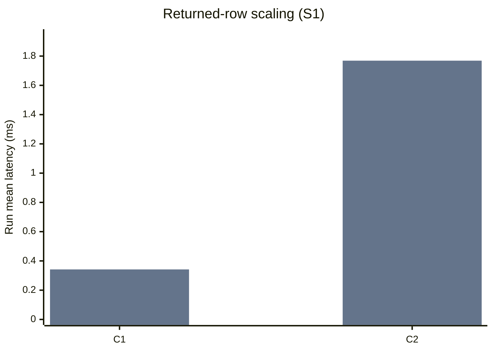


### Returned-row scaling (S2)

| Category | Workload / mode | Peak RSS (MiB) |
| --- | --- | --- |
| C1 | cap-baseline; operation=read; table=LargeRows; rows=10; iterations=100; callbacks=1; access=service; hook=false; pageSize=1000; scanRows=10000; enrichment=batch; mixed=unavailable; readTable=unavailable; queryShape=page; offset=0; hookControl=false; actionContract=auto; scanCoordination=unavailable; wholeScanRows=unavailable; lookupPattern=unavailable; validationOutcome=unavailable; transport=http; phase=warm; load=vus:1; n=3 | 221.979 |
| C2 | cap-baseline; operation=read; table=LargeRows; rows=1000; iterations=100; callbacks=1; access=service; hook=false; pageSize=1000; scanRows=10000; enrichment=batch; mixed=unavailable; readTable=unavailable; queryShape=page; offset=0; hookControl=false; actionContract=auto; scanCoordination=unavailable; wholeScanRows=unavailable; lookupPattern=unavailable; validationOutcome=unavailable; transport=http; phase=warm; load=vus:1; n=3 | 229.74 |

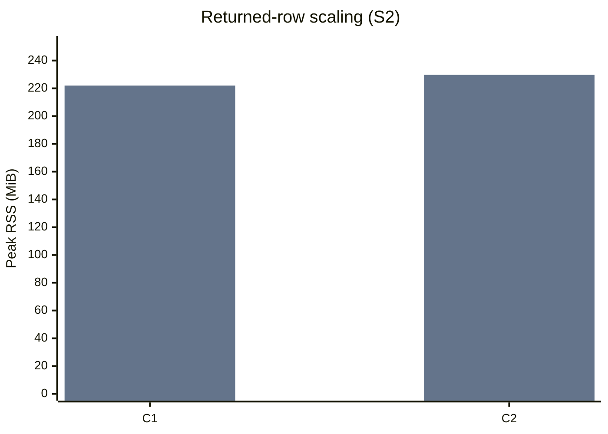


### Returned-row scaling (S3)

| Category | Workload / mode | Run mean latency (ms) |
| --- | --- | --- |
| C1 | wasm-compute; operation=read; table=LargeRows; rows=10; iterations=100; callbacks=1; access=service; hook=false; pageSize=1000; scanRows=10000; enrichment=batch; mixed=unavailable; readTable=unavailable; queryShape=page; offset=0; hookControl=false; actionContract=auto; scanCoordination=unavailable; wholeScanRows=unavailable; lookupPattern=unavailable; validationOutcome=unavailable; transport=http; phase=warm; load=vus:1; n=3 | 1.303 |
| C2 | wasm-compute; operation=read; table=LargeRows; rows=1000; iterations=100; callbacks=1; access=service; hook=false; pageSize=1000; scanRows=10000; enrichment=batch; mixed=unavailable; readTable=unavailable; queryShape=page; offset=0; hookControl=false; actionContract=auto; scanCoordination=unavailable; wholeScanRows=unavailable; lookupPattern=unavailable; validationOutcome=unavailable; transport=http; phase=warm; load=vus:1; n=3 | 19.313 |

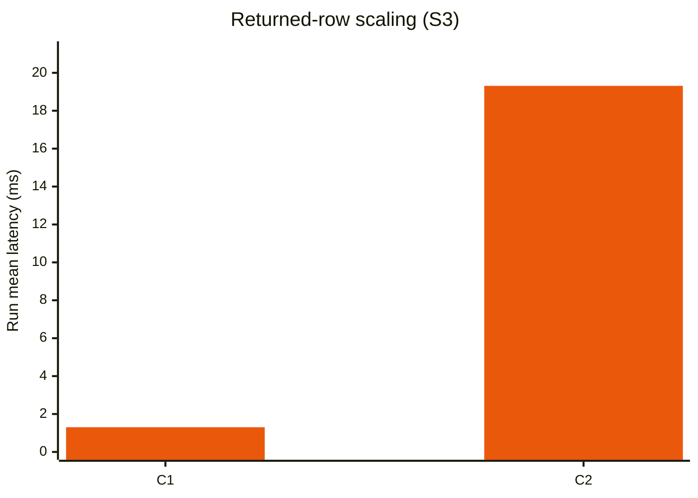

Oyster handlers: [Oyster calculation](../../apps/extension/srv/BenchmarkService/OysterCalculationLargeRows/after-READ.js).

### Returned-row scaling (S4)

| Category | Workload / mode | Peak RSS (MiB) |
| --- | --- | --- |
| C1 | wasm-compute; operation=read; table=LargeRows; rows=10; iterations=100; callbacks=1; access=service; hook=false; pageSize=1000; scanRows=10000; enrichment=batch; mixed=unavailable; readTable=unavailable; queryShape=page; offset=0; hookControl=false; actionContract=auto; scanCoordination=unavailable; wholeScanRows=unavailable; lookupPattern=unavailable; validationOutcome=unavailable; transport=http; phase=warm; load=vus:1; n=3 | 315.516 |
| C2 | wasm-compute; operation=read; table=LargeRows; rows=1000; iterations=100; callbacks=1; access=service; hook=false; pageSize=1000; scanRows=10000; enrichment=batch; mixed=unavailable; readTable=unavailable; queryShape=page; offset=0; hookControl=false; actionContract=auto; scanCoordination=unavailable; wholeScanRows=unavailable; lookupPattern=unavailable; validationOutcome=unavailable; transport=http; phase=warm; load=vus:1; n=3 | 338.979 |

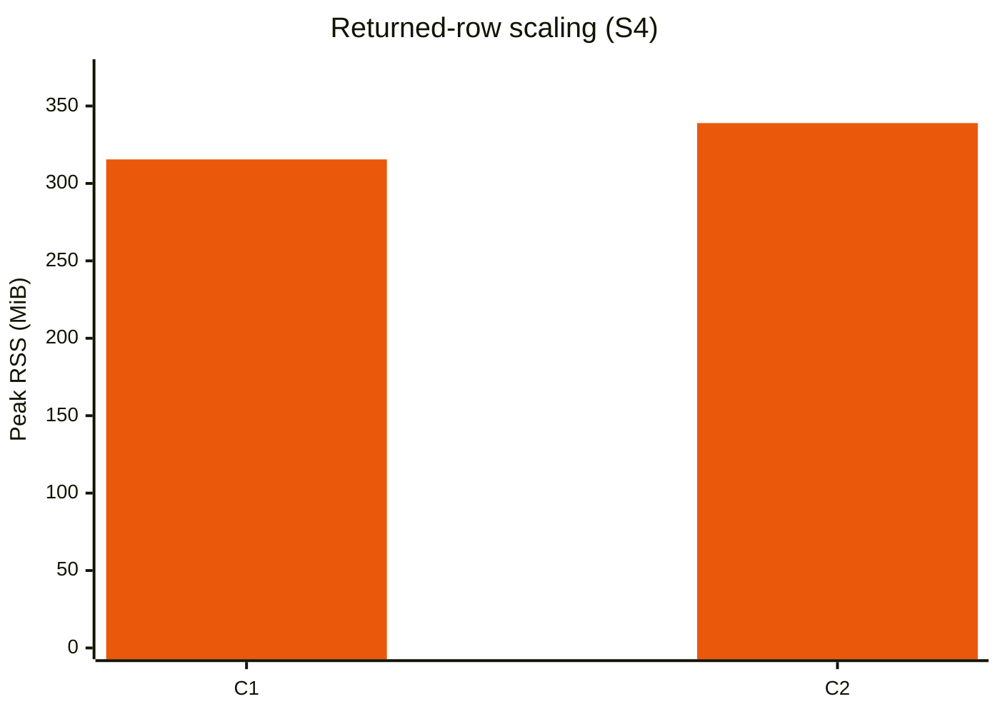

Oyster handlers: [Oyster calculation](../../apps/extension/srv/BenchmarkService/OysterCalculationLargeRows/after-READ.js).

### Returned-row scaling (S5)

| Category | Workload / mode | Run mean latency (ms) |
| --- | --- | --- |
| C1 | native-empty; operation=read; table=LargeRows; rows=10; iterations=100; callbacks=1; access=service; hook=false; pageSize=1000; scanRows=10000; enrichment=batch; mixed=unavailable; readTable=unavailable; queryShape=page; offset=0; hookControl=false; actionContract=auto; scanCoordination=unavailable; wholeScanRows=unavailable; lookupPattern=unavailable; validationOutcome=unavailable; transport=http; phase=warm; load=vus:1; n=3 | 0.386 |
| C2 | native-empty; operation=read; table=LargeRows; rows=1000; iterations=100; callbacks=1; access=service; hook=false; pageSize=1000; scanRows=10000; enrichment=batch; mixed=unavailable; readTable=unavailable; queryShape=page; offset=0; hookControl=false; actionContract=auto; scanCoordination=unavailable; wholeScanRows=unavailable; lookupPattern=unavailable; validationOutcome=unavailable; transport=http; phase=warm; load=vus:1; n=3 | 1.819 |


### Returned-row scaling (S6)

| Category | Workload / mode | Peak RSS (MiB) |
| --- | --- | --- |
| C1 | native-empty; operation=read; table=LargeRows; rows=10; iterations=100; callbacks=1; access=service; hook=false; pageSize=1000; scanRows=10000; enrichment=batch; mixed=unavailable; readTable=unavailable; queryShape=page; offset=0; hookControl=false; actionContract=auto; scanCoordination=unavailable; wholeScanRows=unavailable; lookupPattern=unavailable; validationOutcome=unavailable; transport=http; phase=warm; load=vus:1; n=3 | 317.354 |
| C2 | native-empty; operation=read; table=LargeRows; rows=1000; iterations=100; callbacks=1; access=service; hook=false; pageSize=1000; scanRows=10000; enrichment=batch; mixed=unavailable; readTable=unavailable; queryShape=page; offset=0; hookControl=false; actionContract=auto; scanCoordination=unavailable; wholeScanRows=unavailable; lookupPattern=unavailable; validationOutcome=unavailable; transport=http; phase=warm; load=vus:1; n=3 | 299.188 |


### Returned-row scaling (S7)

| Category | Workload / mode | Run mean latency (ms) |
| --- | --- | --- |
| C1 | oyster-idle; operation=read; table=LargeRows; rows=10; iterations=100; callbacks=1; access=service; hook=false; pageSize=1000; scanRows=10000; enrichment=batch; mixed=unavailable; readTable=unavailable; queryShape=page; offset=0; hookControl=false; actionContract=auto; scanCoordination=unavailable; wholeScanRows=unavailable; lookupPattern=unavailable; validationOutcome=unavailable; transport=http; phase=warm; load=vus:1; n=3 | 0.397 |
| C2 | oyster-idle; operation=read; table=LargeRows; rows=1000; iterations=100; callbacks=1; access=service; hook=false; pageSize=1000; scanRows=10000; enrichment=batch; mixed=unavailable; readTable=unavailable; queryShape=page; offset=0; hookControl=false; actionContract=auto; scanCoordination=unavailable; wholeScanRows=unavailable; lookupPattern=unavailable; validationOutcome=unavailable; transport=http; phase=warm; load=vus:1; n=3 | 1.819 |

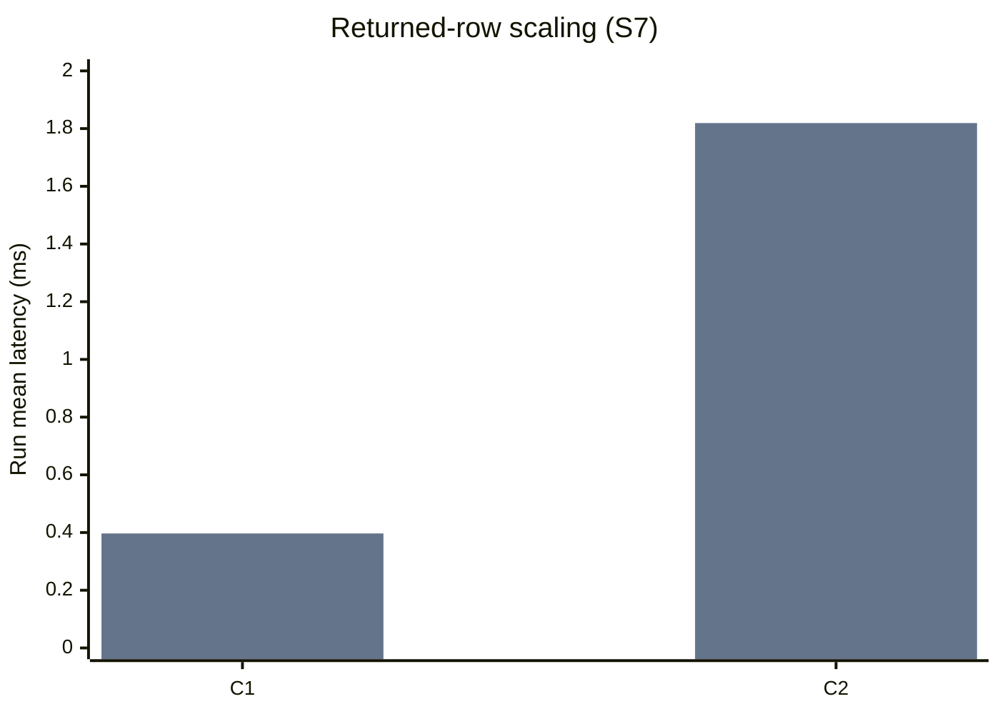


### Returned-row scaling (S8)

| Category | Workload / mode | Peak RSS (MiB) |
| --- | --- | --- |
| C1 | oyster-idle; operation=read; table=LargeRows; rows=10; iterations=100; callbacks=1; access=service; hook=false; pageSize=1000; scanRows=10000; enrichment=batch; mixed=unavailable; readTable=unavailable; queryShape=page; offset=0; hookControl=false; actionContract=auto; scanCoordination=unavailable; wholeScanRows=unavailable; lookupPattern=unavailable; validationOutcome=unavailable; transport=http; phase=warm; load=vus:1; n=3 | 294.24 |
| C2 | oyster-idle; operation=read; table=LargeRows; rows=1000; iterations=100; callbacks=1; access=service; hook=false; pageSize=1000; scanRows=10000; enrichment=batch; mixed=unavailable; readTable=unavailable; queryShape=page; offset=0; hookControl=false; actionContract=auto; scanCoordination=unavailable; wholeScanRows=unavailable; lookupPattern=unavailable; validationOutcome=unavailable; transport=http; phase=warm; load=vus:1; n=3 | 292.146 |

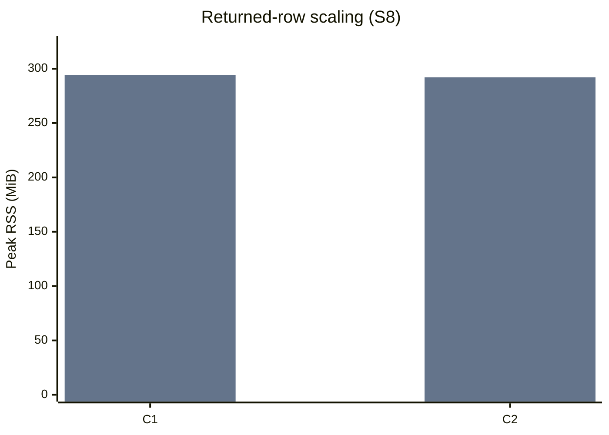


### Returned-row scaling (S9)

| Category | Workload / mode | Run mean latency (ms) |
| --- | --- | --- |
| C1 | native-compute; operation=read; table=LargeRows; rows=10; iterations=100; callbacks=1; access=service; hook=false; pageSize=1000; scanRows=10000; enrichment=batch; mixed=unavailable; readTable=unavailable; queryShape=page; offset=0; hookControl=false; actionContract=auto; scanCoordination=unavailable; wholeScanRows=unavailable; lookupPattern=unavailable; validationOutcome=unavailable; transport=http; phase=warm; load=vus:1; n=3 | 0.386 |
| C2 | native-compute; operation=read; table=LargeRows; rows=1000; iterations=100; callbacks=1; access=service; hook=false; pageSize=1000; scanRows=10000; enrichment=batch; mixed=unavailable; readTable=unavailable; queryShape=page; offset=0; hookControl=false; actionContract=auto; scanCoordination=unavailable; wholeScanRows=unavailable; lookupPattern=unavailable; validationOutcome=unavailable; transport=http; phase=warm; load=vus:1; n=3 | 2.045 |

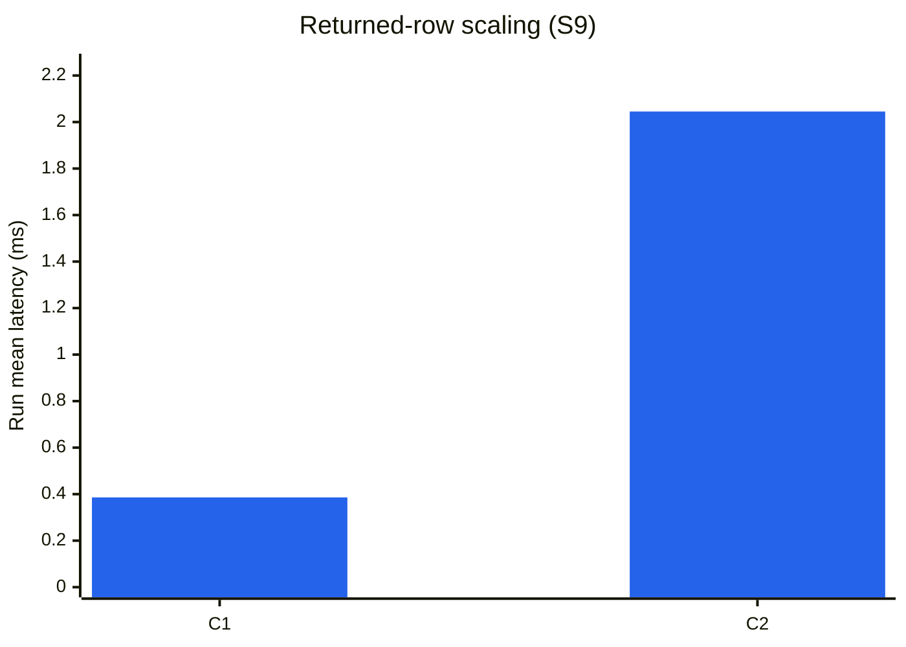


### Returned-row scaling (S10)

| Category | Workload / mode | Peak RSS (MiB) |
| --- | --- | --- |
| C1 | native-compute; operation=read; table=LargeRows; rows=10; iterations=100; callbacks=1; access=service; hook=false; pageSize=1000; scanRows=10000; enrichment=batch; mixed=unavailable; readTable=unavailable; queryShape=page; offset=0; hookControl=false; actionContract=auto; scanCoordination=unavailable; wholeScanRows=unavailable; lookupPattern=unavailable; validationOutcome=unavailable; transport=http; phase=warm; load=vus:1; n=3 | 318.641 |
| C2 | native-compute; operation=read; table=LargeRows; rows=1000; iterations=100; callbacks=1; access=service; hook=false; pageSize=1000; scanRows=10000; enrichment=batch; mixed=unavailable; readTable=unavailable; queryShape=page; offset=0; hookControl=false; actionContract=auto; scanCoordination=unavailable; wholeScanRows=unavailable; lookupPattern=unavailable; validationOutcome=unavailable; transport=http; phase=warm; load=vus:1; n=3 | 299.557 |

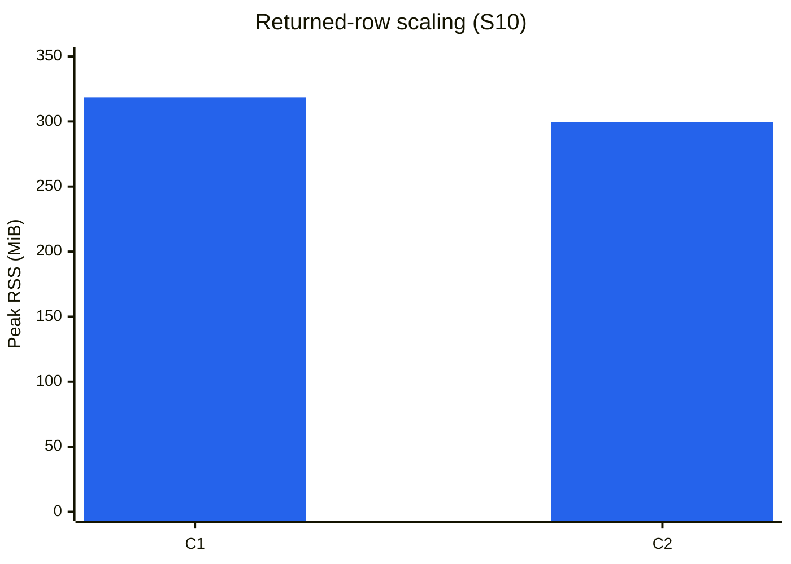


### Returned-row scaling (S11)

| Category | Workload / mode | Run mean latency (ms) |
| --- | --- | --- |
| C1 | wasm-empty; operation=read; table=LargeRows; rows=10; iterations=100; callbacks=1; access=service; hook=false; pageSize=1000; scanRows=10000; enrichment=batch; mixed=unavailable; readTable=unavailable; queryShape=page; offset=0; hookControl=false; actionContract=auto; scanCoordination=unavailable; wholeScanRows=unavailable; lookupPattern=unavailable; validationOutcome=unavailable; transport=http; phase=warm; load=vus:1; n=3 | 1.128 |
| C2 | wasm-empty; operation=read; table=LargeRows; rows=1000; iterations=100; callbacks=1; access=service; hook=false; pageSize=1000; scanRows=10000; enrichment=batch; mixed=unavailable; readTable=unavailable; queryShape=page; offset=0; hookControl=false; actionContract=auto; scanCoordination=unavailable; wholeScanRows=unavailable; lookupPattern=unavailable; validationOutcome=unavailable; transport=http; phase=warm; load=vus:1; n=3 | 6.494 |

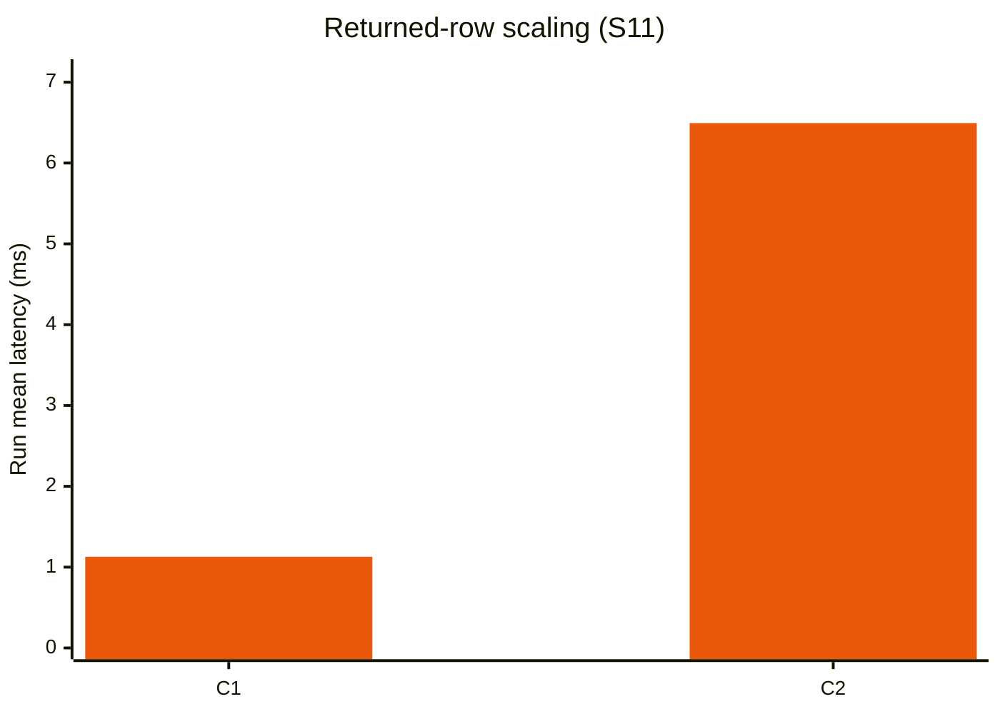

Oyster handlers: [Oyster empty handler](../../apps/extension/srv/BenchmarkService/OysterEmptyLargeRows/after-READ.js).

### Returned-row scaling (S12)

| Category | Workload / mode | Peak RSS (MiB) |
| --- | --- | --- |
| C1 | wasm-empty; operation=read; table=LargeRows; rows=10; iterations=100; callbacks=1; access=service; hook=false; pageSize=1000; scanRows=10000; enrichment=batch; mixed=unavailable; readTable=unavailable; queryShape=page; offset=0; hookControl=false; actionContract=auto; scanCoordination=unavailable; wholeScanRows=unavailable; lookupPattern=unavailable; validationOutcome=unavailable; transport=http; phase=warm; load=vus:1; n=3 | 300.443 |
| C2 | wasm-empty; operation=read; table=LargeRows; rows=1000; iterations=100; callbacks=1; access=service; hook=false; pageSize=1000; scanRows=10000; enrichment=batch; mixed=unavailable; readTable=unavailable; queryShape=page; offset=0; hookControl=false; actionContract=auto; scanCoordination=unavailable; wholeScanRows=unavailable; lookupPattern=unavailable; validationOutcome=unavailable; transport=http; phase=warm; load=vus:1; n=3 | 283.505 |

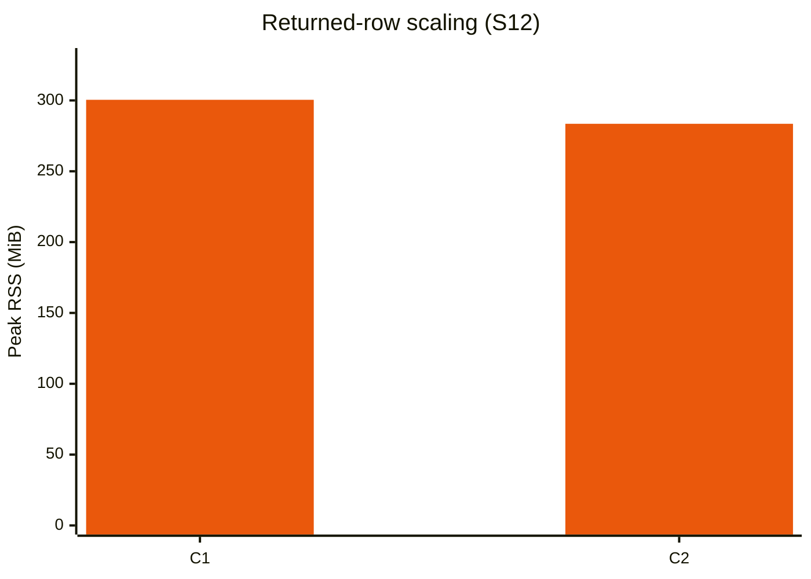

Oyster handlers: [Oyster empty handler](../../apps/extension/srv/BenchmarkService/OysterEmptyLargeRows/after-READ.js).

### CPU iterations scaling (S13)

| Category | Workload / mode | Run mean latency (ms) |
| --- | --- | --- |
| C1 | wasm-compute; operation=action; table=SmallRows; rows=10; iterations=100; callbacks=1; access=service; hook=false; pageSize=1000; scanRows=10000; enrichment=batch; mixed=unavailable; readTable=unavailable; queryShape=page; offset=0; hookControl=false; actionContract=auto; scanCoordination=unavailable; wholeScanRows=unavailable; lookupPattern=unavailable; validationOutcome=unavailable; transport=http; phase=warm; load=vus:1; n=3 | 0.915 |
| C2 | wasm-compute; operation=action; table=SmallRows; rows=10; iterations=10000; callbacks=1; access=service; hook=false; pageSize=1000; scanRows=10000; enrichment=batch; mixed=unavailable; readTable=unavailable; queryShape=page; offset=0; hookControl=false; actionContract=auto; scanCoordination=unavailable; wholeScanRows=unavailable; lookupPattern=unavailable; validationOutcome=unavailable; transport=http; phase=warm; load=vus:1; n=3 | 2.284 |

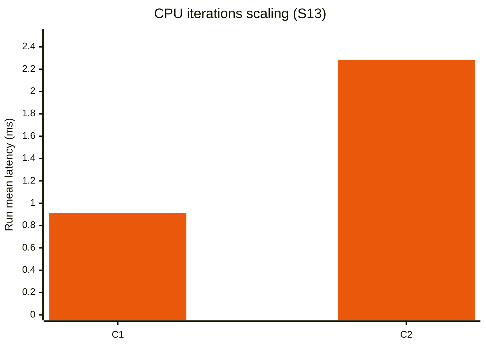

Oyster handlers: [Oyster calculation](../../apps/extension/srv/BenchmarkService/on-oysterCalculation.js).

### CPU iterations scaling (S14)

| Category | Workload / mode | Run mean latency (ms) |
| --- | --- | --- |
| C1 | native-compute; operation=action; table=SmallRows; rows=10; iterations=100; callbacks=1; access=service; hook=false; pageSize=1000; scanRows=10000; enrichment=batch; mixed=unavailable; readTable=unavailable; queryShape=page; offset=0; hookControl=false; actionContract=auto; scanCoordination=unavailable; wholeScanRows=unavailable; lookupPattern=unavailable; validationOutcome=unavailable; transport=http; phase=warm; load=vus:1; n=3 | 0.168 |
| C2 | native-compute; operation=action; table=SmallRows; rows=10; iterations=10000; callbacks=1; access=service; hook=false; pageSize=1000; scanRows=10000; enrichment=batch; mixed=unavailable; readTable=unavailable; queryShape=page; offset=0; hookControl=false; actionContract=auto; scanCoordination=unavailable; wholeScanRows=unavailable; lookupPattern=unavailable; validationOutcome=unavailable; transport=http; phase=warm; load=vus:1; n=3 | 0.188 |

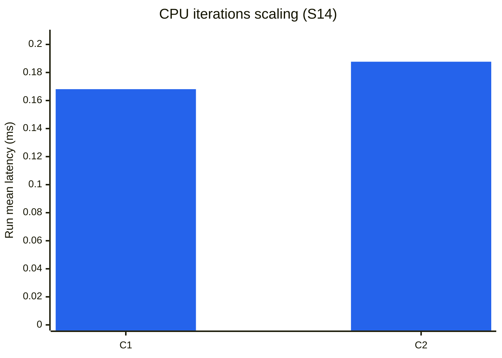


### Scan row scaling (S15)

| Category | Workload / mode | Run mean latency (ms) |
| --- | --- | --- |
| C1 | native-compute; operation=scan; table=LargeRows; rows=10; iterations=100; callbacks=1; access=service; hook=false; pageSize=1000; scanRows=10000; enrichment=batch; mixed=unavailable; readTable=unavailable; queryShape=page; offset=0; hookControl=false; actionContract=auto; scanCoordination=unavailable; wholeScanRows=unavailable; lookupPattern=unavailable; validationOutcome=unavailable; transport=http; phase=warm; load=vus:1; n=3 | 10.904 |
| C2 | native-compute; operation=scan; table=LargeRows; rows=10; iterations=100; callbacks=1; access=service; hook=false; pageSize=1000; scanRows=50000; enrichment=batch; mixed=unavailable; readTable=unavailable; queryShape=page; offset=0; hookControl=false; actionContract=auto; scanCoordination=unavailable; wholeScanRows=unavailable; lookupPattern=unavailable; validationOutcome=unavailable; transport=http; phase=warm; load=vus:1; n=3 | 53.801 |

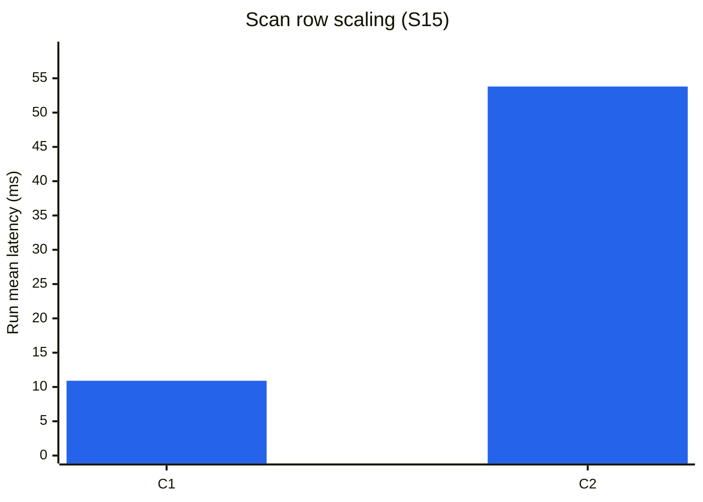


### Scan row scaling (S16)

| Category | Workload / mode | Peak RSS (MiB) |
| --- | --- | --- |
| C1 | native-compute; operation=scan; table=LargeRows; rows=10; iterations=100; callbacks=1; access=service; hook=false; pageSize=1000; scanRows=10000; enrichment=batch; mixed=unavailable; readTable=unavailable; queryShape=page; offset=0; hookControl=false; actionContract=auto; scanCoordination=unavailable; wholeScanRows=unavailable; lookupPattern=unavailable; validationOutcome=unavailable; transport=http; phase=warm; load=vus:1; n=3 | 319.755 |
| C2 | native-compute; operation=scan; table=LargeRows; rows=10; iterations=100; callbacks=1; access=service; hook=false; pageSize=1000; scanRows=50000; enrichment=batch; mixed=unavailable; readTable=unavailable; queryShape=page; offset=0; hookControl=false; actionContract=auto; scanCoordination=unavailable; wholeScanRows=unavailable; lookupPattern=unavailable; validationOutcome=unavailable; transport=http; phase=warm; load=vus:1; n=3 | 335.385 |

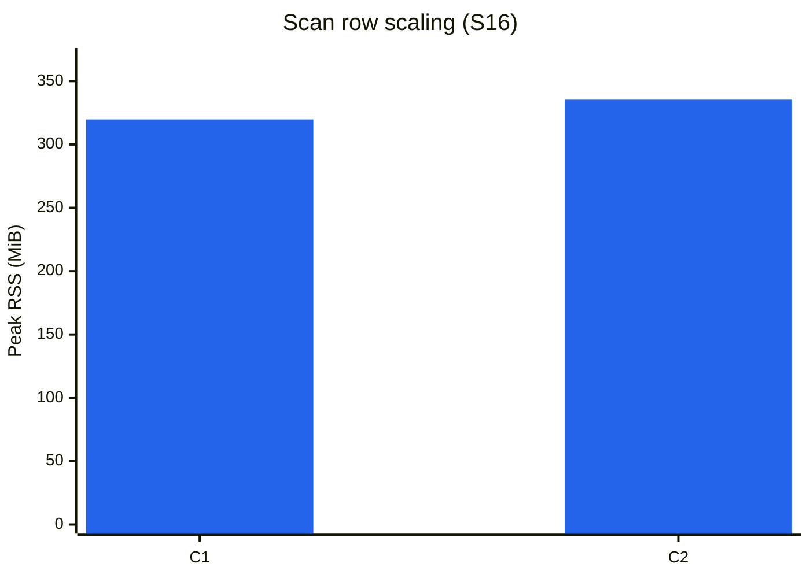


### Scan row scaling (S17)

| Category | Workload / mode | Run mean latency (ms) |
| --- | --- | --- |
| C1 | wasm-compute; operation=scan; table=LargeRows; rows=10; iterations=100; callbacks=1; access=service; hook=false; pageSize=1000; scanRows=10000; enrichment=batch; mixed=unavailable; readTable=unavailable; queryShape=page; offset=0; hookControl=false; actionContract=auto; scanCoordination=unavailable; wholeScanRows=unavailable; lookupPattern=unavailable; validationOutcome=unavailable; transport=http; phase=warm; load=vus:1; n=3 | 154.411 |
| C2 | wasm-compute; operation=scan; table=LargeRows; rows=10; iterations=100; callbacks=1; access=service; hook=false; pageSize=1000; scanRows=50000; enrichment=batch; mixed=unavailable; readTable=unavailable; queryShape=page; offset=0; hookControl=false; actionContract=auto; scanCoordination=unavailable; wholeScanRows=unavailable; lookupPattern=unavailable; validationOutcome=unavailable; transport=http; phase=warm; load=vus:1; n=3 | 766.498 |

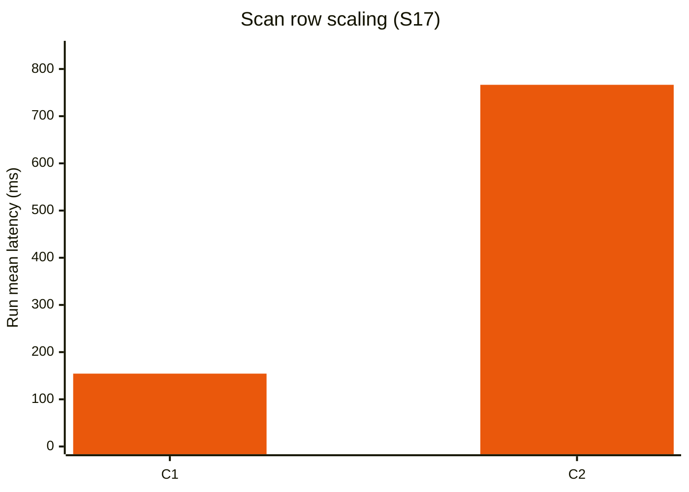

Oyster handlers: [Oyster calculation](../../apps/extension/srv/BenchmarkService/on-oysterScan.js).

### Scan row scaling (S18)

| Category | Workload / mode | Peak RSS (MiB) |
| --- | --- | --- |
| C1 | wasm-compute; operation=scan; table=LargeRows; rows=10; iterations=100; callbacks=1; access=service; hook=false; pageSize=1000; scanRows=10000; enrichment=batch; mixed=unavailable; readTable=unavailable; queryShape=page; offset=0; hookControl=false; actionContract=auto; scanCoordination=unavailable; wholeScanRows=unavailable; lookupPattern=unavailable; validationOutcome=unavailable; transport=http; phase=warm; load=vus:1; n=3 | 317.161 |
| C2 | wasm-compute; operation=scan; table=LargeRows; rows=10; iterations=100; callbacks=1; access=service; hook=false; pageSize=1000; scanRows=50000; enrichment=batch; mixed=unavailable; readTable=unavailable; queryShape=page; offset=0; hookControl=false; actionContract=auto; scanCoordination=unavailable; wholeScanRows=unavailable; lookupPattern=unavailable; validationOutcome=unavailable; transport=http; phase=warm; load=vus:1; n=3 | 322.953 |

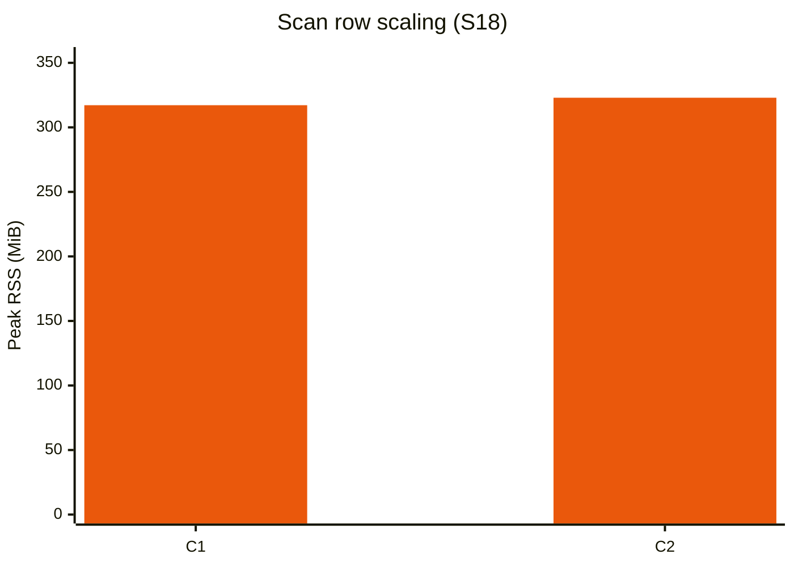

Oyster handlers: [Oyster calculation](../../apps/extension/srv/BenchmarkService/on-oysterScan.js).

### Callback fan-out (S19)

| Category | Workload / mode | Run mean latency (ms) |
| --- | --- | --- |
| C1 | wasm-compute-read; operation=action; table=SmallRows; rows=10; iterations=0; callbacks=1; access=service; hook=false; pageSize=1000; scanRows=10000; enrichment=batch; mixed=unavailable; readTable=unavailable; queryShape=page; offset=0; hookControl=false; actionContract=auto; scanCoordination=unavailable; wholeScanRows=unavailable; lookupPattern=unavailable; validationOutcome=unavailable; transport=http; phase=warm; load=vus:1; n=3 | 1.155 |
| C2 | wasm-compute-read; operation=action; table=SmallRows; rows=10; iterations=0; callbacks=10; access=service; hook=false; pageSize=1000; scanRows=10000; enrichment=batch; mixed=unavailable; readTable=unavailable; queryShape=page; offset=0; hookControl=false; actionContract=auto; scanCoordination=unavailable; wholeScanRows=unavailable; lookupPattern=unavailable; validationOutcome=unavailable; transport=http; phase=warm; load=vus:1; n=3 | 2.465 |

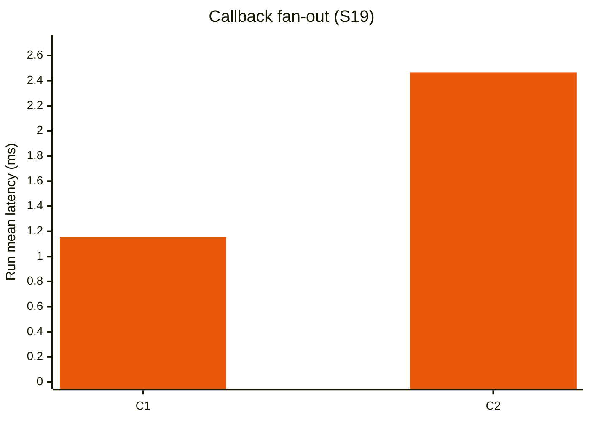

Oyster handlers: [Oyster CQL read](../../apps/extension/srv/BenchmarkService/on-oysterCqlRead.js).

### Callback fan-out (S20)

| Category | Workload / mode | Run mean latency (ms) |
| --- | --- | --- |
| C1 | native-compute-read; operation=action; table=SmallRows; rows=10; iterations=0; callbacks=1; access=service; hook=false; pageSize=1000; scanRows=10000; enrichment=batch; mixed=unavailable; readTable=unavailable; queryShape=page; offset=0; hookControl=false; actionContract=auto; scanCoordination=unavailable; wholeScanRows=unavailable; lookupPattern=unavailable; validationOutcome=unavailable; transport=http; phase=warm; load=vus:1; n=3 | 0.322 |
| C2 | native-compute-read; operation=action; table=SmallRows; rows=10; iterations=0; callbacks=10; access=service; hook=false; pageSize=1000; scanRows=10000; enrichment=batch; mixed=unavailable; readTable=unavailable; queryShape=page; offset=0; hookControl=false; actionContract=auto; scanCoordination=unavailable; wholeScanRows=unavailable; lookupPattern=unavailable; validationOutcome=unavailable; transport=http; phase=warm; load=vus:1; n=3 | 0.93 |

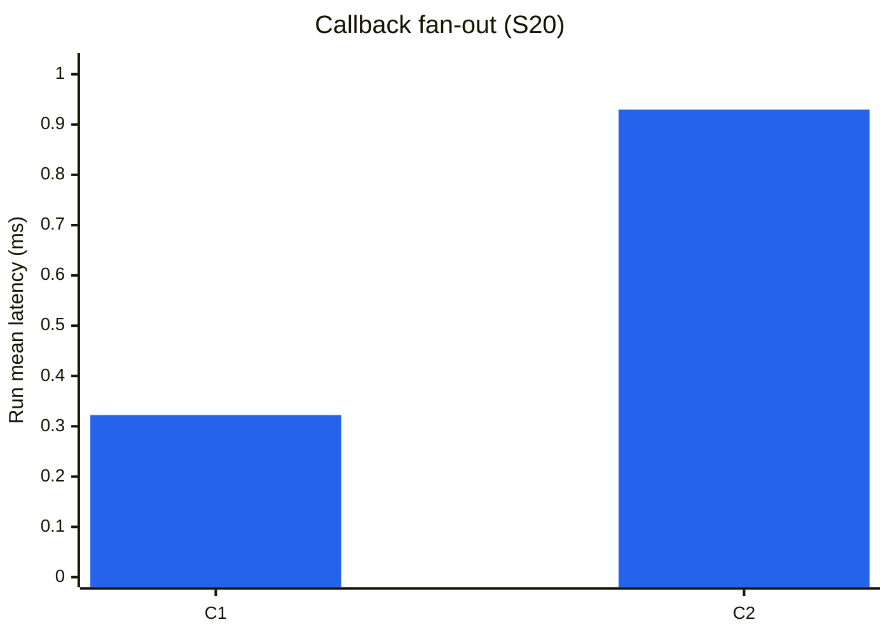


### Callback fan-out (S21)

| Category | Workload / mode | Run mean latency (ms) |
| --- | --- | --- |
| C1 | native-compute-write; operation=action; table=SmallRows; rows=10; iterations=0; callbacks=1; access=service; hook=false; pageSize=1000; scanRows=10000; enrichment=batch; mixed=unavailable; readTable=unavailable; queryShape=page; offset=0; hookControl=false; actionContract=auto; scanCoordination=unavailable; wholeScanRows=unavailable; lookupPattern=unavailable; validationOutcome=unavailable; transport=http; phase=warm; load=vus:1; n=3 | 0.328 |
| C2 | native-compute-write; operation=action; table=SmallRows; rows=10; iterations=0; callbacks=10; access=service; hook=false; pageSize=1000; scanRows=10000; enrichment=batch; mixed=unavailable; readTable=unavailable; queryShape=page; offset=0; hookControl=false; actionContract=auto; scanCoordination=unavailable; wholeScanRows=unavailable; lookupPattern=unavailable; validationOutcome=unavailable; transport=http; phase=warm; load=vus:1; n=3 | 0.912 |

```mermaid
---
config:
  themeVariables:
    xyChart:
      plotColorPalette: "#2563eb"
  themeCSS: ".bar-plot-0 rect:nth-child(1) { fill: #2563eb; stroke: #2563eb; } .bar-plot-0 rect:nth-child(2) { fill: #2563eb; stroke: #2563eb; }"
---
xychart-beta
    title "Callback fan-out (S21)"
    x-axis ["C1", "C2"]
    y-axis "Run mean latency (ms)" 0 --> 1.0028915
    bar [0.3280083639510594, 0.9117195232865033]
```


### Callback fan-out (S22)

| Category | Workload / mode | Run mean latency (ms) |
| --- | --- | --- |
| C1 | wasm-compute-write; operation=action; table=SmallRows; rows=10; iterations=0; callbacks=1; access=service; hook=false; pageSize=1000; scanRows=10000; enrichment=batch; mixed=unavailable; readTable=unavailable; queryShape=page; offset=0; hookControl=false; actionContract=auto; scanCoordination=unavailable; wholeScanRows=unavailable; lookupPattern=unavailable; validationOutcome=unavailable; transport=http; phase=warm; load=vus:1; n=3 | 1.133 |
| C2 | wasm-compute-write; operation=action; table=SmallRows; rows=10; iterations=0; callbacks=10; access=service; hook=false; pageSize=1000; scanRows=10000; enrichment=batch; mixed=unavailable; readTable=unavailable; queryShape=page; offset=0; hookControl=false; actionContract=auto; scanCoordination=unavailable; wholeScanRows=unavailable; lookupPattern=unavailable; validationOutcome=unavailable; transport=http; phase=warm; load=vus:1; n=3 | 2.389 |

```mermaid
---
config:
  themeVariables:
    xyChart:
      plotColorPalette: "#ea580c"
  themeCSS: ".bar-plot-0 rect:nth-child(1) { fill: #ea580c; stroke: #ea580c; } .bar-plot-0 rect:nth-child(2) { fill: #ea580c; stroke: #ea580c; }"
---
xychart-beta
    title "Callback fan-out (S22)"
    x-axis ["C1", "C2"]
    y-axis "Run mean latency (ms)" 0 --> 2.6276483
    bar [1.1330580130852128, 2.388771176788183]
```

Oyster handlers: [Oyster CQL write](../../apps/extension/srv/BenchmarkService/on-oysterCqlWrite.js).

### Load latency (S23)

| Category | Workload / mode | Mean run p95 latency (ms) |
| --- | --- | --- |
| C1 | cap-baseline; operation=action; table=SmallRows; rows=10; iterations=100; callbacks=1; access=service; hook=false; pageSize=1000; scanRows=10000; enrichment=batch; mixed=unavailable; readTable=unavailable; queryShape=page; offset=0; hookControl=false; actionContract=auto; scanCoordination=unavailable; wholeScanRows=unavailable; lookupPattern=unavailable; validationOutcome=unavailable; transport=http; phase=warm; load=vus:1; n=3 | 0.21 |
| C2 | cap-baseline; operation=action; table=SmallRows; rows=10; iterations=100; callbacks=1; access=service; hook=false; pageSize=1000; scanRows=10000; enrichment=batch; mixed=unavailable; readTable=unavailable; queryShape=page; offset=0; hookControl=false; actionContract=auto; scanCoordination=unavailable; wholeScanRows=unavailable; lookupPattern=unavailable; validationOutcome=unavailable; transport=http; phase=warm; load=vus:8; n=3 | 1.74 |
| C3 | cap-baseline; operation=action; table=SmallRows; rows=10; iterations=100; callbacks=1; access=service; hook=false; pageSize=1000; scanRows=10000; enrichment=batch; mixed=unavailable; readTable=unavailable; queryShape=page; offset=0; hookControl=false; actionContract=auto; scanCoordination=unavailable; wholeScanRows=unavailable; lookupPattern=unavailable; validationOutcome=unavailable; transport=http; phase=warm; load=vus:32; n=3 | 5.176 |

```mermaid
---
config:
  themeVariables:
    xyChart:
      plotColorPalette: "#64748b"
  themeCSS: ".bar-plot-0 rect:nth-child(1) { fill: #64748b; stroke: #64748b; } .bar-plot-0 rect:nth-child(2) { fill: #64748b; stroke: #64748b; } .bar-plot-0 rect:nth-child(3) { fill: #64748b; stroke: #64748b; }"
---
xychart-beta
    title "Load latency (S23)"
    x-axis ["C1", "C2", "C3"]
    y-axis "Mean run p95 latency (ms)" 0 --> 5.69305
    bar [0.20950033333333332, 1.7402500000000003, 5.1755]
```


### Successful throughput (S24)

| Category | Workload / mode | Successful throughput (requests/s) |
| --- | --- | --- |
| C1 | cap-baseline; operation=action; table=SmallRows; rows=10; iterations=100; callbacks=1; access=service; hook=false; pageSize=1000; scanRows=10000; enrichment=batch; mixed=unavailable; readTable=unavailable; queryShape=page; offset=0; hookControl=false; actionContract=auto; scanCoordination=unavailable; wholeScanRows=unavailable; lookupPattern=unavailable; validationOutcome=unavailable; transport=http; phase=warm; load=vus:1; n=3 | 5503.772 |
| C2 | cap-baseline; operation=action; table=SmallRows; rows=10; iterations=100; callbacks=1; access=service; hook=false; pageSize=1000; scanRows=10000; enrichment=batch; mixed=unavailable; readTable=unavailable; queryShape=page; offset=0; hookControl=false; actionContract=auto; scanCoordination=unavailable; wholeScanRows=unavailable; lookupPattern=unavailable; validationOutcome=unavailable; transport=http; phase=warm; load=vus:8; n=3 | 7636.514 |
| C3 | cap-baseline; operation=action; table=SmallRows; rows=10; iterations=100; callbacks=1; access=service; hook=false; pageSize=1000; scanRows=10000; enrichment=batch; mixed=unavailable; readTable=unavailable; queryShape=page; offset=0; hookControl=false; actionContract=auto; scanCoordination=unavailable; wholeScanRows=unavailable; lookupPattern=unavailable; validationOutcome=unavailable; transport=http; phase=warm; load=vus:32; n=3 | 7612.607 |

```mermaid
---
config:
  themeVariables:
    xyChart:
      plotColorPalette: "#64748b"
  themeCSS: ".bar-plot-0 rect:nth-child(1) { fill: #64748b; stroke: #64748b; } .bar-plot-0 rect:nth-child(2) { fill: #64748b; stroke: #64748b; } .bar-plot-0 rect:nth-child(3) { fill: #64748b; stroke: #64748b; }"
---
xychart-beta
    title "Successful throughput (S24)"
    x-axis ["C1", "C2", "C3"]
    y-axis "Successful throughput (requests/s)" 0 --> 8400.1649
    bar [5503.772259223261, 7636.513573975681, 7612.607085576194]
```


### Unrelated-request probe (S25)

| Category | Workload / mode | Unrelated-request probe p95 (ms) |
| --- | --- | --- |
| C1 | cap-baseline; operation=action; table=SmallRows; rows=10; iterations=100; callbacks=1; access=service; hook=false; pageSize=1000; scanRows=10000; enrichment=batch; mixed=unavailable; readTable=unavailable; queryShape=page; offset=0; hookControl=false; actionContract=auto; scanCoordination=unavailable; wholeScanRows=unavailable; lookupPattern=unavailable; validationOutcome=unavailable; transport=http; phase=warm; load=vus:8; n=3 | 21.426 |
| C2 | cap-baseline; operation=action; table=SmallRows; rows=10; iterations=100; callbacks=1; access=service; hook=false; pageSize=1000; scanRows=10000; enrichment=batch; mixed=unavailable; readTable=unavailable; queryShape=page; offset=0; hookControl=false; actionContract=auto; scanCoordination=unavailable; wholeScanRows=unavailable; lookupPattern=unavailable; validationOutcome=unavailable; transport=http; phase=warm; load=vus:32; n=3 | 27.32 |

```mermaid
---
config:
  themeVariables:
    xyChart:
      plotColorPalette: "#64748b"
  themeCSS: ".bar-plot-0 rect:nth-child(1) { fill: #64748b; stroke: #64748b; } .bar-plot-0 rect:nth-child(2) { fill: #64748b; stroke: #64748b; }"
---
xychart-beta
    title "Unrelated-request probe (S25)"
    x-axis ["C1", "C2"]
    y-axis "Unrelated-request probe p95 (ms)" 0 --> 30.052519
    bar [21.425528, 27.320471999999995]
```


### Load latency (S26)

| Category | Workload / mode | Mean run p95 latency (ms) |
| --- | --- | --- |
| C1 | cap-baseline; operation=read; table=SmallRows; rows=10; iterations=100; callbacks=1; access=service; hook=false; pageSize=1000; scanRows=10000; enrichment=batch; mixed=true; readTable=unavailable; queryShape=page; offset=0; hookControl=false; actionContract=auto; scanCoordination=unavailable; wholeScanRows=unavailable; lookupPattern=unavailable; validationOutcome=unavailable; transport=http; phase=warm; load=vus:1; n=3 | 0.63 |
| C2 | cap-baseline; operation=read; table=SmallRows; rows=10; iterations=100; callbacks=1; access=service; hook=false; pageSize=1000; scanRows=10000; enrichment=batch; mixed=true; readTable=unavailable; queryShape=page; offset=0; hookControl=false; actionContract=auto; scanCoordination=unavailable; wholeScanRows=unavailable; lookupPattern=unavailable; validationOutcome=unavailable; transport=http; phase=warm; load=vus:8; n=3 | 4.605 |
| C3 | cap-baseline; operation=read; table=SmallRows; rows=10; iterations=100; callbacks=1; access=service; hook=false; pageSize=1000; scanRows=10000; enrichment=batch; mixed=true; readTable=unavailable; queryShape=page; offset=0; hookControl=false; actionContract=auto; scanCoordination=unavailable; wholeScanRows=unavailable; lookupPattern=unavailable; validationOutcome=unavailable; transport=http; phase=warm; load=vus:32; n=3 | 14.647 |

```mermaid
---
config:
  themeVariables:
    xyChart:
      plotColorPalette: "#64748b"
  themeCSS: ".bar-plot-0 rect:nth-child(1) { fill: #64748b; stroke: #64748b; } .bar-plot-0 rect:nth-child(2) { fill: #64748b; stroke: #64748b; } .bar-plot-0 rect:nth-child(3) { fill: #64748b; stroke: #64748b; }"
---
xychart-beta
    title "Load latency (S26)"
    x-axis ["C1", "C2", "C3"]
    y-axis "Mean run p95 latency (ms)" 0 --> 16.111471
    bar [0.6301113333333334, 4.605014, 14.646791666666667]
```


### Successful throughput (S27)

| Category | Workload / mode | Successful throughput (requests/s) |
| --- | --- | --- |
| C1 | cap-baseline; operation=read; table=SmallRows; rows=10; iterations=100; callbacks=1; access=service; hook=false; pageSize=1000; scanRows=10000; enrichment=batch; mixed=true; readTable=unavailable; queryShape=page; offset=0; hookControl=false; actionContract=auto; scanCoordination=unavailable; wholeScanRows=unavailable; lookupPattern=unavailable; validationOutcome=unavailable; transport=http; phase=warm; load=vus:1; n=3 | 2448.086 |
| C2 | cap-baseline; operation=read; table=SmallRows; rows=10; iterations=100; callbacks=1; access=service; hook=false; pageSize=1000; scanRows=10000; enrichment=batch; mixed=true; readTable=unavailable; queryShape=page; offset=0; hookControl=false; actionContract=auto; scanCoordination=unavailable; wholeScanRows=unavailable; lookupPattern=unavailable; validationOutcome=unavailable; transport=http; phase=warm; load=vus:8; n=3 | 3069.472 |
| C3 | cap-baseline; operation=read; table=SmallRows; rows=10; iterations=100; callbacks=1; access=service; hook=false; pageSize=1000; scanRows=10000; enrichment=batch; mixed=true; readTable=unavailable; queryShape=page; offset=0; hookControl=false; actionContract=auto; scanCoordination=unavailable; wholeScanRows=unavailable; lookupPattern=unavailable; validationOutcome=unavailable; transport=http; phase=warm; load=vus:32; n=3 | 3014.988 |

```mermaid
---
config:
  themeVariables:
    xyChart:
      plotColorPalette: "#64748b"
  themeCSS: ".bar-plot-0 rect:nth-child(1) { fill: #64748b; stroke: #64748b; } .bar-plot-0 rect:nth-child(2) { fill: #64748b; stroke: #64748b; } .bar-plot-0 rect:nth-child(3) { fill: #64748b; stroke: #64748b; }"
---
xychart-beta
    title "Successful throughput (S27)"
    x-axis ["C1", "C2", "C3"]
    y-axis "Successful throughput (requests/s)" 0 --> 3376.4191
    bar [2448.085982445949, 3069.471945289881, 3014.9875946167704]
```


### Unrelated-request probe (S28)

| Category | Workload / mode | Unrelated-request probe p95 (ms) |
| --- | --- | --- |
| C1 | cap-baseline; operation=read; table=SmallRows; rows=10; iterations=100; callbacks=1; access=service; hook=false; pageSize=1000; scanRows=10000; enrichment=batch; mixed=true; readTable=unavailable; queryShape=page; offset=0; hookControl=false; actionContract=auto; scanCoordination=unavailable; wholeScanRows=unavailable; lookupPattern=unavailable; validationOutcome=unavailable; transport=http; phase=warm; load=vus:8; n=3 | 24.139 |
| C2 | cap-baseline; operation=read; table=SmallRows; rows=10; iterations=100; callbacks=1; access=service; hook=false; pageSize=1000; scanRows=10000; enrichment=batch; mixed=true; readTable=unavailable; queryShape=page; offset=0; hookControl=false; actionContract=auto; scanCoordination=unavailable; wholeScanRows=unavailable; lookupPattern=unavailable; validationOutcome=unavailable; transport=http; phase=warm; load=vus:32; n=3 | 187.839 |

```mermaid
---
config:
  themeVariables:
    xyChart:
      plotColorPalette: "#64748b"
  themeCSS: ".bar-plot-0 rect:nth-child(1) { fill: #64748b; stroke: #64748b; } .bar-plot-0 rect:nth-child(2) { fill: #64748b; stroke: #64748b; }"
---
xychart-beta
    title "Unrelated-request probe (S28)"
    x-axis ["C1", "C2"]
    y-axis "Unrelated-request probe p95 (ms)" 0 --> 206.62262
    bar [24.138513999999997, 187.83874966666667]
```


### Load latency (S29)

| Category | Workload / mode | Mean run p95 latency (ms) |
| --- | --- | --- |
| C1 | native-compute-read; operation=read; table=SmallRows; rows=10; iterations=0; callbacks=1; access=service; hook=false; pageSize=1000; scanRows=10000; enrichment=batch; mixed=true; readTable=unavailable; queryShape=page; offset=0; hookControl=false; actionContract=auto; scanCoordination=unavailable; wholeScanRows=unavailable; lookupPattern=unavailable; validationOutcome=unavailable; transport=http; phase=warm; load=vus:1; n=3 | 0.803 |
| C2 | native-compute-read; operation=read; table=SmallRows; rows=10; iterations=0; callbacks=1; access=service; hook=false; pageSize=1000; scanRows=10000; enrichment=batch; mixed=true; readTable=unavailable; queryShape=page; offset=0; hookControl=false; actionContract=auto; scanCoordination=unavailable; wholeScanRows=unavailable; lookupPattern=unavailable; validationOutcome=unavailable; transport=http; phase=warm; load=vus:8; n=3 | 6.013 |
| C3 | native-compute-read; operation=read; table=SmallRows; rows=10; iterations=0; callbacks=1; access=service; hook=false; pageSize=1000; scanRows=10000; enrichment=batch; mixed=true; readTable=unavailable; queryShape=page; offset=0; hookControl=false; actionContract=auto; scanCoordination=unavailable; wholeScanRows=unavailable; lookupPattern=unavailable; validationOutcome=unavailable; transport=http; phase=warm; load=vus:32; n=3 | 22.373 |

```mermaid
---
config:
  themeVariables:
    xyChart:
      plotColorPalette: "#2563eb"
  themeCSS: ".bar-plot-0 rect:nth-child(1) { fill: #2563eb; stroke: #2563eb; } .bar-plot-0 rect:nth-child(2) { fill: #2563eb; stroke: #2563eb; } .bar-plot-0 rect:nth-child(3) { fill: #2563eb; stroke: #2563eb; }"
---
xychart-beta
    title "Load latency (S29)"
    x-axis ["C1", "C2", "C3"]
    y-axis "Mean run p95 latency (ms)" 0 --> 24.609811
    bar [0.8029026666666667, 6.013083333333333, 22.372555333333334]
```


### Successful throughput (S30)

| Category | Workload / mode | Successful throughput (requests/s) |
| --- | --- | --- |
| C1 | native-compute-read; operation=read; table=SmallRows; rows=10; iterations=0; callbacks=1; access=service; hook=false; pageSize=1000; scanRows=10000; enrichment=batch; mixed=true; readTable=unavailable; queryShape=page; offset=0; hookControl=false; actionContract=auto; scanCoordination=unavailable; wholeScanRows=unavailable; lookupPattern=unavailable; validationOutcome=unavailable; transport=http; phase=warm; load=vus:1; n=3 | 1814.817 |
| C2 | native-compute-read; operation=read; table=SmallRows; rows=10; iterations=0; callbacks=1; access=service; hook=false; pageSize=1000; scanRows=10000; enrichment=batch; mixed=true; readTable=unavailable; queryShape=page; offset=0; hookControl=false; actionContract=auto; scanCoordination=unavailable; wholeScanRows=unavailable; lookupPattern=unavailable; validationOutcome=unavailable; transport=http; phase=warm; load=vus:8; n=3 | 2201.354 |
| C3 | native-compute-read; operation=read; table=SmallRows; rows=10; iterations=0; callbacks=1; access=service; hook=false; pageSize=1000; scanRows=10000; enrichment=batch; mixed=true; readTable=unavailable; queryShape=page; offset=0; hookControl=false; actionContract=auto; scanCoordination=unavailable; wholeScanRows=unavailable; lookupPattern=unavailable; validationOutcome=unavailable; transport=http; phase=warm; load=vus:32; n=3 | 2328.26 |

```mermaid
---
config:
  themeVariables:
    xyChart:
      plotColorPalette: "#2563eb"
  themeCSS: ".bar-plot-0 rect:nth-child(1) { fill: #2563eb; stroke: #2563eb; } .bar-plot-0 rect:nth-child(2) { fill: #2563eb; stroke: #2563eb; } .bar-plot-0 rect:nth-child(3) { fill: #2563eb; stroke: #2563eb; }"
---
xychart-beta
    title "Successful throughput (S30)"
    x-axis ["C1", "C2", "C3"]
    y-axis "Successful throughput (requests/s)" 0 --> 2561.0856
    bar [1814.817084125077, 2201.353939676231, 2328.25963808305]
```


### Unrelated-request probe (S31)

| Category | Workload / mode | Unrelated-request probe p95 (ms) |
| --- | --- | --- |
| C1 | native-compute-read; operation=read; table=SmallRows; rows=10; iterations=0; callbacks=1; access=service; hook=false; pageSize=1000; scanRows=10000; enrichment=batch; mixed=true; readTable=unavailable; queryShape=page; offset=0; hookControl=false; actionContract=auto; scanCoordination=unavailable; wholeScanRows=unavailable; lookupPattern=unavailable; validationOutcome=unavailable; transport=http; phase=warm; load=vus:8; n=3 | 24.068 |
| C2 | native-compute-read; operation=read; table=SmallRows; rows=10; iterations=0; callbacks=1; access=service; hook=false; pageSize=1000; scanRows=10000; enrichment=batch; mixed=true; readTable=unavailable; queryShape=page; offset=0; hookControl=false; actionContract=auto; scanCoordination=unavailable; wholeScanRows=unavailable; lookupPattern=unavailable; validationOutcome=unavailable; transport=http; phase=warm; load=vus:32; n=3 | 195.988 |

```mermaid
---
config:
  themeVariables:
    xyChart:
      plotColorPalette: "#2563eb"
  themeCSS: ".bar-plot-0 rect:nth-child(1) { fill: #2563eb; stroke: #2563eb; } .bar-plot-0 rect:nth-child(2) { fill: #2563eb; stroke: #2563eb; }"
---
xychart-beta
    title "Unrelated-request probe (S31)"
    x-axis ["C1", "C2"]
    y-axis "Unrelated-request probe p95 (ms)" 0 --> 215.58714
    bar [24.068486000000004, 195.98830566666666]
```


### Load latency (S32)

| Category | Workload / mode | Mean run p95 latency (ms) |
| --- | --- | --- |
| C1 | wasm-compute-read; operation=action; table=SmallRows; rows=10; iterations=0; callbacks=1; access=service; hook=false; pageSize=1000; scanRows=10000; enrichment=batch; mixed=unavailable; readTable=unavailable; queryShape=page; offset=0; hookControl=false; actionContract=auto; scanCoordination=unavailable; wholeScanRows=unavailable; lookupPattern=unavailable; validationOutcome=unavailable; transport=http; phase=warm; load=vus:1; n=3 | 1.315 |
| C2 | wasm-compute-read; operation=action; table=SmallRows; rows=10; iterations=0; callbacks=1; access=service; hook=false; pageSize=1000; scanRows=10000; enrichment=batch; mixed=unavailable; readTable=unavailable; queryShape=page; offset=0; hookControl=false; actionContract=auto; scanCoordination=unavailable; wholeScanRows=unavailable; lookupPattern=unavailable; validationOutcome=unavailable; transport=http; phase=warm; load=vus:8; n=3 | 4.059 |
| C3 | wasm-compute-read; operation=action; table=SmallRows; rows=10; iterations=0; callbacks=1; access=service; hook=false; pageSize=1000; scanRows=10000; enrichment=batch; mixed=unavailable; readTable=unavailable; queryShape=page; offset=0; hookControl=false; actionContract=auto; scanCoordination=unavailable; wholeScanRows=unavailable; lookupPattern=unavailable; validationOutcome=unavailable; transport=http; phase=warm; load=vus:32; n=3 | 14.066 |

```mermaid
---
config:
  themeVariables:
    xyChart:
      plotColorPalette: "#ea580c"
  themeCSS: ".bar-plot-0 rect:nth-child(1) { fill: #ea580c; stroke: #ea580c; } .bar-plot-0 rect:nth-child(2) { fill: #ea580c; stroke: #ea580c; } .bar-plot-0 rect:nth-child(3) { fill: #ea580c; stroke: #ea580c; }"
---
xychart-beta
    title "Load latency (S32)"
    x-axis ["C1", "C2", "C3"]
    y-axis "Mean run p95 latency (ms)" 0 --> 15.472905
    bar [1.315347, 4.058903, 14.066277666666666]
```

Oyster handlers: [Oyster CQL read](../../apps/extension/srv/BenchmarkService/on-oysterCqlRead.js).

### Successful throughput (S33)

| Category | Workload / mode | Successful throughput (requests/s) |
| --- | --- | --- |
| C1 | wasm-compute-read; operation=action; table=SmallRows; rows=10; iterations=0; callbacks=1; access=service; hook=false; pageSize=1000; scanRows=10000; enrichment=batch; mixed=unavailable; readTable=unavailable; queryShape=page; offset=0; hookControl=false; actionContract=auto; scanCoordination=unavailable; wholeScanRows=unavailable; lookupPattern=unavailable; validationOutcome=unavailable; transport=http; phase=warm; load=vus:1; n=3 | 852.784 |
| C2 | wasm-compute-read; operation=action; table=SmallRows; rows=10; iterations=0; callbacks=1; access=service; hook=false; pageSize=1000; scanRows=10000; enrichment=batch; mixed=unavailable; readTable=unavailable; queryShape=page; offset=0; hookControl=false; actionContract=auto; scanCoordination=unavailable; wholeScanRows=unavailable; lookupPattern=unavailable; validationOutcome=unavailable; transport=http; phase=warm; load=vus:8; n=3 | 2602.909 |
| C3 | wasm-compute-read; operation=action; table=SmallRows; rows=10; iterations=0; callbacks=1; access=service; hook=false; pageSize=1000; scanRows=10000; enrichment=batch; mixed=unavailable; readTable=unavailable; queryShape=page; offset=0; hookControl=false; actionContract=auto; scanCoordination=unavailable; wholeScanRows=unavailable; lookupPattern=unavailable; validationOutcome=unavailable; transport=http; phase=warm; load=vus:32; n=3 | 2510.511 |

```mermaid
---
config:
  themeVariables:
    xyChart:
      plotColorPalette: "#ea580c"
  themeCSS: ".bar-plot-0 rect:nth-child(1) { fill: #ea580c; stroke: #ea580c; } .bar-plot-0 rect:nth-child(2) { fill: #ea580c; stroke: #ea580c; } .bar-plot-0 rect:nth-child(3) { fill: #ea580c; stroke: #ea580c; }"
---
xychart-beta
    title "Successful throughput (S33)"
    x-axis ["C1", "C2", "C3"]
    y-axis "Successful throughput (requests/s)" 0 --> 2863.2001
    bar [852.7843316288222, 2602.90919237399, 2510.5109103755476]
```

Oyster handlers: [Oyster CQL read](../../apps/extension/srv/BenchmarkService/on-oysterCqlRead.js).

### Unrelated-request probe (S34)

| Category | Workload / mode | Unrelated-request probe p95 (ms) |
| --- | --- | --- |
| C1 | wasm-compute-read; operation=action; table=SmallRows; rows=10; iterations=0; callbacks=1; access=service; hook=false; pageSize=1000; scanRows=10000; enrichment=batch; mixed=unavailable; readTable=unavailable; queryShape=page; offset=0; hookControl=false; actionContract=auto; scanCoordination=unavailable; wholeScanRows=unavailable; lookupPattern=unavailable; validationOutcome=unavailable; transport=http; phase=warm; load=vus:8; n=3 | 22.024 |
| C2 | wasm-compute-read; operation=action; table=SmallRows; rows=10; iterations=0; callbacks=1; access=service; hook=false; pageSize=1000; scanRows=10000; enrichment=batch; mixed=unavailable; readTable=unavailable; queryShape=page; offset=0; hookControl=false; actionContract=auto; scanCoordination=unavailable; wholeScanRows=unavailable; lookupPattern=unavailable; validationOutcome=unavailable; transport=http; phase=warm; load=vus:32; n=3 | 40.784 |

```mermaid
---
config:
  themeVariables:
    xyChart:
      plotColorPalette: "#ea580c"
  themeCSS: ".bar-plot-0 rect:nth-child(1) { fill: #ea580c; stroke: #ea580c; } .bar-plot-0 rect:nth-child(2) { fill: #ea580c; stroke: #ea580c; }"
---
xychart-beta
    title "Unrelated-request probe (S34)"
    x-axis ["C1", "C2"]
    y-axis "Unrelated-request probe p95 (ms)" 0 --> 44.862828
    bar [22.023875000000004, 40.784389000000004]
```

Oyster handlers: [Oyster CQL read](../../apps/extension/srv/BenchmarkService/on-oysterCqlRead.js).

### Load latency (S35)

| Category | Workload / mode | Mean run p95 latency (ms) |
| --- | --- | --- |
| C1 | wasm-compute-read; operation=read; table=SmallRows; rows=10; iterations=0; callbacks=1; access=service; hook=false; pageSize=1000; scanRows=10000; enrichment=batch; mixed=true; readTable=unavailable; queryShape=page; offset=0; hookControl=false; actionContract=auto; scanCoordination=unavailable; wholeScanRows=unavailable; lookupPattern=unavailable; validationOutcome=unavailable; transport=http; phase=warm; load=vus:1; n=3 | 1.788 |
| C2 | wasm-compute-read; operation=read; table=SmallRows; rows=10; iterations=0; callbacks=1; access=service; hook=false; pageSize=1000; scanRows=10000; enrichment=batch; mixed=true; readTable=unavailable; queryShape=page; offset=0; hookControl=false; actionContract=auto; scanCoordination=unavailable; wholeScanRows=unavailable; lookupPattern=unavailable; validationOutcome=unavailable; transport=http; phase=warm; load=vus:8; n=3 | 9.16 |
| C3 | wasm-compute-read; operation=read; table=SmallRows; rows=10; iterations=0; callbacks=1; access=service; hook=false; pageSize=1000; scanRows=10000; enrichment=batch; mixed=true; readTable=unavailable; queryShape=page; offset=0; hookControl=false; actionContract=auto; scanCoordination=unavailable; wholeScanRows=unavailable; lookupPattern=unavailable; validationOutcome=unavailable; transport=http; phase=warm; load=vus:32; n=3 | 37.179 |

```mermaid
---
config:
  themeVariables:
    xyChart:
      plotColorPalette: "#ea580c"
  themeCSS: ".bar-plot-0 rect:nth-child(1) { fill: #ea580c; stroke: #ea580c; } .bar-plot-0 rect:nth-child(2) { fill: #ea580c; stroke: #ea580c; } .bar-plot-0 rect:nth-child(3) { fill: #ea580c; stroke: #ea580c; }"
---
xychart-beta
    title "Load latency (S35)"
    x-axis ["C1", "C2", "C3"]
    y-axis "Mean run p95 latency (ms)" 0 --> 40.896717
    bar [1.7880416666666665, 9.160360666666667, 37.17883333333334]
```

Oyster handlers: [Oyster CQL read: READ](../../apps/extension/srv/BenchmarkService/OysterCqlReadSmallRows/after-READ.js), [Oyster CQL read: INSERT](../../apps/extension/srv/BenchmarkService/OysterCqlReadWriteRows/before-CREATE.js), [Oyster CQL read: UPDATE](../../apps/extension/srv/BenchmarkService/OysterCqlReadWriteRows/before-UPDATE.js), [Oyster CQL read: action](../../apps/extension/srv/BenchmarkService/on-oysterCqlRead.js).

### Successful throughput (S36)

| Category | Workload / mode | Successful throughput (requests/s) |
| --- | --- | --- |
| C1 | wasm-compute-read; operation=read; table=SmallRows; rows=10; iterations=0; callbacks=1; access=service; hook=false; pageSize=1000; scanRows=10000; enrichment=batch; mixed=true; readTable=unavailable; queryShape=page; offset=0; hookControl=false; actionContract=auto; scanCoordination=unavailable; wholeScanRows=unavailable; lookupPattern=unavailable; validationOutcome=unavailable; transport=http; phase=warm; load=vus:1; n=3 | 688.579 |
| C2 | wasm-compute-read; operation=read; table=SmallRows; rows=10; iterations=0; callbacks=1; access=service; hook=false; pageSize=1000; scanRows=10000; enrichment=batch; mixed=true; readTable=unavailable; queryShape=page; offset=0; hookControl=false; actionContract=auto; scanCoordination=unavailable; wholeScanRows=unavailable; lookupPattern=unavailable; validationOutcome=unavailable; transport=http; phase=warm; load=vus:8; n=3 | 1028.43 |
| C3 | wasm-compute-read; operation=read; table=SmallRows; rows=10; iterations=0; callbacks=1; access=service; hook=false; pageSize=1000; scanRows=10000; enrichment=batch; mixed=true; readTable=unavailable; queryShape=page; offset=0; hookControl=false; actionContract=auto; scanCoordination=unavailable; wholeScanRows=unavailable; lookupPattern=unavailable; validationOutcome=unavailable; transport=http; phase=warm; load=vus:32; n=3 | 1008.083 |

```mermaid
---
config:
  themeVariables:
    xyChart:
      plotColorPalette: "#ea580c"
  themeCSS: ".bar-plot-0 rect:nth-child(1) { fill: #ea580c; stroke: #ea580c; } .bar-plot-0 rect:nth-child(2) { fill: #ea580c; stroke: #ea580c; } .bar-plot-0 rect:nth-child(3) { fill: #ea580c; stroke: #ea580c; }"
---
xychart-beta
    title "Successful throughput (S36)"
    x-axis ["C1", "C2", "C3"]
    y-axis "Successful throughput (requests/s)" 0 --> 1131.2734
    bar [688.5788085017061, 1028.4303582803545, 1008.0827692141092]
```

Oyster handlers: [Oyster CQL read: READ](../../apps/extension/srv/BenchmarkService/OysterCqlReadSmallRows/after-READ.js), [Oyster CQL read: INSERT](../../apps/extension/srv/BenchmarkService/OysterCqlReadWriteRows/before-CREATE.js), [Oyster CQL read: UPDATE](../../apps/extension/srv/BenchmarkService/OysterCqlReadWriteRows/before-UPDATE.js), [Oyster CQL read: action](../../apps/extension/srv/BenchmarkService/on-oysterCqlRead.js).

### Unrelated-request probe (S37)

| Category | Workload / mode | Unrelated-request probe p95 (ms) |
| --- | --- | --- |
| C1 | wasm-compute-read; operation=read; table=SmallRows; rows=10; iterations=0; callbacks=1; access=service; hook=false; pageSize=1000; scanRows=10000; enrichment=batch; mixed=true; readTable=unavailable; queryShape=page; offset=0; hookControl=false; actionContract=auto; scanCoordination=unavailable; wholeScanRows=unavailable; lookupPattern=unavailable; validationOutcome=unavailable; transport=http; phase=warm; load=vus:8; n=3 | 20.157 |
| C2 | wasm-compute-read; operation=read; table=SmallRows; rows=10; iterations=0; callbacks=1; access=service; hook=false; pageSize=1000; scanRows=10000; enrichment=batch; mixed=true; readTable=unavailable; queryShape=page; offset=0; hookControl=false; actionContract=auto; scanCoordination=unavailable; wholeScanRows=unavailable; lookupPattern=unavailable; validationOutcome=unavailable; transport=http; phase=warm; load=vus:32; n=3 | 31.371 |

```mermaid
---
config:
  themeVariables:
    xyChart:
      plotColorPalette: "#ea580c"
  themeCSS: ".bar-plot-0 rect:nth-child(1) { fill: #ea580c; stroke: #ea580c; } .bar-plot-0 rect:nth-child(2) { fill: #ea580c; stroke: #ea580c; }"
---
xychart-beta
    title "Unrelated-request probe (S37)"
    x-axis ["C1", "C2"]
    y-axis "Unrelated-request probe p95 (ms)" 0 --> 34.508421
    bar [20.157250333333327, 31.371292]
```

Oyster handlers: [Oyster CQL read: READ](../../apps/extension/srv/BenchmarkService/OysterCqlReadSmallRows/after-READ.js), [Oyster CQL read: INSERT](../../apps/extension/srv/BenchmarkService/OysterCqlReadWriteRows/before-CREATE.js), [Oyster CQL read: UPDATE](../../apps/extension/srv/BenchmarkService/OysterCqlReadWriteRows/before-UPDATE.js), [Oyster CQL read: action](../../apps/extension/srv/BenchmarkService/on-oysterCqlRead.js).

### Load latency (S38)

| Category | Workload / mode | Mean run p95 latency (ms) |
| --- | --- | --- |
| C1 | native-compute-read; operation=action; table=SmallRows; rows=10; iterations=0; callbacks=1; access=service; hook=false; pageSize=1000; scanRows=10000; enrichment=batch; mixed=unavailable; readTable=unavailable; queryShape=page; offset=0; hookControl=false; actionContract=auto; scanCoordination=unavailable; wholeScanRows=unavailable; lookupPattern=unavailable; validationOutcome=unavailable; transport=http; phase=warm; load=vus:1; n=3 | 0.357 |
| C2 | native-compute-read; operation=action; table=SmallRows; rows=10; iterations=0; callbacks=1; access=service; hook=false; pageSize=1000; scanRows=10000; enrichment=batch; mixed=unavailable; readTable=unavailable; queryShape=page; offset=0; hookControl=false; actionContract=auto; scanCoordination=unavailable; wholeScanRows=unavailable; lookupPattern=unavailable; validationOutcome=unavailable; transport=http; phase=warm; load=vus:8; n=3 | 3.347 |
| C3 | native-compute-read; operation=action; table=SmallRows; rows=10; iterations=0; callbacks=1; access=service; hook=false; pageSize=1000; scanRows=10000; enrichment=batch; mixed=unavailable; readTable=unavailable; queryShape=page; offset=0; hookControl=false; actionContract=auto; scanCoordination=unavailable; wholeScanRows=unavailable; lookupPattern=unavailable; validationOutcome=unavailable; transport=http; phase=warm; load=vus:32; n=3 | 9.936 |

```mermaid
---
config:
  themeVariables:
    xyChart:
      plotColorPalette: "#2563eb"
  themeCSS: ".bar-plot-0 rect:nth-child(1) { fill: #2563eb; stroke: #2563eb; } .bar-plot-0 rect:nth-child(2) { fill: #2563eb; stroke: #2563eb; } .bar-plot-0 rect:nth-child(3) { fill: #2563eb; stroke: #2563eb; }"
---
xychart-beta
    title "Load latency (S38)"
    x-axis ["C1", "C2", "C3"]
    y-axis "Mean run p95 latency (ms)" 0 --> 10.92986
    bar [0.356736, 3.3473470000000005, 9.936236]
```


### Successful throughput (S39)

| Category | Workload / mode | Successful throughput (requests/s) |
| --- | --- | --- |
| C1 | native-compute-read; operation=action; table=SmallRows; rows=10; iterations=0; callbacks=1; access=service; hook=false; pageSize=1000; scanRows=10000; enrichment=batch; mixed=unavailable; readTable=unavailable; queryShape=page; offset=0; hookControl=false; actionContract=auto; scanCoordination=unavailable; wholeScanRows=unavailable; lookupPattern=unavailable; validationOutcome=unavailable; transport=http; phase=warm; load=vus:1; n=3 | 2989.277 |
| C2 | native-compute-read; operation=action; table=SmallRows; rows=10; iterations=0; callbacks=1; access=service; hook=false; pageSize=1000; scanRows=10000; enrichment=batch; mixed=unavailable; readTable=unavailable; queryShape=page; offset=0; hookControl=false; actionContract=auto; scanCoordination=unavailable; wholeScanRows=unavailable; lookupPattern=unavailable; validationOutcome=unavailable; transport=http; phase=warm; load=vus:8; n=3 | 3966.743 |
| C3 | native-compute-read; operation=action; table=SmallRows; rows=10; iterations=0; callbacks=1; access=service; hook=false; pageSize=1000; scanRows=10000; enrichment=batch; mixed=unavailable; readTable=unavailable; queryShape=page; offset=0; hookControl=false; actionContract=auto; scanCoordination=unavailable; wholeScanRows=unavailable; lookupPattern=unavailable; validationOutcome=unavailable; transport=http; phase=warm; load=vus:32; n=3 | 3927.494 |

```mermaid
---
config:
  themeVariables:
    xyChart:
      plotColorPalette: "#2563eb"
  themeCSS: ".bar-plot-0 rect:nth-child(1) { fill: #2563eb; stroke: #2563eb; } .bar-plot-0 rect:nth-child(2) { fill: #2563eb; stroke: #2563eb; } .bar-plot-0 rect:nth-child(3) { fill: #2563eb; stroke: #2563eb; }"
---
xychart-beta
    title "Successful throughput (S39)"
    x-axis ["C1", "C2", "C3"]
    y-axis "Successful throughput (requests/s)" 0 --> 4363.4169
    bar [2989.277004471301, 3966.742623032593, 3927.4936608020275]
```


### Unrelated-request probe (S40)

| Category | Workload / mode | Unrelated-request probe p95 (ms) |
| --- | --- | --- |
| C1 | native-compute-read; operation=action; table=SmallRows; rows=10; iterations=0; callbacks=1; access=service; hook=false; pageSize=1000; scanRows=10000; enrichment=batch; mixed=unavailable; readTable=unavailable; queryShape=page; offset=0; hookControl=false; actionContract=auto; scanCoordination=unavailable; wholeScanRows=unavailable; lookupPattern=unavailable; validationOutcome=unavailable; transport=http; phase=warm; load=vus:8; n=3 | 22.846 |
| C2 | native-compute-read; operation=action; table=SmallRows; rows=10; iterations=0; callbacks=1; access=service; hook=false; pageSize=1000; scanRows=10000; enrichment=batch; mixed=unavailable; readTable=unavailable; queryShape=page; offset=0; hookControl=false; actionContract=auto; scanCoordination=unavailable; wholeScanRows=unavailable; lookupPattern=unavailable; validationOutcome=unavailable; transport=http; phase=warm; load=vus:32; n=3 | 134.509 |

```mermaid
---
config:
  themeVariables:
    xyChart:
      plotColorPalette: "#2563eb"
  themeCSS: ".bar-plot-0 rect:nth-child(1) { fill: #2563eb; stroke: #2563eb; } .bar-plot-0 rect:nth-child(2) { fill: #2563eb; stroke: #2563eb; }"
---
xychart-beta
    title "Unrelated-request probe (S40)"
    x-axis ["C1", "C2"]
    y-axis "Unrelated-request probe p95 (ms)" 0 --> 147.95944
    bar [22.84565266666667, 134.50858333333335]
```


Charts use a single basic Mermaid series with category mappings in the adjacent tables. Values are means of eligible independent run metrics. Missing or failed observations are omitted. No illustrative measurements are included. Scaling and fan-out conclusions require multiple values with every other workload dimension fixed; load sweeps also preserve the load kind. Missing sweeps leave those questions unanswered.

## Failures and limit probes

No failures or limit probes are recorded. This does not establish untested limits.

Failures, partial errors and dropped arrivals affect interpretation even when some requests succeed. Expected failures are not performance successes. A handler skipped after a failure cannot support a throughput improvement.

## Handler and correctness validation

| Manifest validation check | Recorded value |
| --- | --- |
| csvDeploymentVerified | true |

No explicit manifest-wide validation failure is recorded.

| Run | Correctness and rollback checks | Load probe |
| --- | --- | --- |
| action/SmallRows/cap-baseline/direct/service/rows10/cpu100/calls1/batch / rep 1 | {"preflight":{"passed":true,"status":204,"activation":{"passed":true,"handlerActive":true},"rollback":{"passed":true,"rejectionStatus":409,"insertedRowAbsent":true,"auxiliaryUnchanged":true}},"postflight":{"passed":true,"status":204,"activation":{"passed":true,"handlerActive":true}},"passed":true} | {"attempts":0,"errors":0,"droppedIterations":0} |
| read/SmallRows/cap-baseline/direct/service/rows10/cpu100/calls1/batch/query-page-offset0 / rep 1 | {"preflight":{"passed":true,"status":200,"activation":{"passed":true,"handlerActive":true},"rollback":{"passed":true,"rejectionStatus":409,"insertedRowAbsent":true,"auxiliaryUnchanged":true},"rows":10,"checksumsVerified":0,"queryShape":"page","offset":0,"referenceRowsVerified":10,"mixedOperations":\[{"operation":"create","validation":{"passed":true,"status":201,"activation":{"passed":true,"handlerActive":true,"engine":null},"persistedValue":7,"persistedID":7640135}},{"operation":"update","validation":{"passed":true,"status":200,"activation":{"passed":true,"handlerActive":true,"engine":null},"persistedValue":7,"persistedID":3259136}},{"operation":"action","validation":{"passed":true,"status":204,"activation":{"passed":true,"handlerActive":true,"engine":null}}}\]},"postflight":{"passed":true,"status":200,"activation":{"passed":true,"handlerActive":true},"rows":10,"checksumsVerified":0,"queryShape":"page","offset":0,"referenceRowsVerified":10,"mixedOperations":\[{"operation":"create","validation":{"passed":true,"status":201,"activation":{"passed":true,"handlerActive":true,"engine":null},"persistedValue":7,"persistedID":7640136}},{"operation":"update","validation":{"passed":true,"status":200,"activation":{"passed":true,"handlerActive":true,"engine":null},"persistedValue":7,"persistedID":3259137}},{"operation":"action","validation":{"passed":true,"status":204,"activation":{"passed":true,"handlerActive":true,"engine":null}}}\]},"passed":true} | {"attempts":11,"errors":0,"droppedIterations":0,"meanMs":35.851200545454645,"p50Ms":17.375790999999936,"p95Ms":212.92820800000004,"p99Ms":212.92820800000004} |
| action/SmallRows/cap-baseline/direct/service/rows10/cpu100/calls1/batch / rep 1 | {"preflight":{"passed":true,"status":204,"activation":{"passed":true,"handlerActive":true},"rollback":{"passed":true,"rejectionStatus":409,"insertedRowAbsent":true,"auxiliaryUnchanged":true}},"postflight":{"passed":true,"status":204,"activation":{"passed":true,"handlerActive":true}},"passed":true} | {"attempts":11,"errors":0,"droppedIterations":0,"meanMs":8.9721438181818,"p50Ms":7.316375000000335,"p95Ms":27.345165999999992,"p99Ms":27.345165999999992} |
| read/SmallRows/cap-baseline/direct/service/rows10/cpu100/calls1/batch/query-page-offset0 / rep 1 | {"preflight":{"passed":true,"status":200,"activation":{"passed":true,"handlerActive":true},"rollback":{"passed":true,"rejectionStatus":409,"insertedRowAbsent":true,"auxiliaryUnchanged":true},"rows":10,"checksumsVerified":0,"queryShape":"page","offset":0,"referenceRowsVerified":10},"postflight":{"passed":true,"status":200,"activation":{"passed":true,"handlerActive":true},"rows":10,"checksumsVerified":0,"queryShape":"page","offset":0,"referenceRowsVerified":10},"passed":true} | {"attempts":0,"errors":0,"droppedIterations":0} |
| create/WriteRows/cap-baseline/direct/service/rows10/cpu100/calls1/batch / rep 1 | {"preflight":{"passed":true,"status":201,"activation":{"passed":true,"handlerActive":true},"rollback":{"passed":true,"rejectionStatus":409,"insertedRowAbsent":true,"auxiliaryUnchanged":true},"persistedValue":7,"persistedID":17240135},"postflight":{"passed":true,"status":201,"activation":{"passed":true,"handlerActive":true},"persistedValue":7,"persistedID":17240136},"passed":true} | {"attempts":0,"errors":0,"droppedIterations":0} |
| read/SmallRows/cap-baseline/direct/service/rows10/cpu100/calls1/batch/query-page-offset0 / rep 1 | {"preflight":{"passed":true,"status":200,"activation":{"passed":true,"handlerActive":true},"rollback":{"passed":true,"rejectionStatus":409,"insertedRowAbsent":true,"auxiliaryUnchanged":true},"rows":10,"checksumsVerified":0,"queryShape":"page","offset":0,"referenceRowsVerified":10,"mixedOperations":\[{"operation":"create","validation":{"passed":true,"status":201,"activation":{"passed":true,"handlerActive":true,"engine":null},"persistedValue":7,"persistedID":20440135}},{"operation":"update","validation":{"passed":true,"status":200,"activation":{"passed":true,"handlerActive":true,"engine":null},"persistedValue":7,"persistedID":3259136}},{"operation":"action","validation":{"passed":true,"status":204,"activation":{"passed":true,"handlerActive":true,"engine":null}}}\]},"postflight":{"passed":true,"status":200,"activation":{"passed":true,"handlerActive":true},"rows":10,"checksumsVerified":0,"queryShape":"page","offset":0,"referenceRowsVerified":10,"mixedOperations":\[{"operation":"create","validation":{"passed":true,"status":201,"activation":{"passed":true,"handlerActive":true,"engine":null},"persistedValue":7,"persistedID":20440136}},{"operation":"update","validation":{"passed":true,"status":200,"activation":{"passed":true,"handlerActive":true,"engine":null},"persistedValue":7,"persistedID":3259137}},{"operation":"action","validation":{"passed":true,"status":204,"activation":{"passed":true,"handlerActive":true,"engine":null}}}\]},"passed":true} | {"attempts":11,"errors":0,"droppedIterations":0,"meanMs":6.278742454545599,"p50Ms":4.861625000000004,"p95Ms":23.557790999999995,"p99Ms":23.557790999999995} |
| action/SmallRows/cap-baseline/direct/service/rows10/cpu100/calls1/batch / rep 1 | {"preflight":{"passed":true,"status":204,"activation":{"passed":true,"handlerActive":true},"rollback":{"passed":true,"rejectionStatus":409,"insertedRowAbsent":true,"auxiliaryUnchanged":true}},"postflight":{"passed":true,"status":204,"activation":{"passed":true,"handlerActive":true}},"passed":true} | {"attempts":11,"errors":0,"droppedIterations":0,"meanMs":3.5797499999999074,"p50Ms":1.484541999999692,"p95Ms":21.880583,"p99Ms":21.880583} |
| read/LargeRows/cap-baseline/direct/service/rows1000/cpu100/calls1/batch/query-page-offset0 / rep 1 | {"preflight":{"passed":true,"status":200,"activation":{"passed":true,"handlerActive":true},"rollback":{"passed":true,"rejectionStatus":409,"insertedRowAbsent":true,"auxiliaryUnchanged":true},"rows":1000,"checksumsVerified":0,"queryShape":"page","offset":0,"referenceRowsVerified":1000},"postflight":{"passed":true,"status":200,"activation":{"passed":true,"handlerActive":true},"rows":1000,"checksumsVerified":0,"queryShape":"page","offset":0,"referenceRowsVerified":1000},"passed":true} | {"attempts":0,"errors":0,"droppedIterations":0} |
| update/WriteRows/cap-baseline/direct/service/rows10/cpu100/calls1/batch / rep 1 | {"preflight":{"passed":true,"status":200,"activation":{"passed":true,"handlerActive":true},"rollback":{"passed":true,"rejectionStatus":409,"insertedRowAbsent":true,"auxiliaryUnchanged":true},"persistedValue":7,"persistedID":3259136},"postflight":{"passed":true,"status":200,"activation":{"passed":true,"handlerActive":true},"persistedValue":7,"persistedID":3259137},"passed":true} | {"attempts":0,"errors":0,"droppedIterations":0} |
| read/LargeRows/cap-baseline/direct/service/rows10/cpu100/calls1/batch/query-page-offset0 / rep 1 | {"preflight":{"passed":true,"status":200,"activation":{"passed":true,"handlerActive":true},"rollback":{"passed":true,"rejectionStatus":409,"insertedRowAbsent":true,"auxiliaryUnchanged":true},"rows":10,"checksumsVerified":0,"queryShape":"page","offset":0,"referenceRowsVerified":10},"postflight":{"passed":true,"status":200,"activation":{"passed":true,"handlerActive":true},"rows":10,"checksumsVerified":0,"queryShape":"page","offset":0,"referenceRowsVerified":10},"passed":true} | {"attempts":0,"errors":0,"droppedIterations":0} |
| read/SmallRows/cap-baseline/direct/service/rows10/cpu100/calls1/batch/query-page-offset0 / rep 1 | {"preflight":{"passed":true,"status":200,"activation":{"passed":true,"handlerActive":true},"rollback":{"passed":true,"rejectionStatus":409,"insertedRowAbsent":true,"auxiliaryUnchanged":true},"rows":10,"checksumsVerified":0,"queryShape":"page","offset":0,"referenceRowsVerified":10,"mixedOperations":\[{"operation":"create","validation":{"passed":true,"status":201,"activation":{"passed":true,"handlerActive":true,"engine":null},"persistedValue":7,"persistedID":36440135}},{"operation":"update","validation":{"passed":true,"status":200,"activation":{"passed":true,"handlerActive":true,"engine":null},"persistedValue":7,"persistedID":3259136}},{"operation":"action","validation":{"passed":true,"status":204,"activation":{"passed":true,"handlerActive":true,"engine":null}}}\]},"postflight":{"passed":true,"status":200,"activation":{"passed":true,"handlerActive":true},"rows":10,"checksumsVerified":0,"queryShape":"page","offset":0,"referenceRowsVerified":10,"mixedOperations":\[{"operation":"create","validation":{"passed":true,"status":201,"activation":{"passed":true,"handlerActive":true,"engine":null},"persistedValue":7,"persistedID":36440136}},{"operation":"update","validation":{"passed":true,"status":200,"activation":{"passed":true,"handlerActive":true,"engine":null},"persistedValue":7,"persistedID":3259137}},{"operation":"action","validation":{"passed":true,"status":204,"activation":{"passed":true,"handlerActive":true,"engine":null}}}\]},"passed":true} | {"attempts":0,"errors":0,"droppedIterations":0} |
| read/LargeRows/wasm-compute/direct/service/rows10/cpu100/calls1/batch/query-page-offset0 / rep 1 | {"preflight":{"passed":true,"status":200,"activation":{"passed":true,"handlerActive":true,"engine":"oyster"},"rollback":{"passed":true,"rejectionStatus":409,"insertedRowAbsent":true,"auxiliaryUnchanged":true},"rows":10,"checksumsVerified":10,"queryShape":"page","offset":0,"referenceRowsVerified":10},"postflight":{"passed":true,"status":200,"activation":{"passed":true,"handlerActive":true,"engine":"oyster"},"rows":10,"checksumsVerified":10,"queryShape":"page","offset":0,"referenceRowsVerified":10},"passed":true} | {"attempts":0,"errors":0,"droppedIterations":0} |
| action/SmallRows/oyster-idle/hook/service/rows10/cpu100/calls1/batch/hook-control/contract-compute / rep 1 | {"preflight":{"passed":true,"status":200,"activation":{"passed":true,"handlerActive":true,"engine":"oyster"},"rollback":{"passed":true,"rejectionStatus":409,"insertedRowAbsent":true,"auxiliaryUnchanged":true},"checksum":7},"postflight":{"passed":true,"status":200,"activation":{"passed":true,"handlerActive":true,"engine":"oyster"},"checksum":7},"passed":true} | {"attempts":0,"errors":0,"droppedIterations":0} |
| action/SmallRows/oyster-idle/direct/service/rows10/cpu100/calls1/batch / rep 1 | {"preflight":{"passed":true,"status":204,"activation":{"passed":true,"handlerActive":true,"engine":"oyster"},"rollback":{"passed":true,"rejectionStatus":409,"insertedRowAbsent":true,"auxiliaryUnchanged":true}},"postflight":{"passed":true,"status":204,"activation":{"passed":true,"handlerActive":true,"engine":"oyster"}},"passed":true} | {"attempts":0,"errors":0,"droppedIterations":0} |
| update/WriteRows/oyster-idle/direct/service/rows10/cpu100/calls1/batch / rep 1 | {"preflight":{"passed":true,"status":200,"activation":{"passed":true,"handlerActive":true,"engine":"oyster"},"rollback":{"passed":true,"rejectionStatus":409,"insertedRowAbsent":true,"auxiliaryUnchanged":true},"persistedValue":7,"persistedID":3259136},"postflight":{"passed":true,"status":200,"activation":{"passed":true,"handlerActive":true,"engine":"oyster"},"persistedValue":7,"persistedID":3259137},"passed":true} | {"attempts":0,"errors":0,"droppedIterations":0} |
| action/SmallRows/wasm-compute-read/direct/service/rows10/cpu0/calls10/batch / rep 1 | {"preflight":{"passed":true,"status":200,"activation":{"passed":true,"handlerActive":true,"engine":"oyster"},"rollback":{"passed":true,"rejectionStatus":409,"insertedRowAbsent":true,"auxiliaryUnchanged":true},"checksum":337},"postflight":{"passed":true,"status":200,"activation":{"passed":true,"handlerActive":true,"engine":"oyster"},"checksum":777},"passed":true} | {"attempts":0,"errors":0,"droppedIterations":0} |
| action/SmallRows/native-empty/direct/service/rows10/cpu100/calls1/batch / rep 1 | {"preflight":{"passed":true,"status":204,"activation":{"passed":true,"handlerActive":true,"engine":"oyster"},"rollback":{"passed":true,"rejectionStatus":409,"insertedRowAbsent":true,"auxiliaryUnchanged":true}},"postflight":{"passed":true,"status":204,"activation":{"passed":true,"handlerActive":true,"engine":"oyster"}},"passed":true} | {"attempts":0,"errors":0,"droppedIterations":0} |
| action/SmallRows/wasm-compute-read/hook/service/rows10/cpu0/calls1/batch/contract-compute / rep 1 | {"preflight":{"passed":true,"status":200,"activation":{"passed":true,"handlerActive":true,"engine":"oyster"},"rollback":{"passed":true,"rejectionStatus":409,"insertedRowAbsent":true,"auxiliaryUnchanged":true},"checksum":40},"postflight":{"passed":true,"status":200,"activation":{"passed":true,"handlerActive":true,"engine":"oyster"},"checksum":84},"passed":true} | {"attempts":0,"errors":0,"droppedIterations":0} |
| read/SmallRows/native-compute-read/direct/service/rows10/cpu0/calls1/batch/query-page-offset0 / rep 1 | {"preflight":{"passed":true,"status":200,"activation":{"passed":true,"handlerActive":true,"engine":"oyster"},"rollback":{"passed":true,"rejectionStatus":409,"insertedRowAbsent":true,"auxiliaryUnchanged":true},"rows":10,"checksumsVerified":10,"queryShape":"page","offset":0,"referenceRowsVerified":10,"mixedOperations":\[{"operation":"create","validation":{"passed":true,"status":201,"activation":{"passed":true,"handlerActive":true,"engine":"oyster"},"persistedValue":40,"persistedID":62040135}},{"operation":"update","validation":{"passed":true,"status":200,"activation":{"passed":true,"handlerActive":true,"engine":"oyster"},"persistedValue":40,"persistedID":3259136}},{"operation":"action","validation":{"passed":true,"status":200,"checksum":40,"activation":{"passed":true,"handlerActive":true,"engine":"oyster"}}}\]},"postflight":{"passed":true,"status":200,"activation":{"passed":true,"handlerActive":true,"engine":"oyster"},"rows":10,"checksumsVerified":10,"queryShape":"page","offset":0,"referenceRowsVerified":10,"mixedOperations":\[{"operation":"create","validation":{"passed":true,"status":201,"activation":{"passed":true,"handlerActive":true,"engine":"oyster"},"persistedValue":84,"persistedID":62040136}},{"operation":"update","validation":{"passed":true,"status":200,"activation":{"passed":true,"handlerActive":true,"engine":"oyster"},"persistedValue":84,"persistedID":3259137}},{"operation":"action","validation":{"passed":true,"status":200,"checksum":84,"activation":{"passed":true,"handlerActive":true,"engine":"oyster"}}}\]},"passed":true} | {"attempts":11,"errors":0,"droppedIterations":0,"meanMs":5.898454454545515,"p50Ms":3.97466600000007,"p95Ms":25.665999999999997,"p99Ms":25.665999999999997} |
| read/SmallRows/wasm-empty/direct/service/rows10/cpu100/calls1/batch/query-page-offset0 / rep 1 | {"preflight":{"passed":true,"status":200,"activation":{"passed":true,"handlerActive":true,"engine":"oyster"},"rollback":{"passed":true,"rejectionStatus":409,"insertedRowAbsent":true,"auxiliaryUnchanged":true},"rows":10,"checksumsVerified":0,"queryShape":"page","offset":0,"referenceRowsVerified":10},"postflight":{"passed":true,"status":200,"activation":{"passed":true,"handlerActive":true,"engine":"oyster"},"rows":10,"checksumsVerified":0,"queryShape":"page","offset":0,"referenceRowsVerified":10},"passed":true} | {"attempts":0,"errors":0,"droppedIterations":0} |
| action/SmallRows/wasm-validate/direct/service/rows10/cpu0/calls1/batch/decision-accepted / rep 1 | {"preflight":{"passed":true,"status":200,"activation":{"passed":true,"handlerActive":true,"engine":"oyster"},"rollback":{"passed":true,"rejectionStatus":409,"insertedRowAbsent":true,"auxiliaryUnchanged":true},"validationOutcome":"accepted","amount":20},"postflight":{"passed":true,"status":200,"activation":{"passed":true,"handlerActive":true,"engine":"oyster"},"validationOutcome":"accepted","amount":20},"passed":true} | {"attempts":0,"errors":0,"droppedIterations":0} |
| update/WriteRows/native-compute-write/direct/service/rows10/cpu0/calls1/batch / rep 1 | {"preflight":{"passed":true,"status":200,"activation":{"passed":true,"handlerActive":true,"engine":"oyster"},"rollback":{"passed":true,"rejectionStatus":409,"insertedRowAbsent":true,"auxiliaryUnchanged":true},"persistedValue":7,"persistedID":3259136,"auxiliaryValue":7},"postflight":{"passed":true,"status":200,"activation":{"passed":true,"handlerActive":true,"engine":"oyster"},"persistedValue":7,"persistedID":3259137,"auxiliaryValue":7},"passed":true} | {"attempts":0,"errors":0,"droppedIterations":0} |
| update/WriteRows/native-compute-read/direct/service/rows10/cpu0/calls1/batch / rep 1 | {"preflight":{"passed":true,"status":200,"activation":{"passed":true,"handlerActive":true,"engine":"oyster"},"rollback":{"passed":true,"rejectionStatus":409,"insertedRowAbsent":true,"auxiliaryUnchanged":true},"persistedValue":40,"persistedID":3259136},"postflight":{"passed":true,"status":200,"activation":{"passed":true,"handlerActive":true,"engine":"oyster"},"persistedValue":84,"persistedID":3259137},"passed":true} | {"attempts":0,"errors":0,"droppedIterations":0} |
| create/WriteRows/native-compute/direct/service/rows10/cpu100/calls1/batch / rep 1 | {"preflight":{"passed":true,"status":201,"activation":{"passed":true,"handlerActive":true,"engine":"oyster"},"rollback":{"passed":true,"rejectionStatus":409,"insertedRowAbsent":true,"auxiliaryUnchanged":true},"persistedValue":2013694255,"persistedID":78040135},"postflight":{"passed":true,"status":201,"activation":{"passed":true,"handlerActive":true,"engine":"oyster"},"persistedValue":2013694255,"persistedID":78040136},"passed":true} | {"attempts":0,"errors":0,"droppedIterations":0} |
| read/LargeRows/native-empty/direct/service/rows10/cpu100/calls1/batch/query-page-offset0 / rep 1 | {"preflight":{"passed":true,"status":200,"activation":{"passed":true,"handlerActive":true,"engine":"oyster"},"rollback":{"passed":true,"rejectionStatus":409,"insertedRowAbsent":true,"auxiliaryUnchanged":true},"rows":10,"checksumsVerified":0,"queryShape":"page","offset":0,"referenceRowsVerified":10},"postflight":{"passed":true,"status":200,"activation":{"passed":true,"handlerActive":true,"engine":"oyster"},"rows":10,"checksumsVerified":0,"queryShape":"page","offset":0,"referenceRowsVerified":10},"passed":true} | {"attempts":0,"errors":0,"droppedIterations":0} |
| action/SmallRows/wasm-compute-read/direct/service/rows10/cpu0/calls1/batch / rep 1 | {"preflight":{"passed":true,"status":200,"activation":{"passed":true,"handlerActive":true,"engine":"oyster"},"rollback":{"passed":true,"rejectionStatus":409,"insertedRowAbsent":true,"auxiliaryUnchanged":true},"checksum":40},"postflight":{"passed":true,"status":200,"activation":{"passed":true,"handlerActive":true,"engine":"oyster"},"checksum":84},"passed":true} | {"attempts":11,"errors":0,"droppedIterations":0,"meanMs":3.4735188181817462,"p50Ms":1.6958329999997659,"p95Ms":21.83541600000001,"p99Ms":21.83541600000001} |
| action/SmallRows/wasm-compute/direct/service/rows10/cpu100/calls1/batch / rep 1 | {"preflight":{"passed":true,"status":200,"activation":{"passed":true,"handlerActive":true,"engine":"oyster"},"rollback":{"passed":true,"rejectionStatus":409,"insertedRowAbsent":true,"auxiliaryUnchanged":true},"checksum":2013694255},"postflight":{"passed":true,"status":200,"activation":{"passed":true,"handlerActive":true,"engine":"oyster"},"checksum":2013694255},"passed":true} | {"attempts":0,"errors":0,"droppedIterations":0} |
| update/WriteRows/native-validate/direct/service/rows10/cpu0/calls1/batch/decision-accepted / rep 1 | {"preflight":{"passed":true,"status":200,"activation":{"passed":true,"handlerActive":true,"engine":"oyster"},"rollback":{"passed":true,"rejectionStatus":409,"insertedRowAbsent":true,"auxiliaryUnchanged":true},"persistedValue":7,"persistedID":3259136,"validationOutcome":"accepted","amount":20},"postflight":{"passed":true,"status":200,"activation":{"passed":true,"handlerActive":true,"engine":"oyster"},"persistedValue":7,"persistedID":3259137,"validationOutcome":"accepted","amount":20},"passed":true} | {"attempts":0,"errors":0,"droppedIterations":0} |
| update/WriteRows/wasm-validate-read/direct/service/rows10/cpu0/calls1/batch/decision-accepted / rep 1 | {"preflight":{"passed":true,"status":200,"activation":{"passed":true,"handlerActive":true,"engine":"oyster"},"rollback":{"passed":true,"rejectionStatus":409,"insertedRowAbsent":true,"auxiliaryUnchanged":true},"persistedValue":7,"persistedID":3259136,"validationOutcome":"accepted","amount":20},"postflight":{"passed":true,"status":200,"activation":{"passed":true,"handlerActive":true,"engine":"oyster"},"persistedValue":7,"persistedID":3259137,"validationOutcome":"accepted","amount":20},"passed":true} | {"attempts":0,"errors":0,"droppedIterations":0} |
| action/SmallRows/native-compute-write/hook/service/rows10/cpu0/calls1/batch/contract-compute / rep 1 | {"preflight":{"passed":true,"status":200,"activation":{"passed":true,"handlerActive":true,"engine":"oyster"},"rollback":{"passed":true,"rejectionStatus":409,"insertedRowAbsent":true,"auxiliaryUnchanged":true},"checksum":7,"auxiliaryValue":7},"postflight":{"passed":true,"status":200,"activation":{"passed":true,"handlerActive":true,"engine":"oyster"},"checksum":7,"auxiliaryValue":7},"passed":true} | {"attempts":0,"errors":0,"droppedIterations":0} |
| action/SmallRows/wasm-validate/hook/service/rows10/cpu0/calls1/batch/decision-rejected / rep 1 | {"preflight":{"passed":true,"status":400,"activation":{"passed":true,"handlerActive":true,"engine":"oyster"},"rollback":{"passed":true,"rejectionStatus":409,"insertedRowAbsent":true,"auxiliaryUnchanged":true},"validationOutcome":"rejected","rejectionMessage":"Amount exceeds limit"},"postflight":{"passed":true,"status":400,"activation":{"passed":true,"handlerActive":true,"engine":"oyster"},"validationOutcome":"rejected","rejectionMessage":"Amount exceeds limit"},"passed":true,"measuredWritesUnchanged":true} | {"attempts":0,"errors":0,"droppedIterations":0} |
| action/SmallRows/native-validate/hook/service/rows10/cpu0/calls1/batch/decision-accepted / rep 1 | {"preflight":{"passed":true,"status":200,"activation":{"passed":true,"handlerActive":true,"engine":"oyster"},"rollback":{"passed":true,"rejectionStatus":409,"insertedRowAbsent":true,"auxiliaryUnchanged":true},"validationOutcome":"accepted","amount":20},"postflight":{"passed":true,"status":200,"activation":{"passed":true,"handlerActive":true,"engine":"oyster"},"validationOutcome":"accepted","amount":20},"passed":true} | {"attempts":0,"errors":0,"droppedIterations":0} |
| create/WriteRows/native-empty/direct/service/rows10/cpu100/calls1/batch / rep 1 | {"preflight":{"passed":true,"status":201,"activation":{"passed":true,"handlerActive":true,"engine":"oyster"},"rollback":{"passed":true,"rejectionStatus":409,"insertedRowAbsent":true,"auxiliaryUnchanged":true},"persistedValue":7,"persistedID":106840135},"postflight":{"passed":true,"status":201,"activation":{"passed":true,"handlerActive":true,"engine":"oyster"},"persistedValue":7,"persistedID":106840136},"passed":true} | {"attempts":0,"errors":0,"droppedIterations":0} |
| read/SmallRows/wasm-compute-read/direct/service/rows10/cpu0/calls1/batch/query-page-offset0 / rep 1 | {"preflight":{"passed":true,"status":200,"activation":{"passed":true,"handlerActive":true,"engine":"oyster"},"rollback":{"passed":true,"rejectionStatus":409,"insertedRowAbsent":true,"auxiliaryUnchanged":true},"rows":10,"checksumsVerified":10,"queryShape":"page","offset":0,"referenceRowsVerified":10},"postflight":{"passed":true,"status":200,"activation":{"passed":true,"handlerActive":true,"engine":"oyster"},"rows":10,"checksumsVerified":10,"queryShape":"page","offset":0,"referenceRowsVerified":10},"passed":true} | {"attempts":0,"errors":0,"droppedIterations":0} |
| action/SmallRows/native-validate/direct/service/rows10/cpu0/calls1/batch/decision-accepted / rep 1 | {"preflight":{"passed":true,"status":200,"activation":{"passed":true,"handlerActive":true,"engine":"oyster"},"rollback":{"passed":true,"rejectionStatus":409,"insertedRowAbsent":true,"auxiliaryUnchanged":true},"validationOutcome":"accepted","amount":20},"postflight":{"passed":true,"status":200,"activation":{"passed":true,"handlerActive":true,"engine":"oyster"},"validationOutcome":"accepted","amount":20},"passed":true} | {"attempts":0,"errors":0,"droppedIterations":0} |
| create/WriteRows/wasm-validate-read/direct/service/rows10/cpu0/calls1/batch/decision-accepted / rep 1 | {"preflight":{"passed":true,"status":201,"activation":{"passed":true,"handlerActive":true,"engine":"oyster"},"rollback":{"passed":true,"rejectionStatus":409,"insertedRowAbsent":true,"auxiliaryUnchanged":true},"persistedValue":7,"persistedID":116440135,"validationOutcome":"accepted","amount":20},"postflight":{"passed":true,"status":201,"activation":{"passed":true,"handlerActive":true,"engine":"oyster"},"persistedValue":7,"persistedID":116440136,"validationOutcome":"accepted","amount":20},"passed":true} | {"attempts":0,"errors":0,"droppedIterations":0} |
| create/WriteRows/wasm-empty/direct/service/rows10/cpu100/calls1/batch / rep 1 | {"preflight":{"passed":true,"status":201,"activation":{"passed":true,"handlerActive":true,"engine":"oyster"},"rollback":{"passed":true,"rejectionStatus":409,"insertedRowAbsent":true,"auxiliaryUnchanged":true},"persistedValue":7,"persistedID":119640135},"postflight":{"passed":true,"status":201,"activation":{"passed":true,"handlerActive":true,"engine":"oyster"},"persistedValue":7,"persistedID":119640136},"passed":true} | {"attempts":0,"errors":0,"droppedIterations":0} |
| action/SmallRows/wasm-empty/hook/service/rows10/cpu0/calls1/batch/contract-compute / rep 1 | {"preflight":{"passed":true,"status":200,"activation":{"passed":true,"handlerActive":true,"engine":"oyster"},"rollback":{"passed":true,"rejectionStatus":409,"insertedRowAbsent":true,"auxiliaryUnchanged":true},"checksum":7},"postflight":{"passed":true,"status":200,"activation":{"passed":true,"handlerActive":true,"engine":"oyster"},"checksum":7},"passed":true} | {"attempts":0,"errors":0,"droppedIterations":0} |
| update/WriteRows/wasm-empty/direct/service/rows10/cpu100/calls1/batch / rep 1 | {"preflight":{"passed":true,"status":200,"activation":{"passed":true,"handlerActive":true,"engine":"oyster"},"rollback":{"passed":true,"rejectionStatus":409,"insertedRowAbsent":true,"auxiliaryUnchanged":true},"persistedValue":7,"persistedID":3259136},"postflight":{"passed":true,"status":200,"activation":{"passed":true,"handlerActive":true,"engine":"oyster"},"persistedValue":7,"persistedID":3259137},"passed":true} | {"attempts":0,"errors":0,"droppedIterations":0} |
| action/SmallRows/wasm-compute-read/direct/service/rows10/cpu0/calls1/batch/lookup-batch / rep 1 | {"preflight":{"passed":true,"status":200,"activation":{"passed":true,"handlerActive":true,"engine":"oyster"},"rollback":{"passed":true,"rejectionStatus":409,"insertedRowAbsent":true,"auxiliaryUnchanged":true},"checksum":495},"postflight":{"passed":true,"status":200,"activation":{"passed":true,"handlerActive":true,"engine":"oyster"},"checksum":561},"passed":true} | {"attempts":0,"errors":0,"droppedIterations":0} |
| update/WriteRows/native-validate-read/direct/service/rows10/cpu0/calls1/batch/decision-accepted / rep 1 | {"preflight":{"passed":true,"status":200,"activation":{"passed":true,"handlerActive":true,"engine":"oyster"},"rollback":{"passed":true,"rejectionStatus":409,"insertedRowAbsent":true,"auxiliaryUnchanged":true},"persistedValue":7,"persistedID":3259136,"validationOutcome":"accepted","amount":20},"postflight":{"passed":true,"status":200,"activation":{"passed":true,"handlerActive":true,"engine":"oyster"},"persistedValue":7,"persistedID":3259137,"validationOutcome":"accepted","amount":20},"passed":true} | {"attempts":0,"errors":0,"droppedIterations":0} |
| create/WriteRows/native-validate-read/direct/service/rows10/cpu0/calls1/batch/decision-accepted / rep 1 | {"preflight":{"passed":true,"status":201,"activation":{"passed":true,"handlerActive":true,"engine":"oyster"},"rollback":{"passed":true,"rejectionStatus":409,"insertedRowAbsent":true,"auxiliaryUnchanged":true},"persistedValue":7,"persistedID":135640135,"validationOutcome":"accepted","amount":20},"postflight":{"passed":true,"status":201,"activation":{"passed":true,"handlerActive":true,"engine":"oyster"},"persistedValue":7,"persistedID":135640136,"validationOutcome":"accepted","amount":20},"passed":true} | {"attempts":0,"errors":0,"droppedIterations":0} |
| create/WriteRows/native-validate/direct/service/rows10/cpu0/calls1/batch/decision-accepted / rep 1 | {"preflight":{"passed":true,"status":201,"activation":{"passed":true,"handlerActive":true,"engine":"oyster"},"rollback":{"passed":true,"rejectionStatus":409,"insertedRowAbsent":true,"auxiliaryUnchanged":true},"persistedValue":7,"persistedID":138840135,"validationOutcome":"accepted","amount":20},"postflight":{"passed":true,"status":201,"activation":{"passed":true,"handlerActive":true,"engine":"oyster"},"persistedValue":7,"persistedID":138840136,"validationOutcome":"accepted","amount":20},"passed":true} | {"attempts":0,"errors":0,"droppedIterations":0} |
| read/SmallRows/native-compute-read/direct/service/rows10/cpu0/calls1/batch/query-page-offset0 / rep 1 | {"preflight":{"passed":true,"status":200,"activation":{"passed":true,"handlerActive":true,"engine":"oyster"},"rollback":{"passed":true,"rejectionStatus":409,"insertedRowAbsent":true,"auxiliaryUnchanged":true},"rows":10,"checksumsVerified":10,"queryShape":"page","offset":0,"referenceRowsVerified":10,"mixedOperations":\[{"operation":"create","validation":{"passed":true,"status":201,"activation":{"passed":true,"handlerActive":true,"engine":"oyster"},"persistedValue":40,"persistedID":142040135}},{"operation":"update","validation":{"passed":true,"status":200,"activation":{"passed":true,"handlerActive":true,"engine":"oyster"},"persistedValue":40,"persistedID":3259136}},{"operation":"action","validation":{"passed":true,"status":200,"checksum":40,"activation":{"passed":true,"handlerActive":true,"engine":"oyster"}}}\]},"postflight":{"passed":true,"status":200,"activation":{"passed":true,"handlerActive":true,"engine":"oyster"},"rows":10,"checksumsVerified":10,"queryShape":"page","offset":0,"referenceRowsVerified":10,"mixedOperations":\[{"operation":"create","validation":{"passed":true,"status":201,"activation":{"passed":true,"handlerActive":true,"engine":"oyster"},"persistedValue":84,"persistedID":142040136}},{"operation":"update","validation":{"passed":true,"status":200,"activation":{"passed":true,"handlerActive":true,"engine":"oyster"},"persistedValue":84,"persistedID":3259137}},{"operation":"action","validation":{"passed":true,"status":200,"checksum":84,"activation":{"passed":true,"handlerActive":true,"engine":"oyster"}}}\]},"passed":true} | {"attempts":0,"errors":0,"droppedIterations":0} |
| create/WriteRows/native-compute-write/direct/service/rows10/cpu0/calls1/batch / rep 1 | {"preflight":{"passed":true,"status":201,"activation":{"passed":true,"handlerActive":true,"engine":"oyster"},"rollback":{"passed":true,"rejectionStatus":409,"insertedRowAbsent":true,"auxiliaryUnchanged":true},"persistedValue":7,"persistedID":145240135,"auxiliaryValue":7},"postflight":{"passed":true,"status":201,"activation":{"passed":true,"handlerActive":true,"engine":"oyster"},"persistedValue":7,"persistedID":145240136,"auxiliaryValue":7},"passed":true} | {"attempts":0,"errors":0,"droppedIterations":0} |
| action/SmallRows/wasm-compute-write/hook/service/rows10/cpu0/calls1/batch/contract-compute / rep 1 | {"preflight":{"passed":true,"status":200,"activation":{"passed":true,"handlerActive":true,"engine":"oyster"},"rollback":{"passed":true,"rejectionStatus":409,"insertedRowAbsent":true,"auxiliaryUnchanged":true},"checksum":7,"auxiliaryValue":7},"postflight":{"passed":true,"status":200,"activation":{"passed":true,"handlerActive":true,"engine":"oyster"},"checksum":7,"auxiliaryValue":7},"passed":true} | {"attempts":0,"errors":0,"droppedIterations":0} |
| create/WriteRows/native-validate/direct/service/rows10/cpu0/calls1/batch/decision-rejected / rep 1 | {"preflight":{"passed":true,"status":400,"activation":{"passed":true,"handlerActive":true,"engine":"oyster"},"rollback":{"passed":true,"rejectionStatus":409,"insertedRowAbsent":true,"auxiliaryUnchanged":true},"validationOutcome":"rejected","rejectionMessage":"Amount exceeds limit","writeUnchanged":true},"postflight":{"passed":true,"status":400,"activation":{"passed":true,"handlerActive":true,"engine":"oyster"},"validationOutcome":"rejected","rejectionMessage":"Amount exceeds limit","writeUnchanged":true},"passed":true,"measuredWritesUnchanged":true} | {"attempts":0,"errors":0,"droppedIterations":0} |
| update/WriteRows/wasm-compute-write/direct/service/rows10/cpu0/calls1/batch / rep 1 | {"preflight":{"passed":true,"status":200,"activation":{"passed":true,"handlerActive":true,"engine":"oyster"},"rollback":{"passed":true,"rejectionStatus":409,"insertedRowAbsent":true,"auxiliaryUnchanged":true},"persistedValue":7,"persistedID":3259136,"auxiliaryValue":7},"postflight":{"passed":true,"status":200,"activation":{"passed":true,"handlerActive":true,"engine":"oyster"},"persistedValue":7,"persistedID":3259137,"auxiliaryValue":7},"passed":true} | {"attempts":0,"errors":0,"droppedIterations":0} |
| update/WriteRows/wasm-validate-read/direct/service/rows10/cpu0/calls1/batch/decision-rejected / rep 1 | {"preflight":{"passed":true,"status":400,"activation":{"passed":true,"handlerActive":true,"engine":"oyster"},"rollback":{"passed":true,"rejectionStatus":409,"insertedRowAbsent":true,"auxiliaryUnchanged":true},"validationOutcome":"rejected","rejectionMessage":"Amount exceeds limit","writeUnchanged":true},"postflight":{"passed":true,"status":400,"activation":{"passed":true,"handlerActive":true,"engine":"oyster"},"validationOutcome":"rejected","rejectionMessage":"Amount exceeds limit","writeUnchanged":true},"passed":true,"measuredWritesUnchanged":true} | {"attempts":0,"errors":0,"droppedIterations":0} |
| read/SmallRows/wasm-compute-read/direct/service/rows10/cpu0/calls1/batch/query-page-offset0 / rep 1 | {"preflight":{"passed":true,"status":200,"activation":{"passed":true,"handlerActive":true,"engine":"oyster"},"rollback":{"passed":true,"rejectionStatus":409,"insertedRowAbsent":true,"auxiliaryUnchanged":true},"rows":10,"checksumsVerified":10,"queryShape":"page","offset":0,"referenceRowsVerified":10,"mixedOperations":\[{"operation":"create","validation":{"passed":true,"status":201,"activation":{"passed":true,"handlerActive":true,"engine":"oyster"},"persistedValue":40,"persistedID":161240135}},{"operation":"update","validation":{"passed":true,"status":200,"activation":{"passed":true,"handlerActive":true,"engine":"oyster"},"persistedValue":40,"persistedID":3259136}},{"operation":"action","validation":{"passed":true,"status":200,"checksum":40,"activation":{"passed":true,"handlerActive":true,"engine":"oyster"}}}\]},"postflight":{"passed":true,"status":200,"activation":{"passed":true,"handlerActive":true,"engine":"oyster"},"rows":10,"checksumsVerified":10,"queryShape":"page","offset":0,"referenceRowsVerified":10,"mixedOperations":\[{"operation":"create","validation":{"passed":true,"status":201,"activation":{"passed":true,"handlerActive":true,"engine":"oyster"},"persistedValue":84,"persistedID":161240136}},{"operation":"update","validation":{"passed":true,"status":200,"activation":{"passed":true,"handlerActive":true,"engine":"oyster"},"persistedValue":84,"persistedID":3259137}},{"operation":"action","validation":{"passed":true,"status":200,"checksum":84,"activation":{"passed":true,"handlerActive":true,"engine":"oyster"}}}\]},"passed":true} | {"attempts":0,"errors":0,"droppedIterations":0} |
| action/SmallRows/wasm-compute/direct/service/rows10/cpu10000/calls1/batch / rep 1 | {"preflight":{"passed":true,"status":200,"activation":{"passed":true,"handlerActive":true,"engine":"oyster"},"rollback":{"passed":true,"rejectionStatus":409,"insertedRowAbsent":true,"auxiliaryUnchanged":true},"checksum":505434215},"postflight":{"passed":true,"status":200,"activation":{"passed":true,"handlerActive":true,"engine":"oyster"},"checksum":505434215},"passed":true} | {"attempts":0,"errors":0,"droppedIterations":0} |
| action/SmallRows/native-compute-read/direct/service/rows10/cpu0/calls1/batch / rep 1 | {"preflight":{"passed":true,"status":200,"activation":{"passed":true,"handlerActive":true,"engine":"oyster"},"rollback":{"passed":true,"rejectionStatus":409,"insertedRowAbsent":true,"auxiliaryUnchanged":true},"checksum":40},"postflight":{"passed":true,"status":200,"activation":{"passed":true,"handlerActive":true,"engine":"oyster"},"checksum":84},"passed":true} | {"attempts":0,"errors":0,"droppedIterations":0} |
| action/SmallRows/native-compute-read/direct/service/rows10/cpu0/calls10/batch / rep 1 | {"preflight":{"passed":true,"status":200,"activation":{"passed":true,"handlerActive":true,"engine":"oyster"},"rollback":{"passed":true,"rejectionStatus":409,"insertedRowAbsent":true,"auxiliaryUnchanged":true},"checksum":337},"postflight":{"passed":true,"status":200,"activation":{"passed":true,"handlerActive":true,"engine":"oyster"},"checksum":777},"passed":true} | {"attempts":0,"errors":0,"droppedIterations":0} |
| action/SmallRows/native-compute-write/direct/service/rows10/cpu0/calls1/batch / rep 1 | {"preflight":{"passed":true,"status":200,"activation":{"passed":true,"handlerActive":true,"engine":"oyster"},"rollback":{"passed":true,"rejectionStatus":409,"insertedRowAbsent":true,"auxiliaryUnchanged":true},"checksum":7,"auxiliaryValue":7},"postflight":{"passed":true,"status":200,"activation":{"passed":true,"handlerActive":true,"engine":"oyster"},"checksum":7,"auxiliaryValue":7},"passed":true} | {"attempts":0,"errors":0,"droppedIterations":0} |
| action/SmallRows/wasm-validate-read/direct/service/rows10/cpu0/calls1/batch/decision-accepted / rep 1 | {"preflight":{"passed":true,"status":200,"activation":{"passed":true,"handlerActive":true,"engine":"oyster"},"rollback":{"passed":true,"rejectionStatus":409,"insertedRowAbsent":true,"auxiliaryUnchanged":true},"validationOutcome":"accepted","amount":20},"postflight":{"passed":true,"status":200,"activation":{"passed":true,"handlerActive":true,"engine":"oyster"},"validationOutcome":"accepted","amount":20},"passed":true} | {"attempts":0,"errors":0,"droppedIterations":0} |
| read/LargeRows/oyster-idle/direct/service/rows1000/cpu100/calls1/batch/query-page-offset0 / rep 1 | {"preflight":{"passed":true,"status":200,"activation":{"passed":true,"handlerActive":true,"engine":"oyster"},"rollback":{"passed":true,"rejectionStatus":409,"insertedRowAbsent":true,"auxiliaryUnchanged":true},"rows":1000,"checksumsVerified":0,"queryShape":"page","offset":0,"referenceRowsVerified":1000},"postflight":{"passed":true,"status":200,"activation":{"passed":true,"handlerActive":true,"engine":"oyster"},"rows":1000,"checksumsVerified":0,"queryShape":"page","offset":0,"referenceRowsVerified":1000},"passed":true} | {"attempts":0,"errors":0,"droppedIterations":0} |
| action/SmallRows/native-validate/hook/service/rows10/cpu0/calls1/batch/decision-rejected / rep 1 | {"preflight":{"passed":true,"status":400,"activation":{"passed":true,"handlerActive":true,"engine":"oyster"},"rollback":{"passed":true,"rejectionStatus":409,"insertedRowAbsent":true,"auxiliaryUnchanged":true},"validationOutcome":"rejected","rejectionMessage":"Amount exceeds limit"},"postflight":{"passed":true,"status":400,"activation":{"passed":true,"handlerActive":true,"engine":"oyster"},"validationOutcome":"rejected","rejectionMessage":"Amount exceeds limit"},"passed":true,"measuredWritesUnchanged":true} | {"attempts":0,"errors":0,"droppedIterations":0} |
| action/SmallRows/native-validate/direct/service/rows10/cpu0/calls1/batch/decision-rejected / rep 1 | {"preflight":{"passed":true,"status":400,"activation":{"passed":true,"handlerActive":true,"engine":"oyster"},"rollback":{"passed":true,"rejectionStatus":409,"insertedRowAbsent":true,"auxiliaryUnchanged":true},"validationOutcome":"rejected","rejectionMessage":"Amount exceeds limit"},"postflight":{"passed":true,"status":400,"activation":{"passed":true,"handlerActive":true,"engine":"oyster"},"validationOutcome":"rejected","rejectionMessage":"Amount exceeds limit"},"passed":true,"measuredWritesUnchanged":true} | {"attempts":0,"errors":0,"droppedIterations":0} |
| action/SmallRows/wasm-validate-read/direct/service/rows10/cpu0/calls1/batch/decision-rejected / rep 1 | {"preflight":{"passed":true,"status":400,"activation":{"passed":true,"handlerActive":true,"engine":"oyster"},"rollback":{"passed":true,"rejectionStatus":409,"insertedRowAbsent":true,"auxiliaryUnchanged":true},"validationOutcome":"rejected","rejectionMessage":"Amount exceeds limit"},"postflight":{"passed":true,"status":400,"activation":{"passed":true,"handlerActive":true,"engine":"oyster"},"validationOutcome":"rejected","rejectionMessage":"Amount exceeds limit"},"passed":true,"measuredWritesUnchanged":true} | {"attempts":0,"errors":0,"droppedIterations":0} |
| action/SmallRows/wasm-compute-read/direct/service/rows10/cpu0/calls1/batch / rep 1 | {"preflight":{"passed":true,"status":200,"activation":{"passed":true,"handlerActive":true,"engine":"oyster"},"rollback":{"passed":true,"rejectionStatus":409,"insertedRowAbsent":true,"auxiliaryUnchanged":true},"checksum":40},"postflight":{"passed":true,"status":200,"activation":{"passed":true,"handlerActive":true,"engine":"oyster"},"checksum":84},"passed":true} | {"attempts":0,"errors":0,"droppedIterations":0} |
| action/SmallRows/native-validate-read/hook/service/rows10/cpu0/calls1/batch/decision-rejected / rep 1 | {"preflight":{"passed":true,"status":400,"activation":{"passed":true,"handlerActive":true,"engine":"oyster"},"rollback":{"passed":true,"rejectionStatus":409,"insertedRowAbsent":true,"auxiliaryUnchanged":true},"validationOutcome":"rejected","rejectionMessage":"Amount exceeds limit"},"postflight":{"passed":true,"status":400,"activation":{"passed":true,"handlerActive":true,"engine":"oyster"},"validationOutcome":"rejected","rejectionMessage":"Amount exceeds limit"},"passed":true,"measuredWritesUnchanged":true} | {"attempts":0,"errors":0,"droppedIterations":0} |
| update/WriteRows/wasm-compute-read/direct/service/rows10/cpu0/calls1/batch / rep 1 | {"preflight":{"passed":true,"status":200,"activation":{"passed":true,"handlerActive":true,"engine":"oyster"},"rollback":{"passed":true,"rejectionStatus":409,"insertedRowAbsent":true,"auxiliaryUnchanged":true},"persistedValue":40,"persistedID":3259136},"postflight":{"passed":true,"status":200,"activation":{"passed":true,"handlerActive":true,"engine":"oyster"},"persistedValue":84,"persistedID":3259137},"passed":true} | {"attempts":0,"errors":0,"droppedIterations":0} |
| read/SmallRows/wasm-compute-read/direct/service/rows10/cpu0/calls1/batch/query-page-offset0 / rep 1 | {"preflight":{"passed":true,"status":200,"activation":{"passed":true,"handlerActive":true,"engine":"oyster"},"rollback":{"passed":true,"rejectionStatus":409,"insertedRowAbsent":true,"auxiliaryUnchanged":true},"rows":10,"checksumsVerified":10,"queryShape":"page","offset":0,"referenceRowsVerified":10,"mixedOperations":\[{"operation":"create","validation":{"passed":true,"status":201,"activation":{"passed":true,"handlerActive":true,"engine":"oyster"},"persistedValue":40,"persistedID":202840135}},{"operation":"update","validation":{"passed":true,"status":200,"activation":{"passed":true,"handlerActive":true,"engine":"oyster"},"persistedValue":40,"persistedID":3259136}},{"operation":"action","validation":{"passed":true,"status":200,"checksum":40,"activation":{"passed":true,"handlerActive":true,"engine":"oyster"}}}\]},"postflight":{"passed":true,"status":200,"activation":{"passed":true,"handlerActive":true,"engine":"oyster"},"rows":10,"checksumsVerified":10,"queryShape":"page","offset":0,"referenceRowsVerified":10,"mixedOperations":\[{"operation":"create","validation":{"passed":true,"status":201,"activation":{"passed":true,"handlerActive":true,"engine":"oyster"},"persistedValue":84,"persistedID":202840136}},{"operation":"update","validation":{"passed":true,"status":200,"activation":{"passed":true,"handlerActive":true,"engine":"oyster"},"persistedValue":84,"persistedID":3259137}},{"operation":"action","validation":{"passed":true,"status":200,"checksum":84,"activation":{"passed":true,"handlerActive":true,"engine":"oyster"}}}\]},"passed":true} | {"attempts":11,"errors":0,"droppedIterations":0,"meanMs":3.480738727272586,"p50Ms":1.6022080000000187,"p95Ms":20.946958999999993,"p99Ms":20.946958999999993} |
| action/SmallRows/wasm-compute-write/direct/service/rows10/cpu0/calls1/batch / rep 1 | {"preflight":{"passed":true,"status":200,"activation":{"passed":true,"handlerActive":true,"engine":"oyster"},"rollback":{"passed":true,"rejectionStatus":409,"insertedRowAbsent":true,"auxiliaryUnchanged":true},"checksum":7,"auxiliaryValue":7},"postflight":{"passed":true,"status":200,"activation":{"passed":true,"handlerActive":true,"engine":"oyster"},"checksum":7,"auxiliaryValue":7},"passed":true} | {"attempts":0,"errors":0,"droppedIterations":0} |
| create/WriteRows/wasm-validate/direct/service/rows10/cpu0/calls1/batch/decision-rejected / rep 1 | {"preflight":{"passed":true,"status":400,"activation":{"passed":true,"handlerActive":true,"engine":"oyster"},"rollback":{"passed":true,"rejectionStatus":409,"insertedRowAbsent":true,"auxiliaryUnchanged":true},"validationOutcome":"rejected","rejectionMessage":"Amount exceeds limit","writeUnchanged":true},"postflight":{"passed":true,"status":400,"activation":{"passed":true,"handlerActive":true,"engine":"oyster"},"validationOutcome":"rejected","rejectionMessage":"Amount exceeds limit","writeUnchanged":true},"passed":true,"measuredWritesUnchanged":true} | {"attempts":0,"errors":0,"droppedIterations":0} |
| action/SmallRows/wasm-validate-read/hook/service/rows10/cpu0/calls1/batch/decision-rejected / rep 1 | {"preflight":{"passed":true,"status":400,"activation":{"passed":true,"handlerActive":true,"engine":"oyster"},"rollback":{"passed":true,"rejectionStatus":409,"insertedRowAbsent":true,"auxiliaryUnchanged":true},"validationOutcome":"rejected","rejectionMessage":"Amount exceeds limit"},"postflight":{"passed":true,"status":400,"activation":{"passed":true,"handlerActive":true,"engine":"oyster"},"validationOutcome":"rejected","rejectionMessage":"Amount exceeds limit"},"passed":true,"measuredWritesUnchanged":true} | {"attempts":0,"errors":0,"droppedIterations":0} |
| action/SmallRows/native-compute-read/direct/service/rows10/cpu0/calls1/batch / rep 1 | {"preflight":{"passed":true,"status":200,"activation":{"passed":true,"handlerActive":true,"engine":"oyster"},"rollback":{"passed":true,"rejectionStatus":409,"insertedRowAbsent":true,"auxiliaryUnchanged":true},"checksum":40},"postflight":{"passed":true,"status":200,"activation":{"passed":true,"handlerActive":true,"engine":"oyster"},"checksum":84},"passed":true} | {"attempts":11,"errors":0,"droppedIterations":0,"meanMs":5.062965818181632,"p50Ms":3.4213329999984126,"p95Ms":22.475625000000008,"p99Ms":22.475625000000008} |
| scan/LargeRows/native-compute/direct/service/rows10/cpu100/calls1/scan10000-page1000 / rep 1 | {"preflight":{"passed":true,"status":200,"activation":{"passed":true,"handlerActive":true,"engine":"oyster"},"rollback":{"passed":true,"rejectionStatus":409,"insertedRowAbsent":true,"auxiliaryUnchanged":true},"rows":10000,"checksum":935710557},"postflight":{"passed":true,"status":200,"activation":{"passed":true,"handlerActive":true,"engine":"oyster"},"rows":10000,"checksum":935710557},"passed":true} | {"attempts":0,"errors":0,"droppedIterations":0} |
| read/SmallRows/wasm-compute-read/direct/service/rows10/cpu0/calls1/batch/query-page-offset0 / rep 1 | {"preflight":{"passed":true,"status":200,"activation":{"passed":true,"handlerActive":true,"engine":"oyster"},"rollback":{"passed":true,"rejectionStatus":409,"insertedRowAbsent":true,"auxiliaryUnchanged":true},"rows":10,"checksumsVerified":10,"queryShape":"page","offset":0,"referenceRowsVerified":10,"mixedOperations":\[{"operation":"create","validation":{"passed":true,"status":201,"activation":{"passed":true,"handlerActive":true,"engine":"oyster"},"persistedValue":40,"persistedID":222040135}},{"operation":"update","validation":{"passed":true,"status":200,"activation":{"passed":true,"handlerActive":true,"engine":"oyster"},"persistedValue":40,"persistedID":3259136}},{"operation":"action","validation":{"passed":true,"status":200,"checksum":40,"activation":{"passed":true,"handlerActive":true,"engine":"oyster"}}}\]},"postflight":{"passed":true,"status":200,"activation":{"passed":true,"handlerActive":true,"engine":"oyster"},"rows":10,"checksumsVerified":10,"queryShape":"page","offset":0,"referenceRowsVerified":10,"mixedOperations":\[{"operation":"create","validation":{"passed":true,"status":201,"activation":{"passed":true,"handlerActive":true,"engine":"oyster"},"persistedValue":84,"persistedID":222040136}},{"operation":"update","validation":{"passed":true,"status":200,"activation":{"passed":true,"handlerActive":true,"engine":"oyster"},"persistedValue":84,"persistedID":3259137}},{"operation":"action","validation":{"passed":true,"status":200,"checksum":84,"activation":{"passed":true,"handlerActive":true,"engine":"oyster"}}}\]},"passed":true} | {"attempts":11,"errors":0,"droppedIterations":0,"meanMs":4.673098545454664,"p50Ms":1.5193340000000717,"p95Ms":34.879834,"p99Ms":34.879834} |
| update/WriteRows/native-compute/direct/service/rows10/cpu100/calls1/batch / rep 1 | {"preflight":{"passed":true,"status":200,"activation":{"passed":true,"handlerActive":true,"engine":"oyster"},"rollback":{"passed":true,"rejectionStatus":409,"insertedRowAbsent":true,"auxiliaryUnchanged":true},"persistedValue":2013694255,"persistedID":3259136},"postflight":{"passed":true,"status":200,"activation":{"passed":true,"handlerActive":true,"engine":"oyster"},"persistedValue":2013694255,"persistedID":3259137},"passed":true} | {"attempts":0,"errors":0,"droppedIterations":0} |
| action/SmallRows/native-empty/hook/service/rows10/cpu0/calls1/batch/contract-compute / rep 1 | {"preflight":{"passed":true,"status":200,"activation":{"passed":true,"handlerActive":true,"engine":"oyster"},"rollback":{"passed":true,"rejectionStatus":409,"insertedRowAbsent":true,"auxiliaryUnchanged":true},"checksum":7},"postflight":{"passed":true,"status":200,"activation":{"passed":true,"handlerActive":true,"engine":"oyster"},"checksum":7},"passed":true} | {"attempts":0,"errors":0,"droppedIterations":0} |
| read/LargeRows/oyster-idle/direct/service/rows10/cpu100/calls1/batch/query-page-offset0 / rep 1 | {"preflight":{"passed":true,"status":200,"activation":{"passed":true,"handlerActive":true,"engine":"oyster"},"rollback":{"passed":true,"rejectionStatus":409,"insertedRowAbsent":true,"auxiliaryUnchanged":true},"rows":10,"checksumsVerified":0,"queryShape":"page","offset":0,"referenceRowsVerified":10},"postflight":{"passed":true,"status":200,"activation":{"passed":true,"handlerActive":true,"engine":"oyster"},"rows":10,"checksumsVerified":0,"queryShape":"page","offset":0,"referenceRowsVerified":10},"passed":true} | {"attempts":0,"errors":0,"droppedIterations":0} |
| action/SmallRows/native-compute/direct/service/rows10/cpu10000/calls1/batch / rep 1 | {"preflight":{"passed":true,"status":200,"activation":{"passed":true,"handlerActive":true,"engine":"oyster"},"rollback":{"passed":true,"rejectionStatus":409,"insertedRowAbsent":true,"auxiliaryUnchanged":true},"checksum":505434215},"postflight":{"passed":true,"status":200,"activation":{"passed":true,"handlerActive":true,"engine":"oyster"},"checksum":505434215},"passed":true} | {"attempts":0,"errors":0,"droppedIterations":0} |
| read/SmallRows/wasm-compute-write/direct/service/rows10/cpu0/calls1/batch/query-page-offset0 / rep 1 | {"preflight":{"passed":true,"status":200,"activation":{"passed":true,"handlerActive":true,"engine":"oyster"},"rollback":{"passed":true,"rejectionStatus":409,"insertedRowAbsent":true,"auxiliaryUnchanged":true},"rows":10,"checksumsVerified":10,"queryShape":"page","offset":0,"referenceRowsVerified":10,"auxiliaryValue":0},"postflight":{"passed":true,"status":200,"activation":{"passed":true,"handlerActive":true,"engine":"oyster"},"rows":10,"checksumsVerified":10,"queryShape":"page","offset":0,"referenceRowsVerified":10,"auxiliaryValue":0},"passed":true} | {"attempts":0,"errors":0,"droppedIterations":0} |
| action/SmallRows/wasm-validate/direct/service/rows10/cpu0/calls1/batch/decision-rejected / rep 1 | {"preflight":{"passed":true,"status":400,"activation":{"passed":true,"handlerActive":true,"engine":"oyster"},"rollback":{"passed":true,"rejectionStatus":409,"insertedRowAbsent":true,"auxiliaryUnchanged":true},"validationOutcome":"rejected","rejectionMessage":"Amount exceeds limit"},"postflight":{"passed":true,"status":400,"activation":{"passed":true,"handlerActive":true,"engine":"oyster"},"validationOutcome":"rejected","rejectionMessage":"Amount exceeds limit"},"passed":true,"measuredWritesUnchanged":true} | {"attempts":0,"errors":0,"droppedIterations":0} |
| action/SmallRows/wasm-compute-read/direct/service/rows10/cpu0/calls1/batch / rep 1 | {"preflight":{"passed":true,"status":200,"activation":{"passed":true,"handlerActive":true,"engine":"oyster"},"rollback":{"passed":true,"rejectionStatus":409,"insertedRowAbsent":true,"auxiliaryUnchanged":true},"checksum":40},"postflight":{"passed":true,"status":200,"activation":{"passed":true,"handlerActive":true,"engine":"oyster"},"checksum":84},"passed":true} | {"attempts":11,"errors":0,"droppedIterations":0,"meanMs":5.023424181818156,"p50Ms":1.3976670000001832,"p95Ms":40.456625,"p99Ms":40.456625} |
| action/SmallRows/wasm-compute-read/direct/service/rows10/cpu0/calls1/batch/lookup-individual / rep 1 | {"preflight":{"passed":true,"status":200,"activation":{"passed":true,"handlerActive":true,"engine":"oyster"},"rollback":{"passed":true,"rejectionStatus":409,"insertedRowAbsent":true,"auxiliaryUnchanged":true},"checksum":495},"postflight":{"passed":true,"status":200,"activation":{"passed":true,"handlerActive":true,"engine":"oyster"},"checksum":561},"passed":true} | {"attempts":0,"errors":0,"droppedIterations":0} |
| create/WriteRows/native-validate-read/direct/service/rows10/cpu0/calls1/batch/decision-rejected / rep 1 | {"preflight":{"passed":true,"status":400,"activation":{"passed":true,"handlerActive":true,"engine":"oyster"},"rollback":{"passed":true,"rejectionStatus":409,"insertedRowAbsent":true,"auxiliaryUnchanged":true},"validationOutcome":"rejected","rejectionMessage":"Amount exceeds limit","writeUnchanged":true},"postflight":{"passed":true,"status":400,"activation":{"passed":true,"handlerActive":true,"engine":"oyster"},"validationOutcome":"rejected","rejectionMessage":"Amount exceeds limit","writeUnchanged":true},"passed":true,"measuredWritesUnchanged":true} | {"attempts":0,"errors":0,"droppedIterations":0} |
| create/WriteRows/wasm-validate-read/direct/service/rows10/cpu0/calls1/batch/decision-rejected / rep 1 | {"preflight":{"passed":true,"status":400,"activation":{"passed":true,"handlerActive":true,"engine":"oyster"},"rollback":{"passed":true,"rejectionStatus":409,"insertedRowAbsent":true,"auxiliaryUnchanged":true},"validationOutcome":"rejected","rejectionMessage":"Amount exceeds limit","writeUnchanged":true},"postflight":{"passed":true,"status":400,"activation":{"passed":true,"handlerActive":true,"engine":"oyster"},"validationOutcome":"rejected","rejectionMessage":"Amount exceeds limit","writeUnchanged":true},"passed":true,"measuredWritesUnchanged":true} | {"attempts":0,"errors":0,"droppedIterations":0} |
| update/WriteRows/wasm-validate/direct/service/rows10/cpu0/calls1/batch/decision-accepted / rep 1 | {"preflight":{"passed":true,"status":200,"activation":{"passed":true,"handlerActive":true,"engine":"oyster"},"rollback":{"passed":true,"rejectionStatus":409,"insertedRowAbsent":true,"auxiliaryUnchanged":true},"persistedValue":7,"persistedID":3259136,"validationOutcome":"accepted","amount":20},"postflight":{"passed":true,"status":200,"activation":{"passed":true,"handlerActive":true,"engine":"oyster"},"persistedValue":7,"persistedID":3259137,"validationOutcome":"accepted","amount":20},"passed":true} | {"attempts":0,"errors":0,"droppedIterations":0} |
| action/SmallRows/wasm-validate/hook/service/rows10/cpu0/calls1/batch/decision-accepted / rep 1 | {"preflight":{"passed":true,"status":200,"activation":{"passed":true,"handlerActive":true,"engine":"oyster"},"rollback":{"passed":true,"rejectionStatus":409,"insertedRowAbsent":true,"auxiliaryUnchanged":true},"validationOutcome":"accepted","amount":20},"postflight":{"passed":true,"status":200,"activation":{"passed":true,"handlerActive":true,"engine":"oyster"},"validationOutcome":"accepted","amount":20},"passed":true} | {"attempts":0,"errors":0,"droppedIterations":0} |
| read/SmallRows/native-compute-read/direct/service/rows10/cpu0/calls1/batch/query-page-offset0 / rep 1 | {"preflight":{"passed":true,"status":200,"activation":{"passed":true,"handlerActive":true,"engine":"oyster"},"rollback":{"passed":true,"rejectionStatus":409,"insertedRowAbsent":true,"auxiliaryUnchanged":true},"rows":10,"checksumsVerified":10,"queryShape":"page","offset":0,"referenceRowsVerified":10},"postflight":{"passed":true,"status":200,"activation":{"passed":true,"handlerActive":true,"engine":"oyster"},"rows":10,"checksumsVerified":10,"queryShape":"page","offset":0,"referenceRowsVerified":10},"passed":true} | {"attempts":0,"errors":0,"droppedIterations":0} |
| create/WriteRows/native-compute-read/direct/service/rows10/cpu0/calls1/batch / rep 1 | {"preflight":{"passed":true,"status":201,"activation":{"passed":true,"handlerActive":true,"engine":"oyster"},"rollback":{"passed":true,"rejectionStatus":409,"insertedRowAbsent":true,"auxiliaryUnchanged":true},"persistedValue":40,"persistedID":266840135},"postflight":{"passed":true,"status":201,"activation":{"passed":true,"handlerActive":true,"engine":"oyster"},"persistedValue":84,"persistedID":266840136},"passed":true} | {"attempts":0,"errors":0,"droppedIterations":0} |
| create/WriteRows/wasm-compute-read/direct/service/rows10/cpu0/calls1/batch / rep 1 | {"preflight":{"passed":true,"status":201,"activation":{"passed":true,"handlerActive":true,"engine":"oyster"},"rollback":{"passed":true,"rejectionStatus":409,"insertedRowAbsent":true,"auxiliaryUnchanged":true},"persistedValue":40,"persistedID":270040135},"postflight":{"passed":true,"status":201,"activation":{"passed":true,"handlerActive":true,"engine":"oyster"},"persistedValue":84,"persistedID":270040136},"passed":true} | {"attempts":0,"errors":0,"droppedIterations":0} |
| create/WriteRows/wasm-validate/direct/service/rows10/cpu0/calls1/batch/decision-accepted / rep 1 | {"preflight":{"passed":true,"status":201,"activation":{"passed":true,"handlerActive":true,"engine":"oyster"},"rollback":{"passed":true,"rejectionStatus":409,"insertedRowAbsent":true,"auxiliaryUnchanged":true},"persistedValue":7,"persistedID":273240135,"validationOutcome":"accepted","amount":20},"postflight":{"passed":true,"status":201,"activation":{"passed":true,"handlerActive":true,"engine":"oyster"},"persistedValue":7,"persistedID":273240136,"validationOutcome":"accepted","amount":20},"passed":true} | {"attempts":0,"errors":0,"droppedIterations":0} |
| read/SmallRows/oyster-idle/direct/service/rows10/cpu100/calls1/batch/query-page-offset0 / rep 1 | {"preflight":{"passed":true,"status":200,"activation":{"passed":true,"handlerActive":true,"engine":"oyster"},"rollback":{"passed":true,"rejectionStatus":409,"insertedRowAbsent":true,"auxiliaryUnchanged":true},"rows":10,"checksumsVerified":0,"queryShape":"page","offset":0,"referenceRowsVerified":10},"postflight":{"passed":true,"status":200,"activation":{"passed":true,"handlerActive":true,"engine":"oyster"},"rows":10,"checksumsVerified":0,"queryShape":"page","offset":0,"referenceRowsVerified":10},"passed":true} | {"attempts":0,"errors":0,"droppedIterations":0} |
| action/SmallRows/wasm-empty/direct/service/rows10/cpu100/calls1/batch / rep 1 | {"preflight":{"passed":true,"status":204,"activation":{"passed":true,"handlerActive":true,"engine":"oyster"},"rollback":{"passed":true,"rejectionStatus":409,"insertedRowAbsent":true,"auxiliaryUnchanged":true}},"postflight":{"passed":true,"status":204,"activation":{"passed":true,"handlerActive":true,"engine":"oyster"}},"passed":true} | {"attempts":0,"errors":0,"droppedIterations":0} |
| action/SmallRows/native-compute-write/direct/service/rows10/cpu0/calls10/batch / rep 1 | {"preflight":{"passed":true,"status":200,"activation":{"passed":true,"handlerActive":true,"engine":"oyster"},"rollback":{"passed":true,"rejectionStatus":409,"insertedRowAbsent":true,"auxiliaryUnchanged":true},"checksum":7,"auxiliaryValue":7},"postflight":{"passed":true,"status":200,"activation":{"passed":true,"handlerActive":true,"engine":"oyster"},"checksum":7,"auxiliaryValue":7},"passed":true} | {"attempts":0,"errors":0,"droppedIterations":0} |
| action/SmallRows/wasm-validate-read/hook/service/rows10/cpu0/calls1/batch/decision-accepted / rep 1 | {"preflight":{"passed":true,"status":200,"activation":{"passed":true,"handlerActive":true,"engine":"oyster"},"rollback":{"passed":true,"rejectionStatus":409,"insertedRowAbsent":true,"auxiliaryUnchanged":true},"validationOutcome":"accepted","amount":20},"postflight":{"passed":true,"status":200,"activation":{"passed":true,"handlerActive":true,"engine":"oyster"},"validationOutcome":"accepted","amount":20},"passed":true} | {"attempts":0,"errors":0,"droppedIterations":0} |
| read/SmallRows/native-compute-write/direct/service/rows10/cpu0/calls1/batch/query-page-offset0 / rep 1 | {"preflight":{"passed":true,"status":200,"activation":{"passed":true,"handlerActive":true,"engine":"oyster"},"rollback":{"passed":true,"rejectionStatus":409,"insertedRowAbsent":true,"auxiliaryUnchanged":true},"rows":10,"checksumsVerified":10,"queryShape":"page","offset":0,"referenceRowsVerified":10,"auxiliaryValue":0},"postflight":{"passed":true,"status":200,"activation":{"passed":true,"handlerActive":true,"engine":"oyster"},"rows":10,"checksumsVerified":10,"queryShape":"page","offset":0,"referenceRowsVerified":10,"auxiliaryValue":0},"passed":true} | {"attempts":0,"errors":0,"droppedIterations":0} |
| action/SmallRows/wasm-compute-write/direct/service/rows10/cpu0/calls10/batch / rep 1 | {"preflight":{"passed":true,"status":200,"activation":{"passed":true,"handlerActive":true,"engine":"oyster"},"rollback":{"passed":true,"rejectionStatus":409,"insertedRowAbsent":true,"auxiliaryUnchanged":true},"checksum":7,"auxiliaryValue":7},"postflight":{"passed":true,"status":200,"activation":{"passed":true,"handlerActive":true,"engine":"oyster"},"checksum":7,"auxiliaryValue":7},"passed":true} | {"attempts":0,"errors":0,"droppedIterations":0} |
| read/LargeRows/native-empty/direct/service/rows1000/cpu100/calls1/batch/query-page-offset0 / rep 1 | {"preflight":{"passed":true,"status":200,"activation":{"passed":true,"handlerActive":true,"engine":"oyster"},"rollback":{"passed":true,"rejectionStatus":409,"insertedRowAbsent":true,"auxiliaryUnchanged":true},"rows":1000,"checksumsVerified":0,"queryShape":"page","offset":0,"referenceRowsVerified":1000},"postflight":{"passed":true,"status":200,"activation":{"passed":true,"handlerActive":true,"engine":"oyster"},"rows":1000,"checksumsVerified":0,"queryShape":"page","offset":0,"referenceRowsVerified":1000},"passed":true} | {"attempts":0,"errors":0,"droppedIterations":0} |
| read/LargeRows/native-compute/direct/service/rows10/cpu100/calls1/batch/query-page-offset0 / rep 1 | {"preflight":{"passed":true,"status":200,"activation":{"passed":true,"handlerActive":true,"engine":"oyster"},"rollback":{"passed":true,"rejectionStatus":409,"insertedRowAbsent":true,"auxiliaryUnchanged":true},"rows":10,"checksumsVerified":10,"queryShape":"page","offset":0,"referenceRowsVerified":10},"postflight":{"passed":true,"status":200,"activation":{"passed":true,"handlerActive":true,"engine":"oyster"},"rows":10,"checksumsVerified":10,"queryShape":"page","offset":0,"referenceRowsVerified":10},"passed":true} | {"attempts":0,"errors":0,"droppedIterations":0} |
| action/SmallRows/native-compute-read/direct/service/rows10/cpu0/calls1/batch / rep 1 | {"preflight":{"passed":true,"status":200,"activation":{"passed":true,"handlerActive":true,"engine":"oyster"},"rollback":{"passed":true,"rejectionStatus":409,"insertedRowAbsent":true,"auxiliaryUnchanged":true},"checksum":40},"postflight":{"passed":true,"status":200,"activation":{"passed":true,"handlerActive":true,"engine":"oyster"},"checksum":84},"passed":true} | {"attempts":11,"errors":0,"droppedIterations":0,"meanMs":23.31603790909104,"p50Ms":13.509291999999732,"p95Ms":130.75675,"p99Ms":130.75675} |
| action/SmallRows/native-validate-read/direct/service/rows10/cpu0/calls1/batch/decision-accepted / rep 1 | {"preflight":{"passed":true,"status":200,"activation":{"passed":true,"handlerActive":true,"engine":"oyster"},"rollback":{"passed":true,"rejectionStatus":409,"insertedRowAbsent":true,"auxiliaryUnchanged":true},"validationOutcome":"accepted","amount":20},"postflight":{"passed":true,"status":200,"activation":{"passed":true,"handlerActive":true,"engine":"oyster"},"validationOutcome":"accepted","amount":20},"passed":true} | {"attempts":0,"errors":0,"droppedIterations":0} |
| update/WriteRows/native-validate/direct/service/rows10/cpu0/calls1/batch/decision-rejected / rep 1 | {"preflight":{"passed":true,"status":400,"activation":{"passed":true,"handlerActive":true,"engine":"oyster"},"rollback":{"passed":true,"rejectionStatus":409,"insertedRowAbsent":true,"auxiliaryUnchanged":true},"validationOutcome":"rejected","rejectionMessage":"Amount exceeds limit","writeUnchanged":true},"postflight":{"passed":true,"status":400,"activation":{"passed":true,"handlerActive":true,"engine":"oyster"},"validationOutcome":"rejected","rejectionMessage":"Amount exceeds limit","writeUnchanged":true},"passed":true,"measuredWritesUnchanged":true} | {"attempts":0,"errors":0,"droppedIterations":0} |
| create/WriteRows/oyster-idle/direct/service/rows10/cpu100/calls1/batch / rep 1 | {"preflight":{"passed":true,"status":201,"activation":{"passed":true,"handlerActive":true,"engine":"oyster"},"rollback":{"passed":true,"rejectionStatus":409,"insertedRowAbsent":true,"auxiliaryUnchanged":true},"persistedValue":7,"persistedID":311640135},"postflight":{"passed":true,"status":201,"activation":{"passed":true,"handlerActive":true,"engine":"oyster"},"persistedValue":7,"persistedID":311640136},"passed":true} | {"attempts":0,"errors":0,"droppedIterations":0} |
| action/SmallRows/oyster-idle/direct/service/rows10/cpu100/calls1/batch/hook-control/contract-compute / rep 1 | {"preflight":{"passed":true,"status":200,"activation":{"passed":true,"handlerActive":true,"engine":"oyster"},"rollback":{"passed":true,"rejectionStatus":409,"insertedRowAbsent":true,"auxiliaryUnchanged":true},"checksum":7},"postflight":{"passed":true,"status":200,"activation":{"passed":true,"handlerActive":true,"engine":"oyster"},"checksum":7},"passed":true} | {"attempts":0,"errors":0,"droppedIterations":0} |
| create/WriteRows/wasm-compute/direct/service/rows10/cpu100/calls1/batch / rep 1 | {"preflight":{"passed":true,"status":201,"activation":{"passed":true,"handlerActive":true,"engine":"oyster"},"rollback":{"passed":true,"rejectionStatus":409,"insertedRowAbsent":true,"auxiliaryUnchanged":true},"persistedValue":2013694255,"persistedID":318040135},"postflight":{"passed":true,"status":201,"activation":{"passed":true,"handlerActive":true,"engine":"oyster"},"persistedValue":2013694255,"persistedID":318040136},"passed":true} | {"attempts":0,"errors":0,"droppedIterations":0} |
| action/SmallRows/native-compute-read/direct/service/rows10/cpu0/calls1/batch/lookup-individual / rep 1 | {"preflight":{"passed":true,"status":200,"activation":{"passed":true,"handlerActive":true,"engine":"oyster"},"rollback":{"passed":true,"rejectionStatus":409,"insertedRowAbsent":true,"auxiliaryUnchanged":true},"checksum":495},"postflight":{"passed":true,"status":200,"activation":{"passed":true,"handlerActive":true,"engine":"oyster"},"checksum":561},"passed":true} | {"attempts":0,"errors":0,"droppedIterations":0} |
| action/SmallRows/native-compute-read/hook/service/rows10/cpu0/calls1/batch/contract-compute / rep 1 | {"preflight":{"passed":true,"status":200,"activation":{"passed":true,"handlerActive":true,"engine":"oyster"},"rollback":{"passed":true,"rejectionStatus":409,"insertedRowAbsent":true,"auxiliaryUnchanged":true},"checksum":40},"postflight":{"passed":true,"status":200,"activation":{"passed":true,"handlerActive":true,"engine":"oyster"},"checksum":84},"passed":true} | {"attempts":0,"errors":0,"droppedIterations":0} |
| action/SmallRows/native-validate-read/direct/service/rows10/cpu0/calls1/batch/decision-rejected / rep 1 | {"preflight":{"passed":true,"status":400,"activation":{"passed":true,"handlerActive":true,"engine":"oyster"},"rollback":{"passed":true,"rejectionStatus":409,"insertedRowAbsent":true,"auxiliaryUnchanged":true},"validationOutcome":"rejected","rejectionMessage":"Amount exceeds limit"},"postflight":{"passed":true,"status":400,"activation":{"passed":true,"handlerActive":true,"engine":"oyster"},"validationOutcome":"rejected","rejectionMessage":"Amount exceeds limit"},"passed":true,"measuredWritesUnchanged":true} | {"attempts":0,"errors":0,"droppedIterations":0} |
| read/LargeRows/native-compute/direct/service/rows1000/cpu100/calls1/batch/query-page-offset0 / rep 1 | {"preflight":{"passed":true,"status":200,"activation":{"passed":true,"handlerActive":true,"engine":"oyster"},"rollback":{"passed":true,"rejectionStatus":409,"insertedRowAbsent":true,"auxiliaryUnchanged":true},"rows":1000,"checksumsVerified":1000,"queryShape":"page","offset":0,"referenceRowsVerified":1000},"postflight":{"passed":true,"status":200,"activation":{"passed":true,"handlerActive":true,"engine":"oyster"},"rows":1000,"checksumsVerified":1000,"queryShape":"page","offset":0,"referenceRowsVerified":1000},"passed":true} | {"attempts":0,"errors":0,"droppedIterations":0} |
| action/SmallRows/native-compute-read/direct/db/rows10/cpu0/calls1/batch / rep 1 | {"preflight":{"passed":true,"status":200,"activation":{"passed":true,"handlerActive":true,"engine":"oyster"},"rollback":{"passed":true,"rejectionStatus":409,"insertedRowAbsent":true,"auxiliaryUnchanged":true},"checksum":40},"postflight":{"passed":true,"status":200,"activation":{"passed":true,"handlerActive":true,"engine":"oyster"},"checksum":84},"passed":true} | {"attempts":0,"errors":0,"droppedIterations":0} |
| read/SmallRows/native-empty/direct/service/rows10/cpu100/calls1/batch/query-page-offset0 / rep 1 | {"preflight":{"passed":true,"status":200,"activation":{"passed":true,"handlerActive":true,"engine":"oyster"},"rollback":{"passed":true,"rejectionStatus":409,"insertedRowAbsent":true,"auxiliaryUnchanged":true},"rows":10,"checksumsVerified":0,"queryShape":"page","offset":0,"referenceRowsVerified":10},"postflight":{"passed":true,"status":200,"activation":{"passed":true,"handlerActive":true,"engine":"oyster"},"rows":10,"checksumsVerified":0,"queryShape":"page","offset":0,"referenceRowsVerified":10},"passed":true} | {"attempts":0,"errors":0,"droppedIterations":0} |
| action/SmallRows/native-compute-write/direct/db/rows10/cpu0/calls1/batch / rep 1 | {"preflight":{"passed":true,"status":200,"activation":{"passed":true,"handlerActive":true,"engine":"oyster"},"rollback":{"passed":true,"rejectionStatus":409,"insertedRowAbsent":true,"auxiliaryUnchanged":true},"checksum":7,"auxiliaryValue":7},"postflight":{"passed":true,"status":200,"activation":{"passed":true,"handlerActive":true,"engine":"oyster"},"checksum":7,"auxiliaryValue":7},"passed":true} | {"attempts":0,"errors":0,"droppedIterations":0} |
| scan/LargeRows/wasm-compute/direct/service/rows10/cpu100/calls1/scan50000-page1000 / rep 1 | {"preflight":{"passed":true,"status":200,"activation":{"passed":true,"handlerActive":true,"engine":"oyster"},"rollback":{"passed":true,"rejectionStatus":409,"insertedRowAbsent":true,"auxiliaryUnchanged":true},"rows":50000,"checksum":395359707},"postflight":{"passed":true,"status":200,"activation":{"passed":true,"handlerActive":true,"engine":"oyster"},"rows":50000,"checksum":395359707},"passed":true} | {"attempts":0,"errors":0,"droppedIterations":0} |
| read/LargeRows/wasm-empty/direct/service/rows1000/cpu100/calls1/batch/query-page-offset0 / rep 1 | {"preflight":{"passed":true,"status":200,"activation":{"passed":true,"handlerActive":true,"engine":"oyster"},"rollback":{"passed":true,"rejectionStatus":409,"insertedRowAbsent":true,"auxiliaryUnchanged":true},"rows":1000,"checksumsVerified":0,"queryShape":"page","offset":0,"referenceRowsVerified":1000},"postflight":{"passed":true,"status":200,"activation":{"passed":true,"handlerActive":true,"engine":"oyster"},"rows":1000,"checksumsVerified":0,"queryShape":"page","offset":0,"referenceRowsVerified":1000},"passed":true} | {"attempts":0,"errors":0,"droppedIterations":0} |
| action/SmallRows/native-compute/direct/service/rows10/cpu100/calls1/batch / rep 1 | {"preflight":{"passed":true,"status":200,"activation":{"passed":true,"handlerActive":true,"engine":"oyster"},"rollback":{"passed":true,"rejectionStatus":409,"insertedRowAbsent":true,"auxiliaryUnchanged":true},"checksum":2013694255},"postflight":{"passed":true,"status":200,"activation":{"passed":true,"handlerActive":true,"engine":"oyster"},"checksum":2013694255},"passed":true} | {"attempts":0,"errors":0,"droppedIterations":0} |
| scan/LargeRows/native-compute/direct/service/rows10/cpu100/calls1/scan50000-page1000 / rep 1 | {"preflight":{"passed":true,"status":200,"activation":{"passed":true,"handlerActive":true,"engine":"oyster"},"rollback":{"passed":true,"rejectionStatus":409,"insertedRowAbsent":true,"auxiliaryUnchanged":true},"rows":50000,"checksum":395359707},"postflight":{"passed":true,"status":200,"activation":{"passed":true,"handlerActive":true,"engine":"oyster"},"rows":50000,"checksum":395359707},"passed":true} | {"attempts":0,"errors":0,"droppedIterations":0} |
| update/WriteRows/wasm-compute/direct/service/rows10/cpu100/calls1/batch / rep 1 | {"preflight":{"passed":true,"status":200,"activation":{"passed":true,"handlerActive":true,"engine":"oyster"},"rollback":{"passed":true,"rejectionStatus":409,"insertedRowAbsent":true,"auxiliaryUnchanged":true},"persistedValue":2013694255,"persistedID":3259136},"postflight":{"passed":true,"status":200,"activation":{"passed":true,"handlerActive":true,"engine":"oyster"},"persistedValue":2013694255,"persistedID":3259137},"passed":true} | {"attempts":0,"errors":0,"droppedIterations":0} |
| read/SmallRows/native-compute-read/direct/service/rows10/cpu0/calls1/batch/query-page-offset0 / rep 1 | {"preflight":{"passed":true,"status":200,"activation":{"passed":true,"handlerActive":true,"engine":"oyster"},"rollback":{"passed":true,"rejectionStatus":409,"insertedRowAbsent":true,"auxiliaryUnchanged":true},"rows":10,"checksumsVerified":10,"queryShape":"page","offset":0,"referenceRowsVerified":10,"mixedOperations":\[{"operation":"create","validation":{"passed":true,"status":201,"activation":{"passed":true,"handlerActive":true,"engine":"oyster"},"persistedValue":40,"persistedID":359640135}},{"operation":"update","validation":{"passed":true,"status":200,"activation":{"passed":true,"handlerActive":true,"engine":"oyster"},"persistedValue":40,"persistedID":3259136}},{"operation":"action","validation":{"passed":true,"status":200,"checksum":40,"activation":{"passed":true,"handlerActive":true,"engine":"oyster"}}}\]},"postflight":{"passed":true,"status":200,"activation":{"passed":true,"handlerActive":true,"engine":"oyster"},"rows":10,"checksumsVerified":10,"queryShape":"page","offset":0,"referenceRowsVerified":10,"mixedOperations":\[{"operation":"create","validation":{"passed":true,"status":201,"activation":{"passed":true,"handlerActive":true,"engine":"oyster"},"persistedValue":84,"persistedID":359640136}},{"operation":"update","validation":{"passed":true,"status":200,"activation":{"passed":true,"handlerActive":true,"engine":"oyster"},"persistedValue":84,"persistedID":3259137}},{"operation":"action","validation":{"passed":true,"status":200,"checksum":84,"activation":{"passed":true,"handlerActive":true,"engine":"oyster"}}}\]},"passed":true} | {"attempts":11,"errors":0,"droppedIterations":0,"meanMs":30.89388254545455,"p50Ms":16.424457999999504,"p95Ms":187.30929200000003,"p99Ms":187.30929200000003} |
| update/WriteRows/wasm-validate/direct/service/rows10/cpu0/calls1/batch/decision-rejected / rep 1 | {"preflight":{"passed":true,"status":400,"activation":{"passed":true,"handlerActive":true,"engine":"oyster"},"rollback":{"passed":true,"rejectionStatus":409,"insertedRowAbsent":true,"auxiliaryUnchanged":true},"validationOutcome":"rejected","rejectionMessage":"Amount exceeds limit","writeUnchanged":true},"postflight":{"passed":true,"status":400,"activation":{"passed":true,"handlerActive":true,"engine":"oyster"},"validationOutcome":"rejected","rejectionMessage":"Amount exceeds limit","writeUnchanged":true},"passed":true,"measuredWritesUnchanged":true} | {"attempts":0,"errors":0,"droppedIterations":0} |
| action/SmallRows/native-compute-read/direct/service/rows10/cpu0/calls1/batch/lookup-batch / rep 1 | {"preflight":{"passed":true,"status":200,"activation":{"passed":true,"handlerActive":true,"engine":"oyster"},"rollback":{"passed":true,"rejectionStatus":409,"insertedRowAbsent":true,"auxiliaryUnchanged":true},"checksum":495},"postflight":{"passed":true,"status":200,"activation":{"passed":true,"handlerActive":true,"engine":"oyster"},"checksum":561},"passed":true} | {"attempts":0,"errors":0,"droppedIterations":0} |
| read/LargeRows/wasm-compute/direct/service/rows1000/cpu100/calls1/batch/query-page-offset0 / rep 1 | {"preflight":{"passed":true,"status":200,"activation":{"passed":true,"handlerActive":true,"engine":"oyster"},"rollback":{"passed":true,"rejectionStatus":409,"insertedRowAbsent":true,"auxiliaryUnchanged":true},"rows":1000,"checksumsVerified":1000,"queryShape":"page","offset":0,"referenceRowsVerified":1000},"postflight":{"passed":true,"status":200,"activation":{"passed":true,"handlerActive":true,"engine":"oyster"},"rows":1000,"checksumsVerified":1000,"queryShape":"page","offset":0,"referenceRowsVerified":1000},"passed":true} | {"attempts":0,"errors":0,"droppedIterations":0} |
| update/WriteRows/native-validate-read/direct/service/rows10/cpu0/calls1/batch/decision-rejected / rep 1 | {"preflight":{"passed":true,"status":400,"activation":{"passed":true,"handlerActive":true,"engine":"oyster"},"rollback":{"passed":true,"rejectionStatus":409,"insertedRowAbsent":true,"auxiliaryUnchanged":true},"validationOutcome":"rejected","rejectionMessage":"Amount exceeds limit","writeUnchanged":true},"postflight":{"passed":true,"status":400,"activation":{"passed":true,"handlerActive":true,"engine":"oyster"},"validationOutcome":"rejected","rejectionMessage":"Amount exceeds limit","writeUnchanged":true},"passed":true,"measuredWritesUnchanged":true} | {"attempts":0,"errors":0,"droppedIterations":0} |
| update/WriteRows/native-empty/direct/service/rows10/cpu100/calls1/batch / rep 1 | {"preflight":{"passed":true,"status":200,"activation":{"passed":true,"handlerActive":true,"engine":"oyster"},"rollback":{"passed":true,"rejectionStatus":409,"insertedRowAbsent":true,"auxiliaryUnchanged":true},"persistedValue":7,"persistedID":3259136},"postflight":{"passed":true,"status":200,"activation":{"passed":true,"handlerActive":true,"engine":"oyster"},"persistedValue":7,"persistedID":3259137},"passed":true} | {"attempts":0,"errors":0,"droppedIterations":0} |
| action/SmallRows/native-validate-read/hook/service/rows10/cpu0/calls1/batch/decision-accepted / rep 1 | {"preflight":{"passed":true,"status":200,"activation":{"passed":true,"handlerActive":true,"engine":"oyster"},"rollback":{"passed":true,"rejectionStatus":409,"insertedRowAbsent":true,"auxiliaryUnchanged":true},"validationOutcome":"accepted","amount":20},"postflight":{"passed":true,"status":200,"activation":{"passed":true,"handlerActive":true,"engine":"oyster"},"validationOutcome":"accepted","amount":20},"passed":true} | {"attempts":0,"errors":0,"droppedIterations":0} |
| read/LargeRows/wasm-empty/direct/service/rows10/cpu100/calls1/batch/query-page-offset0 / rep 1 | {"preflight":{"passed":true,"status":200,"activation":{"passed":true,"handlerActive":true,"engine":"oyster"},"rollback":{"passed":true,"rejectionStatus":409,"insertedRowAbsent":true,"auxiliaryUnchanged":true},"rows":10,"checksumsVerified":0,"queryShape":"page","offset":0,"referenceRowsVerified":10},"postflight":{"passed":true,"status":200,"activation":{"passed":true,"handlerActive":true,"engine":"oyster"},"rows":10,"checksumsVerified":0,"queryShape":"page","offset":0,"referenceRowsVerified":10},"passed":true} | {"attempts":0,"errors":0,"droppedIterations":0} |
| create/WriteRows/wasm-compute-write/direct/service/rows10/cpu0/calls1/batch / rep 1 | {"preflight":{"passed":true,"status":201,"activation":{"passed":true,"handlerActive":true,"engine":"oyster"},"rollback":{"passed":true,"rejectionStatus":409,"insertedRowAbsent":true,"auxiliaryUnchanged":true},"persistedValue":7,"persistedID":385240135,"auxiliaryValue":7},"postflight":{"passed":true,"status":201,"activation":{"passed":true,"handlerActive":true,"engine":"oyster"},"persistedValue":7,"persistedID":385240136,"auxiliaryValue":7},"passed":true} | {"attempts":0,"errors":0,"droppedIterations":0} |
| scan/LargeRows/wasm-compute/direct/service/rows10/cpu100/calls1/scan10000-page1000 / rep 1 | {"preflight":{"passed":true,"status":200,"activation":{"passed":true,"handlerActive":true,"engine":"oyster"},"rollback":{"passed":true,"rejectionStatus":409,"insertedRowAbsent":true,"auxiliaryUnchanged":true},"rows":10000,"checksum":935710557},"postflight":{"passed":true,"status":200,"activation":{"passed":true,"handlerActive":true,"engine":"oyster"},"rows":10000,"checksum":935710557},"passed":true} | {"attempts":0,"errors":0,"droppedIterations":0} |
| create/WriteRows/cap-baseline/direct/service/rows10/cpu100/calls1/batch / rep 2 | {"preflight":{"passed":true,"status":201,"activation":{"passed":true,"handlerActive":true},"rollback":{"passed":true,"rejectionStatus":409,"insertedRowAbsent":true,"auxiliaryUnchanged":true},"persistedValue":7,"persistedID":391640135},"postflight":{"passed":true,"status":201,"activation":{"passed":true,"handlerActive":true},"persistedValue":7,"persistedID":391640136},"passed":true} | {"attempts":0,"errors":0,"droppedIterations":0} |
| read/LargeRows/cap-baseline/direct/service/rows10/cpu100/calls1/batch/query-page-offset0 / rep 2 | {"preflight":{"passed":true,"status":200,"activation":{"passed":true,"handlerActive":true},"rollback":{"passed":true,"rejectionStatus":409,"insertedRowAbsent":true,"auxiliaryUnchanged":true},"rows":10,"checksumsVerified":0,"queryShape":"page","offset":0,"referenceRowsVerified":10},"postflight":{"passed":true,"status":200,"activation":{"passed":true,"handlerActive":true},"rows":10,"checksumsVerified":0,"queryShape":"page","offset":0,"referenceRowsVerified":10},"passed":true} | {"attempts":0,"errors":0,"droppedIterations":0} |
| action/SmallRows/cap-baseline/direct/service/rows10/cpu100/calls1/batch / rep 2 | {"preflight":{"passed":true,"status":204,"activation":{"passed":true,"handlerActive":true},"rollback":{"passed":true,"rejectionStatus":409,"insertedRowAbsent":true,"auxiliaryUnchanged":true}},"postflight":{"passed":true,"status":204,"activation":{"passed":true,"handlerActive":true}},"passed":true} | {"attempts":11,"errors":0,"droppedIterations":0,"meanMs":3.5141100000000733,"p50Ms":1.6445839999996679,"p95Ms":21.487167,"p99Ms":21.487167} |
| update/WriteRows/cap-baseline/direct/service/rows10/cpu100/calls1/batch / rep 2 | {"preflight":{"passed":true,"status":200,"activation":{"passed":true,"handlerActive":true},"rollback":{"passed":true,"rejectionStatus":409,"insertedRowAbsent":true,"auxiliaryUnchanged":true},"persistedValue":7,"persistedID":3259136},"postflight":{"passed":true,"status":200,"activation":{"passed":true,"handlerActive":true},"persistedValue":7,"persistedID":3259137},"passed":true} | {"attempts":0,"errors":0,"droppedIterations":0} |
| read/SmallRows/cap-baseline/direct/service/rows10/cpu100/calls1/batch/query-page-offset0 / rep 2 | {"preflight":{"passed":true,"status":200,"activation":{"passed":true,"handlerActive":true},"rollback":{"passed":true,"rejectionStatus":409,"insertedRowAbsent":true,"auxiliaryUnchanged":true},"rows":10,"checksumsVerified":0,"queryShape":"page","offset":0,"referenceRowsVerified":10,"mixedOperations":\[{"operation":"create","validation":{"passed":true,"status":201,"activation":{"passed":true,"handlerActive":true,"engine":null},"persistedValue":7,"persistedID":404440135}},{"operation":"update","validation":{"passed":true,"status":200,"activation":{"passed":true,"handlerActive":true,"engine":null},"persistedValue":7,"persistedID":3259136}},{"operation":"action","validation":{"passed":true,"status":204,"activation":{"passed":true,"handlerActive":true,"engine":null}}}\]},"postflight":{"passed":true,"status":200,"activation":{"passed":true,"handlerActive":true},"rows":10,"checksumsVerified":0,"queryShape":"page","offset":0,"referenceRowsVerified":10,"mixedOperations":\[{"operation":"create","validation":{"passed":true,"status":201,"activation":{"passed":true,"handlerActive":true,"engine":null},"persistedValue":7,"persistedID":404440136}},{"operation":"update","validation":{"passed":true,"status":200,"activation":{"passed":true,"handlerActive":true,"engine":null},"persistedValue":7,"persistedID":3259137}},{"operation":"action","validation":{"passed":true,"status":204,"activation":{"passed":true,"handlerActive":true,"engine":null}}}\]},"passed":true} | {"attempts":11,"errors":0,"droppedIterations":0,"meanMs":34.4231401818183,"p50Ms":18.201374999999643,"p95Ms":191.34225000000004,"p99Ms":191.34225000000004} |
| action/SmallRows/cap-baseline/direct/service/rows10/cpu100/calls1/batch / rep 2 | {"preflight":{"passed":true,"status":204,"activation":{"passed":true,"handlerActive":true},"rollback":{"passed":true,"rejectionStatus":409,"insertedRowAbsent":true,"auxiliaryUnchanged":true}},"postflight":{"passed":true,"status":204,"activation":{"passed":true,"handlerActive":true}},"passed":true} | {"attempts":11,"errors":0,"droppedIterations":0,"meanMs":9.197583363636399,"p50Ms":7.280834000000141,"p95Ms":27.200000000000003,"p99Ms":27.200000000000003} |
| read/LargeRows/cap-baseline/direct/service/rows1000/cpu100/calls1/batch/query-page-offset0 / rep 2 | {"preflight":{"passed":true,"status":200,"activation":{"passed":true,"handlerActive":true},"rollback":{"passed":true,"rejectionStatus":409,"insertedRowAbsent":true,"auxiliaryUnchanged":true},"rows":1000,"checksumsVerified":0,"queryShape":"page","offset":0,"referenceRowsVerified":1000},"postflight":{"passed":true,"status":200,"activation":{"passed":true,"handlerActive":true},"rows":1000,"checksumsVerified":0,"queryShape":"page","offset":0,"referenceRowsVerified":1000},"passed":true} | {"attempts":0,"errors":0,"droppedIterations":0} |
| read/SmallRows/cap-baseline/direct/service/rows10/cpu100/calls1/batch/query-page-offset0 / rep 2 | {"preflight":{"passed":true,"status":200,"activation":{"passed":true,"handlerActive":true},"rollback":{"passed":true,"rejectionStatus":409,"insertedRowAbsent":true,"auxiliaryUnchanged":true},"rows":10,"checksumsVerified":0,"queryShape":"page","offset":0,"referenceRowsVerified":10,"mixedOperations":\[{"operation":"create","validation":{"passed":true,"status":201,"activation":{"passed":true,"handlerActive":true,"engine":null},"persistedValue":7,"persistedID":414040135}},{"operation":"update","validation":{"passed":true,"status":200,"activation":{"passed":true,"handlerActive":true,"engine":null},"persistedValue":7,"persistedID":3259136}},{"operation":"action","validation":{"passed":true,"status":204,"activation":{"passed":true,"handlerActive":true,"engine":null}}}\]},"postflight":{"passed":true,"status":200,"activation":{"passed":true,"handlerActive":true},"rows":10,"checksumsVerified":0,"queryShape":"page","offset":0,"referenceRowsVerified":10,"mixedOperations":\[{"operation":"create","validation":{"passed":true,"status":201,"activation":{"passed":true,"handlerActive":true,"engine":null},"persistedValue":7,"persistedID":414040136}},{"operation":"update","validation":{"passed":true,"status":200,"activation":{"passed":true,"handlerActive":true,"engine":null},"persistedValue":7,"persistedID":3259137}},{"operation":"action","validation":{"passed":true,"status":204,"activation":{"passed":true,"handlerActive":true,"engine":null}}}\]},"passed":true} | {"attempts":0,"errors":0,"droppedIterations":0} |
| read/SmallRows/cap-baseline/direct/service/rows10/cpu100/calls1/batch/query-page-offset0 / rep 2 | {"preflight":{"passed":true,"status":200,"activation":{"passed":true,"handlerActive":true},"rollback":{"passed":true,"rejectionStatus":409,"insertedRowAbsent":true,"auxiliaryUnchanged":true},"rows":10,"checksumsVerified":0,"queryShape":"page","offset":0,"referenceRowsVerified":10,"mixedOperations":\[{"operation":"create","validation":{"passed":true,"status":201,"activation":{"passed":true,"handlerActive":true,"engine":null},"persistedValue":7,"persistedID":417240135}},{"operation":"update","validation":{"passed":true,"status":200,"activation":{"passed":true,"handlerActive":true,"engine":null},"persistedValue":7,"persistedID":3259136}},{"operation":"action","validation":{"passed":true,"status":204,"activation":{"passed":true,"handlerActive":true,"engine":null}}}\]},"postflight":{"passed":true,"status":200,"activation":{"passed":true,"handlerActive":true},"rows":10,"checksumsVerified":0,"queryShape":"page","offset":0,"referenceRowsVerified":10,"mixedOperations":\[{"operation":"create","validation":{"passed":true,"status":201,"activation":{"passed":true,"handlerActive":true,"engine":null},"persistedValue":7,"persistedID":417240136}},{"operation":"update","validation":{"passed":true,"status":200,"activation":{"passed":true,"handlerActive":true,"engine":null},"persistedValue":7,"persistedID":3259137}},{"operation":"action","validation":{"passed":true,"status":204,"activation":{"passed":true,"handlerActive":true,"engine":null}}}\]},"passed":true} | {"attempts":11,"errors":0,"droppedIterations":0,"meanMs":6.545367454545297,"p50Ms":4.897917000000007,"p95Ms":24.052708999999993,"p99Ms":24.052708999999993} |
| action/SmallRows/cap-baseline/direct/service/rows10/cpu100/calls1/batch / rep 2 | {"preflight":{"passed":true,"status":204,"activation":{"passed":true,"handlerActive":true},"rollback":{"passed":true,"rejectionStatus":409,"insertedRowAbsent":true,"auxiliaryUnchanged":true}},"postflight":{"passed":true,"status":204,"activation":{"passed":true,"handlerActive":true}},"passed":true} | {"attempts":0,"errors":0,"droppedIterations":0} |
| read/SmallRows/cap-baseline/direct/service/rows10/cpu100/calls1/batch/query-page-offset0 / rep 2 | {"preflight":{"passed":true,"status":200,"activation":{"passed":true,"handlerActive":true},"rollback":{"passed":true,"rejectionStatus":409,"insertedRowAbsent":true,"auxiliaryUnchanged":true},"rows":10,"checksumsVerified":0,"queryShape":"page","offset":0,"referenceRowsVerified":10},"postflight":{"passed":true,"status":200,"activation":{"passed":true,"handlerActive":true},"rows":10,"checksumsVerified":0,"queryShape":"page","offset":0,"referenceRowsVerified":10},"passed":true} | {"attempts":0,"errors":0,"droppedIterations":0} |
| create/WriteRows/oyster-idle/direct/service/rows10/cpu100/calls1/batch / rep 2 | {"preflight":{"passed":true,"status":201,"activation":{"passed":true,"handlerActive":true,"engine":"oyster"},"rollback":{"passed":true,"rejectionStatus":409,"insertedRowAbsent":true,"auxiliaryUnchanged":true},"persistedValue":7,"persistedID":426840135},"postflight":{"passed":true,"status":201,"activation":{"passed":true,"handlerActive":true,"engine":"oyster"},"persistedValue":7,"persistedID":426840136},"passed":true} | {"attempts":0,"errors":0,"droppedIterations":0} |
| update/WriteRows/wasm-validate-read/direct/service/rows10/cpu0/calls1/batch/decision-rejected / rep 2 | {"preflight":{"passed":true,"status":400,"activation":{"passed":true,"handlerActive":true,"engine":"oyster"},"rollback":{"passed":true,"rejectionStatus":409,"insertedRowAbsent":true,"auxiliaryUnchanged":true},"validationOutcome":"rejected","rejectionMessage":"Amount exceeds limit","writeUnchanged":true},"postflight":{"passed":true,"status":400,"activation":{"passed":true,"handlerActive":true,"engine":"oyster"},"validationOutcome":"rejected","rejectionMessage":"Amount exceeds limit","writeUnchanged":true},"passed":true,"measuredWritesUnchanged":true} | {"attempts":0,"errors":0,"droppedIterations":0} |
| read/SmallRows/native-compute-write/direct/service/rows10/cpu0/calls1/batch/query-page-offset0 / rep 2 | {"preflight":{"passed":true,"status":200,"activation":{"passed":true,"handlerActive":true,"engine":"oyster"},"rollback":{"passed":true,"rejectionStatus":409,"insertedRowAbsent":true,"auxiliaryUnchanged":true},"rows":10,"checksumsVerified":10,"queryShape":"page","offset":0,"referenceRowsVerified":10,"auxiliaryValue":0},"postflight":{"passed":true,"status":200,"activation":{"passed":true,"handlerActive":true,"engine":"oyster"},"rows":10,"checksumsVerified":10,"queryShape":"page","offset":0,"referenceRowsVerified":10,"auxiliaryValue":0},"passed":true} | {"attempts":0,"errors":0,"droppedIterations":0} |
| read/SmallRows/oyster-idle/direct/service/rows10/cpu100/calls1/batch/query-page-offset0 / rep 2 | {"preflight":{"passed":true,"status":200,"activation":{"passed":true,"handlerActive":true,"engine":"oyster"},"rollback":{"passed":true,"rejectionStatus":409,"insertedRowAbsent":true,"auxiliaryUnchanged":true},"rows":10,"checksumsVerified":0,"queryShape":"page","offset":0,"referenceRowsVerified":10},"postflight":{"passed":true,"status":200,"activation":{"passed":true,"handlerActive":true,"engine":"oyster"},"rows":10,"checksumsVerified":0,"queryShape":"page","offset":0,"referenceRowsVerified":10},"passed":true} | {"attempts":0,"errors":0,"droppedIterations":0} |
| create/WriteRows/native-compute-write/direct/service/rows10/cpu0/calls1/batch / rep 2 | {"preflight":{"passed":true,"status":201,"activation":{"passed":true,"handlerActive":true,"engine":"oyster"},"rollback":{"passed":true,"rejectionStatus":409,"insertedRowAbsent":true,"auxiliaryUnchanged":true},"persistedValue":7,"persistedID":439640135,"auxiliaryValue":7},"postflight":{"passed":true,"status":201,"activation":{"passed":true,"handlerActive":true,"engine":"oyster"},"persistedValue":7,"persistedID":439640136,"auxiliaryValue":7},"passed":true} | {"attempts":0,"errors":0,"droppedIterations":0} |
| create/WriteRows/wasm-compute-read/direct/service/rows10/cpu0/calls1/batch / rep 2 | {"preflight":{"passed":true,"status":201,"activation":{"passed":true,"handlerActive":true,"engine":"oyster"},"rollback":{"passed":true,"rejectionStatus":409,"insertedRowAbsent":true,"auxiliaryUnchanged":true},"persistedValue":40,"persistedID":442840135},"postflight":{"passed":true,"status":201,"activation":{"passed":true,"handlerActive":true,"engine":"oyster"},"persistedValue":84,"persistedID":442840136},"passed":true} | {"attempts":0,"errors":0,"droppedIterations":0} |
| update/WriteRows/wasm-validate/direct/service/rows10/cpu0/calls1/batch/decision-rejected / rep 2 | {"preflight":{"passed":true,"status":400,"activation":{"passed":true,"handlerActive":true,"engine":"oyster"},"rollback":{"passed":true,"rejectionStatus":409,"insertedRowAbsent":true,"auxiliaryUnchanged":true},"validationOutcome":"rejected","rejectionMessage":"Amount exceeds limit","writeUnchanged":true},"postflight":{"passed":true,"status":400,"activation":{"passed":true,"handlerActive":true,"engine":"oyster"},"validationOutcome":"rejected","rejectionMessage":"Amount exceeds limit","writeUnchanged":true},"passed":true,"measuredWritesUnchanged":true} | {"attempts":0,"errors":0,"droppedIterations":0} |
| create/WriteRows/wasm-empty/direct/service/rows10/cpu100/calls1/batch / rep 2 | {"preflight":{"passed":true,"status":201,"activation":{"passed":true,"handlerActive":true,"engine":"oyster"},"rollback":{"passed":true,"rejectionStatus":409,"insertedRowAbsent":true,"auxiliaryUnchanged":true},"persistedValue":7,"persistedID":449240135},"postflight":{"passed":true,"status":201,"activation":{"passed":true,"handlerActive":true,"engine":"oyster"},"persistedValue":7,"persistedID":449240136},"passed":true} | {"attempts":0,"errors":0,"droppedIterations":0} |
| action/SmallRows/native-empty/hook/service/rows10/cpu0/calls1/batch/contract-compute / rep 2 | {"preflight":{"passed":true,"status":200,"activation":{"passed":true,"handlerActive":true,"engine":"oyster"},"rollback":{"passed":true,"rejectionStatus":409,"insertedRowAbsent":true,"auxiliaryUnchanged":true},"checksum":7},"postflight":{"passed":true,"status":200,"activation":{"passed":true,"handlerActive":true,"engine":"oyster"},"checksum":7},"passed":true} | {"attempts":0,"errors":0,"droppedIterations":0} |
| action/SmallRows/native-validate/hook/service/rows10/cpu0/calls1/batch/decision-rejected / rep 2 | {"preflight":{"passed":true,"status":400,"activation":{"passed":true,"handlerActive":true,"engine":"oyster"},"rollback":{"passed":true,"rejectionStatus":409,"insertedRowAbsent":true,"auxiliaryUnchanged":true},"validationOutcome":"rejected","rejectionMessage":"Amount exceeds limit"},"postflight":{"passed":true,"status":400,"activation":{"passed":true,"handlerActive":true,"engine":"oyster"},"validationOutcome":"rejected","rejectionMessage":"Amount exceeds limit"},"passed":true,"measuredWritesUnchanged":true} | {"attempts":0,"errors":0,"droppedIterations":0} |
| create/WriteRows/wasm-validate/direct/service/rows10/cpu0/calls1/batch/decision-accepted / rep 2 | {"preflight":{"passed":true,"status":201,"activation":{"passed":true,"handlerActive":true,"engine":"oyster"},"rollback":{"passed":true,"rejectionStatus":409,"insertedRowAbsent":true,"auxiliaryUnchanged":true},"persistedValue":7,"persistedID":458840135,"validationOutcome":"accepted","amount":20},"postflight":{"passed":true,"status":201,"activation":{"passed":true,"handlerActive":true,"engine":"oyster"},"persistedValue":7,"persistedID":458840136,"validationOutcome":"accepted","amount":20},"passed":true} | {"attempts":0,"errors":0,"droppedIterations":0} |
| read/SmallRows/native-compute-read/direct/service/rows10/cpu0/calls1/batch/query-page-offset0 / rep 2 | {"preflight":{"passed":true,"status":200,"activation":{"passed":true,"handlerActive":true,"engine":"oyster"},"rollback":{"passed":true,"rejectionStatus":409,"insertedRowAbsent":true,"auxiliaryUnchanged":true},"rows":10,"checksumsVerified":10,"queryShape":"page","offset":0,"referenceRowsVerified":10},"postflight":{"passed":true,"status":200,"activation":{"passed":true,"handlerActive":true,"engine":"oyster"},"rows":10,"checksumsVerified":10,"queryShape":"page","offset":0,"referenceRowsVerified":10},"passed":true} | {"attempts":0,"errors":0,"droppedIterations":0} |
| read/SmallRows/wasm-compute-write/direct/service/rows10/cpu0/calls1/batch/query-page-offset0 / rep 2 | {"preflight":{"passed":true,"status":200,"activation":{"passed":true,"handlerActive":true,"engine":"oyster"},"rollback":{"passed":true,"rejectionStatus":409,"insertedRowAbsent":true,"auxiliaryUnchanged":true},"rows":10,"checksumsVerified":10,"queryShape":"page","offset":0,"referenceRowsVerified":10,"auxiliaryValue":0},"postflight":{"passed":true,"status":200,"activation":{"passed":true,"handlerActive":true,"engine":"oyster"},"rows":10,"checksumsVerified":10,"queryShape":"page","offset":0,"referenceRowsVerified":10,"auxiliaryValue":0},"passed":true} | {"attempts":0,"errors":0,"droppedIterations":0} |
| action/SmallRows/native-compute-write/direct/service/rows10/cpu0/calls1/batch / rep 2 | {"preflight":{"passed":true,"status":200,"activation":{"passed":true,"handlerActive":true,"engine":"oyster"},"rollback":{"passed":true,"rejectionStatus":409,"insertedRowAbsent":true,"auxiliaryUnchanged":true},"checksum":7,"auxiliaryValue":7},"postflight":{"passed":true,"status":200,"activation":{"passed":true,"handlerActive":true,"engine":"oyster"},"checksum":7,"auxiliaryValue":7},"passed":true} | {"attempts":0,"errors":0,"droppedIterations":0} |
| action/SmallRows/native-compute/direct/service/rows10/cpu100/calls1/batch / rep 2 | {"preflight":{"passed":true,"status":200,"activation":{"passed":true,"handlerActive":true,"engine":"oyster"},"rollback":{"passed":true,"rejectionStatus":409,"insertedRowAbsent":true,"auxiliaryUnchanged":true},"checksum":2013694255},"postflight":{"passed":true,"status":200,"activation":{"passed":true,"handlerActive":true,"engine":"oyster"},"checksum":2013694255},"passed":true} | {"attempts":0,"errors":0,"droppedIterations":0} |
| read/SmallRows/wasm-empty/direct/service/rows10/cpu100/calls1/batch/query-page-offset0 / rep 2 | {"preflight":{"passed":true,"status":200,"activation":{"passed":true,"handlerActive":true,"engine":"oyster"},"rollback":{"passed":true,"rejectionStatus":409,"insertedRowAbsent":true,"auxiliaryUnchanged":true},"rows":10,"checksumsVerified":0,"queryShape":"page","offset":0,"referenceRowsVerified":10},"postflight":{"passed":true,"status":200,"activation":{"passed":true,"handlerActive":true,"engine":"oyster"},"rows":10,"checksumsVerified":0,"queryShape":"page","offset":0,"referenceRowsVerified":10},"passed":true} | {"attempts":0,"errors":0,"droppedIterations":0} |
| create/WriteRows/wasm-validate-read/direct/service/rows10/cpu0/calls1/batch/decision-rejected / rep 2 | {"preflight":{"passed":true,"status":400,"activation":{"passed":true,"handlerActive":true,"engine":"oyster"},"rollback":{"passed":true,"rejectionStatus":409,"insertedRowAbsent":true,"auxiliaryUnchanged":true},"validationOutcome":"rejected","rejectionMessage":"Amount exceeds limit","writeUnchanged":true},"postflight":{"passed":true,"status":400,"activation":{"passed":true,"handlerActive":true,"engine":"oyster"},"validationOutcome":"rejected","rejectionMessage":"Amount exceeds limit","writeUnchanged":true},"passed":true,"measuredWritesUnchanged":true} | {"attempts":0,"errors":0,"droppedIterations":0} |
| read/SmallRows/wasm-compute-read/direct/service/rows10/cpu0/calls1/batch/query-page-offset0 / rep 2 | {"preflight":{"passed":true,"status":200,"activation":{"passed":true,"handlerActive":true,"engine":"oyster"},"rollback":{"passed":true,"rejectionStatus":409,"insertedRowAbsent":true,"auxiliaryUnchanged":true},"rows":10,"checksumsVerified":10,"queryShape":"page","offset":0,"referenceRowsVerified":10},"postflight":{"passed":true,"status":200,"activation":{"passed":true,"handlerActive":true,"engine":"oyster"},"rows":10,"checksumsVerified":10,"queryShape":"page","offset":0,"referenceRowsVerified":10},"passed":true} | {"attempts":0,"errors":0,"droppedIterations":0} |
| action/SmallRows/native-compute-read/direct/service/rows10/cpu0/calls1/batch/lookup-batch / rep 2 | {"preflight":{"passed":true,"status":200,"activation":{"passed":true,"handlerActive":true,"engine":"oyster"},"rollback":{"passed":true,"rejectionStatus":409,"insertedRowAbsent":true,"auxiliaryUnchanged":true},"checksum":495},"postflight":{"passed":true,"status":200,"activation":{"passed":true,"handlerActive":true,"engine":"oyster"},"checksum":561},"passed":true} | {"attempts":0,"errors":0,"droppedIterations":0} |
| create/WriteRows/native-validate/direct/service/rows10/cpu0/calls1/batch/decision-accepted / rep 2 | {"preflight":{"passed":true,"status":201,"activation":{"passed":true,"handlerActive":true,"engine":"oyster"},"rollback":{"passed":true,"rejectionStatus":409,"insertedRowAbsent":true,"auxiliaryUnchanged":true},"persistedValue":7,"persistedID":487640135,"validationOutcome":"accepted","amount":20},"postflight":{"passed":true,"status":201,"activation":{"passed":true,"handlerActive":true,"engine":"oyster"},"persistedValue":7,"persistedID":487640136,"validationOutcome":"accepted","amount":20},"passed":true} | {"attempts":0,"errors":0,"droppedIterations":0} |
| read/LargeRows/oyster-idle/direct/service/rows10/cpu100/calls1/batch/query-page-offset0 / rep 2 | {"preflight":{"passed":true,"status":200,"activation":{"passed":true,"handlerActive":true,"engine":"oyster"},"rollback":{"passed":true,"rejectionStatus":409,"insertedRowAbsent":true,"auxiliaryUnchanged":true},"rows":10,"checksumsVerified":0,"queryShape":"page","offset":0,"referenceRowsVerified":10},"postflight":{"passed":true,"status":200,"activation":{"passed":true,"handlerActive":true,"engine":"oyster"},"rows":10,"checksumsVerified":0,"queryShape":"page","offset":0,"referenceRowsVerified":10},"passed":true} | {"attempts":0,"errors":0,"droppedIterations":0} |
| read/LargeRows/native-compute/direct/service/rows10/cpu100/calls1/batch/query-page-offset0 / rep 2 | {"preflight":{"passed":true,"status":200,"activation":{"passed":true,"handlerActive":true,"engine":"oyster"},"rollback":{"passed":true,"rejectionStatus":409,"insertedRowAbsent":true,"auxiliaryUnchanged":true},"rows":10,"checksumsVerified":10,"queryShape":"page","offset":0,"referenceRowsVerified":10},"postflight":{"passed":true,"status":200,"activation":{"passed":true,"handlerActive":true,"engine":"oyster"},"rows":10,"checksumsVerified":10,"queryShape":"page","offset":0,"referenceRowsVerified":10},"passed":true} | {"attempts":0,"errors":0,"droppedIterations":0} |
| read/LargeRows/native-empty/direct/service/rows10/cpu100/calls1/batch/query-page-offset0 / rep 2 | {"preflight":{"passed":true,"status":200,"activation":{"passed":true,"handlerActive":true,"engine":"oyster"},"rollback":{"passed":true,"rejectionStatus":409,"insertedRowAbsent":true,"auxiliaryUnchanged":true},"rows":10,"checksumsVerified":0,"queryShape":"page","offset":0,"referenceRowsVerified":10},"postflight":{"passed":true,"status":200,"activation":{"passed":true,"handlerActive":true,"engine":"oyster"},"rows":10,"checksumsVerified":0,"queryShape":"page","offset":0,"referenceRowsVerified":10},"passed":true} | {"attempts":0,"errors":0,"droppedIterations":0} |
| read/SmallRows/native-empty/direct/service/rows10/cpu100/calls1/batch/query-page-offset0 / rep 2 | {"preflight":{"passed":true,"status":200,"activation":{"passed":true,"handlerActive":true,"engine":"oyster"},"rollback":{"passed":true,"rejectionStatus":409,"insertedRowAbsent":true,"auxiliaryUnchanged":true},"rows":10,"checksumsVerified":0,"queryShape":"page","offset":0,"referenceRowsVerified":10},"postflight":{"passed":true,"status":200,"activation":{"passed":true,"handlerActive":true,"engine":"oyster"},"rows":10,"checksumsVerified":0,"queryShape":"page","offset":0,"referenceRowsVerified":10},"passed":true} | {"attempts":0,"errors":0,"droppedIterations":0} |
| action/SmallRows/native-compute-read/direct/service/rows10/cpu0/calls1/batch/lookup-individual / rep 2 | {"preflight":{"passed":true,"status":200,"activation":{"passed":true,"handlerActive":true,"engine":"oyster"},"rollback":{"passed":true,"rejectionStatus":409,"insertedRowAbsent":true,"auxiliaryUnchanged":true},"checksum":495},"postflight":{"passed":true,"status":200,"activation":{"passed":true,"handlerActive":true,"engine":"oyster"},"checksum":561},"passed":true} | {"attempts":0,"errors":0,"droppedIterations":0} |
| update/WriteRows/wasm-validate/direct/service/rows10/cpu0/calls1/batch/decision-accepted / rep 2 | {"preflight":{"passed":true,"status":200,"activation":{"passed":true,"handlerActive":true,"engine":"oyster"},"rollback":{"passed":true,"rejectionStatus":409,"insertedRowAbsent":true,"auxiliaryUnchanged":true},"persistedValue":7,"persistedID":3259136,"validationOutcome":"accepted","amount":20},"postflight":{"passed":true,"status":200,"activation":{"passed":true,"handlerActive":true,"engine":"oyster"},"persistedValue":7,"persistedID":3259137,"validationOutcome":"accepted","amount":20},"passed":true} | {"attempts":0,"errors":0,"droppedIterations":0} |
| action/SmallRows/native-validate-read/hook/service/rows10/cpu0/calls1/batch/decision-rejected / rep 2 | {"preflight":{"passed":true,"status":400,"activation":{"passed":true,"handlerActive":true,"engine":"oyster"},"rollback":{"passed":true,"rejectionStatus":409,"insertedRowAbsent":true,"auxiliaryUnchanged":true},"validationOutcome":"rejected","rejectionMessage":"Amount exceeds limit"},"postflight":{"passed":true,"status":400,"activation":{"passed":true,"handlerActive":true,"engine":"oyster"},"validationOutcome":"rejected","rejectionMessage":"Amount exceeds limit"},"passed":true,"measuredWritesUnchanged":true} | {"attempts":0,"errors":0,"droppedIterations":0} |
| action/SmallRows/oyster-idle/direct/service/rows10/cpu100/calls1/batch/hook-control/contract-compute / rep 2 | {"preflight":{"passed":true,"status":200,"activation":{"passed":true,"handlerActive":true,"engine":"oyster"},"rollback":{"passed":true,"rejectionStatus":409,"insertedRowAbsent":true,"auxiliaryUnchanged":true},"checksum":7},"postflight":{"passed":true,"status":200,"activation":{"passed":true,"handlerActive":true,"engine":"oyster"},"checksum":7},"passed":true} | {"attempts":0,"errors":0,"droppedIterations":0} |
| action/SmallRows/native-compute-read/direct/service/rows10/cpu0/calls1/batch / rep 2 | {"preflight":{"passed":true,"status":200,"activation":{"passed":true,"handlerActive":true,"engine":"oyster"},"rollback":{"passed":true,"rejectionStatus":409,"insertedRowAbsent":true,"auxiliaryUnchanged":true},"checksum":40},"postflight":{"passed":true,"status":200,"activation":{"passed":true,"handlerActive":true,"engine":"oyster"},"checksum":84},"passed":true} | {"attempts":11,"errors":0,"droppedIterations":0,"meanMs":5.350143909090982,"p50Ms":3.565500000000611,"p95Ms":22.811958000000004,"p99Ms":22.811958000000004} |
| action/SmallRows/native-compute-write/direct/service/rows10/cpu0/calls10/batch / rep 2 | {"preflight":{"passed":true,"status":200,"activation":{"passed":true,"handlerActive":true,"engine":"oyster"},"rollback":{"passed":true,"rejectionStatus":409,"insertedRowAbsent":true,"auxiliaryUnchanged":true},"checksum":7,"auxiliaryValue":7},"postflight":{"passed":true,"status":200,"activation":{"passed":true,"handlerActive":true,"engine":"oyster"},"checksum":7,"auxiliaryValue":7},"passed":true} | {"attempts":0,"errors":0,"droppedIterations":0} |
| action/SmallRows/wasm-empty/direct/service/rows10/cpu100/calls1/batch / rep 2 | {"preflight":{"passed":true,"status":204,"activation":{"passed":true,"handlerActive":true,"engine":"oyster"},"rollback":{"passed":true,"rejectionStatus":409,"insertedRowAbsent":true,"auxiliaryUnchanged":true}},"postflight":{"passed":true,"status":204,"activation":{"passed":true,"handlerActive":true,"engine":"oyster"}},"passed":true} | {"attempts":0,"errors":0,"droppedIterations":0} |
| create/WriteRows/native-validate/direct/service/rows10/cpu0/calls1/batch/decision-rejected / rep 2 | {"preflight":{"passed":true,"status":400,"activation":{"passed":true,"handlerActive":true,"engine":"oyster"},"rollback":{"passed":true,"rejectionStatus":409,"insertedRowAbsent":true,"auxiliaryUnchanged":true},"validationOutcome":"rejected","rejectionMessage":"Amount exceeds limit","writeUnchanged":true},"postflight":{"passed":true,"status":400,"activation":{"passed":true,"handlerActive":true,"engine":"oyster"},"validationOutcome":"rejected","rejectionMessage":"Amount exceeds limit","writeUnchanged":true},"passed":true,"measuredWritesUnchanged":true} | {"attempts":0,"errors":0,"droppedIterations":0} |
| action/SmallRows/native-validate/direct/service/rows10/cpu0/calls1/batch/decision-rejected / rep 2 | {"preflight":{"passed":true,"status":400,"activation":{"passed":true,"handlerActive":true,"engine":"oyster"},"rollback":{"passed":true,"rejectionStatus":409,"insertedRowAbsent":true,"auxiliaryUnchanged":true},"validationOutcome":"rejected","rejectionMessage":"Amount exceeds limit"},"postflight":{"passed":true,"status":400,"activation":{"passed":true,"handlerActive":true,"engine":"oyster"},"validationOutcome":"rejected","rejectionMessage":"Amount exceeds limit"},"passed":true,"measuredWritesUnchanged":true} | {"attempts":0,"errors":0,"droppedIterations":0} |
| update/WriteRows/native-compute-read/direct/service/rows10/cpu0/calls1/batch / rep 2 | {"preflight":{"passed":true,"status":200,"activation":{"passed":true,"handlerActive":true,"engine":"oyster"},"rollback":{"passed":true,"rejectionStatus":409,"insertedRowAbsent":true,"auxiliaryUnchanged":true},"persistedValue":40,"persistedID":3259136},"postflight":{"passed":true,"status":200,"activation":{"passed":true,"handlerActive":true,"engine":"oyster"},"persistedValue":84,"persistedID":3259137},"passed":true} | {"attempts":0,"errors":0,"droppedIterations":0} |
| action/SmallRows/wasm-compute-write/direct/service/rows10/cpu0/calls1/batch / rep 2 | {"preflight":{"passed":true,"status":200,"activation":{"passed":true,"handlerActive":true,"engine":"oyster"},"rollback":{"passed":true,"rejectionStatus":409,"insertedRowAbsent":true,"auxiliaryUnchanged":true},"checksum":7,"auxiliaryValue":7},"postflight":{"passed":true,"status":200,"activation":{"passed":true,"handlerActive":true,"engine":"oyster"},"checksum":7,"auxiliaryValue":7},"passed":true} | {"attempts":0,"errors":0,"droppedIterations":0} |
| action/SmallRows/wasm-validate-read/direct/service/rows10/cpu0/calls1/batch/decision-rejected / rep 2 | {"preflight":{"passed":true,"status":400,"activation":{"passed":true,"handlerActive":true,"engine":"oyster"},"rollback":{"passed":true,"rejectionStatus":409,"insertedRowAbsent":true,"auxiliaryUnchanged":true},"validationOutcome":"rejected","rejectionMessage":"Amount exceeds limit"},"postflight":{"passed":true,"status":400,"activation":{"passed":true,"handlerActive":true,"engine":"oyster"},"validationOutcome":"rejected","rejectionMessage":"Amount exceeds limit"},"passed":true,"measuredWritesUnchanged":true} | {"attempts":0,"errors":0,"droppedIterations":0} |
| action/SmallRows/wasm-validate-read/direct/service/rows10/cpu0/calls1/batch/decision-accepted / rep 2 | {"preflight":{"passed":true,"status":200,"activation":{"passed":true,"handlerActive":true,"engine":"oyster"},"rollback":{"passed":true,"rejectionStatus":409,"insertedRowAbsent":true,"auxiliaryUnchanged":true},"validationOutcome":"accepted","amount":20},"postflight":{"passed":true,"status":200,"activation":{"passed":true,"handlerActive":true,"engine":"oyster"},"validationOutcome":"accepted","amount":20},"passed":true} | {"attempts":0,"errors":0,"droppedIterations":0} |
| read/SmallRows/wasm-compute-read/direct/service/rows10/cpu0/calls1/batch/query-page-offset0 / rep 2 | {"preflight":{"passed":true,"status":200,"activation":{"passed":true,"handlerActive":true,"engine":"oyster"},"rollback":{"passed":true,"rejectionStatus":409,"insertedRowAbsent":true,"auxiliaryUnchanged":true},"rows":10,"checksumsVerified":10,"queryShape":"page","offset":0,"referenceRowsVerified":10,"mixedOperations":\[{"operation":"create","validation":{"passed":true,"status":201,"activation":{"passed":true,"handlerActive":true,"engine":"oyster"},"persistedValue":40,"persistedID":545240135}},{"operation":"update","validation":{"passed":true,"status":200,"activation":{"passed":true,"handlerActive":true,"engine":"oyster"},"persistedValue":40,"persistedID":3259136}},{"operation":"action","validation":{"passed":true,"status":200,"checksum":40,"activation":{"passed":true,"handlerActive":true,"engine":"oyster"}}}\]},"postflight":{"passed":true,"status":200,"activation":{"passed":true,"handlerActive":true,"engine":"oyster"},"rows":10,"checksumsVerified":10,"queryShape":"page","offset":0,"referenceRowsVerified":10,"mixedOperations":\[{"operation":"create","validation":{"passed":true,"status":201,"activation":{"passed":true,"handlerActive":true,"engine":"oyster"},"persistedValue":84,"persistedID":545240136}},{"operation":"update","validation":{"passed":true,"status":200,"activation":{"passed":true,"handlerActive":true,"engine":"oyster"},"persistedValue":84,"persistedID":3259137}},{"operation":"action","validation":{"passed":true,"status":200,"checksum":84,"activation":{"passed":true,"handlerActive":true,"engine":"oyster"}}}\]},"passed":true} | {"attempts":11,"errors":0,"droppedIterations":0,"meanMs":3.038181818181887,"p50Ms":1.3710829999999987,"p95Ms":19.10541699999999,"p99Ms":19.10541699999999} |
| action/SmallRows/wasm-compute-read/direct/service/rows10/cpu0/calls1/batch / rep 2 | {"preflight":{"passed":true,"status":200,"activation":{"passed":true,"handlerActive":true,"engine":"oyster"},"rollback":{"passed":true,"rejectionStatus":409,"insertedRowAbsent":true,"auxiliaryUnchanged":true},"checksum":40},"postflight":{"passed":true,"status":200,"activation":{"passed":true,"handlerActive":true,"engine":"oyster"},"checksum":84},"passed":true} | {"attempts":11,"errors":0,"droppedIterations":0,"meanMs":5.145257545454509,"p50Ms":1.3653340000000753,"p95Ms":41.85600000000001,"p99Ms":41.85600000000001} |
| action/SmallRows/native-validate-read/direct/service/rows10/cpu0/calls1/batch/decision-rejected / rep 2 | {"preflight":{"passed":true,"status":400,"activation":{"passed":true,"handlerActive":true,"engine":"oyster"},"rollback":{"passed":true,"rejectionStatus":409,"insertedRowAbsent":true,"auxiliaryUnchanged":true},"validationOutcome":"rejected","rejectionMessage":"Amount exceeds limit"},"postflight":{"passed":true,"status":400,"activation":{"passed":true,"handlerActive":true,"engine":"oyster"},"validationOutcome":"rejected","rejectionMessage":"Amount exceeds limit"},"passed":true,"measuredWritesUnchanged":true} | {"attempts":0,"errors":0,"droppedIterations":0} |
| action/SmallRows/wasm-compute-read/direct/service/rows10/cpu0/calls1/batch/lookup-individual / rep 2 | {"preflight":{"passed":true,"status":200,"activation":{"passed":true,"handlerActive":true,"engine":"oyster"},"rollback":{"passed":true,"rejectionStatus":409,"insertedRowAbsent":true,"auxiliaryUnchanged":true},"checksum":495},"postflight":{"passed":true,"status":200,"activation":{"passed":true,"handlerActive":true,"engine":"oyster"},"checksum":561},"passed":true} | {"attempts":0,"errors":0,"droppedIterations":0} |
| update/WriteRows/native-empty/direct/service/rows10/cpu100/calls1/batch / rep 2 | {"preflight":{"passed":true,"status":200,"activation":{"passed":true,"handlerActive":true,"engine":"oyster"},"rollback":{"passed":true,"rejectionStatus":409,"insertedRowAbsent":true,"auxiliaryUnchanged":true},"persistedValue":7,"persistedID":3259136},"postflight":{"passed":true,"status":200,"activation":{"passed":true,"handlerActive":true,"engine":"oyster"},"persistedValue":7,"persistedID":3259137},"passed":true} | {"attempts":0,"errors":0,"droppedIterations":0} |
| action/SmallRows/native-empty/direct/service/rows10/cpu100/calls1/batch / rep 2 | {"preflight":{"passed":true,"status":204,"activation":{"passed":true,"handlerActive":true,"engine":"oyster"},"rollback":{"passed":true,"rejectionStatus":409,"insertedRowAbsent":true,"auxiliaryUnchanged":true}},"postflight":{"passed":true,"status":204,"activation":{"passed":true,"handlerActive":true,"engine":"oyster"}},"passed":true} | {"attempts":0,"errors":0,"droppedIterations":0} |
| create/WriteRows/native-compute/direct/service/rows10/cpu100/calls1/batch / rep 2 | {"preflight":{"passed":true,"status":201,"activation":{"passed":true,"handlerActive":true,"engine":"oyster"},"rollback":{"passed":true,"rejectionStatus":409,"insertedRowAbsent":true,"auxiliaryUnchanged":true},"persistedValue":2013694255,"persistedID":564440135},"postflight":{"passed":true,"status":201,"activation":{"passed":true,"handlerActive":true,"engine":"oyster"},"persistedValue":2013694255,"persistedID":564440136},"passed":true} | {"attempts":0,"errors":0,"droppedIterations":0} |
| action/SmallRows/native-compute-read/hook/service/rows10/cpu0/calls1/batch/contract-compute / rep 2 | {"preflight":{"passed":true,"status":200,"activation":{"passed":true,"handlerActive":true,"engine":"oyster"},"rollback":{"passed":true,"rejectionStatus":409,"insertedRowAbsent":true,"auxiliaryUnchanged":true},"checksum":40},"postflight":{"passed":true,"status":200,"activation":{"passed":true,"handlerActive":true,"engine":"oyster"},"checksum":84},"passed":true} | {"attempts":0,"errors":0,"droppedIterations":0} |
| action/SmallRows/native-validate/direct/service/rows10/cpu0/calls1/batch/decision-accepted / rep 2 | {"preflight":{"passed":true,"status":200,"activation":{"passed":true,"handlerActive":true,"engine":"oyster"},"rollback":{"passed":true,"rejectionStatus":409,"insertedRowAbsent":true,"auxiliaryUnchanged":true},"validationOutcome":"accepted","amount":20},"postflight":{"passed":true,"status":200,"activation":{"passed":true,"handlerActive":true,"engine":"oyster"},"validationOutcome":"accepted","amount":20},"passed":true} | {"attempts":0,"errors":0,"droppedIterations":0} |
| update/WriteRows/native-validate-read/direct/service/rows10/cpu0/calls1/batch/decision-accepted / rep 2 | {"preflight":{"passed":true,"status":200,"activation":{"passed":true,"handlerActive":true,"engine":"oyster"},"rollback":{"passed":true,"rejectionStatus":409,"insertedRowAbsent":true,"auxiliaryUnchanged":true},"persistedValue":7,"persistedID":3259136,"validationOutcome":"accepted","amount":20},"postflight":{"passed":true,"status":200,"activation":{"passed":true,"handlerActive":true,"engine":"oyster"},"persistedValue":7,"persistedID":3259137,"validationOutcome":"accepted","amount":20},"passed":true} | {"attempts":0,"errors":0,"droppedIterations":0} |
| action/SmallRows/wasm-compute-read/hook/service/rows10/cpu0/calls1/batch/contract-compute / rep 2 | {"preflight":{"passed":true,"status":200,"activation":{"passed":true,"handlerActive":true,"engine":"oyster"},"rollback":{"passed":true,"rejectionStatus":409,"insertedRowAbsent":true,"auxiliaryUnchanged":true},"checksum":40},"postflight":{"passed":true,"status":200,"activation":{"passed":true,"handlerActive":true,"engine":"oyster"},"checksum":84},"passed":true} | {"attempts":0,"errors":0,"droppedIterations":0} |
| read/LargeRows/wasm-compute/direct/service/rows1000/cpu100/calls1/batch/query-page-offset0 / rep 2 | {"preflight":{"passed":true,"status":200,"activation":{"passed":true,"handlerActive":true,"engine":"oyster"},"rollback":{"passed":true,"rejectionStatus":409,"insertedRowAbsent":true,"auxiliaryUnchanged":true},"rows":1000,"checksumsVerified":1000,"queryShape":"page","offset":0,"referenceRowsVerified":1000},"postflight":{"passed":true,"status":200,"activation":{"passed":true,"handlerActive":true,"engine":"oyster"},"rows":1000,"checksumsVerified":1000,"queryShape":"page","offset":0,"referenceRowsVerified":1000},"passed":true} | {"attempts":0,"errors":0,"droppedIterations":0} |
| read/LargeRows/native-compute/direct/service/rows1000/cpu100/calls1/batch/query-page-offset0 / rep 2 | {"preflight":{"passed":true,"status":200,"activation":{"passed":true,"handlerActive":true,"engine":"oyster"},"rollback":{"passed":true,"rejectionStatus":409,"insertedRowAbsent":true,"auxiliaryUnchanged":true},"rows":1000,"checksumsVerified":1000,"queryShape":"page","offset":0,"referenceRowsVerified":1000},"postflight":{"passed":true,"status":200,"activation":{"passed":true,"handlerActive":true,"engine":"oyster"},"rows":1000,"checksumsVerified":1000,"queryShape":"page","offset":0,"referenceRowsVerified":1000},"passed":true} | {"attempts":0,"errors":0,"droppedIterations":0} |
| read/SmallRows/wasm-compute-read/direct/service/rows10/cpu0/calls1/batch/query-page-offset0 / rep 2 | {"preflight":{"passed":true,"status":200,"activation":{"passed":true,"handlerActive":true,"engine":"oyster"},"rollback":{"passed":true,"rejectionStatus":409,"insertedRowAbsent":true,"auxiliaryUnchanged":true},"rows":10,"checksumsVerified":10,"queryShape":"page","offset":0,"referenceRowsVerified":10,"mixedOperations":\[{"operation":"create","validation":{"passed":true,"status":201,"activation":{"passed":true,"handlerActive":true,"engine":"oyster"},"persistedValue":40,"persistedID":586840135}},{"operation":"update","validation":{"passed":true,"status":200,"activation":{"passed":true,"handlerActive":true,"engine":"oyster"},"persistedValue":40,"persistedID":3259136}},{"operation":"action","validation":{"passed":true,"status":200,"checksum":40,"activation":{"passed":true,"handlerActive":true,"engine":"oyster"}}}\]},"postflight":{"passed":true,"status":200,"activation":{"passed":true,"handlerActive":true,"engine":"oyster"},"rows":10,"checksumsVerified":10,"queryShape":"page","offset":0,"referenceRowsVerified":10,"mixedOperations":\[{"operation":"create","validation":{"passed":true,"status":201,"activation":{"passed":true,"handlerActive":true,"engine":"oyster"},"persistedValue":84,"persistedID":586840136}},{"operation":"update","validation":{"passed":true,"status":200,"activation":{"passed":true,"handlerActive":true,"engine":"oyster"},"persistedValue":84,"persistedID":3259137}},{"operation":"action","validation":{"passed":true,"status":200,"checksum":84,"activation":{"passed":true,"handlerActive":true,"engine":"oyster"}}}\]},"passed":true} | {"attempts":11,"errors":0,"droppedIterations":0,"meanMs":4.072882454545368,"p50Ms":1.5649159999993572,"p95Ms":29.899,"p99Ms":29.899} |
| action/SmallRows/native-validate-read/direct/service/rows10/cpu0/calls1/batch/decision-accepted / rep 2 | {"preflight":{"passed":true,"status":200,"activation":{"passed":true,"handlerActive":true,"engine":"oyster"},"rollback":{"passed":true,"rejectionStatus":409,"insertedRowAbsent":true,"auxiliaryUnchanged":true},"validationOutcome":"accepted","amount":20},"postflight":{"passed":true,"status":200,"activation":{"passed":true,"handlerActive":true,"engine":"oyster"},"validationOutcome":"accepted","amount":20},"passed":true} | {"attempts":0,"errors":0,"droppedIterations":0} |
| action/SmallRows/wasm-compute-read/direct/service/rows10/cpu0/calls1/batch/lookup-batch / rep 2 | {"preflight":{"passed":true,"status":200,"activation":{"passed":true,"handlerActive":true,"engine":"oyster"},"rollback":{"passed":true,"rejectionStatus":409,"insertedRowAbsent":true,"auxiliaryUnchanged":true},"checksum":495},"postflight":{"passed":true,"status":200,"activation":{"passed":true,"handlerActive":true,"engine":"oyster"},"checksum":561},"passed":true} | {"attempts":0,"errors":0,"droppedIterations":0} |
| action/SmallRows/native-compute-read/direct/db/rows10/cpu0/calls1/batch / rep 2 | {"preflight":{"passed":true,"status":200,"activation":{"passed":true,"handlerActive":true,"engine":"oyster"},"rollback":{"passed":true,"rejectionStatus":409,"insertedRowAbsent":true,"auxiliaryUnchanged":true},"checksum":40},"postflight":{"passed":true,"status":200,"activation":{"passed":true,"handlerActive":true,"engine":"oyster"},"checksum":84},"passed":true} | {"attempts":0,"errors":0,"droppedIterations":0} |
| create/WriteRows/wasm-validate-read/direct/service/rows10/cpu0/calls1/batch/decision-accepted / rep 2 | {"preflight":{"passed":true,"status":201,"activation":{"passed":true,"handlerActive":true,"engine":"oyster"},"rollback":{"passed":true,"rejectionStatus":409,"insertedRowAbsent":true,"auxiliaryUnchanged":true},"persistedValue":7,"persistedID":599640135,"validationOutcome":"accepted","amount":20},"postflight":{"passed":true,"status":201,"activation":{"passed":true,"handlerActive":true,"engine":"oyster"},"persistedValue":7,"persistedID":599640136,"validationOutcome":"accepted","amount":20},"passed":true} | {"attempts":0,"errors":0,"droppedIterations":0} |
| action/SmallRows/wasm-compute-read/direct/service/rows10/cpu0/calls10/batch / rep 2 | {"preflight":{"passed":true,"status":200,"activation":{"passed":true,"handlerActive":true,"engine":"oyster"},"rollback":{"passed":true,"rejectionStatus":409,"insertedRowAbsent":true,"auxiliaryUnchanged":true},"checksum":337},"postflight":{"passed":true,"status":200,"activation":{"passed":true,"handlerActive":true,"engine":"oyster"},"checksum":777},"passed":true} | {"attempts":0,"errors":0,"droppedIterations":0} |
| action/SmallRows/native-compute-write/hook/service/rows10/cpu0/calls1/batch/contract-compute / rep 2 | {"preflight":{"passed":true,"status":200,"activation":{"passed":true,"handlerActive":true,"engine":"oyster"},"rollback":{"passed":true,"rejectionStatus":409,"insertedRowAbsent":true,"auxiliaryUnchanged":true},"checksum":7,"auxiliaryValue":7},"postflight":{"passed":true,"status":200,"activation":{"passed":true,"handlerActive":true,"engine":"oyster"},"checksum":7,"auxiliaryValue":7},"passed":true} | {"attempts":0,"errors":0,"droppedIterations":0} |
| action/SmallRows/native-compute-read/direct/service/rows10/cpu0/calls1/batch / rep 2 | {"preflight":{"passed":true,"status":200,"activation":{"passed":true,"handlerActive":true,"engine":"oyster"},"rollback":{"passed":true,"rejectionStatus":409,"insertedRowAbsent":true,"auxiliaryUnchanged":true},"checksum":40},"postflight":{"passed":true,"status":200,"activation":{"passed":true,"handlerActive":true,"engine":"oyster"},"checksum":84},"passed":true} | {"attempts":11,"errors":0,"droppedIterations":0,"meanMs":21.698196909090946,"p50Ms":10.885291999999936,"p95Ms":121.956583,"p99Ms":121.956583} |
| action/SmallRows/wasm-empty/hook/service/rows10/cpu0/calls1/batch/contract-compute / rep 2 | {"preflight":{"passed":true,"status":200,"activation":{"passed":true,"handlerActive":true,"engine":"oyster"},"rollback":{"passed":true,"rejectionStatus":409,"insertedRowAbsent":true,"auxiliaryUnchanged":true},"checksum":7},"postflight":{"passed":true,"status":200,"activation":{"passed":true,"handlerActive":true,"engine":"oyster"},"checksum":7},"passed":true} | {"attempts":0,"errors":0,"droppedIterations":0} |
| action/SmallRows/wasm-compute-write/direct/service/rows10/cpu0/calls10/batch / rep 2 | {"preflight":{"passed":true,"status":200,"activation":{"passed":true,"handlerActive":true,"engine":"oyster"},"rollback":{"passed":true,"rejectionStatus":409,"insertedRowAbsent":true,"auxiliaryUnchanged":true},"checksum":7,"auxiliaryValue":7},"postflight":{"passed":true,"status":200,"activation":{"passed":true,"handlerActive":true,"engine":"oyster"},"checksum":7,"auxiliaryValue":7},"passed":true} | {"attempts":0,"errors":0,"droppedIterations":0} |
| action/SmallRows/wasm-validate-read/hook/service/rows10/cpu0/calls1/batch/decision-rejected / rep 2 | {"preflight":{"passed":true,"status":400,"activation":{"passed":true,"handlerActive":true,"engine":"oyster"},"rollback":{"passed":true,"rejectionStatus":409,"insertedRowAbsent":true,"auxiliaryUnchanged":true},"validationOutcome":"rejected","rejectionMessage":"Amount exceeds limit"},"postflight":{"passed":true,"status":400,"activation":{"passed":true,"handlerActive":true,"engine":"oyster"},"validationOutcome":"rejected","rejectionMessage":"Amount exceeds limit"},"passed":true,"measuredWritesUnchanged":true} | {"attempts":0,"errors":0,"droppedIterations":0} |
| action/SmallRows/native-validate-read/hook/service/rows10/cpu0/calls1/batch/decision-accepted / rep 2 | {"preflight":{"passed":true,"status":200,"activation":{"passed":true,"handlerActive":true,"engine":"oyster"},"rollback":{"passed":true,"rejectionStatus":409,"insertedRowAbsent":true,"auxiliaryUnchanged":true},"validationOutcome":"accepted","amount":20},"postflight":{"passed":true,"status":200,"activation":{"passed":true,"handlerActive":true,"engine":"oyster"},"validationOutcome":"accepted","amount":20},"passed":true} | {"attempts":0,"errors":0,"droppedIterations":0} |
| read/LargeRows/oyster-idle/direct/service/rows1000/cpu100/calls1/batch/query-page-offset0 / rep 2 | {"preflight":{"passed":true,"status":200,"activation":{"passed":true,"handlerActive":true,"engine":"oyster"},"rollback":{"passed":true,"rejectionStatus":409,"insertedRowAbsent":true,"auxiliaryUnchanged":true},"rows":1000,"checksumsVerified":0,"queryShape":"page","offset":0,"referenceRowsVerified":1000},"postflight":{"passed":true,"status":200,"activation":{"passed":true,"handlerActive":true,"engine":"oyster"},"rows":1000,"checksumsVerified":0,"queryShape":"page","offset":0,"referenceRowsVerified":1000},"passed":true} | {"attempts":0,"errors":0,"droppedIterations":0} |
| action/SmallRows/native-compute-read/direct/service/rows10/cpu0/calls10/batch / rep 2 | {"preflight":{"passed":true,"status":200,"activation":{"passed":true,"handlerActive":true,"engine":"oyster"},"rollback":{"passed":true,"rejectionStatus":409,"insertedRowAbsent":true,"auxiliaryUnchanged":true},"checksum":337},"postflight":{"passed":true,"status":200,"activation":{"passed":true,"handlerActive":true,"engine":"oyster"},"checksum":777},"passed":true} | {"attempts":0,"errors":0,"droppedIterations":0} |
| read/LargeRows/native-empty/direct/service/rows1000/cpu100/calls1/batch/query-page-offset0 / rep 2 | {"preflight":{"passed":true,"status":200,"activation":{"passed":true,"handlerActive":true,"engine":"oyster"},"rollback":{"passed":true,"rejectionStatus":409,"insertedRowAbsent":true,"auxiliaryUnchanged":true},"rows":1000,"checksumsVerified":0,"queryShape":"page","offset":0,"referenceRowsVerified":1000},"postflight":{"passed":true,"status":200,"activation":{"passed":true,"handlerActive":true,"engine":"oyster"},"rows":1000,"checksumsVerified":0,"queryShape":"page","offset":0,"referenceRowsVerified":1000},"passed":true} | {"attempts":0,"errors":0,"droppedIterations":0} |
| read/SmallRows/wasm-compute-read/direct/service/rows10/cpu0/calls1/batch/query-page-offset0 / rep 2 | {"preflight":{"passed":true,"status":200,"activation":{"passed":true,"handlerActive":true,"engine":"oyster"},"rollback":{"passed":true,"rejectionStatus":409,"insertedRowAbsent":true,"auxiliaryUnchanged":true},"rows":10,"checksumsVerified":10,"queryShape":"page","offset":0,"referenceRowsVerified":10,"mixedOperations":\[{"operation":"create","validation":{"passed":true,"status":201,"activation":{"passed":true,"handlerActive":true,"engine":"oyster"},"persistedValue":40,"persistedID":634840135}},{"operation":"update","validation":{"passed":true,"status":200,"activation":{"passed":true,"handlerActive":true,"engine":"oyster"},"persistedValue":40,"persistedID":3259136}},{"operation":"action","validation":{"passed":true,"status":200,"checksum":40,"activation":{"passed":true,"handlerActive":true,"engine":"oyster"}}}\]},"postflight":{"passed":true,"status":200,"activation":{"passed":true,"handlerActive":true,"engine":"oyster"},"rows":10,"checksumsVerified":10,"queryShape":"page","offset":0,"referenceRowsVerified":10,"mixedOperations":\[{"operation":"create","validation":{"passed":true,"status":201,"activation":{"passed":true,"handlerActive":true,"engine":"oyster"},"persistedValue":84,"persistedID":634840136}},{"operation":"update","validation":{"passed":true,"status":200,"activation":{"passed":true,"handlerActive":true,"engine":"oyster"},"persistedValue":84,"persistedID":3259137}},{"operation":"action","validation":{"passed":true,"status":200,"checksum":84,"activation":{"passed":true,"handlerActive":true,"engine":"oyster"}}}\]},"passed":true} | {"attempts":0,"errors":0,"droppedIterations":0} |
| read/SmallRows/native-compute-read/direct/service/rows10/cpu0/calls1/batch/query-page-offset0 / rep 2 | {"preflight":{"passed":true,"status":200,"activation":{"passed":true,"handlerActive":true,"engine":"oyster"},"rollback":{"passed":true,"rejectionStatus":409,"insertedRowAbsent":true,"auxiliaryUnchanged":true},"rows":10,"checksumsVerified":10,"queryShape":"page","offset":0,"referenceRowsVerified":10,"mixedOperations":\[{"operation":"create","validation":{"passed":true,"status":201,"activation":{"passed":true,"handlerActive":true,"engine":"oyster"},"persistedValue":40,"persistedID":638040135}},{"operation":"update","validation":{"passed":true,"status":200,"activation":{"passed":true,"handlerActive":true,"engine":"oyster"},"persistedValue":40,"persistedID":3259136}},{"operation":"action","validation":{"passed":true,"status":200,"checksum":40,"activation":{"passed":true,"handlerActive":true,"engine":"oyster"}}}\]},"postflight":{"passed":true,"status":200,"activation":{"passed":true,"handlerActive":true,"engine":"oyster"},"rows":10,"checksumsVerified":10,"queryShape":"page","offset":0,"referenceRowsVerified":10,"mixedOperations":\[{"operation":"create","validation":{"passed":true,"status":201,"activation":{"passed":true,"handlerActive":true,"engine":"oyster"},"persistedValue":84,"persistedID":638040136}},{"operation":"update","validation":{"passed":true,"status":200,"activation":{"passed":true,"handlerActive":true,"engine":"oyster"},"persistedValue":84,"persistedID":3259137}},{"operation":"action","validation":{"passed":true,"status":200,"checksum":84,"activation":{"passed":true,"handlerActive":true,"engine":"oyster"}}}\]},"passed":true} | {"attempts":0,"errors":0,"droppedIterations":0} |
| create/WriteRows/native-compute-read/direct/service/rows10/cpu0/calls1/batch / rep 2 | {"preflight":{"passed":true,"status":201,"activation":{"passed":true,"handlerActive":true,"engine":"oyster"},"rollback":{"passed":true,"rejectionStatus":409,"insertedRowAbsent":true,"auxiliaryUnchanged":true},"persistedValue":40,"persistedID":641240135},"postflight":{"passed":true,"status":201,"activation":{"passed":true,"handlerActive":true,"engine":"oyster"},"persistedValue":84,"persistedID":641240136},"passed":true} | {"attempts":0,"errors":0,"droppedIterations":0} |
| action/SmallRows/native-compute-write/direct/db/rows10/cpu0/calls1/batch / rep 2 | {"preflight":{"passed":true,"status":200,"activation":{"passed":true,"handlerActive":true,"engine":"oyster"},"rollback":{"passed":true,"rejectionStatus":409,"insertedRowAbsent":true,"auxiliaryUnchanged":true},"checksum":7,"auxiliaryValue":7},"postflight":{"passed":true,"status":200,"activation":{"passed":true,"handlerActive":true,"engine":"oyster"},"checksum":7,"auxiliaryValue":7},"passed":true} | {"attempts":0,"errors":0,"droppedIterations":0} |
| update/WriteRows/native-compute-write/direct/service/rows10/cpu0/calls1/batch / rep 2 | {"preflight":{"passed":true,"status":200,"activation":{"passed":true,"handlerActive":true,"engine":"oyster"},"rollback":{"passed":true,"rejectionStatus":409,"insertedRowAbsent":true,"auxiliaryUnchanged":true},"persistedValue":7,"persistedID":3259136,"auxiliaryValue":7},"postflight":{"passed":true,"status":200,"activation":{"passed":true,"handlerActive":true,"engine":"oyster"},"persistedValue":7,"persistedID":3259137,"auxiliaryValue":7},"passed":true} | {"attempts":0,"errors":0,"droppedIterations":0} |
| read/SmallRows/native-compute-read/direct/service/rows10/cpu0/calls1/batch/query-page-offset0 / rep 2 | {"preflight":{"passed":true,"status":200,"activation":{"passed":true,"handlerActive":true,"engine":"oyster"},"rollback":{"passed":true,"rejectionStatus":409,"insertedRowAbsent":true,"auxiliaryUnchanged":true},"rows":10,"checksumsVerified":10,"queryShape":"page","offset":0,"referenceRowsVerified":10,"mixedOperations":\[{"operation":"create","validation":{"passed":true,"status":201,"activation":{"passed":true,"handlerActive":true,"engine":"oyster"},"persistedValue":40,"persistedID":650840135}},{"operation":"update","validation":{"passed":true,"status":200,"activation":{"passed":true,"handlerActive":true,"engine":"oyster"},"persistedValue":40,"persistedID":3259136}},{"operation":"action","validation":{"passed":true,"status":200,"checksum":40,"activation":{"passed":true,"handlerActive":true,"engine":"oyster"}}}\]},"postflight":{"passed":true,"status":200,"activation":{"passed":true,"handlerActive":true,"engine":"oyster"},"rows":10,"checksumsVerified":10,"queryShape":"page","offset":0,"referenceRowsVerified":10,"mixedOperations":\[{"operation":"create","validation":{"passed":true,"status":201,"activation":{"passed":true,"handlerActive":true,"engine":"oyster"},"persistedValue":84,"persistedID":650840136}},{"operation":"update","validation":{"passed":true,"status":200,"activation":{"passed":true,"handlerActive":true,"engine":"oyster"},"persistedValue":84,"persistedID":3259137}},{"operation":"action","validation":{"passed":true,"status":200,"checksum":84,"activation":{"passed":true,"handlerActive":true,"engine":"oyster"}}}\]},"passed":true} | {"attempts":11,"errors":0,"droppedIterations":0,"meanMs":6.131363818181662,"p50Ms":4.949666999999863,"p95Ms":23.537125000000003,"p99Ms":23.537125000000003} |
| action/SmallRows/wasm-compute-read/direct/service/rows10/cpu0/calls1/batch / rep 2 | {"preflight":{"passed":true,"status":200,"activation":{"passed":true,"handlerActive":true,"engine":"oyster"},"rollback":{"passed":true,"rejectionStatus":409,"insertedRowAbsent":true,"auxiliaryUnchanged":true},"checksum":40},"postflight":{"passed":true,"status":200,"activation":{"passed":true,"handlerActive":true,"engine":"oyster"},"checksum":84},"passed":true} | {"attempts":0,"errors":0,"droppedIterations":0} |
| action/SmallRows/wasm-validate/hook/service/rows10/cpu0/calls1/batch/decision-rejected / rep 2 | {"preflight":{"passed":true,"status":400,"activation":{"passed":true,"handlerActive":true,"engine":"oyster"},"rollback":{"passed":true,"rejectionStatus":409,"insertedRowAbsent":true,"auxiliaryUnchanged":true},"validationOutcome":"rejected","rejectionMessage":"Amount exceeds limit"},"postflight":{"passed":true,"status":400,"activation":{"passed":true,"handlerActive":true,"engine":"oyster"},"validationOutcome":"rejected","rejectionMessage":"Amount exceeds limit"},"passed":true,"measuredWritesUnchanged":true} | {"attempts":0,"errors":0,"droppedIterations":0} |
| action/SmallRows/oyster-idle/direct/service/rows10/cpu100/calls1/batch / rep 2 | {"preflight":{"passed":true,"status":204,"activation":{"passed":true,"handlerActive":true,"engine":"oyster"},"rollback":{"passed":true,"rejectionStatus":409,"insertedRowAbsent":true,"auxiliaryUnchanged":true}},"postflight":{"passed":true,"status":204,"activation":{"passed":true,"handlerActive":true,"engine":"oyster"}},"passed":true} | {"attempts":0,"errors":0,"droppedIterations":0} |
| action/SmallRows/wasm-compute-read/direct/service/rows10/cpu0/calls1/batch / rep 2 | {"preflight":{"passed":true,"status":200,"activation":{"passed":true,"handlerActive":true,"engine":"oyster"},"rollback":{"passed":true,"rejectionStatus":409,"insertedRowAbsent":true,"auxiliaryUnchanged":true},"checksum":40},"postflight":{"passed":true,"status":200,"activation":{"passed":true,"handlerActive":true,"engine":"oyster"},"checksum":84},"passed":true} | {"attempts":11,"errors":0,"droppedIterations":0,"meanMs":3.2162915454545438,"p50Ms":1.4504580000002534,"p95Ms":21.03,"p99Ms":21.03} |
| create/WriteRows/wasm-validate/direct/service/rows10/cpu0/calls1/batch/decision-rejected / rep 2 | {"preflight":{"passed":true,"status":400,"activation":{"passed":true,"handlerActive":true,"engine":"oyster"},"rollback":{"passed":true,"rejectionStatus":409,"insertedRowAbsent":true,"auxiliaryUnchanged":true},"validationOutcome":"rejected","rejectionMessage":"Amount exceeds limit","writeUnchanged":true},"postflight":{"passed":true,"status":400,"activation":{"passed":true,"handlerActive":true,"engine":"oyster"},"validationOutcome":"rejected","rejectionMessage":"Amount exceeds limit","writeUnchanged":true},"passed":true,"measuredWritesUnchanged":true} | {"attempts":0,"errors":0,"droppedIterations":0} |
| update/WriteRows/native-validate-read/direct/service/rows10/cpu0/calls1/batch/decision-rejected / rep 2 | {"preflight":{"passed":true,"status":400,"activation":{"passed":true,"handlerActive":true,"engine":"oyster"},"rollback":{"passed":true,"rejectionStatus":409,"insertedRowAbsent":true,"auxiliaryUnchanged":true},"validationOutcome":"rejected","rejectionMessage":"Amount exceeds limit","writeUnchanged":true},"postflight":{"passed":true,"status":400,"activation":{"passed":true,"handlerActive":true,"engine":"oyster"},"validationOutcome":"rejected","rejectionMessage":"Amount exceeds limit","writeUnchanged":true},"passed":true,"measuredWritesUnchanged":true} | {"attempts":0,"errors":0,"droppedIterations":0} |
| action/SmallRows/native-compute/direct/service/rows10/cpu10000/calls1/batch / rep 2 | {"preflight":{"passed":true,"status":200,"activation":{"passed":true,"handlerActive":true,"engine":"oyster"},"rollback":{"passed":true,"rejectionStatus":409,"insertedRowAbsent":true,"auxiliaryUnchanged":true},"checksum":505434215},"postflight":{"passed":true,"status":200,"activation":{"passed":true,"handlerActive":true,"engine":"oyster"},"checksum":505434215},"passed":true} | {"attempts":0,"errors":0,"droppedIterations":0} |
| update/WriteRows/native-validate/direct/service/rows10/cpu0/calls1/batch/decision-rejected / rep 2 | {"preflight":{"passed":true,"status":400,"activation":{"passed":true,"handlerActive":true,"engine":"oyster"},"rollback":{"passed":true,"rejectionStatus":409,"insertedRowAbsent":true,"auxiliaryUnchanged":true},"validationOutcome":"rejected","rejectionMessage":"Amount exceeds limit","writeUnchanged":true},"postflight":{"passed":true,"status":400,"activation":{"passed":true,"handlerActive":true,"engine":"oyster"},"validationOutcome":"rejected","rejectionMessage":"Amount exceeds limit","writeUnchanged":true},"passed":true,"measuredWritesUnchanged":true} | {"attempts":0,"errors":0,"droppedIterations":0} |
| scan/LargeRows/wasm-compute/direct/service/rows10/cpu100/calls1/scan10000-page1000 / rep 2 | {"preflight":{"passed":true,"status":200,"activation":{"passed":true,"handlerActive":true,"engine":"oyster"},"rollback":{"passed":true,"rejectionStatus":409,"insertedRowAbsent":true,"auxiliaryUnchanged":true},"rows":10000,"checksum":935710557},"postflight":{"passed":true,"status":200,"activation":{"passed":true,"handlerActive":true,"engine":"oyster"},"rows":10000,"checksum":935710557},"passed":true} | {"attempts":0,"errors":0,"droppedIterations":0} |
| update/WriteRows/wasm-compute-write/direct/service/rows10/cpu0/calls1/batch / rep 2 | {"preflight":{"passed":true,"status":200,"activation":{"passed":true,"handlerActive":true,"engine":"oyster"},"rollback":{"passed":true,"rejectionStatus":409,"insertedRowAbsent":true,"auxiliaryUnchanged":true},"persistedValue":7,"persistedID":3259136,"auxiliaryValue":7},"postflight":{"passed":true,"status":200,"activation":{"passed":true,"handlerActive":true,"engine":"oyster"},"persistedValue":7,"persistedID":3259137,"auxiliaryValue":7},"passed":true} | {"attempts":0,"errors":0,"droppedIterations":0} |
| read/LargeRows/wasm-empty/direct/service/rows1000/cpu100/calls1/batch/query-page-offset0 / rep 2 | {"preflight":{"passed":true,"status":200,"activation":{"passed":true,"handlerActive":true,"engine":"oyster"},"rollback":{"passed":true,"rejectionStatus":409,"insertedRowAbsent":true,"auxiliaryUnchanged":true},"rows":1000,"checksumsVerified":0,"queryShape":"page","offset":0,"referenceRowsVerified":1000},"postflight":{"passed":true,"status":200,"activation":{"passed":true,"handlerActive":true,"engine":"oyster"},"rows":1000,"checksumsVerified":0,"queryShape":"page","offset":0,"referenceRowsVerified":1000},"passed":true} | {"attempts":0,"errors":0,"droppedIterations":0} |
| read/SmallRows/native-compute-read/direct/service/rows10/cpu0/calls1/batch/query-page-offset0 / rep 2 | {"preflight":{"passed":true,"status":200,"activation":{"passed":true,"handlerActive":true,"engine":"oyster"},"rollback":{"passed":true,"rejectionStatus":409,"insertedRowAbsent":true,"auxiliaryUnchanged":true},"rows":10,"checksumsVerified":10,"queryShape":"page","offset":0,"referenceRowsVerified":10,"mixedOperations":\[{"operation":"create","validation":{"passed":true,"status":201,"activation":{"passed":true,"handlerActive":true,"engine":"oyster"},"persistedValue":40,"persistedID":689240135}},{"operation":"update","validation":{"passed":true,"status":200,"activation":{"passed":true,"handlerActive":true,"engine":"oyster"},"persistedValue":40,"persistedID":3259136}},{"operation":"action","validation":{"passed":true,"status":200,"checksum":40,"activation":{"passed":true,"handlerActive":true,"engine":"oyster"}}}\]},"postflight":{"passed":true,"status":200,"activation":{"passed":true,"handlerActive":true,"engine":"oyster"},"rows":10,"checksumsVerified":10,"queryShape":"page","offset":0,"referenceRowsVerified":10,"mixedOperations":\[{"operation":"create","validation":{"passed":true,"status":201,"activation":{"passed":true,"handlerActive":true,"engine":"oyster"},"persistedValue":84,"persistedID":689240136}},{"operation":"update","validation":{"passed":true,"status":200,"activation":{"passed":true,"handlerActive":true,"engine":"oyster"},"persistedValue":84,"persistedID":3259137}},{"operation":"action","validation":{"passed":true,"status":200,"checksum":84,"activation":{"passed":true,"handlerActive":true,"engine":"oyster"}}}\]},"passed":true} | {"attempts":11,"errors":0,"droppedIterations":0,"meanMs":31.712750000000007,"p50Ms":17.013832999999977,"p95Ms":176.089875,"p99Ms":176.089875} |
| create/WriteRows/native-validate-read/direct/service/rows10/cpu0/calls1/batch/decision-accepted / rep 2 | {"preflight":{"passed":true,"status":201,"activation":{"passed":true,"handlerActive":true,"engine":"oyster"},"rollback":{"passed":true,"rejectionStatus":409,"insertedRowAbsent":true,"auxiliaryUnchanged":true},"persistedValue":7,"persistedID":692440135,"validationOutcome":"accepted","amount":20},"postflight":{"passed":true,"status":201,"activation":{"passed":true,"handlerActive":true,"engine":"oyster"},"persistedValue":7,"persistedID":692440136,"validationOutcome":"accepted","amount":20},"passed":true} | {"attempts":0,"errors":0,"droppedIterations":0} |
| create/WriteRows/wasm-compute/direct/service/rows10/cpu100/calls1/batch / rep 2 | {"preflight":{"passed":true,"status":201,"activation":{"passed":true,"handlerActive":true,"engine":"oyster"},"rollback":{"passed":true,"rejectionStatus":409,"insertedRowAbsent":true,"auxiliaryUnchanged":true},"persistedValue":2013694255,"persistedID":695640135},"postflight":{"passed":true,"status":201,"activation":{"passed":true,"handlerActive":true,"engine":"oyster"},"persistedValue":2013694255,"persistedID":695640136},"passed":true} | {"attempts":0,"errors":0,"droppedIterations":0} |
| read/LargeRows/wasm-empty/direct/service/rows10/cpu100/calls1/batch/query-page-offset0 / rep 2 | {"preflight":{"passed":true,"status":200,"activation":{"passed":true,"handlerActive":true,"engine":"oyster"},"rollback":{"passed":true,"rejectionStatus":409,"insertedRowAbsent":true,"auxiliaryUnchanged":true},"rows":10,"checksumsVerified":0,"queryShape":"page","offset":0,"referenceRowsVerified":10},"postflight":{"passed":true,"status":200,"activation":{"passed":true,"handlerActive":true,"engine":"oyster"},"rows":10,"checksumsVerified":0,"queryShape":"page","offset":0,"referenceRowsVerified":10},"passed":true} | {"attempts":0,"errors":0,"droppedIterations":0} |
| scan/LargeRows/native-compute/direct/service/rows10/cpu100/calls1/scan50000-page1000 / rep 2 | {"preflight":{"passed":true,"status":200,"activation":{"passed":true,"handlerActive":true,"engine":"oyster"},"rollback":{"passed":true,"rejectionStatus":409,"insertedRowAbsent":true,"auxiliaryUnchanged":true},"rows":50000,"checksum":395359707},"postflight":{"passed":true,"status":200,"activation":{"passed":true,"handlerActive":true,"engine":"oyster"},"rows":50000,"checksum":395359707},"passed":true} | {"attempts":0,"errors":0,"droppedIterations":0} |
| action/SmallRows/wasm-validate/hook/service/rows10/cpu0/calls1/batch/decision-accepted / rep 2 | {"preflight":{"passed":true,"status":200,"activation":{"passed":true,"handlerActive":true,"engine":"oyster"},"rollback":{"passed":true,"rejectionStatus":409,"insertedRowAbsent":true,"auxiliaryUnchanged":true},"validationOutcome":"accepted","amount":20},"postflight":{"passed":true,"status":200,"activation":{"passed":true,"handlerActive":true,"engine":"oyster"},"validationOutcome":"accepted","amount":20},"passed":true} | {"attempts":0,"errors":0,"droppedIterations":0} |
| create/WriteRows/native-empty/direct/service/rows10/cpu100/calls1/batch / rep 2 | {"preflight":{"passed":true,"status":201,"activation":{"passed":true,"handlerActive":true,"engine":"oyster"},"rollback":{"passed":true,"rejectionStatus":409,"insertedRowAbsent":true,"auxiliaryUnchanged":true},"persistedValue":7,"persistedID":708440135},"postflight":{"passed":true,"status":201,"activation":{"passed":true,"handlerActive":true,"engine":"oyster"},"persistedValue":7,"persistedID":708440136},"passed":true} | {"attempts":0,"errors":0,"droppedIterations":0} |
| scan/LargeRows/native-compute/direct/service/rows10/cpu100/calls1/scan10000-page1000 / rep 2 | {"preflight":{"passed":true,"status":200,"activation":{"passed":true,"handlerActive":true,"engine":"oyster"},"rollback":{"passed":true,"rejectionStatus":409,"insertedRowAbsent":true,"auxiliaryUnchanged":true},"rows":10000,"checksum":935710557},"postflight":{"passed":true,"status":200,"activation":{"passed":true,"handlerActive":true,"engine":"oyster"},"rows":10000,"checksum":935710557},"passed":true} | {"attempts":0,"errors":0,"droppedIterations":0} |
| action/SmallRows/wasm-validate/direct/service/rows10/cpu0/calls1/batch/decision-accepted / rep 2 | {"preflight":{"passed":true,"status":200,"activation":{"passed":true,"handlerActive":true,"engine":"oyster"},"rollback":{"passed":true,"rejectionStatus":409,"insertedRowAbsent":true,"auxiliaryUnchanged":true},"validationOutcome":"accepted","amount":20},"postflight":{"passed":true,"status":200,"activation":{"passed":true,"handlerActive":true,"engine":"oyster"},"validationOutcome":"accepted","amount":20},"passed":true} | {"attempts":0,"errors":0,"droppedIterations":0} |
| update/WriteRows/wasm-validate-read/direct/service/rows10/cpu0/calls1/batch/decision-accepted / rep 2 | {"preflight":{"passed":true,"status":200,"activation":{"passed":true,"handlerActive":true,"engine":"oyster"},"rollback":{"passed":true,"rejectionStatus":409,"insertedRowAbsent":true,"auxiliaryUnchanged":true},"persistedValue":7,"persistedID":3259136,"validationOutcome":"accepted","amount":20},"postflight":{"passed":true,"status":200,"activation":{"passed":true,"handlerActive":true,"engine":"oyster"},"persistedValue":7,"persistedID":3259137,"validationOutcome":"accepted","amount":20},"passed":true} | {"attempts":0,"errors":0,"droppedIterations":0} |
| update/WriteRows/oyster-idle/direct/service/rows10/cpu100/calls1/batch / rep 2 | {"preflight":{"passed":true,"status":200,"activation":{"passed":true,"handlerActive":true,"engine":"oyster"},"rollback":{"passed":true,"rejectionStatus":409,"insertedRowAbsent":true,"auxiliaryUnchanged":true},"persistedValue":7,"persistedID":3259136},"postflight":{"passed":true,"status":200,"activation":{"passed":true,"handlerActive":true,"engine":"oyster"},"persistedValue":7,"persistedID":3259137},"passed":true} | {"attempts":0,"errors":0,"droppedIterations":0} |
| create/WriteRows/wasm-compute-write/direct/service/rows10/cpu0/calls1/batch / rep 2 | {"preflight":{"passed":true,"status":201,"activation":{"passed":true,"handlerActive":true,"engine":"oyster"},"rollback":{"passed":true,"rejectionStatus":409,"insertedRowAbsent":true,"auxiliaryUnchanged":true},"persistedValue":7,"persistedID":724440135,"auxiliaryValue":7},"postflight":{"passed":true,"status":201,"activation":{"passed":true,"handlerActive":true,"engine":"oyster"},"persistedValue":7,"persistedID":724440136,"auxiliaryValue":7},"passed":true} | {"attempts":0,"errors":0,"droppedIterations":0} |
| action/SmallRows/oyster-idle/hook/service/rows10/cpu100/calls1/batch/hook-control/contract-compute / rep 2 | {"preflight":{"passed":true,"status":200,"activation":{"passed":true,"handlerActive":true,"engine":"oyster"},"rollback":{"passed":true,"rejectionStatus":409,"insertedRowAbsent":true,"auxiliaryUnchanged":true},"checksum":7},"postflight":{"passed":true,"status":200,"activation":{"passed":true,"handlerActive":true,"engine":"oyster"},"checksum":7},"passed":true} | {"attempts":0,"errors":0,"droppedIterations":0} |
| action/SmallRows/wasm-compute/direct/service/rows10/cpu100/calls1/batch / rep 2 | {"preflight":{"passed":true,"status":200,"activation":{"passed":true,"handlerActive":true,"engine":"oyster"},"rollback":{"passed":true,"rejectionStatus":409,"insertedRowAbsent":true,"auxiliaryUnchanged":true},"checksum":2013694255},"postflight":{"passed":true,"status":200,"activation":{"passed":true,"handlerActive":true,"engine":"oyster"},"checksum":2013694255},"passed":true} | {"attempts":0,"errors":0,"droppedIterations":0} |
| update/WriteRows/native-compute/direct/service/rows10/cpu100/calls1/batch / rep 2 | {"preflight":{"passed":true,"status":200,"activation":{"passed":true,"handlerActive":true,"engine":"oyster"},"rollback":{"passed":true,"rejectionStatus":409,"insertedRowAbsent":true,"auxiliaryUnchanged":true},"persistedValue":2013694255,"persistedID":3259136},"postflight":{"passed":true,"status":200,"activation":{"passed":true,"handlerActive":true,"engine":"oyster"},"persistedValue":2013694255,"persistedID":3259137},"passed":true} | {"attempts":0,"errors":0,"droppedIterations":0} |
| read/LargeRows/wasm-compute/direct/service/rows10/cpu100/calls1/batch/query-page-offset0 / rep 2 | {"preflight":{"passed":true,"status":200,"activation":{"passed":true,"handlerActive":true,"engine":"oyster"},"rollback":{"passed":true,"rejectionStatus":409,"insertedRowAbsent":true,"auxiliaryUnchanged":true},"rows":10,"checksumsVerified":10,"queryShape":"page","offset":0,"referenceRowsVerified":10},"postflight":{"passed":true,"status":200,"activation":{"passed":true,"handlerActive":true,"engine":"oyster"},"rows":10,"checksumsVerified":10,"queryShape":"page","offset":0,"referenceRowsVerified":10},"passed":true} | {"attempts":0,"errors":0,"droppedIterations":0} |
| update/WriteRows/native-validate/direct/service/rows10/cpu0/calls1/batch/decision-accepted / rep 2 | {"preflight":{"passed":true,"status":200,"activation":{"passed":true,"handlerActive":true,"engine":"oyster"},"rollback":{"passed":true,"rejectionStatus":409,"insertedRowAbsent":true,"auxiliaryUnchanged":true},"persistedValue":7,"persistedID":3259136,"validationOutcome":"accepted","amount":20},"postflight":{"passed":true,"status":200,"activation":{"passed":true,"handlerActive":true,"engine":"oyster"},"persistedValue":7,"persistedID":3259137,"validationOutcome":"accepted","amount":20},"passed":true} | {"attempts":0,"errors":0,"droppedIterations":0} |
| action/SmallRows/wasm-validate-read/hook/service/rows10/cpu0/calls1/batch/decision-accepted / rep 2 | {"preflight":{"passed":true,"status":200,"activation":{"passed":true,"handlerActive":true,"engine":"oyster"},"rollback":{"passed":true,"rejectionStatus":409,"insertedRowAbsent":true,"auxiliaryUnchanged":true},"validationOutcome":"accepted","amount":20},"postflight":{"passed":true,"status":200,"activation":{"passed":true,"handlerActive":true,"engine":"oyster"},"validationOutcome":"accepted","amount":20},"passed":true} | {"attempts":0,"errors":0,"droppedIterations":0} |
| scan/LargeRows/wasm-compute/direct/service/rows10/cpu100/calls1/scan50000-page1000 / rep 2 | {"preflight":{"passed":true,"status":200,"activation":{"passed":true,"handlerActive":true,"engine":"oyster"},"rollback":{"passed":true,"rejectionStatus":409,"insertedRowAbsent":true,"auxiliaryUnchanged":true},"rows":50000,"checksum":395359707},"postflight":{"passed":true,"status":200,"activation":{"passed":true,"handlerActive":true,"engine":"oyster"},"rows":50000,"checksum":395359707},"passed":true} | {"attempts":0,"errors":0,"droppedIterations":0} |
| action/SmallRows/wasm-compute/direct/service/rows10/cpu10000/calls1/batch / rep 2 | {"preflight":{"passed":true,"status":200,"activation":{"passed":true,"handlerActive":true,"engine":"oyster"},"rollback":{"passed":true,"rejectionStatus":409,"insertedRowAbsent":true,"auxiliaryUnchanged":true},"checksum":505434215},"postflight":{"passed":true,"status":200,"activation":{"passed":true,"handlerActive":true,"engine":"oyster"},"checksum":505434215},"passed":true} | {"attempts":0,"errors":0,"droppedIterations":0} |
| action/SmallRows/native-validate/hook/service/rows10/cpu0/calls1/batch/decision-accepted / rep 2 | {"preflight":{"passed":true,"status":200,"activation":{"passed":true,"handlerActive":true,"engine":"oyster"},"rollback":{"passed":true,"rejectionStatus":409,"insertedRowAbsent":true,"auxiliaryUnchanged":true},"validationOutcome":"accepted","amount":20},"postflight":{"passed":true,"status":200,"activation":{"passed":true,"handlerActive":true,"engine":"oyster"},"validationOutcome":"accepted","amount":20},"passed":true} | {"attempts":0,"errors":0,"droppedIterations":0} |
| action/SmallRows/wasm-compute-write/hook/service/rows10/cpu0/calls1/batch/contract-compute / rep 2 | {"preflight":{"passed":true,"status":200,"activation":{"passed":true,"handlerActive":true,"engine":"oyster"},"rollback":{"passed":true,"rejectionStatus":409,"insertedRowAbsent":true,"auxiliaryUnchanged":true},"checksum":7,"auxiliaryValue":7},"postflight":{"passed":true,"status":200,"activation":{"passed":true,"handlerActive":true,"engine":"oyster"},"checksum":7,"auxiliaryValue":7},"passed":true} | {"attempts":0,"errors":0,"droppedIterations":0} |
| update/WriteRows/wasm-compute/direct/service/rows10/cpu100/calls1/batch / rep 2 | {"preflight":{"passed":true,"status":200,"activation":{"passed":true,"handlerActive":true,"engine":"oyster"},"rollback":{"passed":true,"rejectionStatus":409,"insertedRowAbsent":true,"auxiliaryUnchanged":true},"persistedValue":2013694255,"persistedID":3259136},"postflight":{"passed":true,"status":200,"activation":{"passed":true,"handlerActive":true,"engine":"oyster"},"persistedValue":2013694255,"persistedID":3259137},"passed":true} | {"attempts":0,"errors":0,"droppedIterations":0} |
| update/WriteRows/wasm-compute-read/direct/service/rows10/cpu0/calls1/batch / rep 2 | {"preflight":{"passed":true,"status":200,"activation":{"passed":true,"handlerActive":true,"engine":"oyster"},"rollback":{"passed":true,"rejectionStatus":409,"insertedRowAbsent":true,"auxiliaryUnchanged":true},"persistedValue":40,"persistedID":3259136},"postflight":{"passed":true,"status":200,"activation":{"passed":true,"handlerActive":true,"engine":"oyster"},"persistedValue":84,"persistedID":3259137},"passed":true} | {"attempts":0,"errors":0,"droppedIterations":0} |
| update/WriteRows/wasm-empty/direct/service/rows10/cpu100/calls1/batch / rep 2 | {"preflight":{"passed":true,"status":200,"activation":{"passed":true,"handlerActive":true,"engine":"oyster"},"rollback":{"passed":true,"rejectionStatus":409,"insertedRowAbsent":true,"auxiliaryUnchanged":true},"persistedValue":7,"persistedID":3259136},"postflight":{"passed":true,"status":200,"activation":{"passed":true,"handlerActive":true,"engine":"oyster"},"persistedValue":7,"persistedID":3259137},"passed":true} | {"attempts":0,"errors":0,"droppedIterations":0} |
| create/WriteRows/native-validate-read/direct/service/rows10/cpu0/calls1/batch/decision-rejected / rep 2 | {"preflight":{"passed":true,"status":400,"activation":{"passed":true,"handlerActive":true,"engine":"oyster"},"rollback":{"passed":true,"rejectionStatus":409,"insertedRowAbsent":true,"auxiliaryUnchanged":true},"validationOutcome":"rejected","rejectionMessage":"Amount exceeds limit","writeUnchanged":true},"postflight":{"passed":true,"status":400,"activation":{"passed":true,"handlerActive":true,"engine":"oyster"},"validationOutcome":"rejected","rejectionMessage":"Amount exceeds limit","writeUnchanged":true},"passed":true,"measuredWritesUnchanged":true} | {"attempts":0,"errors":0,"droppedIterations":0} |
| action/SmallRows/wasm-validate/direct/service/rows10/cpu0/calls1/batch/decision-rejected / rep 2 | {"preflight":{"passed":true,"status":400,"activation":{"passed":true,"handlerActive":true,"engine":"oyster"},"rollback":{"passed":true,"rejectionStatus":409,"insertedRowAbsent":true,"auxiliaryUnchanged":true},"validationOutcome":"rejected","rejectionMessage":"Amount exceeds limit"},"postflight":{"passed":true,"status":400,"activation":{"passed":true,"handlerActive":true,"engine":"oyster"},"validationOutcome":"rejected","rejectionMessage":"Amount exceeds limit"},"passed":true,"measuredWritesUnchanged":true} | {"attempts":0,"errors":0,"droppedIterations":0} |
| action/SmallRows/native-compute-read/direct/service/rows10/cpu0/calls1/batch / rep 2 | {"preflight":{"passed":true,"status":200,"activation":{"passed":true,"handlerActive":true,"engine":"oyster"},"rollback":{"passed":true,"rejectionStatus":409,"insertedRowAbsent":true,"auxiliaryUnchanged":true},"checksum":40},"postflight":{"passed":true,"status":200,"activation":{"passed":true,"handlerActive":true,"engine":"oyster"},"checksum":84},"passed":true} | {"attempts":0,"errors":0,"droppedIterations":0} |
| read/SmallRows/cap-baseline/direct/service/rows10/cpu100/calls1/batch/query-page-offset0 / rep 3 | {"preflight":{"passed":true,"status":200,"activation":{"passed":true,"handlerActive":true},"rollback":{"passed":true,"rejectionStatus":409,"insertedRowAbsent":true,"auxiliaryUnchanged":true},"rows":10,"checksumsVerified":0,"queryShape":"page","offset":0,"referenceRowsVerified":10,"mixedOperations":\[{"operation":"create","validation":{"passed":true,"status":201,"activation":{"passed":true,"handlerActive":true,"engine":null},"persistedValue":7,"persistedID":778840135}},{"operation":"update","validation":{"passed":true,"status":200,"activation":{"passed":true,"handlerActive":true,"engine":null},"persistedValue":7,"persistedID":3259136}},{"operation":"action","validation":{"passed":true,"status":204,"activation":{"passed":true,"handlerActive":true,"engine":null}}}\]},"postflight":{"passed":true,"status":200,"activation":{"passed":true,"handlerActive":true},"rows":10,"checksumsVerified":0,"queryShape":"page","offset":0,"referenceRowsVerified":10,"mixedOperations":\[{"operation":"create","validation":{"passed":true,"status":201,"activation":{"passed":true,"handlerActive":true,"engine":null},"persistedValue":7,"persistedID":778840136}},{"operation":"update","validation":{"passed":true,"status":200,"activation":{"passed":true,"handlerActive":true,"engine":null},"persistedValue":7,"persistedID":3259137}},{"operation":"action","validation":{"passed":true,"status":204,"activation":{"passed":true,"handlerActive":true,"engine":null}}}\]},"passed":true} | {"attempts":11,"errors":0,"droppedIterations":0,"meanMs":30.31093572727286,"p50Ms":18.410499999999956,"p95Ms":159.245791,"p99Ms":159.245791} |
| read/SmallRows/cap-baseline/direct/service/rows10/cpu100/calls1/batch/query-page-offset0 / rep 3 | {"preflight":{"passed":true,"status":200,"activation":{"passed":true,"handlerActive":true},"rollback":{"passed":true,"rejectionStatus":409,"insertedRowAbsent":true,"auxiliaryUnchanged":true},"rows":10,"checksumsVerified":0,"queryShape":"page","offset":0,"referenceRowsVerified":10,"mixedOperations":\[{"operation":"create","validation":{"passed":true,"status":201,"activation":{"passed":true,"handlerActive":true,"engine":null},"persistedValue":7,"persistedID":782040135}},{"operation":"update","validation":{"passed":true,"status":200,"activation":{"passed":true,"handlerActive":true,"engine":null},"persistedValue":7,"persistedID":3259136}},{"operation":"action","validation":{"passed":true,"status":204,"activation":{"passed":true,"handlerActive":true,"engine":null}}}\]},"postflight":{"passed":true,"status":200,"activation":{"passed":true,"handlerActive":true},"rows":10,"checksumsVerified":0,"queryShape":"page","offset":0,"referenceRowsVerified":10,"mixedOperations":\[{"operation":"create","validation":{"passed":true,"status":201,"activation":{"passed":true,"handlerActive":true,"engine":null},"persistedValue":7,"persistedID":782040136}},{"operation":"update","validation":{"passed":true,"status":200,"activation":{"passed":true,"handlerActive":true,"engine":null},"persistedValue":7,"persistedID":3259137}},{"operation":"action","validation":{"passed":true,"status":204,"activation":{"passed":true,"handlerActive":true,"engine":null}}}\]},"passed":true} | {"attempts":0,"errors":0,"droppedIterations":0} |
| read/LargeRows/cap-baseline/direct/service/rows1000/cpu100/calls1/batch/query-page-offset0 / rep 3 | {"preflight":{"passed":true,"status":200,"activation":{"passed":true,"handlerActive":true},"rollback":{"passed":true,"rejectionStatus":409,"insertedRowAbsent":true,"auxiliaryUnchanged":true},"rows":1000,"checksumsVerified":0,"queryShape":"page","offset":0,"referenceRowsVerified":1000},"postflight":{"passed":true,"status":200,"activation":{"passed":true,"handlerActive":true},"rows":1000,"checksumsVerified":0,"queryShape":"page","offset":0,"referenceRowsVerified":1000},"passed":true} | {"attempts":0,"errors":0,"droppedIterations":0} |
| action/SmallRows/cap-baseline/direct/service/rows10/cpu100/calls1/batch / rep 3 | {"preflight":{"passed":true,"status":204,"activation":{"passed":true,"handlerActive":true},"rollback":{"passed":true,"rejectionStatus":409,"insertedRowAbsent":true,"auxiliaryUnchanged":true}},"postflight":{"passed":true,"status":204,"activation":{"passed":true,"handlerActive":true}},"passed":true} | {"attempts":11,"errors":0,"droppedIterations":0,"meanMs":9.116560636363685,"p50Ms":7.328583000000435,"p95Ms":27.41624999999999,"p99Ms":27.41624999999999} |
| read/SmallRows/cap-baseline/direct/service/rows10/cpu100/calls1/batch/query-page-offset0 / rep 3 | {"preflight":{"passed":true,"status":200,"activation":{"passed":true,"handlerActive":true},"rollback":{"passed":true,"rejectionStatus":409,"insertedRowAbsent":true,"auxiliaryUnchanged":true},"rows":10,"checksumsVerified":0,"queryShape":"page","offset":0,"referenceRowsVerified":10,"mixedOperations":\[{"operation":"create","validation":{"passed":true,"status":201,"activation":{"passed":true,"handlerActive":true,"engine":null},"persistedValue":7,"persistedID":791640135}},{"operation":"update","validation":{"passed":true,"status":200,"activation":{"passed":true,"handlerActive":true,"engine":null},"persistedValue":7,"persistedID":3259136}},{"operation":"action","validation":{"passed":true,"status":204,"activation":{"passed":true,"handlerActive":true,"engine":null}}}\]},"postflight":{"passed":true,"status":200,"activation":{"passed":true,"handlerActive":true},"rows":10,"checksumsVerified":0,"queryShape":"page","offset":0,"referenceRowsVerified":10,"mixedOperations":\[{"operation":"create","validation":{"passed":true,"status":201,"activation":{"passed":true,"handlerActive":true,"engine":null},"persistedValue":7,"persistedID":791640136}},{"operation":"update","validation":{"passed":true,"status":200,"activation":{"passed":true,"handlerActive":true,"engine":null},"persistedValue":7,"persistedID":3259137}},{"operation":"action","validation":{"passed":true,"status":204,"activation":{"passed":true,"handlerActive":true,"engine":null}}}\]},"passed":true} | {"attempts":11,"errors":0,"droppedIterations":0,"meanMs":6.609238636363447,"p50Ms":4.709458999999697,"p95Ms":24.805042,"p99Ms":24.805042} |
| update/WriteRows/cap-baseline/direct/service/rows10/cpu100/calls1/batch / rep 3 | {"preflight":{"passed":true,"status":200,"activation":{"passed":true,"handlerActive":true},"rollback":{"passed":true,"rejectionStatus":409,"insertedRowAbsent":true,"auxiliaryUnchanged":true},"persistedValue":7,"persistedID":3259136},"postflight":{"passed":true,"status":200,"activation":{"passed":true,"handlerActive":true},"persistedValue":7,"persistedID":3259137},"passed":true} | {"attempts":0,"errors":0,"droppedIterations":0} |
| action/SmallRows/cap-baseline/direct/service/rows10/cpu100/calls1/batch / rep 3 | {"preflight":{"passed":true,"status":204,"activation":{"passed":true,"handlerActive":true},"rollback":{"passed":true,"rejectionStatus":409,"insertedRowAbsent":true,"auxiliaryUnchanged":true}},"postflight":{"passed":true,"status":204,"activation":{"passed":true,"handlerActive":true}},"passed":true} | {"attempts":11,"errors":0,"droppedIterations":0,"meanMs":3.4440078181819174,"p50Ms":1.6369580000000497,"p95Ms":20.908834,"p99Ms":20.908834} |
| action/SmallRows/cap-baseline/direct/service/rows10/cpu100/calls1/batch / rep 3 | {"preflight":{"passed":true,"status":204,"activation":{"passed":true,"handlerActive":true},"rollback":{"passed":true,"rejectionStatus":409,"insertedRowAbsent":true,"auxiliaryUnchanged":true}},"postflight":{"passed":true,"status":204,"activation":{"passed":true,"handlerActive":true}},"passed":true} | {"attempts":0,"errors":0,"droppedIterations":0} |
| read/SmallRows/cap-baseline/direct/service/rows10/cpu100/calls1/batch/query-page-offset0 / rep 3 | {"preflight":{"passed":true,"status":200,"activation":{"passed":true,"handlerActive":true},"rollback":{"passed":true,"rejectionStatus":409,"insertedRowAbsent":true,"auxiliaryUnchanged":true},"rows":10,"checksumsVerified":0,"queryShape":"page","offset":0,"referenceRowsVerified":10},"postflight":{"passed":true,"status":200,"activation":{"passed":true,"handlerActive":true},"rows":10,"checksumsVerified":0,"queryShape":"page","offset":0,"referenceRowsVerified":10},"passed":true} | {"attempts":0,"errors":0,"droppedIterations":0} |
| create/WriteRows/cap-baseline/direct/service/rows10/cpu100/calls1/batch / rep 3 | {"preflight":{"passed":true,"status":201,"activation":{"passed":true,"handlerActive":true},"rollback":{"passed":true,"rejectionStatus":409,"insertedRowAbsent":true,"auxiliaryUnchanged":true},"persistedValue":7,"persistedID":807640135},"postflight":{"passed":true,"status":201,"activation":{"passed":true,"handlerActive":true},"persistedValue":7,"persistedID":807640136},"passed":true} | {"attempts":0,"errors":0,"droppedIterations":0} |
| read/LargeRows/cap-baseline/direct/service/rows10/cpu100/calls1/batch/query-page-offset0 / rep 3 | {"preflight":{"passed":true,"status":200,"activation":{"passed":true,"handlerActive":true},"rollback":{"passed":true,"rejectionStatus":409,"insertedRowAbsent":true,"auxiliaryUnchanged":true},"rows":10,"checksumsVerified":0,"queryShape":"page","offset":0,"referenceRowsVerified":10},"postflight":{"passed":true,"status":200,"activation":{"passed":true,"handlerActive":true},"rows":10,"checksumsVerified":0,"queryShape":"page","offset":0,"referenceRowsVerified":10},"passed":true} | {"attempts":0,"errors":0,"droppedIterations":0} |
| action/SmallRows/native-validate-read/direct/service/rows10/cpu0/calls1/batch/decision-rejected / rep 3 | {"preflight":{"passed":true,"status":400,"activation":{"passed":true,"handlerActive":true,"engine":"oyster"},"rollback":{"passed":true,"rejectionStatus":409,"insertedRowAbsent":true,"auxiliaryUnchanged":true},"validationOutcome":"rejected","rejectionMessage":"Amount exceeds limit"},"postflight":{"passed":true,"status":400,"activation":{"passed":true,"handlerActive":true,"engine":"oyster"},"validationOutcome":"rejected","rejectionMessage":"Amount exceeds limit"},"passed":true,"measuredWritesUnchanged":true} | {"attempts":0,"errors":0,"droppedIterations":0} |
| read/SmallRows/native-compute-read/direct/service/rows10/cpu0/calls1/batch/query-page-offset0 / rep 3 | {"preflight":{"passed":true,"status":200,"activation":{"passed":true,"handlerActive":true,"engine":"oyster"},"rollback":{"passed":true,"rejectionStatus":409,"insertedRowAbsent":true,"auxiliaryUnchanged":true},"rows":10,"checksumsVerified":10,"queryShape":"page","offset":0,"referenceRowsVerified":10},"postflight":{"passed":true,"status":200,"activation":{"passed":true,"handlerActive":true,"engine":"oyster"},"rows":10,"checksumsVerified":10,"queryShape":"page","offset":0,"referenceRowsVerified":10},"passed":true} | {"attempts":0,"errors":0,"droppedIterations":0} |
| action/SmallRows/native-validate/hook/service/rows10/cpu0/calls1/batch/decision-accepted / rep 3 | {"preflight":{"passed":true,"status":200,"activation":{"passed":true,"handlerActive":true,"engine":"oyster"},"rollback":{"passed":true,"rejectionStatus":409,"insertedRowAbsent":true,"auxiliaryUnchanged":true},"validationOutcome":"accepted","amount":20},"postflight":{"passed":true,"status":200,"activation":{"passed":true,"handlerActive":true,"engine":"oyster"},"validationOutcome":"accepted","amount":20},"passed":true} | {"attempts":0,"errors":0,"droppedIterations":0} |
| action/SmallRows/native-compute-read/direct/service/rows10/cpu0/calls1/batch / rep 3 | {"preflight":{"passed":true,"status":200,"activation":{"passed":true,"handlerActive":true,"engine":"oyster"},"rollback":{"passed":true,"rejectionStatus":409,"insertedRowAbsent":true,"auxiliaryUnchanged":true},"checksum":40},"postflight":{"passed":true,"status":200,"activation":{"passed":true,"handlerActive":true,"engine":"oyster"},"checksum":84},"passed":true} | {"attempts":0,"errors":0,"droppedIterations":0} |
| action/SmallRows/native-validate/direct/service/rows10/cpu0/calls1/batch/decision-rejected / rep 3 | {"preflight":{"passed":true,"status":400,"activation":{"passed":true,"handlerActive":true,"engine":"oyster"},"rollback":{"passed":true,"rejectionStatus":409,"insertedRowAbsent":true,"auxiliaryUnchanged":true},"validationOutcome":"rejected","rejectionMessage":"Amount exceeds limit"},"postflight":{"passed":true,"status":400,"activation":{"passed":true,"handlerActive":true,"engine":"oyster"},"validationOutcome":"rejected","rejectionMessage":"Amount exceeds limit"},"passed":true,"measuredWritesUnchanged":true} | {"attempts":0,"errors":0,"droppedIterations":0} |
| action/SmallRows/native-validate-read/direct/service/rows10/cpu0/calls1/batch/decision-accepted / rep 3 | {"preflight":{"passed":true,"status":200,"activation":{"passed":true,"handlerActive":true,"engine":"oyster"},"rollback":{"passed":true,"rejectionStatus":409,"insertedRowAbsent":true,"auxiliaryUnchanged":true},"validationOutcome":"accepted","amount":20},"postflight":{"passed":true,"status":200,"activation":{"passed":true,"handlerActive":true,"engine":"oyster"},"validationOutcome":"accepted","amount":20},"passed":true} | {"attempts":0,"errors":0,"droppedIterations":0} |
| action/SmallRows/wasm-compute-read/direct/service/rows10/cpu0/calls10/batch / rep 3 | {"preflight":{"passed":true,"status":200,"activation":{"passed":true,"handlerActive":true,"engine":"oyster"},"rollback":{"passed":true,"rejectionStatus":409,"insertedRowAbsent":true,"auxiliaryUnchanged":true},"checksum":337},"postflight":{"passed":true,"status":200,"activation":{"passed":true,"handlerActive":true,"engine":"oyster"},"checksum":777},"passed":true} | {"attempts":0,"errors":0,"droppedIterations":0} |
| action/SmallRows/native-compute/direct/service/rows10/cpu10000/calls1/batch / rep 3 | {"preflight":{"passed":true,"status":200,"activation":{"passed":true,"handlerActive":true,"engine":"oyster"},"rollback":{"passed":true,"rejectionStatus":409,"insertedRowAbsent":true,"auxiliaryUnchanged":true},"checksum":505434215},"postflight":{"passed":true,"status":200,"activation":{"passed":true,"handlerActive":true,"engine":"oyster"},"checksum":505434215},"passed":true} | {"attempts":0,"errors":0,"droppedIterations":0} |
| action/SmallRows/native-empty/direct/service/rows10/cpu100/calls1/batch / rep 3 | {"preflight":{"passed":true,"status":204,"activation":{"passed":true,"handlerActive":true,"engine":"oyster"},"rollback":{"passed":true,"rejectionStatus":409,"insertedRowAbsent":true,"auxiliaryUnchanged":true}},"postflight":{"passed":true,"status":204,"activation":{"passed":true,"handlerActive":true,"engine":"oyster"}},"passed":true} | {"attempts":0,"errors":0,"droppedIterations":0} |
| action/SmallRows/native-compute-read/direct/service/rows10/cpu0/calls1/batch / rep 3 | {"preflight":{"passed":true,"status":200,"activation":{"passed":true,"handlerActive":true,"engine":"oyster"},"rollback":{"passed":true,"rejectionStatus":409,"insertedRowAbsent":true,"auxiliaryUnchanged":true},"checksum":40},"postflight":{"passed":true,"status":200,"activation":{"passed":true,"handlerActive":true,"engine":"oyster"},"checksum":84},"passed":true} | {"attempts":11,"errors":0,"droppedIterations":0,"meanMs":5.065643909090931,"p50Ms":3.2667499999997744,"p95Ms":23.249375,"p99Ms":23.249375} |
| action/SmallRows/wasm-validate/hook/service/rows10/cpu0/calls1/batch/decision-rejected / rep 3 | {"preflight":{"passed":true,"status":400,"activation":{"passed":true,"handlerActive":true,"engine":"oyster"},"rollback":{"passed":true,"rejectionStatus":409,"insertedRowAbsent":true,"auxiliaryUnchanged":true},"validationOutcome":"rejected","rejectionMessage":"Amount exceeds limit"},"postflight":{"passed":true,"status":400,"activation":{"passed":true,"handlerActive":true,"engine":"oyster"},"validationOutcome":"rejected","rejectionMessage":"Amount exceeds limit"},"passed":true,"measuredWritesUnchanged":true} | {"attempts":0,"errors":0,"droppedIterations":0} |
| read/LargeRows/oyster-idle/direct/service/rows10/cpu100/calls1/batch/query-page-offset0 / rep 3 | {"preflight":{"passed":true,"status":200,"activation":{"passed":true,"handlerActive":true,"engine":"oyster"},"rollback":{"passed":true,"rejectionStatus":409,"insertedRowAbsent":true,"auxiliaryUnchanged":true},"rows":10,"checksumsVerified":0,"queryShape":"page","offset":0,"referenceRowsVerified":10},"postflight":{"passed":true,"status":200,"activation":{"passed":true,"handlerActive":true,"engine":"oyster"},"rows":10,"checksumsVerified":0,"queryShape":"page","offset":0,"referenceRowsVerified":10},"passed":true} | {"attempts":0,"errors":0,"droppedIterations":0} |
| create/WriteRows/native-validate/direct/service/rows10/cpu0/calls1/batch/decision-rejected / rep 3 | {"preflight":{"passed":true,"status":400,"activation":{"passed":true,"handlerActive":true,"engine":"oyster"},"rollback":{"passed":true,"rejectionStatus":409,"insertedRowAbsent":true,"auxiliaryUnchanged":true},"validationOutcome":"rejected","rejectionMessage":"Amount exceeds limit","writeUnchanged":true},"postflight":{"passed":true,"status":400,"activation":{"passed":true,"handlerActive":true,"engine":"oyster"},"validationOutcome":"rejected","rejectionMessage":"Amount exceeds limit","writeUnchanged":true},"passed":true,"measuredWritesUnchanged":true} | {"attempts":0,"errors":0,"droppedIterations":0} |
| create/WriteRows/native-compute-read/direct/service/rows10/cpu0/calls1/batch / rep 3 | {"preflight":{"passed":true,"status":201,"activation":{"passed":true,"handlerActive":true,"engine":"oyster"},"rollback":{"passed":true,"rejectionStatus":409,"insertedRowAbsent":true,"auxiliaryUnchanged":true},"persistedValue":40,"persistedID":855640135},"postflight":{"passed":true,"status":201,"activation":{"passed":true,"handlerActive":true,"engine":"oyster"},"persistedValue":84,"persistedID":855640136},"passed":true} | {"attempts":0,"errors":0,"droppedIterations":0} |
| create/WriteRows/native-validate-read/direct/service/rows10/cpu0/calls1/batch/decision-rejected / rep 3 | {"preflight":{"passed":true,"status":400,"activation":{"passed":true,"handlerActive":true,"engine":"oyster"},"rollback":{"passed":true,"rejectionStatus":409,"insertedRowAbsent":true,"auxiliaryUnchanged":true},"validationOutcome":"rejected","rejectionMessage":"Amount exceeds limit","writeUnchanged":true},"postflight":{"passed":true,"status":400,"activation":{"passed":true,"handlerActive":true,"engine":"oyster"},"validationOutcome":"rejected","rejectionMessage":"Amount exceeds limit","writeUnchanged":true},"passed":true,"measuredWritesUnchanged":true} | {"attempts":0,"errors":0,"droppedIterations":0} |
| action/SmallRows/wasm-compute/direct/service/rows10/cpu100/calls1/batch / rep 3 | {"preflight":{"passed":true,"status":200,"activation":{"passed":true,"handlerActive":true,"engine":"oyster"},"rollback":{"passed":true,"rejectionStatus":409,"insertedRowAbsent":true,"auxiliaryUnchanged":true},"checksum":2013694255},"postflight":{"passed":true,"status":200,"activation":{"passed":true,"handlerActive":true,"engine":"oyster"},"checksum":2013694255},"passed":true} | {"attempts":0,"errors":0,"droppedIterations":0} |
| read/LargeRows/native-compute/direct/service/rows1000/cpu100/calls1/batch/query-page-offset0 / rep 3 | {"preflight":{"passed":true,"status":200,"activation":{"passed":true,"handlerActive":true,"engine":"oyster"},"rollback":{"passed":true,"rejectionStatus":409,"insertedRowAbsent":true,"auxiliaryUnchanged":true},"rows":1000,"checksumsVerified":1000,"queryShape":"page","offset":0,"referenceRowsVerified":1000},"postflight":{"passed":true,"status":200,"activation":{"passed":true,"handlerActive":true,"engine":"oyster"},"rows":1000,"checksumsVerified":1000,"queryShape":"page","offset":0,"referenceRowsVerified":1000},"passed":true} | {"attempts":0,"errors":0,"droppedIterations":0} |
| update/WriteRows/wasm-empty/direct/service/rows10/cpu100/calls1/batch / rep 3 | {"preflight":{"passed":true,"status":200,"activation":{"passed":true,"handlerActive":true,"engine":"oyster"},"rollback":{"passed":true,"rejectionStatus":409,"insertedRowAbsent":true,"auxiliaryUnchanged":true},"persistedValue":7,"persistedID":3259136},"postflight":{"passed":true,"status":200,"activation":{"passed":true,"handlerActive":true,"engine":"oyster"},"persistedValue":7,"persistedID":3259137},"passed":true} | {"attempts":0,"errors":0,"droppedIterations":0} |
| create/WriteRows/wasm-validate-read/direct/service/rows10/cpu0/calls1/batch/decision-rejected / rep 3 | {"preflight":{"passed":true,"status":400,"activation":{"passed":true,"handlerActive":true,"engine":"oyster"},"rollback":{"passed":true,"rejectionStatus":409,"insertedRowAbsent":true,"auxiliaryUnchanged":true},"validationOutcome":"rejected","rejectionMessage":"Amount exceeds limit","writeUnchanged":true},"postflight":{"passed":true,"status":400,"activation":{"passed":true,"handlerActive":true,"engine":"oyster"},"validationOutcome":"rejected","rejectionMessage":"Amount exceeds limit","writeUnchanged":true},"passed":true,"measuredWritesUnchanged":true} | {"attempts":0,"errors":0,"droppedIterations":0} |
| update/WriteRows/native-empty/direct/service/rows10/cpu100/calls1/batch / rep 3 | {"preflight":{"passed":true,"status":200,"activation":{"passed":true,"handlerActive":true,"engine":"oyster"},"rollback":{"passed":true,"rejectionStatus":409,"insertedRowAbsent":true,"auxiliaryUnchanged":true},"persistedValue":7,"persistedID":3259136},"postflight":{"passed":true,"status":200,"activation":{"passed":true,"handlerActive":true,"engine":"oyster"},"persistedValue":7,"persistedID":3259137},"passed":true} | {"attempts":0,"errors":0,"droppedIterations":0} |
| action/SmallRows/wasm-compute-read/direct/service/rows10/cpu0/calls1/batch / rep 3 | {"preflight":{"passed":true,"status":200,"activation":{"passed":true,"handlerActive":true,"engine":"oyster"},"rollback":{"passed":true,"rejectionStatus":409,"insertedRowAbsent":true,"auxiliaryUnchanged":true},"checksum":40},"postflight":{"passed":true,"status":200,"activation":{"passed":true,"handlerActive":true,"engine":"oyster"},"checksum":84},"passed":true} | {"attempts":11,"errors":0,"droppedIterations":0,"meanMs":3.3658487272728723,"p50Ms":1.4160000000001673,"p95Ms":23.206209,"p99Ms":23.206209} |
| action/SmallRows/native-validate/direct/service/rows10/cpu0/calls1/batch/decision-accepted / rep 3 | {"preflight":{"passed":true,"status":200,"activation":{"passed":true,"handlerActive":true,"engine":"oyster"},"rollback":{"passed":true,"rejectionStatus":409,"insertedRowAbsent":true,"auxiliaryUnchanged":true},"validationOutcome":"accepted","amount":20},"postflight":{"passed":true,"status":200,"activation":{"passed":true,"handlerActive":true,"engine":"oyster"},"validationOutcome":"accepted","amount":20},"passed":true} | {"attempts":0,"errors":0,"droppedIterations":0} |
| action/SmallRows/wasm-validate-read/direct/service/rows10/cpu0/calls1/batch/decision-accepted / rep 3 | {"preflight":{"passed":true,"status":200,"activation":{"passed":true,"handlerActive":true,"engine":"oyster"},"rollback":{"passed":true,"rejectionStatus":409,"insertedRowAbsent":true,"auxiliaryUnchanged":true},"validationOutcome":"accepted","amount":20},"postflight":{"passed":true,"status":200,"activation":{"passed":true,"handlerActive":true,"engine":"oyster"},"validationOutcome":"accepted","amount":20},"passed":true} | {"attempts":0,"errors":0,"droppedIterations":0} |
| read/SmallRows/wasm-compute-read/direct/service/rows10/cpu0/calls1/batch/query-page-offset0 / rep 3 | {"preflight":{"passed":true,"status":200,"activation":{"passed":true,"handlerActive":true,"engine":"oyster"},"rollback":{"passed":true,"rejectionStatus":409,"insertedRowAbsent":true,"auxiliaryUnchanged":true},"rows":10,"checksumsVerified":10,"queryShape":"page","offset":0,"referenceRowsVerified":10,"mixedOperations":\[{"operation":"create","validation":{"passed":true,"status":201,"activation":{"passed":true,"handlerActive":true,"engine":"oyster"},"persistedValue":40,"persistedID":887640135}},{"operation":"update","validation":{"passed":true,"status":200,"activation":{"passed":true,"handlerActive":true,"engine":"oyster"},"persistedValue":40,"persistedID":3259136}},{"operation":"action","validation":{"passed":true,"status":200,"checksum":40,"activation":{"passed":true,"handlerActive":true,"engine":"oyster"}}}\]},"postflight":{"passed":true,"status":200,"activation":{"passed":true,"handlerActive":true,"engine":"oyster"},"rows":10,"checksumsVerified":10,"queryShape":"page","offset":0,"referenceRowsVerified":10,"mixedOperations":\[{"operation":"create","validation":{"passed":true,"status":201,"activation":{"passed":true,"handlerActive":true,"engine":"oyster"},"persistedValue":84,"persistedID":887640136}},{"operation":"update","validation":{"passed":true,"status":200,"activation":{"passed":true,"handlerActive":true,"engine":"oyster"},"persistedValue":84,"persistedID":3259137}},{"operation":"action","validation":{"passed":true,"status":200,"checksum":84,"activation":{"passed":true,"handlerActive":true,"engine":"oyster"}}}\]},"passed":true} | {"attempts":11,"errors":0,"droppedIterations":0,"meanMs":3.371056909090886,"p50Ms":1.5817500000002838,"p95Ms":20.419375000000002,"p99Ms":20.419375000000002} |
| read/SmallRows/wasm-compute-read/direct/service/rows10/cpu0/calls1/batch/query-page-offset0 / rep 3 | {"preflight":{"passed":true,"status":200,"activation":{"passed":true,"handlerActive":true,"engine":"oyster"},"rollback":{"passed":true,"rejectionStatus":409,"insertedRowAbsent":true,"auxiliaryUnchanged":true},"rows":10,"checksumsVerified":10,"queryShape":"page","offset":0,"referenceRowsVerified":10,"mixedOperations":\[{"operation":"create","validation":{"passed":true,"status":201,"activation":{"passed":true,"handlerActive":true,"engine":"oyster"},"persistedValue":40,"persistedID":890840135}},{"operation":"update","validation":{"passed":true,"status":200,"activation":{"passed":true,"handlerActive":true,"engine":"oyster"},"persistedValue":40,"persistedID":3259136}},{"operation":"action","validation":{"passed":true,"status":200,"checksum":40,"activation":{"passed":true,"handlerActive":true,"engine":"oyster"}}}\]},"postflight":{"passed":true,"status":200,"activation":{"passed":true,"handlerActive":true,"engine":"oyster"},"rows":10,"checksumsVerified":10,"queryShape":"page","offset":0,"referenceRowsVerified":10,"mixedOperations":\[{"operation":"create","validation":{"passed":true,"status":201,"activation":{"passed":true,"handlerActive":true,"engine":"oyster"},"persistedValue":84,"persistedID":890840136}},{"operation":"update","validation":{"passed":true,"status":200,"activation":{"passed":true,"handlerActive":true,"engine":"oyster"},"persistedValue":84,"persistedID":3259137}},{"operation":"action","validation":{"passed":true,"status":200,"checksum":84,"activation":{"passed":true,"handlerActive":true,"engine":"oyster"}}}\]},"passed":true} | {"attempts":11,"errors":0,"droppedIterations":0,"meanMs":4.022197090909134,"p50Ms":1.4139579999991838,"p95Ms":29.335042,"p99Ms":29.335042} |
| update/WriteRows/wasm-compute-read/direct/service/rows10/cpu0/calls1/batch / rep 3 | {"preflight":{"passed":true,"status":200,"activation":{"passed":true,"handlerActive":true,"engine":"oyster"},"rollback":{"passed":true,"rejectionStatus":409,"insertedRowAbsent":true,"auxiliaryUnchanged":true},"persistedValue":40,"persistedID":3259136},"postflight":{"passed":true,"status":200,"activation":{"passed":true,"handlerActive":true,"engine":"oyster"},"persistedValue":84,"persistedID":3259137},"passed":true} | {"attempts":0,"errors":0,"droppedIterations":0} |
| action/SmallRows/wasm-compute-read/direct/service/rows10/cpu0/calls1/batch/lookup-individual / rep 3 | {"preflight":{"passed":true,"status":200,"activation":{"passed":true,"handlerActive":true,"engine":"oyster"},"rollback":{"passed":true,"rejectionStatus":409,"insertedRowAbsent":true,"auxiliaryUnchanged":true},"checksum":495},"postflight":{"passed":true,"status":200,"activation":{"passed":true,"handlerActive":true,"engine":"oyster"},"checksum":561},"passed":true} | {"attempts":0,"errors":0,"droppedIterations":0} |
| action/SmallRows/wasm-compute-read/direct/service/rows10/cpu0/calls1/batch / rep 3 | {"preflight":{"passed":true,"status":200,"activation":{"passed":true,"handlerActive":true,"engine":"oyster"},"rollback":{"passed":true,"rejectionStatus":409,"insertedRowAbsent":true,"auxiliaryUnchanged":true},"checksum":40},"postflight":{"passed":true,"status":200,"activation":{"passed":true,"handlerActive":true,"engine":"oyster"},"checksum":84},"passed":true} | {"attempts":0,"errors":0,"droppedIterations":0} |
| create/WriteRows/wasm-validate/direct/service/rows10/cpu0/calls1/batch/decision-accepted / rep 3 | {"preflight":{"passed":true,"status":201,"activation":{"passed":true,"handlerActive":true,"engine":"oyster"},"rollback":{"passed":true,"rejectionStatus":409,"insertedRowAbsent":true,"auxiliaryUnchanged":true},"persistedValue":7,"persistedID":903640135,"validationOutcome":"accepted","amount":20},"postflight":{"passed":true,"status":201,"activation":{"passed":true,"handlerActive":true,"engine":"oyster"},"persistedValue":7,"persistedID":903640136,"validationOutcome":"accepted","amount":20},"passed":true} | {"attempts":0,"errors":0,"droppedIterations":0} |
| create/WriteRows/native-compute-write/direct/service/rows10/cpu0/calls1/batch / rep 3 | {"preflight":{"passed":true,"status":201,"activation":{"passed":true,"handlerActive":true,"engine":"oyster"},"rollback":{"passed":true,"rejectionStatus":409,"insertedRowAbsent":true,"auxiliaryUnchanged":true},"persistedValue":7,"persistedID":906840135,"auxiliaryValue":7},"postflight":{"passed":true,"status":201,"activation":{"passed":true,"handlerActive":true,"engine":"oyster"},"persistedValue":7,"persistedID":906840136,"auxiliaryValue":7},"passed":true} | {"attempts":0,"errors":0,"droppedIterations":0} |
| update/WriteRows/wasm-validate/direct/service/rows10/cpu0/calls1/batch/decision-accepted / rep 3 | {"preflight":{"passed":true,"status":200,"activation":{"passed":true,"handlerActive":true,"engine":"oyster"},"rollback":{"passed":true,"rejectionStatus":409,"insertedRowAbsent":true,"auxiliaryUnchanged":true},"persistedValue":7,"persistedID":3259136,"validationOutcome":"accepted","amount":20},"postflight":{"passed":true,"status":200,"activation":{"passed":true,"handlerActive":true,"engine":"oyster"},"persistedValue":7,"persistedID":3259137,"validationOutcome":"accepted","amount":20},"passed":true} | {"attempts":0,"errors":0,"droppedIterations":0} |
| update/WriteRows/native-validate/direct/service/rows10/cpu0/calls1/batch/decision-rejected / rep 3 | {"preflight":{"passed":true,"status":400,"activation":{"passed":true,"handlerActive":true,"engine":"oyster"},"rollback":{"passed":true,"rejectionStatus":409,"insertedRowAbsent":true,"auxiliaryUnchanged":true},"validationOutcome":"rejected","rejectionMessage":"Amount exceeds limit","writeUnchanged":true},"postflight":{"passed":true,"status":400,"activation":{"passed":true,"handlerActive":true,"engine":"oyster"},"validationOutcome":"rejected","rejectionMessage":"Amount exceeds limit","writeUnchanged":true},"passed":true,"measuredWritesUnchanged":true} | {"attempts":0,"errors":0,"droppedIterations":0} |
| update/WriteRows/native-validate/direct/service/rows10/cpu0/calls1/batch/decision-accepted / rep 3 | {"preflight":{"passed":true,"status":200,"activation":{"passed":true,"handlerActive":true,"engine":"oyster"},"rollback":{"passed":true,"rejectionStatus":409,"insertedRowAbsent":true,"auxiliaryUnchanged":true},"persistedValue":7,"persistedID":3259136,"validationOutcome":"accepted","amount":20},"postflight":{"passed":true,"status":200,"activation":{"passed":true,"handlerActive":true,"engine":"oyster"},"persistedValue":7,"persistedID":3259137,"validationOutcome":"accepted","amount":20},"passed":true} | {"attempts":0,"errors":0,"droppedIterations":0} |
| action/SmallRows/wasm-validate-read/hook/service/rows10/cpu0/calls1/batch/decision-accepted / rep 3 | {"preflight":{"passed":true,"status":200,"activation":{"passed":true,"handlerActive":true,"engine":"oyster"},"rollback":{"passed":true,"rejectionStatus":409,"insertedRowAbsent":true,"auxiliaryUnchanged":true},"validationOutcome":"accepted","amount":20},"postflight":{"passed":true,"status":200,"activation":{"passed":true,"handlerActive":true,"engine":"oyster"},"validationOutcome":"accepted","amount":20},"passed":true} | {"attempts":0,"errors":0,"droppedIterations":0} |
| action/SmallRows/wasm-validate/hook/service/rows10/cpu0/calls1/batch/decision-accepted / rep 3 | {"preflight":{"passed":true,"status":200,"activation":{"passed":true,"handlerActive":true,"engine":"oyster"},"rollback":{"passed":true,"rejectionStatus":409,"insertedRowAbsent":true,"auxiliaryUnchanged":true},"validationOutcome":"accepted","amount":20},"postflight":{"passed":true,"status":200,"activation":{"passed":true,"handlerActive":true,"engine":"oyster"},"validationOutcome":"accepted","amount":20},"passed":true} | {"attempts":0,"errors":0,"droppedIterations":0} |
| create/WriteRows/wasm-validate-read/direct/service/rows10/cpu0/calls1/batch/decision-accepted / rep 3 | {"preflight":{"passed":true,"status":201,"activation":{"passed":true,"handlerActive":true,"engine":"oyster"},"rollback":{"passed":true,"rejectionStatus":409,"insertedRowAbsent":true,"auxiliaryUnchanged":true},"persistedValue":7,"persistedID":926040135,"validationOutcome":"accepted","amount":20},"postflight":{"passed":true,"status":201,"activation":{"passed":true,"handlerActive":true,"engine":"oyster"},"persistedValue":7,"persistedID":926040136,"validationOutcome":"accepted","amount":20},"passed":true} | {"attempts":0,"errors":0,"droppedIterations":0} |
| read/SmallRows/wasm-compute-write/direct/service/rows10/cpu0/calls1/batch/query-page-offset0 / rep 3 | {"preflight":{"passed":true,"status":200,"activation":{"passed":true,"handlerActive":true,"engine":"oyster"},"rollback":{"passed":true,"rejectionStatus":409,"insertedRowAbsent":true,"auxiliaryUnchanged":true},"rows":10,"checksumsVerified":10,"queryShape":"page","offset":0,"referenceRowsVerified":10,"auxiliaryValue":0},"postflight":{"passed":true,"status":200,"activation":{"passed":true,"handlerActive":true,"engine":"oyster"},"rows":10,"checksumsVerified":10,"queryShape":"page","offset":0,"referenceRowsVerified":10,"auxiliaryValue":0},"passed":true} | {"attempts":0,"errors":0,"droppedIterations":0} |
| read/LargeRows/wasm-empty/direct/service/rows10/cpu100/calls1/batch/query-page-offset0 / rep 3 | {"preflight":{"passed":true,"status":200,"activation":{"passed":true,"handlerActive":true,"engine":"oyster"},"rollback":{"passed":true,"rejectionStatus":409,"insertedRowAbsent":true,"auxiliaryUnchanged":true},"rows":10,"checksumsVerified":0,"queryShape":"page","offset":0,"referenceRowsVerified":10},"postflight":{"passed":true,"status":200,"activation":{"passed":true,"handlerActive":true,"engine":"oyster"},"rows":10,"checksumsVerified":0,"queryShape":"page","offset":0,"referenceRowsVerified":10},"passed":true} | {"attempts":0,"errors":0,"droppedIterations":0} |
| action/SmallRows/wasm-compute-write/hook/service/rows10/cpu0/calls1/batch/contract-compute / rep 3 | {"preflight":{"passed":true,"status":200,"activation":{"passed":true,"handlerActive":true,"engine":"oyster"},"rollback":{"passed":true,"rejectionStatus":409,"insertedRowAbsent":true,"auxiliaryUnchanged":true},"checksum":7,"auxiliaryValue":7},"postflight":{"passed":true,"status":200,"activation":{"passed":true,"handlerActive":true,"engine":"oyster"},"checksum":7,"auxiliaryValue":7},"passed":true} | {"attempts":0,"errors":0,"droppedIterations":0} |
| create/WriteRows/native-compute/direct/service/rows10/cpu100/calls1/batch / rep 3 | {"preflight":{"passed":true,"status":201,"activation":{"passed":true,"handlerActive":true,"engine":"oyster"},"rollback":{"passed":true,"rejectionStatus":409,"insertedRowAbsent":true,"auxiliaryUnchanged":true},"persistedValue":2013694255,"persistedID":938840135},"postflight":{"passed":true,"status":201,"activation":{"passed":true,"handlerActive":true,"engine":"oyster"},"persistedValue":2013694255,"persistedID":938840136},"passed":true} | {"attempts":0,"errors":0,"droppedIterations":0} |
| action/SmallRows/oyster-idle/hook/service/rows10/cpu100/calls1/batch/hook-control/contract-compute / rep 3 | {"preflight":{"passed":true,"status":200,"activation":{"passed":true,"handlerActive":true,"engine":"oyster"},"rollback":{"passed":true,"rejectionStatus":409,"insertedRowAbsent":true,"auxiliaryUnchanged":true},"checksum":7},"postflight":{"passed":true,"status":200,"activation":{"passed":true,"handlerActive":true,"engine":"oyster"},"checksum":7},"passed":true} | {"attempts":0,"errors":0,"droppedIterations":0} |
| read/LargeRows/native-empty/direct/service/rows10/cpu100/calls1/batch/query-page-offset0 / rep 3 | {"preflight":{"passed":true,"status":200,"activation":{"passed":true,"handlerActive":true,"engine":"oyster"},"rollback":{"passed":true,"rejectionStatus":409,"insertedRowAbsent":true,"auxiliaryUnchanged":true},"rows":10,"checksumsVerified":0,"queryShape":"page","offset":0,"referenceRowsVerified":10},"postflight":{"passed":true,"status":200,"activation":{"passed":true,"handlerActive":true,"engine":"oyster"},"rows":10,"checksumsVerified":0,"queryShape":"page","offset":0,"referenceRowsVerified":10},"passed":true} | {"attempts":0,"errors":0,"droppedIterations":0} |
| action/SmallRows/native-compute-read/direct/service/rows10/cpu0/calls1/batch/lookup-batch / rep 3 | {"preflight":{"passed":true,"status":200,"activation":{"passed":true,"handlerActive":true,"engine":"oyster"},"rollback":{"passed":true,"rejectionStatus":409,"insertedRowAbsent":true,"auxiliaryUnchanged":true},"checksum":495},"postflight":{"passed":true,"status":200,"activation":{"passed":true,"handlerActive":true,"engine":"oyster"},"checksum":561},"passed":true} | {"attempts":0,"errors":0,"droppedIterations":0} |
| action/SmallRows/wasm-validate-read/hook/service/rows10/cpu0/calls1/batch/decision-rejected / rep 3 | {"preflight":{"passed":true,"status":400,"activation":{"passed":true,"handlerActive":true,"engine":"oyster"},"rollback":{"passed":true,"rejectionStatus":409,"insertedRowAbsent":true,"auxiliaryUnchanged":true},"validationOutcome":"rejected","rejectionMessage":"Amount exceeds limit"},"postflight":{"passed":true,"status":400,"activation":{"passed":true,"handlerActive":true,"engine":"oyster"},"validationOutcome":"rejected","rejectionMessage":"Amount exceeds limit"},"passed":true,"measuredWritesUnchanged":true} | {"attempts":0,"errors":0,"droppedIterations":0} |
| action/SmallRows/wasm-validate-read/direct/service/rows10/cpu0/calls1/batch/decision-rejected / rep 3 | {"preflight":{"passed":true,"status":400,"activation":{"passed":true,"handlerActive":true,"engine":"oyster"},"rollback":{"passed":true,"rejectionStatus":409,"insertedRowAbsent":true,"auxiliaryUnchanged":true},"validationOutcome":"rejected","rejectionMessage":"Amount exceeds limit"},"postflight":{"passed":true,"status":400,"activation":{"passed":true,"handlerActive":true,"engine":"oyster"},"validationOutcome":"rejected","rejectionMessage":"Amount exceeds limit"},"passed":true,"measuredWritesUnchanged":true} | {"attempts":0,"errors":0,"droppedIterations":0} |
| update/WriteRows/wasm-compute/direct/service/rows10/cpu100/calls1/batch / rep 3 | {"preflight":{"passed":true,"status":200,"activation":{"passed":true,"handlerActive":true,"engine":"oyster"},"rollback":{"passed":true,"rejectionStatus":409,"insertedRowAbsent":true,"auxiliaryUnchanged":true},"persistedValue":2013694255,"persistedID":3259136},"postflight":{"passed":true,"status":200,"activation":{"passed":true,"handlerActive":true,"engine":"oyster"},"persistedValue":2013694255,"persistedID":3259137},"passed":true} | {"attempts":0,"errors":0,"droppedIterations":0} |
| action/SmallRows/wasm-compute-read/direct/service/rows10/cpu0/calls1/batch/lookup-batch / rep 3 | {"preflight":{"passed":true,"status":200,"activation":{"passed":true,"handlerActive":true,"engine":"oyster"},"rollback":{"passed":true,"rejectionStatus":409,"insertedRowAbsent":true,"auxiliaryUnchanged":true},"checksum":495},"postflight":{"passed":true,"status":200,"activation":{"passed":true,"handlerActive":true,"engine":"oyster"},"checksum":561},"passed":true} | {"attempts":0,"errors":0,"droppedIterations":0} |
| update/WriteRows/wasm-validate/direct/service/rows10/cpu0/calls1/batch/decision-rejected / rep 3 | {"preflight":{"passed":true,"status":400,"activation":{"passed":true,"handlerActive":true,"engine":"oyster"},"rollback":{"passed":true,"rejectionStatus":409,"insertedRowAbsent":true,"auxiliaryUnchanged":true},"validationOutcome":"rejected","rejectionMessage":"Amount exceeds limit","writeUnchanged":true},"postflight":{"passed":true,"status":400,"activation":{"passed":true,"handlerActive":true,"engine":"oyster"},"validationOutcome":"rejected","rejectionMessage":"Amount exceeds limit","writeUnchanged":true},"passed":true,"measuredWritesUnchanged":true} | {"attempts":0,"errors":0,"droppedIterations":0} |
| read/LargeRows/wasm-empty/direct/service/rows1000/cpu100/calls1/batch/query-page-offset0 / rep 3 | {"preflight":{"passed":true,"status":200,"activation":{"passed":true,"handlerActive":true,"engine":"oyster"},"rollback":{"passed":true,"rejectionStatus":409,"insertedRowAbsent":true,"auxiliaryUnchanged":true},"rows":1000,"checksumsVerified":0,"queryShape":"page","offset":0,"referenceRowsVerified":1000},"postflight":{"passed":true,"status":200,"activation":{"passed":true,"handlerActive":true,"engine":"oyster"},"rows":1000,"checksumsVerified":0,"queryShape":"page","offset":0,"referenceRowsVerified":1000},"passed":true} | {"attempts":0,"errors":0,"droppedIterations":0} |
| read/LargeRows/wasm-compute/direct/service/rows10/cpu100/calls1/batch/query-page-offset0 / rep 3 | {"preflight":{"passed":true,"status":200,"activation":{"passed":true,"handlerActive":true,"engine":"oyster"},"rollback":{"passed":true,"rejectionStatus":409,"insertedRowAbsent":true,"auxiliaryUnchanged":true},"rows":10,"checksumsVerified":10,"queryShape":"page","offset":0,"referenceRowsVerified":10},"postflight":{"passed":true,"status":200,"activation":{"passed":true,"handlerActive":true,"engine":"oyster"},"rows":10,"checksumsVerified":10,"queryShape":"page","offset":0,"referenceRowsVerified":10},"passed":true} | {"attempts":0,"errors":0,"droppedIterations":0} |
| action/SmallRows/native-compute-read/direct/service/rows10/cpu0/calls1/batch / rep 3 | {"preflight":{"passed":true,"status":200,"activation":{"passed":true,"handlerActive":true,"engine":"oyster"},"rollback":{"passed":true,"rejectionStatus":409,"insertedRowAbsent":true,"auxiliaryUnchanged":true},"checksum":40},"postflight":{"passed":true,"status":200,"activation":{"passed":true,"handlerActive":true,"engine":"oyster"},"checksum":84},"passed":true} | {"attempts":11,"errors":0,"droppedIterations":0,"meanMs":26.120018999999782,"p50Ms":13.990791000000172,"p95Ms":150.81241699999998,"p99Ms":150.81241699999998} |
| create/WriteRows/native-empty/direct/service/rows10/cpu100/calls1/batch / rep 3 | {"preflight":{"passed":true,"status":201,"activation":{"passed":true,"handlerActive":true,"engine":"oyster"},"rollback":{"passed":true,"rejectionStatus":409,"insertedRowAbsent":true,"auxiliaryUnchanged":true},"persistedValue":7,"persistedID":977240135},"postflight":{"passed":true,"status":201,"activation":{"passed":true,"handlerActive":true,"engine":"oyster"},"persistedValue":7,"persistedID":977240136},"passed":true} | {"attempts":0,"errors":0,"droppedIterations":0} |
| action/SmallRows/wasm-compute-write/direct/service/rows10/cpu0/calls1/batch / rep 3 | {"preflight":{"passed":true,"status":200,"activation":{"passed":true,"handlerActive":true,"engine":"oyster"},"rollback":{"passed":true,"rejectionStatus":409,"insertedRowAbsent":true,"auxiliaryUnchanged":true},"checksum":7,"auxiliaryValue":7},"postflight":{"passed":true,"status":200,"activation":{"passed":true,"handlerActive":true,"engine":"oyster"},"checksum":7,"auxiliaryValue":7},"passed":true} | {"attempts":0,"errors":0,"droppedIterations":0} |
| read/SmallRows/native-compute-read/direct/service/rows10/cpu0/calls1/batch/query-page-offset0 / rep 3 | {"preflight":{"passed":true,"status":200,"activation":{"passed":true,"handlerActive":true,"engine":"oyster"},"rollback":{"passed":true,"rejectionStatus":409,"insertedRowAbsent":true,"auxiliaryUnchanged":true},"rows":10,"checksumsVerified":10,"queryShape":"page","offset":0,"referenceRowsVerified":10,"mixedOperations":\[{"operation":"create","validation":{"passed":true,"status":201,"activation":{"passed":true,"handlerActive":true,"engine":"oyster"},"persistedValue":40,"persistedID":983640135}},{"operation":"update","validation":{"passed":true,"status":200,"activation":{"passed":true,"handlerActive":true,"engine":"oyster"},"persistedValue":40,"persistedID":3259136}},{"operation":"action","validation":{"passed":true,"status":200,"checksum":40,"activation":{"passed":true,"handlerActive":true,"engine":"oyster"}}}\]},"postflight":{"passed":true,"status":200,"activation":{"passed":true,"handlerActive":true,"engine":"oyster"},"rows":10,"checksumsVerified":10,"queryShape":"page","offset":0,"referenceRowsVerified":10,"mixedOperations":\[{"operation":"create","validation":{"passed":true,"status":201,"activation":{"passed":true,"handlerActive":true,"engine":"oyster"},"persistedValue":84,"persistedID":983640136}},{"operation":"update","validation":{"passed":true,"status":200,"activation":{"passed":true,"handlerActive":true,"engine":"oyster"},"persistedValue":84,"persistedID":3259137}},{"operation":"action","validation":{"passed":true,"status":200,"checksum":84,"activation":{"passed":true,"handlerActive":true,"engine":"oyster"}}}\]},"passed":true} | {"attempts":0,"errors":0,"droppedIterations":0} |
| create/WriteRows/wasm-validate/direct/service/rows10/cpu0/calls1/batch/decision-rejected / rep 3 | {"preflight":{"passed":true,"status":400,"activation":{"passed":true,"handlerActive":true,"engine":"oyster"},"rollback":{"passed":true,"rejectionStatus":409,"insertedRowAbsent":true,"auxiliaryUnchanged":true},"validationOutcome":"rejected","rejectionMessage":"Amount exceeds limit","writeUnchanged":true},"postflight":{"passed":true,"status":400,"activation":{"passed":true,"handlerActive":true,"engine":"oyster"},"validationOutcome":"rejected","rejectionMessage":"Amount exceeds limit","writeUnchanged":true},"passed":true,"measuredWritesUnchanged":true} | {"attempts":0,"errors":0,"droppedIterations":0} |
| create/WriteRows/wasm-compute-read/direct/service/rows10/cpu0/calls1/batch / rep 3 | {"preflight":{"passed":true,"status":201,"activation":{"passed":true,"handlerActive":true,"engine":"oyster"},"rollback":{"passed":true,"rejectionStatus":409,"insertedRowAbsent":true,"auxiliaryUnchanged":true},"persistedValue":40,"persistedID":990040135},"postflight":{"passed":true,"status":201,"activation":{"passed":true,"handlerActive":true,"engine":"oyster"},"persistedValue":84,"persistedID":990040136},"passed":true} | {"attempts":0,"errors":0,"droppedIterations":0} |
| read/LargeRows/oyster-idle/direct/service/rows1000/cpu100/calls1/batch/query-page-offset0 / rep 3 | {"preflight":{"passed":true,"status":200,"activation":{"passed":true,"handlerActive":true,"engine":"oyster"},"rollback":{"passed":true,"rejectionStatus":409,"insertedRowAbsent":true,"auxiliaryUnchanged":true},"rows":1000,"checksumsVerified":0,"queryShape":"page","offset":0,"referenceRowsVerified":1000},"postflight":{"passed":true,"status":200,"activation":{"passed":true,"handlerActive":true,"engine":"oyster"},"rows":1000,"checksumsVerified":0,"queryShape":"page","offset":0,"referenceRowsVerified":1000},"passed":true} | {"attempts":0,"errors":0,"droppedIterations":0} |
| action/SmallRows/native-compute-read/hook/service/rows10/cpu0/calls1/batch/contract-compute / rep 3 | {"preflight":{"passed":true,"status":200,"activation":{"passed":true,"handlerActive":true,"engine":"oyster"},"rollback":{"passed":true,"rejectionStatus":409,"insertedRowAbsent":true,"auxiliaryUnchanged":true},"checksum":40},"postflight":{"passed":true,"status":200,"activation":{"passed":true,"handlerActive":true,"engine":"oyster"},"checksum":84},"passed":true} | {"attempts":0,"errors":0,"droppedIterations":0} |
| update/WriteRows/native-compute-read/direct/service/rows10/cpu0/calls1/batch / rep 3 | {"preflight":{"passed":true,"status":200,"activation":{"passed":true,"handlerActive":true,"engine":"oyster"},"rollback":{"passed":true,"rejectionStatus":409,"insertedRowAbsent":true,"auxiliaryUnchanged":true},"persistedValue":40,"persistedID":3259136},"postflight":{"passed":true,"status":200,"activation":{"passed":true,"handlerActive":true,"engine":"oyster"},"persistedValue":84,"persistedID":3259137},"passed":true} | {"attempts":0,"errors":0,"droppedIterations":0} |
| create/WriteRows/wasm-empty/direct/service/rows10/cpu100/calls1/batch / rep 3 | {"preflight":{"passed":true,"status":201,"activation":{"passed":true,"handlerActive":true,"engine":"oyster"},"rollback":{"passed":true,"rejectionStatus":409,"insertedRowAbsent":true,"auxiliaryUnchanged":true},"persistedValue":7,"persistedID":1002840135},"postflight":{"passed":true,"status":201,"activation":{"passed":true,"handlerActive":true,"engine":"oyster"},"persistedValue":7,"persistedID":1002840136},"passed":true} | {"attempts":0,"errors":0,"droppedIterations":0} |
| read/LargeRows/native-empty/direct/service/rows1000/cpu100/calls1/batch/query-page-offset0 / rep 3 | {"preflight":{"passed":true,"status":200,"activation":{"passed":true,"handlerActive":true,"engine":"oyster"},"rollback":{"passed":true,"rejectionStatus":409,"insertedRowAbsent":true,"auxiliaryUnchanged":true},"rows":1000,"checksumsVerified":0,"queryShape":"page","offset":0,"referenceRowsVerified":1000},"postflight":{"passed":true,"status":200,"activation":{"passed":true,"handlerActive":true,"engine":"oyster"},"rows":1000,"checksumsVerified":0,"queryShape":"page","offset":0,"referenceRowsVerified":1000},"passed":true} | {"attempts":0,"errors":0,"droppedIterations":0} |
| read/SmallRows/wasm-compute-read/direct/service/rows10/cpu0/calls1/batch/query-page-offset0 / rep 3 | {"preflight":{"passed":true,"status":200,"activation":{"passed":true,"handlerActive":true,"engine":"oyster"},"rollback":{"passed":true,"rejectionStatus":409,"insertedRowAbsent":true,"auxiliaryUnchanged":true},"rows":10,"checksumsVerified":10,"queryShape":"page","offset":0,"referenceRowsVerified":10},"postflight":{"passed":true,"status":200,"activation":{"passed":true,"handlerActive":true,"engine":"oyster"},"rows":10,"checksumsVerified":10,"queryShape":"page","offset":0,"referenceRowsVerified":10},"passed":true} | {"attempts":0,"errors":0,"droppedIterations":0} |
| update/WriteRows/wasm-validate-read/direct/service/rows10/cpu0/calls1/batch/decision-rejected / rep 3 | {"preflight":{"passed":true,"status":400,"activation":{"passed":true,"handlerActive":true,"engine":"oyster"},"rollback":{"passed":true,"rejectionStatus":409,"insertedRowAbsent":true,"auxiliaryUnchanged":true},"validationOutcome":"rejected","rejectionMessage":"Amount exceeds limit","writeUnchanged":true},"postflight":{"passed":true,"status":400,"activation":{"passed":true,"handlerActive":true,"engine":"oyster"},"validationOutcome":"rejected","rejectionMessage":"Amount exceeds limit","writeUnchanged":true},"passed":true,"measuredWritesUnchanged":true} | {"attempts":0,"errors":0,"droppedIterations":0} |
| scan/LargeRows/native-compute/direct/service/rows10/cpu100/calls1/scan50000-page1000 / rep 3 | {"preflight":{"passed":true,"status":200,"activation":{"passed":true,"handlerActive":true,"engine":"oyster"},"rollback":{"passed":true,"rejectionStatus":409,"insertedRowAbsent":true,"auxiliaryUnchanged":true},"rows":50000,"checksum":395359707},"postflight":{"passed":true,"status":200,"activation":{"passed":true,"handlerActive":true,"engine":"oyster"},"rows":50000,"checksum":395359707},"passed":true} | {"attempts":0,"errors":0,"droppedIterations":0} |
| read/SmallRows/native-compute-read/direct/service/rows10/cpu0/calls1/batch/query-page-offset0 / rep 3 | {"preflight":{"passed":true,"status":200,"activation":{"passed":true,"handlerActive":true,"engine":"oyster"},"rollback":{"passed":true,"rejectionStatus":409,"insertedRowAbsent":true,"auxiliaryUnchanged":true},"rows":10,"checksumsVerified":10,"queryShape":"page","offset":0,"referenceRowsVerified":10,"mixedOperations":\[{"operation":"create","validation":{"passed":true,"status":201,"activation":{"passed":true,"handlerActive":true,"engine":"oyster"},"persistedValue":40,"persistedID":1018840135}},{"operation":"update","validation":{"passed":true,"status":200,"activation":{"passed":true,"handlerActive":true,"engine":"oyster"},"persistedValue":40,"persistedID":3259136}},{"operation":"action","validation":{"passed":true,"status":200,"checksum":40,"activation":{"passed":true,"handlerActive":true,"engine":"oyster"}}}\]},"postflight":{"passed":true,"status":200,"activation":{"passed":true,"handlerActive":true,"engine":"oyster"},"rows":10,"checksumsVerified":10,"queryShape":"page","offset":0,"referenceRowsVerified":10,"mixedOperations":\[{"operation":"create","validation":{"passed":true,"status":201,"activation":{"passed":true,"handlerActive":true,"engine":"oyster"},"persistedValue":84,"persistedID":1018840136}},{"operation":"update","validation":{"passed":true,"status":200,"activation":{"passed":true,"handlerActive":true,"engine":"oyster"},"persistedValue":84,"persistedID":3259137}},{"operation":"action","validation":{"passed":true,"status":200,"checksum":84,"activation":{"passed":true,"handlerActive":true,"engine":"oyster"}}}\]},"passed":true} | {"attempts":11,"errors":0,"droppedIterations":0,"meanMs":4.519393999999929,"p50Ms":2.953417000000627,"p95Ms":23.002333000000007,"p99Ms":23.002333000000007} |
| action/SmallRows/native-validate-read/hook/service/rows10/cpu0/calls1/batch/decision-accepted / rep 3 | {"preflight":{"passed":true,"status":200,"activation":{"passed":true,"handlerActive":true,"engine":"oyster"},"rollback":{"passed":true,"rejectionStatus":409,"insertedRowAbsent":true,"auxiliaryUnchanged":true},"validationOutcome":"accepted","amount":20},"postflight":{"passed":true,"status":200,"activation":{"passed":true,"handlerActive":true,"engine":"oyster"},"validationOutcome":"accepted","amount":20},"passed":true} | {"attempts":0,"errors":0,"droppedIterations":0} |
| action/SmallRows/oyster-idle/direct/service/rows10/cpu100/calls1/batch / rep 3 | {"preflight":{"passed":true,"status":204,"activation":{"passed":true,"handlerActive":true,"engine":"oyster"},"rollback":{"passed":true,"rejectionStatus":409,"insertedRowAbsent":true,"auxiliaryUnchanged":true}},"postflight":{"passed":true,"status":204,"activation":{"passed":true,"handlerActive":true,"engine":"oyster"}},"passed":true} | {"attempts":0,"errors":0,"droppedIterations":0} |
| action/SmallRows/wasm-compute-read/hook/service/rows10/cpu0/calls1/batch/contract-compute / rep 3 | {"preflight":{"passed":true,"status":200,"activation":{"passed":true,"handlerActive":true,"engine":"oyster"},"rollback":{"passed":true,"rejectionStatus":409,"insertedRowAbsent":true,"auxiliaryUnchanged":true},"checksum":40},"postflight":{"passed":true,"status":200,"activation":{"passed":true,"handlerActive":true,"engine":"oyster"},"checksum":84},"passed":true} | {"attempts":0,"errors":0,"droppedIterations":0} |
| update/WriteRows/native-validate-read/direct/service/rows10/cpu0/calls1/batch/decision-accepted / rep 3 | {"preflight":{"passed":true,"status":200,"activation":{"passed":true,"handlerActive":true,"engine":"oyster"},"rollback":{"passed":true,"rejectionStatus":409,"insertedRowAbsent":true,"auxiliaryUnchanged":true},"persistedValue":7,"persistedID":3259136,"validationOutcome":"accepted","amount":20},"postflight":{"passed":true,"status":200,"activation":{"passed":true,"handlerActive":true,"engine":"oyster"},"persistedValue":7,"persistedID":3259137,"validationOutcome":"accepted","amount":20},"passed":true} | {"attempts":0,"errors":0,"droppedIterations":0} |
| action/SmallRows/native-compute-write/hook/service/rows10/cpu0/calls1/batch/contract-compute / rep 3 | {"preflight":{"passed":true,"status":200,"activation":{"passed":true,"handlerActive":true,"engine":"oyster"},"rollback":{"passed":true,"rejectionStatus":409,"insertedRowAbsent":true,"auxiliaryUnchanged":true},"checksum":7,"auxiliaryValue":7},"postflight":{"passed":true,"status":200,"activation":{"passed":true,"handlerActive":true,"engine":"oyster"},"checksum":7,"auxiliaryValue":7},"passed":true} | {"attempts":0,"errors":0,"droppedIterations":0} |
| update/WriteRows/oyster-idle/direct/service/rows10/cpu100/calls1/batch / rep 3 | {"preflight":{"passed":true,"status":200,"activation":{"passed":true,"handlerActive":true,"engine":"oyster"},"rollback":{"passed":true,"rejectionStatus":409,"insertedRowAbsent":true,"auxiliaryUnchanged":true},"persistedValue":7,"persistedID":3259136},"postflight":{"passed":true,"status":200,"activation":{"passed":true,"handlerActive":true,"engine":"oyster"},"persistedValue":7,"persistedID":3259137},"passed":true} | {"attempts":0,"errors":0,"droppedIterations":0} |
| create/WriteRows/oyster-idle/direct/service/rows10/cpu100/calls1/batch / rep 3 | {"preflight":{"passed":true,"status":201,"activation":{"passed":true,"handlerActive":true,"engine":"oyster"},"rollback":{"passed":true,"rejectionStatus":409,"insertedRowAbsent":true,"auxiliaryUnchanged":true},"persistedValue":7,"persistedID":1041240135},"postflight":{"passed":true,"status":201,"activation":{"passed":true,"handlerActive":true,"engine":"oyster"},"persistedValue":7,"persistedID":1041240136},"passed":true} | {"attempts":0,"errors":0,"droppedIterations":0} |
| action/SmallRows/native-compute-write/direct/service/rows10/cpu0/calls1/batch / rep 3 | {"preflight":{"passed":true,"status":200,"activation":{"passed":true,"handlerActive":true,"engine":"oyster"},"rollback":{"passed":true,"rejectionStatus":409,"insertedRowAbsent":true,"auxiliaryUnchanged":true},"checksum":7,"auxiliaryValue":7},"postflight":{"passed":true,"status":200,"activation":{"passed":true,"handlerActive":true,"engine":"oyster"},"checksum":7,"auxiliaryValue":7},"passed":true} | {"attempts":0,"errors":0,"droppedIterations":0} |
| action/SmallRows/wasm-compute/direct/service/rows10/cpu10000/calls1/batch / rep 3 | {"preflight":{"passed":true,"status":200,"activation":{"passed":true,"handlerActive":true,"engine":"oyster"},"rollback":{"passed":true,"rejectionStatus":409,"insertedRowAbsent":true,"auxiliaryUnchanged":true},"checksum":505434215},"postflight":{"passed":true,"status":200,"activation":{"passed":true,"handlerActive":true,"engine":"oyster"},"checksum":505434215},"passed":true} | {"attempts":0,"errors":0,"droppedIterations":0} |
| update/WriteRows/native-compute/direct/service/rows10/cpu100/calls1/batch / rep 3 | {"preflight":{"passed":true,"status":200,"activation":{"passed":true,"handlerActive":true,"engine":"oyster"},"rollback":{"passed":true,"rejectionStatus":409,"insertedRowAbsent":true,"auxiliaryUnchanged":true},"persistedValue":2013694255,"persistedID":3259136},"postflight":{"passed":true,"status":200,"activation":{"passed":true,"handlerActive":true,"engine":"oyster"},"persistedValue":2013694255,"persistedID":3259137},"passed":true} | {"attempts":0,"errors":0,"droppedIterations":0} |
| action/SmallRows/wasm-empty/hook/service/rows10/cpu0/calls1/batch/contract-compute / rep 3 | {"preflight":{"passed":true,"status":200,"activation":{"passed":true,"handlerActive":true,"engine":"oyster"},"rollback":{"passed":true,"rejectionStatus":409,"insertedRowAbsent":true,"auxiliaryUnchanged":true},"checksum":7},"postflight":{"passed":true,"status":200,"activation":{"passed":true,"handlerActive":true,"engine":"oyster"},"checksum":7},"passed":true} | {"attempts":0,"errors":0,"droppedIterations":0} |
| update/WriteRows/wasm-validate-read/direct/service/rows10/cpu0/calls1/batch/decision-accepted / rep 3 | {"preflight":{"passed":true,"status":200,"activation":{"passed":true,"handlerActive":true,"engine":"oyster"},"rollback":{"passed":true,"rejectionStatus":409,"insertedRowAbsent":true,"auxiliaryUnchanged":true},"persistedValue":7,"persistedID":3259136,"validationOutcome":"accepted","amount":20},"postflight":{"passed":true,"status":200,"activation":{"passed":true,"handlerActive":true,"engine":"oyster"},"persistedValue":7,"persistedID":3259137,"validationOutcome":"accepted","amount":20},"passed":true} | {"attempts":0,"errors":0,"droppedIterations":0} |
| action/SmallRows/wasm-compute-read/direct/service/rows10/cpu0/calls1/batch / rep 3 | {"preflight":{"passed":true,"status":200,"activation":{"passed":true,"handlerActive":true,"engine":"oyster"},"rollback":{"passed":true,"rejectionStatus":409,"insertedRowAbsent":true,"auxiliaryUnchanged":true},"checksum":40},"postflight":{"passed":true,"status":200,"activation":{"passed":true,"handlerActive":true,"engine":"oyster"},"checksum":84},"passed":true} | {"attempts":11,"errors":0,"droppedIterations":0,"meanMs":5.084591090909089,"p50Ms":1.3850840000000062,"p95Ms":40.040542,"p99Ms":40.040542} |
| create/WriteRows/native-validate/direct/service/rows10/cpu0/calls1/batch/decision-accepted / rep 3 | {"preflight":{"passed":true,"status":201,"activation":{"passed":true,"handlerActive":true,"engine":"oyster"},"rollback":{"passed":true,"rejectionStatus":409,"insertedRowAbsent":true,"auxiliaryUnchanged":true},"persistedValue":7,"persistedID":1063640135,"validationOutcome":"accepted","amount":20},"postflight":{"passed":true,"status":201,"activation":{"passed":true,"handlerActive":true,"engine":"oyster"},"persistedValue":7,"persistedID":1063640136,"validationOutcome":"accepted","amount":20},"passed":true} | {"attempts":0,"errors":0,"droppedIterations":0} |
| scan/LargeRows/wasm-compute/direct/service/rows10/cpu100/calls1/scan50000-page1000 / rep 3 | {"preflight":{"passed":true,"status":200,"activation":{"passed":true,"handlerActive":true,"engine":"oyster"},"rollback":{"passed":true,"rejectionStatus":409,"insertedRowAbsent":true,"auxiliaryUnchanged":true},"rows":50000,"checksum":395359707},"postflight":{"passed":true,"status":200,"activation":{"passed":true,"handlerActive":true,"engine":"oyster"},"rows":50000,"checksum":395359707},"passed":true} | {"attempts":0,"errors":0,"droppedIterations":0} |
| scan/LargeRows/wasm-compute/direct/service/rows10/cpu100/calls1/scan10000-page1000 / rep 3 | {"preflight":{"passed":true,"status":200,"activation":{"passed":true,"handlerActive":true,"engine":"oyster"},"rollback":{"passed":true,"rejectionStatus":409,"insertedRowAbsent":true,"auxiliaryUnchanged":true},"rows":10000,"checksum":935710557},"postflight":{"passed":true,"status":200,"activation":{"passed":true,"handlerActive":true,"engine":"oyster"},"rows":10000,"checksum":935710557},"passed":true} | {"attempts":0,"errors":0,"droppedIterations":0} |
| action/SmallRows/oyster-idle/direct/service/rows10/cpu100/calls1/batch/hook-control/contract-compute / rep 3 | {"preflight":{"passed":true,"status":200,"activation":{"passed":true,"handlerActive":true,"engine":"oyster"},"rollback":{"passed":true,"rejectionStatus":409,"insertedRowAbsent":true,"auxiliaryUnchanged":true},"checksum":7},"postflight":{"passed":true,"status":200,"activation":{"passed":true,"handlerActive":true,"engine":"oyster"},"checksum":7},"passed":true} | {"attempts":0,"errors":0,"droppedIterations":0} |
| read/LargeRows/wasm-compute/direct/service/rows1000/cpu100/calls1/batch/query-page-offset0 / rep 3 | {"preflight":{"passed":true,"status":200,"activation":{"passed":true,"handlerActive":true,"engine":"oyster"},"rollback":{"passed":true,"rejectionStatus":409,"insertedRowAbsent":true,"auxiliaryUnchanged":true},"rows":1000,"checksumsVerified":1000,"queryShape":"page","offset":0,"referenceRowsVerified":1000},"postflight":{"passed":true,"status":200,"activation":{"passed":true,"handlerActive":true,"engine":"oyster"},"rows":1000,"checksumsVerified":1000,"queryShape":"page","offset":0,"referenceRowsVerified":1000},"passed":true} | {"attempts":0,"errors":0,"droppedIterations":0} |
| action/SmallRows/native-compute-read/direct/service/rows10/cpu0/calls10/batch / rep 3 | {"preflight":{"passed":true,"status":200,"activation":{"passed":true,"handlerActive":true,"engine":"oyster"},"rollback":{"passed":true,"rejectionStatus":409,"insertedRowAbsent":true,"auxiliaryUnchanged":true},"checksum":337},"postflight":{"passed":true,"status":200,"activation":{"passed":true,"handlerActive":true,"engine":"oyster"},"checksum":777},"passed":true} | {"attempts":0,"errors":0,"droppedIterations":0} |
| read/SmallRows/oyster-idle/direct/service/rows10/cpu100/calls1/batch/query-page-offset0 / rep 3 | {"preflight":{"passed":true,"status":200,"activation":{"passed":true,"handlerActive":true,"engine":"oyster"},"rollback":{"passed":true,"rejectionStatus":409,"insertedRowAbsent":true,"auxiliaryUnchanged":true},"rows":10,"checksumsVerified":0,"queryShape":"page","offset":0,"referenceRowsVerified":10},"postflight":{"passed":true,"status":200,"activation":{"passed":true,"handlerActive":true,"engine":"oyster"},"rows":10,"checksumsVerified":0,"queryShape":"page","offset":0,"referenceRowsVerified":10},"passed":true} | {"attempts":0,"errors":0,"droppedIterations":0} |
| action/SmallRows/native-compute-write/direct/db/rows10/cpu0/calls1/batch / rep 3 | {"preflight":{"passed":true,"status":200,"activation":{"passed":true,"handlerActive":true,"engine":"oyster"},"rollback":{"passed":true,"rejectionStatus":409,"insertedRowAbsent":true,"auxiliaryUnchanged":true},"checksum":7,"auxiliaryValue":7},"postflight":{"passed":true,"status":200,"activation":{"passed":true,"handlerActive":true,"engine":"oyster"},"checksum":7,"auxiliaryValue":7},"passed":true} | {"attempts":0,"errors":0,"droppedIterations":0} |
| action/SmallRows/wasm-compute-write/direct/service/rows10/cpu0/calls10/batch / rep 3 | {"preflight":{"passed":true,"status":200,"activation":{"passed":true,"handlerActive":true,"engine":"oyster"},"rollback":{"passed":true,"rejectionStatus":409,"insertedRowAbsent":true,"auxiliaryUnchanged":true},"checksum":7,"auxiliaryValue":7},"postflight":{"passed":true,"status":200,"activation":{"passed":true,"handlerActive":true,"engine":"oyster"},"checksum":7,"auxiliaryValue":7},"passed":true} | {"attempts":0,"errors":0,"droppedIterations":0} |
| action/SmallRows/native-compute-read/direct/db/rows10/cpu0/calls1/batch / rep 3 | {"preflight":{"passed":true,"status":200,"activation":{"passed":true,"handlerActive":true,"engine":"oyster"},"rollback":{"passed":true,"rejectionStatus":409,"insertedRowAbsent":true,"auxiliaryUnchanged":true},"checksum":40},"postflight":{"passed":true,"status":200,"activation":{"passed":true,"handlerActive":true,"engine":"oyster"},"checksum":84},"passed":true} | {"attempts":0,"errors":0,"droppedIterations":0} |
| read/LargeRows/native-compute/direct/service/rows10/cpu100/calls1/batch/query-page-offset0 / rep 3 | {"preflight":{"passed":true,"status":200,"activation":{"passed":true,"handlerActive":true,"engine":"oyster"},"rollback":{"passed":true,"rejectionStatus":409,"insertedRowAbsent":true,"auxiliaryUnchanged":true},"rows":10,"checksumsVerified":10,"queryShape":"page","offset":0,"referenceRowsVerified":10},"postflight":{"passed":true,"status":200,"activation":{"passed":true,"handlerActive":true,"engine":"oyster"},"rows":10,"checksumsVerified":10,"queryShape":"page","offset":0,"referenceRowsVerified":10},"passed":true} | {"attempts":0,"errors":0,"droppedIterations":0} |
| update/WriteRows/wasm-compute-write/direct/service/rows10/cpu0/calls1/batch / rep 3 | {"preflight":{"passed":true,"status":200,"activation":{"passed":true,"handlerActive":true,"engine":"oyster"},"rollback":{"passed":true,"rejectionStatus":409,"insertedRowAbsent":true,"auxiliaryUnchanged":true},"persistedValue":7,"persistedID":3259136,"auxiliaryValue":7},"postflight":{"passed":true,"status":200,"activation":{"passed":true,"handlerActive":true,"engine":"oyster"},"persistedValue":7,"persistedID":3259137,"auxiliaryValue":7},"passed":true} | {"attempts":0,"errors":0,"droppedIterations":0} |
| scan/LargeRows/native-compute/direct/service/rows10/cpu100/calls1/scan10000-page1000 / rep 3 | {"preflight":{"passed":true,"status":200,"activation":{"passed":true,"handlerActive":true,"engine":"oyster"},"rollback":{"passed":true,"rejectionStatus":409,"insertedRowAbsent":true,"auxiliaryUnchanged":true},"rows":10000,"checksum":935710557},"postflight":{"passed":true,"status":200,"activation":{"passed":true,"handlerActive":true,"engine":"oyster"},"rows":10000,"checksum":935710557},"passed":true} | {"attempts":0,"errors":0,"droppedIterations":0} |
| action/SmallRows/native-validate/hook/service/rows10/cpu0/calls1/batch/decision-rejected / rep 3 | {"preflight":{"passed":true,"status":400,"activation":{"passed":true,"handlerActive":true,"engine":"oyster"},"rollback":{"passed":true,"rejectionStatus":409,"insertedRowAbsent":true,"auxiliaryUnchanged":true},"validationOutcome":"rejected","rejectionMessage":"Amount exceeds limit"},"postflight":{"passed":true,"status":400,"activation":{"passed":true,"handlerActive":true,"engine":"oyster"},"validationOutcome":"rejected","rejectionMessage":"Amount exceeds limit"},"passed":true,"measuredWritesUnchanged":true} | {"attempts":0,"errors":0,"droppedIterations":0} |
| read/SmallRows/native-compute-write/direct/service/rows10/cpu0/calls1/batch/query-page-offset0 / rep 3 | {"preflight":{"passed":true,"status":200,"activation":{"passed":true,"handlerActive":true,"engine":"oyster"},"rollback":{"passed":true,"rejectionStatus":409,"insertedRowAbsent":true,"auxiliaryUnchanged":true},"rows":10,"checksumsVerified":10,"queryShape":"page","offset":0,"referenceRowsVerified":10,"auxiliaryValue":0},"postflight":{"passed":true,"status":200,"activation":{"passed":true,"handlerActive":true,"engine":"oyster"},"rows":10,"checksumsVerified":10,"queryShape":"page","offset":0,"referenceRowsVerified":10,"auxiliaryValue":0},"passed":true} | {"attempts":0,"errors":0,"droppedIterations":0} |
| read/SmallRows/wasm-compute-read/direct/service/rows10/cpu0/calls1/batch/query-page-offset0 / rep 3 | {"preflight":{"passed":true,"status":200,"activation":{"passed":true,"handlerActive":true,"engine":"oyster"},"rollback":{"passed":true,"rejectionStatus":409,"insertedRowAbsent":true,"auxiliaryUnchanged":true},"rows":10,"checksumsVerified":10,"queryShape":"page","offset":0,"referenceRowsVerified":10,"mixedOperations":\[{"operation":"create","validation":{"passed":true,"status":201,"activation":{"passed":true,"handlerActive":true,"engine":"oyster"},"persistedValue":40,"persistedID":1111640135}},{"operation":"update","validation":{"passed":true,"status":200,"activation":{"passed":true,"handlerActive":true,"engine":"oyster"},"persistedValue":40,"persistedID":3259136}},{"operation":"action","validation":{"passed":true,"status":200,"checksum":40,"activation":{"passed":true,"handlerActive":true,"engine":"oyster"}}}\]},"postflight":{"passed":true,"status":200,"activation":{"passed":true,"handlerActive":true,"engine":"oyster"},"rows":10,"checksumsVerified":10,"queryShape":"page","offset":0,"referenceRowsVerified":10,"mixedOperations":\[{"operation":"create","validation":{"passed":true,"status":201,"activation":{"passed":true,"handlerActive":true,"engine":"oyster"},"persistedValue":84,"persistedID":1111640136}},{"operation":"update","validation":{"passed":true,"status":200,"activation":{"passed":true,"handlerActive":true,"engine":"oyster"},"persistedValue":84,"persistedID":3259137}},{"operation":"action","validation":{"passed":true,"status":200,"checksum":84,"activation":{"passed":true,"handlerActive":true,"engine":"oyster"}}}\]},"passed":true} | {"attempts":0,"errors":0,"droppedIterations":0} |
| create/WriteRows/wasm-compute-write/direct/service/rows10/cpu0/calls1/batch / rep 3 | {"preflight":{"passed":true,"status":201,"activation":{"passed":true,"handlerActive":true,"engine":"oyster"},"rollback":{"passed":true,"rejectionStatus":409,"insertedRowAbsent":true,"auxiliaryUnchanged":true},"persistedValue":7,"persistedID":1114840135,"auxiliaryValue":7},"postflight":{"passed":true,"status":201,"activation":{"passed":true,"handlerActive":true,"engine":"oyster"},"persistedValue":7,"persistedID":1114840136,"auxiliaryValue":7},"passed":true} | {"attempts":0,"errors":0,"droppedIterations":0} |
| action/SmallRows/wasm-validate/direct/service/rows10/cpu0/calls1/batch/decision-accepted / rep 3 | {"preflight":{"passed":true,"status":200,"activation":{"passed":true,"handlerActive":true,"engine":"oyster"},"rollback":{"passed":true,"rejectionStatus":409,"insertedRowAbsent":true,"auxiliaryUnchanged":true},"validationOutcome":"accepted","amount":20},"postflight":{"passed":true,"status":200,"activation":{"passed":true,"handlerActive":true,"engine":"oyster"},"validationOutcome":"accepted","amount":20},"passed":true} | {"attempts":0,"errors":0,"droppedIterations":0} |
| read/SmallRows/wasm-empty/direct/service/rows10/cpu100/calls1/batch/query-page-offset0 / rep 3 | {"preflight":{"passed":true,"status":200,"activation":{"passed":true,"handlerActive":true,"engine":"oyster"},"rollback":{"passed":true,"rejectionStatus":409,"insertedRowAbsent":true,"auxiliaryUnchanged":true},"rows":10,"checksumsVerified":0,"queryShape":"page","offset":0,"referenceRowsVerified":10},"postflight":{"passed":true,"status":200,"activation":{"passed":true,"handlerActive":true,"engine":"oyster"},"rows":10,"checksumsVerified":0,"queryShape":"page","offset":0,"referenceRowsVerified":10},"passed":true} | {"attempts":0,"errors":0,"droppedIterations":0} |
| update/WriteRows/native-compute-write/direct/service/rows10/cpu0/calls1/batch / rep 3 | {"preflight":{"passed":true,"status":200,"activation":{"passed":true,"handlerActive":true,"engine":"oyster"},"rollback":{"passed":true,"rejectionStatus":409,"insertedRowAbsent":true,"auxiliaryUnchanged":true},"persistedValue":7,"persistedID":3259136,"auxiliaryValue":7},"postflight":{"passed":true,"status":200,"activation":{"passed":true,"handlerActive":true,"engine":"oyster"},"persistedValue":7,"persistedID":3259137,"auxiliaryValue":7},"passed":true} | {"attempts":0,"errors":0,"droppedIterations":0} |
| action/SmallRows/native-compute-write/direct/service/rows10/cpu0/calls10/batch / rep 3 | {"preflight":{"passed":true,"status":200,"activation":{"passed":true,"handlerActive":true,"engine":"oyster"},"rollback":{"passed":true,"rejectionStatus":409,"insertedRowAbsent":true,"auxiliaryUnchanged":true},"checksum":7,"auxiliaryValue":7},"postflight":{"passed":true,"status":200,"activation":{"passed":true,"handlerActive":true,"engine":"oyster"},"checksum":7,"auxiliaryValue":7},"passed":true} | {"attempts":0,"errors":0,"droppedIterations":0} |
| action/SmallRows/native-validate-read/hook/service/rows10/cpu0/calls1/batch/decision-rejected / rep 3 | {"preflight":{"passed":true,"status":400,"activation":{"passed":true,"handlerActive":true,"engine":"oyster"},"rollback":{"passed":true,"rejectionStatus":409,"insertedRowAbsent":true,"auxiliaryUnchanged":true},"validationOutcome":"rejected","rejectionMessage":"Amount exceeds limit"},"postflight":{"passed":true,"status":400,"activation":{"passed":true,"handlerActive":true,"engine":"oyster"},"validationOutcome":"rejected","rejectionMessage":"Amount exceeds limit"},"passed":true,"measuredWritesUnchanged":true} | {"attempts":0,"errors":0,"droppedIterations":0} |
| create/WriteRows/native-validate-read/direct/service/rows10/cpu0/calls1/batch/decision-accepted / rep 3 | {"preflight":{"passed":true,"status":201,"activation":{"passed":true,"handlerActive":true,"engine":"oyster"},"rollback":{"passed":true,"rejectionStatus":409,"insertedRowAbsent":true,"auxiliaryUnchanged":true},"persistedValue":7,"persistedID":1134040135,"validationOutcome":"accepted","amount":20},"postflight":{"passed":true,"status":201,"activation":{"passed":true,"handlerActive":true,"engine":"oyster"},"persistedValue":7,"persistedID":1134040136,"validationOutcome":"accepted","amount":20},"passed":true} | {"attempts":0,"errors":0,"droppedIterations":0} |
| action/SmallRows/wasm-empty/direct/service/rows10/cpu100/calls1/batch / rep 3 | {"preflight":{"passed":true,"status":204,"activation":{"passed":true,"handlerActive":true,"engine":"oyster"},"rollback":{"passed":true,"rejectionStatus":409,"insertedRowAbsent":true,"auxiliaryUnchanged":true}},"postflight":{"passed":true,"status":204,"activation":{"passed":true,"handlerActive":true,"engine":"oyster"}},"passed":true} | {"attempts":0,"errors":0,"droppedIterations":0} |
| action/SmallRows/native-compute/direct/service/rows10/cpu100/calls1/batch / rep 3 | {"preflight":{"passed":true,"status":200,"activation":{"passed":true,"handlerActive":true,"engine":"oyster"},"rollback":{"passed":true,"rejectionStatus":409,"insertedRowAbsent":true,"auxiliaryUnchanged":true},"checksum":2013694255},"postflight":{"passed":true,"status":200,"activation":{"passed":true,"handlerActive":true,"engine":"oyster"},"checksum":2013694255},"passed":true} | {"attempts":0,"errors":0,"droppedIterations":0} |
| read/SmallRows/native-compute-read/direct/service/rows10/cpu0/calls1/batch/query-page-offset0 / rep 3 | {"preflight":{"passed":true,"status":200,"activation":{"passed":true,"handlerActive":true,"engine":"oyster"},"rollback":{"passed":true,"rejectionStatus":409,"insertedRowAbsent":true,"auxiliaryUnchanged":true},"rows":10,"checksumsVerified":10,"queryShape":"page","offset":0,"referenceRowsVerified":10,"mixedOperations":\[{"operation":"create","validation":{"passed":true,"status":201,"activation":{"passed":true,"handlerActive":true,"engine":"oyster"},"persistedValue":40,"persistedID":1143640135}},{"operation":"update","validation":{"passed":true,"status":200,"activation":{"passed":true,"handlerActive":true,"engine":"oyster"},"persistedValue":40,"persistedID":3259136}},{"operation":"action","validation":{"passed":true,"status":200,"checksum":40,"activation":{"passed":true,"handlerActive":true,"engine":"oyster"}}}\]},"postflight":{"passed":true,"status":200,"activation":{"passed":true,"handlerActive":true,"engine":"oyster"},"rows":10,"checksumsVerified":10,"queryShape":"page","offset":0,"referenceRowsVerified":10,"mixedOperations":\[{"operation":"create","validation":{"passed":true,"status":201,"activation":{"passed":true,"handlerActive":true,"engine":"oyster"},"persistedValue":84,"persistedID":1143640136}},{"operation":"update","validation":{"passed":true,"status":200,"activation":{"passed":true,"handlerActive":true,"engine":"oyster"},"persistedValue":84,"persistedID":3259137}},{"operation":"action","validation":{"passed":true,"status":200,"checksum":84,"activation":{"passed":true,"handlerActive":true,"engine":"oyster"}}}\]},"passed":true} | {"attempts":11,"errors":0,"droppedIterations":0,"meanMs":35.80050381818178,"p50Ms":18.555249999999432,"p95Ms":224.56574999999998,"p99Ms":224.56574999999998} |
| read/SmallRows/native-empty/direct/service/rows10/cpu100/calls1/batch/query-page-offset0 / rep 3 | {"preflight":{"passed":true,"status":200,"activation":{"passed":true,"handlerActive":true,"engine":"oyster"},"rollback":{"passed":true,"rejectionStatus":409,"insertedRowAbsent":true,"auxiliaryUnchanged":true},"rows":10,"checksumsVerified":0,"queryShape":"page","offset":0,"referenceRowsVerified":10},"postflight":{"passed":true,"status":200,"activation":{"passed":true,"handlerActive":true,"engine":"oyster"},"rows":10,"checksumsVerified":0,"queryShape":"page","offset":0,"referenceRowsVerified":10},"passed":true} | {"attempts":0,"errors":0,"droppedIterations":0} |
| update/WriteRows/native-validate-read/direct/service/rows10/cpu0/calls1/batch/decision-rejected / rep 3 | {"preflight":{"passed":true,"status":400,"activation":{"passed":true,"handlerActive":true,"engine":"oyster"},"rollback":{"passed":true,"rejectionStatus":409,"insertedRowAbsent":true,"auxiliaryUnchanged":true},"validationOutcome":"rejected","rejectionMessage":"Amount exceeds limit","writeUnchanged":true},"postflight":{"passed":true,"status":400,"activation":{"passed":true,"handlerActive":true,"engine":"oyster"},"validationOutcome":"rejected","rejectionMessage":"Amount exceeds limit","writeUnchanged":true},"passed":true,"measuredWritesUnchanged":true} | {"attempts":0,"errors":0,"droppedIterations":0} |
| action/SmallRows/native-compute-read/direct/service/rows10/cpu0/calls1/batch/lookup-individual / rep 3 | {"preflight":{"passed":true,"status":200,"activation":{"passed":true,"handlerActive":true,"engine":"oyster"},"rollback":{"passed":true,"rejectionStatus":409,"insertedRowAbsent":true,"auxiliaryUnchanged":true},"checksum":495},"postflight":{"passed":true,"status":200,"activation":{"passed":true,"handlerActive":true,"engine":"oyster"},"checksum":561},"passed":true} | {"attempts":0,"errors":0,"droppedIterations":0} |
| action/SmallRows/wasm-validate/direct/service/rows10/cpu0/calls1/batch/decision-rejected / rep 3 | {"preflight":{"passed":true,"status":400,"activation":{"passed":true,"handlerActive":true,"engine":"oyster"},"rollback":{"passed":true,"rejectionStatus":409,"insertedRowAbsent":true,"auxiliaryUnchanged":true},"validationOutcome":"rejected","rejectionMessage":"Amount exceeds limit"},"postflight":{"passed":true,"status":400,"activation":{"passed":true,"handlerActive":true,"engine":"oyster"},"validationOutcome":"rejected","rejectionMessage":"Amount exceeds limit"},"passed":true,"measuredWritesUnchanged":true} | {"attempts":0,"errors":0,"droppedIterations":0} |
| action/SmallRows/native-empty/hook/service/rows10/cpu0/calls1/batch/contract-compute / rep 3 | {"preflight":{"passed":true,"status":200,"activation":{"passed":true,"handlerActive":true,"engine":"oyster"},"rollback":{"passed":true,"rejectionStatus":409,"insertedRowAbsent":true,"auxiliaryUnchanged":true},"checksum":7},"postflight":{"passed":true,"status":200,"activation":{"passed":true,"handlerActive":true,"engine":"oyster"},"checksum":7},"passed":true} | {"attempts":0,"errors":0,"droppedIterations":0} |
| create/WriteRows/wasm-compute/direct/service/rows10/cpu100/calls1/batch / rep 3 | {"preflight":{"passed":true,"status":201,"activation":{"passed":true,"handlerActive":true,"engine":"oyster"},"rollback":{"passed":true,"rejectionStatus":409,"insertedRowAbsent":true,"auxiliaryUnchanged":true},"persistedValue":2013694255,"persistedID":1162840135},"postflight":{"passed":true,"status":201,"activation":{"passed":true,"handlerActive":true,"engine":"oyster"},"persistedValue":2013694255,"persistedID":1162840136},"passed":true} | {"attempts":0,"errors":0,"droppedIterations":0} |
| scan/LargeRows/wasm-compute/direct/service/rows10/cpu100/calls1/scan50000-page1000 / rep 1 | {"passed":true,"handlerExecuted":true,"rows":1000000,"invocations":20,"everyChecksumVerified":true} | unavailable |
| scan/LargeRows/native-compute/direct/service/rows10/cpu100/calls1/scan50000-page1000 / rep 1 | {"passed":true,"handlerExecuted":true,"rows":1000000,"invocations":20,"everyChecksumVerified":true} | unavailable |
| scan/LargeRows/native-compute/direct/service/rows10/cpu100/calls1/scan50000-page1000 / rep 2 | {"passed":true,"handlerExecuted":true,"rows":1000000,"invocations":20,"everyChecksumVerified":true} | unavailable |
| scan/LargeRows/wasm-compute/direct/service/rows10/cpu100/calls1/scan50000-page1000 / rep 2 | {"passed":true,"handlerExecuted":true,"rows":1000000,"invocations":20,"everyChecksumVerified":true} | unavailable |
| scan/LargeRows/wasm-compute/direct/service/rows10/cpu100/calls1/scan50000-page1000 / rep 3 | {"passed":true,"handlerExecuted":true,"rows":1000000,"invocations":20,"everyChecksumVerified":true} | unavailable |
| scan/LargeRows/native-compute/direct/service/rows10/cpu100/calls1/scan50000-page1000 / rep 3 | {"passed":true,"handlerExecuted":true,"rows":1000000,"invocations":20,"everyChecksumVerified":true} | unavailable |

Validation and handler execution must be checked before interpreting timing. Skipped, blocked or explicitly invalid handler probes are excluded from findings and successful charts. Probe latency alone does not prove handler correctness. Query-count, result correctness, rollback and side-effect checks are established only by the recorded validation evidence.

## Reproduction metadata

| Run completion field | Recorded value |
| --- | --- |
| plannedRuns | 363 |
| passed | true |
| records | 369 |
| failedRecords | 0 |

| Field | Recorded value |
| --- | --- |
| id | bench-2026-11-06T14-21-27-043Z |
| startedAt | 2026-11-06T14:21:27.044Z |
| finishedAt | 2026-11-06T15:45:11.374Z |
| settings.suite | long |
| settings.seed | 42 |
| settings.transport | http |
| settings.warmup | 3 |
| settings.duration | 10 |
| settings.repetitions | 3 |
| environment.node | v22.18.0 |
| environment.platform | darwin |
| environment.arch | arm64 |
| environment.release | 27.2.0 |
| environment.cpus | \[{"model":"Apple M2 Pro","speedMHz":2400},{"model":"Apple M2 Pro","speedMHz":2400},{"model":"Apple M2 Pro","speedMHz":2400},{"model":"Apple M2 Pro","speedMHz":2400},{"model":"Apple M2 Pro","speedMHz":2400},{"model":"Apple M2 Pro","speedMHz":2400},{"model":"Apple M2 Pro","speedMHz":2400},{"model":"Apple M2 Pro","speedMHz":2400},{"model":"Apple M2 Pro","speedMHz":2400},{"model":"Apple M2 Pro","speedMHz":2400},{"model":"Apple M2 Pro","speedMHz":2400},{"model":"Apple M2 Pro","speedMHz":2400}\] |
| environment.totalMemoryMiB | 32768 |
| environment.sourceHashes..base/db/schema.cds | 8be719b3a99c4027b48e5e1d0818a2bde4257826457c84490e321934e58137f1 |
| environment.sourceHashes..base/index.cds | 9c3c1a54e1fb6d29fb6ea1edd82c9d05ede545bbc14023a9e51cea3bab105c51 |
| environment.sourceHashes..base/package.json | 1c2e666ce16a10c160c63245f4c3ae732d2153f398b1e8ff2e380653685439c2 |
| environment.sourceHashes.apps/cap/lib/diagnostics.js | 64705192a43c77a717d1f2c246695646b0fd1490d02ad76cc3db769f383d2ab2 |
| environment.sourceHashes.apps/cap/lib/validation.js | 21a780d4a04b7dcc75c52d0b90296116c943eb169ca9991941210bc96cf9a66a |
| environment.sourceHashes.apps/cap/lib/workload.js | 799dfd8f304679e66b22db6c7a59a54e7df327808f6d481282870222f48dc87b |
| environment.sourceHashes.apps/cap/package.json | 4889275683a82117a43a8938d35d8f1d765a4400042961d5c9a23d5171bf2e20 |
| environment.sourceHashes.apps/cap/server.js | 4d4a20de0154e1b1efe7d81531bc3270f0d8dab094ae679a5647d354a97ee7bf |
| environment.sourceHashes.apps/cap/srv/BenchmarkExtensionService/on-oysterCalculation.js | b370fd3f835929fca9dfa3c8e097b1222e70dd3211d062bf776cde0f9aa8cf16 |
| environment.sourceHashes.apps/cap/srv/BenchmarkExtensionService/on-oysterCqlRead.js | 13693aacb722408ce29b807685367131cce34365453a6db98b9b0803a2580a5a |
| environment.sourceHashes.apps/cap/srv/BenchmarkExtensionService/on-oysterCqlWrite.js | 1f4819dd33e10e8a943aa0c661ff80a4ed09551ad8d23fef17dd87b76b74b4b9 |
| environment.sourceHashes.apps/cap/srv/BenchmarkExtensionService/on-oysterEmpty.js | d36c0ff185865d2eaee7eebcd10417f709ec50a2dd39abab4472cd166263f4be |
| environment.sourceHashes.apps/cap/srv/BenchmarkExtensionService/on-oysterValidation.js | 1e1b28b458e8619d90f74a67e55ef441dd5295fde42c54402fa378d0e3025e8d |
| environment.sourceHashes.apps/cap/srv/BenchmarkExtensionService/on-oysterValidationRead.js | 35f4d1c8b55693257b485360b97654287fa84de5d449004d030e5b12ab7b7190 |
| environment.sourceHashes.apps/cap/srv/BenchmarkService/OysterCalculationLargeRows/after-READ.js | 0f6fc64e6e972dad8ce950e1f65bbd7286e0671e594f74d6398da090ee2bd48a |
| environment.sourceHashes.apps/cap/srv/BenchmarkService/OysterCalculationSmallRows/after-READ.js | 0f6fc64e6e972dad8ce950e1f65bbd7286e0671e594f74d6398da090ee2bd48a |
| environment.sourceHashes.apps/cap/srv/BenchmarkService/OysterCalculationWriteRows/before-CREATE.js | 4272ddfb2361e75e6dc2b9023c0e11c621fe04bc19aa2492c6eecd7b2014ad14 |
| environment.sourceHashes.apps/cap/srv/BenchmarkService/OysterCalculationWriteRows/before-UPDATE.js | 4272ddfb2361e75e6dc2b9023c0e11c621fe04bc19aa2492c6eecd7b2014ad14 |
| environment.sourceHashes.apps/cap/srv/BenchmarkService/OysterCqlReadLargeRows/after-READ.js | 746ba43a2bea76b071b5a70aadabb278d81b937e19689383137b8397947d1fde |
| environment.sourceHashes.apps/cap/srv/BenchmarkService/OysterCqlReadSmallRows/after-READ.js | 746ba43a2bea76b071b5a70aadabb278d81b937e19689383137b8397947d1fde |
| environment.sourceHashes.apps/cap/srv/BenchmarkService/OysterCqlReadWriteRows/before-CREATE.js | 961b231726ac0bc2349730f5f78ced949ca34ef53244d85591c661f0b1ba3370 |
| environment.sourceHashes.apps/cap/srv/BenchmarkService/OysterCqlReadWriteRows/before-UPDATE.js | 961b231726ac0bc2349730f5f78ced949ca34ef53244d85591c661f0b1ba3370 |
| environment.sourceHashes.apps/cap/srv/BenchmarkService/OysterCqlWriteLargeRows/after-READ.js | 885179c00b59ea8986779bd52e50478522285c2039a145bf45199c5bed7a9613 |
| environment.sourceHashes.apps/cap/srv/BenchmarkService/OysterCqlWriteSmallRows/after-READ.js | 885179c00b59ea8986779bd52e50478522285c2039a145bf45199c5bed7a9613 |
| environment.sourceHashes.apps/cap/srv/BenchmarkService/OysterCqlWriteWriteRows/before-CREATE.js | bbb9e4d35dc174474087b770248bba3cbbf39b63ca82870bf1df1e17cf35c7fd |
| environment.sourceHashes.apps/cap/srv/BenchmarkService/OysterCqlWriteWriteRows/before-UPDATE.js | bbb9e4d35dc174474087b770248bba3cbbf39b63ca82870bf1df1e17cf35c7fd |
| environment.sourceHashes.apps/cap/srv/BenchmarkService/OysterEmptyLargeRows/after-READ.js | d7c0332f5c528370b3d8f7684de9a89a56eeeab1600fdad867e7ca954a0125c1 |
| environment.sourceHashes.apps/cap/srv/BenchmarkService/OysterEmptySmallRows/after-READ.js | d7c0332f5c528370b3d8f7684de9a89a56eeeab1600fdad867e7ca954a0125c1 |
| environment.sourceHashes.apps/cap/srv/BenchmarkService/OysterEmptyWriteRows/before-CREATE.js | 449444874806a0c2980be2d5e7a01eef196fbb78283f8996152bf9dec1deab55 |
| environment.sourceHashes.apps/cap/srv/BenchmarkService/OysterEmptyWriteRows/before-UPDATE.js | 449444874806a0c2980be2d5e7a01eef196fbb78283f8996152bf9dec1deab55 |
| environment.sourceHashes.apps/cap/srv/BenchmarkService/OysterValidationReadWriteRows/before-CREATE.js | 2c074e14d443068ecfc2095137d6e77e1f3d02e2b0452fe65dfeba86c4da5ad4 |
| environment.sourceHashes.apps/cap/srv/BenchmarkService/OysterValidationReadWriteRows/before-UPDATE.js | 32ef941620345d3a2df6af5362a737904c7e2f72103c597706e5060cf658d9ce |
| environment.sourceHashes.apps/cap/srv/BenchmarkService/OysterValidationWriteRows/before-CREATE.js | fe31122e71d9b4f1cb70b12ced6a60fb9fd518a9f58bc56a9e252595dfcba75b |
| environment.sourceHashes.apps/cap/srv/BenchmarkService/OysterValidationWriteRows/before-UPDATE.js | ed4e02269fee97bde5c5d07296901dc4ce8c985a4c633b2b86393498c7467f44 |
| environment.sourceHashes.apps/cap/srv/BenchmarkService/on-oysterCalculation.js | b370fd3f835929fca9dfa3c8e097b1222e70dd3211d062bf776cde0f9aa8cf16 |
| environment.sourceHashes.apps/cap/srv/BenchmarkService/on-oysterCqlRead.js | 13693aacb722408ce29b807685367131cce34365453a6db98b9b0803a2580a5a |
| environment.sourceHashes.apps/cap/srv/BenchmarkService/on-oysterCqlWrite.js | 1f4819dd33e10e8a943aa0c661ff80a4ed09551ad8d23fef17dd87b76b74b4b9 |
| environment.sourceHashes.apps/cap/srv/BenchmarkService/on-oysterLookupBatch.js | 112d6dca622ff27f31da02f2ba8094ab94d434a187e646fa977ebc61926d1622 |
| environment.sourceHashes.apps/cap/srv/BenchmarkService/on-oysterLookupIndividual.js | 12e264e0d4738422b1deb82a44c8bc6e67af88ad56589a95cbdb3c393f17aecd |
| environment.sourceHashes.apps/cap/srv/BenchmarkService/on-oysterNoop.js | 449444874806a0c2980be2d5e7a01eef196fbb78283f8996152bf9dec1deab55 |
| environment.sourceHashes.apps/cap/srv/BenchmarkService/on-oysterScan.js | a205177bde01770782f5dd1c6faff4f2b8f1a4f2c183ff0a5f9600d393475d2b |
| environment.sourceHashes.apps/cap/srv/BenchmarkService/on-oysterValidation.js | 1e1b28b458e8619d90f74a67e55ef441dd5295fde42c54402fa378d0e3025e8d |
| environment.sourceHashes.apps/cap/srv/BenchmarkService/on-oysterValidationRead.js | 35f4d1c8b55693257b485360b97654287fa84de5d449004d030e5b12ab7b7190 |
| environment.sourceHashes.apps/cap/srv/benchmark-service.cds | 211a6798d11df74d85a33adbdaabca06f266873d8a83a031ff344c6a86992467 |
| environment.sourceHashes.apps/cap/srv/benchmark-service.js | 4a96027891dc8891db50cd8390e2dc6809063dde81a1c6c4e96ec8dd0d492ee6 |
| environment.sourceHashes.apps/cap/srv/extension-service.cds | 5324d1ddeadb9f0f0b56d633a9907cf14578e91f4be94b7b15c69da4440f959f |
| environment.sourceHashes.apps/cap/srv/extension-service.js | 929539a2131bb9378e82e48fcfb2515d954ce5a079591ad422e7329176523862 |
| environment.sourceHashes.bench/fixture.js | 426eaead6f866c3972bd806a4db6e817192ab89279ea4b1b4fbceb0655927da0 |
| environment.sourceHashes.bench/load-worker.js | f49564542fc68e42b537712cc988da8cded99a97c51ab07be6b8fa20acde71e6 |
| environment.sourceHashes.bench/load.js | d9e3da4174c9f30473b0f442981bcbf75decfa6c203378cda174b5e9765f69c6 |
| environment.sourceHashes.bench/process.js | 0f2624276d8d530df66adc8c41cdba457d66749fbc8be20d0239d235a1589140 |
| environment.sourceHashes.bench/report-view.js | 1678b5f9f92eefc1c51de74c80d6b778a307c7067ef24a2392358ef6ffcbc731 |
| environment.sourceHashes.bench/report.js | 313e39f99166aa13671011fa2f0f7c5a77adb8db6353ea5cb08115760bf117e3 |
| environment.sourceHashes.bench/reports.js | 85bcce9b8c7a63982ccdcc5c51e0b1fb7148ea246eddc748aba8c4efc894bca4 |
| environment.sourceHashes.bench/requests.js | a813fd7ef46e2cc7c4dbd8a4f61a36b40d8527374d9d1ecae604621a52b6d9a0 |
| environment.sourceHashes.bench/resources.js | cc5af7fd7786f791ed5ea2ffac6ba20bd13aa7eb0cf2f6619e7fc5d142ae308d |
| environment.sourceHashes.bench/run.js | 2d0c34fdc49a2a558e3271d0048cc16aa8b23c2652eead598324b40c997f2f37 |
| environment.sourceHashes.bench/scenarios.js | 3e46bf689e392f712736c01f2a245e004a48e82363749231e0077374079ab70b |
| environment.sourceHashes.bench/verify.js | df194d6b7a7394b546a49cd998d71090ae5e721593fe441291489e9676112545 |
| environment.sourceHashes.bench/whole-scan.js | db3794b17d2d93fa5cde8f0440ae1311758ca4d55c6ee7de95cd2dbeba31deba |
| environment.sourceHashes.lib/diagnostics.js | 64705192a43c77a717d1f2c246695646b0fd1490d02ad76cc3db769f383d2ab2 |
| environment.sourceHashes.lib/validation.js | 21a780d4a04b7dcc75c52d0b90296116c943eb169ca9991941210bc96cf9a66a |
| environment.sourceHashes.lib/workload.js | 799dfd8f304679e66b22db6c7a59a54e7df327808f6d481282870222f48dc87b |
| environment.sourceHashes.package-lock.json | e3889aa5a76f5a821c5a9c98f27477b2de6c0ee932356a935e5e15d413194d54 |
| environment.sourceHashes.package.json | c20182cb5794c8aa83a5b9787b2aafc09e0ccc10b1f08f9324150b6cde4a238a |
| environment.sourceHashes.server.js | 2205942b4b4ea26476fca1616555cb0f7b534acdad8b9f784c35b61d6fe9ae43 |
| environment.sourceHashes.srv/BenchmarkExtensionService/on-oysterCalculation.js | b370fd3f835929fca9dfa3c8e097b1222e70dd3211d062bf776cde0f9aa8cf16 |
| environment.sourceHashes.srv/BenchmarkExtensionService/on-oysterCqlRead.js | 13693aacb722408ce29b807685367131cce34365453a6db98b9b0803a2580a5a |
| environment.sourceHashes.srv/BenchmarkExtensionService/on-oysterCqlWrite.js | 1f4819dd33e10e8a943aa0c661ff80a4ed09551ad8d23fef17dd87b76b74b4b9 |
| environment.sourceHashes.srv/BenchmarkExtensionService/on-oysterEmpty.js | d36c0ff185865d2eaee7eebcd10417f709ec50a2dd39abab4472cd166263f4be |
| environment.sourceHashes.srv/BenchmarkExtensionService/on-oysterValidation.js | 1e1b28b458e8619d90f74a67e55ef441dd5295fde42c54402fa378d0e3025e8d |
| environment.sourceHashes.srv/BenchmarkExtensionService/on-oysterValidationRead.js | 35f4d1c8b55693257b485360b97654287fa84de5d449004d030e5b12ab7b7190 |
| environment.sourceHashes.srv/BenchmarkService/OysterCalculationLargeRows/after-READ.js | 0f6fc64e6e972dad8ce950e1f65bbd7286e0671e594f74d6398da090ee2bd48a |
| environment.sourceHashes.srv/BenchmarkService/OysterCalculationSmallRows/after-READ.js | 0f6fc64e6e972dad8ce950e1f65bbd7286e0671e594f74d6398da090ee2bd48a |
| environment.sourceHashes.srv/BenchmarkService/OysterCalculationWriteRows/before-CREATE.js | 4272ddfb2361e75e6dc2b9023c0e11c621fe04bc19aa2492c6eecd7b2014ad14 |
| environment.sourceHashes.srv/BenchmarkService/OysterCalculationWriteRows/before-UPDATE.js | 4272ddfb2361e75e6dc2b9023c0e11c621fe04bc19aa2492c6eecd7b2014ad14 |
| environment.sourceHashes.srv/BenchmarkService/OysterCqlReadLargeRows/after-READ.js | 746ba43a2bea76b071b5a70aadabb278d81b937e19689383137b8397947d1fde |
| environment.sourceHashes.srv/BenchmarkService/OysterCqlReadSmallRows/after-READ.js | 746ba43a2bea76b071b5a70aadabb278d81b937e19689383137b8397947d1fde |
| environment.sourceHashes.srv/BenchmarkService/OysterCqlReadWriteRows/before-CREATE.js | 961b231726ac0bc2349730f5f78ced949ca34ef53244d85591c661f0b1ba3370 |
| environment.sourceHashes.srv/BenchmarkService/OysterCqlReadWriteRows/before-UPDATE.js | 961b231726ac0bc2349730f5f78ced949ca34ef53244d85591c661f0b1ba3370 |
| environment.sourceHashes.srv/BenchmarkService/OysterCqlWriteLargeRows/after-READ.js | 885179c00b59ea8986779bd52e50478522285c2039a145bf45199c5bed7a9613 |
| environment.sourceHashes.srv/BenchmarkService/OysterCqlWriteSmallRows/after-READ.js | 885179c00b59ea8986779bd52e50478522285c2039a145bf45199c5bed7a9613 |
| environment.sourceHashes.srv/BenchmarkService/OysterCqlWriteWriteRows/before-CREATE.js | bbb9e4d35dc174474087b770248bba3cbbf39b63ca82870bf1df1e17cf35c7fd |
| environment.sourceHashes.srv/BenchmarkService/OysterCqlWriteWriteRows/before-UPDATE.js | bbb9e4d35dc174474087b770248bba3cbbf39b63ca82870bf1df1e17cf35c7fd |
| environment.sourceHashes.srv/BenchmarkService/OysterEmptyLargeRows/after-READ.js | d7c0332f5c528370b3d8f7684de9a89a56eeeab1600fdad867e7ca954a0125c1 |
| environment.sourceHashes.srv/BenchmarkService/OysterEmptySmallRows/after-READ.js | d7c0332f5c528370b3d8f7684de9a89a56eeeab1600fdad867e7ca954a0125c1 |
| environment.sourceHashes.srv/BenchmarkService/OysterEmptyWriteRows/before-CREATE.js | 449444874806a0c2980be2d5e7a01eef196fbb78283f8996152bf9dec1deab55 |
| environment.sourceHashes.srv/BenchmarkService/OysterEmptyWriteRows/before-UPDATE.js | 449444874806a0c2980be2d5e7a01eef196fbb78283f8996152bf9dec1deab55 |
| environment.sourceHashes.srv/BenchmarkService/OysterValidationReadWriteRows/before-CREATE.js | 2c074e14d443068ecfc2095137d6e77e1f3d02e2b0452fe65dfeba86c4da5ad4 |
| environment.sourceHashes.srv/BenchmarkService/OysterValidationReadWriteRows/before-UPDATE.js | 32ef941620345d3a2df6af5362a737904c7e2f72103c597706e5060cf658d9ce |
| environment.sourceHashes.srv/BenchmarkService/OysterValidationWriteRows/before-CREATE.js | fe31122e71d9b4f1cb70b12ced6a60fb9fd518a9f58bc56a9e252595dfcba75b |
| environment.sourceHashes.srv/BenchmarkService/OysterValidationWriteRows/before-UPDATE.js | ed4e02269fee97bde5c5d07296901dc4ce8c985a4c633b2b86393498c7467f44 |
| environment.sourceHashes.srv/BenchmarkService/on-oysterCalculation.js | b370fd3f835929fca9dfa3c8e097b1222e70dd3211d062bf776cde0f9aa8cf16 |
| environment.sourceHashes.srv/BenchmarkService/on-oysterCqlRead.js | 13693aacb722408ce29b807685367131cce34365453a6db98b9b0803a2580a5a |
| environment.sourceHashes.srv/BenchmarkService/on-oysterCqlWrite.js | 1f4819dd33e10e8a943aa0c661ff80a4ed09551ad8d23fef17dd87b76b74b4b9 |
| environment.sourceHashes.srv/BenchmarkService/on-oysterLookupBatch.js | 112d6dca622ff27f31da02f2ba8094ab94d434a187e646fa977ebc61926d1622 |
| environment.sourceHashes.srv/BenchmarkService/on-oysterLookupIndividual.js | 12e264e0d4738422b1deb82a44c8bc6e67af88ad56589a95cbdb3c393f17aecd |
| environment.sourceHashes.srv/BenchmarkService/on-oysterNoop.js | 449444874806a0c2980be2d5e7a01eef196fbb78283f8996152bf9dec1deab55 |
| environment.sourceHashes.srv/BenchmarkService/on-oysterScan.js | a205177bde01770782f5dd1c6faff4f2b8f1a4f2c183ff0a5f9600d393475d2b |
| environment.sourceHashes.srv/BenchmarkService/on-oysterValidation.js | 1e1b28b458e8619d90f74a67e55ef441dd5295fde42c54402fa378d0e3025e8d |
| environment.sourceHashes.srv/BenchmarkService/on-oysterValidationRead.js | 35f4d1c8b55693257b485360b97654287fa84de5d449004d030e5b12ab7b7190 |
| environment.sourceHashes.srv/benchmark-service.cds | 211a6798d11df74d85a33adbdaabca06f266873d8a83a031ff344c6a86992467 |
| environment.sourceHashes.srv/benchmark-service.js | 4a96027891dc8891db50cd8390e2dc6809063dde81a1c6c4e96ec8dd0d492ee6 |
| environment.sourceHashes.srv/extension-service.cds | 5324d1ddeadb9f0f0b56d633a9907cf14578e91f4be94b7b15c69da4440f959f |
| environment.sourceHashes.srv/extension-service.js | 929539a2131bb9378e82e48fcfb2515d954ce5a079591ad422e7329176523862 |
| environment.dependencyTreeExitCode | 0 |
| environment.dependencyTreeHash | b263924600c3e83f6cd1553e3795d47b9dda2c74046c727cb31d783ce477a588 |
| environment.dependencies.@cap-js/cds-test | 1.0.2 |
| environment.dependencies.@cap-js/sqlite | 3.1.2 |
| environment.dependencies.@sap/cds-dk | 10.2.1 |
| environment.dependencies.@sap/cds-mtxs | 4.2.1 |
| environment.dependencies.@sap/cds-oyster | 0.5.6 |
| environment.dependencies.@sap/cds | 10.2.2 |
| environment.dependencies.autocannon | 8.0.0 |
| environment.dependencies.chai-as-promised | 8.0.2 |
| environment.dependencies.chai | 6.3.0 |
| environment.dependencies.check-error | 2.1.3 |
| environment.dependencies.oyster-benchmark-base | 1.0.0 |
| environment.runtimes.cap.plugins | \["@cap-js/sqlite","@sap/cds-fiori"\] |
| environment.runtimes.cap.engine | unavailable |
| environment.runtimes.cap.limits | unavailable |
| environment.runtimes.cap.annotations | \[\] |
| environment.runtimes.oyster.plugins | \["@cap-js/sqlite","@sap/cds-mtxs","@sap/cds-fiori","@sap/cds-oyster"\] |
| environment.runtimes.oyster.engine | oyster |
| environment.runtimes.oyster.limits.maxExecutionTime | 3000 |
| environment.runtimes.oyster.limits.maxMemory | 4194304 |
| environment.runtimes.oyster.limits.maxCallbacks | 100 |
| environment.runtimes.oyster.limits.maxDepth | 10 |
| environment.runtimes.oyster.limits.continueOnError | false |
| environment.runtimes.oyster.limits.limitedAfterRead | false |
| environment.runtimes.oyster.limits.maxCallbackPayload | 10240 |
| environment.runtimes.oyster.limits.maxCQNDepth | 10 |
| environment.runtimes.oyster.limits.maxResultSize | 1000 |
| environment.runtimes.oyster.annotations | \[{"name":"BenchmarkService.OysterEmptyWriteRows","phase":"before","event":"CREATE"},{"name":"BenchmarkService.OysterEmptyWriteRows","phase":"before","event":"UPDATE"},{"name":"BenchmarkService.OysterEmptySmallRows","phase":"after","event":"READ"},{"name":"BenchmarkService.OysterEmptyLargeRows","phase":"after","event":"READ"},{"name":"BenchmarkService.OysterCalculationWriteRows","phase":"before","event":"CREATE"},{"name":"BenchmarkService.OysterCalculationWriteRows","phase":"before","event":"UPDATE"},{"name":"BenchmarkService.OysterCalculationSmallRows","phase":"after","event":"READ"},{"name":"BenchmarkService.OysterCalculationLargeRows","phase":"after","event":"READ"},{"name":"BenchmarkService.OysterCqlReadWriteRows","phase":"before","event":"CREATE"},{"name":"BenchmarkService.OysterCqlReadWriteRows","phase":"before","event":"UPDATE"},{"name":"BenchmarkService.OysterCqlReadSmallRows","phase":"after","event":"READ"},{"name":"BenchmarkService.OysterCqlReadLargeRows","phase":"after","event":"READ"},{"name":"BenchmarkService.OysterCqlWriteWriteRows","phase":"before","event":"CREATE"},{"name":"BenchmarkService.OysterCqlWriteWriteRows","phase":"before","event":"UPDATE"},{"name":"BenchmarkService.OysterCqlWriteSmallRows","phase":"after","event":"READ"},{"name":"BenchmarkService.OysterCqlWriteLargeRows","phase":"after","event":"READ"},{"name":"BenchmarkService.OysterValidationWriteRows","phase":"before","event":"CREATE"},{"name":"BenchmarkService.OysterValidationWriteRows","phase":"before","event":"UPDATE"},{"name":"BenchmarkService.OysterValidationReadWriteRows","phase":"before","event":"CREATE"},{"name":"BenchmarkService.OysterValidationReadWriteRows","phase":"before","event":"UPDATE"},{"name":"BenchmarkService.oysterValidation","phase":"on","event":"oysterValidation"},{"name":"BenchmarkService.oysterValidationRead","phase":"on","event":"oysterValidationRead"},{"name":"BenchmarkService.oysterNoop","phase":"on","event":"oysterNoop"},{"name":"BenchmarkService.oysterLookupIndividual","phase":"on","event":"oysterLookupIndividual"},{"name":"BenchmarkService.oysterLookupBatch","phase":"on","event":"oysterLookupBatch"},{"name":"BenchmarkService.oysterCalculation","phase":"on","event":"oysterCalculation"},{"name":"BenchmarkService.oysterCqlRead","phase":"on","event":"oysterCqlRead"},{"name":"BenchmarkService.oysterCqlWrite","phase":"on","event":"oysterCqlWrite"},{"name":"BenchmarkService.oysterScan","phase":"on","event":"oysterScan"},{"name":"BenchmarkExtensionService.oysterValidation","phase":"on","event":"oysterValidation"},{"name":"BenchmarkExtensionService.oysterValidationRead","phase":"on","event":"oysterValidationRead"},{"name":"BenchmarkExtensionService.oysterEmpty","phase":"on","event":"oysterEmpty"},{"name":"BenchmarkExtensionService.oysterCalculation","phase":"on","event":"oysterCalculation"},{"name":"BenchmarkExtensionService.oysterCqlRead","phase":"on","event":"oysterCqlRead"},{"name":"BenchmarkExtensionService.oysterCqlWrite","phase":"on","event":"oysterCqlWrite"}\] |
| fixture.deployedAt | 2026-11-06T14:21:26.819Z |
| fixture.source | CDS model and retained CSV files; cds deploy --to sqlite |
| fixture.hashes.db/data/perf-SmallRows.csv | 4a7bdbd4851607a2fa22524bd4db8d8361813a5c8a5b47826d71a4c532ca8a9a |
| fixture.hashes.db/data/perf-LargeRows.csv | ceefad384cc700ed3366cde6f4d8e88c26afb94daca938567b3ad2ac6225392c |
| fixture.hashes.db/data/perf-WriteRows.csv | 8a1ab271811071eb83fa6ac075be2c625aa90a900a4d884485252f88c048a4a1 |
| fixture.hashes.db/data/perf-LookupRows.csv | 8b46fe21f92b833d7bab5eb7486aa5df87708fdb55167f0825039b76cc7a917f |
| fixture.hashes.db/data/perf-SideEffectRows.csv | bf09dc0f2814be9b863c388ecd6709ecf2d891773c1db87bcdbb6bca2826bb14 |
| fixture.tables.SmallRows.count | 1000 |
| fixture.tables.SmallRows.uniqueKeys | 1000 |
| fixture.tables.SmallRows.minID | 123201 |
| fixture.tables.SmallRows.maxID | 124200 |
| fixture.tables.SmallRows.minValue | 0 |
| fixture.tables.SmallRows.maxValue | 100 |
| fixture.tables.SmallRows.minTextBytes | 11 |
| fixture.tables.SmallRows.maxTextBytes | 11 |
| fixture.tables.LargeRows.count | 1000000 |
| fixture.tables.LargeRows.uniqueKeys | 1000000 |
| fixture.tables.LargeRows.minID | 4888521 |
| fixture.tables.LargeRows.maxID | 5888520 |
| fixture.tables.LargeRows.minValue | 0 |
| fixture.tables.LargeRows.maxValue | 100 |
| fixture.tables.LargeRows.minTextBytes | 12 |
| fixture.tables.LargeRows.maxTextBytes | 12 |
| fixture.tables.WriteRows.count | 1000 |
| fixture.tables.WriteRows.uniqueKeys | 1000 |
| fixture.tables.WriteRows.minID | 3259136 |
| fixture.tables.WriteRows.maxID | 3260135 |
| fixture.tables.WriteRows.minValue | 0 |
| fixture.tables.WriteRows.maxValue | 100 |
| fixture.tables.WriteRows.minTextBytes | 12 |
| fixture.tables.WriteRows.maxTextBytes | 12 |
| fixture.tables.LookupRows.count | 1000 |
| fixture.tables.LookupRows.uniqueKeys | 1000 |
| fixture.tables.LookupRows.minID | 3868513 |
| fixture.tables.LookupRows.maxID | 3869512 |
| fixture.tables.LookupRows.minValue | 0 |
| fixture.tables.LookupRows.maxValue | 100 |
| fixture.tables.LookupRows.minTextBytes | 12 |
| fixture.tables.LookupRows.maxTextBytes | 12 |
| fixture.tables.SideEffectRows.count | 1000 |
| fixture.tables.SideEffectRows.uniqueKeys | 1000 |
| fixture.tables.SideEffectRows.minID | 1380586 |
| fixture.tables.SideEffectRows.maxID | 1381585 |
| fixture.tables.SideEffectRows.minValue | 0 |
| fixture.tables.SideEffectRows.maxValue | 100 |
| fixture.tables.SideEffectRows.minTextBytes | 12 |
| fixture.tables.SideEffectRows.maxTextBytes | 12 |

The manifest records actual versions, configuration, hardware, source revision, fixture hashes and timing settings when provided. Measurements cover the client request through transaction completion; handler-only diagnostics have a different boundary. Warm-up and process startup are outside warm timing. Renderer version and renderer validation are established only if recorded in the manifest.

## Execution paths

These diagrams describe the intended fixture paths and timing boundaries; validation establishes which paths executed in each run.

### Native workload

```mermaid
sequenceDiagram
    participant Client
    participant CAP
    participant Native as Native handler
    participant DB as Database
    Client->>CAP: HTTP or service request
    CAP->>Native: Invoke workload handler
    Native->>Native: Deterministic computation
    opt Auxiliary service read or write
        Native->>CAP: srv.run query in request context
        CAP->>DB: Execute query
        DB-->>CAP: Query result
        CAP-->>Native: Query result
    end
    Native-->>CAP: Handler completes
    CAP->>DB: Complete request transaction
    DB-->>CAP: Completion
    CAP-->>Client: Request result
```

### Oyster and srvQuery callback

```mermaid
sequenceDiagram
    participant Client
    participant CAP
    participant Host as Oyster host
    participant WASM as WASM sandbox
    participant DB as Database
    Client->>CAP: HTTP or service request
    CAP->>Host: Invoke deployed handler
    Host->>WASM: Serialize request and execute handler
    WASM->>WASM: Deterministic computation
    opt Auxiliary read or write
        WASM->>Host: srvQuery callback with serialized CQL
        Host->>Host: Validate query and restore CAP context
        Host->>CAP: srv.run query in request context
        CAP->>DB: Execute query
        DB-->>CAP: Query result
        CAP-->>Host: Query result
        Host-->>WASM: Serialized callback result
    end
    WASM-->>Host: Serialized handler result
    Host-->>CAP: Handler completes
    CAP->>DB: Complete request transaction
    DB-->>CAP: Completion
    CAP-->>Client: Request result
```

### Declared extension point

```mermaid
sequenceDiagram
    participant Client
    participant App as Application handler
    participant Hook as Extension service hook
    participant Handler as Native or Oyster implementation
    Client->>App: Trigger operation
    App->>Hook: Await declared hook with fixed parameters
    alt Hook implementation present
        Hook->>Handler: Invoke implementation in request context
        Handler-->>Hook: Implementation completes
    else No hook implementation
        Hook->>Hook: Unimplemented hook control
    end
    Hook-->>App: Hook completes
    App-->>Client: Operation and transaction complete
```

## Evidence

[Manifest](manifest.json), [Exact observations](results.csv), [Results CSV](results.csv).

No raw run files are recorded.

## Interpretation of benchmark findings

| Benchmark comparison | Observed result |
| --- | --- |
| CAP custom logic with and without DB | Native empty-handler controls: F7: Native handler overhead, 0.003 ms (1.793%), n=3; F8: Native handler overhead, 0.0000994 ms (0.017%), n=3; F9: Native handler overhead, 0.011 ms (2.174%), n=3; F10: Native handler overhead, -0.000395 ms (0.002%), n=3; F11: Native handler overhead, 0.005 ms (1.022%), n=3; F12: Native handler overhead, -0.011 ms (-2.812%), n=3 Native incremental service IO: Unanswered: no eligible matched controls. Native CPU controls: F76: Native CPU handler overhead, -0.002 ms (-0.404%), n=3; F77: Native CPU handler overhead, 0.226 ms (12.477%), n=3; F78: Native CPU handler overhead, -0.004 ms (-0.82%), n=3; F79: Native CPU handler overhead, 0.000266 ms (0.112%), n=3 Primary DB-backed operations are identified in the matched workload; auxiliary IO increments include service dispatch, query execution and transaction work. The computation execution-location rows compare native and WASM logic without auxiliary IO. |
| Execution in Oyster | F19: Sandbox path versus native handler, 0.679 ms (404.589%), n=3; F20: Sandbox path versus native handler, 0.764 ms (200.364%), n=3; F21: Sandbox path versus native handler, 0.772 ms (140.085%), n=3; F22: Sandbox path versus native handler, 4.676 ms (257.181%), n=3; F23: Sandbox path versus native handler, 0.749 ms (145.817%), n=3; F24: Sandbox path versus native handler, 0.743 ms (192.849%), n=3; F25: Sandbox path versus native handler, 0.676 ms (366.577%), n=3; F26: Execution-location penalty for CPU work, 0.747 ms (444.052%), n=3; F27: Execution-location penalty for CPU work, 0.748 ms (136.396%), n=3; F28: Execution-location penalty for CPU work, 17.268 ms (844.023%), n=3; F29: Execution-location penalty for CPU work, 0.75 ms (146.849%), n=3; F30: Execution-location penalty for CPU work, 0.917 ms (237.734%), n=3; F31: Execution-location penalty for CPU work, 2.096 ms (1116.828%), n=3; F32: Execution-location penalty for CPU work, 143.507 ms (1316.565%), n=3; F33: Execution-location penalty for CPU work, 712.697 ms (1324.81%), n=3; F34: Execution-location penalty for CPU work, 710.375 ms (1259.048%), n=3 The empty-handler comparison covers the sandbox execution path; the computation comparison covers equivalent loop parameters in native and WASM handlers. |
| Net Oyster overhead | F1: Installed plugin overhead, -0.008 ms (-4.043%), n=3; F2: Installed plugin overhead, 0.029 ms (8.489%), n=3; F3: Installed plugin overhead, 0.014 ms (2.708%), n=3; F4: Installed plugin overhead, 0.05 ms (2.846%), n=3; F5: Installed plugin overhead, 0.019 ms (3.818%), n=3; F6: Installed plugin overhead, 0.055 ms (16.085%), n=3; F13: Total empty sandbox path, 0.682 ms (413.489%), n=3; F14: Total empty sandbox path, 0.764 ms (200.317%), n=3; F15: Total empty sandbox path, 0.783 ms (144.782%), n=3; F16: Total empty sandbox path, 4.675 ms (257.211%), n=3; F17: Total empty sandbox path, 0.755 ms (148.166%), n=3; F18: Total empty sandbox path, 0.732 ms (184.656%), n=3; F35: CPU plus auxiliary read path, 1.535 ms (165.873%), n=3; F36: CPU plus auxiliary read path, 0.786 ms (229.812%), n=3; F37: CPU plus auxiliary read path, 0.81 ms (128.021%), n=3; F38: CPU plus auxiliary read path, 0.909 ms (198.684%), n=3; F39: CPU plus auxiliary read path, 1.113 ms (297.958%), n=3; F40: CPU plus auxiliary read path, 0.895 ms (166.309%), n=3; F41: CPU plus auxiliary read path, 0.827 ms (128.089%), n=3; F42: CPU plus auxiliary read path, 0.833 ms (258.407%), n=3; F43: CPU plus auxiliary read path, 1.635 ms (173.657%), n=3; F44: CPU plus auxiliary write path, 1.477 ms (162.112%), n=3; F45: CPU plus auxiliary write path, 0.83 ms (238.718%), n=3; F46: CPU plus auxiliary write path, 0.822 ms (134.414%), n=3; F47: CPU plus auxiliary write path, 1.027 ms (177.646%), n=3; F48: CPU plus auxiliary write path, 0.774 ms (116.444%), n=3; F49: CPU plus auxiliary write path, 0.805 ms (246.307%), n=3; F75: Unimplemented hook routing, 0.019 ms (11.05%), n=3 Each delta uses the stated baseline and complete request boundary. Installed-plugin, empty-sandbox, IO-path and hook-routing deltas are separate empirical comparisons and cannot be added as isolated component costs. |
| Callbacks versus native CQL | Unanswered: no eligible matched controls. Callback-attribution percentages use native incremental IO as their denominator. The four-mode difference-of-differences is an empirical path comparison; query construction, validation, serialization, service/DB execution and interactions may contribute. Native service versus database controls: F80: Native service versus database read, 0.028 ms (9.577%), n=3; F81: Native service versus database write, 0.041 ms (14.385%), n=3 |
| Large-result loops | S1: cap-baseline, rows 10 to 1000, Run mean latency (ms) 0.342 to 1.769; S3: wasm-compute, rows 10 to 1000, Run mean latency (ms) 1.303 to 19.313; S5: native-empty, rows 10 to 1000, Run mean latency (ms) 0.386 to 1.819; S7: oyster-idle, rows 10 to 1000, Run mean latency (ms) 0.397 to 1.819; S9: native-compute, rows 10 to 1000, Run mean latency (ms) 0.386 to 2.045; S11: wasm-empty, rows 10 to 1000, Run mean latency (ms) 1.128 to 6.494; S13: wasm-compute, iterations 100 to 10000, Run mean latency (ms) 0.915 to 2.284; S14: native-compute, iterations 100 to 10000, Run mean latency (ms) 0.168 to 0.188; S15: native-compute, scanRows 10000 to 50000, Run mean latency (ms) 10.904 to 53.801; S17: wasm-compute, scanRows 10000 to 50000, Run mean latency (ms) 154.411 to 766.498 See the identified scaling tables for all intermediate values, repetition counts and the fixed workload. Returned-row, scan-row and computation-iteration sweeps answer different loop questions; a missing dimension remains unanswered. |
| Heavy-load behavior | S23: cap-baseline, load 1 to 32, Mean run p95 latency (ms) 0.21 to 5.176; S24: cap-baseline, load 1 to 32, Successful throughput (requests/s) 5503.772 to 7612.607; S25: cap-baseline, load 8 to 32, Unrelated-request probe p95 (ms) 21.426 to 27.32; S26: cap-baseline, load 1 to 32, Mean run p95 latency (ms) 0.63 to 14.647; S27: cap-baseline, load 1 to 32, Successful throughput (requests/s) 2448.086 to 3014.988; S28: cap-baseline, load 8 to 32, Unrelated-request probe p95 (ms) 24.139 to 187.839; S29: native-compute-read, load 1 to 32, Mean run p95 latency (ms) 0.803 to 22.373; S30: native-compute-read, load 1 to 32, Successful throughput (requests/s) 1814.817 to 2328.26; S31: native-compute-read, load 8 to 32, Unrelated-request probe p95 (ms) 24.068 to 195.988; S32: wasm-compute-read, load 1 to 32, Mean run p95 latency (ms) 1.315 to 14.066; S33: wasm-compute-read, load 1 to 32, Successful throughput (requests/s) 852.784 to 2510.511; S34: wasm-compute-read, load 8 to 32, Unrelated-request probe p95 (ms) 22.024 to 40.784; S35: wasm-compute-read, load 1 to 32, Mean run p95 latency (ms) 1.788 to 37.179; S36: wasm-compute-read, load 1 to 32, Successful throughput (requests/s) 688.579 to 1008.083; S37: wasm-compute-read, load 8 to 32, Unrelated-request probe p95 (ms) 20.157 to 31.371; S38: native-compute-read, load 1 to 32, Mean run p95 latency (ms) 0.357 to 9.936; S39: native-compute-read, load 1 to 32, Successful throughput (requests/s) 2989.277 to 3927.494; S40: native-compute-read, load 8 to 32, Unrelated-request probe p95 (ms) 22.846 to 134.509 Capacity is unanswered: no matched scheduled-arrival sweep. Generator saturation is unverified because scheduled-arrival client CPU evidence is missing. 0 warm load runs record errors or dropped starts; consult the failure table. CPU isolation is unverified. |

Conclusions apply only to the measured fixture, settings and host. A single matched repetition does not establish stable overhead or capacity.

## Named use-case comparisons

**Blue: native. Orange: Oyster. Gray: no-handler controls.** These vertical charts retain the individual READ, INSERT, UPDATE, action and extension-point comparisons.

### INSERT without callbacks

```mermaid
---
config:
  xyChart:
    width: 1400
    height: 480
    xAxis:
      labelFontSize: 13
  themeVariables:
    xyChart:
      plotColorPalette: "#64748b"
  themeCSS: ".bar-plot-0 rect:nth-child(1) { fill: #64748b; stroke: #64748b; } .bar-plot-0 rect:nth-child(2) { fill: #64748b; stroke: #64748b; } .bar-plot-0 rect:nth-child(3) { fill: #2563eb; stroke: #2563eb; } .bar-plot-0 rect:nth-child(4) { fill: #ea580c; stroke: #ea580c; } .bar-plot-0 rect:nth-child(5) { fill: #2563eb; stroke: #2563eb; } .bar-plot-0 rect:nth-child(6) { fill: #ea580c; stroke: #ea580c; }"
---
xychart-beta
    title "INSERT without callbacks"
    x-axis ["Plain CAP (0.526 ms)", "Oyster enabled, no handler (0.54 ms)", "Native empty handler (0.551 ms)", "Oyster empty handler (1.323 ms)", "Native calculation (0.549 ms)", "Oyster calculation (1.298 ms)"]
    y-axis "Mean request time (ms)" 0 --> 1.4554971
    bar [0.5260140012482849, 0.5400117015070935, 0.5513495901923684, 1.3231791647060438, 0.5490897746050895, 1.2975197978913646]
```

Inserts one row. The same calculation runs 100 iterations per request. Compares execution in the application with execution in Oyster. Empty handlers skip the calculation; no-handler controls perform only the ordinary request. Oyster minus its matched control, enabling Oyster: **+0.014 ms**; [empty handler](../../apps/extension/srv/BenchmarkService/OysterEmptyWriteRows/before-CREATE.js): **+0.772 ms**; [calculation](../../apps/extension/srv/BenchmarkService/OysterCalculationWriteRows/before-CREATE.js): **+0.748 ms**.

### INSERT: accepted business constraint without callbacks

```mermaid
---
config:
  xyChart:
    width: 1400
    height: 480
    xAxis:
      labelFontSize: 13
  themeVariables:
    xyChart:
      plotColorPalette: "#64748b"
  themeCSS: ".bar-plot-0 rect:nth-child(1) { fill: #2563eb; stroke: #2563eb; } .bar-plot-0 rect:nth-child(2) { fill: #ea580c; stroke: #ea580c; }"
---
xychart-beta
    title "INSERT: accepted business constraint without callbacks"
    x-axis ["Native constraint (0.573 ms)", "Oyster constraint (1.254 ms)"]
    y-axis "Mean request time (ms)" 0 --> 1.3790742
    bar [0.5733057644014039, 1.253703847878876]
```

Inserts one row. Checks quantity × unitPrice against a fixed limit of 1,000. Measures accepted requests, without a synthetic calculation loop. Oyster minus its matched control, [calculation](../../apps/extension/srv/BenchmarkService/OysterValidationWriteRows/before-CREATE.js): **+0.68 ms**.

### INSERT: accepted business constraint with database queries

```mermaid
---
config:
  xyChart:
    width: 1400
    height: 480
    xAxis:
      labelFontSize: 13
  themeVariables:
    xyChart:
      plotColorPalette: "#64748b"
  themeCSS: ".bar-plot-0 rect:nth-child(1) { fill: #2563eb; stroke: #2563eb; } .bar-plot-0 rect:nth-child(2) { fill: #ea580c; stroke: #ea580c; }"
---
xychart-beta
    title "INSERT: accepted business constraint with database queries"
    x-axis ["Native constraint + lookup (0.663 ms)", "Oyster constraint + lookup (1.61 ms)"]
    y-axis "Mean request time (ms)" 0 --> 1.7706282
    bar [0.6628266837819089, 1.6096619848493827]
```

Inserts one row. Checks quantity × unitPrice against a limit retrieved by one database query. Measures accepted requests, without a synthetic calculation loop. Oyster minus its matched control, [CQL read](../../apps/extension/srv/BenchmarkService/OysterValidationReadWriteRows/before-CREATE.js): **+0.947 ms**.

### INSERT with database queries

```mermaid
---
config:
  xyChart:
    width: 1400
    height: 480
    xAxis:
      labelFontSize: 13
  themeVariables:
    xyChart:
      plotColorPalette: "#64748b"
  themeCSS: ".bar-plot-0 rect:nth-child(1) { fill: #2563eb; stroke: #2563eb; } .bar-plot-0 rect:nth-child(2) { fill: #ea580c; stroke: #ea580c; } .bar-plot-0 rect:nth-child(3) { fill: #2563eb; stroke: #2563eb; } .bar-plot-0 rect:nth-child(4) { fill: #ea580c; stroke: #ea580c; }"
---
xychart-beta
    title "INSERT with database queries"
    x-axis ["Native CQL read (0.646 ms)", "Oyster CQL read (1.473 ms)", "Native CQL write (0.665 ms)", "Oyster CQL write (1.439 ms)"]
    y-axis "Mean request time (ms)" 0 --> 1.6202089
    bar [0.6461529311411554, 1.4729171809152317, 0.6654201142832106, 1.438974216991961]
```

Inserts one row. It also performs 1 auxiliary CQL read per request. Compares execution in the application with execution in Oyster. The CQL update variant uses 1 auxiliary statements per request. Oyster minus its matched control, [CQL read](../../apps/extension/srv/BenchmarkService/OysterCqlReadWriteRows/before-CREATE.js): **+0.827 ms**; [CQL update](../../apps/extension/srv/BenchmarkService/OysterCqlWriteWriteRows/before-CREATE.js): **+0.774 ms**.

### INSERT: rejected business constraint without callbacks

```mermaid
---
config:
  xyChart:
    width: 1400
    height: 480
    xAxis:
      labelFontSize: 13
  themeVariables:
    xyChart:
      plotColorPalette: "#64748b"
  themeCSS: ".bar-plot-0 rect:nth-child(1) { fill: #2563eb; stroke: #2563eb; } .bar-plot-0 rect:nth-child(2) { fill: #ea580c; stroke: #ea580c; }"
---
xychart-beta
    title "INSERT: rejected business constraint without callbacks"
    x-axis ["Native constraint (0.262 ms)", "Oyster constraint (0.989 ms)"]
    y-axis "Mean request time (ms)" 0 --> 1.0883996
    bar [0.26169884767158685, 0.9894541384002338]
```

Inserts one row. Checks quantity × unitPrice against a fixed limit of 1,000. Measures rejected requests, without a synthetic calculation loop. Oyster minus its matched control, [calculation](../../apps/extension/srv/BenchmarkService/OysterValidationWriteRows/before-CREATE.js): **+0.728 ms**.

### INSERT: rejected business constraint with database queries

```mermaid
---
config:
  xyChart:
    width: 1400
    height: 480
    xAxis:
      labelFontSize: 13
  themeVariables:
    xyChart:
      plotColorPalette: "#64748b"
  themeCSS: ".bar-plot-0 rect:nth-child(1) { fill: #2563eb; stroke: #2563eb; } .bar-plot-0 rect:nth-child(2) { fill: #ea580c; stroke: #ea580c; }"
---
xychart-beta
    title "INSERT: rejected business constraint with database queries"
    x-axis ["Native constraint + lookup (0.385 ms)", "Oyster constraint + lookup (1.221 ms)"]
    y-axis "Mean request time (ms)" 0 --> 1.3428555
    bar [0.3851970967939697, 1.220777733483681]
```

Inserts one row. Checks quantity × unitPrice against a limit retrieved by one database query. Measures rejected requests, without a synthetic calculation loop. Oyster minus its matched control, [CQL read](../../apps/extension/srv/BenchmarkService/OysterValidationReadWriteRows/before-CREATE.js): **+0.836 ms**.

### UPDATE without callbacks

```mermaid
---
config:
  xyChart:
    width: 1400
    height: 480
    xAxis:
      labelFontSize: 13
  themeVariables:
    xyChart:
      plotColorPalette: "#64748b"
  themeCSS: ".bar-plot-0 rect:nth-child(1) { fill: #64748b; stroke: #64748b; } .bar-plot-0 rect:nth-child(2) { fill: #64748b; stroke: #64748b; } .bar-plot-0 rect:nth-child(3) { fill: #2563eb; stroke: #2563eb; } .bar-plot-0 rect:nth-child(4) { fill: #ea580c; stroke: #ea580c; } .bar-plot-0 rect:nth-child(5) { fill: #2563eb; stroke: #2563eb; } .bar-plot-0 rect:nth-child(6) { fill: #ea580c; stroke: #ea580c; }"
---
xychart-beta
    title "UPDATE without callbacks"
    x-axis ["Plain CAP (0.491 ms)", "Oyster enabled, no handler (0.51 ms)", "Native empty handler (0.515 ms)", "Oyster empty handler (1.264 ms)", "Native calculation (0.511 ms)", "Oyster calculation (1.26 ms)"]
    y-axis "Mean request time (ms)" 0 --> 1.3909471
    bar [0.4911275463851544, 0.5098844357625174, 0.5150779526800934, 1.264497354791762, 0.510719807370892, 1.260324493065845]
```

Updates one existing row. The same calculation runs 100 iterations per request. Compares execution in the application with execution in Oyster. Empty handlers skip the calculation; no-handler controls perform only the ordinary request. Oyster minus its matched control, enabling Oyster: **+0.019 ms**; [empty handler](../../apps/extension/srv/BenchmarkService/OysterEmptyWriteRows/before-UPDATE.js): **+0.749 ms**; [calculation](../../apps/extension/srv/BenchmarkService/OysterCalculationWriteRows/before-UPDATE.js): **+0.75 ms**.

### UPDATE with database queries

```mermaid
---
config:
  xyChart:
    width: 1400
    height: 480
    xAxis:
      labelFontSize: 13
  themeVariables:
    xyChart:
      plotColorPalette: "#64748b"
  themeCSS: ".bar-plot-0 rect:nth-child(1) { fill: #2563eb; stroke: #2563eb; } .bar-plot-0 rect:nth-child(2) { fill: #ea580c; stroke: #ea580c; } .bar-plot-0 rect:nth-child(3) { fill: #2563eb; stroke: #2563eb; } .bar-plot-0 rect:nth-child(4) { fill: #ea580c; stroke: #ea580c; }"
---
xychart-beta
    title "UPDATE with database queries"
    x-axis ["Native CQL read (0.635 ms)", "Oyster CQL read (1.445 ms)", "Native CQL write (0.612 ms)", "Oyster CQL write (1.434 ms)"]
    y-axis "Mean request time (ms)" 0 --> 1.5891131
    bar [0.6347071053524623, 1.4446482859519818, 0.6116328815977723, 1.4336315282222885]
```

Updates one existing row. It also performs 1 auxiliary CQL read per request. Compares execution in the application with execution in Oyster. The CQL update variant uses 1 auxiliary statements per request. Oyster minus its matched control, [CQL read](../../apps/extension/srv/BenchmarkService/OysterCqlReadWriteRows/before-UPDATE.js): **+0.81 ms**; [CQL update](../../apps/extension/srv/BenchmarkService/OysterCqlWriteWriteRows/before-UPDATE.js): **+0.822 ms**.

### UPDATE: accepted business constraint without callbacks

```mermaid
---
config:
  xyChart:
    width: 1400
    height: 480
    xAxis:
      labelFontSize: 13
  themeVariables:
    xyChart:
      plotColorPalette: "#64748b"
  themeCSS: ".bar-plot-0 rect:nth-child(1) { fill: #2563eb; stroke: #2563eb; } .bar-plot-0 rect:nth-child(2) { fill: #ea580c; stroke: #ea580c; }"
---
xychart-beta
    title "UPDATE: accepted business constraint without callbacks"
    x-axis ["Native constraint (0.52 ms)", "Oyster constraint (1.26 ms)"]
    y-axis "Mean request time (ms)" 0 --> 1.3856595
    bar [0.5199588731018339, 1.259690452845024]
```

Updates one existing row. Checks quantity × unitPrice against a fixed limit of 1,000. Measures accepted requests, without a synthetic calculation loop. Oyster minus its matched control, [calculation](../../apps/extension/srv/BenchmarkService/OysterValidationWriteRows/before-UPDATE.js): **+0.74 ms**.

### UPDATE: accepted business constraint with database queries

```mermaid
---
config:
  xyChart:
    width: 1400
    height: 480
    xAxis:
      labelFontSize: 13
  themeVariables:
    xyChart:
      plotColorPalette: "#64748b"
  themeCSS: ".bar-plot-0 rect:nth-child(1) { fill: #2563eb; stroke: #2563eb; } .bar-plot-0 rect:nth-child(2) { fill: #ea580c; stroke: #ea580c; }"
---
xychart-beta
    title "UPDATE: accepted business constraint with database queries"
    x-axis ["Native constraint + lookup (0.631 ms)", "Oyster constraint + lookup (1.502 ms)"]
    y-axis "Mean request time (ms)" 0 --> 1.6518095
    bar [0.6307358032788669, 1.5016449593688572]
```

Updates one existing row. Checks quantity × unitPrice against a limit retrieved by one database query. Measures accepted requests, without a synthetic calculation loop. Oyster minus its matched control, [CQL read](../../apps/extension/srv/BenchmarkService/OysterValidationReadWriteRows/before-UPDATE.js): **+0.871 ms**.

### UPDATE: rejected business constraint without callbacks

```mermaid
---
config:
  xyChart:
    width: 1400
    height: 480
    xAxis:
      labelFontSize: 13
  themeVariables:
    xyChart:
      plotColorPalette: "#64748b"
  themeCSS: ".bar-plot-0 rect:nth-child(1) { fill: #2563eb; stroke: #2563eb; } .bar-plot-0 rect:nth-child(2) { fill: #ea580c; stroke: #ea580c; }"
---
xychart-beta
    title "UPDATE: rejected business constraint without callbacks"
    x-axis ["Native constraint (0.278 ms)", "Oyster constraint (1.008 ms)"]
    y-axis "Mean request time (ms)" 0 --> 1.1092156
    bar [0.2780576311300964, 1.0083778628869846]
```

Updates one existing row. Checks quantity × unitPrice against a fixed limit of 1,000. Measures rejected requests, without a synthetic calculation loop. Oyster minus its matched control, [calculation](../../apps/extension/srv/BenchmarkService/OysterValidationWriteRows/before-UPDATE.js): **+0.73 ms**.

### UPDATE: rejected business constraint with database queries

```mermaid
---
config:
  xyChart:
    width: 1400
    height: 480
    xAxis:
      labelFontSize: 13
  themeVariables:
    xyChart:
      plotColorPalette: "#64748b"
  themeCSS: ".bar-plot-0 rect:nth-child(1) { fill: #2563eb; stroke: #2563eb; } .bar-plot-0 rect:nth-child(2) { fill: #ea580c; stroke: #ea580c; }"
---
xychart-beta
    title "UPDATE: rejected business constraint with database queries"
    x-axis ["Native constraint + lookup (0.395 ms)", "Oyster constraint + lookup (1.418 ms)"]
    y-axis "Mean request time (ms)" 0 --> 1.5599849
    bar [0.39458653344968075, 1.4181681018091028]
```

Updates one existing row. Checks quantity × unitPrice against a limit retrieved by one database query. Measures rejected requests, without a synthetic calculation loop. Oyster minus its matched control, [CQL read](../../apps/extension/srv/BenchmarkService/OysterValidationReadWriteRows/before-UPDATE.js): **+1.024 ms**.

### READ 10 rows from million-row table without callbacks

```mermaid
---
config:
  xyChart:
    width: 1400
    height: 480
    xAxis:
      labelFontSize: 13
  themeVariables:
    xyChart:
      plotColorPalette: "#64748b"
  themeCSS: ".bar-plot-0 rect:nth-child(1) { fill: #64748b; stroke: #64748b; } .bar-plot-0 rect:nth-child(2) { fill: #64748b; stroke: #64748b; } .bar-plot-0 rect:nth-child(3) { fill: #2563eb; stroke: #2563eb; } .bar-plot-0 rect:nth-child(4) { fill: #ea580c; stroke: #ea580c; } .bar-plot-0 rect:nth-child(5) { fill: #2563eb; stroke: #2563eb; } .bar-plot-0 rect:nth-child(6) { fill: #ea580c; stroke: #ea580c; }"
---
xychart-beta
    title "READ 10 rows from million-row table without callbacks"
    x-axis ["Plain CAP (0.342 ms)", "Oyster enabled, no handler (0.397 ms)", "Native empty handler (0.386 ms)", "Oyster empty handler (1.128 ms)", "Native calculation (0.386 ms)", "Oyster calculation (1.303 ms)"]
    y-axis "Mean request time (ms)" 0 --> 1.4334988
    bar [0.3418676025454646, 0.39681707267979593, 0.3855933808223407, 1.1284052985503223, 0.38585976602572014, 1.303180734455094]
```

Reads 10 rows from the million-row table. Reads an ordered page. The same calculation runs 100 iterations for every returned row. Compares execution in the application with execution in Oyster. Empty handlers skip the calculation; no-handler controls perform only the ordinary request. Oyster minus its matched control, enabling Oyster: **+0.055 ms**; [empty handler](../../apps/extension/srv/BenchmarkService/OysterEmptyLargeRows/after-READ.js): **+0.743 ms**; [calculation](../../apps/extension/srv/BenchmarkService/OysterCalculationLargeRows/after-READ.js): **+0.917 ms**.

### READ 1,000 rows from million-row table without callbacks

```mermaid
---
config:
  xyChart:
    width: 1400
    height: 480
    xAxis:
      labelFontSize: 13
  themeVariables:
    xyChart:
      plotColorPalette: "#64748b"
  themeCSS: ".bar-plot-0 rect:nth-child(1) { fill: #64748b; stroke: #64748b; } .bar-plot-0 rect:nth-child(2) { fill: #64748b; stroke: #64748b; } .bar-plot-0 rect:nth-child(3) { fill: #2563eb; stroke: #2563eb; } .bar-plot-0 rect:nth-child(4) { fill: #ea580c; stroke: #ea580c; } .bar-plot-0 rect:nth-child(5) { fill: #2563eb; stroke: #2563eb; } .bar-plot-0 rect:nth-child(6) { fill: #ea580c; stroke: #ea580c; }"
---
xychart-beta
    title "READ 1,000 rows from million-row table without callbacks"
    x-axis ["Plain CAP (1.769 ms)", "Oyster enabled, no handler (1.819 ms)", "Native empty handler (1.819 ms)", "Oyster empty handler (6.494 ms)", "Native calculation (2.045 ms)", "Oyster calculation (19.313 ms)"]
    y-axis "Mean request time (ms)" 0 --> 21.244733
    bar [1.7686333414944129, 1.8191160725729505, 1.818721051254973, 6.494442088378371, 2.045183598787554, 19.313393649860984]
```

Reads 1,000 rows from the million-row table. Reads an ordered page. The same calculation runs 100 iterations for every returned row. Compares execution in the application with execution in Oyster. Empty handlers skip the calculation; no-handler controls perform only the ordinary request. Oyster minus its matched control, enabling Oyster: **+0.05 ms**; [empty handler](../../apps/extension/srv/BenchmarkService/OysterEmptyLargeRows/after-READ.js): **+4.676 ms**; [calculation](../../apps/extension/srv/BenchmarkService/OysterCalculationLargeRows/after-READ.js): **+17.268 ms**.

### READ 10 rows from 1,000-row table without callbacks

```mermaid
---
config:
  xyChart:
    width: 1400
    height: 480
    xAxis:
      labelFontSize: 13
  themeVariables:
    xyChart:
      plotColorPalette: "#64748b"
  themeCSS: ".bar-plot-0 rect:nth-child(1) { fill: #64748b; stroke: #64748b; } .bar-plot-0 rect:nth-child(2) { fill: #64748b; stroke: #64748b; } .bar-plot-0 rect:nth-child(3) { fill: #2563eb; stroke: #2563eb; } .bar-plot-0 rect:nth-child(4) { fill: #ea580c; stroke: #ea580c; }"
---
xychart-beta
    title "READ 10 rows from 1,000-row table without callbacks"
    x-axis ["Plain CAP (0.353 ms)", "Oyster enabled, no handler (0.382 ms)", "Native empty handler (0.382 ms)", "Oyster empty handler (1.146 ms)"]
    y-axis "Mean request time (ms)" 0 --> 1.2604168
    bar [0.3530033987015447, 0.3816506744239188, 0.3817500346657999, 1.145833446243845]
```

Reads 10 rows from the 1,000-row table. Reads an ordered page. The handler does nothing. Compares an application handler with an Oyster handler. Empty handlers skip the calculation; no-handler controls perform only the ordinary request. Oyster minus its matched control, enabling Oyster: **+0.029 ms**; [empty handler](../../apps/extension/srv/BenchmarkService/OysterEmptySmallRows/after-READ.js): **+0.764 ms**.

### READ 10 rows from 1,000-row table with database queries

```mermaid
---
config:
  xyChart:
    width: 1400
    height: 480
    xAxis:
      labelFontSize: 13
  themeVariables:
    xyChart:
      plotColorPalette: "#64748b"
  themeCSS: ".bar-plot-0 rect:nth-child(1) { fill: #2563eb; stroke: #2563eb; } .bar-plot-0 rect:nth-child(2) { fill: #ea580c; stroke: #ea580c; } .bar-plot-0 rect:nth-child(3) { fill: #2563eb; stroke: #2563eb; } .bar-plot-0 rect:nth-child(4) { fill: #ea580c; stroke: #ea580c; }"
---
xychart-beta
    title "READ 10 rows from 1,000-row table with database queries"
    x-axis ["Native CQL read (0.457 ms)", "Oyster CQL read (1.366 ms)", "Native CQL write (0.578 ms)", "Oyster CQL write (1.604 ms)"]
    y-axis "Mean request time (ms)" 0 --> 1.7649117
    bar [0.4573570778835549, 1.3659361810419528, 0.5775765818722542, 1.6044652181361085]
```

Reads 10 rows from the 1,000-row table. Reads an ordered page. It also performs 1 auxiliary CQL read per request. Compares execution in the application with execution in Oyster. The CQL update variant uses 2 auxiliary statements per request. Oyster minus its matched control, [CQL read](../../apps/extension/srv/BenchmarkService/OysterCqlReadSmallRows/after-READ.js): **+0.909 ms**; [CQL update](../../apps/extension/srv/BenchmarkService/OysterCqlWriteSmallRows/after-READ.js): **+1.027 ms**.

### Action without callbacks

```mermaid
---
config:
  xyChart:
    width: 1400
    height: 480
    xAxis:
      labelFontSize: 13
  themeVariables:
    xyChart:
      plotColorPalette: "#64748b"
  themeCSS: ".bar-plot-0 rect:nth-child(1) { fill: #64748b; stroke: #64748b; } .bar-plot-0 rect:nth-child(2) { fill: #64748b; stroke: #64748b; } .bar-plot-0 rect:nth-child(3) { fill: #2563eb; stroke: #2563eb; } .bar-plot-0 rect:nth-child(4) { fill: #ea580c; stroke: #ea580c; } .bar-plot-0 rect:nth-child(5) { fill: #2563eb; stroke: #2563eb; } .bar-plot-0 rect:nth-child(6) { fill: #ea580c; stroke: #ea580c; }"
---
xychart-beta
    title "Action without callbacks"
    x-axis ["Plain CAP (0.173 ms)", "Oyster enabled, no handler (0.165 ms)", "Native empty handler (0.168 ms)", "Oyster empty handler (0.847 ms)", "Native calculation (0.168 ms)", "Oyster calculation (0.915 ms)"]
    y-axis "Mean request time (ms)" 0 --> 1.0061342
    bar [0.1733025253124111, 0.16494846691316148, 0.16789722697958653, 0.8465667615477038, 0.16810171481385508, 0.9146674231637735]
```

Calls an action and waits for it to finish. The same calculation runs 100 iterations per request. Compares execution in the application with execution in Oyster. Empty handlers skip the calculation; no-handler controls perform only the ordinary request. Oyster minus its matched control, enabling Oyster: **-0.008 ms**; [empty handler](../../apps/extension/srv/BenchmarkService/on-oysterNoop.js): **+0.679 ms**; [calculation](../../apps/extension/srv/BenchmarkService/on-oysterCalculation.js): **+0.747 ms**.

### Action: accepted business constraint without callbacks

```mermaid
---
config:
  xyChart:
    width: 1400
    height: 480
    xAxis:
      labelFontSize: 13
  themeVariables:
    xyChart:
      plotColorPalette: "#64748b"
  themeCSS: ".bar-plot-0 rect:nth-child(1) { fill: #2563eb; stroke: #2563eb; } .bar-plot-0 rect:nth-child(2) { fill: #ea580c; stroke: #ea580c; }"
---
xychart-beta
    title "Action: accepted business constraint without callbacks"
    x-axis ["Native constraint (0.174 ms)", "Oyster constraint (0.889 ms)"]
    y-axis "Mean request time (ms)" 0 --> 0.977512
    bar [0.17378712729131238, 0.8886472727665847]
```

Calls an action and waits for it to finish. Checks quantity × unitPrice against a fixed limit of 1,000. Measures accepted requests, without a synthetic calculation loop. Oyster minus its matched control, [calculation](../../apps/extension/srv/BenchmarkService/on-oysterValidation.js): **+0.715 ms**.

### Action: accepted business constraint with database queries

```mermaid
---
config:
  xyChart:
    width: 1400
    height: 480
    xAxis:
      labelFontSize: 13
  themeVariables:
    xyChart:
      plotColorPalette: "#64748b"
  themeCSS: ".bar-plot-0 rect:nth-child(1) { fill: #2563eb; stroke: #2563eb; } .bar-plot-0 rect:nth-child(2) { fill: #ea580c; stroke: #ea580c; }"
---
xychart-beta
    title "Action: accepted business constraint with database queries"
    x-axis ["Native constraint + lookup (0.322 ms)", "Oyster constraint + lookup (1.15 ms)"]
    y-axis "Mean request time (ms)" 0 --> 1.2653097
    bar [0.32211507336179657, 1.1502815241203797]
```

Calls an action and waits for it to finish. Checks quantity × unitPrice against a limit retrieved by one database query. Measures accepted requests, without a synthetic calculation loop. Oyster minus its matched control, [CQL read](../../apps/extension/srv/BenchmarkService/on-oysterValidationRead.js): **+0.828 ms**.

### Action without callbacks

```mermaid
---
config:
  xyChart:
    width: 1400
    height: 480
    xAxis:
      labelFontSize: 13
  themeVariables:
    xyChart:
      plotColorPalette: "#64748b"
  themeCSS: ".bar-plot-0 rect:nth-child(1) { fill: #2563eb; stroke: #2563eb; } .bar-plot-0 rect:nth-child(2) { fill: #ea580c; stroke: #ea580c; }"
---
xychart-beta
    title "Action without callbacks"
    x-axis ["Native calculation (0.188 ms)", "Oyster calculation (2.284 ms)"]
    y-axis "Mean request time (ms)" 0 --> 2.51243
    bar [0.18768715529028115, 2.284027238954342]
```

Calls an action and waits for it to finish. The same calculation runs 10,000 iterations per request. Compares execution in the application with execution in Oyster. Empty handlers skip the calculation; no-handler controls perform only the ordinary request. Oyster minus its matched control, [calculation](../../apps/extension/srv/BenchmarkService/on-oysterCalculation.js): **+2.096 ms**.

### Action with database queries

```mermaid
---
config:
  xyChart:
    width: 1400
    height: 480
    xAxis:
      labelFontSize: 13
  themeVariables:
    xyChart:
      plotColorPalette: "#64748b"
  themeCSS: ".bar-plot-0 rect:nth-child(1) { fill: #2563eb; stroke: #2563eb; } .bar-plot-0 rect:nth-child(2) { fill: #ea580c; stroke: #ea580c; } .bar-plot-0 rect:nth-child(3) { fill: #2563eb; stroke: #2563eb; } .bar-plot-0 rect:nth-child(4) { fill: #ea580c; stroke: #ea580c; }"
---
xychart-beta
    title "Action with database queries"
    x-axis ["Native CQL read (0.322 ms)", "Oyster CQL read (1.155 ms)", "Native CQL write (0.328 ms)", "Oyster CQL write (1.133 ms)"]
    y-axis "Mean request time (ms)" 0 --> 1.270324
    bar [0.3223112638243787, 1.1548399664713955, 0.3280083639510594, 1.1330580130852128]
```

Calls an action and waits for it to finish. It also performs 1 auxiliary CQL read per request. Compares execution in the application with execution in Oyster. The CQL update variant uses 1 auxiliary statements per request. Oyster minus its matched control, [CQL read](../../apps/extension/srv/BenchmarkService/on-oysterCqlRead.js): **+0.833 ms**; [CQL update](../../apps/extension/srv/BenchmarkService/on-oysterCqlWrite.js): **+0.805 ms**.

### Action: rejected business constraint without callbacks

```mermaid
---
config:
  xyChart:
    width: 1400
    height: 480
    xAxis:
      labelFontSize: 13
  themeVariables:
    xyChart:
      plotColorPalette: "#64748b"
  themeCSS: ".bar-plot-0 rect:nth-child(1) { fill: #2563eb; stroke: #2563eb; } .bar-plot-0 rect:nth-child(2) { fill: #ea580c; stroke: #ea580c; }"
---
xychart-beta
    title "Action: rejected business constraint without callbacks"
    x-axis ["Native constraint (0.23 ms)", "Oyster constraint (0.954 ms)"]
    y-axis "Mean request time (ms)" 0 --> 1.0491033
    bar [0.23033902804056614, 0.9537302820945793]
```

Calls an action and waits for it to finish. Checks quantity × unitPrice against a fixed limit of 1,000. Measures rejected requests, without a synthetic calculation loop. Oyster minus its matched control, [calculation](../../apps/extension/srv/BenchmarkService/on-oysterValidation.js): **+0.723 ms**.

### Action: rejected business constraint with database queries

```mermaid
---
config:
  xyChart:
    width: 1400
    height: 480
    xAxis:
      labelFontSize: 13
  themeVariables:
    xyChart:
      plotColorPalette: "#64748b"
  themeCSS: ".bar-plot-0 rect:nth-child(1) { fill: #2563eb; stroke: #2563eb; } .bar-plot-0 rect:nth-child(2) { fill: #ea580c; stroke: #ea580c; }"
---
xychart-beta
    title "Action: rejected business constraint with database queries"
    x-axis ["Native constraint + lookup (0.369 ms)", "Oyster constraint + lookup (1.218 ms)"]
    y-axis "Mean request time (ms)" 0 --> 1.3393137
    bar [0.3687561685536785, 1.2175578850740065]
```

Calls an action and waits for it to finish. Checks quantity × unitPrice against a limit retrieved by one database query. Measures rejected requests, without a synthetic calculation loop. Oyster minus its matched control, [CQL read](../../apps/extension/srv/BenchmarkService/on-oysterValidationRead.js): **+0.849 ms**.

### READ loop over 10,000 rows with paged queries

```mermaid
---
config:
  xyChart:
    width: 1400
    height: 480
    xAxis:
      labelFontSize: 13
  themeVariables:
    xyChart:
      plotColorPalette: "#64748b"
  themeCSS: ".bar-plot-0 rect:nth-child(1) { fill: #2563eb; stroke: #2563eb; } .bar-plot-0 rect:nth-child(2) { fill: #ea580c; stroke: #ea580c; }"
---
xychart-beta
    title "READ loop over 10,000 rows with paged queries"
    x-axis ["Native calculation (10.904 ms)", "Oyster calculation (154.411 ms)"]
    y-axis "Mean request time (ms)" 0 --> 169.85233
    bar [10.903782553155688, 154.41120637499998]
```

Reads pages of 1,000 rows and performs 100 calculation iterations per row. Native queries run through the service; Oyster uses one callback per page. Oyster minus its matched control, [calculation](../../apps/extension/srv/BenchmarkService/on-oysterScan.js): **+143.507 ms**.

### READ loop over 50,000 rows with paged queries

```mermaid
---
config:
  xyChart:
    width: 1400
    height: 480
    xAxis:
      labelFontSize: 13
  themeVariables:
    xyChart:
      plotColorPalette: "#64748b"
  themeCSS: ".bar-plot-0 rect:nth-child(1) { fill: #2563eb; stroke: #2563eb; } .bar-plot-0 rect:nth-child(2) { fill: #ea580c; stroke: #ea580c; }"
---
xychart-beta
    title "READ loop over 50,000 rows with paged queries"
    x-axis ["Native calculation (53.801 ms)", "Oyster calculation (766.498 ms)"]
    y-axis "Mean request time (ms)" 0 --> 843.14829
    bar [53.801244303198985, 766.4984453910257]
```

Reads pages of 1,000 rows and performs 100 calculation iterations per row. Native queries run through the service; Oyster uses one callback per page. Oyster minus its matched control, [calculation](../../apps/extension/srv/BenchmarkService/on-oysterScan.js): **+712.697 ms**.

### Action through an extension point without callbacks

```mermaid
---
config:
  xyChart:
    width: 1400
    height: 480
    xAxis:
      labelFontSize: 13
  themeVariables:
    xyChart:
      plotColorPalette: "#64748b"
  themeCSS: ".bar-plot-0 rect:nth-child(1) { fill: #2563eb; stroke: #2563eb; } .bar-plot-0 rect:nth-child(2) { fill: #ea580c; stroke: #ea580c; }"
---
xychart-beta
    title "Action through an extension point without callbacks"
    x-axis ["Native empty handler (0.184 ms)", "Oyster empty handler (0.861 ms)"]
    y-axis "Mean request time (ms)" 0 --> 0.94661989
    bar [0.1844101041856204, 0.8605635364588812]
```

Calls an action and waits for it to finish. The handler does nothing. Compares an application handler with an Oyster handler. Empty handlers skip the calculation; no-handler controls perform only the ordinary request. Oyster minus its matched control, [empty handler](../../apps/extension/srv/BenchmarkExtensionService/on-oysterEmpty.js): **+0.676 ms**.

### Action through an extension point with database queries

```mermaid
---
config:
  xyChart:
    width: 1400
    height: 480
    xAxis:
      labelFontSize: 13
  themeVariables:
    xyChart:
      plotColorPalette: "#64748b"
  themeCSS: ".bar-plot-0 rect:nth-child(1) { fill: #2563eb; stroke: #2563eb; } .bar-plot-0 rect:nth-child(2) { fill: #ea580c; stroke: #ea580c; } .bar-plot-0 rect:nth-child(3) { fill: #2563eb; stroke: #2563eb; } .bar-plot-0 rect:nth-child(4) { fill: #ea580c; stroke: #ea580c; }"
---
xychart-beta
    title "Action through an extension point with database queries"
    x-axis ["Native CQL read (0.342 ms)", "Oyster CQL read (1.128 ms)", "Native CQL write (0.348 ms)", "Oyster CQL write (1.178 ms)"]
    y-axis "Mean request time (ms)" 0 --> 1.2962886
    bar [0.3420586123305244, 1.127863315698597, 0.3480237649936397, 1.1784441381452082]
```

Calls an action and waits for it to finish. It also performs 1 auxiliary CQL read per request. The application invokes the handler through a declared extension point. Compares execution in the application with execution in Oyster. The CQL update variant uses 1 auxiliary statements per request. Oyster minus its matched control, [CQL read](../../apps/extension/srv/BenchmarkExtensionService/on-oysterCqlRead.js): **+0.786 ms**; [CQL update](../../apps/extension/srv/BenchmarkExtensionService/on-oysterCqlWrite.js): **+0.83 ms**.

### Action through an extension point: rejected business constraint without callbacks

```mermaid
---
config:
  xyChart:
    width: 1400
    height: 480
    xAxis:
      labelFontSize: 13
  themeVariables:
    xyChart:
      plotColorPalette: "#64748b"
  themeCSS: ".bar-plot-0 rect:nth-child(1) { fill: #2563eb; stroke: #2563eb; } .bar-plot-0 rect:nth-child(2) { fill: #ea580c; stroke: #ea580c; }"
---
xychart-beta
    title "Action through an extension point: rejected business constraint without callbacks"
    x-axis ["Native constraint (0.273 ms)", "Oyster constraint (0.93 ms)"]
    y-axis "Mean request time (ms)" 0 --> 1.0225733
    bar [0.2730354020773034, 0.9296120564572602]
```

Calls an action and waits for it to finish. Checks quantity × unitPrice against a fixed limit of 1,000. Measures rejected requests through a predefined extension point, without a synthetic calculation loop. Oyster minus its matched control, [calculation](../../apps/extension/srv/BenchmarkExtensionService/on-oysterValidation.js): **+0.657 ms**.

### Action through an extension point: rejected business constraint with database queries

```mermaid
---
config:
  xyChart:
    width: 1400
    height: 480
    xAxis:
      labelFontSize: 13
  themeVariables:
    xyChart:
      plotColorPalette: "#64748b"
  themeCSS: ".bar-plot-0 rect:nth-child(1) { fill: #2563eb; stroke: #2563eb; } .bar-plot-0 rect:nth-child(2) { fill: #ea580c; stroke: #ea580c; }"
---
xychart-beta
    title "Action through an extension point: rejected business constraint with database queries"
    x-axis ["Native constraint + lookup (0.391 ms)", "Oyster constraint + lookup (1.181 ms)"]
    y-axis "Mean request time (ms)" 0 --> 1.2994775
    bar [0.3914821254399123, 1.181343151347965]
```

Calls an action and waits for it to finish. Checks quantity × unitPrice against a limit retrieved by one database query. Measures rejected requests through a predefined extension point, without a synthetic calculation loop. Oyster minus its matched control, [CQL read](../../apps/extension/srv/BenchmarkExtensionService/on-oysterValidationRead.js): **+0.79 ms**.

### Action through an extension point: accepted business constraint without callbacks

```mermaid
---
config:
  xyChart:
    width: 1400
    height: 480
    xAxis:
      labelFontSize: 13
  themeVariables:
    xyChart:
      plotColorPalette: "#64748b"
  themeCSS: ".bar-plot-0 rect:nth-child(1) { fill: #2563eb; stroke: #2563eb; } .bar-plot-0 rect:nth-child(2) { fill: #ea580c; stroke: #ea580c; }"
---
xychart-beta
    title "Action through an extension point: accepted business constraint without callbacks"
    x-axis ["Native constraint (0.184 ms)", "Oyster constraint (0.852 ms)"]
    y-axis "Mean request time (ms)" 0 --> 0.93711336
    bar [0.1840840569158266, 0.8519212327572744]
```

Calls an action and waits for it to finish. Checks quantity × unitPrice against a fixed limit of 1,000. Measures accepted requests through a predefined extension point, without a synthetic calculation loop. Oyster minus its matched control, [calculation](../../apps/extension/srv/BenchmarkExtensionService/on-oysterValidation.js): **+0.668 ms**.

### Action through an extension point: accepted business constraint with database queries

```mermaid
---
config:
  xyChart:
    width: 1400
    height: 480
    xAxis:
      labelFontSize: 13
  themeVariables:
    xyChart:
      plotColorPalette: "#64748b"
  themeCSS: ".bar-plot-0 rect:nth-child(1) { fill: #2563eb; stroke: #2563eb; } .bar-plot-0 rect:nth-child(2) { fill: #ea580c; stroke: #ea580c; }"
---
xychart-beta
    title "Action through an extension point: accepted business constraint with database queries"
    x-axis ["Native constraint + lookup (0.338 ms)", "Oyster constraint + lookup (1.099 ms)"]
    y-axis "Mean request time (ms)" 0 --> 1.2085169
    bar [0.3375014293206131, 1.0986517187464253]
```

Calls an action and waits for it to finish. Checks quantity × unitPrice against a limit retrieved by one database query. Measures accepted requests through a predefined extension point, without a synthetic calculation loop. Oyster minus its matched control, [CQL read](../../apps/extension/srv/BenchmarkExtensionService/on-oysterValidationRead.js): **+0.761 ms**.
