# CDS-Oyster performance results

CDS-Oyster provides the isolated WebAssembly (WASM) runtime required for business logic from untrusted sources in SAP Cloud Application Programming Model (CAP). This report compares response time and throughput for equivalent native JavaScript and Oyster handlers. Native execution is the measurement reference. Untrusted logic runs in Oyster. A handler is custom code invoked for a data request or service action.

**Blue: native. Orange: Oyster. Gray: no-handler controls.** Vertical bars show absolute measurements. Lower latency means shorter response time. Higher throughput means more requests completed per second. p95 is the response time within which 95% of successful requests completed. Throughput is successful requests per second.

## Application-level impact

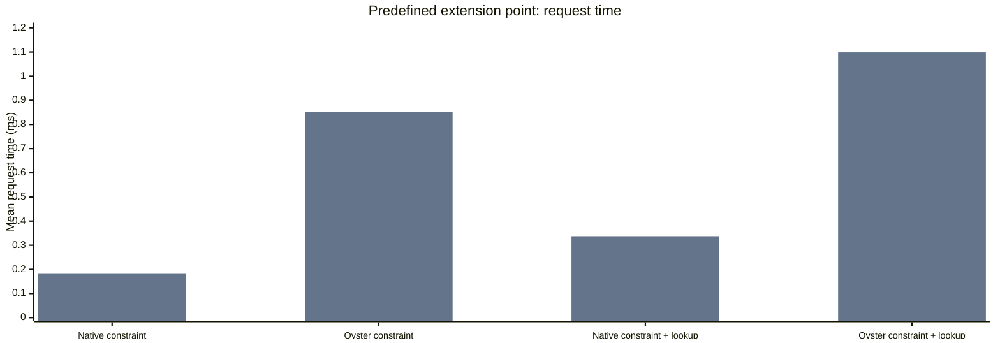

| Extension-point work | Native ms | Oyster ms | Extra ms |
| --- | --- | --- | --- |
| [constraint](source/srv/BenchmarkExtensionService/on-oysterValidation.js) | 0.184 | 0.852 | +0.668 |
| [constraint + lookup](source/srv/BenchmarkExtensionService/on-oysterValidationRead.js) | 0.338 | 1.099 | +0.761 |

Small, bounded extension points keep the isolation premium predictable. Reusing data already held by the application avoids additional database round trips.

Oyster handlers: [Oyster constraint](source/srv/BenchmarkExtensionService/on-oysterValidation.js), [Oyster constraint + lookup](source/srv/BenchmarkExtensionService/on-oysterValidationRead.js).

### Business constraint: accepted and rejected requests

Ordinary business constraints need little arithmetic. Their cost mainly comes from invoking the isolated handler and, when needed, retrieving additional data. These handlers check quantity × unitPrice against a fixed or queried limit.

Rejection is a normal business outcome and needs its own latency budget. Expected business rejections remain successful outcomes of this test. Accepted and rejected requests are compared separately, with persistence checks confirming the decision.

| Workload | Decision | Native ms | Oyster ms | Extra ms |
| --- | --- | --- | --- | --- |
| [Action](source/srv/BenchmarkService/on-oysterValidation.js) | accepted | 0.174 | 0.889 | +0.715 |
| [UPDATE](source/srv/BenchmarkService/OysterValidationWriteRows/before-UPDATE.js) | accepted | 0.52 | 1.26 | +0.74 |
| [Action through extension point](source/srv/BenchmarkExtensionService/on-oysterValidation.js) | rejected | 0.273 | 0.93 | +0.657 |
| [Action through extension point](source/srv/BenchmarkExtensionService/on-oysterValidation.js) | accepted | 0.184 | 0.852 | +0.668 |
| [INSERT](source/srv/BenchmarkService/OysterValidationWriteRows/before-CREATE.js) | accepted | 0.573 | 1.254 | +0.68 |
| [INSERT](source/srv/BenchmarkService/OysterValidationWriteRows/before-CREATE.js) | rejected | 0.262 | 0.989 | +0.728 |
| [UPDATE](source/srv/BenchmarkService/OysterValidationWriteRows/before-UPDATE.js) | rejected | 0.278 | 1.008 | +0.73 |
| [Action](source/srv/BenchmarkService/on-oysterValidation.js) | rejected | 0.23 | 0.954 | +0.723 |
| [Action with lookup](source/srv/BenchmarkService/on-oysterValidationRead.js) | accepted | 0.322 | 1.15 | +0.828 |
| [UPDATE with lookup](source/srv/BenchmarkService/OysterValidationReadWriteRows/before-UPDATE.js) | accepted | 0.631 | 1.502 | +0.871 |
| [Action through extension point with lookup](source/srv/BenchmarkExtensionService/on-oysterValidationRead.js) | rejected | 0.391 | 1.181 | +0.79 |
| [Action through extension point with lookup](source/srv/BenchmarkExtensionService/on-oysterValidationRead.js) | accepted | 0.338 | 1.099 | +0.761 |
| [INSERT with lookup](source/srv/BenchmarkService/OysterValidationReadWriteRows/before-CREATE.js) | accepted | 0.663 | 1.61 | +0.947 |
| [INSERT with lookup](source/srv/BenchmarkService/OysterValidationReadWriteRows/before-CREATE.js) | rejected | 0.385 | 1.221 | +0.836 |
| [UPDATE with lookup](source/srv/BenchmarkService/OysterValidationReadWriteRows/before-UPDATE.js) | rejected | 0.395 | 1.418 | +1.024 |
| [Action with lookup](source/srv/BenchmarkService/on-oysterValidationRead.js) | rejected | 0.369 | 1.218 | +0.849 |

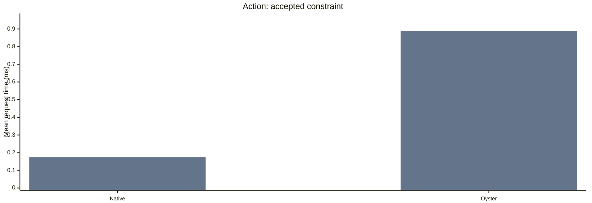

Oyster handlers: [Oyster constraint](source/srv/BenchmarkService/on-oysterValidation.js).

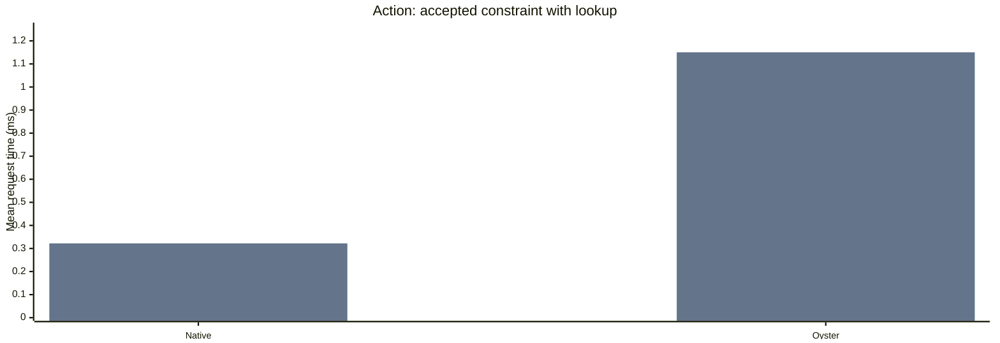

Oyster handlers: [Oyster constraint + lookup](source/srv/BenchmarkService/on-oysterValidationRead.js).

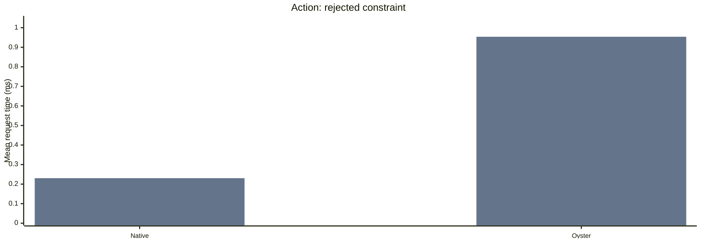

Oyster handlers: [Oyster constraint](source/srv/BenchmarkService/on-oysterValidation.js).

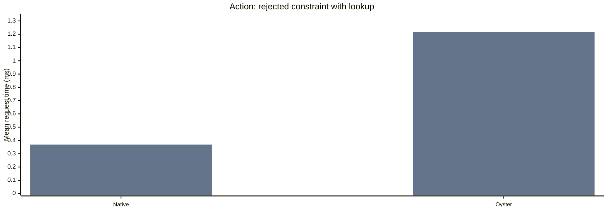

Oyster handlers: [Oyster constraint + lookup](source/srv/BenchmarkService/on-oysterValidationRead.js).

The added milliseconds describe these actual constraint handlers. Use accepted-request costs for normal request budgets and rejected-request costs when estimating rejected traffic. 3 paired runs; delta SD 0.025 ms.

| Application design | Added mean request time | Comparison |
| --- | --- | --- |
| Predefined extension points | +0.668 ms (4.63× native time) per accepted call, [amount constraint](source/srv/BenchmarkExtensionService/on-oysterValidation.js) | Equivalent native constraint handler |
| CRUD constraints on custom entities | [INSERT](source/srv/BenchmarkService/OysterValidationWriteRows/before-CREATE.js): +0.714 ms, [UPDATE](source/srv/BenchmarkService/OysterValidationWriteRows/before-UPDATE.js): +0.75 ms | Oyster enabled, generic CRUD without a handler |
| after-READ calculation on a large collection | [READ 1,000 rows from million-row table](source/srv/BenchmarkService/OysterCalculationLargeRows/after-READ.js): +17.268 ms (9.44× native time) | Equivalent native calculation handler |

The custom-entity comparison measures adding an accepted fixed-limit constraint to generic CRUD. It includes the additional quantity and unitPrice request fields. The native/Oyster constraint comparisons above use identical inputs.

These are individual SQLite constraint invocations. Measure the complete application to budget requests that invoke several handlers. Synthetic calculations below are stress workloads.

## 1. What is the typical overhead?

| Workload | Native empty ms | Oyster empty ms | Extra ms | Ratio |
| --- | --- | --- | --- | --- |
| [INSERT](source/srv/BenchmarkService/OysterEmptyWriteRows/before-CREATE.js) | 0.551 | 1.323 | +0.772 | 2.401× |
| [UPDATE](source/srv/BenchmarkService/OysterEmptyWriteRows/before-UPDATE.js) | 0.515 | 1.264 | +0.749 | 2.458× |
| [READ 10 rows from 1,000-row table](source/srv/BenchmarkService/OysterEmptySmallRows/after-READ.js) | 0.382 | 1.146 | +0.764 | 3.004× |
| [Action](source/srv/BenchmarkService/on-oysterNoop.js) | 0.168 | 0.847 | +0.679 | 5.046× |

Plugin installation and handler invocation are separate costs. Use the no-handler controls to assess the former and the empty-handler controls to budget the latter.

An empty handler measures the recurring cost of invoking Oyster without business calculation or auxiliary queries. It still crosses the sandbox boundary and carries request context. READ handlers also carry returned rows. Budget this starting cost for the data each extension receives.

Budget the added milliseconds against the application’s response-time target. Ratios alone exaggerate the impact when the native reference is very fast.

## 2. How does overhead change across scenarios?

The following comparisons add calculation, auxiliary database queries and invocation through a predefined extension point. Native and Oyster perform the same work in each comparison.

| Synthetic arithmetic workload | Native ms | Oyster ms | Extra ms |
| --- | --- | --- | --- |
| [Calculation action](source/srv/BenchmarkService/on-oysterCalculation.js) | 0.168 | 0.915 | +0.747 |

Repeated arithmetic amplifies the execution cost. Treat these as stress cases when assessing ordinary business constraints.

| Auxiliary query workload | Native ms | Oyster ms | Extra ms |
| --- | --- | --- | --- |
| [Action: CQL read](source/srv/BenchmarkService/on-oysterCqlRead.js) | 0.93 | 2.465 | +1.535 |
| [Action: CQL update](source/srv/BenchmarkService/on-oysterCqlWrite.js) | 0.912 | 2.389 | +1.477 |

All request-time differences include dispatch, handler work, query handling, response processing and transaction completion. They measure the overhead of the complete Oyster execution path.

| Small calculation workload | Native ms | Oyster ms | Extra ms |
| --- | --- | --- | --- |
| [INSERT](source/srv/BenchmarkService/OysterCalculationWriteRows/before-CREATE.js) | 0.549 | 1.298 | +0.748 |
| [UPDATE](source/srv/BenchmarkService/OysterCalculationWriteRows/before-UPDATE.js) | 0.511 | 1.26 | +0.75 |
| [READ 10 rows from million-row table](source/srv/BenchmarkService/OysterCalculationLargeRows/after-READ.js) | 0.386 | 1.303 | +0.917 |

| Calculation iterations | Native ms | Oyster ms | Extra ms | Ratio |
| --- | --- | --- | --- | --- |
| [100](source/srv/BenchmarkService/on-oysterCalculation.js) | 0.168 | 0.915 | +0.747 | 5.441× |
| [10,000](source/srv/BenchmarkService/on-oysterCalculation.js) | 0.188 | 2.284 | +2.096 | 12.168× |

| Predefined extension-point work | Extra Oyster ms |
| --- | --- |
| [empty handler](source/srv/BenchmarkExtensionService/on-oysterEmpty.js) | +0.676 |
| [CQL read](source/srv/BenchmarkExtensionService/on-oysterCqlRead.js) | +0.786 |
| [CQL write](source/srv/BenchmarkExtensionService/on-oysterCqlWrite.js) | +0.83 |

Keep predefined extension points narrow and reuse the caller’s data. Extra service calls and queries add work to the same request budget.

## 3. Which patterns increase overhead?

These comparisons examine result volume, repeated database callbacks and increasing concurrent demand.

### Repeated database callbacks

Each database callback requires query validation, CAP dispatch and data exchange. Comparing individual lookups with one query for the same records tests whether reducing these repeated steps lowers request time.

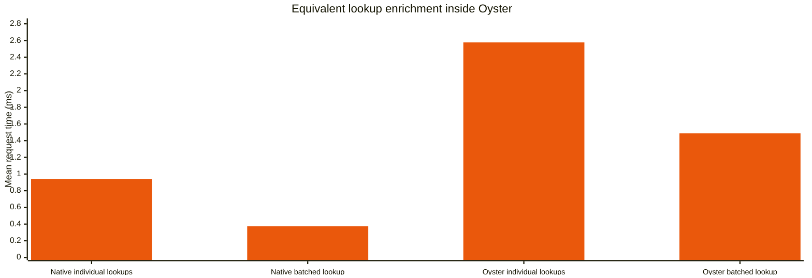

| Equivalent lookup work | Oyster ms |
| --- | --- |
| [Individual queries](source/srv/BenchmarkService/on-oysterLookupIndividual.js) | 2.577 |
| [One batch](source/srv/BenchmarkService/on-oysterLookupBatch.js) | 1.487 |

The same 10 distinct keys, columns, arithmetic and scalar result are preserved. -1.09 ms (-42.292%) is the matched difference.

The handlers reduce the query count from 10 query callbacks to one for equivalent work. Batching reduced time in this comparison. Allowing an extension to fetch the required records in one query reduces callbacks in this workload.

### What does an additional CQL callback cost?

CQL is CAP’s query language. A CQL callback asks CAP to execute an Oyster query and return its result. The 1-versus-10 action comparison keeps calculation and lookup shape fixed and adds nine sequential statements within one invocation.

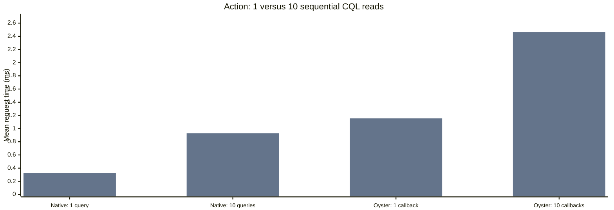

Oyster handlers: [Oyster CQL read](source/srv/BenchmarkService/on-oysterCqlRead.js).

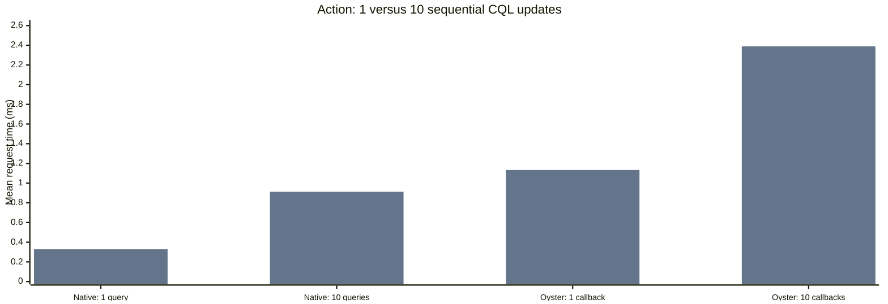

Oyster handlers: [Oyster CQL write](source/srv/BenchmarkService/on-oysterCqlWrite.js).

| Query work | Native ms per added query | Oyster ms per added callback | Extra Oyster ms per callback |
| --- | --- | --- | --- |
| [CQL read](source/srv/BenchmarkService/on-oysterCqlRead.js) | 0.067 | 0.146 | +0.078 |
| [CQL update](source/srv/BenchmarkService/on-oysterCqlWrite.js) | 0.065 | 0.14 | +0.075 |

Increment per statement = (10-statement time minus 1-statement time) / 9. Extra Oyster cost subtracts the native increment. This estimates the average cost of the **nine additional queries**, including database work and data transfer. It does not establish a constant internal callback timer.

### Large result sets and loops

Large results combine more row handling, more data transfer and potentially more calculation. Total stored table size and rows processed by an extension are different quantities. A ten-row indexed page can stay small even when its table contains one million rows.

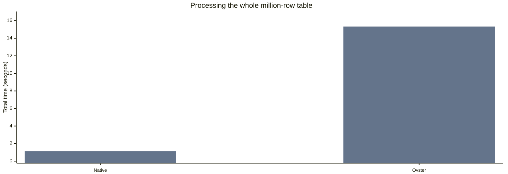

[Whole-dataset processing](source/srv/BenchmarkService/on-oysterScan.js) added **+14.208 seconds** across 3 paired runs. These are total elapsed seconds for all bounded action calls, rather than per-call milliseconds.

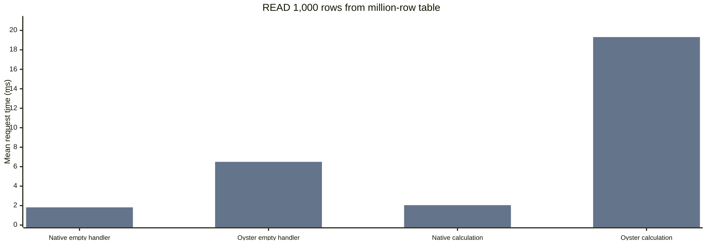

| Large-result work | Native ms | Oyster ms | Extra ms |
| --- | --- | --- | --- |
| Empty READ handler | 1.819 | 6.494 | +4.676 |
| READ with per-row arithmetic | 2.045 | 19.313 | +17.268 |

Oyster handlers: [Oyster empty handler](source/srv/BenchmarkService/OysterEmptyLargeRows/after-READ.js), [Oyster calculation](source/srv/BenchmarkService/OysterCalculationLargeRows/after-READ.js).

Transferring and handling 1,000 rows through an [empty Oyster handler](source/srv/BenchmarkService/OysterEmptyLargeRows/after-READ.js) costs about 5 ms extra in this run. Per-row arithmetic adds further overhead. Bound both the result size and the work per row.

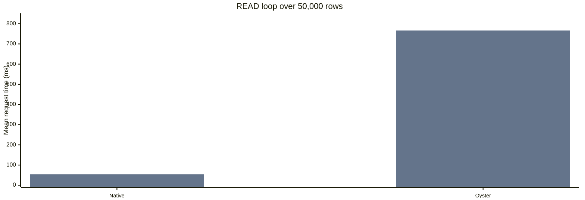

| Large-result work | Native ms | Oyster ms | Extra ms |
| --- | --- | --- | --- |
| [READ loop over 50,000 rows](source/srv/BenchmarkService/on-oysterScan.js) | 53.801 | 766.498 | +712.697 |

Oyster handlers: [Oyster calculation](source/srv/BenchmarkService/on-oysterScan.js).

Paging bounds each invocation’s payload, but a scan still processes the complete dataset. Use bounded pages and a separate latency budget for bulk work.

### Concurrent load and capacity

Oyster handlers: [Oyster CQL read: READ](source/srv/BenchmarkService/OysterCqlReadSmallRows/after-READ.js), [Oyster CQL read: INSERT](source/srv/BenchmarkService/OysterCqlReadWriteRows/before-CREATE.js), [Oyster CQL read: UPDATE](source/srv/BenchmarkService/OysterCqlReadWriteRows/before-UPDATE.js), [Oyster CQL read: action](source/srv/BenchmarkService/on-oysterCqlRead.js).

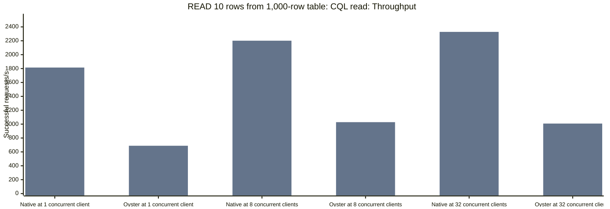

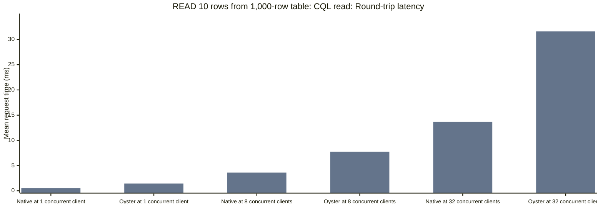

| Load | Native requests/s | Oyster requests/s | Native mean ms | Oyster mean ms | Extra mean ms | Native p95 ms | Oyster p95 ms | Extra p95 ms |
| --- | --- | --- | --- | --- | --- | --- | --- | --- |
| 1 concurrent client | 1814.817 | 688.579 | 0.539 | 1.434 | +0.895 | 0.803 | 1.788 | +0.985 |
| 8 concurrent clients | 2201.354 | 1028.43 | 3.618 | 7.749 | +4.131 | 6.013 | 9.16 | +3.147 |
| 32 concurrent clients | 2328.26 | 1008.083 | 13.695 | 31.606 | +17.911 | 22.373 | 37.179 | +14.806 |

Oyster benefits from concurrent requests and sustains near-peak throughput at 32 concurrent clients.

The throughput plateau means that additional clients mainly increase request latency. Limit in-flight work around the throughput knee instead of raising concurrency to chase more capacity.

The per-request delta shows how Oyster’s added latency changes with load. Use it with the complete round-trip time and throughput to choose a concurrency limit.

Recorded higher-load failures: 0. Successful response latency excludes failed or unsuitable runs. The load generator sends the next request after a response; these are closed-loop concurrency measurements on one machine with local SQLite. They do not establish independently scheduled arrival-rate capacity or horizontal scaling across servers.

## 4. How do measured costs relate to Oyster’s runtime work?

During an Oyster invocation, a request crosses an isolation boundary, the handler executes as JavaScript inside WebAssembly, and its result must be reintegrated into CAP. Database callbacks additionally validate service-scoped queries, preserve the CAP request context, execute through the service and return encoded results. The runtime also applies configured resource limits and propagates handler errors back to CAP.

The native reference executes in Node.js. Oyster evaluates the handler JavaScript inside its prebuilt WASM framework. The runtime reuses the framework and supports concurrent execution. These measurements do not identify sandbox pool size or utilization. The measured warm phase covers repeated invocations and CAP integration. Startup, initial framework loading and warmup precede it.

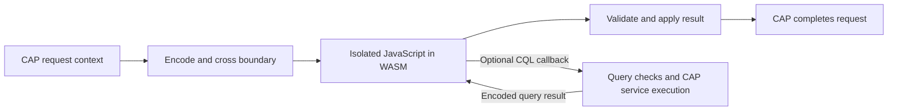

The recurring premium covers isolation and CAP integration. Keep extension boundaries small, reuse available data, and reduce service round trips before optimizing short arithmetic expressions.

Large-result and scan measurements cover row handling and calculation as well as invocation. Restricting rows and fields passed to an extension reduces the data it must handle. Bulk processing needs a separate latency budget because the empty-handler increment does not describe that workload.

### Application design choices

| Application design choice | Reason from this benchmark |
| --- | --- |
| Define extension points with limits on input and result size. | The empty-handler and large-result controls measure the cost of an invocation and the additional work of handling returned rows. |
| Pass data already available to the application and allow bounded queries for additional records. | The individual-versus-batch comparison tests the cost of fetching equivalent data with fewer callbacks. The custom logic still runs in Oyster. |
| Measure per-record invocation and whole-dataset processing before exposing those interfaces. | Large-result and scan costs are measured. Repeated per-record invocation is a separate workload that this test run does not quantify. |
| Set latency and concurrency budgets for representative extension workloads. | Use throughput to identify the capacity knee and added request time to assess its latency cost. |

These measurements describe the tested CAP and Oyster versions on one host with SQLite. They do not compare alternative isolation runtimes or establish production HANA performance.

## Evidence quality and remaining measurements

| Question | Evidence status |
| --- | --- |
| Marginal CQL callback cost | Matched 1-versus-10 query observations are present. Repeat before generalizing the increment. |
| Equivalent lookup batching | 3 paired runs; delta SD 0.125 ms |
| Bulk result handling versus added calculation | Matching empty and calculation handlers compare the result-handling path with per-row arithmetic. Internal components are not individually timed. |
| Independent variability | 3 repetitions configured. Detailed results list actual matched repetition counts. |
| Other workloads and horizontal scaling | Heavy-load conclusions apply to the named workloads. Multi-server scaling is not measured. |

## Run setup and reproduction

| Recorded setting | Value |
| --- | --- |
| Run | bench-2026-11-06T14-21-27-043Z |
| Hardware / OS | Apple M2 Pro / darwin / arm64 |
| Node / CAP / Oyster / SQLite adapter | v22.18.0 / 10.2.2 / 0.5.6 / 3.1.2 |
| Protocol / repetitions | long / 3 |
| Warmup / measured seconds per case | 3 / 10 |
| Validation | Passed |

Both app copies use the same model and retained CSVs. The CDS CLI deploys SQLite while CAP is stopped. Fixed projections and stored handlers are reused across cases; writes rotate seeded rows and allocate distinct keys. Native and Oyster handlers share the app with Oyster installed; the plain CAP control omits the plugin. Server startup and warmup are outside measured request time.

Run npm install and npm run benchmark for short, or npm run benchmark:long for repeated/larger workloads. The [README](../../README.md) gives complete operator instructions. The runner starts and stops CAP and the load generator.

This example contains the main report and source snapshots of its linked Oyster handlers. [Native handlers](source/srv/benchmark-service.js), [extension-point delegation](source/srv/extension-service.js), [constraint checks](source/lib/validation.js) and [calculation helpers](source/lib/workload.js) show the matching application code. These results use the recorded local working tree. Complete per-case details, measurements and raw timings remain in the local result directory `reports/bench-2026-11-06T14-21-27-043Z/`.
