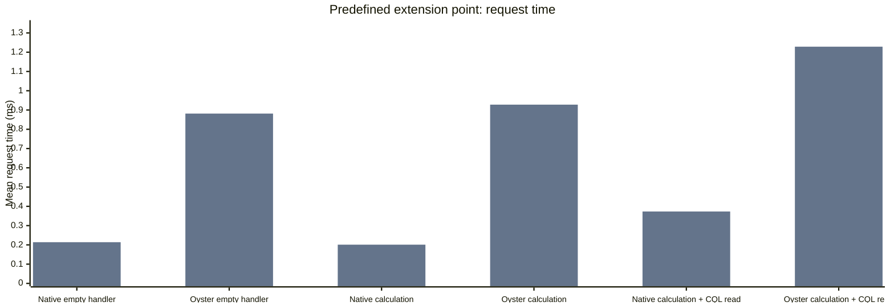
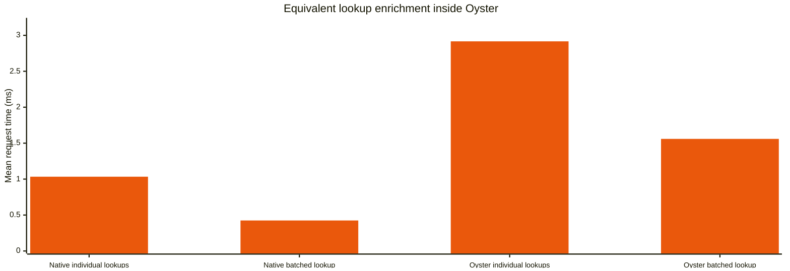
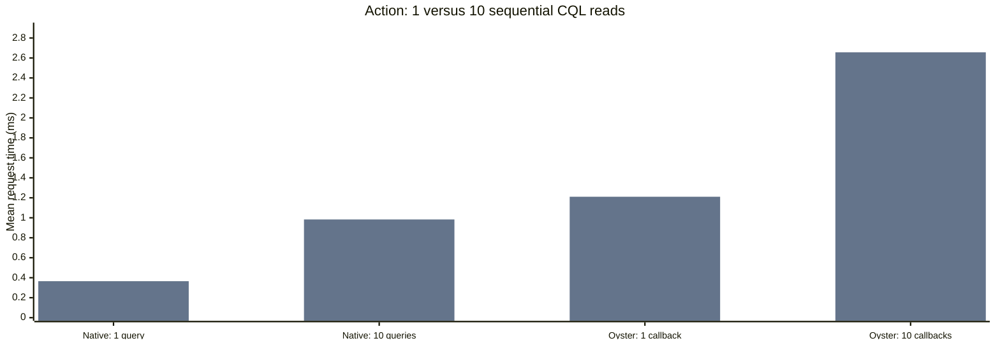
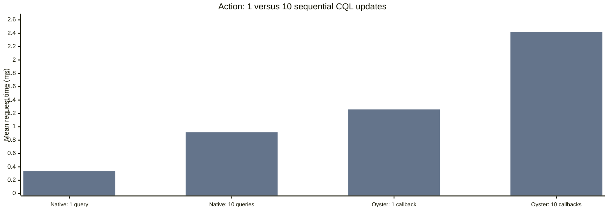
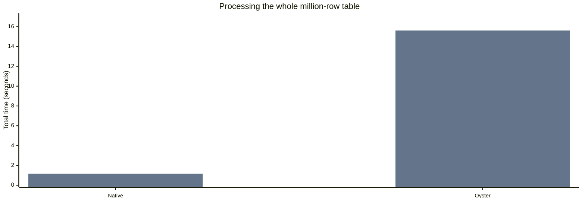
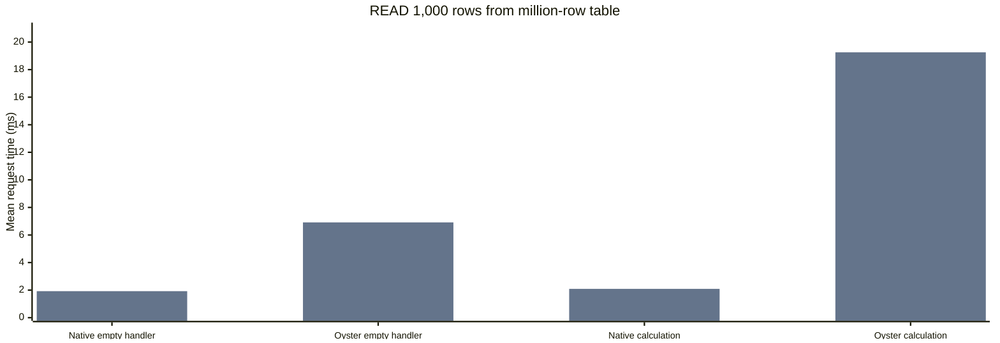
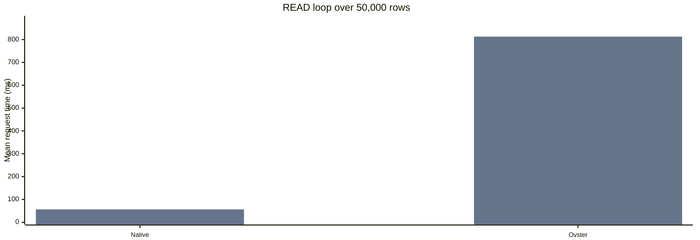
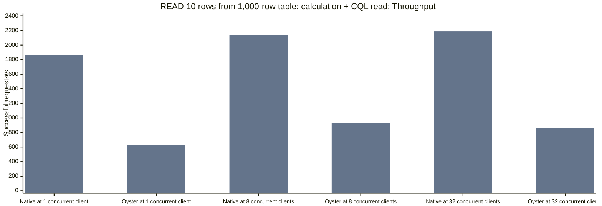
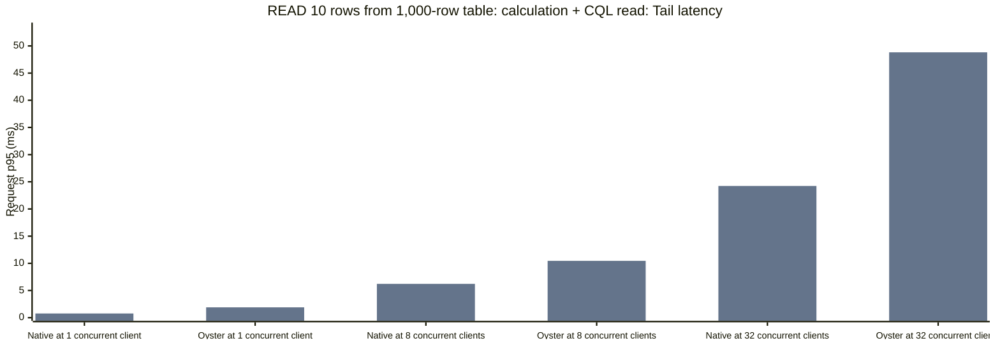
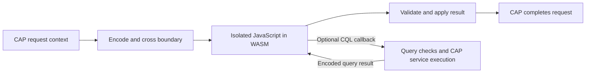

# CDS-Oyster performance results

CDS-Oyster provides the isolated WebAssembly (WASM) runtime required for business logic from untrusted sources in SAP Cloud Application Programming Model (CAP). This report compares response time, throughput and server CPU demand for equivalent native JavaScript and Oyster handlers. Native execution is the measurement reference. Untrusted logic runs in Oyster. A handler is custom code invoked for a data request or service action.

**Blue: native. Orange: Oyster. Gray: no-handler controls.** Vertical bars show absolute measurements. Lower latency means shorter response time. Higher throughput means more requests completed per second. p95 is the response time within which 95% of successful requests completed. Throughput is successful requests per second.

## Application-level impact

Each test action invokes one predefined extension point. The bars show mean response time for the complete request. CQL is CAP’s query language. An Oyster CQL callback asks CAP to run a database query and return its result.

Oyster handlers: [Oyster empty handler](../../srv/BenchmarkExtensionService/on-oysterEmpty.js), [Oyster calculation](../../srv/BenchmarkExtensionService/on-oysterCalculation.js), [Oyster calculation + CQL read](../../srv/BenchmarkExtensionService/on-oysterCqlRead.js).

**One small extension-point call added +0.727 to +0.902 ms** compared with the same work in a native handler. The tested work was an arithmetic calculation, with zero or one auxiliary database query.

| Application design | Added mean request time | Comparison |
| --- | --- | --- |
| Predefined extension points | +0.727 to +0.902 ms per call. [calculation](../../srv/BenchmarkExtensionService/on-oysterCalculation.js), [calculation + CQL read](../../srv/BenchmarkExtensionService/on-oysterCqlRead.js), [calculation + CQL write](../../srv/BenchmarkExtensionService/on-oysterCqlWrite.js). | Equivalent native handler |
| CRUD handlers on custom entities | [INSERT](../../srv/BenchmarkService/OysterCalculationWriteRows/before-CREATE.js): +0.772 ms, [UPDATE](../../srv/BenchmarkService/OysterCalculationWriteRows/before-UPDATE.js): +0.74 ms, [READ (10 rows)](../../srv/BenchmarkService/OysterCalculationSmallRows/after-READ.js): +0.948 ms. Small calculation, no auxiliary queries. | Oyster enabled and no handler |
| after-READ calculation on a large collection | [READ 1,000 rows from million-row table](../../srv/BenchmarkService/OysterCalculationLargeRows/after-READ.js): +17.163 ms (9.211× native time). 100 calculation iterations per returned row. | Equivalent native handler |

**Illustrative request:** a request taking 100 ms with native handlers, including one [calculation + CQL read](../../srv/BenchmarkExtensionService/on-oysterCqlRead.js) extension-point call, would take about **100.855 ms (+0.855%)** with that call running in Oyster, if the measured increment carries over. The 100 ms baseline is assumed.

These are low-load SQLite measurements of individual handlers. A complete business application, multiple extension calls in one request, and registration and startup costs were not measured. Throughput and CPU demand under concurrent load are analyzed below.

**Run completed with missing measurements:** all 279 ordinary cases and six whole-table scans ran. Sixteen ordinary cases produced no HTTP measurement summary. Those records are excluded from overhead comparisons. All six whole-table scans passed validation.

## 1. What is the typical overhead?

| Workload | Native empty ms | Oyster empty ms | Extra ms | Ratio | Paired runs |
| --- | --- | --- | --- | --- | --- |
| [INSERT](../../srv/BenchmarkService/OysterEmptyWriteRows/before-CREATE.js) | 0.533 | 1.23 | +0.697 | 2.31× | 3 |
| [UPDATE](../../srv/BenchmarkService/OysterEmptyWriteRows/before-UPDATE.js) | 0.539 | 1.292 | +0.754 | 2.401× | 3 |
| [READ 10 rows from 1,000-row table](../../srv/BenchmarkService/OysterEmptySmallRows/after-READ.js) | 0.424 | 1.256 | +0.832 | 2.982× | 3 |

Enabling Oyster without invoking a handler changed the matched request times by 0.009 to 0.058 ms across the measured controls. Invocation adds a separate cost; these data do not prove enabling the plugin has zero cost.

An empty handler measures the recurring cost of invoking Oyster without business calculation or auxiliary queries. It still crosses the sandbox boundary and carries request context; READ handlers also carry returned rows. This is a workload-dependent starting cost, rather than a constant charge for every extension.

The ratio and the absolute increment answer different questions. A large ratio can result from a small native response time. Compare the added milliseconds with the application’s response-time budget, and assess server CPU demand separately.

## 2. How does overhead change across scenarios?

The following comparisons add calculation, auxiliary database queries and invocation through a predefined extension point. Native and Oyster perform the same work in each comparison.

The 10,000-iteration [scalar calculation action](../../srv/BenchmarkService/on-oysterCalculation.js) took 0.202 ms native and 2.391 ms Oyster: +2.188 ms (11.832× native time). The result applies to this arithmetic workload. Other calculations require their own measurements.

| Calculation plus auxiliary query | Native ms | Oyster ms | Extra ms |
| --- | --- | --- | --- |
| [Action: CQL read](../../srv/BenchmarkService/on-oysterCqlRead.js) | 0.365 | 1.211 | +0.845 |
| [Action: CQL update](../../srv/BenchmarkService/on-oysterCqlWrite.js) | 0.335 | 1.261 | +0.926 |

All request-time differences include dispatch, handler work, query handling, response processing and transaction completion. They measure the overhead of the complete Oyster execution path.

| Small calculation workload | Native ms | Oyster ms | Extra ms |
| --- | --- | --- | --- |
| [INSERT](../../srv/BenchmarkService/OysterCalculationWriteRows/before-CREATE.js) | 0.573 | 1.319 | +0.746 |
| [UPDATE](../../srv/BenchmarkService/OysterCalculationWriteRows/before-UPDATE.js) | 0.569 | 1.283 | +0.714 |
| [READ 10 rows from 1,000-row table](../../srv/BenchmarkService/OysterCalculationSmallRows/after-READ.js) | 0.407 | 1.371 | +0.964 |

| Predefined extension-point work | Extra Oyster ms | Paired runs |
| --- | --- | --- |
| [empty handler](../../srv/BenchmarkExtensionService/on-oysterEmpty.js) | +0.668 | 3 |
| [calculation](../../srv/BenchmarkExtensionService/on-oysterCalculation.js) | +0.727 | 3 |
| [calculation + CQL read](../../srv/BenchmarkExtensionService/on-oysterCqlRead.js) | +0.855 | 3 |
| [calculation + CQL write](../../srv/BenchmarkExtensionService/on-oysterCqlWrite.js) | +0.902 | 3 |

A predefined extension point is an action the application declares for custom logic. These comparisons include the application calling a second CAP service to invoke that logic. They measure the complete routed path. They do not isolate routing cost or show that this route is faster than a direct handler.

## 3. Which patterns increase overhead?

These comparisons examine result volume, repeated database callbacks and increasing concurrent demand.

### Repeated database callbacks

Each database callback requires query validation, CAP dispatch and data exchange. Comparing individual lookups with one query for the same records tests whether reducing these repeated steps lowers request time.

The same 10 distinct keys, columns, arithmetic and scalar result took 2.916 ms with [individual queries](../../srv/BenchmarkService/on-oysterLookupIndividual.js) and 1.559 ms in [one batch](../../srv/BenchmarkService/on-oysterLookupBatch.js): -1.357 ms (-45.725%). 3 paired runs; delta SD 0.458 ms.

The handlers reduce the query count from 10 query callbacks to one for equivalent work. Batching reduced time in this comparison. Allowing an extension to fetch the required records in one query reduces callbacks in this workload.

### What does an additional CQL callback cost?

CQL is CAP’s query language. A CQL callback asks CAP to execute an Oyster query and return its result. The 1-versus-10 action comparison keeps calculation and lookup shape fixed and adds nine sequential statements within one invocation.

Oyster handlers: [Oyster calculation + CQL read](../../srv/BenchmarkService/on-oysterCqlRead.js).

Oyster handlers: [Oyster calculation + CQL write](../../srv/BenchmarkService/on-oysterCqlWrite.js).

| Query work | Native ms per added query | Oyster ms per added callback | Extra Oyster ms per callback | Paired runs |
| --- | --- | --- | --- | --- |
| [CQL read](../../srv/BenchmarkService/on-oysterCqlRead.js) | 0.069 | 0.161 | +0.092 | 3 |
| [CQL update](../../srv/BenchmarkService/on-oysterCqlWrite.js) | 0.065 | 0.129 | +0.064 | 3 |

Increment per statement = (10-statement time minus 1-statement time) / 9. Extra Oyster cost subtracts the native increment. This estimates the average cost of the **nine additional queries**, including database work and data transfer. It does not establish a constant internal callback timer.

### Large result sets and loops

Large results combine more row handling, more data transfer and potentially more calculation. Total stored table size and rows processed by an extension are different quantities. A ten-row indexed page can stay small even when its table contains one million rows.

[Whole-dataset processing](../../srv/BenchmarkService/on-oysterScan.js) added **+14.452 seconds** across 3 paired runs. These are total elapsed seconds for all bounded action calls, rather than per-call milliseconds.

[READ 1,000 rows from million-row table](../../srv/BenchmarkService/OysterCalculationLargeRows/after-READ.js) added **+17.163 ms (9.211× native time)** with 100 calculation iterations per row. 3 paired runs; delta SD 0.256 ms.

Oyster handlers: [Oyster empty handler](../../srv/BenchmarkService/OysterEmptyLargeRows/after-READ.js), [Oyster calculation](../../srv/BenchmarkService/OysterCalculationLargeRows/after-READ.js).

A limit on rows passed to a READ handler or action bounds the amount of work within that call. Paging limits each payload, but the complete scan still processes every row.

[READ loop over 50,000 rows](../../srv/BenchmarkService/on-oysterScan.js) added **+756.392 ms (14.411× native time)** with 100 calculation iterations per row. 3 paired runs; delta SD 26.487 ms.

Oyster handlers: [Oyster calculation](../../srv/BenchmarkService/on-oysterScan.js).

A limit on rows passed to a READ handler or action bounds the amount of work within that call. Paging limits each payload, but the complete scan still processes every row.

With matching large-result empty handlers, adding [calculation](../../srv/BenchmarkService/OysterCalculationLargeRows/after-READ.js) changed Oyster time by +12.34 ms and native time by +0.166 ms. Matched repetition pairs: 3.

Passing and handling 1,000 rows through an [empty Oyster handler](../../srv/BenchmarkService/OysterEmptyLargeRows/after-READ.js) already adds +4.99 ms versus native. The [arithmetic and checksum changes](../../srv/BenchmarkService/OysterCalculationLargeRows/after-READ.js) add another +12.174 ms beyond the native calculation increment. Result volume and calculation per row both contribute to the measured increment. These controls compare complete paths. They do not time serialization or interpreter components separately.

### Concurrent load and capacity

Oyster handlers: [Oyster calculation + CQL read: READ](../../srv/BenchmarkService/OysterCqlReadSmallRows/after-READ.js), [Oyster calculation + CQL read: INSERT](../../srv/BenchmarkService/OysterCqlReadWriteRows/before-CREATE.js), [Oyster calculation + CQL read: UPDATE](../../srv/BenchmarkService/OysterCqlReadWriteRows/before-UPDATE.js), [Oyster calculation + CQL read: action](../../srv/BenchmarkService/on-oysterCqlRead.js).

| Load | Native requests/s | Oyster requests/s | Native p95 ms | Oyster p95 ms | Native CPU cores | Oyster CPU cores |
| --- | --- | --- | --- | --- | --- | --- |
| 1 concurrent client | 1861.894 | 627.095 | 0.773 | 1.902 | 0.982 | 1.032 |
| 8 concurrent clients | 2140.159 | 927.164 | 6.223 | 10.456 | 1.112 | 1.48 |
| 32 concurrent clients | 2187.192 | 861.089 | 24.238 | 48.821 | 1.082 | 1.458 |

[READ 10 rows from 1,000-row table: calculation + CQL read: READ](../../srv/BenchmarkService/OysterCqlReadSmallRows/after-READ.js), [READ 10 rows from 1,000-row table: calculation + CQL read: INSERT](../../srv/BenchmarkService/OysterCqlReadWriteRows/before-CREATE.js), [READ 10 rows from 1,000-row table: calculation + CQL read: UPDATE](../../srv/BenchmarkService/OysterCqlReadWriteRows/before-UPDATE.js), [READ 10 rows from 1,000-row table: calculation + CQL read: action](../../srv/BenchmarkService/on-oysterCqlRead.js). From 8 concurrent clients to 32 concurrent clients, Oyster throughput changed -7.127%; p95 changed from 10.456 to 48.821 ms. Comparisons use the same independent repetitions at every load.

Additional concurrency did not increase observed Oyster throughput and increased tail latency in this range. The measurements show a throughput plateau in this range but do not identify the limiting resource. Capacity planning therefore needs the target workload and response-time limit. Increasing concurrent requests can increase waiting time without increasing completed work.

At 32 concurrent clients, measured server CPU cost per successful request was 0.496 ms native and 1.704 ms [Oyster: READ](../../srv/BenchmarkService/OysterCqlReadSmallRows/after-READ.js), [Oyster: INSERT](../../srv/BenchmarkService/OysterCqlReadWriteRows/before-CREATE.js), [Oyster: UPDATE](../../srv/BenchmarkService/OysterCqlReadWriteRows/before-UPDATE.js), [Oyster: action](../../srv/BenchmarkService/on-oysterCqlRead.js) (3.431×). CPU cores equal CPU percent / 100; CPU milliseconds per request equal CPU percent × 10 / successful requests per second. This measures process resource cost, not only handler execution.

Recorded higher-load failures: 0. Successful response latency excludes failed or unsuitable runs. The load generator sends the next request after a response; these are closed-loop concurrency measurements on one machine with local SQLite. They do not establish independently scheduled arrival-rate capacity or horizontal scaling across servers.

## 4. How do measured costs relate to Oyster’s runtime work?

During an Oyster invocation, a request crosses an isolation boundary, the handler executes as JavaScript inside WebAssembly, and its result must be reintegrated into CAP. Database callbacks additionally validate service-scoped queries, preserve the CAP request context, execute through the service and return encoded results. The runtime also applies configured resource limits and propagates handler errors back to CAP.

The native reference executes in Node.js; Oyster evaluates the handler JavaScript inside its WASM framework. The framework is prebuilt and reused. The measured warm phase covers repeated sandbox invocations and CAP integration; startup, initial framework loading and warmup precede it. The benchmark measures the complete path, with no separate timer for each internal component.

For the lightweight empty-handler workloads, the extra request time is 0.697 to 0.832 ms in this test run. This is the combined increment for the measured isolation and CAP integration path. Whether it fits an application depends on that application’s response-time budget. It does not quantify each internal step or predict the cost of larger inputs and calculations.

Large-result and scan measurements cover row handling and calculation as well as invocation. Restricting rows and fields passed to an extension reduces the data it must handle. Bulk processing needs a separate latency and CPU budget because the empty-handler increment does not describe that workload.

At 32 concurrent clients, [Oyster: READ](../../srv/BenchmarkService/OysterCqlReadSmallRows/after-READ.js), [Oyster: INSERT](../../srv/BenchmarkService/OysterCqlReadWriteRows/before-CREATE.js), [Oyster: UPDATE](../../srv/BenchmarkService/OysterCqlReadWriteRows/before-UPDATE.js), [Oyster: action](../../srv/BenchmarkService/on-oysterCqlRead.js) required 3.431× the native server CPU time per successful request for the named workload. The extra response time at light load therefore does not describe server capacity. Use the measured throughput, p95 and CPU demand together when sizing this workload.

### Application design choices

| Application design choice | Reason from this benchmark |
| --- | --- |
| Define extension points with limits on input and result size. | The empty-handler and large-result controls measure the cost of an invocation and the additional work of handling returned rows. |
| Pass data already available to the application and allow bounded queries for additional records. | The individual-versus-batch comparison tests the cost of fetching equivalent data with fewer callbacks. The custom logic still runs in Oyster. |
| Measure per-record invocation and whole-dataset processing before exposing those interfaces. | Large-result and scan costs are measured. Repeated per-record invocation is a separate workload that this test run does not quantify. |
| Set response-time and CPU budgets for representative extension workloads. | The load comparison reports latency and CPU demand separately. An empty-handler increment alone cannot establish capacity for another workload. |

These measurements describe the tested CAP and Oyster versions on one host with SQLite. They do not compare alternative isolation runtimes or establish production HANA performance.

## Evidence quality and remaining measurements

| Question | Evidence status |
| --- | --- |
| Marginal CQL callback cost | Matched 1-versus-10 query observations are present. Repeat before generalizing the increment. |
| Equivalent lookup batching | 3 paired runs; delta SD 0.458 ms |
| Bulk result handling versus added calculation | Matching empty and calculation handlers compare the result-handling path with added arithmetic and checksum work. Internal components are not individually timed. |
| Independent variability | 3 repetitions configured; paired run counts show actual available evidence. |
| Other workloads and horizontal scaling | Heavy-load conclusions apply to the named workloads. Multi-server scaling is not measured. |

## Run setup and reproduction

| Recorded setting | Value |
| --- | --- |
| Run | bench-2026-11-05T21-37-42-410Z |
| Hardware / OS | Apple M2 Pro / darwin / arm64 |
| Node / CAP / Oyster / SQLite adapter | v22.18.0 / 10.2.2 / 0.5.6 / 3.1.2 |
| Protocol / repetitions | long / 3 |
| Warmup / measured seconds per case | 3 / 10 |
| Validation | Failed or incomplete |

Both app copies use the same model and retained CSVs. The CDS CLI deploys SQLite while CAP is stopped. Fixed projections and stored handlers are reused across cases; writes rotate seeded rows and allocate distinct keys. Native and Oyster handlers share the app with Oyster installed; the plain CAP control omits the plugin. Server startup and warmup are outside measured request time.

Run npm install and npm run benchmark for short, or npm run benchmark:long for repeated/larger workloads. The [README](../../README.md) gives complete operator instructions. The runner starts and stops CAP and the load generator.

This reference contains the report only. Running the benchmark produces the complete per-case details, saved measurements and raw timings.
