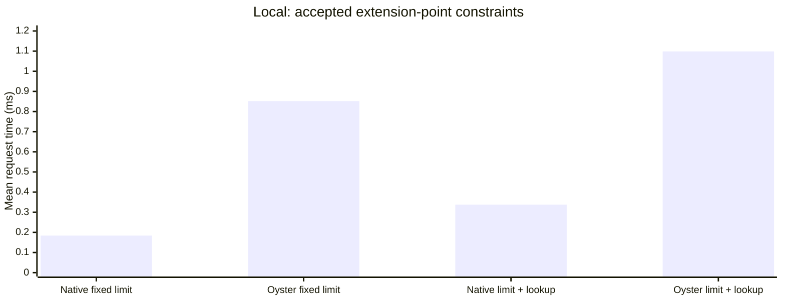
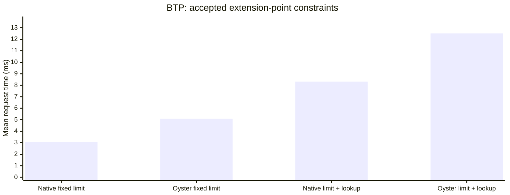

# Oyster Performance

| Local short | Local long | BTP short | BTP long |
| --- | --- | --- | --- |
| [Report](local-short-2026-11-06.md) | [Report](local-long-2026-11-06.md) | [Report](btp-short-2026-11-07.md) | [Report](btp-long-2026-11-07.md) |

Ordinary business constraints add **0.657–1.024 ms locally** and **1.679–4.362 ms in BTP**, compared with equivalent native logic in the selected long runs. Empty invocations, large returned results, database callbacks and concurrent traffic have different costs and need separate latency budgets.

SAP Cloud Application Programming Model (CAP) supplies the services. CDS-Oyster runs untrusted extension logic in an isolated WebAssembly runtime. Native JavaScript provides the measurement reference for equivalent work. These findings help application owners define extension points and bound the data and work each invocation receives.

The opening table uses one concurrent client and the long runs. Each native/Oyster pair shares its workload, database and request path within its environment. Extra milliseconds are Oyster minus native. Percentages are calculated within each repetition pair, then averaged with equal weights. Both absolute times are retained so the overhead can be assessed against the request baseline.

| Work per request | Local native ms | Local Oyster ms | Local extra ms | Local overhead | BTP native ms | BTP Oyster ms | BTP extra ms | BTP overhead |
| --- | --- | --- | --- | --- | --- | --- | --- | --- |
| [Empty action](../apps/extension/srv/BenchmarkService/on-oysterNoop.js) | 0.168 | 0.847 | +0.679 | +404.6% | 2.618 | 4.866 | +2.248 | +89.0% |
| [INSERT, accepted](../apps/extension/srv/BenchmarkService/OysterValidationWriteRows/before-CREATE.js) | 0.573 | 1.254 | +0.680 | +119.4% | 14.300 | 17.400 | +3.100 | +22.1% |
| [UPDATE, accepted](../apps/extension/srv/BenchmarkService/OysterValidationWriteRows/before-UPDATE.js) | 0.520 | 1.260 | +0.740 | +142.3% | 14.510 | 16.189 | +1.679 | +11.7% |
| [Predefined extension point, accepted](../apps/extension/srv/BenchmarkExtensionService/on-oysterValidation.js) | 0.184 | 0.852 | +0.668 | +363.0% | 3.091 | 5.098 | +2.008 | +74.4% |
| [Predefined extension point + lookup, accepted](../apps/extension/srv/BenchmarkExtensionService/on-oysterValidationRead.js) | 0.338 | 1.099 | +0.761 | +225.6% | 8.321 | 12.511 | +4.190 | +50.4% |
| [READ 1,000 rows, empty after handler](../apps/extension/srv/BenchmarkService/OysterEmptyLargeRows/after-READ.js) | 1.819 | 6.494 | +4.676 | +257.2% | 19.149 | 30.728 | +11.579 | +60.6% |

These are measured individual handler paths. A complete application request that composes multiple extension points is not measured here. Use the added milliseconds alongside that application’s own native request time.

**Blue: native. Orange: Oyster.** Lower bars mean shorter request times.

## Ordinary constraints and empty handlers

Each constraint checks quantity × unitPrice against 1,000. The lookup variant retrieves the limit with one query. Accepted writes persist data; rejected writes return the expected HTTP 400 response and leave stored rows unchanged. Expected business rejections count as successful test outcomes. Request shape and persistence affect the native baseline, so one percentage cannot describe every path.

| Work per request | Local native ms | Local Oyster ms | Local extra ms | Local overhead | BTP native ms | BTP Oyster ms | BTP extra ms | BTP overhead |
| --- | --- | --- | --- | --- | --- | --- | --- | --- |
| [INSERT, accepted](../apps/extension/srv/BenchmarkService/OysterValidationWriteRows/before-CREATE.js) | 0.573 | 1.254 | +0.680 | +119.4% | 14.300 | 17.400 | +3.100 | +22.1% |
| [INSERT, rejected](../apps/extension/srv/BenchmarkService/OysterValidationWriteRows/before-CREATE.js) | 0.262 | 0.989 | +0.728 | +279.1% | 3.219 | 6.591 | +3.372 | +108.0% |
| [UPDATE, accepted](../apps/extension/srv/BenchmarkService/OysterValidationWriteRows/before-UPDATE.js) | 0.520 | 1.260 | +0.740 | +142.3% | 14.510 | 16.189 | +1.679 | +11.7% |
| [UPDATE, rejected](../apps/extension/srv/BenchmarkService/OysterValidationWriteRows/before-UPDATE.js) | 0.278 | 1.008 | +0.730 | +262.7% | 3.384 | 6.271 | +2.887 | +89.9% |
| [Action, accepted](../apps/extension/srv/BenchmarkService/on-oysterValidation.js) | 0.174 | 0.889 | +0.715 | +412.0% | 2.717 | 5.089 | +2.372 | +93.4% |
| [Action, rejected](../apps/extension/srv/BenchmarkService/on-oysterValidation.js) | 0.230 | 0.954 | +0.723 | +314.3% | 2.929 | 5.781 | +2.852 | +98.7% |
| [Predefined extension point, accepted](../apps/extension/srv/BenchmarkExtensionService/on-oysterValidation.js) | 0.184 | 0.852 | +0.668 | +363.0% | 3.091 | 5.098 | +2.008 | +74.4% |
| [Predefined extension point, rejected](../apps/extension/srv/BenchmarkExtensionService/on-oysterValidation.js) | 0.273 | 0.930 | +0.657 | +240.8% | 3.974 | 5.937 | +1.962 | +50.0% |
| [INSERT + lookup, accepted](../apps/extension/srv/BenchmarkService/OysterValidationReadWriteRows/before-CREATE.js) | 0.663 | 1.610 | +0.947 | +142.3% | 18.062 | 20.127 | +2.065 | +11.9% |
| [INSERT + lookup, rejected](../apps/extension/srv/BenchmarkService/OysterValidationReadWriteRows/before-CREATE.js) | 0.385 | 1.221 | +0.836 | +216.9% | 10.081 | 12.508 | +2.426 | +24.1% |
| [UPDATE + lookup, accepted](../apps/extension/srv/BenchmarkService/OysterValidationReadWriteRows/before-UPDATE.js) | 0.631 | 1.502 | +0.871 | +138.3% | 17.038 | 20.323 | +3.285 | +19.6% |
| [UPDATE + lookup, rejected](../apps/extension/srv/BenchmarkService/OysterValidationReadWriteRows/before-UPDATE.js) | 0.395 | 1.418 | +1.024 | +259.7% | 9.523 | 13.885 | +4.362 | +46.1% |
| [Action + lookup, accepted](../apps/extension/srv/BenchmarkService/on-oysterValidationRead.js) | 0.322 | 1.150 | +0.828 | +257.2% | 9.645 | 12.466 | +2.821 | +29.4% |
| [Action + lookup, rejected](../apps/extension/srv/BenchmarkService/on-oysterValidationRead.js) | 0.369 | 1.218 | +0.849 | +230.4% | 10.123 | 13.437 | +3.314 | +32.8% |
| [Predefined extension point + lookup, accepted](../apps/extension/srv/BenchmarkExtensionService/on-oysterValidationRead.js) | 0.338 | 1.099 | +0.761 | +225.6% | 8.321 | 12.511 | +4.190 | +50.4% |
| [Predefined extension point + lookup, rejected](../apps/extension/srv/BenchmarkExtensionService/on-oysterValidationRead.js) | 0.391 | 1.181 | +0.790 | +201.9% | 9.601 | 12.578 | +2.977 | +30.8% |

| Work per request | Local native ms | Local Oyster ms | Local extra ms | Local overhead | BTP native ms | BTP Oyster ms | BTP extra ms | BTP overhead |
| --- | --- | --- | --- | --- | --- | --- | --- | --- |
| [Empty INSERT before handler](../apps/extension/srv/BenchmarkService/OysterEmptyWriteRows/before-CREATE.js) | 0.551 | 1.323 | +0.772 | +140.1% | 14.896 | 16.847 | +1.951 | +13.1% |
| [Empty UPDATE before handler](../apps/extension/srv/BenchmarkService/OysterEmptyWriteRows/before-UPDATE.js) | 0.515 | 1.264 | +0.749 | +145.8% | 13.700 | 17.460 | +3.760 | +27.1% |
| [Empty READ after handler, 10 rows](../apps/extension/srv/BenchmarkService/OysterEmptySmallRows/after-READ.js) | 0.382 | 1.146 | +0.764 | +200.4% | 10.397 | 12.917 | +2.520 | +24.3% |
| [Empty predefined extension point](../apps/extension/srv/BenchmarkExtensionService/on-oysterEmpty.js) | 0.184 | 0.861 | +0.676 | +366.6% | 3.077 | 5.316 | +2.239 | +77.1% |

An empty handler still enters the isolation path and handles event data. The measured cost varies by event and payload. Treat it as a workload-specific starting cost; the short/long comparison below retains the observed repetition range.

## Database callbacks and equivalent batching

Sequential statement actions repeat an indexed read or write once or 10 times without synthetic arithmetic. The separate batching comparison retrieves the same 10 distinct keys and checked result through 10 individual queries or one batched query.

| Work per request | Local native ms | Local Oyster ms | Local extra ms | Local overhead | BTP native ms | BTP Oyster ms | BTP extra ms | BTP overhead |
| --- | --- | --- | --- | --- | --- | --- | --- | --- |
| [One indexed read](../apps/extension/srv/BenchmarkService/on-oysterCqlRead.js) | 0.322 | 1.155 | +0.833 | +258.4% | 9.583 | 12.296 | +2.714 | +30.2% |
| [10 sequential reads](../apps/extension/srv/BenchmarkService/on-oysterCqlRead.js) | 0.930 | 2.465 | +1.535 | +165.9% | 34.341 | 41.725 | +7.384 | +21.5% |
| [One indexed write](../apps/extension/srv/BenchmarkService/on-oysterCqlWrite.js) | 0.328 | 1.133 | +0.805 | +246.3% | 10.468 | 13.963 | +3.495 | +33.2% |
| [10 sequential writes](../apps/extension/srv/BenchmarkService/on-oysterCqlWrite.js) | 0.912 | 2.389 | +1.477 | +162.1% | 33.139 | 39.172 | +6.033 | +18.2% |
| [10 keys, individual queries](../apps/extension/srv/BenchmarkService/on-oysterLookupIndividual.js) | 0.942 | 2.577 | +1.635 | +173.7% | 34.089 | 41.609 | +7.520 | +22.9% |
| [10 keys, one batch query](../apps/extension/srv/BenchmarkService/on-oysterLookupBatch.js) | 0.374 | 1.487 | +1.113 | +298.0% | 9.943 | 13.494 | +3.551 | +36.3% |

| Additional sequential statement | Environment | Native increment ms | Oyster increment ms | Extra increment ms |
| --- | --- | --- | --- | --- |
| READ | Local | 0.067 | 0.146 | +0.078 |
| READ | BTP | 2.751 | 3.270 | +0.519 |
| WRITE | Local | 0.065 | 0.140 | +0.075 |
| WRITE | BTP | 2.519 | 2.801 | +0.282 |

The estimate divides the one-to-10 increase by nine within matching repetitions and subtracts the native increment. It includes query execution and request processing; it is not an internal callback timer.

Local batching changes the Oyster mean from 2.577 to 1.487 ms (-42.3%). The native mean changes from 0.942 to 0.374 ms.

BTP batching changes the Oyster mean from 41.609 to 13.494 ms (-67.6%). The native mean changes from 34.089 to 9.943 ms.

Design extension contracts that make required data available together and permit equivalent batching. The measured query pattern establishes the gain or loss for these requests, rather than a universal per-query constant.

## Result volume and arithmetic

| Work per request | Local native ms | Local Oyster ms | Local extra ms | Local overhead | BTP native ms | BTP Oyster ms | BTP extra ms | BTP overhead |
| --- | --- | --- | --- | --- | --- | --- | --- | --- |
| [READ returns 10 rows, empty after handler](../apps/extension/srv/BenchmarkService/OysterEmptyLargeRows/after-READ.js) | 0.386 | 1.128 | +0.743 | +192.8% | 9.048 | 12.788 | +3.740 | +41.3% |
| [READ 1,000 rows, empty after handler](../apps/extension/srv/BenchmarkService/OysterEmptyLargeRows/after-READ.js) | 1.819 | 6.494 | +4.676 | +257.2% | 19.149 | 30.728 | +11.579 | +60.6% |
| [READ loops over 1,000 rows](../apps/extension/srv/BenchmarkService/OysterCalculationLargeRows/after-READ.js) | 2.045 | 19.313 | +17.268 | +844.0% | 19.266 | 50.685 | +31.419 | +163.6% |
| [Scan processes 10,000 rows](../apps/extension/srv/BenchmarkService/on-oysterScan.js) | 10.904 | 154.411 | +143.507 | +1316.6% | 108.764 | 333.912 | +225.148 | +207.2% |
| [Scan processes 50,000 rows](../apps/extension/srv/BenchmarkService/on-oysterScan.js) | 53.801 | 766.498 | +712.697 | +1324.8% | 526.429 | 1725.493 | +1199.064 | +227.7% |

Stored table size and returned result size are different inputs. Empty after-READ handlers measure result handling; arithmetic variants add work per row. Bound the rows and fields passed to extension logic and budget bulk processing separately from small invocations.

| Complete scan | Rows | Native elapsed s | Oyster elapsed s | Extra elapsed s |
| --- | --- | --- | --- | --- |
| Local | 1000000 | 1.129 | 15.336 | +14.208 |
| BTP | 1000000 | 9.852 | 33.605 | +23.753 |

Complete scans use elapsed time across successive scan requests. They are separate from ordinary per-request latency. Inspect the detailed reports for page size and correctness checks, and compare this total work with the application’s response-time requirements.

| Work per request | Local native ms | Local Oyster ms | Local extra ms | Local overhead | BTP native ms | BTP Oyster ms | BTP extra ms | BTP overhead |
| --- | --- | --- | --- | --- | --- | --- | --- | --- |
| [100 synthetic action iterations](../apps/extension/srv/BenchmarkService/on-oysterCalculation.js) | 0.168 | 0.915 | +0.747 | +444.1% | 2.942 | 5.598 | +2.656 | +90.7% |
| [10,000 synthetic action iterations](../apps/extension/srv/BenchmarkService/on-oysterCalculation.js) | 0.188 | 2.284 | +2.096 | +1116.8% | 3.057 | 7.833 | +4.776 | +168.0% |

Synthetic arithmetic is a stress input, separate from ordinary business constraints. Its observed gap includes execution inside WebAssembly as well as invocation and CAP integration.

## Concurrent and mixed traffic

Each client sends its next request after the previous response. Mean and p95 are per-request values; p95 is the time within which 95% of requests finish. Its difference compares the two request percentiles. Throughput counts successful requests.

| Traffic | Environment | Clients | Native mean ms | Oyster mean ms | Extra mean ms | Native p95 ms | Oyster p95 ms | Extra p95 ms | Native requests/s | Oyster requests/s |
| --- | --- | --- | --- | --- | --- | --- | --- | --- | --- | --- |
| One-read action | Local | 1 | 0.322 | 1.155 | +0.833 | 0.357 | 1.315 | +0.959 | 2989.3 | 852.8 |
| One-read action | BTP | 1 | 9.583 | 12.296 | +2.714 | 14.720 | 17.859 | +3.140 | 104.9 | 80.3 |
| One-read action | Local | 8 | 2.004 | 3.060 | +1.056 | 3.347 | 4.059 | +0.712 | 3966.7 | 2602.9 |
| One-read action | BTP | 8 | 12.623 | 18.085 | +5.461 | 17.163 | 23.873 | +6.710 | 628.2 | 439.2 |
| One-read action | Local | 32 | 8.118 | 12.708 | +4.589 | 9.936 | 14.066 | +4.130 | 3927.5 | 2510.5 |
| One-read action | BTP | 32 | 48.189 | 60.362 | +12.173 | 58.663 | 72.829 | +14.166 | 658.6 | 524.2 |
| Mixed READ/INSERT/UPDATE/action | Local | 1 | 0.539 | 1.434 | +0.895 | 0.803 | 1.788 | +0.985 | 1814.8 | 688.6 |
| Mixed READ/INSERT/UPDATE/action | BTP | 1 | 13.978 | 16.865 | +2.887 | 18.730 | 22.357 | +3.626 | 70.6 | 58.7 |
| Mixed READ/INSERT/UPDATE/action | Local | 8 | 3.618 | 7.749 | +4.131 | 6.013 | 9.160 | +3.147 | 2201.4 | 1028.4 |
| Mixed READ/INSERT/UPDATE/action | BTP | 8 | 21.885 | 24.736 | +2.850 | 33.815 | 34.663 | +0.849 | 361.9 | 320.8 |
| Mixed READ/INSERT/UPDATE/action | Local | 32 | 13.695 | 31.606 | +17.911 | 22.373 | 37.179 | +14.806 | 2328.3 | 1008.1 |
| Mixed READ/INSERT/UPDATE/action | BTP | 32 | 84.416 | 96.422 | +12.006 | 109.540 | 124.326 | +14.786 | 376.7 | 328.3 |

Assess throughput gains alongside response-time increases as concurrency rises. Where more clients yield little additional throughput, adding concurrency alone does not preserve low-load latency. These fixed-deployment observations neither forecast production capacity nor identify an internal sandbox bottleneck.

## Short versus long: agreement and variability

Only identical workloads are compared. The range is the minimum and maximum of paired added-time observations in the long run, not a confidence interval. A single short repetition cannot establish repeat variability.

| Matched workload | Environment | Short native ms | Short Oyster ms | Short extra ms | Long native ms | Long Oyster ms | Long extra ms | Long extra range ms |
| --- | --- | --- | --- | --- | --- | --- | --- | --- |
| Empty action | Local | 0.242 | 0.894 | +0.652 | 0.168 | 0.847 | +0.679 | 0.677–0.682 |
| Empty action | BTP | 3.093 | 5.951 | +2.858 | 2.618 | 4.866 | +2.248 | 1.909–2.502 |
| INSERT, accepted | Local | 0.633 | 1.245 | +0.612 | 0.573 | 1.254 | +0.680 | 0.638–0.720 |
| INSERT, accepted | BTP | 17.438 | 17.403 | -0.034 | 14.300 | 17.400 | +3.100 | 2.326–4.085 |
| Predefined extension point + lookup, accepted | Local | 0.343 | 1.080 | +0.737 | 0.338 | 1.099 | +0.761 | 0.747–0.775 |
| Predefined extension point + lookup, accepted | BTP | 12.297 | 11.015 | -1.282 | 8.321 | 12.511 | +4.190 | 4.128–4.236 |
| 10 sequential reads | Local | 0.890 | 2.653 | +1.763 | 0.930 | 2.465 | +1.535 | 1.490–1.576 |
| 10 sequential reads | BTP | 33.066 | 58.977 | +25.911 | 34.341 | 41.725 | +7.384 | 6.175–8.795 |
| READ loops over 1,000 rows | Local | 1.976 | 19.163 | +17.188 | 2.045 | 19.313 | +17.268 | 16.569–18.571 |
| READ loops over 1,000 rows | BTP | 24.756 | 52.031 | +27.274 | 19.266 | 50.685 | +31.419 | 30.158–32.182 |
| Scan processes 10,000 rows | Local | 11.046 | 156.672 | +145.626 | 10.904 | 154.411 | +143.507 | 142.811–143.909 |
| Scan processes 10,000 rows | BTP | 135.060 | 357.576 | +222.516 | 108.764 | 333.912 | +225.148 | 214.519–233.153 |

Short has a negative mean difference while every long pair is positive for: BTP INSERT, accepted; BTP Predefined extension point + lookup, accepted. The short result alone does not support a negative overhead conclusion for these paths.

Use short to inspect correctness and broad effects. Prefer repeated long measurements and their ranges for overhead estimates. Repetitions in one run do not characterize variation across days, hardware sizes or other tenants.

## Setup and evidence

| Run | Started (UTC) | Records | Repetitions | Warmup / measurement s | Recorded interval min | Node | Request path |
| --- | --- | --- | --- | --- | --- | --- | --- |
| [btp-long](btp-long-2026-11-07.md) | 2026-11-07T11:53:12.949Z | 351 | 3 | 3 / 10 | 107.1 | v24.22.1 | CF router |
| [btp-short](btp-short-2026-11-07.md) | 2026-11-07T09:46:27.084Z | 102 | 1 | 2 / 4 | 17.6 | v24.22.1 | CF router |
| [local-long](local-long-2026-11-06.md) | 2026-11-06T14:21:27.044Z | 369 | 3 | 3 / 10 | 83.7 | v22.18.0 | Local HTTP |
| [local-short](local-short-2026-11-06.md) | 2026-11-06T14:09:44.927Z | 108 | 1 | 2 / 4 | 11.6 | v22.18.0 | Local HTTP |

| Run | Provider RSS peak MiB | Generator RSS peak MiB |
| --- | --- | --- |
| btp-long | 828.7 | 409.6 |
| btp-short | 701.6 | 120.7 |
| local-long | 410.5 | not measured |
| local-short | 315.3 | not measured |

Resource peaks are sampled process observations. Missing generator samples are shown explicitly. RSS alone does not establish available capacity or identify the limiting component.

The selected BTP runs use a subscribed HANA tenant and a generator in a separate CF container. Native and Oyster pairs share the provider and tenant within BTP. Local runs use SQLite with the server and generator on the same machine. Cross-environment differences combine hardware, database, authentication and request-path effects; they do not isolate one infrastructure cost.

Oyster handlers: 35 of 35 recorded source identities match between the selected local and BTP long runs.

Fixture CSVs: 5 of 5 recorded source identities match between the selected local and BTP long runs.

[Exact paired observations](oyster-performance-2026-11-07/comparisons.csv) retain every native/Oyster pair and repetition. [All workload summaries](oyster-performance-2026-11-07/details.md) retain matching dimensions, counts and ranges. [Input selection and hashes](oyster-performance-2026-11-07/evidence.json) identify the selected runs. The four linked reports retain the full scenario charts, resource metrics and validation decisions.

Define extension points with bounded input and result sizes, permit equivalent batching, and assess added per-call milliseconds against the complete application. Untrusted logic continues to require Oyster isolation; native logic is the performance reference. Concurrent and bulk workloads need their own budgets. No internal sandbox component, startup overhead or production capacity is inferred from these timings.
